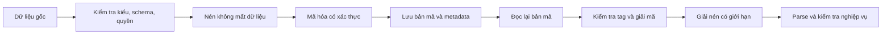

# Nén và mã hóa dữ liệu dưới góc độ chi phí truy cập

## 1. Vì sao nén và mã hóa là quyết định về đường truy cập dữ liệu?

Một ứng dụng Java có thể lưu đúng một bản ghi nhưng vẫn trở nên chậm hoặc khó vận hành nếu phải đọc quá nhiều byte, giải nén cả một khối lớn để lấy một trường nhỏ, hoặc phụ thuộc vào một dịch vụ khóa mã hóa đang không sẵn sàng. **Nén** và **mã hóa bảo mật** đều thay đổi cách dữ liệu được lưu và truy cập, nhưng có mục tiêu khác nhau:

- **Nén (compression):** biến dữ liệu thành biểu diễn thường chiếm ít byte hơn, dựa trên đặc tính dư thừa. Khi đọc cần giải nén. Nén không tạo ra tính bí mật.
- **Mã hóa bảo mật (encryption):** biến bản rõ thành bản mã bằng khóa và thuật toán để giới hạn ai có thể đọc. Khi truy cập cần giải mã bằng khóa hợp lệ; việc mã hóa không mặc nhiên làm dữ liệu nhỏ hơn.
- **Mã hóa ký tự/biểu diễn (encoding):** quy ước cách giá trị trở thành byte, như UTF-8, Base64 hay định dạng nhị phân. Encoding không phải encryption: bất kỳ người nào biết định dạng đều có thể giải mã về biểu diễn ban đầu.

Trong bài này, khi nói **mã hóa dữ liệu**, ta tập trung vào *encryption* nhằm bảo vệ tính bí mật và, khi dùng mã hóa có xác thực, tính toàn vẹn của bản ghi. Vẫn cần phân biệt nó với encoding vì ba thao tác thường nằm liên tiếp trong một pipeline persistence.

Bài thuộc chương **Biểu diễn dữ liệu** của module `DATA_PERSISTENCE_FUNDAMENTALS`. Người học sẽ đánh giá tác động của nén và mã hóa lên mô hình dữ liệu, schema, truy vấn/chỉ mục, ranh giới Java persistence, giao dịch, cô lập và đồng thời, lỗi kết nối, schema migration, bảo mật, sao lưu và hiệu năng.

### Tình huống xuyên suốt

Xét ứng dụng lưu đơn hàng và lịch sử xử lý hỗ trợ:

1. **Đơn hàng đang hoạt động:** thường đọc theo `order_id`, sửa trạng thái trong giao dịch; phải tìm kiếm nhanh và bảo vệ dữ liệu cá nhân.
2. **Biên bản hỗ trợ:** văn bản dài, ít sửa, đôi khi chỉ đọc một đoạn, có thể chứa thông tin nhạy cảm.
3. **Nhật ký sự kiện đã đóng:** đọc ít, thường xử lý theo lô để phân tích hoặc phục hồi.
4. **Bản sao lưu:** ít đọc nhưng phải khôi phục được khi có sự cố, kể cả sau khi đã thay phiên bản ứng dụng.

Dữ liệu có mức nhạy cảm và kiểu truy cập khác nhau. Vì vậy lựa chọn nén/mã hóa cũng có thể khác nhau giữa bảng nóng, đối tượng đính kèm, tệp lịch sử và bản backup.

## 2. Mô hình hóa chi phí truy cập trước khi chọn thuật toán

Nếu một lần đọc cần tải, giải mã, giải nén rồi phân tích bản ghi, có thể ước lượng:

\[
T_{\text{read}} \approx T_{\text{locate}} + T_{\text{transfer}} + T_{\text{key}} + T_{\text{decrypt}} + T_{\text{decompress}} + T_{\text{parse}} + T_{\text{wait}}
\]

Trong đó:

- `T_locate`: thời gian tìm vị trí bản ghi, chỉ mục, metadata hoặc danh mục archive.
- `T_transfer`: thời gian truyền byte từ đĩa, bộ nhớ đệm, object storage hay mạng.
- `T_key`: thời gian lấy/cấp quyền dùng khóa, nếu chưa có khóa hợp lệ trong bộ nhớ an toàn.
- `T_decrypt` và `T_decompress`: CPU và bộ nhớ phục vụ giải mã/giải nén.
- `T_parse`: chuyển byte thành cấu trúc Java hoặc các cột có kiểu.
- `T_wait`: chờ hàng đợi, pool, contention, retry hoặc phục hồi từ kho lạnh.

Đây là **mô hình khái niệm**, không phải công thức chính xác có thể cộng từng đồng hồ đo trong hệ thống thực: các bước có thể pipeline hoặc chồng lấp; cache, I/O và CPU có tương tác. Nhưng nó giúp tránh suy luận sai rằng “ít byte hơn luôn nhanh hơn”.

Chi phí tổng thể còn bao gồm:

\[
C_{\text{total}} =
C_{\text{storage}} + C_{\text{network}} + C_{\text{CPU/RAM}} +
C_{\text{operations}} + C_{\text{recovery}}
\]

Hai công thức nhấn mạnh khác biệt giữa **độ trễ của một yêu cầu** và **tổng chi phí vận hành**. Một thuật toán nén mạnh có thể làm tiền lưu trữ giảm nhưng thời gian giải nén/ghi tăng, khiến API giao dịch chậm hơn.

### Ví dụ số liệu giả định

Giả sử một tệp phân tích 100 MiB khi chưa nén, 25 MiB sau nén. Nếu đường truyền hiệu dụng giữ ở 20 MiB/s, chỉ riêng thời gian truyền lý tưởng có thể đổi từ khoảng 5 giây xuống 1,25 giây. Để biết thời gian đọc thực sự có giảm hay không, phải **cộng thêm** CPU giải nén, độ trễ tìm đối tượng, thao tác giải mã, số lần gọi từ xa và mức tranh chấp tài nguyên. Ví dụ này chỉ minh họa cách đặt giả thuyết, không phải benchmark thực tế.

## 3. Xác định đường truy cập: toàn bộ, ngẫu nhiên hay từng cột?

Cùng một dữ liệu có thể có chi phí rất khác tùy cách đọc:

| Mẫu truy cập | Ví dụ | Mối quan tâm khi nén/mã hóa |
| --- | --- | --- |
| Đọc một bản ghi theo ID | Mở đơn hàng `42` | Có giải mã/giải nén được riêng bản ghi, tránh đọc cả tập không? |
| Đọc một trường nhỏ | Chỉ lấy trạng thái đơn hàng | Bản ghi được mã hóa nguyên khối có buộc mở toàn bộ payload không? |
| Quét nhiều bản ghi | Tính doanh thu theo tháng | Nén theo cột/lô có giảm I/O đủ để bù CPU không? |
| Tìm theo khóa/chỉ mục | Tra người dùng theo email | Giá trị mã hóa có còn tìm kiếm chính xác được không? |
| Cập nhật từng hàng | Đổi `status` của đơn | Có phải nén/mã hóa rồi ghi lại nguyên khối không? |
| Đọc một đoạn của tệp lớn | Mở phút thứ 10 của biên bản | Có thể truy xuất độc lập từng chunk hay phải đọc từ đầu? |
| Sao lưu/khôi phục | Phục hồi toàn bộ bảng | Throughput, khóa, checksum và thời gian giải nén có đáp ứng RTO? |
| Tra dữ liệu lạnh | Mở lịch sử năm trước | Thời gian phục hồi object/chunk có vượt yêu cầu người dùng? |

**Đơn vị nén và đơn vị mã hóa** là hai quyết định quan trọng. Nếu 10.000 bản ghi nằm trong một khối nén duy nhất, việc lấy một bản ghi có thể yêu cầu giải nén nhiều dữ liệu. Nếu mỗi bản ghi hoặc chunk có khung độc lập và có chỉ mục vị trí, hệ thống có thể đọc ít byte hơn nhưng trả giá bằng metadata, header, nonce/tag và tỉ lệ nén thấp hơn.

## 4. Nén không mất dữ liệu và nén có mất dữ liệu

### 4.1. Lossless là yêu cầu thường gặp trong persistence nghiệp vụ

**Nén không mất dữ liệu (lossless)** cho phép giải nén lại chính xác byte đầu vào. Đây là yêu cầu tự nhiên đối với ID, số tiền, trạng thái đơn hàng, dữ liệu giao dịch, log dùng để đối soát và bản sao lưu.

Ví dụ JSON chứa nhiều tên trường lặp lại có thể nén tốt:

```json
{"orderId":42,"status":"PAID","currency":"VND","total":"125000.50"}
{"orderId":43,"status":"NEW","currency":"VND","total":"0.00"}
{"orderId":44,"status":"PAID","currency":"VND","total":"250000.00"}
```

Dữ liệu lặp `"status"`, `"currency"`, `"total"` và mã trạng thái có độ dư thừa; bộ nén có thể tận dụng. Với tệp JPEG/PNG/PDF đã nén sẵn hoặc dữ liệu ciphertext gần ngẫu nhiên, nén thêm thường ít lợi ích và đôi khi làm kích thước tăng.

### 4.2. Lossy chỉ phù hợp khi nghiệp vụ cho phép mất thông tin

**Nén có mất dữ liệu (lossy)** bỏ bớt thông tin để tiết kiệm byte, ví dụ ảnh/video/audio theo chất lượng được lựa chọn. Một ảnh xem trước có thể chấp nhận giảm chất lượng; hóa đơn cần đối soát, chữ ký số và giao dịch tài chính thì không.

Đừng áp dụng nén lossy cho cột tiền, mã nhận diện, audit hay dữ liệu bắt buộc phải khôi phục đúng từng byte. Với hình ảnh hoặc âm thanh, có thể lưu bản gốc và bản dẫn xuất nén lossy riêng, áp dụng retention và quyền truy cập cho cả hai.

### 4.3. Một số họ thuật toán nén lossless

| Giải pháp | Đặc tính thường thấy | Nên kiểm tra trong workload |
| --- | --- | --- |
| GZIP/DEFLATE | Phổ biến, hỗ trợ rộng, phù hợp truyền tệp và dữ liệu trao đổi | Mức nén, CPU, khả năng đọc từng phần |
| Zstandard (Zstd) | Có nhiều mức nén, thường cân bằng tốt giữa tốc độ và tỷ lệ | Mức nén, dictionary, phiên bản thư viện |
| LZ4 | Ưu tiên giải nén rất nhanh, thường hy sinh phần tỷ lệ nén | Số byte tăng thêm, CPU và throughput |
| Snappy | Hướng đến tốc độ cao, dùng trong một số hệ thống dữ liệu | Khả năng tương thích, chi phí lưu |
| Brotli | Có thể phù hợp với nội dung web/văn bản trong một số cấu hình | CPU nén, lợi ích kích thước, client hỗ trợ |
| Dictionary/RLE/delta/bit packing | Mã hóa theo đặc trưng cột hoặc chuỗi giá trị | Cardinality, phân bố dữ liệu, chi phí đọc cột |

Các đặc tính trên là **xu hướng thường gặp**, không phải thứ hạng cố định. Không thể nói thuật toán A luôn nhanh hơn B mà không cho biết mức nén, kích thước khối, dữ liệu, CPU và thư viện.

## 5. Chọn kích thước khối nén và khả năng đọc ngẫu nhiên

Giả sử 1 GiB log được chia thành những khối độc lập:

- **Một khối lớn:** ít overhead metadata, có thể tận dụng lặp lại xa hơn, nhưng một lần tìm sự kiện có thể phải đọc/giải nén quá nhiều.
- **Nhiều khối nhỏ:** cho phép đọc hoặc thử lại một vùng nhỏ, giảm bộ nhớ đỉnh, nhưng mỗi khối có header và trạng thái bộ nén riêng; tỉ lệ nén có thể kém hơn.
- **Các khối theo thời gian/khóa:** hỗ trợ bỏ qua khối khi truy vấn có khoảng thời gian hoặc định danh cụ thể.

```text
Tệp lớn:
+---------------------------------------------------------+
| Blob nén duy nhất: muốn lấy record #9000 có thể phải    |
| đọc/giải nén một vùng rất lớn hoặc cần index đặc thù.   |
+---------------------------------------------------------+

Tệp chia chunk:
+----------+----------+----------+----------+----------+
| chunk 1  | chunk 2  | chunk 3  | chunk 4  | chunk 5  |
+----------+----------+----------+----------+----------+
                ^ metadata chỉ ra chunk chứa record cần đọc
```

Cần có **chỉ mục vùng**: ví dụ `record_id → chunk_id, offset, length` hoặc `time_range → object_key`. Đối với object storage hỗ trợ byte range, việc lấy một vùng byte có thể giảm lượng dữ liệu truyền, nhưng chỉ khi chunk có thể giải nén và giải mã độc lập; không thể đọc giữa một luồng GZIP liên tục mà không có checkpoint hoặc cấu trúc phù hợp.

**Quy tắc thực hành:** chọn kích thước block bằng phép đo cùng tỷ lệ **đọc một bản ghi / đọc hàng loạt**, không chọn một kích thước chung từ cảm tính. Đồng thời đo bộ nhớ đỉnh, hiệu quả cache, số request và chi phí mã hóa mỗi block.

## 6. Mã hóa bảo mật ở những tầng khác nhau

### 6.1. Mã hóa khi truyền và mã hóa khi lưu

| Tầng | Bảo vệ chính | Giới hạn cần hiểu |
| --- | --- | --- |
| TLS giữa Java và DB/dịch vụ | Dữ liệu khi truyền trên đường mạng | Không tự bảo vệ bản rõ trên ứng dụng hoặc trong DB |
| Mã hóa đĩa/volume | Byte trên thiết bị lưu trữ | Khi volume đã mở, ứng dụng được cấp quyền có thể đọc như thường |
| TDE/mã hóa ở tầng DB | File dữ liệu, một số thành phần lưu trữ/backup theo cấu hình engine | DB thường nhìn thấy bản rõ để lọc, join và truy vấn |
| Mã hóa phía ứng dụng ở mức trường | Hạn chế phạm vi có thể xem bản rõ nếu DB bị đọc trái phép | DB khó tìm kiếm/sắp xếp giá trị; phải quản lý khóa và metadata |
| Mã hóa ở tầng object storage | Bảo vệ đối tượng lưu trữ theo chính sách nhà cung cấp/cấu hình | Quyền giải mã, key policy, tệp xuất và cache vẫn cần kiểm soát |

Các tầng có thể bổ sung cho nhau. Ví dụ TLS bảo vệ byte trên đường truyền, TDE bảo vệ file DB ở trạng thái lưu trữ và mã hóa ứng dụng bảo vệ một trường cực kỳ nhạy cảm. Không nên giả định bật một cờ “encrypted” là đủ cho mọi đe dọa.

### 6.2. Mã hóa có xác thực (AEAD)

Với payload do ứng dụng quản lý, nên dùng cơ chế mã hóa có xác thực như **AES-GCM** theo cấu hình và thư viện đã được kiểm chứng. AEAD bảo vệ tính bí mật và phát hiện sửa đổi trái phép đối với ciphertext cùng dữ liệu metadata đã được đưa vào xác thực.

Một bản ghi mã hóa thường cần:

```text
+----------+---------+--------+--------+------------------+-----------+
| magic    | version | key ID | nonce  | ciphertext       | auth tag  |
+----------+---------+--------+--------+------------------+-----------+
       \__________________ authenticated metadata _______________/
```

- **Key ID:** chỉ cách chọn khóa; không chứa khóa bí mật.
- **Nonce/IV:** giá trị dùng cho một lần mã hóa. Với AES-GCM, **không được tái sử dụng nonce với cùng khóa**.
- **Ciphertext:** dữ liệu đã được mã hóa, thường bao gồm dữ liệu nén trước đó nếu chính sách cho phép.
- **Authentication tag:** giúp phát hiện sai khóa, sửa đổi ciphertext hoặc metadata được xác thực.
- **Version:** cho phép thay đổi định dạng và thuật toán có kiểm soát.

Đối với AES-GCM, nonce ngẫu nhiên 96 bit từ bộ sinh ngẫu nhiên mật mã là cách phổ biến khi quản lý đúng số lần mã hóa và vòng đời khóa; hệ thống quy mô rất lớn phải đánh giá rủi ro trùng nonce, giới hạn sử dụng khóa và có chiến lược cấp nonce bảo đảm duy nhất phù hợp. Nếu dùng một khóa để mã hóa nhiều payload, phải đảm bảo cơ chế cấp nonce được thiết kế cẩn thận.

### 6.3. Quản lý khóa quan trọng hơn việc tự chọn thuật toán

Một dữ liệu được mã hóa vẫn có thể mất khả năng phục hồi nếu khóa bị mất. Cần thiết kế:

- **Key management:** ai được sử dụng khóa, lưu khóa ở đâu, ghi nhận truy cập, quyền giải mã độc lập với quyền đọc bản mã.
- **Envelope encryption:** một khóa dữ liệu (DEK) mã hóa payload, còn một khóa quản lý (KEK) ở KMS/HSM bảo vệ DEK. Metadata lưu phiên bản/key ID, không lưu khóa gốc dạng bản rõ bên cạnh ciphertext.
- **Rotation:** khóa mới có thể dùng cho dữ liệu mới; dữ liệu cũ phải tiếp tục có khả năng giải mã hoặc được mã hóa lại theo kế hoạch.
- **Revocation:** khi thu hồi quyền, cần xét khóa đang cache, dữ liệu đã được giải mã và các bản sao.
- **Backup/restore:** bản sao lưu dữ liệu phải có quy trình phục hồi khóa an toàn, phân tách quyền và diễn tập giải mã.
- **Audit:** theo dõi thao tác sử dụng khóa và các lỗi giải mã, tránh ghi plaintext hoặc key material vào log.

**Mã hóa không thay cho phân quyền.** Nếu ứng dụng đã giải mã xong và gửi nội dung cho người dùng không có quyền, dữ liệu vẫn bị lộ.

## 7. Nên nén trước hay mã hóa trước?

Thông thường với dữ liệu được phép nén an toàn, đường ghi là:



Nén ciphertext thường không hiệu quả vì ciphertext đạt độ ngẫu nhiên cao theo thiết kế. Vì vậy, nếu nén và mã hóa cùng một payload, nén trước rồi mã hóa là thứ tự phổ biến.

**Nhưng có ngoại lệ bảo mật rất quan trọng:** khi dữ liệu bí mật và nội dung do kẻ tấn công kiểm soát được nén **cùng một ngữ cảnh**, kích thước bản mã sau nén có thể tiết lộ thông tin qua số lượng byte, nhất là nếu đối thủ có thể gửi nhiều yêu cầu và quan sát độ dài. Đây là họ tấn công kênh phụ dựa vào nén, ví dụ bài toán tương tự CRIME/BREACH trong những bối cảnh thích hợp.

Để giảm rủi ro:

1. Tránh nén kết hợp secret với dữ liệu do người không tin cậy điều khiển khi họ quan sát được độ dài đầu ra.
2. Tách secret thành trường/đối tượng mã hóa độc lập, áp dụng chính sách nén riêng.
3. Đừng coi padding ngẫu nhiên là giải pháp đầy đủ trong mọi mô hình tấn công; phải đánh giá kênh đo độ dài cụ thể.
4. Phân biệt payload cố định, lưu trữ nội bộ với phản hồi tương tác có input do đối thủ chọn.
5. Xác định rõ ai quan sát được kích thước object, tần suất truy cập và metadata; mã hóa không che giấu mặc định các tín hiệu này.

Với dữ liệu cực kỳ nhạy cảm hoặc bối cảnh có đầu vào do đối thủ kiểm soát, **không nén** có thể là lựa chọn tốt hơn về bảo mật dù tốn thêm byte.

## 8. Chi phí mã hóa đối với truy vấn và chỉ mục

### 8.1. Mã hóa toàn bộ tầng lưu trữ khác mã hóa trường

Nếu DB sử dụng TDE, DB engine thường giải mã dữ liệu trong phạm vi hoạt động của nó và vẫn có thể dùng index, join, filter trên giá trị bản rõ. Người vận hành hạ tầng không nhất thiết nhìn được file DB nếu thiếu khóa, nhưng người có quyền truy vấn DB có thể vẫn truy cập giá trị.

Nếu ứng dụng tự mã hóa cột `customer_email` thành ciphertext ngẫu nhiên trước khi gửi SQL, DB không thể áp dụng trực tiếp:

```sql
SELECT id FROM customers WHERE customer_email = 'a@example.com';
```

vì trong cột chỉ còn ciphertext. Mã hóa AEAD với nonce ngẫu nhiên tạo ciphertext khác nhau cho cùng bản rõ, nên so sánh ciphertext để tìm bằng nhau **không hoạt động** như truy vấn trên bản rõ.

### 8.2. Các lựa chọn khi cần tìm kiếm

| Nhu cầu | Hướng tiếp cận | Đánh đổi/rủi ro |
| --- | --- | --- |
| Không cần tìm theo trường nhạy cảm | Mã hóa trường bằng AEAD ngẫu nhiên | Bảo mật dễ phân tích hơn, nhưng không thể tìm trực tiếp |
| Tìm chính xác theo giá trị chuẩn hóa | Lưu một giá trị lập chỉ mục riêng được bảo vệ bằng HMAC keyed (*blind index*) | Lộ mẫu bằng nhau và tần suất; phải quản lý khóa, xử lý chuẩn hóa và va chạm |
| Tìm qua hệ thống được tin cậy | Truy vấn trên tầng có quyền giải mã và kiểm soát truy cập | Mở rộng phạm vi tin cậy, cần audit và giới hạn quyền |
| Tìm tiền tố, khoảng giá trị, sắp xếp | Thiết kế lại yêu cầu/kiến trúc hoặc dịch vụ chuyên biệt được thẩm định | Cơ chế mã hóa hỗ trợ truy vấn thường rò rỉ quan hệ và phức tạp |
| Phân tích tập dữ liệu lớn | Dùng projection đã tối thiểu hóa trường nhạy cảm, có quyền truy cập riêng | Quản trị bản sao, retention và rủi ro tái nhận diện |

Một blind index dạng `HMAC(k, normalize(value))` có thể hỗ trợ tìm bằng nhau nếu được thiết kế đúng; nó **không giấu được việc hai bản ghi có cùng giá trị**, và không phù hợp để coi là giải pháp tổng quát cho dữ liệu miền nhỏ như “giới tính”, trạng thái có vài giá trị, hoặc những trường có thể đoán. Nó cũng cần chiến lược thay khóa, phạm vi tenant và chính sách truy vấn cẩn thận.

Các lựa chọn như deterministic encryption hoặc order-preserving encryption có thể tiết lộ tính bằng nhau, tần suất hoặc thứ tự; không nên dùng chỉ để giữ nguyên câu SQL cũ mà bỏ qua threat model.

### 8.3. Mã hóa ảnh hưởng cập nhật và đồng thời

Nếu ứng dụng mã hóa nguyên cả hồ sơ người dùng thành một blob, sửa một trường nhỏ thường đòi:

1. Đọc ciphertext blob.
2. Giải mã, thay đổi trường.
3. Nén/mã hóa lại cả blob với nonce mới.
4. Ghi phiên bản mới có điều kiện.

Hai request cùng sửa hai trường khác nhau vẫn có thể tranh cùng một blob. Dùng `version` và `UPDATE ... WHERE version = ?` hoặc giao dịch/khóa tương ứng để tránh ghi đè. Nếu chỉ mã hóa riêng các trường nhạy cảm, có thể giảm phần dữ liệu phải mã hóa lại nhưng tăng số cột và metadata cần quản lý.

Với AEAD, **không chỉnh sửa trực tiếp vài byte bên trong ciphertext** rồi giữ tag cũ: tag sẽ không còn hợp lệ. Mỗi lần mã hóa lại phải dùng nonce mới không trùng với nonce từng dùng cùng khóa.

## 9. Compression và encryption trong hệ quản trị dữ liệu

### 9.1. Cơ sở dữ liệu quan hệ

Nhiều DB có cách nén trang, hàng, cột hoặc giá trị lớn riêng. Cần hiểu engine làm gì thay vì tự nén tất cả trường thành byte:

- Với một cột `TEXT` dài, cách nén ở tầng DB có thể giúp giảm lưu trữ mà vẫn giữ ngữ nghĩa truy vấn/cấu trúc cột.
- Nếu ứng dụng nén cả hàng thành `BYTEA`/`BLOB`, DB mất khả năng tối ưu nhiều điều kiện lọc và chỉ mục cột bình thường.
- Dữ liệu mã hóa ứng dụng thường trông có độ ngẫu nhiên cao; các cơ chế nén tự động của DB có thể không đem lại nhiều lợi ích trên phần ciphertext đó.
- Các cơ chế nén/tối ưu của DB có thể tương tác với vacuum/compaction, redo/WAL, replication, backup và chi phí CPU.

Lược đồ minh họa: giữ trường phục vụ giao dịch ở cột có kiểu; trường nội dung lớn được chuyển sang đối tượng riêng:

```sql
CREATE TABLE orders (
    id           BIGINT PRIMARY KEY,
    customer_id  BIGINT NOT NULL,
    status       VARCHAR(20) NOT NULL
        CHECK (status IN ('NEW', 'PAID', 'CANCELLED')),
    total        NUMERIC(18, 2) NOT NULL CHECK (total >= 0),
    version      BIGINT NOT NULL DEFAULT 0,
    created_at   TIMESTAMPTZ NOT NULL DEFAULT CURRENT_TIMESTAMP
);

CREATE INDEX idx_orders_customer_created
ON orders (customer_id, created_at DESC);
```

Đừng nén/mã hóa mọi trường rồi lưu vào một blob duy nhất nếu nghiệp vụ cần tìm theo `customer_id`, lọc `status`, kiểm soát đồng thời theo `version` và tham gia transaction. Có thể mã hóa riêng một số trường nhạy cảm sau khi đánh giá quyền truy cập, còn những trường dùng cho quyết định nghiệp vụ được bảo vệ bằng TLS, phân quyền và cơ chế mã hóa DB/hạ tầng tương ứng.

### 9.2. Phân tích và lưu trữ theo cột

Định dạng như Parquet thường kết hợp layout theo cột với dictionary encoding, RLE, delta và bộ nén. Truy vấn chỉ đọc vài cột có thể bỏ qua những vùng không liên quan nhờ metadata và column pruning; lợi thế này phụ thuộc kích thước row group, phân vùng, sắp xếp dữ liệu và công cụ đọc.

Nếu mã hóa toàn bộ file, cần xét việc công cụ query có giải mã cả file trước khi sử dụng row group/metadata hay không; điều đó có thể mất ưu điểm truy cập chọn lọc. Các giải pháp mã hóa chuyên dụng theo module/cột hoặc mã hóa ở tầng object storage có đặc tính khác nhau, cần đo trong hệ công nghệ thực tế.

### 9.3. Kho lưu trữ lạnh

Dữ liệu lạnh thường đọc theo lô hoặc theo kỳ, nên một mức nén mạnh hơn có thể giảm dung lượng đáng kể. Nhưng:

- Có thể cần khôi phục object từ storage tier trước khi tải.
- Giải nén file rất lớn làm tăng thời gian phục hồi (RTO).
- Mất khóa hay phiên bản decoder khiến dữ liệu có thể không đọc được dù object còn nguyên.
- Nếu chỉ cần một bản ghi, thiếu index/chunk metadata có thể khiến toàn bộ archive phải được đọc.

Lưu manifest: object key, schema version, compression codec/level, encryption algorithm/key ID, byte size, checksum/kiểm tra toàn vẹn, khoảng ID/thời gian, retention và công cụ phục hồi. Thử khôi phục thực tế, không chỉ kiểm tra object tồn tại.

## 10. Thiết kế một record có nén và mã hóa

Một envelope hữu ích phải phân biệt **metadata cần để giải mã** với **dữ liệu cần giữ bí mật**.

```text
[magic][format_version][codec][encryption_suite][key_id]
[nonce][original_length][ciphertext + authentication_tag]
```

- Các trường header cần được parser đọc theo kích thước có giới hạn, tránh cấp phát theo giá trị không đáng tin.
- Các metadata ảnh hưởng đến ý nghĩa và giải mã nên được **xác thực** bằng AEAD AAD hoặc nằm trong phần được mã hóa.
- `original_length` giúp kiểm soát giải nén, nhưng không được tin chỉ vì nó nằm trong header; kiểm tra kích thước sau giải nén.
- Nếu lưu theo chunk, mỗi chunk cần nonce phù hợp và tag riêng; chỉ mục chunk/offset cũng cần bảo vệ khỏi bị tráo đổi.
- Nếu cần ngăn việc chuyển một ciphertext hợp lệ từ record A sang record B, hãy đưa `recordId`, `tenantId` hoặc ngữ cảnh liên quan vào AAD/metadata đã được xác thực, và kiểm tra khi đọc.
- Key ID có thể là metadata không bí mật, nhưng có thể tiết lộ cấu trúc hạ tầng/phiên bản; cân nhắc quản lý truy cập.

**Không dùng checksum thuần như CRC32 để thay tag xác thực.** CRC giúp phát hiện hỏng vô tình nhưng người có quyền sửa ciphertext có thể tính lại CRC. Nếu dùng AES-GCM đúng cách, việc xác minh tag là bước thiết yếu trước khi tin vào bản rõ.

## 11. Java 17: ví dụ nén GZIP rồi mã hóa AES-GCM

Ví dụ dưới đây minh họa một **payload nhỏ**, sử dụng thư viện chuẩn Java. Dữ liệu đầu vào được **nén GZIP → mã hóa AES-GCM**, metadata được đưa vào **AAD**, lúc đọc kiểm tra tag trước rồi mới giải nén với giới hạn dung lượng. Nó là ví dụ về framing và chi phí xử lý, không thay thế cho một giao thức production có key ID, chính sách rotation, kiểm soát nonce ở quy mô lớn và thiết kế chống kênh phụ.

Để dễ theo dõi, frame minh họa có:

```text
4 byte  magic "DPFC"
1 byte  version = 1
1 byte  suite = 1 (GZIP + AES-GCM)
12 byte nonce
4 byte  original length, big-endian
N byte  ciphertext, đã bao gồm 16 byte authentication tag
```

Giới hạn bản rõ là 1 MiB. Đầu vào là `byte[]` vì codec không quyết định văn bản được encoding theo charset nào. Ứng dụng phải chọn UTF-8 hay schema binary trước khi đưa byte vào codec.

```java
import java.io.ByteArrayInputStream;
import java.io.ByteArrayOutputStream;
import java.io.IOException;
import java.util.Arrays;
import java.util.zip.GZIPInputStream;
import java.util.zip.GZIPOutputStream;
import java.nio.ByteBuffer;
import java.security.GeneralSecurityException;
import java.security.SecureRandom;
import javax.crypto.Cipher;
import javax.crypto.SecretKey;
import javax.crypto.spec.GCMParameterSpec;

public final class SecureCompressedRecord {
    private static final int MAGIC = 0x44504643; // "DPFC"
    private static final byte VERSION = 1;
    private static final byte SUITE = 1; // GZIP + AES-GCM
    private static final int NONCE_BYTES = 12;
    private static final int TAG_BITS = 128;
    private static final int TAG_BYTES = TAG_BITS / 8;
    private static final int HEADER_BYTES = 4 + 1 + 1 + NONCE_BYTES + 4;
    private static final int MAX_PLAIN_BYTES = 1024 * 1024;
    private static final int MAX_CONTAINER_BYTES = MAX_PLAIN_BYTES + 65536;
    private static final SecureRandom RNG = new SecureRandom();

    private SecureCompressedRecord() {}

    public static byte[] encode(byte[] plain, SecretKey key)
            throws IOException, GeneralSecurityException {
        if (plain.length > MAX_PLAIN_BYTES) {
            throw new IOException("Bản rõ vượt giới hạn");
        }

        ByteArrayOutputStream compressedBuffer = new ByteArrayOutputStream();
        try (GZIPOutputStream gzip =
                new GZIPOutputStream(compressedBuffer)) {
            gzip.write(plain);
        }
        byte[] compressed = compressedBuffer.toByteArray();

        byte[] nonce = new byte[NONCE_BYTES];
        RNG.nextBytes(nonce); // Phải không trùng với nonce đã dùng cùng key.

        byte[] header = ByteBuffer.allocate(HEADER_BYTES)
                .putInt(MAGIC)
                .put(VERSION)
                .put(SUITE)
                .put(nonce)
                .putInt(plain.length)
                .array();

        Cipher cipher = Cipher.getInstance("AES/GCM/NoPadding");
        cipher.init(Cipher.ENCRYPT_MODE, key,
                new GCMParameterSpec(TAG_BITS, nonce));
        cipher.updateAAD(header);
        byte[] encrypted = cipher.doFinal(compressed);

        if (HEADER_BYTES + encrypted.length > MAX_CONTAINER_BYTES) {
            throw new IOException("Frame vượt giới hạn");
        }
        ByteArrayOutputStream result = new ByteArrayOutputStream();
        result.write(header);
        result.write(encrypted);
        return result.toByteArray();
    }

    public static byte[] decode(byte[] container, SecretKey key)
            throws IOException, GeneralSecurityException {
        if (container.length < HEADER_BYTES + TAG_BYTES
                || container.length > MAX_CONTAINER_BYTES) {
            throw new IOException("Kích thước frame không hợp lệ");
        }

        ByteBuffer buffer = ByteBuffer.wrap(container);
        if (buffer.getInt() != MAGIC
                || buffer.get() != VERSION
                || buffer.get() != SUITE) {
            throw new IOException("Sai định dạng hoặc phiên bản");
        }

        byte[] nonce = new byte[NONCE_BYTES];
        buffer.get(nonce);
        int expectedLength = buffer.getInt();
        if (expectedLength < 0 || expectedLength > MAX_PLAIN_BYTES) {
            throw new IOException("Độ dài bản rõ không hợp lệ");
        }

        byte[] encrypted = new byte[buffer.remaining()];
        buffer.get(encrypted);

        Cipher cipher = Cipher.getInstance("AES/GCM/NoPadding");
        cipher.init(Cipher.DECRYPT_MODE, key,
                new GCMParameterSpec(TAG_BITS, nonce));
        cipher.updateAAD(container, 0, HEADER_BYTES);
        byte[] compressed = cipher.doFinal(encrypted);
        // doFinal phải kiểm tra được authentication tag trước khi giải nén.

        ByteArrayOutputStream plain = new ByteArrayOutputStream();
        try (GZIPInputStream gzip = new GZIPInputStream(
                new ByteArrayInputStream(compressed))) {
            byte[] chunk = new byte[8192];
            int count;
            while ((count = gzip.read(chunk)) != -1) {
                if (count > MAX_PLAIN_BYTES - plain.size()) {
                    throw new IOException("Dữ liệu giải nén vượt giới hạn");
                }
                plain.write(chunk, 0, count);
            }
        }
        byte[] output = plain.toByteArray();
        if (output.length != expectedLength) {
            throw new IOException("Sai độ dài sau giải nén");
        }
        return output;
    }
}
```

### Dùng codec trong ví dụ nhỏ

```java
import java.nio.charset.StandardCharsets;
import java.security.SecureRandom;
import java.util.Arrays;
import javax.crypto.KeyGenerator;
import javax.crypto.SecretKey;

KeyGenerator generator = KeyGenerator.getInstance("AES");
generator.init(256, new SecureRandom());
SecretKey key = generator.generateKey(); // Demo: key trong RAM, không lưu vào file.

byte[] original = "Biên bản xử lý đơn hàng 42"
        .getBytes(StandardCharsets.UTF_8);

byte[] frame = SecureCompressedRecord.encode(original, key);
byte[] restored = SecureCompressedRecord.decode(frame, key);

if (!Arrays.equals(original, restored)) {
    throw new IllegalStateException("Dữ liệu không trùng khớp");
}
```

Các giới hạn cần hiểu trước khi mang ý tưởng vào production:

1. **Quản lý khóa:** ví dụ nhận `SecretKey` từ caller và không ghi khóa ra file. Thực tế cần key ID, KMS/HSM hoặc kho khóa phù hợp, phân quyền, rotation và quy trình phục hồi. Không tự hardcode khóa trong mã nguồn.
2. **Nonce:** ví dụ dùng nonce ngẫu nhiên cho mỗi lần mã hóa. Không tái sử dụng nonce với cùng key, kể cả khi mã hóa lại cùng bản rõ; đánh giá giới hạn sử dụng key nếu hệ thống phát sinh rất nhiều bản ghi.
3. **Kênh phụ do nén:** chỉ nén dữ liệu được phép theo threat model; không nén bí mật chung với input do đối thủ điều khiển nếu họ quan sát được độ dài.
4. **Bộ nhớ:** codec giữ dữ liệu trong RAM nhiều lần (`plain`, `compressed`, `encrypted`). Phù hợp payload nhỏ; file lớn cần thiết kế streaming và chunk AEAD độc lập với giới hạn/nonce cụ thể.
5. **Kiểm tra tag:** `cipher.doFinal` khi giải mã sẽ báo lỗi nếu tag sai. Không xử lý hay trả một phần plaintext trước khi xác thực.
6. **Giới hạn nén nở:** kiểm tra độ dài trước và trong lúc giải nén; header có xác thực không thay cho giới hạn bộ nhớ. Một tệp rất nhỏ có thể giải nén thành lượng dữ liệu rất lớn.
7. **Tính toàn vẹn theo ngữ cảnh:** header được xác thực; ví dụ chưa gắn `orderId`/`tenantId` vào AAD. Nếu dùng cho cột mã hóa của từng hàng, thêm định danh và kiểm tra ngữ cảnh để chống tráo ciphertext giữa các hàng.
8. **Thử nghiệm hiệu năng:** việc nén payload chỉ vài chục byte có thể **tăng kích thước** vì GZIP header, AEAD tag, nonce và metadata. Hãy đo trước khi bật cho mọi trường.

## 12. Chi phí của các ranh giới nén và mã hóa khác nhau

### 12.1. Mã hóa từng trường

Ưu điểm: chỉ giải mã trường cần đọc, có thể tách khóa theo nhóm nhạy cảm, giảm lộ thông tin khi DB bị truy cập trái phép.

Chi phí: mỗi trường cần nonce/tag/key metadata, truy vấn theo giá trị khó hơn, có thêm số lần xử lý mật mã và phức tạp rotation. Trường ngắn có thể tăng số byte đáng kể.

### 12.2. Mã hóa theo bản ghi

Ưu điểm: ít metadata hơn so với nhiều trường, có thể coi toàn bản ghi là một đơn vị xác thực và cập nhật.

Chi phí: chỉ cần một trường cũng phải giải mã cả record; cập nhật một trường phải mã hóa lại toàn khối; khó lập index trên các giá trị bên trong nếu DB không thấy bản rõ.

### 12.3. Mã hóa theo tệp/chunk

Ưu điểm: phù hợp archive và đối tượng lớn, có thể nén nhiều bản ghi và quản lý khóa theo object.

Chi phí: đọc một bản ghi có thể cần truy xuất cả chunk, khôi phục phải biết metadata/index, sửa dữ liệu có thể phải thay nhiều byte. Mỗi chunk cần nonce/tag riêng; một ciphertext GCM nguyên khối không hỗ trợ giải mã và xác thực ngẫu nhiên một đoạn giữa tệp theo cách tùy ý.

### 12.4. TDE và TLS

Ưu điểm: áp dụng tương đối trong suốt đối với truy vấn ứng dụng; thường bảo vệ dữ liệu ở tầng hạ tầng và đường truyền mà không làm mất khả năng đánh index theo bản rõ trong DB.

Giới hạn: DB/ứng dụng có quyền vẫn nhìn thấy dữ liệu; key/access policy và cấu hình backup phải được kiểm soát. Không nên tuyên bố TDE bảo vệ khỏi một tài khoản DB bị lộ quyền `SELECT`.

## 13. Giao dịch, đồng thời và độ tin cậy khi thay đổi biểu diễn

### 13.1. Ghi ciphertext không thay thế transaction

Giả sử khi xác nhận đơn hàng, ứng dụng phải cập nhật `orders.status` và tạo event outbox chứa dữ liệu dẫn xuất đã nén/mã hóa. Nếu cả hai nằm trong cùng DB và là một kết quả nghiệp vụ, hãy ghi trong **một transaction**:

```sql
BEGIN;

UPDATE orders
SET status = 'PAID',
    version = version + 1
WHERE id = :order_id
  AND status = 'NEW'
  AND version = :expected_version;

-- Ứng dụng chỉ tiếp tục khi có đúng một hàng được cập nhật.
INSERT INTO outbox_events (event_id, order_id, payload)
VALUES (:event_id, :order_id, :encrypted_compressed_payload);

COMMIT;
```

Tham số có dấu `:` là minh họa, dùng `PreparedStatement` hoặc thư viện tham số đặt tên phù hợp. Việc ghi event vào cùng DB giúp giao dịch không bị chia làm hai lần commit; worker có thể đọc outbox sau đó và gửi lên hệ thống khác, với ID để chống xử lý trùng.

Không gửi dữ liệu sang object storage rồi giả định rollback của DB tự xóa object; giao dịch JDBC chỉ bao trùm những hoạt động DB tham gia transaction đó.

### 13.2. Đồng thời và cập nhật lại ciphertext

Hai phiên bản Java cùng đọc blob phiên bản `7` có thể cùng cố thay đổi. Khi ghi lại ciphertext, dùng khóa lạc quan:

```sql
UPDATE secure_documents
SET encrypted_payload = :new_payload,
    version = version + 1
WHERE id = :id
  AND version = :expected_version;
```

Nếu `0 hàng` bị tác động, phải giải thích là không tìm thấy hoặc xung đột; không tự ghi đè bản mã mới hơn. Mỗi lần mã hóa lại phải có nonce mới, kể cả khi hai lần cập nhật cùng dữ liệu. Phần encryption không ngăn lost update ở DB; cần cơ chế đồng thời riêng.

### 13.3. Khi kết quả commit hoặc upload chưa rõ

Các lỗi cần phân biệt:

| Tình huống | Rủi ro | Cách xử lý |
| --- | --- | --- |
| Hết kết nối khi đang lấy khóa | Không tạo được payload bảo mật hoặc yêu cầu bị chậm | Timeout, phân loại lỗi, không ghi bản rõ thay thế |
| Sai khóa hoặc tag xác thực không khớp | Dữ liệu hỏng/bị sửa, khóa không đúng hoặc metadata sai | Dừng xử lý, ghi cảnh báo an toàn, điều tra key ID/backup |
| GZIP hỏng sau khi tag đã hợp lệ | Pipeline/format lỗi hoặc dữ liệu ban đầu không đúng quy ước | Từ chối bản ghi, không dùng dữ liệu một phần |
| Timeout đúng lúc DB `COMMIT` | Không biết giao dịch đã commit chưa | Đối chiếu theo request ID/transaction ID trước khi retry |
| Upload object thành công nhưng phản hồi mất | Có thể tạo bản trùng hoặc metadata lệch | Khóa object ổn định, checksum, tra trạng thái và idempotency |
| Worker xử lý lại một event | Có thể tạo tác dụng phụ hai lần | Event ID, consumer idempotent và checkpoint |
| Mất khóa của bản backup | Không thể giải mã dữ liệu để phục hồi | Quy trình lưu/khôi phục khóa tách biệt, diễn tập restore |

Nếu dịch vụ khóa tạm ngừng, **không fallback ghi plaintext** vào kho được thiết kế để chỉ giữ ciphertext. Việc chọn tạm dừng ghi hoặc chuyển sang hàng đợi an toàn là quyết định dựa trên yêu cầu nhất quán và bảo mật.

## 14. Compression và encryption khi tiến hóa schema

Dữ liệu lâu dài có thể tồn tại qua nhiều phiên bản:

```text
2026: JSON v1 -> GZIP -> AES-GCM key A
2027: JSON v2 -> Zstd -> AES-GCM key B
2028: Reader phải có khả năng đọc cả v1 và v2, hoặc có migration.
```

Một bản lưu cần metadata xác định:

- `schemaVersion` của payload (ví dụ JSON v1/v2, Protobuf schema ID).
- `compressionCodec` và nếu cần `compressionLevel`, phiên bản/dictionary ID.
- `encryptionSuite`, `keyId`, nonce/tag và quy tắc AAD.
- Định dạng framing và giới hạn an toàn khi decode.
- Thời gian, nguồn dữ liệu, phiên bản dữ liệu và retention.
- Cách kiểm tra toàn vẹn, phục hồi và xử lý bản cũ.

**Thứ tự migration:** ưu tiên triển khai reader hiểu cả cũ và mới; sau đó writer bắt đầu ghi định dạng mới; kiểm tra lỗi decode; backfill/mã hóa lại dữ liệu cũ nếu cần; chỉ bỏ hỗ trợ cũ khi đã kiểm kê cả backup/archive và message có thể phát lại.

Đổi thuật toán hoặc key ID không đồng nghĩa phải đổi schema nghiệp vụ, nhưng phải thay version của envelope hoặc metadata cần thiết để decoder không đoán sai. Không “thử từng thuật toán cho đến khi ra dữ liệu có vẻ hợp lệ”; lựa chọn phải theo hợp đồng và kiểm tra tag/schema.

### Rotation và chi phí viết lại

Nếu dùng envelope encryption, có trường hợp chỉ cần **bọc lại DEK** bằng KEK mới mà không phải giải mã/mã hóa lại toàn bộ payload. Nếu cần đổi DEK hoặc thuật toán cho dữ liệu, phải mã hóa lại theo kế hoạch, gây I/O, CPU, lưu trữ tạm và nguy cơ tranh chấp với cập nhật hiện hành. Với dữ liệu lớn, cần lô nhỏ, checkpoint, đo tiến độ và hỗ trợ đọc cả hai phiên bản trong giai đoạn chuyển đổi.

## 15. Sao lưu, phục hồi và lưu trữ lạnh

Một bản sao lưu mã hóa thành công chỉ có giá trị khi:

1. File/đối tượng còn nguyên, kiểm tra được tính toàn vẹn.
2. Có đúng key hoặc khả năng dùng key hợp lệ trong môi trường phục hồi.
3. Còn decoder hỗ trợ schema, codec nén và thuật toán mã hóa đã sử dụng.
4. Có manifest để liên kết các đối tượng, phiên bản, thời gian và danh tính.
5. Thời gian khôi phục thực tế đáp ứng **RTO**, dữ liệu có thể mất khi sự cố nằm trong **RPO** đã xác định.

Nên thử khôi phục một mẫu dữ liệu nóng và lạnh, giải mã, giải nén, parse rồi **đối chiếu giá trị nghiệp vụ**. Chỉ xác nhận số byte tải về hoặc checksum file là chưa đủ để chứng minh có thể dùng dữ liệu.

Nén có thể giảm chi phí lưu trữ và truyền backup, nhưng giải nén/giải mã có thể kéo dài restore. Nếu lưu cả manifest và ciphertext, phải có snapshot/phiên bản tương ứng. Nếu chỉ khôi phục DB metadata mà không có object hoặc khóa, dữ liệu thực tế không truy cập được.

### Chính sách xóa dữ liệu

Dữ liệu đã bị xóa logic vẫn còn trong DB và có thể còn trong bản sao lưu. Dữ liệu đã xóa vật lý khỏi DB nóng có thể còn trong backup hoặc archive theo retention. Mã hóa có thể hỗ trợ một số chiến lược hủy quyền truy cập bằng cách hủy khóa (**crypto-erasure**), nhưng chỉ hiệu quả khi khóa được quản lý/tách biệt phù hợp và không còn bản sao khóa hoặc bản rõ tồn tại ngoài phạm vi kiểm soát. Không mặc định rằng hủy một khóa đã xóa sạch mọi bản sao dữ liệu.

## 16. Quy trình chọn giải pháp dựa trên workload và threat model

Đối với mỗi loại dữ liệu, hãy đi theo thứ tự:

1. **Mô tả dữ liệu:** kích thước, tỉ lệ lặp, kiểu/độ chính xác, mức nhạy cảm, tuổi thọ, schema và số bản ghi.
2. **Mô tả truy cập:** tỷ lệ đọc/ghi, tìm theo ID, tìm theo trường, đọc chunk, quét lô, cập nhật nhỏ, thời gian phục hồi.
3. **Viết yêu cầu bảo mật:** ai được đọc, mối đe dọa nào cần ngăn, có thể lộ metadata/kích thước/tần suất không, ai quản lý khóa?
4. **Quy định tính đúng đắn:** cần byte-for-byte lossless ở đâu, cần AEAD/integrity ở đâu, transaction và kiểm soát đồng thời đặt tại đâu?
5. **Chọn ranh giới:** nén và mã hóa ở DB, ứng dụng, object/chunk hay hạ tầng; metadata/index được bảo vệ thế nào?
6. **Xác định lỗi:** mất khóa, mất kết nối, decode lỗi, dữ liệu nở quá kích thước, retry và kết quả commit chưa rõ.
7. **Đo trên dữ liệu thật đã ẩn danh hoặc mẫu tương đương:** kích thước, throughput, p95/p99, CPU/RAM, I/O, cache hit, storage/network bill.
8. **Diễn tập:** đọc bản cũ sau migration, rotate khóa, phục hồi backup, xử lý node/chunk hỏng và xóa theo retention.

### Ma trận quyết định minh họa

| Loại dữ liệu | Phương án khởi đầu hợp lý | Điểm cần xác minh |
| --- | --- | --- |
| Hàng đơn hàng đang giao dịch | Cột DB có kiểu và chỉ mục; TLS, quyền tối thiểu, cơ chế mã hóa storage | Không phá truy vấn, giao dịch, độ trễ p99 |
| Trường bí mật ít truy vấn | AEAD phía ứng dụng theo trường, KMS và key ID | Quyền giải mã, không lộ qua log/cache, khả năng rotation |
| Biên bản hỗ trợ dài | Nén lossless nếu đem lại lợi ích; mã hóa theo object/chunk | Đọc từng đoạn, không nén secret với input có thể bị lợi dụng |
| Log phân tích theo lô | Định dạng có schema, nén theo cột/khối, mã hóa ở tầng phù hợp | Column pruning, hiệu quả nén, truy vấn theo thời gian |
| Backup định kỳ | Nén theo chính sách, mã hóa có kiểm soát khóa và manifest | RPO/RTO, khả năng đọc bản cũ, phục hồi cả key |
| Archive lạnh | Chunk/partition hợp lý, metadata index, nén và mã hóa có version | Chi phí truy xuất, thời gian restore, retention |

Không cần bật cả nén và mã hóa ứng dụng cho mọi trường theo cùng cấu hình. Mức bảo vệ và ranh giới xử lý phải đi theo nhu cầu thực tế của dữ liệu.

## 17. Bài thực hành tổng hợp

### Phần A — Đo chi phí đọc/ghi

Tạo ba tập dữ liệu không chứa thông tin cá nhân thật:

- `dataset-a`: JSON có nhiều tên trường lặp.
- `dataset-b`: tệp nhị phân đã nén hoặc byte gần ngẫu nhiên.
- `dataset-c`: bản ghi ngắn dưới 100 byte.

Với mỗi tập:

1. Đo byte trước/sau GZIP và nếu có thư viện phù hợp, Zstd/LZ4 ở các mức nén khác nhau.
2. Đo thời gian encode/decode riêng, sau đó thời gian đọc toàn tuyến từ nguồn đến giá trị Java.
3. Đo CPU, bộ nhớ đỉnh, throughput và p95/p99 khi có nhiều yêu cầu đồng thời.
4. So sánh kích thước sau khi bổ sung header, nonce, tag và metadata.
5. Thử đọc một bản ghi trong file 100 MiB ở dạng nguyên khối và dạng chunk có index.
6. Ghi lại trường hợp nén không giúp giảm byte hoặc khiến endpoint chậm.

Mẫu bảng kết quả:

| Kịch bản | Byte gốc | Byte nén | Byte mã hóa cuối | p95 đọc | CPU/req | Ghi chú |
| --- | ---: | ---: | ---: | ---: | ---: | --- |
| JSON lặp | Đo | Đo | Đo | Đo | Đo | Có lợi cho scan? |
| Dữ liệu đã nén | Đo | Đo | Đo | Đo | Đo | Có nén tăng kích thước? |
| Record rất ngắn | Đo | Đo | Đo | Đo | Đo | Header/tag chiếm tỷ lệ bao nhiêu? |
| Archive có chunk index | Đo | Đo | Đo | Đo | Đo | Đọc một phần so với toàn bộ |

Không điền số đo giả. Kết quả cần mô tả môi trường, cấu hình nén, kích thước mẫu và số lượt thử để tái hiện được.

### Phần B — Kiểm tra tính đúng đắn và bảo mật

1. Mã hóa một payload nhỏ bằng `SecureCompressedRecord` và xác nhận round-trip byte-for-byte.
2. Thay một byte ciphertext hoặc header AAD: giải mã phải thất bại.
3. Thử dùng khóa khác: không được trả plaintext.
4. Thử container bị cắt cụt và `original_length` vượt giới hạn: phải từ chối trước khi cấp phát/giải nén vượt mức.
5. Thử một payload nén nở rất mạnh: quá giới hạn phải bị từ chối dù byte lưu nhỏ.
6. Tạo hai lần mã hóa cùng một bản rõ bằng cùng key: quan sát nonce khác và ciphertext khác; kiểm tra không tái sử dụng nonce.
7. Xác định xem kích thước bản mã có tiết lộ thông tin nào trong threat model được đặt ra; thử phương án tách dữ liệu bí mật khỏi input do người khác điều khiển.
8. Trình bày cách lưu và phục hồi key ID/DEK/KEK trong môi trường thử nghiệm mà không ghi khóa vào repository.

### Phần C — Tích hợp persistence và sự cố

1. Lưu bản ghi nghiệp vụ và outbox trong cùng transaction DB, payload outbox dùng envelope có version.
2. Giả lập lỗi ở giữa hai bước ghi và kiểm tra rollback.
3. Thử hai yêu cầu cập nhật cùng `version`; xác nhận chỉ một cập nhật thắng.
4. Giả lập mạng lỗi khi phản hồi commit chưa đến; tra trạng thái theo request ID trước khi thử lại.
5. Tạo hai bản schema v1/v2 với codec và key ID khác nhau; reader mới phải đọc được cả hai hoặc có migration rõ ràng.
6. Sao lưu DB và archive thử nghiệm, khôi phục sang môi trường mới có quyền dùng khóa hợp lệ; giải mã/giải nén rồi đối chiếu dữ liệu.
7. Mô phỏng KMS không sẵn sàng. Ứng dụng phải trả lỗi có kiểm soát hoặc chờ theo chính sách, không lặng lẽ lưu plaintext.

### Câu hỏi tự đánh giá

1. Nén, encoding và encryption khác nhau ở mục tiêu và chi phí nào?
2. Tại sao tỉ lệ nén cao không bảo đảm một yêu cầu đọc đơn lẻ nhanh hơn?
3. Điều gì xảy ra khi một bản ghi nhỏ được nén và gắn header, nonce, authentication tag?
4. Khi nào nên chọn chunk nhỏ và khi nào chọn khối lớn?
5. Vì sao cùng một ciphertext AEAD không thể tùy tiện lấy vài byte ở giữa rồi giải mã như một bản ghi độc lập?
6. Với mã hóa trường ngẫu nhiên, tại sao DB không thể tìm email bằng phép so sánh plaintext thông thường?
7. TDE, TLS và mã hóa phía ứng dụng bảo vệ những ranh giới khác nhau như thế nào?
8. Nén trước khi mã hóa có thể gây rò rỉ thông tin qua tín hiệu nào?
9. Vì sao AES-GCM cần nonce riêng cho mỗi lần mã hóa với cùng khóa và tag phải được kiểm tra?
10. Nếu chỉ còn backup ciphertext nhưng mất khóa hoặc decoder cũ, dữ liệu có thực sự phục hồi được không?
11. Transaction DB, AEAD và checksum đang giải quyết ba nhóm vấn đề gì?
12. Những phép đo nào chứng minh lựa chọn nén/mã hóa đã phù hợp với SLA và chi phí vận hành?

Khi thiết kế persistence, **đơn vị truy cập, mức bảo vệ và thời gian phục hồi** cần được cân nhắc cùng nhau. Nén có thể đổi CPU lấy ít byte I/O; mã hóa bảo vệ dữ liệu nhưng thêm công việc mật mã và quản lý khóa; cách nhóm bản ghi quyết định liệu truy cập một trường có phải đọc cả khối hay không. Phương án tốt là phương án giữ đúng bất biến nghiệp vụ, đáp ứng quyền truy cập và giới hạn bảo mật, đo được độ trễ/chi phí, đồng thời vẫn giải mã và khôi phục được dữ liệu sau lỗi hoặc thay đổi schema.
