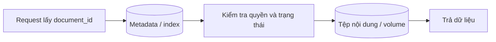
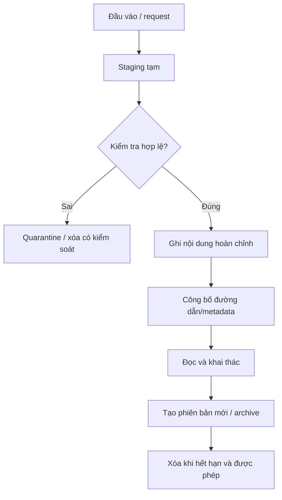

# Lưu trữ bằng tệp và thư mục

Một ứng dụng Java có thể lưu dữ liệu bền vững mà không cần bắt đầu bằng cơ sở dữ liệu: ghi tệp cấu hình, tài liệu, ảnh, dữ liệu import, bản xuất CSV hoặc trạng thái công việc vào hệ thống tệp. Cách làm này dễ hiểu, có sẵn trong hệ điều hành và phù hợp với nhiều loại dữ liệu. Tuy nhiên, khi dữ liệu tăng, cần tìm kiếm theo nhiều thuộc tính, có nhiều người ghi đồng thời hoặc phải cập nhật nhất quán nhiều đối tượng, mô hình tệp và thư mục bộc lộ các giới hạn đáng kể.

Bài học thuộc chương **Mô hình lưu trữ** trong module **DATA_PERSISTENCE_FUNDAMENTALS**. Mục tiêu là hiểu tệp và thư mục như một mô hình persistence: dữ liệu nằm ở đâu, được định danh và truy xuất thế nào, điều gì xảy ra khi ghi hoặc khôi phục thất bại, và ứng dụng Java phải chịu trách nhiệm gì về lược đồ, đồng thời, bảo mật, sao lưu và hiệu năng.

## 1. Tệp và thư mục là một mô hình lưu trữ

**Tệp (file)** là một đối tượng lưu trữ có nội dung byte và các thuộc tính do hệ thống tệp quản lý. **Thư mục (directory)** tổ chức tên và liên kết đến các đối tượng trong một cây đường dẫn. Ứng dụng thao tác qua API của hệ điều hành hoặc các lớp Java như `Path`, `Files` và `FileChannel`.

Ví dụ một ứng dụng quản lý chứng từ:

```text
app-data/
├── documents/
│   ├── 2026/
│   │   └── 11/
│   │       ├── 9b32a27c-...pdf
│   │       └── bf91d531-...pdf
├── imports/
│   ├── pending/
│   ├── completed/
│   └── failed/
├── exports/
│   └── 2026-11-21/
└── work/
    └── temporary/
```

Trong cây này, tên tệp và vị trí thư mục đã mang một phần **ý nghĩa truy xuất**: dữ liệu thuộc loại nào, được tạo trong kỳ nào hoặc đang ở giai đoạn xử lý nào. Nhưng hệ thống tệp không tự hiểu khái niệm “chứng từ hợp lệ”, “đã thanh toán” hay “người này được xem tài liệu”. Ứng dụng phải triển khai những quy tắc đó.

### Hệ thống tệp không đồng nghĩa với một ổ đĩa đơn lẻ

Cùng API đọc/ghi có thể trỏ đến các môi trường rất khác:

- Ổ đĩa cục bộ (SSD/HDD) trên một máy.
- Volume bền vững được gắn vào máy ảo hoặc container.
- Thiết bị/lớp lưu trữ được mã hóa.
- Hệ thống tệp mạng như NFS/SMB.
- Hệ thống tệp phân tán hoặc mount do dịch vụ đám mây cung cấp.

Các môi trường này có thể khác nhau về **độ bền, atomicity, quyền truy cập, khóa tệp, tính nhất quán cache, tốc độ và khả năng dùng chung giữa nhiều máy**. Không được suy rằng API Java giống nhau thì bảo đảm vận hành cũng giống nhau.

## 2. Các thành phần cốt lõi

| Thành phần | Ý nghĩa | Ảnh hưởng đến ứng dụng |
| --- | --- | --- |
| **Path** | Chuỗi hoặc đối tượng biểu diễn đường dẫn | Cần chuẩn hóa, kiểm tra quyền và không ghép trực tiếp đầu vào chưa tin cậy |
| **Directory entry** | Ánh xạ tên trong thư mục đến đối tượng hệ thống tệp | Đổi tên, di chuyển và xóa ảnh hưởng cách tìm dữ liệu |
| **Nội dung tệp** | Dãy byte được ứng dụng diễn giải | Cần định dạng, mã hóa ký tự, phiên bản schema và kiểm tra lỗi |
| **Metadata hệ thống tệp** | Kích thước, thời gian, thuộc tính quyền, một số cơ chế liên kết | Không đủ làm toàn bộ metadata nghiệp vụ |
| **File descriptor/handle** | Tài nguyên hệ điều hành đang mở | Phải đóng đúng; số handle hữu hạn |
| **Buffer và page cache** | Lớp đệm giữa ứng dụng và thiết bị lưu trữ | Ghi thành công vào buffer chưa nhất thiết có nghĩa đã bền vững sau mất điện |
| **Mount/volume** | Phạm vi thiết bị hoặc hệ thống tệp | Ảnh hưởng đến atomic move, backup và giới hạn dung lượng |
| **Lock** | Cơ chế phối hợp truy cập | Semantics thay đổi theo hệ điều hành, filesystem và tiến trình |

**Đường dẫn không phải định danh vĩnh viễn của nội dung.** Khi đổi tên tệp, cùng dữ liệu có thể chuyển sang đường dẫn khác. Khi xóa một tệp và tạo tệp mới với cùng tên, đường dẫn giống nhau nhưng đó có thể là đối tượng nghiệp vụ khác. Nếu nghiệp vụ cần ID bền vững, hãy định nghĩa ID riêng và quản lý việc ánh xạ ID sang path.

### Tệp văn bản và tệp nhị phân

- **Văn bản**: JSON, CSV, YAML, XML, Markdown. Dễ đọc khi chẩn đoán lỗi nhưng cần quy tắc mã hóa, escape và xử lý schema.
- **Nhị phân**: PDF, ảnh, âm thanh, định dạng tự thiết kế. Có thể nhỏ và nhanh hơn cho dữ liệu nhất định nhưng phải kiểm soát cấu trúc và tương thích.
- **Tệp log/record**: một tệp chứa nhiều sự kiện/khung bản ghi. Phù hợp ghi nối tiếp nhưng cần cơ chế xác định ranh giới bản ghi và phục hồi sau ghi dở.

Chọn định dạng theo yêu cầu truy cập, khả năng trao đổi, kích thước, công cụ hỗ trợ và nhu cầu tiến hóa; không chọn chỉ vì đuôi tệp quen thuộc.

## 3. Các cách ánh xạ dữ liệu nghiệp vụ vào tệp

Có ba mô hình cơ bản; cũng có thể kết hợp chúng.

### 3.1. Một thực thể trên một tệp

```text
orders/
├── 28/
│   └── 28fa...-order.json
└── b7/
    └── b7c1...-order.json
```

Mỗi đơn hàng có tệp riêng. Dùng một ID ổn định để tạo đường dẫn, có thể chia các thư mục theo vài ký tự đầu của ID nhằm tránh dồn quá nhiều tệp vào một thư mục.

**Ưu điểm:** dễ đọc/ghi một thực thể, phục hồi một bản ghi, xuất hoặc chuyển một đối tượng.

**Giới hạn:** khó truy vấn “mọi đơn ở trạng thái PAID trong 30 ngày”; số tệp rất lớn gây áp lực lên metadata, inode, thư mục và thao tác backup; cập nhật hai thực thể đồng thời khó bảo đảm giao dịch.

### 3.2. Nhiều bản ghi trong một tệp

```text
logs/
├── orders-2026-11-20.log
└── orders-2026-11-21.log
```

Mỗi tệp chứa nhiều dòng JSON hoặc bản ghi nhị phân có đánh dấu độ dài. Phù hợp với luồng ghi nối tiếp, audit hoặc export theo kỳ.

**Ưu điểm:** ít tệp hơn, đọc/ghi tuần tự hiệu quả, thuận tiện cho xử lý batch.

**Giới hạn:** tìm một bản ghi cần quét hoặc xây chỉ mục riêng; ghi dở ở cuối tệp phải được phát hiện; thay đổi hay xóa riêng một bản ghi có thể cần ghi lại đoạn dữ liệu lớn.

### 3.3. Tệp dữ liệu và chỉ mục/manifest

Một hệ thống có thể lưu blob trong tệp, còn bảng chỉ mục hoặc manifest ánh xạ `document_id` tới tên tệp, kích thước, checksum, phiên bản, chủ sở hữu và trạng thái.



Manifest cũng là **dữ liệu cần bảo vệ**: nếu file còn nhưng mapping mất, hệ thống không biết đối tượng nào thuộc về ai; nếu mapping đã commit mà file chưa có, tham chiếu bị hỏng. Khi cần cập nhật **cả metadata và blob** một cách đáng tin cậy, thường nên dùng database giao dịch cho metadata và một vùng lưu tệp/object có trạng thái chuyển giao rõ ràng.

## 4. Thiết kế cấu trúc thư mục

Một cấu trúc tốt phải trả lời được: tìm tệp bằng gì, ai có quyền, dữ liệu có thể đổi tên hay chuyển chỗ không, số tệp dự báo bao nhiêu và dọn theo vòng đời ra sao?

### 4.1. Các cách chia cây thư mục

| Cách chia | Ví dụ | Khi phù hợp | Điểm cần lưu ý |
| --- | --- | --- | --- |
| Theo loại dữ liệu | `/documents/`, `/exports/` | Các nhóm có retention và quyền riêng | Không tự giải quyết tìm kiếm trong mỗi nhóm |
| Theo tenant | `/tenants/{id}/documents/` | Cần phân tách về tổ chức, quota, sao lưu | Cần xác thực tenant; không lấy ID từ client rồi ghép đường dẫn |
| Theo thời gian | `/2026/11/21/` | Log, dữ liệu tạo theo ngày, archive/retention | Truy xuất theo ID cần biết ngày hoặc có index |
| Theo hash/ID | `/ab/cd/{uuid}.bin` | Khối lượng tệp lớn, tra cứu theo ID | Đường dẫn khó đọc, cần hàm ánh xạ thống nhất |
| Theo trạng thái xử lý | `/pending/`, `/complete/` | Quy trình staging hoặc batch | Di chuyển path không thay thế một transaction trạng thái nhiều bước |

Ví dụ: nếu ID của tài liệu là UUID, có thể dùng hai ký tự đầu của dạng chuẩn hóa làm bucket. **Không** dùng thông tin nhạy cảm như email hoặc mã truy cập làm tên thư mục khi không cần thiết.

### 4.2. Đặt tên và định danh

Một tên tệp cần tránh phụ thuộc vào thuộc tính thường thay đổi như tên khách hàng hay tiêu đề tài liệu. Có thể lưu tên gốc như metadata phục vụ hiển thị, trong khi tên vật lý dựa trên `document_id` bất biến.

Không được coi `fileName == entityId` là quy tắc đủ để nhận diện nếu ID có thể trùng giữa tenant hoặc namespace. Tùy thiết kế, khóa logic có thể là `(tenantId, documentId, version)`.

Các ràng buộc đặt tên nên xác định:

- Ký tự hợp lệ, độ dài tối đa, mã hóa Unicode và trường hợp tên chỉ khác chữ hoa/chữ thường.
- Tránh tên đặc biệt, dấu `..`, dấu phân cách đường dẫn và tên dành riêng của hệ điều hành.
- Không phụ thuộc vào thứ tự liệt kê tệp làm thứ tự nghiệp vụ.
- Tránh tạo quá nhiều tệp nhỏ nếu workload chủ yếu quét toàn bộ tập dữ liệu.
- Khi cần phiên bản bất biến, đặt phiên bản vào ID/path hoặc dùng manifest trỏ đến bản mới.

### 4.3. Directory listing không phải truy vấn nghiệp vụ

`Files.list` hoặc `DirectoryStream` giúp liệt kê tên trong một thư mục nhưng không hỗ trợ sẵn việc lọc, JOIN, sort nghiệp vụ và phân trang ổn định như database. Việc quét hàng triệu đường dẫn có thể gây tải metadata rất lớn.

Nếu yêu cầu “tìm mọi hóa đơn của khách A, trạng thái đã trả, từ tháng 3 đến tháng 6”, một **bảng chỉ mục có ràng buộc** hoặc DB thường phù hợp hơn. Không biến cây folder thành một bộ máy truy vấn SQL tự xây nếu các truy vấn đã có độ phức tạp của database.

## 5. Vòng đời một tệp trong ứng dụng

Tệp có thể trải qua các trạng thái:



Ví dụ import CSV:

1. Nhận upload vào tệp tạm với tên do server tạo.
2. Giới hạn kích thước và quota; kiểm tra định dạng, checksum và quyền xử lý.
3. Parse và xác thực nội dung. Dữ liệu chưa qua kiểm tra không được công bố như dữ liệu nghiệp vụ.
4. Sau khi hoàn tất, chuyển tệp vào vùng lưu phù hợp hoặc ghi dữ liệu hợp lệ vào DB.
5. Ghi metadata về nguồn, phiên bản, kết quả và thời hạn lưu.
6. Dọn tệp staging kể cả khi job lỗi, với quy trình retry/checkpoint phù hợp.

Cần phân biệt **tệp tạm thời** với **tệp quan trọng**. Một tệp staging có thể phải sống qua restart nếu job dài cần tiếp tục; một báo cáo đã sinh ra có thể tái tạo từ dữ liệu nguồn nhưng vẫn cần lưu theo SLA để tránh tốn thời gian tính lại. Chính sách persistence phụ thuộc hậu quả khi mất dữ liệu, không chỉ thư mục đặt nó.

## 6. Java NIO.2: đọc, ghi và thao tác đường dẫn

Java hiện đại ưu tiên các API trong `java.nio.file` và `java.nio.channels` hơn các thao tác cũ với `java.io.File` cho nhiều yêu cầu về đường dẫn, tùy chọn I/O và xử lý lỗi.

### 6.1. Đọc một tệp văn bản nhỏ bằng UTF-8

```java
import java.io.IOException;
import java.nio.charset.StandardCharsets;
import java.nio.file.Files;
import java.nio.file.Path;

public final class DocumentReader {
    public static String readSmallText(Path storageRoot, String fileName)
            throws IOException {
        // Chỉ minh họa khi fileName do server tạo và đã được xác thực.
        Path file = storageRoot.resolve(fileName);
        return Files.readString(file, StandardCharsets.UTF_8);
    }
}
```

`Files.readString` đọc toàn bộ nội dung vào bộ nhớ: phù hợp với tệp có kích thước nhỏ và đã được giới hạn. Với tệp lớn, dùng stream hoặc `FileChannel`/`InputStream` và xử lý theo khối để tránh sử dụng RAM tỷ lệ với toàn bộ kích thước tệp.

### 6.2. Ghi tệp mới đơn giản

```java
import java.io.IOException;
import java.nio.charset.StandardCharsets;
import java.nio.file.Files;
import java.nio.file.Path;
import java.nio.file.StandardOpenOption;

public final class NewFileWriter {
    public static void writeNew(Path storageRoot, String fileName, String content)
            throws IOException {
        Path path = storageRoot.resolve(fileName);
        Files.writeString(
                path,
                content,
                StandardCharsets.UTF_8,
                StandardOpenOption.CREATE_NEW,
                StandardOpenOption.WRITE
        );
    }
}
```

`CREATE_NEW` làm thao tác tạo mới thất bại nếu đích tồn tại, thay vì vô tình ghi đè. Đây là công cụ hữu ích cho trường hợp tạo một tên mới, nhưng **không phải** giao thức “ghi bản hoàn chỉnh rồi công bố”: một reader khác vẫn có thể thấy tệp đã tạo trong khi writer chưa ghi xong. Để công bố nội dung nhất quán theo một đường dẫn, cần thiết kế staging rồi chuyển tên.

### 6.3. Ghi qua tệp tạm và chuyển tên nguyên tử

Một phương án thường dùng là ghi nội dung hoàn chỉnh vào tệp tạm **trong cùng thư mục/tệp hệ thống** rồi thử chuyển bằng `ATOMIC_MOVE`.

```java
import java.io.IOException;
import java.nio.ByteBuffer;
import java.nio.channels.FileChannel;
import java.nio.file.AtomicMoveNotSupportedException;
import java.nio.file.Files;
import java.nio.file.Path;
import java.nio.file.StandardCopyOption;
import java.nio.file.StandardOpenOption;
import java.util.Objects;

public final class SnapshotFileWriter {
    private SnapshotFileWriter() {}

    // Đòi hỏi thư mục đã được ứng dụng bảo vệ và chỉ một writer
    // được phép công bố cùng một tên tệp.
    public static void publish(
            Path trustedDirectory,
            String serverGeneratedFileName,
            byte[] serializedData) throws IOException {

        Objects.requireNonNull(serializedData);
        if (serverGeneratedFileName == null ||
                !serverGeneratedFileName.matches("[A-Za-z0-9_-]{1,80}\\.json")) {
            throw new IllegalArgumentException("Invalid file name");
        }

        Files.createDirectories(trustedDirectory);
        Path target = trustedDirectory.resolve(serverGeneratedFileName);
        Path temp = Files.createTempFile(trustedDirectory, ".writing-", ".tmp");
        boolean moved = false;

        try {
            try (FileChannel channel = FileChannel.open(
                    temp, StandardOpenOption.WRITE)) {
                ByteBuffer bytes = ByteBuffer.wrap(serializedData);
                while (bytes.hasRemaining()) {
                    channel.write(bytes);
                }
                channel.force(true);
            }

            // Không hạ cấp âm thầm sang một move không nguyên tử.
            // Nếu không được hỗ trợ, ngoại lệ sẽ đi lên caller.
            Files.move(temp, target, StandardCopyOption.ATOMIC_MOVE);
            moved = true;
        } catch (AtomicMoveNotSupportedException e) {
            throw new IOException("Atomic move is unavailable here", e);
        } finally {
            if (!moved) {
                Files.deleteIfExists(temp);
            }
        }
    }
}
```

**Phạm vi bảo đảm và giới hạn của ví dụ:**

- Tệp tạm được tạo cùng thư mục với đích để giảm nguy cơ chuyển qua hai filesystem, nhưng **không bảo đảm mọi provider hỗ trợ `ATOMIC_MOVE`**.
- Với `ATOMIC_MOVE`, cách xử lý **nếu đích đã tồn tại** có thể phụ thuộc filesystem/provider; không được xem ví dụ này là giao thức “không bao giờ overwrite” hoặc CAS. Ứng dụng phải quy định rõ writer duy nhất, chính sách cập nhật và kiểm tra provider đích.
- `FileChannel.force(true)` yêu cầu đẩy nội dung và metadata tệp xuống thiết bị theo bảo đảm mà hệ điều hành/provider hỗ trợ; **không tự bảo đảm thay đổi entry của thư mục đã bền vững** sau mất điện.
- Java chuẩn không cung cấp một giao thức `fsync` thư mục thống nhất cho mọi nền tảng. Khi cần cam kết chống mất dữ liệu ở mức cao, phải kiểm chứng trên hệ điều hành/filesystem mục tiêu hoặc dùng tầng lưu trữ có giao thức durability rõ ràng.
- Đọc từ đường dẫn đích khi `ATOMIC_MOVE` thành công thường thấy một phiên bản hoàn chỉnh ở phía trước hoặc phía sau move; điều đó **không tạo transaction nguyên tử qua hai hay nhiều tệp**.
- Hàm này chỉ thực hiện thao tác với nội dung tệp. Nó không xử lý quyền truy cập nghiệp vụ, quota, lock writer, checksum, version hay cập nhật metadata ngoài tệp.

Một lần `Files.writeString(path, newContent)` trực tiếp lên tệp hiện có có thể để reader nhìn thấy nội dung một phần hoặc tệp bị truncate nếu tiến trình chết giữa chừng. Vì thế, khi reader cần xem snapshot nhất quán, phải cân nhắc cách công bố phiên bản mới thay vì sửa tại chỗ.

### 6.4. Đọc dữ liệu lớn theo luồng

```java
import java.io.IOException;
import java.io.InputStream;
import java.nio.file.Files;
import java.nio.file.Path;

public final class StreamReader {
    public static long countBytes(Path file) throws IOException {
        long total = 0L;
        try (InputStream input = Files.newInputStream(file)) {
            byte[] buffer = new byte[64 * 1024];
            int read;
            while ((read = input.read(buffer)) != -1) {
                total = Math.addExact(total, read);
            }
        }
        return total;
    }
}
```

Phần lớn API stream không bảo đảm các thay đổi đồng thời ở writer sẽ được reader nhìn thấy theo một snapshot nhất quán. Nếu dữ liệu không bất biến, cần giao thức phiên bản, lock phù hợp hoặc chuyển tệp mới rồi công bố theo quy tắc.

Để đọc một thư mục cực lớn, cân nhắc `DirectoryStream` thay vì `Files.list` rồi gom tất cả vào bộ nhớ; luôn đóng `DirectoryStream` và stream từ `Files.list`. Khi dùng `Files.walk` cũng phải đóng stream và tránh tải toàn bộ cây nếu không cần.

## 7. Atomicity, durability và nhất quán: ba câu hỏi khác nhau

**Atomicity:** reader có thấy tệp hoàn chỉnh hay một phần? Có thể cập nhật nhiều tệp cùng lúc như một đơn vị không?

**Durability:** nếu API báo ghi thành công rồi mất điện, dữ liệu có chắc chắn tồn tại sau khởi động lại không?

**Consistency:** nội dung và các tham chiếu nghiệp vụ có hợp lệ với nhau không, kể cả khi nhiều người/tiến trình ghi đồng thời?

Một thao tác đổi tên nguyên tử có thể giúp reader không thấy nội dung đang ghi dở, nhưng chưa đồng nghĩa với commit bền vững hay với giao dịch ACID giữa các tệp.

| Tình huống | Khả năng xảy ra | Thiết kế cần xem xét |
| --- | --- | --- |
| Tiến trình chết khi ghi trực tiếp | Tệp bị cắt hoặc chứa dữ liệu một phần | Ghi staging và công bố bản hoàn chỉnh |
| Tiến trình chết trước atomic move | Tệp đích cũ còn, tệp tạm bị bỏ lại | Dọn staging theo quy trình recovery |
| Tiến trình chết sau move nhưng trước khi ổn định metadata | Khả năng phục hồi phụ thuộc filesystem/durability | Phối hợp flush nội dung và metadata theo bảo đảm nền tảng |
| Hai writer cùng cập nhật một path | Writer sau có thể ghi đè tác dụng writer trước | Single writer, khóa hoặc version/CAS |
| Đổi hai tệp `order` và `inventory` | Chỉ một tệp được cập nhật khi lỗi giữa hai bước | Database transaction hoặc log phục hồi |
| File có nhưng index/DB metadata chưa ghi | Dữ liệu mồ côi, khó truy xuất | Quy trình reconciliation và dọn file mồ côi |
| DB metadata có nhưng file chưa tồn tại | Broken reference | Công bố file trước khi commit tham chiếu hoặc dùng trạng thái pending |

### Không có transaction đa tệp mặc định

Giả sử chức năng chuyển tiền lưu hai file:

```text
accounts/A.json : balance = 100
accounts/B.json : balance =  50

Chuyển 20 từ A sang B:
    ghi A: 80
    ghi B: 70
```

Nếu crash giữa hai bước, tổng tiền sai. Hai lần move nguyên tử độc lập **không tạo thành một transaction**. Để đạt bảo đảm tương đương, ta phải thiết kế write-ahead log, protocol commit, khôi phục và kiểm soát cạnh tranh — phần lớn là công việc mà một hệ quản trị giao dịch đã giải quyết.

**Kết luận thiết kế:** dữ liệu như số dư, thanh toán, tồn kho hoặc ràng buộc qua nhiều bản ghi thường phù hợp hơn với cơ sở dữ liệu có transaction. Lưu file vẫn hữu ích cho snapshot, blob, report, batch và artifact nếu ranh giới nhất quán được xác định rõ.

## 8. File append-only: hiệu quả ghi và bài toán phục hồi

Thay vì sửa lại tệp, ứng dụng có thể **nối thêm** sự kiện. Cách này hợp với log audit, ingestion hoặc các luồng dữ liệu tuần tự.

Ví dụ một event log:

```text
seq=1001 | order=O-41 | type=CREATED | payload=...
seq=1002 | order=O-41 | type=PAID    | payload=...
seq=1003 | order=O-42 | type=CREATED | payload=...
```

Nhưng log thực tế cần một **định dạng bản ghi có ranh giới chắc chắn**:

```text
[magic][format_version][payload_length][sequence][payload][checksum]
[magic][format_version][payload_length][sequence][payload][checksum]
...
```

Khi khởi động lại:

1. Quét từ checkpoint hoặc đoạn đã xác nhận.
2. Xác thực header, độ dài và checksum của từng record.
3. Nếu record cuối bị cắt do crash, chỉ công nhận các record hoàn chỉnh theo quy tắc.
4. Xác định offset hợp lệ cuối và xử lý đoạn tail chưa hoàn tất.
5. Phát lại event theo sequence với consumer có khả năng idempotent.

**Không** mặc định mỗi câu gọi `APPEND` là một record nguyên tử đối với mọi filesystem và mọi kích thước ghi. Có thể xảy ra partial write, dữ liệu đến từ nhiều writer xen kẽ hoặc log bị lỗi do sự cố thiết bị.

Để vận hành lâu dài cần thêm:

- Rotation theo kích thước/thời gian và quy ước tên segment.
- Checkpoint hoặc snapshot để không phải replay từ đầu vĩnh viễn.
- Cơ chế phát hiện record trùng và version schema.
- Giới hạn số tệp, quota và retention.
- Kiểm soát số writer; một writer tuần tự thường dễ bảo đảm thứ tự hơn.
- Backup/copy nhất quán các segment và checkpoint đi kèm.

Nếu ứng dụng bắt đầu tự xây index, transaction, compaction, concurrency và recovery phức tạp trên một log, nên đánh giá liệu một database hoặc event platform có phù hợp hơn.

## 9. Đồng thời và khóa truy cập

**Nhiều reader, một writer** là tình huống tương đối dễ: writer xuất bản snapshot mới, reader dùng phiên bản đã hoàn chỉnh. **Nhiều writer cùng một tệp** phức tạp hơn nhiều.

### 9.1. Khóa tệp trong Java

Java có `FileChannel.lock()` và `tryLock()` để yêu cầu lock vùng tệp. Tuy nhiên:

- Lock có thể mang tính tư vấn (*advisory*) hoặc chịu quy định đặc biệt của hệ điều hành/provider.
- Không phải mọi tiến trình hoặc thư viện đều bắt buộc tôn trọng lock như nhau.
- Semantics trên network filesystem và giữa các máy có thể khác local filesystem.
- Lock của file không tự động bảo đảm nhất quán của metadata bên trong một DB khác.
- Nếu crash, hệ điều hành thường giải phóng lock của process, nhưng trạng thái nghiệp vụ vẫn có thể ghi dở.

Với nhiều JVM hoặc nhiều máy cùng xử lý một tài liệu, cần xác định cơ chế sở hữu writer có thể kiểm chứng, chẳng hạn một service duy nhất sở hữu việc ghi, queue tuần tự, hay hệ quản trị có transaction/conditional update. Không xem `synchronized` trong một JVM là khóa toàn hệ thống.

### 9.2. Optimistic concurrency với version

Một tệp JSON có thể mang `version`:

```json
{
  "schemaVersion": 2,
  "entityId": "5e2d41d9-76e1-44fe-9d85-78ae21da09b0",
  "version": 7,
  "status": "PAID"
}
```

Khi client đọc version 7 và muốn ghi version 8, server phải bảo đảm **không ai đã commit version khác** giữa lúc kiểm tra và lúc công bố. Chỉ so sánh version rồi `Files.move` không đủ ngăn race của hai writer. Một **compare-and-swap** đáng tin cậy đòi hỏi khóa phù hợp hoặc cơ chế lưu trữ hỗ trợ điều kiện cập nhật nguyên tử.

Khi có hai cập nhật hợp lệ nhưng trái thứ tự, cần phân biệt `entityId` (cùng bản ghi), `version` (trạng thái mới hơn) và `messageId` (sự kiện giao lại). Một event log chỉ chứa cùng `entityId` không được bỏ toàn bộ các sự kiện sau của thực thể đó.

### 9.3. Tệp trên nhiều máy

Nếu nhiều instance Java dùng thư mục local riêng, chúng **không chia sẻ dữ liệu**. Nếu chuyển sang shared filesystem, phải đánh giá:

- Cache consistency của client, lock và thứ tự nhìn thấy thay đổi.
- Hành vi khi một node mất mạng hoặc mount bị lỗi.
- Sự khác nhau giữa xử lý lỗi tạm thời và lỗi ghi chưa rõ kết quả.
- Giới hạn IOPS, throughput và số connection/client.
- Cơ chế split-brain khi hai instance đều nghĩ mình là writer hợp lệ.

Chọn shared mount vì “cùng đường dẫn trên mọi máy” không tự giải quyết đồng thời hay độ bền của nghiệp vụ.

## 10. Bảo vệ đường dẫn và nội dung

Lưu tệp là một bề mặt tấn công phổ biến. Người dùng có thể kiểm soát tên upload, tên export, file path hoặc nội dung tệp.

### 10.1. Path traversal và liên kết tượng trưng

Không làm thế này với đầu vào chưa tin cậy:

```java
Path destination = Path.of("/srv/app-data/uploads", userSuppliedName);
Files.write(destination, bytes);
```

Một tên như `../../secrets.txt` hoặc đường dẫn tuyệt đối có thể thoát khỏi thư mục lưu trữ dự kiến, tùy API và cách ghép path. Giải pháp nền tảng:

1. Đặt **storage root đáng tin cậy** ngoài vùng web được phục vụ trực tiếp.
2. Dùng ID do server cấp làm tên vật lý; lưu tên gốc như metadata đã kiểm tra.
3. Xác thực hoặc allowlist ký tự/định dạng, chuẩn hóa path và kiểm tra path nằm trong root.
4. Không đi theo symlink do bên không tin cậy kiểm soát; chú ý hard link và cuộc đua **time-of-check/time-of-use**.
5. Giới hạn quyền của tiến trình và filesystem; không cho user thao túng cấu trúc thư mục gốc.
6. Với mức bảo mật cao hoặc đối thủ có quyền chỉnh sửa cây thư mục, dùng cơ chế thao tác dựa trên directory handle/`SecureDirectoryStream` nếu provider hỗ trợ hoặc dùng tầng lưu trữ được thiết kế riêng.

`Path.normalize()` và `startsWith(root)` giúp chặn nhiều trường hợp traversal ở mức chuỗi, **nhưng không tự ngăn** một symlink bên dưới root trỏ ra ngoài hoặc bị thay đổi sau kiểm tra. `toRealPath` cũng có giới hạn nếu thực hiện check rồi thao tác ở bước khác. Cần kết hợp kiểm soát quyền và cơ chế truy cập phù hợp.

### 10.2. Giới hạn tài nguyên của upload

- Xác định size cap **trước và trong** quá trình stream; không tin chỉ vào `Content-Length`.
- Giới hạn quota theo tenant/job và số tệp được phép.
- Kiểm tra định dạng từ nội dung khi cần; không tin đuôi `.pdf` hoặc MIME client khai báo.
- Cảnh giác file nén có thể giải nén thành dữ liệu rất lớn; xử lý ZIP entry path an toàn.
- Quét/kiểm tra tệp theo yêu cầu sản phẩm trước khi công bố.
- Không log nội dung nhạy cảm hoặc đường dẫn chứa thông tin định danh không cần thiết.

### 10.3. Quyền truy cập và mã hóa

Ứng dụng phải thực thi quyền ở **cả tầng nghiệp vụ và hệ thống tệp**. Một đường dẫn có thể đoán không đồng nghĩa được phép đọc. Với tệp có dữ liệu cá nhân hoặc thanh toán, xem xét mã hóa lưu trữ, mã hóa truyền tải, vòng đời khóa, audit, quyền tối thiểu và chính sách retention.

Khi phục vụ file download, server nên tra cứu metadata và kiểm tra quyền với `documentId` trước khi mở file; không cung cấp cơ chế tải một đường dẫn tự do từ phía client.

## 11. Hiệu năng, mở rộng và chi phí

Hệ thống tệp có thể rất nhanh cho **đọc/ghi tuần tự tệp lớn**, nhưng không phải mọi kiểu truy cập đều có chi phí như nhau.

| Mẫu truy cập | Điểm mạnh | Rủi ro thường gặp |
| --- | --- | --- |
| Đọc một tệp lớn tuần tự | Throughput tốt, hỗ trợ stream | Tốn I/O và bandwidth nếu đọc quá nhiều không cần thiết |
| Nhiều tệp nhỏ, mở/đóng liên tục | Dễ tổ chức theo object | Metadata lookup, inode, file handle và latency tăng |
| Tìm theo thuộc tính bên trong file | Đơn giản khi ít file | Phải quét toàn bộ hoặc tự xây index |
| Ghi nối tiếp một log | Ít seek hơn nhiều ghi rời rạc | Ghi dở, chia segment, đồng thời, recovery |
| Cập nhật ngẫu nhiên file lớn | Có thể hỗ trợ qua channel | Khó giữ snapshot nhất quán, write amplification |
| Liệt kê thư mục cực lớn | Có API directory iteration | Latency và chi phí metadata lớn; không có query index tự nhiên |
| Ghi qua mạng | Có thể chia sẻ dữ liệu giữa máy | Latency mạng, lock, retry và trạng thái ghi không chắc chắn |

Các chỉ số nên đo:

- Kích thước tệp trung bình, p95 và phân bố tệp rất nhỏ/rất lớn.
- Số lượng file trên mỗi directory; số file được mở đồng thời.
- IOPS, throughput, latency đọc/ghi/fsync và % dung lượng đĩa đã dùng.
- CPU và thời gian serialize/deserialize; chi phí nén/mã hóa.
- Thời gian scan, backup, restore và số tệp cần kiểm tra sau lỗi.
- Tốc độ tạo/xóa file và độ trễ của job dọn.
- Với hệ thống tệp mạng: latency, thời gian treo I/O, lỗi mount và cache consistency.

### Khi dung lượng tăng

Dung lượng lưu thực tế bao gồm không chỉ payload mà còn metadata filesystem, bản tạm, phiên bản cũ, index tự quản lý, snapshot/backup và dự phòng thao tác rewrite. Với nhiều tệp nhỏ, metadata có thể là phần đáng kể. Một cấu trúc tệp trên SSD vẫn cần headroom cho ghi mới, rotation, compaction, staging và khôi phục.

Ví dụ nếu mỗi ngày tạo 100.000 tệp nhỏ, sau một năm sẽ có khoảng **36,5 triệu tệp** trước khi xóa. Tổ chức theo bucket giảm số entry trong một thư mục nhưng **không xóa chi phí tổng số đối tượng**, thời gian backup hay yêu cầu tìm kiếm.

### Chọn tệp riêng hay gói nhiều bản ghi

- Nhiều tệp riêng: cập nhật từng đối tượng đơn giản hơn, nhưng có overhead mở/đóng và metadata.
- Một tệp lớn: đọc/ghi batch thuận lợi, nhưng sửa một bản ghi có thể cần tái ghi hoặc duy trì index.
- Segment log cố định kích thước: cân bằng quản lý file với đọc/ghi tuần tự; thêm compaction/replay.
- Blob trong database: được quản lý gần metadata transaction, nhưng ảnh hưởng dung lượng DB, replication và backup.
- Object storage: thích hợp cho file lớn hoặc số lượng object rất lớn, nhưng có mô hình API, consistency và phí GET/PUT/egress khác filesystem.

Quyết định nên dựa trên workload thực, retention, SLO, khả năng phục hồi và tổng chi phí vận hành, không chỉ số byte lưu được.

## 12. Backup, phục hồi và tính toàn vẹn

Copy toàn bộ một cây thư mục đang có writer hoạt động **không mặc định tạo snapshot nhất quán**. Giữa lúc copy hai tệp, writer có thể đã cập nhật bản thứ nhất và chưa cập nhật bản thứ hai. Vì vậy, chiến lược backup phải phù hợp với cách file được công bố và quan hệ metadata.

### 12.1. Các lựa chọn sao lưu

| Phương án | Ưu điểm | Giới hạn |
| --- | --- | --- |
| Tạm dừng writer rồi copy | Trạng thái dễ xác định | Tạo gián đoạn, không phù hợp với dữ liệu lớn |
| Snapshot ở tầng filesystem/volume | Có thể chụp trạng thái tại một thời điểm | Cần kiểm tra tính nhất quán ứng dụng và flushing |
| Lưu immutable file/version | Backup phần mới, có thể đối chiếu checksum | Phải quản lý manifest, retention và garbage collection |
| Ghi log và checkpoint | Có thể replay sự kiện và khôi phục theo đoạn | Giao thức phức tạp, cần bảo vệ log/checkpoint đồng bộ |
| Backup qua dịch vụ chuyên dụng | Theo lịch, mã hóa, version, chính sách giữ | Phải kiểm tra quyền, giới hạn và restore thực tế |

Nếu metadata nằm trong database còn nội dung nằm trên filesystem, cần xác định **điểm nhất quán giữa hai kho**. Có thể dùng trạng thái `PENDING → AVAILABLE`, đối soát và dọn object mồ côi, hoặc checkpoint/snapshot có sự phối hợp của cả hai.

### 12.2. Checksum và kiểm chứng

Có thể tính checksum (ví dụ SHA-256) của nội dung khi ghi và lưu cùng metadata. Khi đọc hoặc di chuyển, dùng checksum để phát hiện dữ liệu bị thay đổi ngoài ý muốn. Cần phân biệt:

- **Checksum** phát hiện sai khác dữ liệu nhưng không bảo đảm người sửa dữ liệu là ai.
- **Chữ ký số/HMAC** có thể hỗ trợ xác thực nguồn/tính toàn vẹn chống sửa có chủ đích khi khóa được quản lý an toàn.
- **Mã hóa** bảo vệ bí mật dữ liệu; tùy phương án, cần thêm xác thực tính toàn vẹn bằng authenticated encryption.

Checksum không thay thế backup: khi file mất hoàn toàn, checksum chỉ cho biết có sự cố chứ không khôi phục được nội dung.

### 12.3. Recovery sau sự cố

Một quy trình khởi động có thể:

1. Quét tệp staging còn lại, phân loại theo job/TTL và trạng thái đã ghi.
2. Kiểm tra các file đã công bố với metadata và checksum khi cần.
3. Phát hiện tham chiếu đến file không tồn tại và file mồ côi.
4. Nếu có append-only log, xác định record cuối hợp lệ và checkpoint tương ứng.
5. Đối soát với nguồn nghiệp vụ, replay hoặc restore theo quy tắc.
6. Ghi log audit phục hồi và báo lỗi khi không thể xác định trạng thái chính xác.

**RPO** là mức mất dữ liệu tối đa chấp nhận được; **RTO** là thời gian khôi phục tối đa chấp nhận được. Backup mỗi ngày không đủ để cam kết RPO vài phút nếu không có cơ chế ghi liên tục bổ sung. Muốn đáp ứng RTO phải thử restore trên khối lượng dữ liệu thực; thời gian copy hàng triệu file nhỏ có thể khác đáng kể so với một file có cùng tổng byte.

## 13. Tiến hóa định dạng và schema trong tệp

Khi ứng dụng mới đọc tệp do phiên bản cũ tạo, phải có cơ chế nhận biết định dạng. Không nên đổi tên trường JSON hoặc thay cách mã hóa rồi giả định mọi file cũ sẽ tự tương thích.

Ví dụ snapshot JSON:

```json
{
  "schemaVersion": 3,
  "documentId": "5e2d41d9-76e1-44fe-9d85-78ae21da09b0",
  "revision": 9,
  "createdAt": "2026-11-21T12:00:00Z",
  "contentType": "application/pdf",
  "contentSha256": "value-from-a-real-hash",
  "blobPath": "documents/5e/2d/5e2d41d9-76e1-44fe-9d85-78ae21da09b0.pdf"
}
```

Trong hệ thống thực, `contentSha256` phải là hash thực của file và `blobPath` cần được xác thực theo root tin cậy, hoặc được tạo từ ID thay vì nhận tự do từ client. Đường dẫn lưu trong metadata có thể là một tham chiếu tương đối để hỗ trợ di chuyển volume.

Một chiến lược nâng cấp:

1. Đọc `schemaVersion` rồi chọn parser/adapter thích hợp.
2. Migrate khi đọc hoặc chạy batch chuyển đổi có checkpoint.
3. Ghi tệp mới dưới version mới, dùng staging và kiểm tra checksum.
4. Duy trì khả năng rollback hoặc đọc phiên bản cũ trong thời gian triển khai.
5. Sau khi kiểm chứng, dọn bản cũ theo retention; không xóa bản gốc trước khi xác nhận việc chuyển đổi.

Nếu dữ liệu pháp lý hoặc kế toán yêu cầu giữ bản đã ký/đã chốt, không nên âm thầm sửa nội dung cũ để “migrate” mà không có bằng chứng và chính sách được phê duyệt.

## 14. So sánh lưu tệp với các mô hình persistence khác

| Tiêu chí | File + directory | Relational database | Object storage |
| --- | --- | --- | --- |
| Đơn vị lưu | Byte/file và path | Row/table/transaction | Object và key |
| Truy vấn theo nhiều thuộc tính | Cần scan/index riêng | SQL, index, join | Thường qua key hoặc metadata/index bổ sung |
| Cập nhật nhiều thực thể atomically | Không có mặc định | Có transaction ACID trong phạm vi hỗ trợ | Thường không có transaction đa object theo kiểu SQL |
| Truy cập tuần tự file lớn | Thuận lợi | Có thể làm, tùy schema và engine | Phù hợp stream/download object |
| Nhiều máy truy cập | Cần shared filesystem và semantics rõ | Qua server/cluster DB | Qua API dịch vụ, phù hợp phân tán |
| Schema validation | Tự triển khai | DDL, constraints, transaction | Tự triển khai hoặc dựa vào metadata |
| Backup/restore | Phụ thuộc snapshot/chiến lược ứng dụng | Có công cụ phục hồi riêng của DB | Có versioning/lifecycle tùy dịch vụ |
| Concurrent writes | Cần lock/giao thức riêng | Có isolation và concurrency control | Phụ thuộc ETag/precondition và tính năng provider |
| Phí vận hành | Rẻ khi đơn giản; có thể tốn khi tự xây DB | Compute, storage, tuning, vận hành | Storage, requests, network, retrieval |

Không có mô hình nào “tốt nhất” trong mọi hoàn cảnh. Có thể giữ **metadata và trạng thái nghiệp vụ trong database**, còn file nhị phân trong object storage hoặc volume; cache/index/report có vòng đời riêng. Quan trọng là xác định **nguồn chân lý**, ranh giới transaction và cách sửa sai khi một hệ thống cập nhật thành công còn hệ khác thất bại.

### Khi nào file/directory là lựa chọn hợp lý?

- Tệp cấu hình, artifact build, export, snapshot hoặc dữ liệu nhập theo batch.
- Sản phẩm nhỏ với một writer và mô hình truy xuất chủ yếu theo tên/ID.
- File kích thước lớn được xử lý theo luồng.
- Dữ liệu staging hay kết quả sinh ra có thể tái tạo.
- Ứng dụng offline hoặc công cụ nội bộ cần dễ kiểm tra nội dung.

### Khi nào cần cân nhắc database?

- Nhiều người ghi và thay đổi trạng thái liên quan nhau.
- Ràng buộc duy nhất, khóa ngoại và giao dịch nhiều bản ghi là thiết yếu.
- Truy vấn phức tạp, tìm kiếm theo nhiều cột, phân trang và tổng hợp thường xuyên.
- Cần khóa, isolation, kiểm soát đồng thời và lịch sử thay đổi có quy tắc.
- Phục hồi theo thời điểm, replication và quyền truy cập ở cấp dữ liệu được yêu cầu.

Có thể bắt đầu với file nếu yêu cầu đơn giản, nhưng cần nhận biết dấu hiệu phải chuyển kiến trúc **trước** khi tích tụ hàng loạt chỉ mục và cơ chế transaction tự xây.

## 15. Tình huống thiết kế: quản lý tài liệu đính kèm cho đơn hàng Java

Yêu cầu: khách hàng tải lên hóa đơn PDF, chỉ chủ đơn hoặc nhân viên có quyền mới xem được; ứng dụng có nhiều instance; cần chống file trùng, có khả năng dọn dữ liệu dở dang và backup.

Thiết kế một phương án có thể xem xét:

```text
1. API nhận upload:
   - xác thực người dùng và quyền trên order_id
   - cấp document_id do server tạo
   - stream vào vùng staging có giới hạn dung lượng

2. Worker kiểm tra:
   - MIME/content hợp lệ, giới hạn kích thước, mã độc nếu cần
   - tính checksum và ghi metadata trạng thái PENDING

3. Công bố nội dung:
   - publish thành một blob bất biến theo document_id + revision
   - kiểm tra kết quả ghi/độ bền theo contract của storage
   - cập nhật metadata trong DB sang AVAILABLE

4. Download:
   - tra cứu document_id, kiểm tra quyền nghiệp vụ
   - stream blob tới client hoặc cấp quyền truy cập tạm thời có hạn
   - ghi audit theo chính sách

5. Recovery & lifecycle:
   - đối soát PENDING quá hạn và blob mồ côi
   - archive/xóa theo retention của đơn và quyền riêng tư
   - backup metadata và blob với điểm nhất quán phù hợp
```

Mô hình này không tuyên bố commit DB và publish blob là một transaction ACID. Nó xử lý **trạng thái trung gian và đối soát** để khôi phục khi một bước thành công còn bước kia lỗi. Nếu tệp được lưu trên volume cục bộ, mỗi instance có thể không nhìn thấy cùng dữ liệu; cần dùng storage dùng chung với semantics rõ ràng hoặc bố trí một service sở hữu việc ghi.

### Một số câu hỏi cần trả lời trước triển khai

| Câu hỏi | Tại sao quan trọng |
| --- | --- |
| File có thể thay đổi sau khi AVAILABLE? | Quyết định immutable blob, revision và cache invalidation |
| Khi DB commit nhưng file thất bại? | Cần trạng thái PENDING/FAILED và retry |
| Khi file thành công nhưng DB lỗi? | Cần dọn orphan hoặc tìm lại bằng document ID |
| Khi nhiều instance cùng upload cùng tài liệu? | Cần idempotency và ràng buộc nghiệp vụ, không chỉ tên file |
| Khi file chứa thông tin nhạy cảm? | Cần authz, mã hóa, audit, retention và xử lý xóa |
| Khi dữ liệu tăng lên hàng triệu file? | Cần partition/bucket, metadata index, backup và chi phí inode |
| Khi restore metadata và blob từ hai thời điểm khác nhau? | Cần quy trình reconciliation và điểm khôi phục nhất quán |

## 16. Những sai lầm thường gặp

**1. Dùng đường dẫn do người dùng nhập trực tiếp.** Dễ gây path traversal, ghi đè tài liệu hoặc tiết lộ dữ liệu. Hãy dùng server-generated ID và ranh giới quyền truy cập.

**2. Xem “đã gọi write” là đã bền vững.** Buffered I/O, page cache và crash khiến kết quả khác mong đợi. Xác định mức durability và kiểm chứng `force`/snapshot trên storage thực tế.

**3. Coi `ATOMIC_MOVE` là transaction toàn bộ hệ thống.** Nó chỉ có phạm vi một thao tác move và phụ thuộc provider; không cam kết nhất quán hai tệp hoặc metadata ở DB.

**4. Kiểm tra file không tồn tại rồi mới tạo mà thiếu cơ chế cạnh tranh.** Hai writer có thể cùng vượt qua bước kiểm tra. Dùng `CREATE_NEW` cho tạo mới khi phù hợp; với update cần lock hoặc version/CAS đáng tin cậy.

**5. Lưu một thực thể bằng tên có thể thay đổi.** Đổi tên khách hàng làm mất liên kết hoặc tạo bản sao. Dùng ID ổn định và metadata riêng.

**6. Dùng một thư mục chứa hàng triệu tệp rồi quét khi tìm kiếm.** Metadata và thao tác backup có thể trở thành nút thắt. Chia bucket và duy trì index theo nhu cầu.

**7. Không đóng stream hoặc channel.** Rò rỉ handle, khóa và tài nguyên. Dùng `try-with-resources`, giới hạn truy cập đồng thời.

**8. Sao lưu bằng cách copy khi writer đang sửa file mà không có snapshot nhất quán.** Kết quả có thể chứa các phiên bản lệch nhau. Cần checkpoint/ảnh chụp và diễn tập restore.

**9. Coi mọi filesystem có lock và rename giống nhau.** Mount mạng và OS có thể khác rõ rệt; phải kiểm thử đúng môi trường.

**10. Xem checksum là bảo mật đầy đủ.** Hash kiểm tra nội dung, nhưng không xác thực người gửi hoặc thay thế mã hóa/ủy quyền.

**11. Sửa file JSON lịch sử theo schema mới mà không lưu version.** Có thể mất khả năng đọc dữ liệu cũ hoặc đổi ý nghĩa chứng từ. Thiết kế migration có version và kiểm chứng.

**12. Không tính chi phí vận hành.** Một giải pháp “chỉ là ghi file” có thể dần cần index, lock, log, backup, recovery và cơ chế tìm kiếm phức tạp hơn một DB được quản lý tốt.

## 17. Câu hỏi tự kiểm tra và bài tập

1. Tại sao đường dẫn file không phải định danh nghiệp vụ ổn định của một thực thể?
2. Khi nào nên chọn một thực thể trên một file, khi nào nên chọn append-only log có nhiều record?
3. Vì sao một lần ghi tệp trực tiếp có thể để lại nội dung không hoàn chỉnh khi tiến trình chết?
4. `Files.move(..., ATOMIC_MOVE)` có và không có những bảo đảm gì?
5. Tại sao `FileChannel.force(true)` chưa đủ để kết luận một lần rename chắc chắn sống qua mất điện?
6. Nếu hai writer cùng đọc version 7 rồi đều ghi version 8, kiểm tra version đơn giản có ngăn lost update không?
7. Vì sao `Path.normalize()` và `startsWith(root)` vẫn chưa đủ để chống một cây symlink do attacker kiểm soát?
8. Một bộ backup chứa tệp và metadata nhưng được sao từ hai thời điểm khác nhau có thể gây lỗi gì?
9. Tại sao giữ hàng triệu tệp vài KB có thể khác về chi phí và hiệu năng so với vài tệp lớn có cùng tổng byte?
10. Những trường hợp nào buộc bạn chọn transactional database thay vì xây nhiều giao thức ghi file?
11. Khi phục hồi event log, làm thế nào xác định record cuối hợp lệ và xử lý đuôi bị ghi dở?
12. Nếu một hệ thống phải hỗ trợ cả file đính kèm và trạng thái đơn hàng, nên xác định nguồn chân lý ở đâu và cách đối soát thế nào?

**Bài tập thực hành:** thiết kế một ứng dụng Java xuất báo cáo PDF theo yêu cầu. Dùng `reportId` do server sinh, phân chia thư mục theo ngày hoặc ID, tệp tạm, trạng thái job, giới hạn lưu trữ, cơ chế tải theo quyền và quy tắc dọn sau 30 ngày. Viết bảng xử lý cho các sự cố: crash khi đang ghi, writer trùng job, mất tệp nhưng metadata còn, và backup phục hồi lệch thời điểm. Sau đó nêu lý do liệu metadata job nên được quản lý trong một DB hay trong các tệp manifest.

Lưu trữ bằng tệp và thư mục là một mô hình persistence thực dụng khi **đơn vị truy cập rõ ràng**, quy tắc ghi đơn giản và cơ chế khôi phục có thể kiểm chứng. Khi bài toán mở rộng sang cập nhật nhiều thực thể, tìm kiếm phức tạp, nhiều writer, giao dịch hay phục hồi chính xác theo thời điểm, ứng dụng phải bổ sung những bảo đảm mà hệ thống tệp không cung cấp mặc định. Hiểu ranh giới này giúp thiết kế Java chọn đúng chỗ cho tệp, metadata, chỉ mục và dữ liệu nghiệp vụ, đồng thời kiểm soát bảo mật, hiệu năng, chi phí và độ bền dữ liệu.
