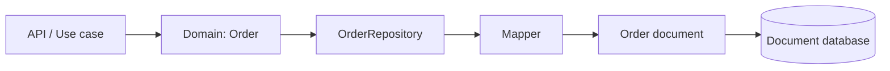

# Mô hình tài liệu và cấu trúc dữ liệu lồng nhau

Trong **mô hình lưu trữ dạng tài liệu (document model)**, một bản ghi không nhất thiết là một hàng gồm các cột phẳng. Nó có thể là một cấu trúc gồm đối tượng, đối tượng con và mảng, biểu diễn trực tiếp một phần dữ liệu mà ứng dụng cần đọc hoặc thay đổi cùng nhau. Mô hình này thường xuất hiện trong các cơ sở dữ liệu tài liệu như MongoDB và trong các cột JSON của cơ sở dữ liệu quan hệ. Tuy cùng biểu diễn dữ liệu lồng nhau, khả năng truy vấn, lập chỉ mục, giao dịch và ràng buộc của từng hệ quản trị có thể khác nhau.

Bài học đặt mô hình tài liệu trong bài toán **data persistence của ứng dụng Java**: thiết kế cấu trúc lưu trữ, chọn ranh giới nhất quán, truy vấn các trường lồng nhau, kiểm soát cập nhật đồng thời, tiến hóa lược đồ và bảo vệ dữ liệu qua thời gian.

## Mục tiêu học tập

Sau bài này, bạn có thể:

- Giải thích tài liệu, đối tượng lồng nhau, mảng và đường dẫn trường khác nhau như thế nào.
- Chọn khi nào nên **nhúng (embed)** dữ liệu vào một tài liệu, khi nào nên **tham chiếu (reference)** sang tài liệu khác.
- Thiết kế tài liệu theo các thao tác đọc/ghi và ranh giới nhất quán của nghiệp vụ, thay vì chỉ sao chép cấu trúc lớp Java.
- Viết và lý giải truy vấn, cập nhật có điều kiện, chỉ mục trên trường lồng nhau; nhận diện giới hạn của mảng lớn và tài liệu lớn.
- Ánh xạ dữ liệu vào Java, kiểm tra bất biến nghiệp vụ, xử lý thay đổi schema và các yêu cầu vận hành.

## 1. Từ bản ghi phẳng đến tài liệu có cấu trúc

Trong mô hình quan hệ, thông tin về đơn hàng thường nằm ở `orders`, các dòng hàng ở `order_items`, còn địa chỉ hoặc khách hàng nằm ở bảng khác. Ứng dụng có thể cần `JOIN` hoặc nhiều truy vấn để tái tạo một đơn hàng đầy đủ. Trong mô hình tài liệu, một đơn hàng có thể được lưu thành **một tài liệu** gồm các trường đơn giản và nhiều mức lồng nhau.

Các thành phần cơ bản:

| Thành phần | Ý nghĩa | Ví dụ |
|---|---|---|
| Tài liệu (document) | Đơn vị dữ liệu chứa các cặp tên trường và giá trị | Một đơn hàng |
| Trường vô hướng (scalar) | Chuỗi, số, Boolean, ngày giờ hoặc `null` theo kiểu mà hệ lưu trữ hỗ trợ | `status`, `totalVnd` |
| Đối tượng lồng nhau | Nhóm trường có ý nghĩa chung | `shipping.address` |
| Mảng | Danh sách phần tử; có thể là vô hướng hoặc đối tượng | `items` |
| Định danh | Giá trị xác định một tài liệu trong phạm vi phù hợp | `_id` trong MongoDB |
| Đường dẫn trường (field path) | Cách tham chiếu một trường ở sâu trong tài liệu | `shipping.address.city` |

Định dạng trao đổi phổ biến là **JSON**; MongoDB lưu dữ liệu dưới dạng **BSON** và hỗ trợ thêm kiểu dữ liệu so với JSON thuần. Vì vậy, chuỗi ngày giờ ISO 8601 trong ví dụ JSON dưới đây chỉ là cách biểu diễn dễ đọc; khi ghi xuống MongoDB, có thể dùng kiểu BSON Date để truy vấn và sắp xếp thời gian phù hợp. Không nên mặc định mọi hệ lưu trữ tài liệu có cùng kiểu, cùng giới hạn kích thước hoặc cùng bảo đảm giao dịch.

### Ví dụ: đơn hàng có dữ liệu lồng nhau

```json
{
  "_id": "ord_1042",
  "schemaVersion": 2,
  "revision": 3,
  "customerId": "cus_007",
  "buyer": {
    "fullName": "Nguyễn An"
  },
  "shipping": {
    "recipient": {
      "name": "Nguyễn An"
    },
    "address": {
      "line1": "12 Đường Minh Họa",
      "city": "Đà Nẵng",
      "countryCode": "VN"
    }
  },
  "items": [
    {
      "productId": "sku_keyboard_01",
      "productName": "Bàn phím cơ",
      "unitPriceVnd": 750000,
      "quantity": 1
    },
    {
      "productId": "sku_pad_02",
      "productName": "Lót chuột",
      "unitPriceVnd": 90000,
      "quantity": 2
    }
  ],
  "totalVnd": 930000,
  "status": "PLACED",
  "createdAt": "2026-11-21T12:00:00Z"
}
```

Đây là **một** tài liệu có nhiều mức lồng nhau, không phải năm tài liệu độc lập. `shipping.address.city` là trường của đối tượng địa chỉ nằm trong đối tượng vận chuyển; `items` là mảng, mỗi phần tử là một dòng hàng. Tổng `930000` đồng được tính từ `750000 × 1 + 90000 × 2`; ví dụ giả định chưa có phí vận chuyển hay giảm giá.

Hãy chú ý ba quyết định mô hình hóa:

1. `buyer.fullName` và `items[].productName` là **ảnh chụp thông tin tại thời điểm đặt hàng**. Tên sản phẩm đổi về sau không tự ý sửa lịch sử đơn hàng.
2. `customerId` và `items[].productId` là **tham chiếu định danh** đến dữ liệu gốc của khách hàng và danh mục sản phẩm. Chúng không đồng nghĩa với khóa ngoại được hệ cơ sở dữ liệu tự kiểm tra.
3. `schemaVersion` xác định hình dạng tài liệu; `revision` ghi nhận phiên bản cập nhật, dùng cho kiểm soát xung đột khi nhiều luồng cùng thay đổi một đơn.

Một tài liệu giống một **cây**: gốc là đơn hàng, nhánh là `buyer`, `shipping`, `items`, còn lá là các giá trị. Tuy nhiên, cách lưu dạng cây không bảo đảm mọi mối quan hệ nghiệp vụ đều nên nằm trong cùng một tài liệu.

## 2. Thiết kế cấu trúc theo nghiệp vụ và thao tác truy cập

Điểm xuất phát tốt là các câu hỏi: *Người dùng thường cần đọc những dữ liệu nào cùng lúc? Những trường nào phải thay đổi nhất quán trong một thao tác? Danh sách con có tăng mãi không? Ai sở hữu và cập nhật dữ liệu đó?*

Với đơn hàng, màn hình chi tiết thường cần địa chỉ giao, các dòng hàng và tổng tiền cùng lúc. Việc nhúng `shipping` và `items` giúp đọc được chúng từ một đơn vị dữ liệu. Ngược lại, kho hàng hoặc giá bán hiện hành có vòng đời và tốc độ cập nhật riêng, nên không thể coi bản sao tên/giá trong đơn hàng là nguồn dữ liệu gốc.

Trong thiết kế theo domain, một **aggregate** là nhóm dữ liệu có ranh giới áp dụng bất biến nghiệp vụ. Aggregate đơn hàng có thể giữ các dòng hàng và tổng tiền; nhưng lượng tồn kho của sản phẩm là aggregate khác. Tài liệu và aggregate thường có thể khớp nhau, song không có quy tắc bắt buộc “một lớp Java = một tài liệu” hay “một aggregate = một tài liệu” cho mọi ứng dụng.

### Nhúng hay tham chiếu?

| Câu hỏi thiết kế | Ưu tiên nhúng vào tài liệu cha khi... | Ưu tiên tham chiếu/tách tài liệu khi... |
|---|---|---|
| Cách đọc | Phần con gần như luôn được đọc với cha | Phần con được truy vấn độc lập thường xuyên |
| Vòng đời | Phần con được tạo, thay đổi, xóa cùng cha | Phần con có chủ sở hữu hoặc vòng đời riêng |
| Số lượng | Số phần tử có giới hạn thực tế | Số phần tử tăng không giới hạn |
| Tần suất ghi | Các trường cần cập nhật cùng nhau | Nhiều tác nhân cập nhật các phần con riêng biệt với tần suất cao |
| Chia sẻ | Dữ liệu chỉ thuộc về một cha | Một thực thể được nhiều cha tham chiếu |
| Tính lịch sử | Cần lưu ảnh chụp tại một thời điểm | Cần luôn đọc trạng thái hiện hành từ nguồn gốc |

Các lựa chọn không hoàn toàn loại trừ nhau. Trong ví dụ đơn hàng, có thể **vừa nhúng** `productName` và `unitPriceVnd` để giữ đúng lịch sử, **vừa lưu** `productId` để truy ngược sản phẩm hiện hành khi cần. Tránh nhúng cả hồ sơ khách hàng, toàn bộ đánh giá sản phẩm hoặc nhật ký hàng nghìn thay đổi chỉ để giảm một phép truy vấn.

### Mảng lồng nhau cần có giới hạn

Mảng `items` phù hợp nếu nghiệp vụ giới hạn số dòng hàng trong một đơn. Với danh sách bình luận, phiên làm việc, sự kiện thiết bị hoặc lịch sử trạng thái liên tục phát sinh, việc nhúng tất cả vào một tài liệu có thể dẫn đến:

- Tài liệu phình to, tốn băng thông và bộ nhớ cho các lần đọc.
- Tăng chi phí cập nhật và tạo điểm tranh chấp khi nhiều ghi chạm cùng tài liệu.
- Khó phân trang, lập chỉ mục hoặc quản lý vòng đời của từng phần tử.
- Đụng giới hạn kích thước tài liệu của hệ quản trị; **MongoDB có giới hạn 16 MiB cho một BSON document**, nhưng đây không phải giới hạn chung của mọi cơ sở dữ liệu tài liệu.

Giải pháp có thể là tách bình luận thành collection riêng với `orderId`, phân trang bằng khóa sắp xếp ổn định hoặc dùng **bucket** theo cửa sổ thời gian/kích thước nếu truy cập theo nhóm. Không nên chọn kích thước bucket hay giới hạn mảng nếu chưa biết lượng dữ liệu và mẫu truy vấn thực tế.

## 3. Truy vấn trường và mảng lồng nhau

Các ví dụ từ đây dùng **MongoDB Query Language** để minh họa cụ thể. Cú pháp này không tự động áp dụng cho PostgreSQL `jsonb`, Elasticsearch hay cơ sở dữ liệu tài liệu khác; cần dùng API tương ứng của hệ quản trị đang chọn.

### Tìm theo đường dẫn trường

```javascript
db.orders.find(
  { "shipping.address.city": "Đà Nẵng" },
  { _id: 1, customerId: 1, status: 1 }
);
```

Đường dẫn dấu chấm cho phép truy vấn sâu trong `shipping.address`. Phần thứ hai là **projection**, chỉ lấy các trường cần hiển thị thay vì luôn chuyển toàn bộ đơn hàng qua mạng. Khi thực tế cần hiển thị các dòng hàng, ứng dụng có thể chọn projection khác.

### Điều kiện trên cùng một phần tử mảng

Giả sử muốn tìm đơn hàng có **một dòng hàng** vừa có mã `sku_pad_02`, vừa có số lượng ít nhất 2:

```javascript
db.orders.find(
  {
    items: {
      $elemMatch: {
        productId: "sku_pad_02",
        quantity: { $gte: 2 }
      }
    }
  },
  { _id: 1, customerId: 1, createdAt: 1 }
);
```

`$elemMatch` yêu cầu các điều kiện cùng đúng **trên một phần tử mảng**. Nếu viết hai điều kiện độc lập như `"items.productId": ...` và `"items.quantity": ...`, mỗi điều kiện có thể khớp một phần tử **khác nhau**, tạo ra kết quả sai về mặt nghiệp vụ.

### Thiết kế chỉ mục theo truy vấn

```javascript
// Danh sách đơn của một khách hàng, mới nhất trước.
db.orders.createIndex({ customerId: 1, createdAt: -1 });

// Hỗ trợ tìm theo mã sản phẩm ở bên trong mảng items.
db.orders.createIndex({ "items.productId": 1 });

db.orders.find({ customerId: "cus_007" })
         .sort({ createdAt: -1 })
         .limit(20);
```

Trên MongoDB, chỉ mục chứa trường mảng trở thành **multikey index**. Nó giúp một số truy vấn vào phần tử mảng, nhưng có các quy tắc riêng về sắp xếp, điều kiện kết hợp và chỉ mục ghép. Không nên giả định một index trên `items.productId` sẽ tự tối ưu mọi truy vấn có thêm `items.quantity`.

Chiến lược chỉ mục cần dựa trên **tần suất truy vấn, độ chọn lọc, thứ tự lọc/sắp xếp và chi phí ghi**. Có thể sử dụng `explain("executionStats")` để xem kế hoạch thực thi và số tài liệu/chỉ mục phải duyệt. Mỗi index tăng chi phí lưu trữ và cập nhật; không nên lập chỉ mục cho mọi trường chỉ vì trường đó tồn tại.

## 4. Cập nhật có điều kiện và nhất quán dữ liệu

Giả sử hai yêu cầu cùng đọc đơn hàng ở `revision = 3`. Một yêu cầu chuyển trạng thái sang `PAID`; yêu cầu kia cũng muốn đổi trạng thái dựa trên dữ liệu cũ. Nếu cập nhật không có điều kiện, lần ghi sau có thể ghi đè quyết định của lần ghi trước.

Với MongoDB, dùng **optimistic concurrency control** bằng `revision`:

```javascript
const result = db.orders.updateOne(
  {
    _id: "ord_1042",
    revision: 3,
    status: "PLACED"
  },
  {
    $set: { status: "PAID" },
    $inc: { revision: 1 }
  }
);

if (result.matchedCount === 0) {
  // Đơn không còn ở revision hoặc trạng thái đã đọc;
  // đọc lại trước khi quyết định thử lại hay báo xung đột.
}
```

Điều kiện `revision: 3` và `status: "PLACED"` cùng kiểm tra phiên bản lẫn chuyển trạng thái hợp lệ. Một thao tác cập nhật trên **một tài liệu** của MongoDB là atomic, nên thay đổi `status` và tăng `revision` xảy ra cùng nhau. `matchedCount = 0` còn có thể do không tìm thấy đơn; ứng dụng cần phân biệt trường hợp này nếu giao diện hoặc API yêu cầu.

Đối với bất biến `totalVnd = tổng số lượng × đơn giá`, thay đổi `items` phải đi kèm tính toán lại `totalVnd` trong cùng ranh giới cập nhật, hoặc được điều phối bởi một lệnh nghiệp vụ bảo đảm bất biến. Cập nhật riêng `items[0].quantity` rồi hy vọng một tiến trình khác sửa `totalVnd` sau có thể để lại dữ liệu sai khi tiến trình gặp lỗi.

### Atomicity không tự động mở rộng sang tài liệu khác

Ví dụ `orders`, `inventory` và `payments` có thể là ba tài liệu/collection khác nhau. **Atomic trên đơn hàng** không có nghĩa giảm tồn kho và ghi thanh toán cũng atomic cùng đơn hàng. Nếu nghiệp vụ cần bảo đảm nhất quán xuyên nhiều tài liệu, phải cân nhắc khả năng giao dịch nhiều tài liệu của hệ cơ sở dữ liệu, điều kiện triển khai, mức cô lập và chi phí; hoặc dùng quy trình nhiều bước có kiểm soát như đặt chỗ tồn kho, sự kiện nghiệp vụ, idempotency key và bù trừ khi thất bại.

Tương tự, **durability** phụ thuộc cách ghi, xác nhận và cấu hình của hệ lưu trữ. Ứng dụng cần xác định trạng thái nào đã được lưu bền vững, khi nào được phép trả thành công cho người dùng, và điều gì xảy ra khi mất kết nối ngay sau khi gửi yêu cầu. Một lệnh có thể đã được server áp dụng dù client không nhận phản hồi; vì vậy thao tác tạo đơn hoặc ghi nhận thanh toán cần chiến lược **idempotency**, không đơn giản thử lại mù quáng.

## 5. Ánh xạ cấu trúc lồng nhau trong Java

Trong Java, `record` thích hợp để mô tả dữ liệu được truyền qua ranh giới persistence khi dữ liệu tương đối bất biến và các trường được nêu rõ. Ví dụ dưới đây phản ánh hình dạng tài liệu đơn hàng; `@JsonProperty` là ví dụ ánh xạ tên `_id` khi dùng Jackson để đọc/ghi JSON:

```java
import com.fasterxml.jackson.annotation.JsonProperty;
import java.time.Instant;
import java.util.List;

record BuyerSnapshot(String fullName) {}

record Recipient(String name) {}

record Address(String line1, String city, String countryCode) {}

record Shipping(Recipient recipient, Address address) {}

record OrderItem(
    String productId,
    String productName,
    long unitPriceVnd,
    int quantity
) {
    long subtotalVnd() {
        return Math.multiplyExact(unitPriceVnd, (long) quantity);
    }
}

record OrderDocument(
    @JsonProperty("_id") String id,
    int schemaVersion,
    long revision,
    String customerId,
    BuyerSnapshot buyer,
    Shipping shipping,
    List<OrderItem> items,
    long totalVnd,
    String status,
    Instant createdAt
) {}
```

Với Jackson, cần phiên bản hỗ trợ `record` và mô-đun `jackson-datatype-jsr310` để xử lý `Instant` như mong muốn. Khi lưu bằng MongoDB Java Driver, ứng dụng còn phải cấu hình codec hoặc viết ánh xạ giữa đối tượng Java và BSON; **khai báo record không tự động bảo đảm ánh xạ BSON đúng**.

Kiểu `long` trong ví dụ lưu **số đồng Việt Nam nguyên**, không dùng `double` cho tiền để tránh sai số nhị phân. Nếu nghiệp vụ có tiền tệ với đơn vị thập phân hoặc phép tính tỷ giá/thuế, cân nhắc `BigDecimal` cùng chính sách làm tròn và đơn vị rõ ràng. Dùng `Math.multiplyExact` giúp phát hiện tràn số trong phép nhân, nhưng vẫn phải kiểm tra số lượng hợp lệ và tổng tiền.

Một lớp kiểm tra trước khi ghi có thể bảo vệ bất biến đơn giản:

```java
final class OrderValidator {
    static void validate(OrderDocument order) {
        if (order.items() == null || order.items().isEmpty()) {
            throw new IllegalArgumentException("Đơn hàng phải có dòng hàng");
        }

        long computedTotal = 0L;
        for (OrderItem item : order.items()) {
            if (item.quantity() <= 0 || item.unitPriceVnd() < 0) {
                throw new IllegalArgumentException("Số lượng hoặc đơn giá sai");
            }
            computedTotal = Math.addExact(computedTotal, item.subtotalVnd());
        }

        if (computedTotal != order.totalVnd()) {
            throw new IllegalArgumentException("Tổng tiền không khớp dòng hàng");
        }
    }
}
```

Đây mới là kiểm tra một phần: ứng dụng còn phải kiểm tra định danh, trạng thái cho phép, thời gian, quyền truy cập và các ràng buộc khác. Bất biến được kiểm tra khi **tạo** tài liệu cần được duy trì ở tất cả đường **cập nhật** tài liệu. Có thể bổ sung validation của cơ sở dữ liệu (nếu hệ quản trị hỗ trợ) để giảm nguy cơ dữ liệu sai lọt vào từ những chương trình khác.

### Tách domain khỏi định dạng lưu trữ

Một kiến trúc đơn giản có thể chia thành:



`OrderRepository` là ranh giới để domain không phải gọi trực tiếp cú pháp truy vấn cụ thể. `Mapper` chịu trách nhiệm phiên bản tài liệu, định dạng ngày giờ, tên `_id` và các chuyển đổi kiểu. Với dự án nhỏ, có thể dùng cùng một kiểu cho cả hai phía nếu vẫn kiểm soát được ràng buộc; nhưng khi schema tiến hóa, tách `Order` và `OrderDocument` thường giúp hạn chế ảnh hưởng đến nghiệp vụ.

Một API cập nhật nên diễn đạt được yêu cầu chống xung đột, chẳng hạn `changeStatus(orderId, expectedRevision, nextStatus)` và trả kết quả thành công, không tìm thấy hoặc xung đột. Chỉ gọi `save(order)` thiếu điều kiện trong mọi hoàn cảnh có thể biến thao tác ghi thành **last write wins** ngoài ý muốn.

## 6. Schema linh hoạt vẫn phải có hợp đồng dữ liệu

Không ít cơ sở dữ liệu tài liệu cho phép hai tài liệu trong cùng một collection có các tập trường khác nhau. Tính linh hoạt đó hữu ích cho phát triển lược đồ, nhưng **không có nghĩa là không cần schema**. Phần mềm vẫn cần biết trường nào bắt buộc, kiểu nào hợp lệ, giá trị mặc định và hành vi khi gặp tài liệu cũ.

Ví dụ phiên bản 1 từng lưu địa chỉ dạng chuỗi:

```json
{
  "_id": "ord_1001",
  "schemaVersion": 1,
  "shippingAddress": "Đà Nẵng, Việt Nam"
}
```

Phiên bản 2 chuyển sang đối tượng `shipping.address` có `line1`, `city`, `countryCode`. Đây không phải đổi tên trường đơn thuần: chuỗi cũ có thể **thiếu** thông tin để tách thành địa chỉ chuẩn. Không được tự ý điền giá trị có vẻ hợp lý nếu không có nguồn dữ liệu xác nhận.

Một quy trình tiến hóa an toàn gồm:

1. Xác định hợp đồng mới và `schemaVersion`; mô tả trường bắt buộc, tùy chọn, định dạng và ràng buộc.
2. Triển khai reader có thể hiểu các phiên bản đang tồn tại hoặc thực hiện bước chuyển đổi rõ ràng; kiểm tra những trường hợp thiếu/không chuyển đổi được.
3. Chuyển writer sang phiên bản mới và theo dõi ứng dụng còn ghi phiên bản cũ hay không.
4. Backfill dữ liệu cũ theo lô có thể chạy lại an toàn; đo lỗi, xử lý dữ liệu chưa đủ, tránh ghi đè thay đổi mới của người dùng.
5. Sau khi xác minh dữ liệu và các phiên bản ứng dụng đã chuyển đổi, mới loại bỏ đường đọc cũ và các chỉ mục không còn dùng.

Phân biệt **trường không tồn tại**, **trường tồn tại nhưng có giá trị `null`**, **mảng rỗng** và **chuỗi rỗng**. Chúng có thể mang ý nghĩa nghiệp vụ khác nhau; cách hệ quản trị truy vấn và lập chỉ mục các trạng thái này cũng khác nhau. Đừng mặc định `null` tương đương “không được cung cấp”.

## 7. Hiệu năng, bảo mật và khả năng khôi phục

Một thiết kế tài liệu tốt phục vụ cả chức năng hiện tại lẫn chi phí vận hành về sau.

**Hiệu năng.** Với mỗi use case chính, xác định bộ lọc, thứ tự sắp xếp, số bản ghi trả về và lượng dữ liệu cần đọc. Kiểm tra kế hoạch thực thi trên tập dữ liệu đại diện; dùng phân trang cho kết quả lớn và tránh tải toàn bộ mảng chỉ để hiển thị một vài phần tử. Thống kê độ lớn tài liệu, tốc độ tăng mảng, số lần cập nhật và mức tranh chấp; khi mô hình truy cập thay đổi, ranh giới nhúng/tham chiếu cũng có thể cần thay đổi.

**Bảo mật và quyền riêng tư.** Đơn hàng có thể chứa tên, địa chỉ và thông tin liên hệ. Chỉ lưu dữ liệu cần thiết, giới hạn trường được API trả về và áp dụng phân quyền ở cấp yêu cầu, ví dụ mọi truy vấn đơn hàng của người dùng đều phải ràng buộc `customerId` từ danh tính đã xác thực. Lọc phía giao diện sau khi đã tải mọi đơn hàng là quá muộn. Áp dụng mã hóa và quản lý khóa phù hợp, chính sách lưu giữ/xóa dữ liệu, và tuyệt đối không nhúng mật khẩu hay thông tin thanh toán nhạy cảm không cần thiết vào tài liệu đơn hàng.

**Sao lưu và phục hồi.** Bản sao dữ liệu giữa các nút giúp tăng sẵn sàng nhưng không thay thế backup độc lập. Cần xác định mục tiêu mất dữ liệu cho phép (RPO), thời gian khôi phục (RTO), khả năng khôi phục đến một thời điểm và thử phục hồi thật. Khi restore, dữ liệu, metadata/indexes, ứng dụng và phiên bản schema phải tương thích; hệ thống chỉ được xem là có chiến lược phục hồi khi đã kiểm chứng được quy trình.

**Lỗi kết nối và thử lại.** Thiết lập timeout, nhận diện lỗi có thể thử lại, tránh thử vô hạn, và dùng khóa idempotency/định danh duy nhất cho các lệnh tạo dữ liệu quan trọng. Khi nhận kết quả không chắc chắn từ network, đọc/đối chiếu trạng thái đã ghi trước khi phát lại lệnh có tác dụng phụ.

## 8. Những sai lầm thường gặp

| Cách làm | Hậu quả | Cách cải thiện |
|---|---|---|
| Nhúng mọi quan hệ vào tài liệu cha | Tài liệu lớn, mảng không giới hạn, ghi tranh chấp | Chỉ nhúng phần cùng vòng đời và có kích thước dự đoán được |
| Chỉ dùng tham chiếu cho mọi dữ liệu | Đọc nhiều lần, khó giữ ảnh chụp lịch sử | Nhúng những giá trị cần hiển thị và nhất quán cùng aggregate |
| Nghĩ tài liệu không cần schema | Reader dễ lỗi khi thiếu trường hoặc sai kiểu | Có hợp đồng, validation và kế hoạch phiên bản |
| Thay đổi mảng mà bỏ qua tổng hợp | `totalVnd` không khớp dòng hàng | Áp dụng bất biến trong một lệnh nghiệp vụ và ranh giới atomic phù hợp |
| Cập nhật chỉ dựa vào `_id` | Ghi đè thay đổi đồng thời | Dùng điều kiện phiên bản và quy tắc chuyển trạng thái |
| Đặt index trên tất cả trường | Ghi chậm, tốn dung lượng, index không hiệu quả | Đo workload và kế hoạch thực thi trước khi tạo index |
| Xem atomic một tài liệu là atomic toàn hệ thống | Mất nhất quán giữa đơn hàng, thanh toán và kho | Thiết kế giao dịch hoặc quy trình phối hợp xuyên aggregate |

## 9. Tình huống áp dụng

Hệ thống thương mại điện tử cần hiển thị nhanh chi tiết đơn hàng, bảo đảm tổng tiền và nội dung đơn nhất quán, nhưng giá sản phẩm và tồn kho được quản lý bởi các dịch vụ khác.

- **Trong tài liệu đơn hàng:** định danh, thông tin người mua cần thiết tại lúc đặt hàng, địa chỉ giao, các dòng hàng, giá đã chốt, tổng tiền, trạng thái, thời điểm tạo và `revision`.
- **Tham chiếu:** `customerId`, `productId`, mã giao dịch thanh toán hoặc mã đặt chỗ tồn kho; chỉ lưu thêm dữ liệu snapshot khi có lý do nghiệp vụ.
- **Không nhúng vô hạn:** toàn bộ lịch sử thanh toán, log giao hàng, bình luận và sự kiện xử lý. Tách chúng nếu cần lưu lâu, phân trang hoặc ghi độc lập.
- **Bất biến cần giữ:** tổng tiền đúng với dòng hàng và quy tắc phí/giảm giá; chuyển trạng thái hợp lệ; không ghi đè kết quả của yêu cầu đồng thời.
- **Vận hành:** chỉ mục cho tra cứu đơn theo khách hàng và thời gian, phân quyền đọc theo chủ đơn, schema version để nâng cấp, backup và thử phục hồi.

### Bài thực hành thiết kế

Hãy thiết kế hai mô hình cho một danh sách yêu thích (*wishlist*) có thể chứa từ vài món đến hàng chục nghìn món, được nhiều thiết bị của cùng người dùng cập nhật:

1. Mô hình A nhúng tất cả `items` vào tài liệu người dùng; mô hình B lưu mỗi mục yêu thích thành tài liệu riêng với `userId` và `productId`.
2. Với từng mô hình, đánh giá kích thước dữ liệu, tần suất ghi, cách chống thêm trùng, phân trang và chỉ mục cần có.
3. Chọn mô hình và giải thích ranh giới cập nhật. Gợi ý: nếu số mục không bị giới hạn và cần phân trang/tìm kiếm thường xuyên, mô hình B thường dễ mở rộng hơn; cần kiểm tra ràng buộc duy nhất phù hợp cho cặp `(userId, productId)`.

## Ghi nhớ

**Mô hình tài liệu giúp đặt dữ liệu thường đi cùng nhau vào một cấu trúc lồng nhau**, nhờ đó đơn giản hóa nhiều thao tác đọc và một số cập nhật có tính nhất quán cao. Giá trị của nó phụ thuộc vào cách chọn ranh giới tài liệu: nhúng phần có vòng đời và kích thước phù hợp; tham chiếu phần được chia sẻ, thay đổi độc lập hoặc tăng không giới hạn. Trong ứng dụng Java, hãy xem cấu trúc tài liệu là một **hợp đồng persistence** có validation, chiến lược truy vấn/chỉ mục, kiểm soát đồng thời, phiên bản schema và quy trình khôi phục, thay vì chỉ là một đối tượng Java được chuyển sang JSON.
