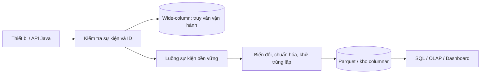

# Phân biệt wide-column với lưu trữ phân tích theo cột

Hai thuật ngữ **wide-column store** và **columnar storage** đều chứa từ *column* (cột), nhưng chỉ hai cách tổ chức dữ liệu phục vụ những mục tiêu khác nhau. Wide-column thường được dùng để đáp ứng các truy vấn có khóa xác định, lượng ghi lớn và khả năng phân tán trên nhiều nút. Lưu trữ phân tích theo cột chủ yếu giúp đọc và tổng hợp một số cột trên rất nhiều bản ghi. Nhầm lẫn hai khái niệm dễ dẫn đến lựa chọn sai mô hình dữ liệu, thiết kế khóa không phù hợp hoặc buộc hệ thống vận hành xử lý các truy vấn phân tích quá nặng.

Bài này nằm trong chương **Mô hình lưu trữ** của `DATA_PERSISTENCE_FUNDAMENTALS`. Góc nhìn xuyên suốt là thiết kế persistence cho ứng dụng Java: dữ liệu được đặt ở đâu, truy vấn gì cần nhanh, giới hạn nhất quán đến đâu, xử lý lỗi thế nào và tối ưu chi phí lưu trữ, chỉ mục, sao lưu, vận hành ra sao.

## Mục tiêu học tập

Sau bài học, bạn có thể:

- Phân biệt **mô hình dữ liệu wide-column/column-family** với **cách bố trí vật lý dạng cột cho OLAP**.
- Giải thích `partition key`, `clustering key`, column family, column chunk, row group và column pruning theo ngữ cảnh thích hợp.
- Chọn khóa và giới hạn kích thước partition cho truy vấn vận hành trên Cassandra hoặc một hệ wide-column tương tự.
- Giải thích vì sao lưu trữ theo cột, nén và xử lý theo lô phù hợp với truy vấn thống kê nhiều hàng.
- Thiết kế luồng từ dữ liệu vận hành sang kho phân tích, xác định rủi ro về đồng bộ, tính đúng đắn, độ trễ và bảo mật.

## 1. Cùng chữ “cột”, khác câu hỏi cần trả lời

Hãy hình dung ứng dụng nhận hàng triệu sự kiện cảm biến. Hai nhu cầu thường gặp là:

1. **Vận hành:** “Cho tôi 100 sự kiện mới nhất của thiết bị `sensor-17` trong ngày 21/11.”
2. **Phân tích:** “Trong tuần vừa qua, nhiệt độ trung bình theo từng giờ của *tất cả* thiết bị là bao nhiêu?”

Truy vấn thứ nhất xác định rõ **một thiết bị, một khoảng thời gian ngắn** và cần kết quả nhanh. Truy vấn thứ hai đọc số lượng lớn sự kiện nhưng chỉ cần vài trường như thời gian, loại phép đo và giá trị. Mỗi cách lưu trữ tối ưu một mẫu truy cập khác nhau.

| Tiêu chí | Wide-column / column-family | Lưu trữ phân tích theo cột (columnar / OLAP) |
|---|---|---|
| Trọng tâm | Tìm và ghi dữ liệu theo khóa, mở rộng theo partition | Quét, lọc, tổng hợp nhiều hàng, đọc ít cột |
| Tổ chức logic | Bảng gồm các partition; dữ liệu trong partition thường có trật tự theo khóa gom cụm hoặc cơ chế tương đương | Bảng dữ liệu logic vẫn gồm hàng và cột; cách **lưu vật lý** gom các giá trị cùng cột |
| Đơn vị truy cập điển hình | Một hoặc một số partition/hàng có khóa cụ thể | Nhiều hàng, một tập cột được chọn |
| Mẫu truy vấn thuận lợi | Tra cứu theo khóa, chuỗi thời gian của một thực thể, cập nhật theo định danh | `SUM`, `AVG`, `COUNT`, `GROUP BY`, lọc nhiều dữ liệu, báo cáo |
| Ghi dữ liệu | Thường phù hợp ghi dồn dập và phân tán, tùy hệ quản trị | Thường tối ưu cho quét phân tích; hỗ trợ ghi theo lô hoặc trực tuyến tùy engine |
| Chỉ mục/đường dẫn dữ liệu | Khóa phân vùng, khóa sắp xếp và các cấu trúc index theo engine | Metadata min/max, dictionary, zone map, partition pruning, data skipping; tùy engine |
| Hệ tiêu biểu | Apache Cassandra, Apache HBase, Google Cloud Bigtable | Apache Parquet, Apache ORC (định dạng); ClickHouse, DuckDB, các kho OLAP (engine) |
| Cần tránh suy luận | Không tự động phù hợp mọi phép `GROUP BY` trên toàn dữ liệu | Không tự động tốt cho mọi ghi từng hàng hoặc tra cứu bằng khóa |

**Điểm phân biệt cốt lõi:** *wide-column* mô tả một họ mô hình lưu trữ và truy cập phân tán theo khóa; *columnar* mô tả cách nhóm dữ liệu cùng cột để giảm chi phí truy vấn phân tích. Parquet và ORC là **định dạng file**, còn Cassandra, HBase, ClickHouse và DuckDB là **hệ thống hoặc engine**; không nên so sánh chúng như những sản phẩm hoàn toàn cùng tầng kiến trúc.

## 2. Wide-column là gì?

Các hệ wide-column thường dùng một định danh hàng/partition để tìm đúng vùng dữ liệu, cho phép các hàng có số lượng hoặc sự hiện diện của các thuộc tính khác nhau, và cung cấp cách nhóm các cột hoặc sắp thứ tự dữ liệu theo khóa.

Khái niệm cần phân biệt theo từng họ hệ quản trị:

- **Apache Cassandra:** bảng CQL có cấu trúc cột được khai báo rõ; `partition key` quyết định phân phối dữ liệu, còn `clustering columns` quyết định thứ tự dữ liệu bên trong một partition. Các giá trị cột có thể không hiện diện hoặc là `null` theo quy tắc lưu trữ của Cassandra. Cassandra không có bộ truy vấn quan hệ/phân tích tổng quát như một kho OLAP.
- **Apache HBase và Bigtable:** các hàng được nhận diện bằng row key; cột được nhóm trong *column families*, với các qualifier và phiên bản theo thời gian tùy hệ thống. Một hàng có thể có các qualifier khác hàng khác; điều này tạo cảm giác “rộng” và thưa (*sparse*).

Tên gọi *column-family* **không có nghĩa** mọi sản phẩm này lưu các vector giá trị của từng cột theo cách Parquet dùng cho phân tích. Chẳng hạn, HBase duy trì lưu trữ theo column family; còn mô hình đọc của Cassandra tập trung mạnh vào partition và clustering key. Chi tiết SSTable, cấu trúc bộ nhớ và compaction khác nhau theo sản phẩm/phiên bản. Không nên áp đặt một sơ đồ vật lý duy nhất cho toàn bộ họ wide-column.

### Khóa đóng vai trò gì?

Với Cassandra, hai loại khóa có nhiệm vụ rõ ràng:

| Khái niệm | Vai trò | Hệ quả khi chọn sai |
|---|---|---|
| `partition key` | Xác định partition để phân phối và định vị dữ liệu | Phân phối lệch, partition quá lớn hoặc truy vấn phải chạm nhiều partition |
| `clustering key` | Xác định thứ tự/định danh hàng trong một partition | Khó lấy các sự kiện gần nhất hoặc quét đúng khoảng thời gian |
| Primary key hoàn chỉnh | Kết hợp partition key và clustering columns để nhận diện hàng | Ghi lặp có thể cập nhật cùng hàng hoặc tạo hàng mới ngoài ý muốn |

Hình dung theo dữ liệu sự kiện:

```text
Partition (device_id = sensor-17, event_day = 2026-11-21)
  ├─ 08:12:10Z · event-103 · temperature · 28.2
  ├─ 08:12:05Z · event-102 · temperature · 28.1
  └─ 08:11:59Z · event-101 · humidity    · 72.0

Partition (device_id = sensor-18, event_day = 2026-11-21)
  ├─ 08:12:09Z · event-202 · temperature · 27.8
  └─ 08:11:57Z · event-201 · humidity    · 69.0
```

Đây là sơ đồ **logic** minh họa truy cập theo thiết bị và ngày; không khẳng định từng byte được xếp trên ổ đĩa đúng theo hình. Truy vấn một thiết bị/ngày có thể định vị partition, sau đó lấy vùng thời gian mong muốn theo thứ tự clustering. Truy vấn nhiệt độ của *tất cả* thiết bị trong nhiều tháng có thể phải tìm qua rất nhiều partition, không còn phù hợp với đường truy cập tối ưu này.

## 3. Ví dụ thiết kế wide-column bằng Cassandra CQL

Giả định mỗi sự kiện có `deviceId`, `recordedAt` theo UTC, `eventId`, `metricType`, `value` và `unit`. Màn hình nghiệp vụ ưu tiên truy vấn: **một thiết bị, trong một ngày UTC, theo thời gian mới nhất**.

```sql
CREATE TABLE telemetry_by_device_day (
    device_id    text,
    event_day    date,
    recorded_at  timestamp,
    event_id     uuid,
    metric_type  text,
    value        double,
    unit         text,
    PRIMARY KEY ((device_id, event_day), recorded_at, event_id)
) WITH CLUSTERING ORDER BY (recorded_at DESC, event_id ASC);
```

Ở đây `((device_id, event_day))` là **composite partition key**. Hai trường `recorded_at`, `event_id` tạo **clustering key**; `event_id` giúp các sự kiện có cùng thời điểm không đè lên cùng một hàng, miễn là ID được duy trì ổn định khi gửi lại sự kiện.

```sql
-- Mỗi thiết bị/ngày là một vùng dữ liệu được định vị bằng khóa.
SELECT recorded_at, event_id, metric_type, value, unit
FROM telemetry_by_device_day
WHERE device_id = 'sensor-17'
  AND event_day = '2026-11-21'
  AND recorded_at >= '2026-11-21T08:00:00Z'
  AND recorded_at <  '2026-11-21T09:00:00Z'
LIMIT 100;
```

Điều kiện cung cấp đầy đủ partition key và giới hạn khoảng clustering key, tương ứng mẫu đọc đã thiết kế. Vì `recorded_at` giảm dần, truy vấn lấy sự kiện gần nhất trước trong vùng lọc, miễn là không có `ORDER BY` khác thay đổi ý định. Lệnh CQL trên dùng literal để học cách đọc; ứng dụng Java nên dùng **prepared statement** và tham số để tránh ghép chuỗi đầu vào người dùng.

### Vì sao không đặt mỗi thiết bị vào một partition duy nhất?

Nếu khóa phân vùng chỉ là `device_id`, thiết bị chạy nhiều năm sẽ tích lũy quá nhiều hàng trong cùng partition. Partition lớn gây khó khăn cho compaction, repair, đọc và phân phối tải. Thêm `event_day` tạo **time bucket** theo ngày, giúp giới hạn kích thước partition và hỗ trợ chính sách lưu giữ; song đây chỉ là lựa chọn ban đầu. Thiết bị gửi hàng triệu sự kiện mỗi giờ vẫn có thể làm một partition/ngày quá lớn. Lúc đó cần đánh giá bucket theo giờ, loại phép đo hoặc shard có kiểm soát, đồng thời chấp nhận rằng truy vấn nhiều bucket sẽ cần nhiều lượt đọc và gộp kết quả.

Hãy ước lượng trước khi chọn bucket. Ví dụ giả định một thiết bị gửi **10 sự kiện/giây** thì một ngày có `10 × 86.400 = 864.000` sự kiện. Kích thước dữ liệu thực phụ thuộc schema, metadata, bộ mã hóa, nén và hệ quản trị; không suy dung lượng partition chỉ bằng số dòng mà không đo trên dữ liệu thật. Cần tính thêm số thiết bị, sự phân bố tải theo giờ, thời gian giữ dữ liệu và mức đọc đồng thời.

### Truy vấn ngoài khóa phải được thiết kế riêng

Yêu cầu “tìm tất cả sự kiện có `metric_type = 'temperature'` trong tuần” không khớp với partition key `device_id, event_day`. Thêm `ALLOW FILTERING` để ép chạy một truy vấn lớn có thể làm độ trễ và lượng đọc tăng đột biến; đây không phải cách giải quyết mặc định cho production. Tùy quy mô, có thể xây **bảng truy cập khác** theo `metric_type`/thời gian hoặc chuyển nghiệp vụ tổng hợp sang hệ phân tích. Mỗi bảng dẫn xuất tạo thêm chi phí ghi, đồng bộ và kiểm soát tính nhất quán.

Thiết kế wide-column thường bắt đầu từ **danh sách truy vấn cần phục vụ** rồi mới chọn khóa. Nó có thể cố ý nhân bản dữ liệu để tối ưu những đường đọc quan trọng, nhưng phải xác định nguồn dữ liệu đúng, cách cập nhật bản sao và hành vi khi một lần ghi chỉ thành công một phần.

## 4. Lưu trữ phân tích theo cột là gì?

Giả sử tập dữ liệu có một triệu hàng, mỗi hàng gồm 20 trường, nhưng báo cáo chỉ cần ba trường `recorded_at`, `metric_type` và `value`. Cách lưu theo cột bố trí các **giá trị thuộc cùng một cột** gần nhau trong những nhóm hàng nhất định, để công cụ đọc phần cần thiết mà không phải luôn giải mã 17 cột còn lại.

```text
Dữ liệu logic (các hàng):

event_id   recorded_at  device_id   metric_type  value
e101       08:11:59     sensor-17   humidity     72.0
e102       08:12:05     sensor-17   temperature  28.1
e201       08:11:57     sensor-18   humidity     69.0

Một nhóm hàng trong file columnar (mô phỏng):

column event_id:    [e101, e102, e201]
column recorded_at: [08:11:59, 08:12:05, 08:11:57]
column device_id:   [sensor-17, sensor-17, sensor-18]
column metric_type: [humidity, temperature, humidity]
column value:       [72.0, 28.1, 69.0]

Truy vấn AVG(value) WHERE metric_type = 'temperature'
  → chủ yếu đọc metric_type và value trong các nhóm hàng phù hợp.
```

Hình trên chỉ minh họa cách đọc. Trong Parquet, dữ liệu được chia thành **row groups**, và mỗi row group chứa các **column chunks** của từng cột. Các chunk dùng encoding, compression và metadata tương ứng. Với cột lồng nhau, cách mã hóa còn dùng các cấp định nghĩa/lặp (*definition/repetition levels*), nên cấu trúc thật phong phú hơn năm mảng đơn giản.

Những cơ chế thường giúp OLAP đọc nhanh:

- **Column pruning:** bỏ qua các cột không nằm trong phép lọc, tính toán hoặc đầu ra.
- **Predicate pushdown, row-group/file skipping:** dùng điều kiện và metadata (ví dụ min/max, thống kê) để bỏ qua vùng không thể chứa kết quả khi engine và dữ liệu hỗ trợ.
- **Nén và encoding:** giá trị cùng cột thường có kiểu và phân bố tương tự, thuận lợi cho dictionary, run-length hoặc các kiểu mã hóa khác.
- **Vectorized execution:** engine xử lý nhiều giá trị cùng lúc thay vì gọi một phép toán cho mỗi đối tượng hàng.
- **Phân vùng dữ liệu phân tích:** tổ chức file theo ngày/tháng hoặc thuộc tính lọc thường gặp để tránh mở mọi file.

Không phải engine nào cũng triển khai đầy đủ các cơ chế trên, và không phải truy vấn nào cũng hưởng lợi như nhau. Nếu muốn lấy **một hàng duy nhất theo ID** nhưng không có index/đường dẫn thích hợp, kho phân tích có thể phải đọc nhiều dữ liệu. Ngược lại, một số engine columnar hiện đại còn hỗ trợ ingest liên tục, truy vấn thời gian thực và tìm kiếm theo khóa; không nên quy mọi columnar database thành hệ chỉ đọc file theo lô.

## 5. Ví dụ phân tích cùng dữ liệu bằng Parquet và DuckDB

Giả sử luồng dữ liệu cảm biến đã được chuyển thành các file Parquet có schema nhất quán: `recorded_at`, `device_id`, `event_id`, `metric_type`, `value`, `unit`. Với ví dụ này, thời gian đã được chuẩn hóa về UTC; khi triển khai cần chọn rõ `TIMESTAMP` hay `TIMESTAMPTZ` và quy tắc timezone theo engine.

```sql
SELECT
    metric_type,
    date_trunc('hour', recorded_at) AS hour_utc,
    count(*) AS event_count,
    avg(value) AS average_value
FROM read_parquet('sensor_events_2026_11_21.parquet')
WHERE metric_type = 'temperature'
  AND recorded_at >= TIMESTAMP '2026-11-21 00:00:00'
  AND recorded_at <  TIMESTAMP '2026-11-22 00:00:00'
GROUP BY metric_type, hour_utc
ORDER BY hour_utc;
```

Đây là **SQL minh họa trên DuckDB**, không phải cú pháp CQL. Báo cáo chỉ cần đọc cột loại phép đo, thời gian và giá trị; nếu file và engine hỗ trợ thống kê hữu ích, một số vùng dữ liệu còn có thể được bỏ qua. Truy vấn không phụ thuộc việc biết trước `device_id` nào, vì nhiệm vụ là tổng hợp trên toàn bộ tập dữ liệu.

Để tập dữ liệu nhiều ngày hoạt động tốt, cần tổ chức các file hợp lý, chẳng hạn phân vùng theo ngày hoặc tháng và bảo đảm bộ máy truy vấn nhận biết partition. Chọn partition quá chi tiết như từng `event_id` sẽ tạo vô số file nhỏ, tăng overhead đọc metadata; chọn partition quá rộng có thể làm quét thừa. Phải cân đối kích thước file, khả năng gộp file, thời điểm dữ liệu đến muộn và bộ lọc của truy vấn.

### Phân biệt ba cấp “cột” dễ nhầm lẫn

| Tên gọi | Mô tả đúng | Không suy ra |
|---|---|---|
| Cột trong bảng CQL | Trường của một hàng, gắn với khóa partition/clustering | Mọi giá trị cột được đóng thành vector tối ưu `AVG` |
| Column family trong HBase/Bigtable | Nhóm cột/qualifier để tổ chức và quản trị dữ liệu ở họ wide-column | Giống column chunk trong file Parquet |
| Column chunk trong Parquet | Phần dữ liệu của một cột bên trong row group, kèm mã hóa/nén/metadata | Có thể truy cập từng hàng bằng khóa nghiệp vụ như Cassandra |

Một bảng có **rất nhiều cột** trong RDBMS vẫn không mặc nhiên là *wide-column database*. Ngược lại, việc một hệ wide-column hỗ trợ một ít truy vấn tổng hợp không biến nó thành kho phân tích theo cột.

## 6. So sánh bằng hai truy vấn và một quyết định thiết kế

Giả sử ứng dụng cần đáp ứng đồng thời hai use case:

| Use case | Truy vấn | Lựa chọn khởi đầu phù hợp | Lý do |
|---|---|---|---|
| Màn hình vận hành | 100 sự kiện mới nhất của `sensor-17` trong ngày | Cassandra với khóa `(device_id, event_day)` và clustering thời gian | Định vị đúng partition và quét một đoạn có giới hạn |
| Thống kê toàn đội thiết bị | `AVG(value)` theo giờ/loại đo trong tuần | File Parquet + engine OLAP, hoặc kho columnar tương đương | Đọc vài cột, lọc dữ liệu thời gian và gộp nhiều hàng |
| Tìm một sự kiện theo `event_id` | Tra cứu chính xác, tần suất cao | Cần bảng/index truy cập phù hợp trong hệ vận hành | Bảng Cassandra đã thiết kế không hỗ trợ tra cứu trực tiếp chỉ bằng `event_id` |
| Dashboard tổng hợp gần thời gian thực | Thống kê theo cửa sổ thời gian với độ trễ giới hạn | Engine phân tích hỗ trợ ingest streaming hoặc bảng tổng hợp cập nhật liên tục | Yêu cầu thời gian tươi mới và khả năng aggregate, phải đo theo SLA |

**Không có lựa chọn thắng tuyệt đối.** Hệ thống có thể dùng wide-column làm nguồn phục vụ API và một bộ lưu trữ theo cột cho thống kê. Nhưng nếu workload thực chỉ có vài nghìn sự kiện/ngày, một cơ sở dữ liệu quan hệ có chỉ mục phù hợp đôi khi đơn giản hơn cả hai. Cần cân nhắc khối lượng, truy vấn, tính nhất quán, khả năng vận hành và chi phí trước khi thêm công nghệ.

## 7. Đường đi từ dữ liệu vận hành sang dữ liệu phân tích

Trong ứng dụng Java có cả màn hình theo thiết bị lẫn báo cáo toàn hệ thống, luồng dữ liệu có thể được thiết kế như sau:



Sơ đồ là **kiến trúc tham khảo**, chưa phải bảo đảm rằng ghi vào `C` và `D` sẽ cùng thành công. Nếu ứng dụng ghi hai nơi trực tiếp rồi gặp lỗi giữa chừng, dữ liệu phục vụ API và báo cáo có thể khác nhau. Có thể dùng nguồn sự kiện bền vững làm điểm nhận chung, hoặc cơ chế CDC/outbox tương thích với hệ lưu trữ đã chọn, để tạo lại luồng downstream và theo dõi sự kiện bị thiếu. Với mỗi kiến trúc cần chỉ rõ **nguồn sự thật**, cách xử lý lỗi và cách phát lại khi cần.

Một số vấn đề phải giải quyết rõ ràng:

1. **Định danh/idempotency:** mỗi sự kiện giữ nguyên `eventId` qua các lần retry. Không tạo ID mới khi phát lại một sự kiện đã được nhận; ở downstream cần khóa khử trùng lặp hoặc quy tắc upsert đúng với nghiệp vụ.
2. **Thời gian:** phân biệt `recordedAt` (thiết bị đo), `receivedAt` (server nhận) và thời gian pipeline xử lý. Dữ liệu có thể đến muộn hoặc sai đồng hồ; định nghĩa rõ cửa sổ thống kê và chính sách cập nhật kết quả cũ.
3. **Schema:** phiên bản thông điệp cần hỗ trợ chuyển đổi; đổi `value` từ số sang chuỗi hoặc đổi đơn vị đo mà không chuẩn hóa sẽ làm báo cáo sai.
4. **Đối soát:** đo số sự kiện theo thời gian, số bản ghi bị từ chối, độ trễ pipeline và chênh lệch giữa dữ liệu nguồn với dữ liệu phân tích. Dashboard có thể trễ vài phút ngay cả khi API đã hiển thị sự kiện.
5. **Xóa dữ liệu:** chính sách retention, yêu cầu xóa và thay đổi quyền truy cập phải đi qua cả nguồn vận hành, hàng đợi và tập dữ liệu phân tích/backup theo chính sách áp dụng.

### Khi nào chấp nhận độ trễ?

Màn hình một thiết bị thường cần dữ liệu rất mới, trong khi báo cáo tuần có thể chấp nhận vài phút hoặc vài giờ chậm. Hãy định nghĩa **freshness SLA** và hiển thị thời điểm dữ liệu được cập nhật. Không nên để người dùng hiểu “số liệu thời gian thực” khi pipeline đang chạy theo đợt mỗi ngày. Nếu kết quả báo cáo tham gia quyết định nghiệp vụ quan trọng, cần xác định mức độ hoàn tất dữ liệu, cách làm tròn, dữ liệu đến muộn và khả năng tính lại.

## 8. Góc nhìn ứng dụng Java: repository và hợp đồng truy cập

Mã nghiệp vụ Java không nên phải biết cả cú pháp CQL lẫn định dạng Parquet. Một thiết kế thực dụng tách hai cổng đọc/ghi theo yêu cầu:

```java
import java.time.Instant;
import java.time.LocalDate;
import java.util.List;
import java.util.UUID;

record SensorEvent(
    String deviceId,
    LocalDate eventDayUtc,
    Instant recordedAt,
    UUID eventId,
    String metricType,
    double value,
    String unit
) {}

record HourlyMetric(
    String metricType,
    Instant hourStartUtc,
    long count,
    double average
) {}

interface SensorEventRepository {
    void save(SensorEvent event);
    List<SensorEvent> latest(
        String deviceId, LocalDate dayUtc, Instant from, Instant until,
        int limit
    );
}

interface SensorAnalyticsQuery {
    List<HourlyMetric> hourlyAverage(
        String metricType, Instant from, Instant until
    );
}
```

`SensorEventRepository` diễn đạt truy cập **theo thiết bị/ngày**, phù hợp khóa wide-column. `SensorAnalyticsQuery` diễn đạt truy vấn **theo tập dữ liệu và khoảng thời gian**, có thể triển khai bằng một dịch vụ SQL/OLAP hoặc một API phục vụ kết quả đã tổng hợp. Sự tách biệt bảo vệ domain trước khác biệt về nguồn dữ liệu và đặc tính độ trễ.

Ví dụ phần ghi cho Cassandra Java Driver 4.x, giả sử `CqlSession` được quản lý và cấu hình kết nối ở lớp hạ tầng:

```java
import com.datastax.oss.driver.api.core.CqlSession;
import com.datastax.oss.driver.api.core.cql.PreparedStatement;

final class CassandraSensorWriter {
    private final CqlSession session;
    private final PreparedStatement insert;

    CassandraSensorWriter(CqlSession session) {
        this.session = session;
        this.insert = session.prepare("""
            INSERT INTO telemetry_by_device_day (
                device_id, event_day, recorded_at, event_id,
                metric_type, value, unit
            ) VALUES (?, ?, ?, ?, ?, ?, ?)
            """);
    }

    void save(SensorEvent e) {
        // eventDayUtc phải được tính nhất quán từ recordedAt theo UTC.
        session.execute(insert.bind(
            e.deviceId(), e.eventDayUtc(), e.recordedAt(),
            e.eventId(), e.metricType(), e.value(), e.unit()
        ));
    }
}
```

`PreparedStatement` tránh ghép câu truy vấn từ chuỗi đầu vào và giúp tái sử dụng câu lệnh. Đoạn mã minh họa **đường ghi**, không thay thế validation, timeout, chiến lược retry, kiểm tra quyền hoặc cơ chế xử lý backpressure. Trong Java, `LocalDate` biểu diễn ngày UTC của bucket, còn `Instant` biểu diễn thời điểm; nếu dùng múi giờ mặc định của máy để tính `eventDayUtc`, dữ liệu có thể được ghi sai partition tại ranh giới ngày.

`double` là ví dụ cho giá trị cảm biến, không nên dùng cho khoản tiền cần tính chính xác thập phân. Với dữ liệu thực tế, cần kiểm tra `NaN`, `Infinity`, đơn vị đo và dải hợp lệ trước khi chấp nhận sự kiện; cơ sở dữ liệu không biết mọi quy tắc vật lý hay nghiệp vụ của cảm biến.

### Tránh hiểu sai về kiểm soát đồng thời

Ghi cùng primary key trong Cassandra thường có ngữ nghĩa **upsert**; một bản ghi đến muộn hoặc một retry với nội dung khác có thể ảnh hưởng dữ liệu tùy timestamp và quy tắc giải quyết xung đột. `eventId` ổn định hỗ trợ idempotency nhưng **không đủ** nếu hệ thống sinh lại payload khác với cùng ID. Những thao tác cần điều kiện như `IF NOT EXISTS` có thể dùng cơ chế lightweight transaction của Cassandra khi thích hợp, đổi lại chi phí đồng bộ lớn hơn. Mức nhất quán của đọc/ghi còn phụ thuộc consistency level, replication và tình trạng cụm; không thể mặc định rằng mọi lần ghi đều có giao dịch ACID đa hàng.

Ở kho phân tích, việc đọc trên dữ liệu đang nạp có thể cho kết quả khác giữa hai lần chạy vì batch hoặc streaming ingestion chưa hoàn tất. Nếu báo cáo phải lặp lại chính xác, chọn **snapshot/version** hoặc mốc dữ liệu hoàn tất, tùy khả năng của engine.

## 9. Thiết kế chỉ mục, lưu giữ và vận hành

| Mặt vận hành | Wide-column | Columnar analytics |
|---|---|---|
| Thiết kế dữ liệu | Xác định truy vấn trước rồi chọn partition/clustering key; tránh hot partition | Chọn schema, cột cần đọc, sắp xếp/partition dữ liệu theo bộ lọc thường gặp |
| Đọc | Giới hạn số partition, số hàng và khoảng thời gian; theo dõi tail latency | Đo lượng dữ liệu quét, tỷ lệ bỏ qua file/row group, hiệu quả nén và thời gian tổng hợp |
| Ghi | Kiểm soát idempotency, write amplification, compaction, tombstone | Tránh file quá nhỏ, thiết kế batch/stream ingestion, gộp file và xử lý dữ liệu trễ |
| Chỉ mục | Khóa chính là đường truy cập ưu tiên; secondary index tùy hệ và workload | Metadata thống kê, sorting/data skipping, index chuyên dụng tùy engine |
| Lưu giữ | TTL/retention ảnh hưởng tombstone, compaction, khả năng repair | Partition lifecycle, xóa/cập nhật file hoặc table format hỗ trợ mutation |
| Khôi phục | Snapshot/backup, replication, repair, kiểm thử restore theo sản phẩm | Snapshot/version của dataset, catalog/metadata, backup và kiểm thử restore |

### Một số rủi ro cụ thể của wide-column

- **Hot partition:** một khóa tập trung phần lớn truy cập, làm một số nút chịu tải cao hơn các nút khác.
- **Partition quá lớn:** số hàng hoặc dung lượng trong partition tăng không kiểm soát, kéo theo chi phí compaction và truy vấn.
- **Tombstone:** xóa hoặc TTL tạo dấu vết xóa trong nhiều cơ chế LSM; nhiều tombstone có thể làm truy vấn chậm và làm công tác compaction/repair khó hơn.
- **Thiết kế sai khóa:** truy vấn phổ biến không lọc được partition, buộc quét diện rộng hoặc nhân bản dữ liệu quá mức.

Ví dụ Cassandra có thể dùng chiến lược compaction theo cửa sổ thời gian (*TimeWindowCompactionStrategy*) cho một số workload chuỗi thời gian có TTL và đặc tính gần như append-only. Không nên mặc định một cấu hình compaction sẽ tốt cho mọi loại bảng hoặc thay đổi mà không đo hiệu năng và tính đến điều kiện dữ liệu đến muộn.

### Một số rủi ro cụ thể của columnar analytics

- **Too many small files:** nhiều file nhỏ khiến chi phí mở file, metadata và lập kế hoạch truy vấn lớn.
- **Partition không khớp truy vấn:** quét nhiều ngày/tháng dù báo cáo chỉ cần phạm vi hẹp.
- **Dữ liệu không cùng đơn vị hoặc schema:** cùng tên `value` nhưng đơn vị khác, làm kết quả trung bình vô nghĩa.
- **Cập nhật/xóa từng dòng nhiều lần:** tùy định dạng file và table format, việc thay đổi bản ghi có thể phải ghi lại dữ liệu hoặc dùng delta/delete file trước khi compaction.

Parquet đơn thuần là định dạng file và không tự cung cấp khóa chính duy nhất, giao dịch nhiều người ghi hay quyền truy cập. Khi xây lakehouse, các khả năng commit, snapshot, schema evolution, delete/update cần một **table format/catalog hoặc dịch vụ quản trị** phù hợp (ví dụ Apache Iceberg, Delta Lake hoặc cơ chế tương đương), và phải kiểm tra tính năng thực tế theo phiên bản đang dùng.

### Tính bền vững và bảo mật

Với cả hai mô hình, **replication không thay thế backup**. Đặt mục tiêu mất dữ liệu cho phép (RPO), thời gian phục hồi (RTO), diễn tập restore và kiểm tra tính toàn vẹn sau phục hồi. Hệ phục vụ API cần chính sách timeout, retry có giới hạn và phát hiện lần ghi đã thành công nhưng client mất phản hồi. Kho phân tích cần bảo đảm có thể dựng lại từ dữ liệu gốc hoặc khôi phục được cùng schema, partition metadata và các phiên bản dataset cần thiết.

Dữ liệu cảm biến có thể gắn với người dùng, địa điểm hoặc hoạt động của một cá nhân. Giới hạn cột xuất sang phân tích, phân quyền truy cập ở API và kho dữ liệu, mã hóa khi truyền/lưu theo yêu cầu, đặt thời hạn giữ dữ liệu và kiểm soát truy vết truy cập. Khi phát sinh yêu cầu xóa, phải xác định các bản sao, file cũ, snapshot và backup được xử lý theo chính sách nào.

## 10. Quy trình chọn mô hình theo workload

Trước khi quyết định, hãy trả lời các câu hỏi theo thứ tự:

1. **Truy vấn chính là gì?** Lấy vài hàng theo khóa hay tổng hợp trên hàng triệu hàng? Liệt kê truy vấn cụ thể, trường lọc, thứ tự sắp xếp, giới hạn kết quả và tần suất.
2. **Dữ liệu lớn lên ra sao?** Số bản ghi mỗi thiết bị, độ lệch giữa các thiết bị, kích thước bản ghi và thời gian giữ dữ liệu. Phân phối không đều quan trọng hơn chỉ nhìn tổng số hàng.
3. **Độ trễ và tính mới đến mức nào?** API cần phản hồi trong mili giây hay báo cáo chấp nhận dữ liệu chậm vài phút? Cần kết quả chính xác tại snapshot hay tổng hợp gần đúng?
4. **Dữ liệu được thay đổi thế nào?** Ghi thêm sự kiện, cập nhật từng bản ghi hay cập nhật/xóa hàng loạt? Có yêu cầu giao dịch xuyên nhiều bản ghi không?
5. **Ai vận hành?** Đội ngũ có thể quản lý cụm wide-column, pipeline và kho OLAP không? Có yêu cầu backup, audit, đa vùng và chi phí lưu trữ/truy vấn rõ ràng chưa?

Sau đó **đo thử** với dữ liệu gần thực tế: p95/p99 latency của truy vấn khóa trên wide-column; lượng byte quét, thời gian `GROUP BY`, chi phí ingest và độ trễ của pipeline trên columnar. Đánh giá lại khi kiểu truy vấn hoặc tỷ lệ dữ liệu thay đổi. Đừng chọn công nghệ chỉ theo tên gọi có chữ “cột”.

## 11. Bài tập vận dụng

Một nền tảng quản lý 50.000 thiết bị. Mỗi thiết bị gửi trung bình 2 sự kiện/giây, nhưng 1% thiết bị gửi tới 100 sự kiện/giây vào giờ cao điểm. Hệ thống cần:

- Hiển thị 200 sự kiện gần nhất của một thiết bị trong ngày, ưu tiên phản hồi nhanh.
- Tính tỷ lệ lỗi theo khu vực và theo giờ trong 90 ngày, phục vụ dashboard.
- Giữ dữ liệu vận hành 30 ngày và dữ liệu tổng hợp 12 tháng.
- Hỗ trợ sự kiện gửi trễ tối đa 24 giờ, không đếm trùng khi client retry.

Hãy thực hiện:

1. Đề xuất partition key và clustering key cho bảng sự kiện vận hành. Ước lượng số sự kiện mỗi partition của thiết bị thường và thiết bị cao điểm; cân nhắc bucket theo ngày hoặc giờ.
2. Đề xuất schema báo cáo với `region`, `metricType`, `recordedAt` và `value`. Nêu cách phân vùng hoặc tổ chức file để tính tỷ lệ lỗi theo khu vực/giờ.
3. Vẽ luồng nạp dữ liệu vào kho phân tích, xác định nguồn sự thật và cơ chế chống đếm trùng theo `eventId`.
4. Xác định xử lý dữ liệu đến muộn, cơ chế tính lại cửa sổ thống kê, thời gian tươi mới của dashboard và cách đối soát số lượng sự kiện.
5. Đưa ra hai phép đo chứng minh thiết kế vận hành nhanh và hai phép đo chứng minh kho phân tích hiệu quả; nêu cách khôi phục khi một bước pipeline thất bại.

**Gợi ý kiểm tra:** thiết bị trung bình phát `2 × 86.400 = 172.800` sự kiện/ngày; thiết bị ở mức cao điểm 100 sự kiện/giây *nếu duy trì cả ngày* sẽ tạo `8.640.000` sự kiện/ngày. Không được dùng số trung bình để mặc định mọi partition đều an toàn. Cần đo kích thước byte thực tế, tần suất cao điểm và phân bố tải rồi mới chốt bucket.

## Ghi nhớ

**Wide-column** phù hợp khi ứng dụng cần đọc/ghi có định hướng theo khóa, đặc biệt với dữ liệu phân tán và truy vấn đã biết trước. **Lưu trữ phân tích theo cột** phát huy hiệu quả khi phải đọc ít cột trên rất nhiều hàng để lọc, gom nhóm và tính toán. Từ “column” chỉ là tên gọi chung, không đồng nghĩa tổ chức lưu trữ giống nhau. Trong persistence cho Java, quyết định nên bắt đầu từ **mẫu truy cập, ranh giới nhất quán, khối lượng, độ tươi dữ liệu và khả năng vận hành**; nếu cần cả hai nhóm nhu cầu, hãy thiết kế rõ cách chuyển dữ liệu và bảo đảm tính đúng đắn giữa hệ vận hành và hệ phân tích.
