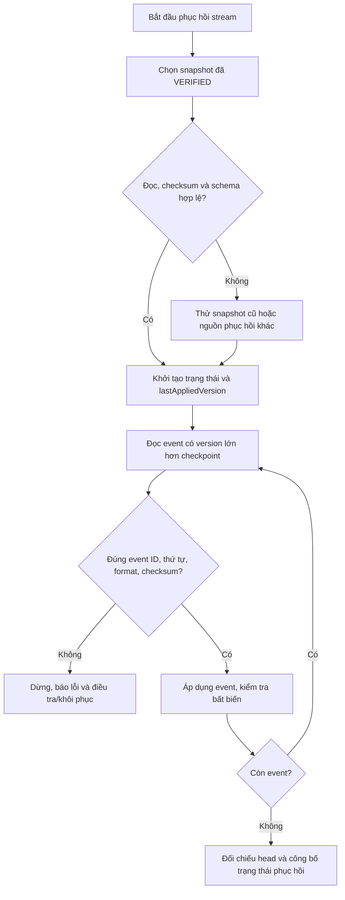

# Nhật ký chỉ ghi thêm và snapshot dưới góc độ lưu trữ

## 1. Tại sao phải giữ lịch sử thay đổi và tạo ảnh chụp trạng thái?

Một ứng dụng Java có thể lưu trạng thái hiện tại của đối tượng bằng cách cập nhật một hàng SQL: hàng tồn kho của sách `BOOK-JAVA` đang còn 7 cuốn. Cách đó rất thuận tiện cho truy vấn hiện tại, nhưng nếu người vận hành hỏi “Tại sao từ 10 cuốn còn 7?” thì con số `7` không tự trả lời được.

Một cách khác là giữ một **nhật ký chỉ ghi thêm** (*append-only log*): mỗi lần nhập, bán hoặc điều chỉnh kho tạo một bản ghi mới. Từ các bản ghi đó, ứng dụng có thể dựng lại số tồn tại một thời điểm cụ thể. Nhưng khi nhật ký có hàng triệu bản ghi, dựng lại từ đầu mỗi lần khởi động sẽ tốn thời gian. **Snapshot** là ảnh chụp trạng thái ở một mốc đã biết, cho phép bắt đầu khôi phục từ mốc ấy rồi chỉ áp dụng các thay đổi mới hơn.

Bài học thuộc chương **Mô hình lưu trữ** của module `DATA_PERSISTENCE_FUNDAMENTALS`. Trọng tâm là cơ chế lưu trữ, không giới hạn vào một framework: bản ghi được sắp xếp ra sao, thế nào là đã ghi bền vững, mốc snapshot có nghĩa gì, làm sao phát hiện thiếu/trùng/sai thứ tự và khôi phục sau lỗi. Người học cũng cần liên hệ với schema, truy vấn/chỉ mục, giao dịch, cô lập và đồng thời trong Java, cũng như tiến hóa định dạng, bảo mật, sao lưu và hiệu năng.

### Mục tiêu sau bài học

Bạn cần có khả năng:

1. Phân biệt nhật ký append-only ở tầng ứng dụng với write-ahead log của cơ sở dữ liệu và nhật ký audit.
2. Thiết kế ID, phiên bản, thứ tự, định dạng bản ghi và giới hạn kích thước để đọc lại log an toàn.
3. Tạo snapshot có **điểm cắt nhất quán** và phát lại đúng các thay đổi sau điểm cắt ấy.
4. Giải thích được các kịch bản crash trước/sau commit, ghi một phần, dữ liệu trùng, sự kiện sai thứ tự và snapshot lỗi.
5. Chọn cách lưu trữ/compaction/backup phù hợp mà không phá lịch sử hoặc khả năng phục hồi.
6. Thực hiện một ví dụ Java + SQL với ranh giới giao dịch rõ ràng.

## 2. Ba lớp khái niệm: trạng thái, nhật ký và snapshot

Xét một mã hàng `BOOK-JAVA` bắt đầu có 10 cuốn.

| Phiên bản | Thay đổi | Số tồn sau thay đổi |
| --- | ---: | ---: |
| 0 | Khởi tạo kho | 10 |
| 1 | Bán 3 | 7 |
| 2 | Nhập thêm 5 | 12 |
| 3 | Bán 2 | 10 |
| 4 | Điều chỉnh giảm 1 | 9 |

Có thể biểu diễn bằng nhật ký:

```text
stream = BOOK-JAVA
version 1  | delta = -3 | quantity_after = 7
version 2  | delta = +5 | quantity_after = 12
version 3  | delta = -2 | quantity_after = 10
version 4  | delta = -1 | quantity_after =  9
```

Trong ví dụ này, số tồn ban đầu `10` có thể được lưu dưới dạng một sự kiện khởi tạo riêng, một bản ghi gốc có phiên bản `0` hoặc snapshot nền. **Cần ghi lại điểm khởi tạo** nếu muốn dựng lại trạng thái hoàn toàn từ log.

Các thành phần có nhiệm vụ khác nhau:

- **Current state:** giá trị mới nhất phục vụ thao tác nghiệp vụ, chẳng hạn `quantity = 9`.
- **Append-only log:** chuỗi các thay đổi đã được chấp nhận. Khi sửa sai, thường thêm **bản ghi bù trừ** chứ không sửa các bản ghi lịch sử.
- **Snapshot:** trạng thái tại phiên bản cụ thể, ví dụ `{version: 2, quantity: 12}`, được tính từ nguồn hợp lệ.
- **Checkpoint:** metadata cho biết đã xử lý bền vững tới offset/phiên bản nào; có thể gắn với snapshot hoặc người tiêu thụ log. Checkpoint **không nhất thiết** chứa toàn bộ trạng thái.
- **Projection:** dạng dữ liệu dẫn xuất dùng cho đọc, ví dụ tổng tồn của từng mã hàng hoặc báo cáo bán hàng. Snapshot có thể chụp một projection, nhưng không vì thế mà snapshot trở thành toàn bộ log.

Một snapshot ở `version = 2` cùng các sự kiện `3` và `4` cho kết quả cuối:

```text
Snapshot: quantity = 12, lastAppliedVersion = 2
    + event v3: -2
    + event v4: -1
    = quantity 9, lastAppliedVersion = 4
```

Nếu phát lại nhầm event `v2` một lần nữa, kết quả sai. Nếu bỏ qua `v3`, kết quả cũng sai. Vì vậy **điểm cắt và thứ tự** là một phần của cấu trúc lưu trữ, không phải chi tiết phụ.

## 3. Append-only thực sự nghĩa là gì?

Một nhật ký logic append-only có hợp đồng: bản ghi đã cam kết không bị thay đổi tại chỗ; các thay đổi mới được bổ sung ở cuối chuỗi hoặc ở cuối một *stream* xác định. Điều này giúp truy vết và phát lại, nhưng không có nghĩa mọi byte trên ổ đĩa vĩnh viễn không được di chuyển. Storage engine có thể ghi lại page, hợp nhất segment, nén, chuyển tầng hoặc compact dữ liệu theo chính sách.

### 3.1. Các họ nhật ký cần phân biệt

| Loại | Ghi gì? | Mục đích | Có thể tự dựng trạng thái nghiệp vụ? |
| --- | --- | --- | --- |
| Nhật ký sự kiện nghiệp vụ (*domain event log*) | Các thay đổi có ý nghĩa nghiệp vụ, ID và thứ tự | Phát lại, tích hợp, lịch sử | Có, **nếu** mọi thay đổi cần thiết và trạng thái gốc đều được ghi |
| Write-ahead log (*WAL*) của DB | Thông tin đủ để engine phục hồi thao tác lưu trữ theo định dạng nội bộ | Độ bền giao dịch, crash recovery, replication | Thường không phải API sự kiện nghiệp vụ; không nên xem như domain event log |
| Audit log | Ai làm gì, lúc nào, kết quả nào | Điều tra, tuân thủ và truy vết | Chỉ khi nội dung đầy đủ và có hợp đồng phát lại; phần lớn không nên giả định |
| Transactional outbox | Sự kiện cần chuyển cho hệ thống khác, ghi trong cùng transaction với trạng thái nguồn | Không bỏ mất ý định phát thông điệp khi app chết | Thường phục vụ tích hợp, có thể không chứa mọi chi tiết để dựng lại nguồn |
| Log cập nhật dữ liệu dẫn xuất | Thay đổi cho cache, search, projection | Đồng bộ bản sao | Phụ thuộc định dạng, thời hạn giữ và nguồn gốc |

**WAL không phải event sourcing.** DB có thể dùng WAL để đảm bảo giao dịch dù ứng dụng chỉ dùng `UPDATE` thông thường. Ngược lại, ứng dụng có thể triển khai nhật ký sự kiện trên bảng SQL trong một DB vốn đã có WAL. Đây là hai tầng khác nhau.

**Event sourcing cũng không bắt buộc** chỉ vì dùng append-only log. Một hệ thống có thể lưu current state làm nguồn có thẩm quyền và lưu thay đổi như nhật ký audit đầy đủ trong cùng giao dịch. Khi muốn coi log là nguồn sự thật, phải bảo đảm nó có thể tái dựng trạng thái và có quy tắc nâng cấp sự kiện, giữ dữ liệu, xử lý thứ tự, xung đột.

### 3.2. Tại sao không ghi đè bản ghi cũ để sửa sai?

Giả sử một giao dịch trừ nhầm 3 cuốn thành 4 cuốn. Nếu sửa trực tiếp event cũ, những consumer đã đọc bản ghi đó và snapshot tạo từ nó có thể khác biệt với lịch sử mới. Thường nên thêm một sự kiện điều chỉnh `+1` có nguyên nhân và tham chiếu đến sự kiện cần sửa, nếu chính sách cho phép.

Tuy nhiên, **append-only không phải lý do để giữ dữ liệu nhạy cảm vô thời hạn**. Khi có yêu cầu xóa/ẩn thông tin, thiết kế cần tính đến che dữ liệu, compaction, giới hạn retention, quản lý khóa mã hóa và xử lý bản sao. Lịch sử nghiệp vụ và nghĩa vụ bảo mật phải được cân bằng trong thiết kế.

## 4. Cấu trúc một bản ghi log đáng tin cậy

Một event chỉ có chuỗi `"-3"` là quá mơ hồ. Để đọc lại và đối chiếu sau nhiều năm, bản ghi nên mang metadata rõ ràng.

Ví dụ logic:

```json
{
  "eventId": "2f1fd683-7e52-45de-b859-9e6bc421f2e4",
  "streamId": "BOOK-JAVA",
  "streamVersion": 3,
  "eventType": "InventoryAdjusted",
  "schemaVersion": 1,
  "requestId": "d3ba6516-e5df-4a0f-bd1f-fb246a9d65f1",
  "delta": -2,
  "quantityAfter": 10,
  "occurredAt": "2026-11-21T09:30:00Z"
}
```

Ý nghĩa:

| Trường | Vai trò |
| --- | --- |
| `eventId` | Nhận diện một event khi xử lý trùng hoặc tra cứu lỗi |
| `streamId` | Nhóm các sự kiện thuộc một đơn vị có thứ tự riêng |
| `streamVersion` | Phiên bản tăng đơn điệu, giúp phát hiện thiếu hoặc sai thứ tự trong stream |
| `eventType` | Nghĩa của thay đổi, khác với tên bảng hay cách serialize |
| `schemaVersion` | Cách giải mã diễn giải payload ở phiên bản tương ứng |
| `requestId` | Liên kết với yêu cầu logic để xử lý retry sau timeout |
| `delta` | Thay đổi số lượng; kiểu, giới hạn và đơn vị phải rõ |
| `quantityAfter` | Giá trị kiểm chứng sau áp dụng; có thể không cần nếu format định nghĩa khác |
| `occurredAt` | Thời gian tham chiếu; **không nên tự dùng làm thứ tự toàn cục** |

Đối với nhiều stream, phiên bản `3` của `BOOK-JAVA` không được so sánh trực tiếp với phiên bản `3` của `BOOK-SQL`. Nếu nghiệp vụ cần thứ tự giữa nhiều stream, phải có một cơ chế sắp xếp toàn cục hoặc ranh giới giao dịch được xác định riêng.

### 4.1. Khóa sự kiện, thứ tự và lỗ hổng phiên bản

Đối với mỗi stream, hợp đồng đơn giản là `v1, v2, v3, ...` liên tiếp. Tại thời điểm append, chỉ chấp nhận event nếu phiên bản mong đợi khớp phiên bản hiện tại. Reader khi replay kiểm tra:

```text
snapshot.version = 2
expect next = 3
read event version 3 -> OK, expect 4
read event version 5 -> GAP (thiếu v4), dừng và báo lỗi
read event version 3 -> DUPLICATE/OLD, không tự áp dụng lần nữa
```

**Cảnh báo quan trọng:** một ID tự tăng trong cơ sở dữ liệu **không đương nhiên là thứ tự commit**. Hai giao dịch có thể được cấp `id = 100` và `id = 101` nhưng `101` commit trước `100`; sequence cũng có thể bị nhảy số sau rollback. Nếu lấy `MAX(id)` làm checkpoint rồi bỏ qua mọi ID nhỏ hơn, có thể bỏ sót giao dịch commit muộn. Dùng phiên bản tuần tự được bảo vệ theo stream, offset do hệ thống log xác nhận đã bền vững hoặc giao thức snapshot có **consistent cut** rõ ràng.

### 4.2. Biểu diễn trên đĩa: framing và integrity

Trong tệp nhị phân, một khung minh họa có thể là:

```text
+----------------- Header -----------------+---- Payload ----+
| magic | formatVersion | length | checksum | event bytes     |
+------------------------------------------+----------------+

magic         4 byte: nhận diện định dạng
formatVersion 2 byte: cách đọc payload
length        4 byte: kích thước payload
checksum      4 byte: CRC32C của payload
payload       length byte: dữ liệu có schema xác định
```

Các trường đa byte phải quy định endianness; chuỗi phải quy định charset, ví dụ UTF-8. Reader cần kiểm tra `length >= 0` và giới hạn tối đa **trước khi cấp phát bộ nhớ**, dùng thao tác đọc đủ byte, từ chối header/schema không biết, kiểm tra checksum và validate dữ liệu nghiệp vụ.

Checksum như CRC32C giúp phát hiện lỗi ghi/truyền không chủ ý, **không chứng minh tính xác thực** trước người sửa dữ liệu có chủ đích. Nếu cần chống giả mạo, dùng MAC/chữ ký số, quyền truy cập và quản lý khóa phù hợp.

Với log tệp, nên phân đoạn thành nhiều `segment` có giới hạn kích thước và metadata để không phải quét từ đầu tệp khổng lồ. Có thể duy trì index chỉ tới vị trí của một offset hoặc phiên bản, nhưng chỉ mục cũng cần được xây lại hoặc phục hồi nhất quán sau lỗi.

## 5. Ghi vào nhật ký: atomicity, ordering và durability

Một thao tác append có ít nhất bốn mốc:

1. Nhận lệnh từ người dùng và kiểm tra quyền, quy tắc nghiệp vụ.
2. Ghi event vào bộ đệm hoặc vào DB/tệp.
3. Lưu bền vững theo hợp đồng commit.
4. Trả xác nhận thành công cho client.

Đừng coi mốc 2 là mốc 3. Một lời gọi `write` hoặc `flush` có thể thành công khi dữ liệu còn trong cache của hệ điều hành hoặc thiết bị. Với tệp thông thường, cần thiết kế `FileChannel.force(...)` hoặc cơ chế đồng bộ tương ứng và hiểu giới hạn filesystem/phần cứng. Với DB, durability sau `COMMIT` phụ thuộc chế độ commit/WAL/replication của engine và cấu hình triển khai.

### 5.1. Chỉ một writer hay nhiều writer?

Khi nhiều luồng cùng append, hệ thống phải bảo vệ việc cấp phiên bản và thứ tự:

- **Single writer theo partition/stream:** serialize các lệnh ghi ở một nơi, đơn giản hóa thứ tự nhưng cần cơ chế chuyển chủ khi lỗi.
- **Optimistic concurrency:** mỗi lệnh mang `expectedVersion`, chỉ append khi phiên bản nguồn vẫn đúng; nếu không, trả xung đột và quyết định retry.
- **Khóa giao dịch:** DB giữ khóa hàng hiện tại khi cập nhật và ghi event trong cùng transaction.
- **Phân vùng theo stream:** các mã hàng khác nhau có thể ghi song song; nếu thao tác chạm nhiều stream, cần giao dịch hoặc quy trình phối hợp riêng.

Đơn giản hóa bằng một biến `AtomicLong` trong JVM không đủ khi có nhiều tiến trình hoặc khi máy khởi động lại. Nguồn cấp phiên bản phải có cơ chế bền vững và quản lý đồng thời phù hợp.

### 5.2. Nguy cơ crash trong lúc append

```text
Crash trước khi ghi byte nào:
    Không có event mới; có thể thử lại theo request ID.

Crash giữa header hoặc payload:
    Đuôi tệp có thể chứa frame chưa hoàn chỉnh.

Crash sau ghi byte nhưng trước mốc bền vững:
    Reader sau khởi động lại có thể thấy hoặc không thấy event.

Crash sau commit bền vững nhưng trước khi gửi phản hồi:
    Client không biết chắc event đã được ghi; cần tra theo request ID.
```

Recovery có thể bỏ phần **đuôi chưa hoàn chỉnh** nếu giao thức nói rõ đuôi chưa hoàn chỉnh chưa từng được xác nhận và writer dừng tại mốc commit hợp lệ. Không nên tùy tiện bỏ phần log hỏng **ở giữa** rồi tiếp tục như chưa có gì xảy ra; làm vậy có thể phá thứ tự, checksum và bất biến.

Nếu một bản ghi `v4` đã được xác nhận nhưng `v3` thiếu, recovery phải coi đó là lỗi toàn vẹn hoặc có cơ chế phục hồi nguồn khác. “Đọc được 99% event” không đủ khi 1% bị thiếu có thể làm số tồn sai.

### 5.3. Bảo đảm một lần và idempotency

Khi phản hồi commit bị mất, client có thể gửi lại cùng thao tác. Cơ chế phổ biến là gán `requestId` duy nhất cho một yêu cầu logic và lưu nó cùng event. Khi nhận lại:

- Tìm request đã tồn tại và trả kết quả đã cam kết, sau khi kiểm tra cùng chủ thể và nội dung yêu cầu.
- Nếu chưa có, thực hiện thao tác mới dưới ràng buộc unique/khóa đồng thời.
- Nếu tranh chấp xảy ra, xử lý lỗi unique bằng cách rollback rồi tra lại kết quả.

Một log có thể ghi mỗi event đúng một lần nhờ khóa duy nhất, nhưng **hệ thống tiêu thụ** vẫn có thể xử lý lại event sau khi mất ACK. Vì vậy consumer cần idempotency riêng, ví dụ lưu `eventId` đã áp dụng cùng transaction với projection.

## 6. Snapshot là gì và không phải gì?

Snapshot là dữ liệu mô tả trạng thái hợp lệ tại một **điểm cắt** của log hoặc của nguồn trạng thái. Nó thường chứa:

- Định danh stream hoặc tập dữ liệu.
- Phiên bản/offset cuối cùng đã được áp dụng **bao gồm**.
- Giá trị trạng thái cần thiết để tiếp tục tính toán.
- Phiên bản schema/format của snapshot.
- Metadata tạo snapshot, kích thước, checksum và thông tin mã hóa.
- Thông tin kiểm tra/khôi phục nếu nằm ở kho khác.

Ví dụ:

```json
{
  "snapshotSchemaVersion": 1,
  "streamId": "BOOK-JAVA",
  "lastAppliedVersion": 2,
  "quantity": 12,
  "createdAt": "2026-11-21T10:00:00Z"
}
```

Quy tắc phát lại phải thống nhất: snapshot `lastAppliedVersion = 2` **đã bao gồm** `v1` và `v2`. Reader chỉ áp dụng các event có phiên bản **lớn hơn 2** theo đúng thứ tự.

**Snapshot không phải backup độc lập.** Snapshot giúp rút ngắn thời gian dựng trạng thái; nếu snapshot và log cùng nằm trên một hệ thống mất dữ liệu, vẫn có thể mất toàn bộ. Backup cần chiến lược lưu bản sao an toàn, phục hồi theo mốc, quyền, khóa mã hóa và diễn tập khôi phục.

### 6.1. Điểm cắt nhất quán (*consistent cut*)

Giả sử đang tạo snapshot khi một writer đồng thời ghi `v5`. Các khả năng:

- Snapshot thấy trạng thái ở `v4` và ghi checkpoint `4`: hợp lệ.
- Snapshot thấy trạng thái ở `v5` và ghi checkpoint `5`: hợp lệ.
- Snapshot thấy **giá trị đã gồm `v5` nhưng ghi checkpoint `4`**: sai; replay `v5` một lần nữa.
- Snapshot thấy giá trị ở `v4` nhưng ghi checkpoint `5`: sai; replay bỏ qua `v5`.

Phải chụp **giá trị trạng thái và checkpoint từ cùng một lát cắt nhất quán**. Với một hàng DB lưu đồng thời `quantity` và `version`, một câu `SELECT` đọc hai cột cùng hàng trong một snapshot nhất quán là cách đơn giản. Với nhiều bảng hoặc nhiều stream, cần một transaction đọc ở mức cô lập/snapshot phù hợp hoặc giao thức barrier/watermark khác. Không tự dùng đồng hồ hệ thống làm điểm cắt đúng tuyệt đối.

### 6.2. Snapshot đầy đủ và snapshot tăng dần

- **Full snapshot:** ghi toàn bộ trạng thái ở mốc đã biết. Dễ phục hồi nhưng tốn IO/dung lượng.
- **Incremental snapshot/checkpoint:** chỉ lưu phần thay đổi từ mốc trước. Tiết kiệm chi phí mỗi lần nhưng cần một **chuỗi phụ thuộc** đầy đủ và quy tắc khôi phục thứ tự.
- **Snapshot theo stream:** chụp từng mã hàng độc lập, thuận tiện khi các stream không phụ thuộc nhau.
- **Snapshot toàn hệ thống:** cần bảo toàn quan hệ giữa nhiều tập dữ liệu, giao dịch và checkpoint tương ứng. Chụp mỗi bảng ở một thời điểm tùy ý có thể tạo trạng thái chưa từng tồn tại.

**Cần lựa chọn theo bất biến nghiệp vụ.** Ví dụ thao tác chuyển hàng giữa hai kho phải giảm ở kho A và tăng ở kho B cùng nhau; snapshot từng kho tại hai thời điểm khác nhau có thể tạo tổng tồn không đúng. Muốn khôi phục trạng thái toàn hệ thống nhất quán, cần snapshot trên một consistent cut có bao gồm hoặc loại trừ toàn bộ giao dịch liên quan.

## 7. Quy trình tạo và công bố snapshot an toàn

Một quy trình snapshot có thể gồm:

1. Chọn một checkpoint đã xác nhận bền vững và một lát cắt trạng thái phù hợp.
2. Tạo snapshot trong bộ nhớ hoặc tệp tạm với schema version, mốc đã áp dụng và dữ liệu.
3. Ghi trọn vẹn, tính checksum; không coi tệp chưa hoàn chỉnh là snapshot hợp lệ.
4. Đọc kiểm tra hoặc xác minh sau ghi theo yêu cầu về độ tin cậy.
5. **Công bố** snapshot bằng cập nhật manifest/con trỏ “snapshot hiện hành” chỉ khi bản mới đã hợp lệ.
6. Giữ snapshot cũ ít nhất tới khi bản mới và đường phục hồi được xác minh, theo chính sách lưu trữ.
7. Chỉ sau đó mới cân nhắc dọn log cũ nếu không còn consumer, yêu cầu audit hay backup nào cần.

### 7.1. Snapshot trong cùng DB

Nếu bảng hiện tại chứa `quantity` và `version` đã được cập nhật nguyên tử, có thể lưu snapshot trong một bảng khác bằng một câu `INSERT ... SELECT` từ cùng hàng. DB sẽ đọc cùng một phiên bản hàng nhất quán trong câu lệnh đó.

```sql
INSERT INTO inventory_snapshots (sku, last_version, quantity)
SELECT sku, version, quantity
FROM inventory_heads
WHERE sku = 'BOOK-JAVA'
ON CONFLICT (sku, last_version) DO NOTHING;
```

Tại đây `ON CONFLICT` là cú pháp PostgreSQL. Nếu một writer cập nhật nguồn đồng thời, snapshot lấy giá trị và phiên bản cùng nhau theo quy tắc MVCC/statement snapshot của DB. Sau đó cần kiểm tra sự liên tục giữa checkpoint và các event sẽ dùng để replay.

### 7.2. Snapshot nằm ở tệp hoặc object storage

Khi lưu snapshot ngoài DB, nên dùng một manifest:

```text
snapshotKey: inventory/BOOK-JAVA/v000004.snap
streamId: BOOK-JAVA
lastAppliedVersion: 4
snapshotSchemaVersion: 1
checksumSha256: <giá trị băm của chính byte snapshot>
status: VERIFIED
```

Worker ghi bản tạm bằng tên/khóa duy nhất, xác minh byte đã lưu, rồi cập nhật manifest để người đọc chọn nó. Một transaction JDBC **không** tự rollback việc tải object lên kho ngoài DB. Nếu ứng dụng chết giữa upload và cập nhật manifest, lần chạy lại phải tra cứu object và checksum theo khóa ổn định, hoàn tất hoặc thu gom bản mồ côi theo quy trình.

Với hệ thống file, thao tác thay thế snapshot thường dùng tệp tạm, ghi/đồng bộ dữ liệu và `rename` nguyên tử nếu cùng filesystem có hỗ trợ. Tuy nhiên, **atomic rename khác durability sau mất điện**; việc đồng bộ thư mục/metadata còn phụ thuộc nền tảng. Không khẳng định mọi hệ điều hành hoặc object store đều cung cấp cùng một mô hình bền vững.

### 7.3. Hai checkpoint có thể khác nhau

- Checkpoint **snapshot của stream** ghi trạng thái đã áp dụng tới phiên bản `V`.
- Checkpoint **consumer** ghi event đã xử lý thành công tới offset `O`.

Không được mặc định `V = O` khi chúng thuộc các không gian thứ tự khác nhau. Ví dụ một consumer dashboard xử lý nhiều stream có offset broker riêng, trong khi snapshot hàng tồn là phiên bản của một SKU. Muốn quyết định segment nào xóa được phải xét **mọi người tiêu thụ còn cần dữ liệu**, không chỉ snapshot của một stream.

## 8. Replay: khôi phục từ snapshot rồi áp dụng phần đuôi log

Quy trình khôi phục cho mỗi stream:



Nếu không có snapshot hợp lệ, có thể bắt đầu từ sự kiện khởi tạo gốc hoặc snapshot nền **khi toàn bộ log cần thiết còn đầy đủ**. Không tự coi “không tìm thấy snapshot” là lý do đặt số tồn bằng `0` trong mọi tình huống.

### 8.1. Java 17: phát lại với phát hiện thiếu và sai lệch

Ví dụ thuần Java sau giả định các event của một SKU đã được đọc từ kho lưu trữ và **sắp theo streamVersion tăng dần**. Nó kiểm tra liên tục, overflow và bất biến số lượng không âm.

```java
import java.util.List;

record InventorySnapshot(
        String sku,
        long lastAppliedVersion,
        long quantity
) {}

record InventoryEvent(
        String sku,
        long streamVersion,
        long delta,
        long quantityAfter
) {}

record RecoveredInventory(
        String sku,
        long version,
        long quantity
) {}

public final class InventoryReplayer {
    private InventoryReplayer() {}

    public static RecoveredInventory replay(
            InventorySnapshot snapshot,
            List<InventoryEvent> events) {

        if (snapshot.lastAppliedVersion() < 0 || snapshot.quantity() < 0) {
            throw new IllegalArgumentException("Snapshot không hợp lệ");
        }

        long version = snapshot.lastAppliedVersion();
        long quantity = snapshot.quantity();

        for (InventoryEvent event : events) {
            if (!snapshot.sku().equals(event.sku())) {
                throw new IllegalStateException("Event thuộc stream khác");
            }

            long expectedVersion = Math.addExact(version, 1);
            if (event.streamVersion() != expectedVersion) {
                throw new IllegalStateException(
                    "Thiếu, trùng hoặc sai thứ tự event tại v"
                    + event.streamVersion());
            }

            quantity = Math.addExact(quantity, event.delta());
            if (quantity < 0 || quantity != event.quantityAfter()) {
                throw new IllegalStateException(
                    "Bất biến tồn kho hoặc quantityAfter bị sai");
            }

            version = event.streamVersion();
        }

        return new RecoveredInventory(snapshot.sku(), version, quantity);
    }
}
```

Mã trên minh họa **kiểm tra replay**, chưa phải một log engine hoàn chỉnh. Trước khi gọi, tầng đọc phải kiểm tra checksum, schema, kích thước, chữ ký nếu có, quyền và lấy đúng các event có `version > snapshot.lastAppliedVersion`. Nếu event mới hơn chưa đọc hết do pagination, chỉ được công bố trạng thái tương ứng checkpoint đã thực sự áp dụng; không báo đây là trạng thái mới nhất mà không kiểm tra đã bắt kịp nguồn.

Nếu muốn hỗ trợ duplicate một cách idempotent trong consumer, không đơn giản dùng `continue` cho mọi phiên bản cũ; phải dựa trên event ID/checkpoint đã xác minh và bảo đảm không che lấp event sai thứ tự hoặc payload khác ID. Với bản lưu nguồn có thứ tự nghiêm ngặt, gặp lỗ hổng là tín hiệu cần dừng.

### 8.2. Ví dụ phát lại cụ thể

```text
Snapshot: { sku=BOOK-JAVA, lastAppliedVersion=2, quantity=12 }

Event v3: delta=-2, quantityAfter=10  -> hợp lệ
Event v4: delta=-1, quantityAfter=9   -> hợp lệ

Kết quả: version=4, quantity=9

Nếu Event v3 bị mất:
Event v4 đến khi expected=3 -> lỗi thứ tự, KHÔNG công bố quantity=11.
```

Việc kiểm tra `quantityAfter` cho phép phát hiện một số sai lệch ngay cả khi số lượng vẫn không âm. Tuy nhiên nó không thay thế xác thực toàn vẹn chuỗi log; người tấn công có quyền sửa cả event lẫn giá trị kiểm chứng có thể tạo chuỗi giả nhìn có vẻ hợp lệ.

## 9. Ví dụ SQL: lưu head, nhật ký và snapshot trong cùng DB

Để học cơ chế transaction, có thể lưu current state, append-only event và snapshot trong một DB quan hệ. Đây là **một cách triển khai**, không phải yêu cầu bắt buộc đối với mọi hệ thống dùng log.

### 9.1. Lược đồ PostgreSQL minh họa

```sql
CREATE TABLE inventory_heads (
    sku         VARCHAR(80) PRIMARY KEY,
    quantity    BIGINT NOT NULL CHECK (quantity >= 0),
    version     BIGINT NOT NULL DEFAULT 0 CHECK (version >= 0),
    updated_at  TIMESTAMPTZ NOT NULL DEFAULT CURRENT_TIMESTAMP
);

CREATE TABLE inventory_log (
    sku            VARCHAR(80) NOT NULL
                   REFERENCES inventory_heads(sku),
    stream_version BIGINT NOT NULL CHECK (stream_version > 0),
    request_id     UUID NOT NULL UNIQUE,
    delta          BIGINT NOT NULL CHECK (delta <> 0),
    quantity_after BIGINT NOT NULL CHECK (quantity_after >= 0),
    occurred_at    TIMESTAMPTZ NOT NULL DEFAULT CURRENT_TIMESTAMP,
    PRIMARY KEY (sku, stream_version)
);

CREATE TABLE inventory_snapshots (
    sku                  VARCHAR(80) NOT NULL
                         REFERENCES inventory_heads(sku),
    last_version         BIGINT NOT NULL CHECK (last_version >= 0),
    quantity             BIGINT NOT NULL CHECK (quantity >= 0),
    snapshot_format      SMALLINT NOT NULL DEFAULT 1,
    created_at           TIMESTAMPTZ NOT NULL DEFAULT CURRENT_TIMESTAMP,
    PRIMARY KEY (sku, last_version)
);

INSERT INTO inventory_heads (sku, quantity)
VALUES ('BOOK-JAVA', 10);
```

Trong ví dụ này, `inventory_heads` là bảng đọc nhanh và cũng là nơi giữ phiên bản cập nhật theo stream. Nhật ký ghi cùng giao dịch với head để có thể đối chiếu/tái dựng theo quy tắc. Nếu muốn head chỉ là cache có thể dựng lại hoàn toàn, cần ghi **trạng thái khởi tạo 10 cuốn vào log hoặc snapshot nền v0** và giữ nguồn khởi tạo ấy bền vững. Nếu không có điểm khởi tạo, replay chỉ từ các delta không thể suy ra số tồn ban đầu.

Ở đây FK từ log/snapshot đến head giả định các SKU hiện hữu không bị xóa vật lý trước khi hết thời hạn giữ lịch sử. Nếu nghiệp vụ cần xóa head nhưng giữ log, phải thiết kế lại quan hệ/metadata thay vì bật cascade xóa hết lịch sử.

### 9.2. Ghi đồng thời head và event

Một thao tác bán ba cuốn phải cập nhật `inventory_heads` và ghi đúng một event **cùng giao dịch**:

```sql
BEGIN;

UPDATE inventory_heads
SET quantity = quantity - 3,
    version = version + 1,
    updated_at = CURRENT_TIMESTAMP
WHERE sku = 'BOOK-JAVA'
  AND quantity >= 3
RETURNING version, quantity;

-- Giả sử trả về version=1, quantity=7.
-- Nếu không có đúng một hàng: ROLLBACK, không INSERT event.

INSERT INTO inventory_log (
    sku, stream_version, request_id, delta, quantity_after
) VALUES (
    'BOOK-JAVA',
    1,
    '11111111-1111-4111-8111-111111111111',
    -3,
    7
);

COMMIT;
```

Trong mã ứng dụng, `version` và `quantity` của `INSERT` phải được lấy trực tiếp từ kết quả `UPDATE ... RETURNING`, không hard-code như các giá trị minh họa trên. Nếu ghi log thất bại vì request trùng hoặc DB lỗi, rollback cũng hoàn tác thay đổi của head. Nếu hai giao dịch tranh cùng một SKU, lệnh `UPDATE` trên cùng hàng được DB điều phối theo cơ chế khóa và cô lập tương ứng, nhờ đó các phiên bản được cấp theo thay đổi đã commit.

Ràng buộc trên bảng log và head giúp phát hiện nhiều lỗi, nhưng không thể bảo đảm mọi writer đều luôn gọi đúng hai câu SQL nếu có luồng ghi bypass service. Khi yêu cầu audit nghiêm ngặt, hạn chế quyền ghi trực tiếp, dùng transaction API tập trung, trigger hoặc stored procedure theo kiến trúc đã lựa chọn, và đối soát định kỳ.

### 9.3. Java/JDBC: cùng kết nối, cùng transaction

```java
import java.sql.Connection;
import java.sql.PreparedStatement;
import java.sql.ResultSet;
import java.sql.SQLException;
import java.util.UUID;
import javax.sql.DataSource;

public final class InventoryService {
    private final DataSource dataSource;

    public InventoryService(DataSource dataSource) {
        this.dataSource = dataSource;
    }

    public long adjust(String sku, long delta, UUID requestId)
            throws SQLException {
        if (delta == 0) {
            throw new IllegalArgumentException("Delta phải khác 0");
        }

        try (Connection connection = dataSource.getConnection()) {
            connection.setAutoCommit(false);
            try {
                long version;
                long quantityAfter;

                String update = """
                    UPDATE inventory_heads
                    SET quantity = quantity + ?,
                        version = version + 1,
                        updated_at = CURRENT_TIMESTAMP
                    WHERE sku = ?
                      AND quantity + ? >= 0
                    RETURNING version, quantity
                    """;

                try (PreparedStatement statement =
                        connection.prepareStatement(update)) {
                    statement.setLong(1, delta);
                    statement.setString(2, sku);
                    statement.setLong(3, delta);

                    try (ResultSet rows = statement.executeQuery()) {
                        if (!rows.next()) {
                            throw new IllegalStateException(
                                "SKU không tồn tại hoặc không đủ tồn kho");
                        }
                        version = rows.getLong("version");
                        quantityAfter = rows.getLong("quantity");
                    }
                }

                String append = """
                    INSERT INTO inventory_log
                        (sku, stream_version, request_id, delta, quantity_after)
                    VALUES (?, ?, ?, ?, ?)
                    """;

                try (PreparedStatement statement =
                        connection.prepareStatement(append)) {
                    statement.setString(1, sku);
                    statement.setLong(2, version);
                    statement.setObject(3, requestId);
                    statement.setLong(4, delta);
                    statement.setLong(5, quantityAfter);
                    if (statement.executeUpdate() != 1) {
                        throw new SQLException("Không append được event");
                    }
                }

                connection.commit();
                return quantityAfter;
            } catch (SQLException | RuntimeException error) {
                try {
                    connection.rollback();
                } catch (SQLException rollbackError) {
                    error.addSuppressed(rollbackError);
                }
                throw error;
            }
        }
    }
}
```

Giải thích:

- `PreparedStatement` dùng tham số, tránh ghép SQL từ đầu vào.
- `UPDATE ... RETURNING` là cú pháp PostgreSQL; ví dụ dùng Java 17 text block. DB/driver khác có thể cần cú pháp hoặc cách lấy giá trị khác.
- DB kiểm tra `quantity + delta >= 0` tại thời điểm cập nhật. Nếu phép cộng `BIGINT` bị tràn, PostgreSQL trả lỗi; transaction rollback thay vì âm thầm vòng số.
- `version` và `quantityAfter` được đọc từ cùng câu cập nhật, rồi ghi vào log trên cùng `Connection` trước `commit`.
- `UNIQUE(request_id)` khiến một yêu cầu lặp không thể ghi thêm event mới. Khi gặp lỗi trùng, service cần rollback và **tra lại kết quả theo request ID** sau đó, xác thực rằng request lặp có cùng SKU, delta và chủ thể hợp lệ. Mã minh họa chưa triển khai đường trả lại kết quả idempotent này.
- Khi mất mạng đúng lúc `commit`, `rollback` được gọi trong `catch` không chứng minh giao dịch đã thất bại; caller phải đối chiếu theo `request_id` ở nguồn có thẩm quyền.
- Không giữ giao dịch mở trong lúc xuất snapshot lớn hoặc ghi lên object storage; các thao tác đó cần workflow riêng.

### 9.4. Tạo snapshot và đọc phần đuôi log

Lưu snapshot nội DB:

```sql
INSERT INTO inventory_snapshots (sku, last_version, quantity)
SELECT sku, version, quantity
FROM inventory_heads
WHERE sku = 'BOOK-JAVA'
ON CONFLICT (sku, last_version) DO NOTHING;
```

Để khôi phục một SKU từ snapshot mới nhất:

```sql
SELECT last_version, quantity
FROM inventory_snapshots
WHERE sku = 'BOOK-JAVA'
ORDER BY last_version DESC
LIMIT 1;
```

Giả sử nhận `last_version = 2` và `quantity = 12`:

```sql
SELECT stream_version, delta, quantity_after
FROM inventory_log
WHERE sku = 'BOOK-JAVA'
  AND stream_version > 2
ORDER BY stream_version ASC;
```

Reader phải đảm bảo chọn snapshot **đã xác minh** và sự kiện nằm trong lát cắt dữ liệu đủ để phục hồi đúng mốc yêu cầu. Nếu replay đồng thời với các giao dịch mới trên DB, cần xác định muốn dựng lại tới checkpoint nào và đọc ở transaction snapshot phù hợp, hoặc nắm mốc phiên bản đích rồi quét tới mốc ấy. Không tự khẳng định reader đã theo kịp phiên bản mới nhất nếu nguồn tiếp tục có ghi.

## 10. Dọn nhật ký: compaction, retention và khôi phục

Log append-only sẽ tăng kích thước theo thời gian. Có thể giảm chi phí bằng snapshot, phân đoạn và chính sách dọn dẹp, nhưng **xóa log cũ là quyết định liên quan đến quyền, audit và khả năng phục hồi**.

### 10.1. Compaction khác xóa tùy tiện

Một cơ chế compaction có thể:

- Gộp nhiều event thành một trạng thái snapshot tại mốc đã kiểm chứng.
- Giữ các event kể từ mốc cần phát lại.
- Loại bỏ thông tin trùng hoặc segment cũ **khi đã bảo đảm** các consumer và chính sách lưu trữ không còn cần.
- Giữ metadata index/manifest để chứng minh dữ liệu nào đã được compact.

Nếu log là **lịch sử nghiệp vụ hoặc bằng chứng kiểm toán**, snapshot không thay thế được câu hỏi “Ai đã thay đổi số tồn, lúc nào, vì sao?”. Khi đó có thể phải giữ log dài hạn hoặc lưu trữ lạnh có khả năng tra cứu lịch sử; chỉ giữ snapshot là mất các thay đổi trung gian.

### 10.2. Điều kiện trước khi xóa segment cũ

Một quy trình an toàn cần kiểm tra:

1. Snapshot hoặc checkpoint thay thế đã **ghi bền vững và đọc xác minh**.
2. Các bản ghi mới sau checkpoint vẫn đủ để replay từ đó.
3. Không có consumer đang chậm hoặc cần phát lại từ offset cũ.
4. Không có yêu cầu lưu giữ, đối soát, điều tra hoặc legal hold buộc giữ lịch sử.
5. Backup/replica/khôi phục đã tính đến việc segment bị dọn.
6. Quy trình dọn có trạng thái và có thể retry; không xóa cả loạt chỉ dựa trên thời gian.

Ví dụ một snapshot v100 đã được tạo, nhưng một consumer mới xử lý tới v80. Nếu xóa log v81–v100 mà consumer đó không thể bắt đầu từ snapshot tương thích, consumer sẽ không bắt kịp nguồn. Với multi-stream, cần watermarks riêng cho từng consumer/partition và thiết kế điểm khởi tạo tương ứng.

### 10.3. Log ở tầng nóng và lạnh

Nhật ký lâu năm có thể được chuyển sang object storage hoặc kho lưu trữ lạnh cùng schema version, index và checksum. Lúc cần tra cứu lịch sử, hệ thống có thể tải lại segment, xác minh và dựng một bản đọc độc lập. Dữ liệu lạnh có độ trễ và chi phí truy xuất riêng; cần công bố điều đó trong hợp đồng phục hồi.

**Không nhầm snapshot với backup hoặc archive:** snapshot tối ưu điểm bắt đầu replay; backup bảo vệ trước mất mát; archive phục vụ giữ dữ liệu lâu dài ít truy cập. Có thể phối hợp cả ba, nhưng mục tiêu và điều kiện xóa khác nhau.

## 11. Schema evolution: log cũ và snapshot cũ vẫn phải đọc được

Append-only log có đặc tính quan trọng: event cũ có thể được đọc lại rất lâu sau khi ứng dụng sinh ra nó đã bị nâng cấp. Đổi tên trường hoặc enum một cách tùy tiện sẽ làm hỏng replay dù bản ghi byte vẫn nguyên vẹn.

Ví dụ phiên bản 1 có event:

```json
{"schemaVersion":1,"type":"StockChanged","delta":-3}
```

Phiên bản 2 có thể thêm lý do:

```json
{"schemaVersion":2,"type":"StockChanged","delta":-3,"reason":"SALE"}
```

Reader mới cần biết cách diễn giải event v1 khi không có `reason`, ví dụ gán `UNKNOWN` nếu nghiệp vụ chấp nhận. Không tự gán lý do `SALE` cho mọi event cũ. Nếu schema thay đổi đơn vị, tên trường, cấu trúc nested hoặc cách định danh stream, phải viết chuyển đổi có kiểm tra và dữ liệu mẫu đối chiếu.

### 11.1. Quy tắc tương thích

| Thay đổi | Rủi ro khi replay | Cách xử lý |
| --- | --- | --- |
| Thêm trường tùy chọn | Reader cũ không hiểu | Quy định bỏ qua trường không biết và giá trị mặc định |
| Đổi tên/kiểu trường | Reader mới đọc sai dữ liệu cũ | Versioned decoder hoặc upcaster |
| Đổi nghĩa event | Cùng tên nhưng tính trạng thái khác | Tạo event type mới hoặc conversion tường minh |
| Thêm trạng thái enum | Consumer cũ không biết mã mới | Xử lý unknown và kế hoạch triển khai |
| Đổi đơn vị thời gian/tiền | Tính toán sai mà không báo lỗi | Ghi rõ đơn vị, kiểm tra khi migrate |
| Snapshot có schema khác | Snapshot cũ không deserialize được | Versioned snapshot reader hoặc tái dựng từ log còn đầy đủ |
| Dọn mất event cũ quá sớm | Không còn nguồn để tái dựng khi decoder lỗi | Retention theo khả năng phục hồi và backup |

**Snapshot cần phiên bản riêng** so với event: snapshot thường chứa state hiện tại, còn event mô tả thay đổi. Hai cấu trúc tiến hóa không nhất thiết cùng nhịp.

### 11.2. Triển khai không đồng thời

Trong hệ thống nhiều dịch vụ, writer mới có thể phát event khi reader cũ vẫn chạy. Cần giữ khả năng tương thích theo chiến lược triển khai, kiểm tra từ trước trên dữ liệu lịch sử, dùng schema registry nếu kiến trúc yêu cầu. Các event trong log hoặc bản lưu lạnh có thể có nhiều schema version cùng tồn tại.

Khi snapshot v2 đã tạo nhưng hệ thống khôi phục dùng reader v1, cần quyết định có hỗ trợ đọc ngược hay không. Không mặc nhiên giả định nâng cấp ứng dụng có thể rollback bất kỳ lúc nào nếu dữ liệu mới đã dùng schema không tương thích.

## 12. Tính nhất quán khi có nhiều bản ghi và nhiều hệ thống

### 12.1. Giao dịch có nhiều stream

Giả sử chuyển 3 cuốn sách từ kho A sang kho B. Nếu hệ thống chỉ append `-3` vào log A rồi gặp lỗi trước khi append `+3` vào log B, tổng tồn sai.

Nếu cùng một DB quan hệ, có thể cập nhật hai head và ghi hai event trong **một transaction**; khóa theo thứ tự ổn định để giảm deadlock. Nếu hai kho thuộc hai dịch vụ/DB độc lập, transaction cục bộ không bao trùm cả hai. Cần saga/workflow có trạng thái, điều kiện thành công và cơ chế bù trừ hoặc giao dịch phân tán được thiết kế cụ thể. Snapshot cho mỗi kho cũng phải được tạo tại một lát cắt có nghĩa nếu sau này dùng để khôi phục tổng toàn hệ thống.

### 12.2. Sự kiện ngoài DB: outbox và consumer

Khi ứng dụng cần xuất event sang broker hoặc search index:

```text
Transaction DB:
    cập nhật inventory_heads
    append inventory_log
    append outbox_events
COMMIT

Outbox worker:
    đọc outbox
    gửi event
    đợi ACK
    đánh dấu tiến độ

Consumer:
    kiểm tra eventId đã xử lý
    cập nhật projection và checkpoint cùng transaction
```

Nếu worker gửi event xong nhưng mất ACK, nó có thể gửi lại. Transactional outbox bảo đảm **ý định phát sự kiện được ghi cùng giao dịch nguồn**; nó không tự tạo “exactly once” xuyên suốt các hệ thống. Consumer vẫn phải chống lặp và xử lý thứ tự.

### 12.3. Khả năng thấy dữ liệu mới

Một snapshot/cache đọc có thể chậm hơn log nguồn. Với quyết định nghiệp vụ quan trọng như “còn đủ 3 cuốn để bán”, phải dùng nguồn có thẩm quyền và kiểm tra điều kiện ngay khi cập nhật, không dựa trên snapshot báo cáo đã cũ. Snapshot v100 không ngăn một writer đã commit tới v105; nó là một **mốc lịch sử**, không bảo đảm dữ liệu mới nhất.

## 13. Bảo mật, lưu giữ, quyền riêng tư và tính toàn vẹn

Nhật ký rất hữu ích để điều tra nhưng cũng dễ chứa nhiều dữ liệu nhạy cảm hơn bảng current state, vì lưu cả thay đổi đã cũ. Các yêu cầu bảo vệ gồm:

- **Phân quyền:** kiểm soát người có quyền append, replay, xem lịch sử, xuất snapshot, dọn segment và xóa dữ liệu. Người chỉ được xem số tồn hiện tại không mặc nhiên có quyền xem toàn bộ lịch sử.
- **Mã hóa:** bảo vệ dữ liệu khi truyền và khi lưu, giữ khóa dài hạn tương ứng với retention; snapshot và segment có thể nằm ở nhiều kho khác nhau.
- **Giới hạn payload:** không ghi password, token, thông tin cá nhân không cần thiết hoặc payload bí mật vào event chỉ vì “có log để tiện debug”.
- **Integrity:** checksum phát hiện lỗi vô ý; chữ ký/MAC phù hợp khi cần chống sửa giả; kiểm tra chuỗi bản ghi/manifest theo chính sách nếu cần bằng chứng mạnh hơn.
- **Retention:** quy định bản ghi nào giữ bao lâu, khi nào compact, khi nào xóa, áp dụng ra sao cho backup, cache, replica và cold archive.
- **Yêu cầu xóa dữ liệu:** không thể giải quyết bằng cách chỉ xóa một hàng current state nếu thông tin vẫn nằm trong append-only log. Cần thiết kế chiến lược từ đầu, có thể gồm giảm dữ liệu lưu, tách dữ liệu nhận diện ra khỏi event, tái mã hóa/loại bỏ dữ liệu lịch sử theo chính sách và xử lý bản sao.
- **Audit hoạt động quản trị:** thao tác dọn log hoặc thay manifest phải được ghi nhận phù hợp, tránh tạo một đường xóa không kiểm soát.

Dùng append-only log **không tự bảo đảm bất biến chống sửa đổi** (*immutability* về pháp lý/kỹ thuật). Nếu hệ thống cần bằng chứng không thể sửa hoặc lưu giữ bắt buộc, phải chọn cơ chế lưu trữ và kiểm soát độc lập phù hợp, không dựa vào quy ước “ứng dụng chỉ INSERT”.

## 14. Hiệu năng: khi nào snapshot có giá trị?

Giả sử replay một event tốn thời gian trung bình `t` và hiện có `N` event. Thời gian dựng lại xấp xỉ tỷ lệ với số event cần áp dụng, chưa tính IO, xác minh và khởi tạo. Nếu snapshot tại phiên bản `S`, số event cần replay còn khoảng `N - S`.

```text
Không có snapshot:
    [v1][v2][v3]...[v999999][v1000000] -> replay ~1.000.000 event

Có snapshot tại v999000:
    [snapshot v999000] + [v999001]...[v1000000] -> replay ~1.000 event
```

Nhưng snapshot cũng cần đọc/ghi trạng thái, tính checksum, giữ dung lượng và dọn bản cũ. Snapshot quá thường xuyên có thể tăng chi phí IO và tranh chấp; snapshot quá thưa làm thời gian khôi phục dài. Cần đo và chọn chu kỳ theo khối lượng event, kích thước state, thời gian khôi phục mục tiêu và mức tăng trưởng.

### Các số liệu nên theo dõi

| Tín hiệu | Phản ánh điều gì |
| --- | --- |
| Tốc độ append (events/s, bytes/s) | Tải ghi và nhu cầu phân đoạn/IO |
| p95/p99 thời gian xác nhận commit | Độ trễ người dùng và áp lực fsync/transaction |
| Replay duration, events replayed | Thời gian khởi động/khôi phục và giá trị của snapshot |
| Snapshot create/read/verify duration | Chi phí tạo và tải ảnh chụp |
| Lag của consumer/checkpoint | Có consumer chậm khiến không thể dọn log hay không |
| Gaps, checksum failures, invalid schema | Nguy cơ sai dữ liệu hoặc corruption |
| Dung lượng log, snapshot, index, backup | Chi phí và khả năng tăng trưởng |
| Retry, duplicate event, deadlock | Lỗi và cạnh tranh ghi |
| Recovery drill RTO/RPO | Khả năng phục hồi sau sự cố thực tế |

Đọc một snapshot lớn có thể chậm hơn replay vài nghìn event nhỏ; quyết định phải dựa trên số đo thực. Khi thiết kế snapshot theo stream, cần cân nhắc việc tạo quá nhiều file nhỏ và chi phí metadata; khi thiết kế snapshot toàn hệ thống, cần cân nhắc thời gian ghi và consistent cut.

### 14.1. Index và phân vùng

Với bảng SQL log, khóa chính `(sku, stream_version)` hỗ trợ đọc phần đuôi của một SKU theo phiên bản. Nếu thường xuyên tìm event theo `request_id`, ràng buộc unique cũng tạo cấu trúc phục vụ tra cứu trong đa số DB. Chỉ mục tăng chi phí append nên không tạo tràn lan.

Với log tệp, segment index giúp nhảy tới vị trí cần đọc; với broker phân vùng, thứ tự thường được bảo đảm **bên trong partition**, không mặc định giữa mọi partition. Chọn khóa phân vùng theo phạm vi bất biến và thứ tự cần giữ.

## 15. Những sai lầm dễ gặp

| Sai lầm | Tại sao gây lỗi | Cách tránh |
| --- | --- | --- |
| Lấy `MAX(auto_increment_id)` làm thứ tự commit toàn cục | ID có thể cấp trước commit, có gap/commit đảo thứ tự | Dùng stream version hoặc offset/consistent cut có hợp đồng rõ |
| Snapshot giá trị và checkpoint ở hai thời điểm khác nhau | Replay trùng hoặc bỏ sót event | Chụp một lát cắt nguyên tử/nhất quán |
| Ghi frame mà không có length/checksum/giới hạn | Khó phát hiện tệp bị cắt, có nguy cơ cấp phát quá lớn | Framing, validation, checksum và giới hạn |
| Coi `flush` bằng commit bền vững | Byte có thể còn trong cache | Dùng cơ chế durability của DB/filesystem đã kiểm chứng |
| Cho nhiều writer tự tăng version trong RAM | Tranh chấp, mất thứ tự sau restart | Khóa/transaction/sequencer bền vững |
| Sửa event cũ để “đúng lịch sử” | Snapshot và consumer có thể khác biệt | Thêm event điều chỉnh theo hợp đồng |
| Xóa log ngay sau khi tạo snapshot | Consumer/audit/backup có thể vẫn cần log cũ | Xem watermark, retention và thử phục hồi |
| Coi snapshot là backup độc lập | Mất cùng storage vẫn mất dữ liệu | Thiết kế backup và diễn tập phục hồi riêng |
| Bỏ qua schema version | Replay dữ liệu cũ bằng code mới sai | Versioned event/snapshot decoder |
| Retry sau timeout mà không có request ID | Có thể append nghiệp vụ hai lần | Unique request ID và đối chiếu commit |
| Khôi phục bằng cách bỏ event hỏng ở giữa | Trạng thái không còn đầy đủ và đúng thứ tự | Dừng, báo lỗi, dùng nguồn phục hồi tin cậy |
| Lưu thông tin cá nhân vĩnh viễn vì log append-only | Khó tuân thủ chính sách xóa và giảm dữ liệu | Thiết kế retention, phân quyền, giảm thông tin ngay từ đầu |

## 16. Bài thực hành tổng hợp

Tạo một ứng dụng Java 17 với PostgreSQL thử nghiệm để quản lý số tồn theo SKU. Chỉ cần một mã hàng để bắt đầu, sau đó mở rộng sang nhiều SKU. Không cần tự viết storage engine nhị phân hoàn chỉnh nếu mục tiêu là học giao dịch và replay.

### Phần A — Cài đặt ghi và kiểm chứng

1. Tạo ba bảng `inventory_heads`, `inventory_log`, `inventory_snapshots` theo ví dụ.
2. Đặt số tồn ban đầu `10` và lưu rõ nguồn khởi tạo/snapshot nền `v0`.
3. Ghi lần lượt các thay đổi `-3, +5, -2, -1`, nhận `version` tăng từ 1 đến 4.
4. Xác nhận `quantity` cuối bằng 9 và từng event có `quantity_after` đúng.
5. Thử trừ số tồn xuống âm; transaction không được tạo event mới.
6. Gửi lại một request ID; kết quả nghiệp vụ không bị áp dụng lần hai.
7. Chạy hai yêu cầu đồng thời tranh cùng SKU; không có phiên bản trùng hoặc số lượng âm.
8. Cố tình gây lỗi `INSERT inventory_log` sau khi cập nhật head; chứng minh rollback cả thay đổi.

### Phần B — Snapshot và replay

1. Sau phiên bản 2, tạo snapshot `{last_version: 2, quantity: 12}`.
2. Đọc event `v3`, `v4` theo thứ tự và replay để được số tồn 9.
3. Loại event `v3` khỏi dữ liệu thử: reader phải dừng do thiếu phiên bản, không âm thầm cho kết quả.
4. Đưa một event trùng hoặc đảo thứ tự: reader phải nhận diện.
5. Tạo snapshot có `quantity` bị sửa nhưng checkpoint không đổi: kiểm tra bằng checksum/sự đối chiếu với nguồn tin cậy, không tự coi snapshot đó là hợp lệ chỉ vì có file.
6. Lặp tạo snapshot khi writer hoạt động, xác minh `quantity` và `last_version` luôn thuộc cùng lát cắt.
7. Thử replay tới một phiên bản đích cố định khi DB vẫn có ghi mới.

### Phần C — Giả lập lỗi và khôi phục

1. Ghi một tệp thử gồm các frame có header, length, payload và checksum.
2. Cắt tệp ở giữa frame cuối: reader báo tail chưa hoàn chỉnh; chỉ được phục hồi theo chính sách xác định.
3. Sửa một byte ở frame giữa: reader phải dừng vì checksum sai và không bỏ qua frame để tiếp tục.
4. Giả lập worker dừng sau khi ghi snapshot ngoài DB nhưng trước khi công bố manifest; chạy lại bằng khóa ổn định và xác minh checksum.
5. Ghi log nghiệp vụ ra bản sao lưu thử, khôi phục cùng snapshot và schema version, đối chiếu với head.
6. Xác định quy tắc dọn log cũ khi một consumer vẫn ở checkpoint thấp hơn.

### Phần D — Đánh giá hiệu năng và quyết định thiết kế

| Bài đo | Điều cần ghi |
| --- | --- |
| Replay không snapshot | Số event, thời gian và bộ nhớ |
| Replay có snapshot | Mốc snapshot, số event sau mốc và thời gian |
| Tạo snapshot | Kích thước, thời gian ghi và verify |
| Ghi đồng thời | Số xung đột, p95/p99 commit, tính liên tục version |
| Log tăng trưởng | Byte/event, dung lượng theo ngày, chi phí chỉ mục |
| Phục hồi sau lỗi | Event cuối được xác nhận, phần đuôi hợp lệ, mức dữ liệu có thể mất |

### Câu hỏi tự đánh giá

1. Nhật ký sự kiện nghiệp vụ và WAL của DB khác nhau ở mục đích nào?
2. Vì sao append-only không có nghĩa mọi byte trên ổ đĩa bất biến vĩnh viễn?
3. Snapshot `v100` đã bao gồm những event nào và phải replay từ đâu?
4. Tại sao đọc state ở `v101` nhưng lưu checkpoint `v100` là lỗi?
5. Vì sao `MAX(id)` của sequence SQL không đủ để làm watermark commit toàn cục?
6. Một event có CRC đúng có thể vẫn gây lỗi nghiệp vụ hoặc bị xử lý trùng không?
7. Nếu mất kết nối ngay khi `COMMIT`, dựa vào đâu quyết định có append lại?
8. Sau khi snapshot xong, điều kiện nào phải đúng trước khi xóa segment log cũ?
9. Một snapshot ở cùng ổ với log có bảo vệ ứng dụng trước sự cố mất ổ không?
10. Khi schema của event thay đổi, reader cũ, snapshot cũ và bản lưu lạnh phải được xử lý thế nào?
11. Vì sao phải có giao dịch chung khi chuyển tồn kho giữa hai SKU hoặc hai bảng?
12. Nếu một consumer nhận sự kiện đã xử lý sau khi mất ACK, nó cần cơ chế gì để không cộng tồn lần nữa?

Bài học hoàn thành khi bạn giải thích và kiểm chứng được mối quan hệ **log lưu thay đổi → snapshot chốt trạng thái ở một mốc → replay phần đuôi để khôi phục**, đồng thời chỉ ra được các điều kiện bền vững, thứ tự, nhất quán và quyền lưu giữ. Việc append và chụp snapshot chỉ đáng tin cậy khi có hợp đồng rõ về **phiên bản, commit, định dạng, lỗi, khôi phục, bảo mật và vòng đời dữ liệu**.
