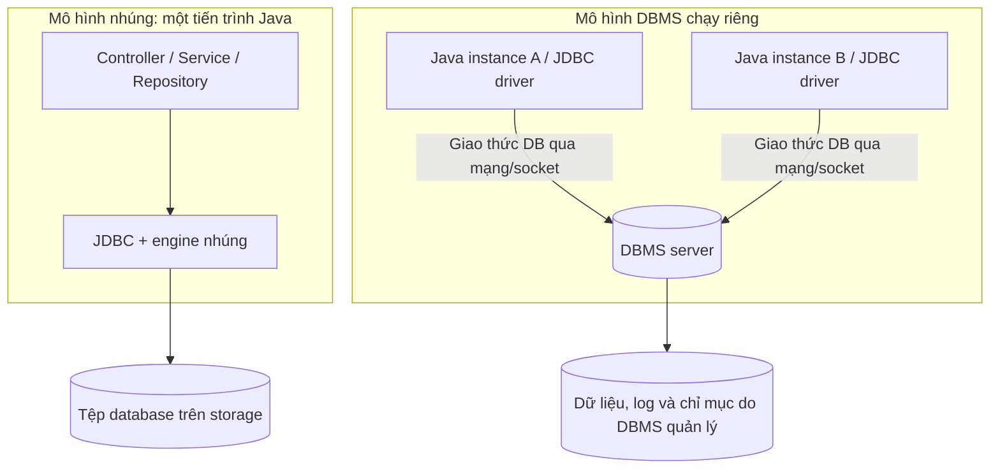
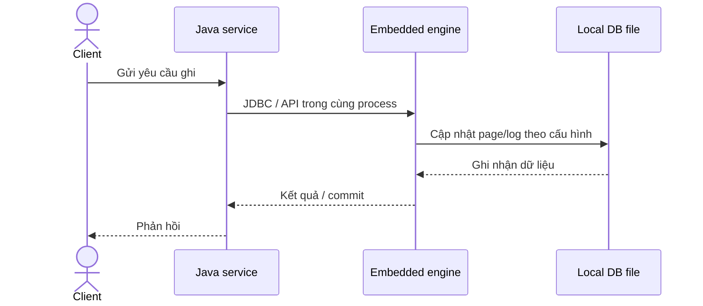
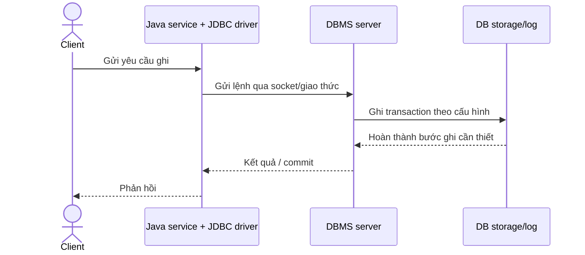
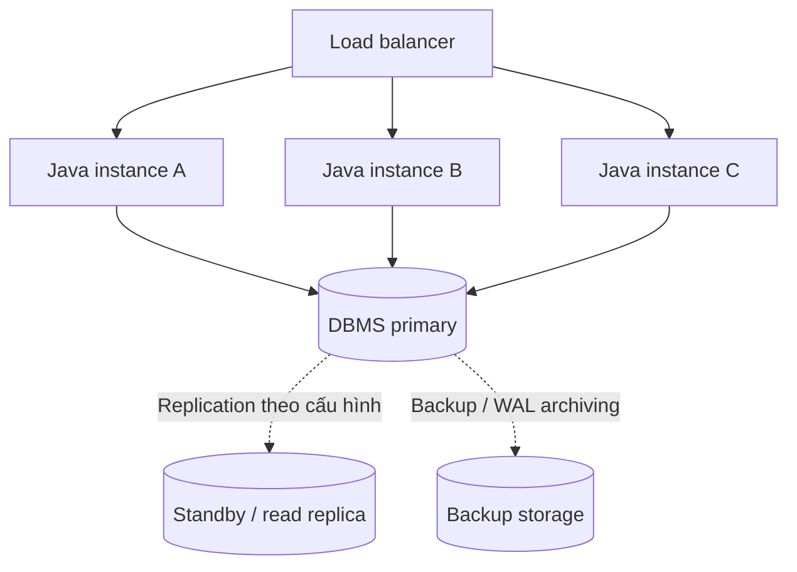
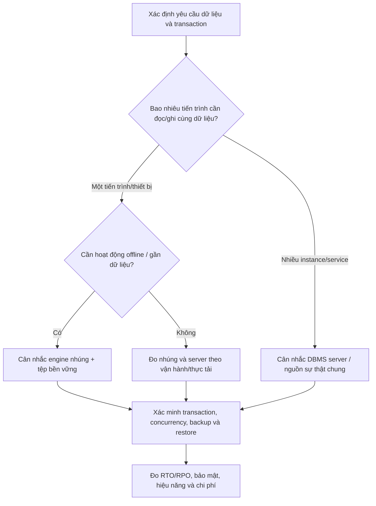

# Phân biệt cơ sở dữ liệu nhúng với hệ quản trị chạy riêng

> **Chương:** Mô hình lưu trữ  
> **Học phần:** `DATA_PERSISTENCE_FUNDAMENTALS` — hiểu nguyên lý lưu trữ dữ liệu bền vững trong ứng dụng Java, từ mô hình dữ liệu, lược đồ, truy vấn và chỉ mục đến giao dịch, cô lập, kiểm soát đồng thời, lỗi kết nối, tiến hóa schema, bảo mật, sao lưu và hiệu năng.

Một ứng dụng Java quản lý kho ở một cửa hàng có thể lưu dữ liệu trong tệp database mà chính ứng dụng mở. Một dịch vụ bán hàng có nhiều máy chủ lại thường kết nối đến database chạy như dịch vụ độc lập. Cả hai đều có thể thực hiện câu lệnh SQL, tạo bảng và giao dịch, nhưng **ranh giới tiến trình, cách chia sẻ dữ liệu và trách nhiệm vận hành** rất khác nhau.

Điểm quyết định không phải là “database nào chuyên nghiệp hơn”, mà là **ai sở hữu vòng đời của engine, bao nhiêu tiến trình cần truy cập, sự cố của ứng dụng ảnh hưởng thế nào đến lưu trữ, và mức bền vững/khả dụng mà nghiệp vụ yêu cầu**. Bài này phân biệt hai mô hình để người phát triển Java lựa chọn đúng ranh giới persistence.

Sau bài học, người học có thể:

- Giải thích được database **nhúng** (*embedded*) và hệ quản trị database **chạy riêng** (*client–server*) theo ranh giới tiến trình.
- Phân biệt nhúng với lưu trong RAM, lưu trên đĩa, cache và việc dùng JDBC driver.
- So sánh cấu trúc triển khai, chia sẻ dữ liệu, transaction, kiểm soát đồng thời, sao lưu, bảo mật và giám sát.
- Kết nối từ Java đến H2 nhúng và PostgreSQL chạy riêng; hiểu phần nào của repository có thể dùng chung và phần nào phụ thuộc DBMS.
- Chọn mô hình cho ứng dụng desktop/offline, test, phân tích cục bộ, hoặc dịch vụ trực tuyến nhiều instance.
- Nhận biết dấu hiệu phải thay đổi kiến trúc, cùng cách chuyển dữ liệu và kiểm tra tính đúng đắn khi migration.

## 1. Phân biệt bằng ranh giới tiến trình

**Cơ sở dữ liệu nhúng** là engine được nạp vào **cùng tiến trình** với ứng dụng sử dụng nó, thường như một thư viện. Ứng dụng gọi API/JDBC; engine đọc, ghi và quản lý dữ liệu bằng tài nguyên của tiến trình đó, thông thường trên một hoặc nhiều tệp. Khi tiến trình Java dừng, engine nhúng cũng dừng, dù dữ liệu đã ghi bền vững có thể còn trên đĩa.

**Hệ quản trị cơ sở dữ liệu chạy riêng** là một tiến trình hoặc dịch vụ có vòng đời độc lập với ứng dụng. Ứng dụng Java dùng client library/JDBC driver để gửi yêu cầu qua giao thức kết nối, thường qua TCP hoặc Unix socket; DBMS điều phối các client, quản lý file dữ liệu, transaction, người dùng và quy trình vận hành riêng.



Sơ đồ là cách nhìn logic. Trong mô hình nhúng, một số engine vẫn cung cấp chế độ server hoặc cơ chế kết nối đặc thù; trong mô hình server, Java vẫn cần thư viện driver nằm trong tiến trình. **Có JDBC driver trong Java không có nghĩa là database nhúng**: với PostgreSQL, driver chạy trong JVM, còn engine PostgreSQL chạy ở tiến trình khác.

Ví dụ:

| Phần mềm | Hình thức thường gặp | Điểm cần hiểu |
| --- | --- | --- |
| **SQLite** | Engine nhúng, database chủ yếu trong tệp | Dùng nhiều trong ứng dụng mobile/desktop; có transaction, khóa và chế độ WAL; ghi đồng thời có giới hạn riêng |
| **H2 Database** | Nhúng trong Java, có chế độ in-memory/file; cũng hỗ trợ server mode | Hữu ích cho ứng dụng Java nhỏ, demo và một số test; chọn đúng mode khi triển khai |
| **Apache Derby** | Có chế độ embedded và network server | Cùng một sản phẩm có thể chạy theo hai mô hình |
| **DuckDB** | Engine nhúng cho xử lý dữ liệu phân tích | Tối ưu truy vấn phân tích; khác mục tiêu với OLTP nhiều writer từ nhiều service |
| **RocksDB** | Thư viện key–value nhúng | Không phải DBMS SQL quan hệ; phù hợp một số mô hình state store và truy cập theo key |
| **PostgreSQL / MySQL** | Hệ quản trị quan hệ chạy riêng | Nhiều client kết nối, DBMS quản lý đồng thời, phân quyền, backup và vận hành |

Tên sản phẩm không thay thế việc kiểm tra chế độ chạy. H2 có thể chạy embedded hoặc server; SQLite có thể được một dịch vụ bao bọc và cung cấp API qua mạng, nhưng khi đó chính dịch vụ bao bọc trở thành ranh giới chia sẻ truy cập.

## 2. Hai trục độc lập: vị trí engine và nơi dữ liệu tồn tại

Một nhầm lẫn phổ biến: **nhúng = trong RAM, server = lưu trên đĩa**. Thực tế có ít nhất hai lựa chọn độc lập.

| Trục | Lựa chọn | Hệ quả |
| --- | --- | --- |
| **Vị trí engine** | Cùng tiến trình ứng dụng (embedded) | Vòng đời engine gắn với JVM; gọi hàm nội bộ, ít bước kết nối mạng |
| | Tiến trình/dịch vụ riêng (server) | Nhiều ứng dụng/instance có thể sử dụng endpoint DB; DB có lifecycle độc lập |
| **Nơi lưu dữ liệu** | Trong bộ nhớ | Có thể mất khi engine/process kết thúc, trừ cơ chế snapshot/persistence được cấu hình riêng |
| | Trên lưu trữ bền vững | Dữ liệu được lưu theo cơ chế và cam kết durability; có thể còn sau restart |

H2 minh họa rất rõ:

```text
jdbc:h2:mem:demo              # H2 nhúng, dữ liệu trong bộ nhớ
jdbc:h2:file:./data/catalog  # H2 nhúng, dữ liệu trong tệp trên đĩa
jdbc:h2:tcp://localhost/~/demo  # Kết nối tới H2 server mode
```

Với `jdbc:h2:mem:demo`, dữ liệu không tự trở thành bền vững chỉ vì các câu lệnh đã `COMMIT`. Tùy chế độ và cấu hình, database in-memory có thể bị đóng khi không còn connection hoặc khi tiến trình kết thúc. Tùy chọn giữ database in-memory trong vòng đời JVM cũng **không khiến nó sống sót qua crash/restart JVM**. Ngược lại, `jdbc:h2:file:` có thể lưu bền vững trên đĩa, nhưng nếu tệp ở volume tạm của container và bị xóa khi redeploy thì dữ liệu vẫn mất.

PostgreSQL thông thường quản lý file dữ liệu và transaction log từ tiến trình server, nhưng nếu storage server bị mất hoặc cấu hình durability không đáp ứng yêu cầu, việc chạy riêng không tự bảo đảm mọi commit sống sót qua mọi sự cố.

**Kết luận của trục này:** hãy hỏi hai câu riêng: “Engine chạy ở tiến trình nào?” và “Dữ liệu sống sót qua loại sự cố nào?”. Khả dụng (*availability*) còn là câu hỏi thứ ba về thời gian dịch vụ không phục vụ được.

## 3. Đường đi của một yêu cầu ghi/đọc

Trong Java, service và repository thường không cần biết từng chi tiết vật lý của database. Tuy nhiên, đường thực thi khác nhau:





Mô hình nhúng thường tránh một lượt truyền dữ liệu qua mạng tới DBMS, nhưng vẫn tốn CPU, disk I/O, lock, index maintenance và ghi log. Mô hình server bổ sung kết nối, độ trễ truyền và serialization, đổi lại nhiều client cùng dùng một nguồn sự thật do DBMS điều phối.

Một request ghi cần xác định thời điểm `COMMIT` riêng với thời điểm `INSERT` chạy xong và thời điểm phản hồi HTTP đến client. Nếu đường truyền đứt sau commit, client có thể không biết giao dịch đã hoàn tất. Cơ chế idempotency và tra cứu trạng thái bằng request ID cần có ở **cả hai mô hình** nếu nghiệp vụ có retry.

## 4. Ví dụ kết nối JDBC từ Java

Ứng dụng Java có thể dùng cùng API `java.sql.Connection`, `PreparedStatement` và `ResultSet` để truy cập H2 hoặc PostgreSQL; khác biệt nằm ở JDBC URL, driver, thông tin xác thực và những tính năng SQL/transaction riêng.

### H2 nhúng lưu xuống tệp

```java
import java.nio.file.Files;
import java.nio.file.Path;
import java.sql.Connection;
import java.sql.DriverManager;
import java.sql.ResultSet;
import java.sql.Statement;

public final class EmbeddedExample {
    public static void main(String[] args) throws Exception {
        Files.createDirectories(Path.of("data"));

        // Cần có dependency H2 JDBC trên classpath.
        String url = "jdbc:h2:file:./data/catalog";

        try (Connection connection = DriverManager.getConnection(url);
             Statement statement = connection.createStatement()) {
            statement.executeUpdate(
                "CREATE TABLE IF NOT EXISTS setting (" +
                "setting_key VARCHAR(80) PRIMARY KEY, " +
                "setting_value VARCHAR(400) NOT NULL)");

            statement.executeUpdate(
                "MERGE INTO setting (setting_key, setting_value) " +
                "KEY (setting_key) VALUES ('language', 'vi')");

            try (ResultSet rows = statement.executeQuery(
                    "SELECT setting_key, setting_value FROM setting")) {
                while (rows.next()) {
                    System.out.println(rows.getString("setting_key")
                        + "=" + rows.getString("setting_value"));
                }
            }
        }
    }
}
```

Trong ví dụ, ứng dụng mở engine H2 trong cùng JVM, đường dẫn `./data` được diễn giải **theo thư mục làm việc của process** chứ không tự gắn với file JAR. Việc deploy trong container cần volume bền vững và cấu hình đường dẫn tuyệt đối hoặc được quản lý chặt chẽ để không vô tình tạo database mới ở chỗ khác. Ví dụ dùng cú pháp `MERGE ... KEY` đặc thù H2; khi chuyển sang PostgreSQL cần thay bằng cơ chế upsert tương ứng.

Việc kết nối thành công không đồng nghĩa có chính sách backup, mã hóa dữ liệu trên đĩa, hoặc quyền file an toàn. Đặc biệt, không mặc định cho hai JVM ở hai máy cùng mở file H2 qua một network filesystem; chế độ, khóa file và khả năng chia sẻ tiến trình phải tuân thủ tài liệu engine.

### PostgreSQL chạy như dịch vụ riêng

```java
import java.sql.Connection;
import java.sql.DriverManager;
import java.sql.PreparedStatement;
import java.sql.ResultSet;

public final class ServerExample {
    public static void main(String[] args) throws Exception {
        // Ví dụ: jdbc:postgresql://db.internal:5432/catalog
        String url = System.getenv("JDBC_URL");
        String user = System.getenv("DB_USER");
        String password = System.getenv("DB_PASSWORD");

        // Cần có dependency PostgreSQL JDBC và DB đã được triển khai.
        try (Connection connection =
                    DriverManager.getConnection(url, user, password);
             PreparedStatement statement = connection.prepareStatement(
                 "SELECT setting_key, setting_value " +
                 "FROM setting WHERE setting_key = ?")) {
            statement.setString(1, "language");
            try (ResultSet rows = statement.executeQuery()) {
                if (rows.next()) {
                    System.out.println(rows.getString("setting_value"));
                }
            }
        }
    }
}
```

PostgreSQL không tự tạo database từ JDBC URL nếu database chưa tồn tại; schema `setting` phải được khởi tạo bằng migration trước khi chạy ví dụ. Đây là **hai đoạn minh họa độc lập**: ví dụ PostgreSQL chỉ thực hiện `SELECT` trên schema đã được provision, không đọc tệp H2 được tạo ở đoạn trước.

Với dịch vụ thực, dùng `DataSource` và connection pool được cấu hình bởi ứng dụng/framework; đặt giới hạn connection và timeout. Thông tin xác thực lấy từ cơ chế quản lý secret và chỉ truyền qua kênh được bảo vệ; tránh hard-code password vào mã nguồn hoặc log. Việc có kết nối mạng tới DBMS mở thêm yêu cầu firewall/network policy, TLS, tài khoản phân quyền tối thiểu và giám sát.

## 5. Giao dịch và đồng thời: điều gì giống, điều gì khác?

Cả database nhúng và DBMS chạy riêng **đều có thể hỗ trợ ACID** ở mức mà engine và cấu hình công bố. Transaction, rollback, isolation và ràng buộc dữ liệu không chỉ thuộc về database server. Điểm khác thường nằm ở **cách engine cho phép nhiều connection/process cùng truy cập** và giới hạn tài nguyên.

| Vấn đề | Database nhúng | DBMS chạy riêng |
| --- | --- | --- |
| Nhiều thread trong một JVM | Thường dùng nhiều connection, engine quản lý khóa theo khả năng của sản phẩm | Mỗi thread/request có connection riêng qua pool; server điều phối |
| Nhiều tiến trình Java độc lập | Có thể bị giới hạn bởi file lock và giao thức truy cập; phụ thuộc engine | Nhiều client kết nối cùng server và schema |
| Ghi đồng thời | SQLite có mô hình **một writer tại một thời điểm** cho một database file; H2 có cơ chế lock/transaction riêng | DBMS quan hệ server hỗ trợ nhiều transaction đồng thời, có lock/MVCC và tranh chấp cần quản lý |
| Isolation | Hỗ trợ và ngữ nghĩa phụ thuộc từng engine/mode | Hỗ trợ và ngữ nghĩa phụ thuộc DBMS; tên mức cô lập không bảo đảm hành vi giống hệt |
| Deadlock / lock timeout | Vẫn có thể xảy ra lock contention hoặc lỗi busy | Có thể có deadlock, serialization failure và lock wait |
| Dữ liệu chia sẻ giữa các instance | Khó nếu các instance có file riêng; chia sẻ file qua mạng cần đánh giá rất kỹ | Nhiều instance dùng cùng nguồn dữ liệu server có cơ chế điều phối |

Ví dụ, bật WAL của SQLite có thể giúp reader và writer cùng hoạt động tốt hơn một số chế độ journal khác; nó **không biến SQLite thành hệ thống nhiều writer đồng thời không giới hạn**. Với H2 embedded file, engine có các chính sách file locking; mở file từ tiến trình khác khi database đang được dùng có thể bị từ chối nếu không dùng cơ chế/chế độ được hỗ trợ.

Các lỗi đồng thời vẫn phải được xử lý ở tầng nghiệp vụ. Giả sử cần chuyển tiền giữa hai tài khoản: cả hai câu `UPDATE` phải thuộc **một transaction**, và điều kiện đủ số dư phải được kiểm tra nguyên tử tại database.

```sql
CREATE TABLE account (
    id BIGINT PRIMARY KEY,
    balance_minor BIGINT NOT NULL CHECK (balance_minor >= 0)
);

-- Thực thi trong một transaction:
UPDATE account
SET balance_minor = balance_minor - ?
WHERE id = ? AND balance_minor >= ?;

UPDATE account
SET balance_minor = balance_minor + ?
WHERE id = ?;
```

Sau lệnh trừ, ứng dụng phải kiểm tra có đúng một hàng được cập nhật; sau lệnh cộng cũng phải kiểm tra một hàng. Nếu một bước thất bại, rollback toàn bộ. Đối với tiền, kiểm tra tràn số, đơn vị tiền và quy tắc nghiệp vụ; khi retry sau lỗi commit chưa rõ kết quả, cần request ID/idempotency, không đơn giản chạy lại cả hai `UPDATE` vô điều kiện.

### Một transaction JDBC có thể dùng với cả hai mô hình

```java
import java.sql.Connection;
import java.sql.PreparedStatement;
import java.sql.SQLException;
import javax.sql.DataSource;

final class AccountTransfer {
    private final DataSource dataSource;

    AccountTransfer(DataSource dataSource) {
        this.dataSource = dataSource;
    }

    void transfer(long fromId, long toId, long amountMinor)
            throws SQLException {
        if (fromId == toId || amountMinor <= 0) {
            throw new IllegalArgumentException("Invalid transfer");
        }

        try (Connection conn = dataSource.getConnection()) {
            conn.setAutoCommit(false);
            try {
                try (PreparedStatement debit = conn.prepareStatement(
                        "UPDATE account SET balance_minor = balance_minor - ? " +
                        "WHERE id = ? AND balance_minor >= ?")) {
                    debit.setLong(1, amountMinor);
                    debit.setLong(2, fromId);
                    debit.setLong(3, amountMinor);
                    if (debit.executeUpdate() != 1) {
                        throw new IllegalStateException("Insufficient balance");
                    }
                }

                try (PreparedStatement credit = conn.prepareStatement(
                        "UPDATE account SET balance_minor = balance_minor + ? " +
                        "WHERE id = ?")) {
                    credit.setLong(1, amountMinor);
                    credit.setLong(2, toId);
                    if (credit.executeUpdate() != 1) {
                        throw new IllegalStateException(
                                "Destination account not found");
                    }
                }

                conn.commit();
            } catch (SQLException | RuntimeException error) {
                try {
                    conn.rollback();
                } catch (SQLException rollbackError) {
                    error.addSuppressed(rollbackError);
                }
                throw error;
            }
        }
    }
}
```

Đoạn code làm rõ rằng transaction vẫn là một ranh giới **trong DB**, bất kể DB chạy trong JVM hay ở máy riêng. Ví dụ cố ý chưa đầy đủ các quy tắc của hệ thống tài chính: cần kiểm tra quyền thao tác, chống trùng khi retry, overflow, khả năng deadlock/retry an toàn và ghi lịch sử có ID trong cùng giao dịch.

## 6. Khả năng chia sẻ dữ liệu và triển khai nhiều instance

Giả sử một API Java được triển khai thành ba pod:

```text
Pod A + H2 file /data/orders.mv.db
Pod B + H2 file /data/orders.mv.db
Pod C + H2 file /data/orders.mv.db
```

Tên đường dẫn giống nhau **không chứng minh chúng đang dùng cùng một tệp**: mỗi pod có thể có volume độc lập. Nếu thật sự chia sẻ một tệp qua network volume, nhiều engine nhúng không được thiết kế để cho các tiến trình trên nhiều máy ghi vào cùng file như một DBMS phân tán; có thể gặp khóa file, mất an toàn hoặc lỗi hiệu năng.

Một cấu hình phổ biến cho ứng dụng trực tuyến nhiều instance:



Server DB trở thành **nguồn sự thật chung**. Điều này chưa tự làm hệ thống HA: nếu chỉ có một primary không có phương án phục hồi, nó là điểm lỗi chung. Cần thiết kế kết nối, timeout, failover, sao lưu và chính sách consistency. Nhưng ít nhất các request từ nhiều Java instance nhìn thấy cùng một kho dữ liệu và DBMS chịu trách nhiệm điều phối giao dịch theo cách được hỗ trợ.

Ngược lại, một ứng dụng desktop offline có thể dùng **mỗi thiết bị một database nhúng**. Khi có kết nối trở lại, một dịch vụ đồng bộ gửi thay đổi lên server. Đây là kiến trúc hợp lệ nếu có cơ chế nhận diện sự kiện, giải quyết xung đột, retry và đồng bộ theo phiên bản. Không nên giả định “ghi thành công vào DB nhúng trên thiết bị” đồng nghĩa dữ liệu đã được đồng bộ đến hệ thống trung tâm.

## 7. Độ bền, sao lưu và phục hồi

Khả năng ghi vào tệp không đồng nghĩa mọi dữ liệu được khôi phục trong mọi sự cố. Cần phân biệt:

1. **Transaction đã commit:** engine xác nhận theo chính sách journal/WAL, flush và lưu trữ mà nó áp dụng.
2. **Dữ liệu sống qua restart của ứng dụng:** cần dữ liệu trên storage còn tồn tại, đúng đường dẫn và định dạng.
3. **Dữ liệu sống qua hỏng thiết bị/đĩa:** cần backup hoặc bản sao ở miền lỗi khác và quy trình restore.
4. **Dữ liệu còn phục vụ được khi một node lỗi:** cần cấu hình HA/failover hoặc phương án khôi phục đáp ứng RTO.
5. **Có thể quay lại trước lỗi logic/xóa nhầm:** cần backup/PITR phù hợp; replication thường truyền cả sai sót sang replica.

| Mục vận hành | Database nhúng | DBMS chạy riêng |
| --- | --- | --- |
| Đường đi dữ liệu | Ứng dụng phải quản lý file/volume và location | DBA/platform quản lý data directory/storage của DBMS |
| Backup | Dùng backup API hoặc snapshot an toàn do engine hỗ trợ; tránh copy file live tùy tiện | Công cụ như logical backup, physical backup, WAL/binlog và PITR tùy DBMS |
| Restore | Kiểm tra mở lại file, integrity, tương thích phiên bản app/engine | Kiểm tra restore cluster/schema, role/privilege, transaction log và kết nối của app |
| HA/failover | Cần thiết kế riêng ở tầng ứng dụng/thiết bị hoặc sản phẩm có hỗ trợ | Nhiều DBMS hỗ trợ replication, promotion và công cụ điều phối |
| RTO/RPO | Đo từ lúc lỗi đến khi thiết bị/app dùng lại được và mức dữ liệu đã mất | Đo từ góc nhìn API sau failover/restore và mức dữ liệu đã mất |

Ví dụ, sao chép một file SQLite đang được ghi **mà không dùng cơ chế backup/snapshot phù hợp** có thể tạo bản sao không nhất quán, đặc biệt khi có file journal/WAL liên quan. Với H2 file database cũng cần quy trình sao lưu được engine hỗ trợ. Với PostgreSQL, `pg_dump` là logical backup, còn yêu cầu point-in-time recovery thường cần base backup cùng WAL được lưu giữ đúng; chọn công cụ theo RPO/RTO, kích thước và thời gian phục hồi.

Nếu ứng dụng nhúng lưu file ở ổ đĩa của laptop, backup định kỳ có thể do app hoặc người dùng thực hiện. Nếu database server lưu đơn hàng cho công ty, backup/restore, quyền truy cập và theo dõi thường là trách nhiệm vận hành tập trung. **Trách nhiệm khác nhau không có nghĩa mô hình nào tự động an toàn hơn**.

## 8. Bảo mật và giới hạn tin cậy

Với database nhúng, ranh giới bảo mật thường ở **hệ điều hành và tiến trình ứng dụng**. Ai có quyền đọc file hoặc chiếm quyền tiến trình có thể có khả năng truy cập dữ liệu; quyền file, mã hóa at-rest, bảo vệ key và chính sách export/backup quan trọng. Một ứng dụng desktop trên máy người dùng không nên giả định có thể giữ mọi bí mật chỉ bằng cách giấu đường dẫn file DB.

Với DBMS riêng, có thêm ranh giới **qua mạng và tài khoản database**: xác thực, TLS, firewall, quyền `SELECT/INSERT/UPDATE` theo role, audit và rotation secret. Đồng thời xuất hiện bề mặt tấn công của dịch vụ mạng và hoạt động quản trị server; cần cấu hình chặt chẽ.

Những nguyên tắc giống nhau ở cả hai mô hình:

- Dùng `PreparedStatement` để truyền **giá trị**, không nối chuỗi SQL từ input người dùng.
- Kiểm tra quyền ở tầng nghiệp vụ và ràng buộc DB; không cho phép request của tenant A xem/sửa hàng tenant B chỉ vì chia sẻ server.
- Mã hóa phù hợp dữ liệu nhạy cảm; giới hạn quyền truy cập file backup và key, tránh đưa password/token vào log.
- Kiểm tra dữ liệu từ client, version schema và migration trước khi mở rộng trường có nội dung nhạy cảm.
- Không bật console quản trị, giao diện H2 web console hay cổng database công khai chỉ để debug production.

Một DBMS server với user/role không đúng vẫn có thể bị lộ dữ liệu; một DB nhúng lưu trong file được mã hóa, có backup và quản lý quyền tốt có thể đáp ứng yêu cầu của sản phẩm offline. Phải đánh giá **mô hình đe dọa** và quyền truy cập thực tế.

## 9. Hiệu năng: so sánh theo workload thay vì nhãn kiến trúc

Engine nhúng có thể giảm network round trip và chi phí giao thức cho truy cập cục bộ. Tuy nhiên, khi cùng JVM phải xử lý API, truy vấn, page cache và I/O, những tài nguyên này cạnh tranh trực tiếp với workload của ứng dụng. Database chạy riêng tạo thêm hop mạng nhưng có thể dành CPU/RAM/storage độc lập và phục vụ nhiều client.

| Yếu tố | Câu hỏi khi đo |
| --- | --- |
| Latency | Có bao nhiêu thời gian ở JDBC, mạng, thực thi SQL, lock wait và disk I/O? |
| Concurrency | Bao nhiêu reader/writer thực sự? Có tranh chấp một writer hoặc contention trên hàng không? |
| Kích thước dữ liệu | Dữ liệu và chỉ mục còn vừa với cache hay truy cập quá nhiều trang đĩa? |
| Mẫu truy vấn | Point lookup, transaction OLTP hay scan/aggregation theo cột? |
| Nhiều ứng dụng | Chỉ một process dùng dữ liệu hay nhiều API/worker/reporting service cùng cần truy cập? |
| Backup và bảo trì | Backup, vacuum/compaction, migration hoặc rebuild index có làm gián đoạn workload không? |
| Độ tin cậy | Sau crash, lượng dữ liệu mất và thời gian phục hồi thực tế là bao nhiêu? |

Ví dụ, DuckDB nhúng phù hợp nhiều bài toán phân tích cục bộ với scan và tổng hợp; PostgreSQL server phù hợp một API OLTP có nhiều request giao dịch từ nhiều service. Kết luận **không dựa vào việc DuckDB là nhúng hay PostgreSQL là server một cách đơn lẻ**, mà còn dựa vào kiểu lưu trữ, optimizer, index, isolation và workload.

Tối ưu kết nối cũng khác nhau. Ở mô hình server, connection pool giúp tránh chi phí thiết lập connection liên tục và kiểm soát số client; pool quá lớn có thể làm DB nghẽn. Ở mô hình nhúng, mở quá nhiều connection/transaction vẫn có thể tăng tranh chấp, không tạo thêm khả năng ghi vô hạn.

## 10. Chọn mô hình cho các tình huống thực tế

### Tình huống A: ứng dụng desktop/offline dùng trên một máy

Ứng dụng thu ngân chạy trên một thiết bị, cần nhập hàng và in hóa đơn ngay cả khi mất mạng. Database nhúng trên lưu trữ bền vững thường hợp lý nếu engine hỗ trợ transaction, dung lượng và số writer phù hợp. Cần xác định đường dẫn dữ liệu, bảo vệ khóa truy cập, backup, khả năng phục hồi sau tắt máy bất ngờ và cơ chế đồng bộ khi kết nối trở lại.

Nếu có nhiều máy thu ngân cùng sửa một kho chung, phải đưa ra quyết định mới: các máy có server DB trung tâm, hay mỗi máy có DB local và đồng bộ? Phương án thứ hai đòi hỏi ID toàn cục, log thay đổi, xử lý xung đột, phát hiện gửi trùng và chính sách khi hai thiết bị cùng bán đơn vị hàng cuối cùng.

### Tình huống B: API Spring Boot có nhiều replica

Nhiều pod Java phục vụ đặt hàng, hàng nghìn request ghi/đọc đồng thời, cần truy vấn dữ liệu chung và chuyển đổi khi một node lỗi. DBMS chạy riêng là lựa chọn tự nhiên hơn cho **nguồn dữ liệu nghiệp vụ dùng chung**. Đánh giá ràng buộc dữ liệu, isolation, connection pool, replica/HA, backup và kế hoạch migration trước khi triển khai.

H2 nhúng vẫn có thể dùng cho dữ liệu tạm hoặc chức năng cục bộ trong mỗi pod, nhưng không nên coi các database file riêng của từng pod là cùng một nguồn sự thật mà không có cơ chế đồng bộ.

### Tình huống C: unit test và integration test

H2 in-memory khởi động nhanh cho một số test repository hoặc thử nghiệm SQL đơn giản. Tuy nhiên, **H2 không tương đương hoàn toàn PostgreSQL**: cú pháp, kiểu dữ liệu, isolation, locking, migration, planner, index và behavior khi lỗi có thể khác, kể cả khi bật compatibility mode.

Với tính năng phụ thuộc mạnh vào PostgreSQL, nên có test tích hợp trên PostgreSQL thật trong môi trường cô lập (ví dụ một instance test qua container/CI), đặc biệt để kiểm tra ràng buộc, transaction, concurrency, migration và lỗi timeout. Đừng suy ra ứng dụng production đúng chỉ từ việc test H2 in-memory chạy xanh.

### Tình huống D: phân tích dữ liệu cục bộ

Một công cụ Java phân tích file Parquet/CSV cho người dùng trên laptop, chủ yếu thực hiện scan, aggregate và ít người ghi đồng thời, có thể phù hợp database phân tích nhúng. Nhưng nếu kết quả phải chia sẻ cho nhiều người cùng lúc với quyền truy cập độc lập, có thể cần dịch vụ quản lý dữ liệu tập trung hoặc cơ chế xuất bản rõ ràng.

## 11. Chuyển từ nhúng sang DBMS server: không chỉ đổi JDBC URL

Khi sản phẩm phát triển từ một JVM thành nhiều instance, có thể cần chuyển storage. Một kế hoạch chuyển đổi an toàn gồm:

1. **Kiểm kê dữ liệu và schema:** kiểu số, chuỗi, `NULL`, timestamp/timezone, ID, quan hệ, `UNIQUE`, `FOREIGN KEY`, phiên bản schema và dữ liệu đang tồn tại.
2. **Xác định nguồn sự thật và cửa sổ chuyển đổi:** khi nào dừng ghi cũ, có cần dual-write hay đồng bộ tăng dần, RPO/RTO chấp nhận được.
3. **Tạo schema và migration cho DB mới:** kiểm tra giới hạn kiểu dữ liệu, SQL dialect, identity/sequence, index, transaction isolation và các ràng buộc.
4. **Xuất/nhập dữ liệu:** dùng công cụ hoặc luồng export/import phù hợp; giữ chính xác ID, đơn vị tiền, timestamp và encoding; xử lý dữ liệu bất hợp lệ.
5. **Đối soát:** so sánh số hàng, tổng theo nghiệp vụ, checksum/ID và các quan hệ; thử truy vấn thường dùng và tình huống cập nhật đồng thời.
6. **Chuyển ứng dụng:** cấu hình DataSource, pool, TLS, secret, timeout; chạy thử migration và rollback plan.
7. **Xác minh sau cutover:** theo dõi lỗi kết nối, độ trễ, tình trạng lock/index, chức năng ghi/đọc và khả năng restore từ backup mới.

**Ví dụ khác biệt SQL:** `MERGE ... KEY` trong H2 không có nghĩa cú pháp tương ứng chạy nguyên vẹn trên PostgreSQL; PostgreSQL thường dùng `INSERT ... ON CONFLICT ...` cho upsert. Cột `TIMESTAMP`, các hàm ngày giờ, xử lý `BOOLEAN`, giới hạn string và cơ chế generated ID cũng cần xem lại. Một `DataSource` abstraction giúp thay kết nối, nhưng không làm các giả định về dialect và concurrency biến mất.

Chuyển sang server DB còn thay đổi trách nhiệm vận hành: connection pool, phân quyền, lưu secret, giám sát, backup, failover và cập nhật schema giữa các phiên bản ứng dụng. Ngược lại, nếu thay DB server bằng file nhúng để hoạt động offline, phải thiết kế đồng bộ và xung đột có chủ đích.

## 12. Quy trình ra quyết định và bài tập

Trước khi chọn engine, hãy trả lời theo thứ tự:



**Bài A — nhận diện mô hình.** Ba ứng dụng Java cùng chứa JDBC driver PostgreSQL và cùng kết nối `db.internal:5432`. Engine nằm ở đâu? Vì sao có driver trong từng JVM không đồng nghĩa có ba database nhúng?

**Bài B — chọn mô hình.** Một ứng dụng ghi nhật ký công việc trên laptop cần dùng được khi offline, chỉ một người thao tác và có dữ liệu quan trọng. Đề xuất mô hình lưu trữ, backup, khôi phục và thời điểm đồng bộ khi có mạng.

**Bài C — chuyển sang nhiều pod.** Một Spring Boot API hiện dùng `jdbc:h2:file:./data/orders`. Khi chạy ba pod, những rủi ro nào phát sinh với dữ liệu và file? Hãy mô tả cách chuyển sang DBMS server hoặc kiến trúc đồng bộ rõ ràng.

**Bài D — transaction.** Hai request đồng thời rút tiền từ một tài khoản, mỗi request lớn hơn số tiền có thể chi cùng lúc. Viết `UPDATE ... WHERE balance_minor >= ?`, kiểm tra affected rows, và giải thích vì sao kiểm tra số dư ở Java trước `UPDATE` chưa đủ trong cả hai mô hình.

**Bài E — backup.** Một DB SQLite đang hoạt động ở WAL mode; người quản trị chỉ sao chép file chính bằng lệnh copy thông thường. Điều gì có thể xảy ra? Thiết kế quy trình backup và restore sử dụng tính năng an toàn của engine.

**Bài F — kiểm thử.** Test chạy trên H2 nhưng production dùng PostgreSQL. Hãy liệt kê các trường hợp cần kiểm tra lại trên PostgreSQL thật: cú pháp upsert, transaction isolation, `TIMESTAMPTZ`, unique constraint, migration và đồng thời.

## 13. Checklist chốt lựa chọn

- [ ] Phân biệt rõ engine chạy **cùng tiến trình** hay **dịch vụ độc lập**; xác định nơi lưu dữ liệu là RAM hay storage bền vững.
- [ ] Biết số lượng process/instance cần chia sẻ dữ liệu và cơ chế ghi đồng thời được engine hỗ trợ.
- [ ] Xác định dải dữ liệu, mô hình bảng/khóa/chỉ mục, transaction, isolation và ràng buộc toàn vẹn.
- [ ] Có đường dẫn/volume/permission phù hợp cho file DB nhúng, hoặc mạng/TLS/secret/pool phù hợp cho server DB.
- [ ] Đã diễn tập restart, crash, lỗi đĩa, timeout commit và phục hồi bằng backup; đo RPO/RTO cho từng kịch bản.
- [ ] Có phương án migration schema, tương thích driver/dialect, backup và rollback khi nâng cấp phiên bản.
- [ ] Đo latency, throughput, lock contention, kích thước dữ liệu và ảnh hưởng của backup/bảo trì trên workload thực.
- [ ] Có chính sách bảo mật, mã hóa khi cần, kiểm soát truy cập và tránh SQL injection ở cả hai mô hình.
- [ ] Khi có nhiều service hoặc thiết bị offline, xác định rõ **nguồn sự thật**, cơ chế đồng bộ, idempotency và xử lý xung đột.

**Nguyên tắc lựa chọn:** nhúng hay chạy riêng trước hết là quyết định **engine thuộc vòng đời và ranh giới truy cập của ai**. Hãy chọn theo yêu cầu chia sẻ dữ liệu, đồng thời, khôi phục, bảo mật và vận hành; sau đó kiểm chứng bằng dữ liệu và workload thực tế. Một database nhúng trên đĩa có thể là nguồn lưu trữ bền vững phù hợp cho ứng dụng cục bộ; một DBMS chạy riêng thường phù hợp hơn khi nhiều tiến trình Java phải dùng chung dữ liệu nghiệp vụ với cơ chế quản trị và phục hồi tập trung.
