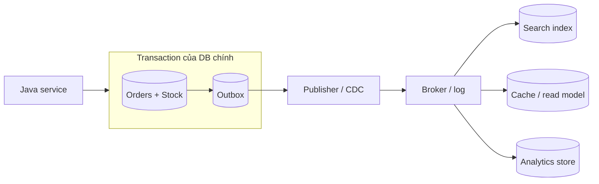

# So sánh các mô hình theo truy vấn, giao dịch và cấu trúc dữ liệu

## 1. Bài toán lựa chọn mô hình lưu trữ

Khi xây dựng một ứng dụng Java, lập trình viên thường bắt đầu bằng các class như `Order`, `Customer`, `Cart` và `Payment` rồi tự hỏi nên dùng SQL, document database, key-value store hay một công nghệ khác. Tuy nhiên, **hình dạng của object không đủ để quyết định mô hình lưu trữ**.

Giả sử một hệ thống bán hàng phải đáp ứng những thao tác sau:

- Tạo đơn cùng các dòng hàng và giữ tồn kho một cách nguyên tử.
- Tìm đơn theo mã; liệt kê đơn của một khách theo thời gian.
- Hiển thị giỏ hàng và phiên đăng nhập có thời hạn ngắn.
- Tìm sản phẩm theo từ khóa có lỗi chính tả và bộ lọc.
- Đề xuất người dùng hoặc sản phẩm dựa trên nhiều bước quan hệ.
- Lưu hàng triệu sự kiện đo lường theo thời gian.
- Tổng hợp doanh thu theo ngày, danh mục và khu vực.
- Lưu ảnh sản phẩm và hóa đơn PDF.

Các thao tác này khác nhau về **kiểu truy vấn**, **yêu cầu giao dịch**, **quan hệ dữ liệu**, **độ mới**, **quy mô** và **vòng đời**. Một mô hình duy nhất có thể đáp ứng một số hoặc nhiều nhu cầu, nhưng hiếm khi tối ưu mọi tình huống với cùng chi phí.

Mục tiêu của bài là **so sánh các mô hình lưu trữ theo ba trục chính** và áp dụng để thiết kế ranh giới persistence cho Java:

1. **Truy vấn:** Dữ liệu được tìm theo khóa, lọc theo thuộc tính, join, duyệt quan hệ, lấy chuỗi thời gian, tìm kiếm toàn văn hay tổng hợp phân tích?
2. **Giao dịch:** Cần thay đổi những dữ liệu nào cùng thành công/rollback? Có cần cập nhật nhiều bản ghi, nhiều partition hoặc nhiều hệ thống một cách nguyên tử không?
3. **Cấu trúc dữ liệu:** Dữ liệu biểu diễn tốt nhất dưới dạng hàng/bảng, document, cặp khóa–giá trị, nhóm cột theo khóa phân vùng, đỉnh–cạnh, chuỗi điểm thời gian, cột phân tích hay blob?

Ngoài ba trục đó, vẫn phải tính đến **độ bền, isolation, concurrency, bảo mật, backup, schema evolution, hiệu năng và khả năng vận hành**. Đây là những yếu tố quyết định liệu lựa chọn kỹ thuật có đáp ứng yêu cầu nghiệp vụ trong môi trường thật hay không.

## 2. Phân biệt mô hình dữ liệu, hệ quản trị và cách tổ chức vật lý

**Mô hình lưu trữ** là cách khái niệm hóa và tổ chức dữ liệu để thao tác. **Hệ quản trị** là phần mềm hiện thực các khả năng truy vấn, ghi, bảo vệ và vận hành. **Thiết kế vật lý** là lựa chọn index, partition, replication, nén và cấu hình cụ thể.

Ví dụ:

- PostgreSQL là một hệ quản trị quan hệ, đồng thời có `JSONB`, chỉ mục tìm kiếm văn bản và extension hỗ trợ dữ liệu thời gian.
- Một hệ quản trị document có thể hỗ trợ transaction nhiều document; điều đó không biến mọi thao tác trên document thành một transaction mặc định.
- Hệ tìm kiếm thường lưu dữ liệu theo chỉ mục đảo (*inverted index*) và có thể phục vụ truy vấn lọc, nhưng không tự thay thế nguồn ghi giao dịch của đơn hàng.
- “Wide-column” theo kiểu Cassandra và “columnar analytics” theo kiểu kho OLAP đều liên quan đến cột, nhưng có **mục tiêu và mô hình truy cập khác nhau**.

Do đó, không có quy tắc “NoSQL = không có transaction” hoặc “SQL = không mở rộng được”. Khả năng thực tế luôn phụ thuộc **DBMS, phiên bản, topology, cấu hình và mẫu truy cập**.

### 2.1. OLTP và OLAP

| Đặc điểm | OLTP — xử lý giao dịch | OLAP — phân tích |
|---|---|---|
| Công việc chính | Nhiều thao tác nhỏ, đọc/ghi bản ghi cụ thể | Quét, lọc và tổng hợp khối lượng dữ liệu lớn |
| Yêu cầu điển hình | Đơn hàng đúng, tồn kho không âm, commit nhanh | Báo cáo doanh thu nhiều chiều, so sánh xu hướng |
| Truy vấn | Theo ID, index, join số lượng phù hợp | `GROUP BY`, tổng hợp, join dữ liệu lớn |
| Cập nhật | Thường xuyên, cần concurrency control | Thường nạp theo batch/stream, cập nhật theo cơ chế riêng |
| Cấu trúc thường gặp | Hàng và quan hệ, document aggregate | Columnar, bảng sự kiện/fact và dimension |

Một hệ thống có thể dùng SQL cho cả OLTP và OLAP. Tuy nhiên, việc chạy truy vấn phân tích dài trên cùng tài nguyên phục vụ giao dịch có thể gây cạnh tranh CPU, IO và bộ nhớ; cần đo tải và cân nhắc phân tách workload.

## 3. Bảng so sánh các mô hình phổ biến

Các nhận xét dưới đây mô tả **đặc tính thường gặp**, không phải cam kết giống nhau của mọi sản phẩm trong một nhóm.

| Mô hình | Truy vấn phù hợp | Cấu trúc đặc trưng | Phạm vi giao dịch thường thuận lợi | Điểm cần cảnh giác |
|---|---|---|---|---|
| **Quan hệ (relational)** | Truy vấn theo khóa, lọc, join, tổng hợp, cập nhật có điều kiện | Bảng, hàng, cột, khóa, quan hệ | Nhiều hàng/bảng trong một database transaction | Schema, index và join cần thiết kế theo workload |
| **Document** | Đọc/ghi cả aggregate, lọc theo thuộc tính lồng nhau | JSON/BSON-like document, collection | Thao tác trên một document thường thuận lợi; nhiều document tùy DBMS | Dữ liệu lặp, cập nhật chéo document, document quá lớn |
| **Key–value** | `GET/SET` theo khóa, TTL, counter, lookup nhanh | Khóa → giá trị hoặc cấu trúc nhỏ | Thao tác trên khóa hoặc lệnh nguyên tử theo DBMS | Truy vấn tùy ý, quan hệ và tính bền cần đánh giá |
| **Wide-column / partition-oriented** | Truy vấn đã biết trước theo partition key và thứ tự trong partition | Hàng phân vùng, clustering key, nhóm cột | Thường tối ưu các thao tác có ranh giới hẹp; batch/conditional phụ thuộc engine | Hot partition, truy vấn ngoài khóa, trade-off consistency |
| **Graph** | Duyệt nhiều bước liên kết, tìm đường đi, quan hệ nhiều–nhiều | Đỉnh, cạnh, thuộc tính | Thay đổi đồ thị theo cơ chế transaction của engine | Truy vấn quét lớn, supernode, chi phí traversal |
| **Time-series** | Theo thiết bị/nguồn và khoảng thời gian; rollup | Timestamp + tags + measurements | Ingestion/ghi chuỗi theo cơ chế của engine | Cardinality cao, dữ liệu đến trễ, retention |
| **Search index** | Full-text, relevance, autocomplete, faceting | Chỉ mục đảo và tài liệu phục vụ tìm kiếm | Cập nhật chỉ mục có ngữ nghĩa riêng | Độ trễ đồng bộ và xung đột với nguồn giao dịch |
| **Columnar / analytical** | Quét cột, tổng hợp và phân tích dữ liệu lớn | Dữ liệu theo cột, phân đoạn, bảng fact/dimension | Thường tối ưu nạp/phân tích; khả năng ghi giao dịch tùy engine | Không mặc nhiên phù hợp cập nhật đơn hàng tức thời |
| **Object/blob storage** | Đọc/ghi tệp theo object key, truyền nội dung lớn | Bucket, object key, bytes, metadata | Thao tác một object theo API; không có ACID transaction chung với DB | Quyền truy cập, phiên bản, cleanup và nhất quán metadata |

**Cách đọc bảng:** “Thuận lợi” nghĩa là cấu trúc/mẫu truy cập khớp với mô hình; không có nghĩa tốc độ luôn nhanh hơn mô hình khác. Một relational database với index tốt có thể xử lý lookup khóa rất nhanh; một document DB với index và query phù hợp cũng có thể xử lý phép lọc phức tạp.

## 4. So sánh theo truy vấn: từ câu hỏi nghiệp vụ đến đường truy cập

Để chọn nơi lưu, hãy bắt đầu bằng **những câu truy vấn quan trọng nhất**, không chỉ dữ liệu đang trông như thế nào trong Java.

| Câu hỏi | Đường truy cập mong muốn | Mô hình thường đáng xem xét |
|---|---|---|
| Tìm đơn `ORD-123` | Khóa chính | Quan hệ, document, key–value |
| Liệt kê 20 đơn gần nhất của khách | Lọc `customer_id` và sắp xếp `created_at` | Quan hệ với composite index; document có index; wide-column nếu mô hình hóa theo khách |
| Tìm mọi đơn có SKU X trong 30 ngày | Join hoặc chỉ mục theo SKU/ngày | Quan hệ, mô hình đọc được materialize |
| Lấy giỏ hàng đang dùng theo session | Lookup key, TTL | Key–value hoặc database có TTL thích hợp |
| Tìm “tai nghe khong day” gần nghĩa với tên sản phẩm | Full-text/tokenization/relevance | Search engine hoặc tính năng full-text phù hợp |
| Tìm bạn của bạn có quan hệ với chủ tài khoản | Traversal nhiều cạnh | Graph, hoặc SQL recursive query nếu kích thước/độ phức tạp phù hợp |
| Lấy nhiệt độ thiết bị trong 24 giờ | Lọc `device_id` và time range, rollup | Time-series hoặc bảng có partition/index theo thời gian |
| Tổng doanh thu theo ngày, ngành hàng và khu vực | Quét/tổng hợp nhiều hàng | Columnar analytics, warehouse hoặc relational khi quy mô cho phép |
| Tải PDF hóa đơn | Lookup object key rồi stream bytes | Object storage; metadata trong database |

### 4.1. Mẫu truy vấn phải ghi rõ hơn tên chức năng

“Có trang đơn hàng” chưa đủ để thiết kế index. Hãy đặc tả:

- Query filter theo những cột nào?
- Có sắp xếp, phân trang, giới hạn số hàng hay join không?
- Bao nhiêu bản ghi được đọc/ghi mỗi giây?
- Dữ liệu tăng bao nhiêu mỗi ngày?
- Có cần đọc sau ghi thấy ngay kết quả không?
- Có kiểm tra quyền theo tenant/user không?
- Độ trễ p95/p99 mong muốn và tần suất query là bao nhiêu?

Ví dụ truy vấn theo khách và thời gian:

```sql
SELECT id, status, created_at
FROM orders
WHERE customer_id = :customer_id
ORDER BY created_at DESC, id DESC
LIMIT 20;
```

Một index có thể cân nhắc:

```sql
CREATE INDEX ix_orders_customer_created
ON orders (customer_id, created_at DESC, id DESC);
```

Index phải dựa trên kế hoạch truy vấn và dữ liệu thực. Nếu chỉ hỏi “đơn hàng nên dùng NoSQL hay SQL”, ta đã bỏ qua điều quan trọng nhất: **các đường truy cập cần được hỗ trợ**.

### 4.2. Tránh dùng một đường truy cập để suy ra mọi nhu cầu

Một data store tối ưu lấy một document theo `id` chưa chắc tốt khi phải lọc theo bảy thuộc tính bất kỳ, join đến bảng khác và group theo tháng. Ngược lại, hệ quan hệ có chỉ mục phù hợp chưa chắc tối ưu cho duyệt nhiều cấp quan hệ xã hội rất sâu.

Khi cần hai loại query khác nhau trên cùng dữ liệu, có thể lưu **nguồn dữ liệu có thẩm quyền** ở một mô hình và xây dựng **read model/index dẫn xuất** ở mô hình khác. Cần quản lý độ trễ đồng bộ và cơ chế tái tạo; tránh biến mọi bản sao thành nhiều nguồn sự thật độc lập.

## 5. Mô hình quan hệ: ưu tiên khi invariant trải qua nhiều bản ghi

Trong một hệ quản trị quan hệ, dữ liệu được biểu diễn bằng bảng, hàng và quan hệ qua khóa. SQL cung cấp truy vấn có điều kiện, join, aggregation, constraint và transaction theo khả năng DBMS.

### 5.1. Ví dụ đơn hàng và tồn kho

```sql
CREATE TABLE stock (
    sku TEXT PRIMARY KEY,
    available INTEGER NOT NULL CHECK (available >= 0)
);

CREATE TABLE orders (
    id UUID PRIMARY KEY,
    customer_id UUID NOT NULL,
    status TEXT NOT NULL
        CHECK (status IN ('NEW', 'CONFIRMED', 'CANCELLED')),
    created_at TIMESTAMPTZ NOT NULL DEFAULT now()
);

CREATE TABLE order_lines (
    order_id UUID NOT NULL REFERENCES orders(id),
    line_no INTEGER NOT NULL CHECK (line_no > 0),
    sku TEXT NOT NULL REFERENCES stock(sku),
    quantity INTEGER NOT NULL CHECK (quantity > 0),
    unit_price NUMERIC(18, 2) NOT NULL CHECK (unit_price >= 0),
    PRIMARY KEY (order_id, line_no)
);
```

Các đặc tính nổi bật:

- `PRIMARY KEY` xác định bản ghi.
- `FOREIGN KEY` giữ liên kết giữa đơn và dòng hàng.
- `CHECK` bảo vệ số lượng và tồn kho không âm.
- Transaction cho phép tạo đơn, thêm dòng và giữ tồn kho trong một đơn vị all-or-nothing khi dùng cùng nguồn giao dịch.
- SQL cho phép join, lọc theo khách, tổng hợp doanh thu, v.v.

### 5.2. Một thao tác ghi có điều kiện

```sql
UPDATE stock
SET available = available - :quantity
WHERE sku = :sku
  AND available >= :quantity;
```

Chỉ tiếp tục khi câu lệnh tác động đúng **một hàng**. Với PostgreSQL, cơ chế đồng thời của `UPDATE` trên cùng hàng phối hợp các writer cạnh tranh; điều kiện sẽ được đánh giá phù hợp trước khi cập nhật theo isolation đang dùng.

Phần cập nhật tồn kho, tạo đơn và thêm dòng hàng cần nằm trong **cùng transaction** nếu nghiệp vụ đòi hỏi tất cả phải cùng thành công. Việc dùng SQL riêng lẻ không tự làm các câu lệnh thuộc cùng transaction: JDBC phải quản lý `Connection` và `autoCommit`; framework phải có transaction manager đúng phạm vi.

### 5.3. Khi relational phù hợp

- Dữ liệu có nhiều quan hệ và truy vấn liên kết.
- Có nhiều invariant liên quan đến nhiều hàng/bảng.
- Yêu cầu kiểm soát đồng thời, khóa, constraint và transaction chặt.
- Truy vấn có thể thay đổi theo nhu cầu nghiệp vụ, cần SQL linh hoạt.
- Có nhiều báo cáo vận hành trên dữ liệu tương đối có cấu trúc.

**Điểm cần cân nhắc:** Khi dữ liệu cực lớn, quan hệ phức tạp hoặc phân tán nhiều vùng, replication, partition và transaction phân tán có chi phí. Không mặc định một database có thể đáp ứng mọi truy vấn/khối lượng; cần đo tải, tối ưu index, schema và có thể dùng read replica hoặc hệ phân tích riêng.

## 6. Mô hình document: nhóm dữ liệu thường được đọc và ghi cùng nhau

Document database tổ chức dữ liệu thành các document có thể lồng nhau, thường gần với JSON/BSON. Ý tưởng chính là xác định **ranh giới aggregate**: các field và collection nào thường được đọc, kiểm tra hoặc cập nhật cùng nhau?

Ví dụ biểu diễn một đơn hàng:

```json
{
  "_id": "ORD-123",
  "customerId": "CUS-9",
  "status": "NEW",
  "createdAt": "2026-04-10T09:30:00Z",
  "lines": [
    {"lineNo": 1, "sku": "BOOK-01", "quantity": 2, "unitPrice": "19.90"},
    {"lineNo": 2, "sku": "PEN-02", "quantity": 1, "unitPrice": "4.50"}
  ]
}
```

Nếu giao diện chủ yếu lấy **toàn bộ chi tiết một đơn** theo ID, biểu diễn document có thể giúp giảm số phép join ứng dụng cần thực hiện.

Tuy nhiên, nếu tồn kho của `BOOK-01` nằm trong một document chung dùng cho mọi đơn, cập nhật đơn và cập nhật kho có thể phải phối hợp **nhiều document**. Việc một document được ghi nguyên tử không bảo đảm hai document được commit cùng nhau, trừ khi engine và transaction boundary được cấu hình hỗ trợ.

### 6.1. Embedded hay referenced?

| Cấu trúc | Nên cân nhắc khi | Rủi ro |
|---|---|---|
| **Embed** dòng hàng trong đơn | Dòng hàng thuộc riêng một đơn, được đọc cùng đơn, kích thước có giới hạn | Document tăng lớn; truy vấn theo SKU trên nhiều đơn cần index/chiến lược thích hợp |
| **Reference** từ đơn đến khách | Khách tồn tại độc lập, được nhiều đơn tham chiếu | Lấy dữ liệu có thể cần query thêm, join do engine hỗ trợ hoặc do ứng dụng xử lý |
| **Embed** địa chỉ giao hàng tại thời điểm đặt | Cần giữ snapshot lịch sử ngay cả khi khách đổi địa chỉ | Dữ liệu lặp; phải xác định quy tắc cập nhật và retention |
| **Reference** sản phẩm đến catalog | Giá/tên hiện tại được quản lý tập trung | Lấy catalog hiện tại không được làm thay đổi giá đã chốt của đơn cũ |

**Denormalization** có thể tốt khi phục vụ read pattern, nhưng phải biết phần nào là snapshot lịch sử, phần nào cần đồng bộ từ nguồn có thẩm quyền.

### 6.2. Giao dịch trong document database

Nhiều document DB hỗ trợ thao tác nguyên tử trên một document và một số có transaction xuyên nhiều document. Nhưng khả năng, giới hạn, isolation, chi phí và yêu cầu topology **khác nhau theo sản phẩm**. Không nên khẳng định “document database không hỗ trợ ACID”, cũng không nên giả định một lời gọi `save(document)` bao trùm những document khác.

Nếu invariant như “tổng hàng đã giữ không vượt tồn kho” phụ thuộc nhiều document, hãy kiểm tra engine có primitive cập nhật có điều kiện, transaction hoặc mô hình phân bổ quota phù hợp. Chỉ kiểm tra số lượng trong object Java rồi ghi hai document riêng biệt thường không đủ để chống race.

## 7. Key–value: truy cập theo khóa và dữ liệu ngắn hạn

Key–value store biểu diễn `key → value`. Value có thể là chuỗi, bytes hoặc một cấu trúc của engine như hash/list/set.

Ví dụ giỏ hàng tạm:

```text
Key:   cart:user-42
Value: {"items":[{"sku":"BOOK-01","quantity":2}]}
TTL:   1800 giây
```

Với một hệ có lệnh tương tự Redis:

```text
SET cart:user-42 "{\"items\":[{\"sku\":\"BOOK-01\",\"quantity\":2}]}" EX 1800
GET cart:user-42
```

Các lệnh chỉ minh họa một cách lưu chuỗi JSON dưới một key. TTL là thời gian sống trong kho đó, không phải chính sách xóa dữ liệu trên toàn hệ thống.

### 7.1. Điểm mạnh

- Lookup nhanh khi biết chính xác khóa.
- Hữu ích cho cache, session, rate limit, token ngắn hạn, trạng thái tạm.
- Một số engine hỗ trợ thao tác tăng/giảm counter hoặc cập nhật cấu trúc bằng lệnh nguyên tử.
- Có thể giảm tải database nguồn cho những dữ liệu đọc lặp lại.

### 7.2. Giới hạn cần biết

- Nếu chỉ có một key `cart:user-42`, truy vấn “mọi giỏ có sản phẩm X” thường không tự nhiên trừ khi thiết kế thêm index/cấu trúc hỗ trợ.
- Tính bền sau restart phụ thuộc chế độ persistence/snapshot/log của sản phẩm và cấu hình.
- Một thao tác nguyên tử trên **một key** không suy ra giao dịch nguyên tử trên **nhiều key hoặc hệ thống**.
- Cache có thể bị evict, hết TTL hoặc chậm cập nhật; không nên dùng làm nguồn dữ liệu cuối cho tồn kho/số dư khi không có cơ chế bảo vệ invariant.

Ví dụ, đọc `stock:BOOK-01 = 1` từ cache rồi gửi hai đơn đặt hàng có thể gây oversell nếu không có cập nhật có điều kiện tại nguồn dữ liệu có thẩm quyền.

## 8. Wide-column / partition-oriented: thiết kế bảng từ query và partition key

Các hệ wide-column theo kiểu Cassandra tổ chức dữ liệu sao cho **partition key** quyết định nhóm dữ liệu cần truy cập và **clustering key** hỗ trợ sắp xếp trong partition. Mô hình thường khuyến khích thiết kế bảng theo **đường truy vấn đã biết trước**.

Ví dụ một ứng dụng cần đọc sự kiện gần đây của khách theo ngày. CQL minh họa:

```sql
CREATE TABLE order_events_by_customer_day (
    customer_id uuid,
    event_day date,
    occurred_at timestamp,
    event_id timeuuid,
    event_type text,
    order_id uuid,
    PRIMARY KEY ((customer_id, event_day), occurred_at, event_id)
) WITH CLUSTERING ORDER BY (occurred_at DESC, event_id DESC);
```

Truy vấn chính:

```sql
SELECT occurred_at, event_id, event_type, order_id
FROM order_events_by_customer_day
WHERE customer_id = :customer_id
  AND event_day = :event_day
LIMIT 50;
```

Cú pháp theo phong cách Cassandra/CQL, **không phải SQL PostgreSQL**. Điểm thiết kế là query biết trước cả `customer_id` và `event_day`, nhờ đó truy cập một partition được chọn thay vì quét dữ liệu toàn cụm.

### 8.1. Những câu hỏi phải trả lời

- Nếu một khách có hàng triệu sự kiện mỗi ngày, một partition có quá lớn hoặc quá nóng không?
- Muốn query theo `order_id` thay vì khách/ngày thì cần bảng theo truy vấn khác hoặc đường truy cập bổ sung không?
- Có cần join tùy ý hoặc transaction mạnh qua nhiều partition không?
- Ngữ nghĩa ghi/đọc, điều kiện cập nhật, mức consistency và conflict resolution của DBMS được chọn ra sao?
- Độ trễ replica và những bản ghi đến muộn ảnh hưởng timeline thế nào?

Mô hình này có thể phù hợp với khối lượng ghi lớn và truy vấn nhất quán theo khóa, nhưng **không tự thay thế cơ sở dữ liệu giao dịch** nơi một invariant tài chính phụ thuộc nhiều bản ghi. Một số engine cung cấp conditional mutation hoặc transaction với phạm vi/chi phí riêng; phải kiểm tra khả năng cụ thể.

### 8.2. Wide-column không đồng nghĩa columnar OLAP

Một wide-column store theo partition key không có cùng mục tiêu với kho phân tích lưu **giá trị của từng cột** liền kề để quét và nén hiệu quả. Cả hai đều có chữ “column”, nhưng nên so sánh bằng workload: tìm 50 sự kiện của một khách khác với tính tổng từ hàng tỷ sự kiện.

## 9. Graph: biểu diễn và truy vấn quan hệ nhiều bước

Graph model dùng **đỉnh (vertex/node)**, **cạnh (edge/relationship)** và thuộc tính. Nó phù hợp khi câu hỏi quan trọng là **những đối tượng liên quan nhau qua bao nhiêu bước**.

Ví dụ một mạng xã hội:

```text
(User A)-[:FOLLOWS]->(User B)
(User B)-[:FOLLOWS]->(User C)
(User A)-[:LIKES]->(Product P)
```

Một truy vấn Cypher minh họa gợi ý những người mà bạn của người dùng đang theo dõi:

```cypher
MATCH (u:User {id: $userId})-[:FOLLOWS]->(friend:User)
      -[:FOLLOWS]->(candidate:User)
WHERE candidate <> u
  AND NOT (u)-[:FOLLOWS]->(candidate)
RETURN candidate.id AS userId, count(DISTINCT friend) AS mutualCount
ORDER BY mutualCount DESC
LIMIT 20;
```

Một hệ SQL cũng có thể biểu diễn quan hệ bằng bảng nối và truy vấn đệ quy. Graph thường trở nên đáng cân nhắc khi **traversal nhiều bước, cấu trúc quan hệ linh hoạt và kết quả đường đi** là lõi của sản phẩm.

### 9.1. Graph không làm biến mất bài toán nhất quán

- Mỗi lần tạo/xóa cạnh phải có quy tắc quyền và toàn vẹn.
- Một số hệ graph cung cấp transaction ACID; những hệ khác có phạm vi và mức bảo đảm khác.
- Truy vấn qua đỉnh nối với số lượng cạnh cực lớn (*supernode*) có thể gây hiệu năng kém.
- Với phép tổng hợp doanh thu khổng lồ, mô hình columnar có thể phù hợp hơn traversal.
- Nếu quan hệ graph được dựng từ đơn hàng trong database khác, phải có cơ chế đồng bộ, xử lý mất/đúp event và tái tạo graph khi cần.

Chọn graph khi **quan hệ là đối tượng truy vấn chính**, không chỉ vì dữ liệu có foreign key.

## 10. Time-series: truy vấn theo thời gian với tốc độ ghi và retention lớn

Dữ liệu thời gian thường gồm:

- **Timestamp**: thời điểm phát sinh hoặc quan sát.
- **Tags/Dimensions**: nguồn, thiết bị, tenant, khu vực, loại đo.
- **Measurements/Fields**: giá trị đo, chỉ số, trạng thái.

Ví dụ:

```text
device_id = sensor-17
recorded_at = 2026-04-10T09:30:00Z
temperature_c = 23.8
site = warehouse-a
```

Một bảng SQL minh họa:

```sql
CREATE TABLE sensor_readings (
    device_id TEXT NOT NULL,
    recorded_at TIMESTAMPTZ NOT NULL,
    temperature_c NUMERIC(6, 2) NOT NULL,
    site TEXT NOT NULL,
    PRIMARY KEY (device_id, recorded_at)
);

SELECT date_trunc('hour', recorded_at) AS hour_bucket,
       AVG(temperature_c) AS avg_temperature
FROM sensor_readings
WHERE device_id = :device_id
  AND recorded_at >= :from_time
  AND recorded_at < :to_time
GROUP BY hour_bucket
ORDER BY hour_bucket;
```

Đây là SQL PostgreSQL minh họa mô hình thời gian; các hệ time-series chuyên dụng hoặc extension có thể cung cấp chunk/time partition, nén, continuous aggregate và retention tự động.

### 10.1. Các yêu cầu làm nên mô hình time-series

- Ghi thường xuyên và phần lớn theo thứ tự thời gian, nhưng có thể có dữ liệu **đến trễ**.
- Truy vấn theo cửa sổ thời gian, thiết bị hoặc nguồn.
- Tính tổng hợp theo phút/giờ/ngày; giữ dữ liệu thô ngắn hơn rollup.
- Chính sách retention và downsampling rõ ràng.
- Kiểm soát cardinality: tag chứa ID ngẫu nhiên của từng request có thể làm tăng số chuỗi và chi phí index đáng kể.
- Idempotency cho điểm đo gửi lại; quy tắc khi hai lần đo có cùng khóa thời gian.

Không phải mọi dữ liệu chứa `created_at` đều cần time-series database. Nếu chủ yếu đọc/ghi đơn hàng theo ID, một cột thời gian trên bảng quan hệ có thể là đủ.

## 11. Search index: tìm nội dung theo từ khóa và mức độ liên quan

Full-text search giải quyết một lớp câu hỏi khác với lookup chính xác:

- Tách từ, chuẩn hóa chữ hoa/thường và dấu.
- Tìm kiếm nhiều thuật ngữ, một phần từ, đôi khi lỗi chính tả.
- Xếp hạng kết quả theo độ liên quan.
- Filter, faceting và autocomplete.

Một sản phẩm có tiêu đề “Tai nghe chống ồn không dây” có thể cần xuất hiện khi khách tìm “tai nghe bluetooth”; truy vấn `WHERE name = ?` không đáp ứng tốt yêu cầu này. Hệ search hoặc tính năng full-text của DBMS có thể phù hợp hơn.

**Search index thường là bản sao phục vụ đọc**, không phải nguồn giao dịch có thẩm quyền cho tồn kho, thanh toán hoặc quyền truy cập.

### 11.1. Độ mới là một phần của hợp đồng

Giả sử primary DB commit giá mới, rồi worker gửi event cập nhật search. Trong một khoảng thời gian, tìm kiếm có thể còn hiện giá cũ. Để tránh thu tiền sai, API đặt hàng phải xác định giá/tồn kho ở nguồn có thẩm quyền tại thời điểm giao dịch, không dựa hoàn toàn vào thông tin đã index.

Truy vấn tìm kiếm có thể trả về ID và bản tóm tắt, sau đó ứng dụng đọc lại dữ liệu quan trọng từ nguồn chính theo chính sách độ mới. Cần xác định rõ các ràng buộc quyền truy cập; chỉ lọc sau khi tìm có thể vừa tốn tài nguyên vừa có nguy cơ lộ metadata nếu triển khai sai.

### 11.2. Đồng bộ an toàn

Sử dụng outbox/event hoặc change data capture (CDC) để cập nhật index. Worker phải xử lý event lặp và lệch thứ tự theo **version hoặc nguồn dữ liệu có thẩm quyền**. Có khả năng **reindex từ nguồn** khi index hỏng hoặc chuyển engine.

Không dùng đường “ghi DB xong gọi search API” rồi giả định hai hệ thống commit nguyên tử. Nếu ứng dụng chết sau commit DB nhưng trước khi gọi search, cập nhật sẽ bị mất trừ khi có cơ chế bền vững để phát lại.

## 12. Columnar analytics: tối ưu tổng hợp khối lượng dữ liệu lớn

Kho phân tích theo cột thường phù hợp với truy vấn chỉ đọc vài cột trên rất nhiều hàng, chẳng hạn:

```sql
SELECT date_trunc('day', created_at) AS order_day,
       region,
       SUM(total_amount) AS revenue
FROM order_fact
WHERE created_at >= :start_time
  AND created_at < :end_time
GROUP BY order_day, region
ORDER BY order_day, region;
```

Trong kho OLAP, dữ liệu có thể được nạp từ các sự kiện giao dịch và tổ chức thành bảng fact/dimension. Lưu theo cột giúp quét các trường cần thiết và nén dữ liệu có tính chất tương đồng, tùy engine và thiết kế cụ thể.

Nhưng nguồn phân tích có thể **chậm cập nhật**, có quy tắc làm mới riêng và không nên là nơi quyết định đơn hàng mới có hợp lệ hay không.

### 12.1. Chọn theo mô hình truy vấn

- **OLTP:** “Đơn hàng `ORD-123` hiện đang ở trạng thái gì? Có thể trừ tồn kho thêm 2 không?”
- **OLAP:** “Tỷ lệ đơn bị hủy theo vùng, tuần và nhóm sản phẩm trong 12 tháng qua là bao nhiêu?”

Hai câu hỏi khác nhau về dữ liệu cần quét và tính đúng đắn tức thì. Nếu workload phân tích bắt đầu gây nghẽn transaction, có thể chuyển phần tổng hợp sang kho columnar. Cần có đường nạp dữ liệu tin cậy, xử lý cập nhật/xóa và đo độ trễ dữ liệu.

## 13. Object storage: lưu nội dung lớn và metadata

Ảnh, video, PDF, bản xuất dữ liệu và archive thường phù hợp lưu dưới dạng object/blobs, truy xuất bằng key.

Ví dụ:

```text
Object key: invoices/2026/04/ORD-123.pdf
Content type: application/pdf
Size: 182744 bytes
Checksum: ...
```

Database quan hệ có thể lưu metadata:

```sql
CREATE TABLE invoice_files (
    invoice_id UUID PRIMARY KEY,
    order_id UUID NOT NULL REFERENCES orders(id),
    object_key TEXT NOT NULL UNIQUE,
    content_type TEXT NOT NULL,
    checksum TEXT,
    created_at TIMESTAMPTZ NOT NULL DEFAULT now()
);
```

**Khó khăn chính:** Database và object storage thường không có một transaction ACID chung. Nếu upload file thành công nhưng insert metadata thất bại, sẽ có object mồ côi. Nếu insert metadata trước nhưng upload lỗi, database có thể trỏ đến file không tồn tại.

Một quy trình phù hợp có thể:

1. Tạo yêu cầu và trạng thái `PENDING_UPLOAD` trong DB.
2. Upload object với key/ID ổn định, ghi checksum và điều kiện truy cập.
3. Xác minh file tồn tại và hợp lệ.
4. Commit trạng thái `AVAILABLE` trong DB.
5. Có job dọn object/metadata mồ côi và retry an toàn.

Quy trình phải thiết kế theo API và độ nhất quán thực tế của object store. Đồng thời xem xét quyền tải, signed URL, mã hóa, retention, versioning và backup. Một object key được biết không đồng nghĩa người dùng có quyền truy cập nội dung đó.

## 14. So sánh cụ thể: một hệ thống, nhiều mẫu dữ liệu

Có thể phân loại theo **nguồn dữ liệu có thẩm quyền (source of truth)** và **bản sao phục vụ truy vấn (derived read model)**:

| Dữ liệu / chức năng | Mô hình được cân nhắc | Vai trò | Lý do |
|---|---|---|---|
| Đơn hàng, dòng hàng, số lượng còn bán | Relational | Nguồn ghi có thẩm quyền | Constraint, transaction nhiều hàng/bảng, lookup và join |
| Giỏ hàng tạm, session | Key–value có TTL | Trạng thái tạm/cache | Lookup theo khóa, hạn sống rõ |
| Catalog có thuộc tính biến đổi theo loại sản phẩm | Document hoặc relational + JSONB | Nguồn catalog, tùy invariant | Aggregate linh hoạt và truy vấn thuộc tính |
| Tìm kiếm catalog | Search index | Bản sao phục vụ đọc | Tokenization, ranking, faceting |
| Quan hệ gợi ý sản phẩm theo mạng liên kết | Graph khi traversal là trọng tâm | Read model/chức năng quan hệ | Duyệt nhiều bước |
| Số liệu thiết bị/log metric | Time-series | Nguồn hoặc kho phân tích theo thời gian | Ingestion, time range, rollup, retention |
| Tổng hợp doanh thu dài hạn | Columnar analytics | Dữ liệu dẫn xuất | Quét và tổng hợp nhiều chiều |
| Ảnh, PDF hóa đơn | Object storage + metadata DB | Nguồn file bền vững | Lưu và phân phối binary lớn |

Đây là **một thiết kế tham khảo**, không phải kiến trúc bắt buộc. Một ứng dụng nhỏ có thể phục vụ catalog, full-text cơ bản và báo cáo bằng PostgreSQL ban đầu. Chỉ nên thêm engine khi **mẫu truy vấn, scale, SLA hoặc chi phí vận hành** chứng minh lợi ích vượt độ phức tạp đồng bộ và bảo trì.

### 14.1. Vì sao không tạo hai nguồn có thẩm quyền cùng lúc?

Nếu ứng dụng ghi `stock.available` độc lập vào PostgreSQL và một document store, hai hệ có thể khác nhau khi một ghi thành công, một ghi lỗi hoặc event đến lệch thứ tự. Nếu cả hai đều được phép quyết định bán hàng, invariant tồn kho có thể bị phá.

Cần xác định:

- Nơi nào **được quyền quyết định và commit** một thay đổi.
- Nơi nào chỉ **phản ánh** trạng thái để tối ưu đọc.
- Mức chậm cập nhật được phép ở từng bản sao.
- Cơ chế rebuild khi bản sao sai hoặc bị mất.
- Cách chặn request khi nguồn có thẩm quyền không sẵn sàng.

## 15. Ranh giới giao dịch khi phối hợp nhiều mô hình

Một transaction trong PostgreSQL không tự bao trùm Redis, search engine, object storage hoặc broker. Nếu cập nhật đơn và phát sự kiện phải được ghi nhận cùng nhau, có thể dùng **transactional outbox**:

```sql
BEGIN;

UPDATE orders
SET status = 'CONFIRMED'
WHERE id = :order_id AND status = 'NEW';

-- Bắt buộc kiểm tra số hàng cập nhật đúng 1.
INSERT INTO outbox_events
    (event_id, aggregate_id, event_type, payload)
VALUES
    (:event_id, :order_id, 'OrderConfirmed', :payload_json);

COMMIT;
```

Đoạn trên là phác thảo; giả định tồn tại bảng `outbox_events` và tham số hợp lệ. Trong code thật, nếu số hàng `UPDATE` khác 1, phải rollback hoặc trả kết quả idempotent phù hợp; nếu có thêm invariant liên quan đến tồn kho hoặc thanh toán, phải bảo vệ trong cùng transaction thích hợp.

Sau commit, một worker đọc outbox, gửi sự kiện và cập nhật search, cache hoặc analytics:



Điều được bảo đảm là **thay đổi nghiệp vụ và ý định phát sự kiện** được commit cùng nhau. Việc cập nhật các hệ phụ thuộc diễn ra sau và có thể retry.

### 15.1. Các lỗi phải tính trước

| Thời điểm lỗi | Hệ quả | Cách xử lý |
|---|---|---|
| Trước commit DB | Transaction có thể rollback | Không xác nhận thành công trước commit |
| Sau commit DB, trước khi publisher đọc | Read model chưa cập nhật | Outbox còn để worker tiếp tục |
| Sau khi broker nhận event nhưng trước khi worker ghi nhận đã gửi | Event có thể bị gửi lặp | Consumer idempotent bằng `event_id` hoặc version |
| Event đến lệch thứ tự | Read model có thể ghi đè giá trị mới bằng cũ | Version/order key, xử lý theo nguồn hoặc rebuild |
| Search/index hỏng | Không thể tìm hoặc hiện dữ liệu cũ | Reindex từ nguồn có thẩm quyền, theo dõi lag |
| Cache hết TTL | Cache miss, tăng tải DB | Rate limit, TTL jitter/single-flight khi cần, theo dõi tải |
| Commit DB timeout | Client không biết chắc đã commit chưa | Tra cứu/idempotency; không tự tạo lệnh mới |

Hệ phân tán không có đảm bảo “exactly once” xuyên mọi hệ chỉ nhờ một outbox. Phải thiết kế **at-least-once delivery** và xử lý lặp an toàn ở phía nhận, hoặc dùng cơ chế có bảo đảm tương đương khi sản phẩm thực sự hỗ trợ.

### 15.2. Đánh đổi giữa consistency và availability khi phân vùng mạng

Khi các nút của một hệ phân tán mất kết nối, hệ thống phải xác định liệu có tiếp tục chấp nhận thao tác hay từ chối để bảo vệ ngữ nghĩa nhất quán đã cam kết.

Trong định lý CAP, *consistency* nói đến **linearizability của hành vi đọc/ghi**, không đồng nhất với Consistency trong ACID. CAP không có nghĩa hệ thống luôn chọn cố định “hai trong ba” mọi lúc; trade-off thể hiện khi xảy ra **network partition**.

Ví dụ, ở dịch vụ giữ hàng, từ chối ghi khi không xác định được số tồn kho có thẩm quyền có thể đúng hơn cho phép hai vùng độc lập cùng bán món cuối. Một feed nội dung có thể chấp nhận đọc dữ liệu chậm cập nhật để tăng khả năng phục vụ.

Không suy ra khả năng consistency/availability của cả nhóm “SQL”, “NoSQL” hay “document” khi chưa biết topology, mức quorum và cấu hình của sản phẩm cụ thể.

## 16. Java: tổ chức persistence theo hợp đồng thay vì ép một API chung

Nếu một ứng dụng dùng nhiều mô hình, repository nên diễn đạt **công việc và bảo đảm thật** của từng nguồn dữ liệu.

Ví dụ giao diện đọc/ghi đơn có thẩm quyền:

```java
import java.util.List;
import java.util.Optional;
import java.util.UUID;

record OrderSummary(UUID id, String status) {}
record CustomerOrdersQuery(UUID customerId, int limit, String cursor) {}

interface OrderStore {
    Optional<OrderSummary> findById(UUID orderId);
    List<OrderSummary> listByCustomer(CustomerOrdersQuery query);

    // Việc xác nhận đơn phải bảo vệ invariant trong transaction nguồn.
    boolean confirmIfNew(UUID orderId, UUID commandId);
}
```

Giao diện tìm kiếm có hợp đồng khác:

```java
record ProductHit(String productId, String title, double relevanceScore) {}

interface ProductSearch {
    List<ProductHit> search(String query, int limit);

    // Index có thể chậm so với nguồn catalog.
    // Không dùng relevanceScore làm quyết định nghiệp vụ.
}
```

Một giao diện cache tạm:

```java
import java.time.Duration;
import java.util.Optional;

interface SessionCache {
    Optional<byte[]> get(String sessionKey);
    void put(String sessionKey, byte[] data, Duration ttl);
    void invalidate(String sessionKey);
}
```

Điểm quan trọng là **không giả định tất cả ba interface có cùng transaction, độ bền và độ mới**. Service xử lý đặt hàng phải dùng nguồn ghi đúng đắn; search/cache là những nơi tối ưu đọc theo hợp đồng riêng.

### 16.1. Khi cần phân tách domain và lưu trữ

Java entity, DTO, document, key và hàng SQL không nhất thiết tương ứng một-một.

Một `Order` domain có thể được lưu ở hai bảng `orders` và `order_lines`, hiển thị bằng JSON DTO, được index dưới một document tìm kiếm và xuất thành nhiều hàng trong bảng OLAP. Mỗi biểu diễn phục vụ một mục đích. Các mapper và event cần được định nghĩa rõ để tránh vô tình lộ field nội bộ hoặc làm mất ý nghĩa tiền tệ/trạng thái.

### 16.2. Cẩn thận với “generic CRUD repository”

Một abstraction chỉ có `save(Object)` và `findById` có thể che đi những khác biệt quan trọng:

- `save` của một cache có thể chỉ ghi tạm và sắp hết TTL.
- `save` của một ORM có thể chỉ flush vào transaction chưa commit.
- `save` của object store có thể tải bytes lên nhưng metadata DB chưa được xác nhận.
- `save` vào search index có thể chưa được phép tìm thấy ngay.
- `save` vào document store có thể nguyên tử trong một document nhưng chưa bao gồm document khác.

Abstraction tốt phải cho caller biết **khi nào thao tác thành công** và **những bảo đảm nào đi kèm**. Với nghiệp vụ nhạy cảm, phương thức cụ thể như `reserveStockIfAvailable` có ý nghĩa hơn một lệnh `save(stock)` mơ hồ.

## 17. So sánh theo tiêu chí phi chức năng

Ngay cả khi hai mô hình đều trả lời được query, vẫn cần so sánh về vận hành.

| Tiêu chí | Câu hỏi cần kiểm chứng |
|---|---|
| **Đúng đắn và isolation** | Có constraint và transaction đúng phạm vi invariant? Lost update/write skew được xử lý thế nào? |
| **Durability** | Commit xác nhận điều gì? WAL/snapshot/replication/quorum có cấu hình ra sao? |
| **Độ trễ** | p95/p99 của các query quan trọng dưới tải và concurrency thật như thế nào? |
| **Throughput** | Bao nhiêu yêu cầu thành công mỗi giây trước khi lock/CPU/IO/network bão hòa? |
| **Scale dữ liệu** | Dữ liệu tăng theo tenant, key, event, timestamp hay quan hệ? Có hot partition/supernode không? |
| **Sẵn sàng** | Khi mất một nút/vùng hoặc partition mạng, thao tác nào còn được phục vụ? |
| **Mở rộng schema** | Thêm/đổi field, index, migration và khôi phục dữ liệu cũ thế nào? |
| **Bảo mật** | Quyền theo tenant, row/document/object, mã hóa, audit và secrets được bảo vệ thế nào? |
| **Backup/restore** | RPO/RTO đo được qua diễn tập? Restore có phải replay/migrate nhiều phiên bản không? |
| **Chi phí vận hành** | Số engine, năng lực đội ngũ, giám sát, on-call, nâng cấp, license và dữ liệu sao chép? |

“Càng nhiều công nghệ càng chuyên biệt” không phải lợi ích tự thân. Mỗi engine mới thêm đường failure, tài khoản/quyền, backup, monitoring, migration và một bài toán đồng bộ.

### 17.1. Cẩn thận khi đo benchmark

Benchmark chỉ có giá trị khi so cùng **workload và mức bảo đảm**:

- Cùng số lượng bản ghi, kích thước và phân phối key.
- Cùng tỷ lệ đọc/ghi, độ chọn lọc, số join/traversal.
- Cùng mức concurrency và độ trễ mạng.
- Cùng yêu cầu consistency, durability và khả năng mất dữ liệu được chấp nhận.
- Cùng xử lý cache warm/cold, indexing và compaction.
- Báo cáo throughput **thành công** kèm p95/p99 và tỷ lệ lỗi.

So database dùng ghi bất đồng bộ với database phải chờ lưu bền/quorum nhưng chỉ xem latency sẽ dẫn đến kết luận sai.

## 18. Quy trình chọn mô hình trong một dự án Java

### Bước 1 — Liệt kê thực thể và dữ liệu có thẩm quyền

Với đơn hàng, xác định dữ liệu được quyết định ở đâu. Có thể là PostgreSQL cho trạng thái đơn, số tồn kho và thanh toán; catalog có thể ở cùng DB hoặc một nguồn riêng tùy quy tắc.

### Bước 2 — Viết các truy vấn và tần suất quan trọng

Không chỉ liệt kê entity. Viết 5–10 câu query thật, bộ lọc, sort, pagination, SLA và quy mô dữ liệu.

### Bước 3 — Viết invariant và phạm vi transaction

Ví dụ:

- Không tồn kho âm.
- Mỗi yêu cầu `request_id` chỉ tác động một lần.
- Đơn được xác nhận phải có các dòng hàng hợp lệ.
- Ghi số tiền không được trùng hoặc lệch sổ sách.

Nếu invariant trải nhiều bảng, ưu tiên một nguồn transaction có thể bảo vệ nó theo cách rõ ràng. Nếu trải qua nhiều hệ độc lập, cần state machine, saga hoặc cơ chế phối hợp có đối soát.

### Bước 4 — Chọn mô hình nguồn rồi mới chọn read model

Bắt đầu bằng giải pháp có thể bảo vệ nghiệp vụ. Chỉ thêm search, cache, graph hoặc OLAP khi các query chứng minh cần thiết. Dữ liệu dẫn xuất phải có đường cập nhật và rebuild.

### Bước 5 — Thiết kế key, schema và index theo query

- Relational: khóa chính/ngoại, constraint, composite index, isolation.
- Document: aggregate boundary, embedded/reference, index theo field.
- Key–value: key naming, TTL, giới hạn kích thước và eviction.
- Wide-column: partition/clustering key, độ lớn partition, query-first modeling.
- Graph: loại cạnh, hướng, traversal depth, supernode.
- Time-series: timestamp, tag cardinality, partition/rollup/retention.
- Search: field mapping, analyzer, filter và reindex.
- Columnar: fact/dimension, partition, cách nạp và độ mới dữ liệu.

### Bước 6 — Kiểm thử với lỗi và concurrency

Mô phỏng rollback giữa các thao tác ghi, retry sau timeout commit, hai writer cùng sửa dữ liệu, event trùng, replica chậm, cache stale, search lag và restore backup.

### Bước 7 — Đo tải và vận hành trước khi mở rộng

Nếu relational database xử lý được mục tiêu latency, throughput, đúng đắn và vận hành đơn giản, đó có thể là lựa chọn phù hợp. Nếu benchmark chỉ ra điểm nghẽn từ full-text, analytics hoặc traversal, cân nhắc bổ sung mô hình chuyên dụng với phạm vi rõ.

## 19. Tình huống thực hành

### Bài tập A — Chọn nguồn dữ liệu cho đơn hàng

Một service phải:

1. Tạo đơn với nhiều dòng hàng.
2. Trừ tồn kho.
3. Bảo đảm không oversell.
4. Trả đơn vừa tạo ngay.
5. Gửi sự kiện cho hệ thống email.

Hãy chọn mô hình lưu trữ chính, xác định invariant và ranh giới transaction, sau đó đề xuất đường phát sự kiện không làm mất cập nhật khi service chết giữa chừng.

### Bài tập B — Catalog có nhiều thuộc tính

Catalog gồm sách, quần áo và điện thoại. Mỗi loại có các thuộc tính riêng; cần tìm theo tên và lọc theo giá, thương hiệu, thông số kỹ thuật.

Hãy so sánh:

- Bảng quan hệ với các cột chung và bảng thuộc tính.
- Cột `JSONB` hoặc document theo loại sản phẩm.
- Search index để tìm kiếm từ khóa và faceting.

Nêu đường ghi có thẩm quyền, loại index cần thiết và cách tránh search hiện giá đã cũ khi đặt hàng.

### Bài tập C — Sự kiện theo thiết bị

Một triệu thiết bị gửi nhiệt độ mỗi phút. Người dùng thường truy vấn đồ thị 24 giờ gần nhất của một thiết bị và trung bình theo giờ của cả khu vực.

Chọn mô hình/partition key, chính sách retention và rollup; giải thích ảnh hưởng khi thiết bị gửi dữ liệu muộn hoặc gửi trùng. Kiểm tra tại sao tag `request_id` duy nhất cho mỗi điểm đo có thể gây cardinality lớn.

### Bài tập D — Truy vấn quan hệ nhiều bước

Một ứng dụng tuyển dụng muốn tìm ứng viên được giới thiệu thông qua nhiều cấp kết nối. Trình bày cách dùng SQL với bảng quan hệ và graph với các cạnh `KNOWS`/`REFERRED`. Khi nào graph có lợi và những trường hợp nào traversal trở nên đắt?

### Bài tập E — Tách reporting khỏi OLTP

Hệ thống xử lý nhiều giao dịch mỗi giây và báo cáo doanh thu cuối ngày quét hàng trăm triệu dòng. Truy vấn báo cáo làm tăng p99 của API giao dịch.

Đề xuất cách nạp dữ liệu sang kho phân tích, bảo đảm không mất sự kiện, xử lý cập nhật/hủy đơn, và công bố độ trễ dữ liệu trên dashboard.

### Bài tập F — Recovery khi có nhiều mô hình

PostgreSQL được khôi phục từ backup, nhưng search index và Redis vẫn giữ dữ liệu trước sự cố. Hệ thống cần xác định trạng thái nào đúng?

Hãy mô tả cách chọn nguồn có thẩm quyền, vô hiệu hóa/tái tạo cache, rebuild search, xử lý event đã phát và đối soát trạng thái theo mốc recovery. Nêu RPO/RTO và những thao tác nên tạm dừng trong lúc chưa chắc chắn.

### Gợi ý

Với mỗi tình huống, trả lời theo thứ tự: **truy vấn chính → invariant → ranh giới transaction → cấu trúc/key/index → mô hình nguồn và bản sao → độ mới, retry, backup → benchmark và kiểm thử lỗi**. Không kết luận chỉ từ nhãn SQL/NoSQL.

## 20. Những ngộ nhận phổ biến

**“NoSQL không có transaction.”** Khả năng transaction khác nhau theo engine và phạm vi; một số document store có multi-document transactions, một số key–value store có lệnh hoặc cơ chế nguyên tử riêng.

**“SQL không thể lưu JSON hoặc dữ liệu linh hoạt.”** Một số relational DB có kiểu JSON, biểu thức truy vấn và index phù hợp. Cần chọn mô hình theo invariant và workload, không chỉ tên sản phẩm.

**“Một document tương đương một object Java.”** Object graph, aggregate boundary và storage document là những khái niệm khác nhau; mapping phải có chủ đích.

**“Graph luôn nhanh hơn SQL khi có quan hệ.”** SQL join/recursive query có thể đủ; graph phù hợp khi traversal là query chủ đạo và workload thực cho thấy lợi ích.

**“Wide-column và columnar analytics là cùng một mô hình.”** Một bên thường tối ưu truy vấn theo partition key; bên kia tối ưu quét/tổng hợp cột trên khối lượng lớn.

**“Có replica là bảo đảm không mất dữ liệu.”** Replication bất đồng bộ có thể chưa nhận thay đổi đã được primary xác nhận; backup và khôi phục là bài toán riêng.

**“Cache nhanh nên là nguồn dữ liệu chính.”** Cache có eviction, TTL và độ mới riêng; không mặc định đáp ứng invariant tài chính/tồn kho.

**“Outbox giúp cập nhật mọi hệ thống đúng một lần.”** Outbox lưu bền ý định phát cùng giao dịch nguồn; publisher/consumer vẫn cần xử lý lặp và đối soát.

**“Chọn engine nhanh nhất theo benchmark tổng quát.”** Thay đổi mức durability/consistency, kiểu query hoặc kích thước dữ liệu làm thay đổi kết quả. Phải benchmark đúng workload, độ trễ đuôi và mức bảo đảm.

## 21. Checklist lựa chọn mô hình lưu trữ

1. Đã mô tả **5–10 truy vấn quan trọng** cùng filter, sort, phân trang, tần suất và SLA chưa?
2. Dữ liệu nào là **nguồn có thẩm quyền**, dữ liệu nào là cache, search index hoặc read model?
3. Những invariant nào phải được giữ **sau mỗi commit**? Chúng trải qua bao nhiêu hàng, document, key và hệ thống?
4. DBMS được chọn hỗ trợ transaction, constraint, isolation và retry **trong đúng phạm vi cần thiết** không?
5. Key, index, partition, traversal và định dạng dữ liệu có khớp đường truy cập thật không?
6. Có nguy cơ hot partition, supernode, document quá lớn, N+1 query hoặc index quá nhiều không?
7. Có yêu cầu read-your-writes, độ trễ replica hoặc độ mới dữ liệu dẫn xuất rõ ràng không?
8. Nếu dùng nhiều mô hình, có outbox/CDC, idempotency, version và đường rebuild nhất quán không?
9. Schema, dữ liệu cũ, archive, backup và restore có thể tồn tại qua nhiều phiên bản ứng dụng không?
10. Phân quyền theo tenant/user, mã hóa, audit, retention và xóa dữ liệu được thực thi tại đâu?
11. Đã đo p95/p99, throughput thành công, chi phí IO/index và hiệu năng dưới concurrency thật chưa?
12. Đội ngũ có năng lực vận hành, quan trắc, backup và xử lý sự cố cho từng engine bổ sung không?

**Nguyên tắc ghi nhớ:** Mô hình lưu trữ tốt là mô hình **phù hợp với những truy vấn cần chạy, bảo vệ được các thay đổi phải nguyên tử và thể hiện đúng cấu trúc cũng như vòng đời của dữ liệu**. Trong Java, hãy thiết kế ranh giới persistence từ invariant nghiệp vụ, chọn nguồn có thẩm quyền trước, rồi bổ sung các mô hình phục vụ đọc hoặc phân tích khi nhu cầu thực tế chứng minh sự cần thiết.
