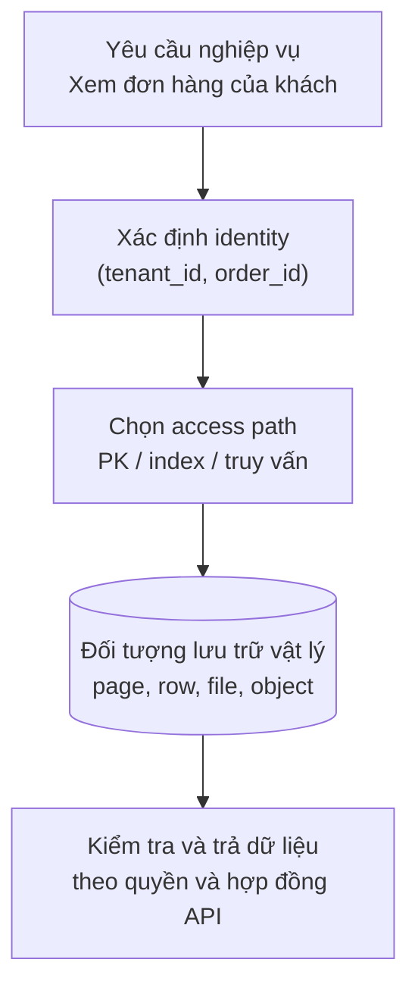
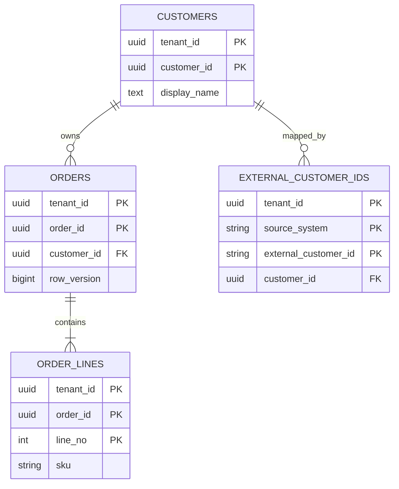
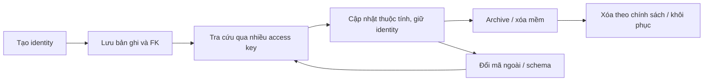
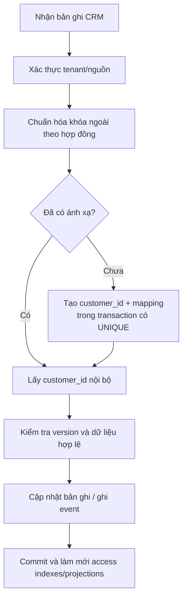

# Định danh bản ghi và khóa truy cập

Khi một ứng dụng Java lưu thông tin khách hàng hoặc đơn hàng, hệ thống cần trả lời hai câu hỏi rất gần nhau nhưng không giống nhau: **bản ghi nào là bản ghi đang được nói tới** và **phải dùng giá trị nào để tìm đến bản ghi đó**. Nếu chọn khóa sai, hệ thống có thể tạo trùng khách hàng, cập nhật nhầm đơn của tenant khác, trả kết quả chậm khi dữ liệu tăng hoặc đánh mất liên kết khi người dùng đổi email.

Bài học thuộc chương **Định danh và quan hệ** của module **DATA_PERSISTENCE_FUNDAMENTALS**. Trong phạm vi lưu trữ dữ liệu bền vững, từ thiết kế mô hình dữ liệu, lược đồ, truy vấn và chỉ mục đến giao dịch, cô lập, kiểm soát đồng thời, tiến hóa schema và bảo mật, việc xác định đúng khóa là nền tảng để ứng dụng Java lưu, liên kết, đọc và thay đổi dữ liệu đáng tin cậy.

Sau bài này, người học cần biết cách:

1. Phân biệt định danh logic, khóa nghiệp vụ, khóa tra cứu, khóa của chỉ mục và vị trí vật lý của bản ghi.
2. Chọn khóa chính, khóa ứng viên, khóa thay thế và khóa ghép với **phạm vi duy nhất** rõ ràng.
3. Dùng ràng buộc database để bảo vệ tính duy nhất và toàn vẹn tham chiếu, kể cả khi nhiều request chạy đồng thời.
4. Thiết kế chỉ mục theo cách ứng dụng thực sự tìm và sắp xếp dữ liệu.
5. Kết nối định danh trong Java/JPA, SQL, API và các hệ lưu trữ khác mà vẫn bảo vệ quyền truy cập.
6. Duy trì tham chiếu tới cùng một bản ghi khi dữ liệu đổi tên, di chuyển, xóa mềm, phục hồi hoặc thay đổi schema.

## 1. Định danh bản ghi và khóa truy cập khác nhau ở đâu?

Giả sử ứng dụng có một khách hàng:

| Thuộc tính | Giá trị minh họa | Vai trò |
| --- | --- | --- |
| `customer_id` | `f894...` (UUID) | Định danh nội bộ ổn định của khách hàng |
| `email` | `mai@example.test` | Thuộc tính nghiệp vụ, có thể dùng để tìm kiếm |
| `crm_customer_code` | `CRM-01482` | Khóa do hệ thống CRM cấp để đối soát |
| `tenant_id` | `t-17` (ký hiệu minh họa) | Phạm vi tổ chức chứa bản ghi |
| `display_name` | `Nguyễn Mai` | Thông tin hiển thị, không nên làm khóa định danh |
| `page/row location` | Vị trí nội bộ do storage engine quản lý | Vị trí vật lý có thể thay đổi |
| `access_token` | Chuỗi bí mật cấp cho phiên truy cập | Bằng chứng xác thực, không phải ID khách hàng |

**Định danh logic** (*identity*) cho phép khẳng định hai lần đọc ở thời điểm khác nhau đang nói về cùng một thực thể nghiệp vụ. **Khóa truy cập** (*access key/lookup key*) là giá trị hoặc tập giá trị dùng để tìm nhanh dữ liệu. Một bản ghi có thể có một định danh ổn định và nhiều khóa tra cứu: theo ID, theo email hiện tại, theo mã CRM hoặc theo số điện thoại đã xác thực.

Ví dụ người dùng đổi email, `customer_id` vẫn không đổi. Chỉ mục tra cứu theo email phải phản ánh email mới; lịch sử đơn hàng không được chuyển sang một khách hàng khác chỉ vì địa chỉ email đã thay đổi.

**Điểm phân biệt quan trọng:** cụm từ “access key” trong ngữ cảnh hệ thống lưu trữ đôi khi còn dùng để chỉ **khóa bí mật cấp quyền truy cập dịch vụ** (như khóa API). Trong bài này, **khóa truy cập dữ liệu** chủ yếu nghĩa là giá trị dùng để tìm bản ghi. ID của bản ghi **không** được coi là bằng chứng người gọi có quyền xem hoặc sửa bản ghi đó.

### Bốn lớp cần tách bạch



- **Identity:** biết **bản ghi nào** phải được thao tác.
- **Access path:** biết **đường truy xuất hiệu quả** tới bản ghi.
- **Physical location:** storage engine quyết định byte nằm ở trang đĩa, page cache hoặc vị trí nào.
- **Authorization:** ứng dụng và/hoặc database quyết định **ai được phép** thực hiện thao tác.

Một khóa chính hoàn hảo vẫn không ngăn lộ dữ liệu nếu API không kiểm tra tenant và quyền của người gọi.

## 2. Các loại khóa trong mô hình dữ liệu

| Thuật ngữ | Định nghĩa | Ví dụ | Cần lưu ý |
| --- | --- | --- | --- |
| **Superkey** | Tập thuộc tính phân biệt duy nhất một hàng theo các ràng buộc của quan hệ | `(customer_id, email)` khi `customer_id` đã duy nhất | Có thể chứa thuộc tính thừa |
| **Candidate key** | Superkey tối thiểu, không thể bỏ một thuộc tính mà vẫn duy nhất | `customer_id` hoặc một mã khách ổn định, duy nhất | Có thể có nhiều khóa ứng viên |
| **Primary key (PK)** | Khóa ứng viên được chọn để định danh hàng trong bảng | `customer_id` hoặc `(tenant_id, customer_id)` | Cần duy nhất và không NULL |
| **Alternate key** | Khóa ứng viên không được chọn làm PK | `(tenant_id, loyalty_number)` nếu ổn định và luôn tồn tại | Thường bảo vệ bằng `UNIQUE` |
| **Natural/business key** | Thuộc tính có ý nghĩa từ nghiệp vụ hoặc hệ thống ngoài | Mã đơn do doanh nghiệp cấp | Có thể thay đổi hoặc chỉ duy nhất trong một phạm vi |
| **Surrogate key** | Giá trị kỹ thuật được tạo riêng để định danh | UUID, sequence-generated integer | Không tự thay thế ràng buộc duy nhất của nghiệp vụ |
| **Composite key** | Khóa gồm nhiều thuộc tính | `(tenant_id, order_id)` | Thứ tự cột ảnh hưởng truy cập qua index |
| **Foreign key (FK)** | Tham chiếu từ hàng ở bảng này tới khóa được phép tham chiếu ở bảng khác | `orders.customer_id → customers.customer_id` | Phải bảo vệ phạm vi tenant và hành vi xóa/cập nhật |
| **External key** | ID được cấp bởi nguồn bên ngoài | `(partner_id, external_order_id)` | Cần namespace của nơi cấp |
| **Index/search key** | Thuộc tính dùng để tìm/lọc/sắp xếp nhờ index | `(tenant_id, created_at)` | Có thể không duy nhất và không phải identity |
| **Partition/shard key** | Thuộc tính quyết định vị trí phân chia dữ liệu | `tenant_id`, ngày tạo hoặc hash ID | Phục vụ phân bố dữ liệu, không nhất thiết định danh |

Các loại khóa có thể **trùng giá trị nhưng khác trách nhiệm**. Ví dụ `customer_id` đồng thời là PK và được lập chỉ mục để truy cập nhanh. Ngược lại, `created_at` được index để sắp xếp nhưng không thể là PK: nhiều đơn có thể tạo cùng một thời điểm.

### Khóa ứng viên và quy tắc duy nhất

Một thuộc tính chỉ là khóa ứng viên khi **ngữ nghĩa nghiệp vụ bảo đảm duy nhất**, không phải chỉ vì bộ dữ liệu hôm nay chưa có giá trị trùng. Chẳng hạn email trong một bảng có thể hiện chưa trùng, nhưng người dùng có thể thay đổi email, chưa cung cấp email, có email dùng chung hoặc tổ chức cho phép tái sử dụng email. Khi đó email không đáp ứng yêu cầu của một identity ổn định.

Ngược lại, một số mã nghiệp vụ được định nghĩa rõ là bất biến, duy nhất và luôn có thể dùng làm khóa. Quyết định chọn khóa dựa trên **quy tắc lâu dài** và hệ quả khi thay đổi, không dựa hoàn toàn vào sở thích UUID hay số tăng dần.

## 3. Tiêu chí chọn khóa định danh tốt

Một khóa định danh cần được đánh giá theo các tiêu chí:

1. **Tính duy nhất:** không có hai thực thể khác nhau cùng một khóa trong phạm vi đã định.
2. **Tính ổn định:** tránh thay đổi theo tên, vị trí, email, trạng thái hoặc logic hiển thị.
3. **Tính bắt buộc:** mỗi bản ghi cần được định danh ngay khi được coi là tồn tại; PK trong SQL không được NULL.
4. **Phạm vi:** xác định rõ khóa duy nhất trong cả hệ thống, trong một tenant, trong một nguồn hoặc trong một giai đoạn.
5. **Tính tối giản:** không đưa thêm thuộc tính không cần thiết vào khóa, trừ khi dùng để thể hiện đúng phạm vi.
6. **Khả năng tham chiếu:** dễ được dùng ổn định trong FK, API, log và dữ liệu đồng bộ.
7. **Tác động vận hành:** kích thước khóa, thứ tự phát sinh, tần suất ghi và topology ảnh hưởng index, shard và hiệu năng.

Không nên dùng **thứ tự dòng trong file CSV**, vị trí trong mảng, số thứ tự hiển thị, số trang hoặc địa chỉ vật lý của row để nhận diện bản ghi lâu dài. Các giá trị đó có thể thay đổi sau khi import lại, compact dữ liệu, xóa hoặc sắp xếp.

### Định danh toàn cục và theo phạm vi

Hai cửa hàng khác nhau có thể cùng phát mã đơn `ORD-001`. Nếu mã chỉ duy nhất **trong mỗi cửa hàng**, định danh đúng có thể là:

```text
(store_id, order_number)
(tenant_id, partner_id, external_order_number)
(tenant_id, document_id)
```

Đừng tự giả định một chuỗi là “unique toàn cầu”. Tên `external_id` không làm rõ ai cấp và phạm vi nào bảo đảm duy nhất. Thiếu namespace có thể gây **ghi đè hoặc nối nhầm dữ liệu giữa các tổ chức**.

Trong hệ thống nhiều tenant, khóa ghép `(tenant_id, entity_id)` là một cách rõ ràng để bảo vệ quan hệ dữ liệu. Dù `entity_id` là UUID có xác suất trùng cực thấp, bao gồm `tenant_id` trong FK và truy vấn vẫn giúp diễn đạt ranh giới sở hữu. Nếu dùng UUID duy nhất toàn cục cho PK, vẫn phải có cơ chế đáng tin cậy khác để ràng buộc mọi liên kết và quyền truy cập theo tenant.

## 4. Khóa tự nhiên, khóa thay thế và các kiểu ID thường dùng

### 4.1. So sánh lựa chọn

| Lựa chọn | Điểm mạnh | Đánh đổi |
| --- | --- | --- |
| Số nguyên tăng dần (sequence/identity) | Khóa gọn, thuận lợi cho nhiều chỉ mục và các kiểu ghi tuần tự | Có thể lộ quy mô hoặc thứ tự phát sinh nếu công khai; cấp ID phân tán cần thiết kế |
| UUID ngẫu nhiên | Tạo độc lập giữa các tiến trình; ít cần phối hợp nơi cấp | Khóa dài hơn số nguyên; tính ngẫu nhiên có thể giảm locality của B-tree |
| ID có yếu tố thời gian | Có thể thuận lợi cho sắp xếp/ghi theo thời gian | Cần kiểm tra cách cấp ID, khả năng trùng và thông tin thời gian bị lộ |
| Mã nghiệp vụ ổn định | Hữu ích cho đối soát và giao tiếp với hệ thống ngoài | Có thể dài, thay đổi quy tắc, chỉ duy nhất theo namespace |
| Khóa ghép theo tenant + local ID | Diễn đạt rõ phạm vi sở hữu và FK | Nhiều cột trong JOIN/INDEX; mọi đường đọc/ghi phải thống nhất |

Không có kiểu khóa nào tự giải quyết đầy đủ bảo mật, truy vấn, tính nhất quán hoặc retry. UUID là một cách tạo ID, **không phải cơ chế phân quyền hay khóa idempotency**. Với mọi chiến lược cấp ID, database vẫn phải dùng ràng buộc khóa chính hoặc unique constraint để bảo vệ invariant.

### 4.2. Khóa surrogate không bỏ qua uniqueness nghiệp vụ

Giả sử bảng khách hàng dùng `customer_id` là UUID. Nếu nghiệp vụ quy định **mỗi tenant chỉ có một tài khoản thành viên cho mỗi số hội viên**, DB vẫn cần ràng buộc duy nhất trên `(tenant_id, membership_number)`. Nếu chỉ có PK UUID, hai request cạnh tranh có thể tạo hai khách hàng với cùng mã hội viên nhưng UUID khác nhau.

Ngược lại, đừng đặt `UNIQUE(email)` trên toàn bộ hệ thống nếu một người dùng được phép có tài khoản ở nhiều tenant hoặc quy tắc email áp dụng khác nhau. Phạm vi constraint phải khớp hợp đồng nghiệp vụ.

### 4.3. Chuẩn hóa khóa trước khi so sánh

Một số khóa đầu vào cần chuẩn hóa:

- Trim khoảng trắng theo hợp đồng.
- Chuẩn hóa Unicode khi hệ thống cấp mã xác định cách tương đương.
- Quy định rõ có phân biệt chữ hoa/thường không.
- Giữ số 0 đầu nếu mã `000123` khác `123`.
- Không tự chuyển mã chứa dấu gạch ngang thành mã không dấu khi chưa được phép.

Ví dụ với địa chỉ email, sản phẩm có thể yêu cầu tìm kiếm không phân biệt chữ hoa/thường trong một phạm vi, nhưng **không được mặc nhiên áp dụng mọi cách viết thường hoặc bỏ dấu chấm/plus tag** cho mọi nhà cung cấp email. Một chính sách chuẩn hóa sai có thể hợp nhất hai địa chỉ khác biệt. Hãy lưu quy tắc và kiểm chứng với nguồn cấp dữ liệu.

## 5. Thiết kế khóa trong PostgreSQL: một ví dụ xuyên suốt

Giả sử một nền tảng có nhiều tenant. Mỗi tenant lưu khách hàng và đơn hàng; mã khách từ CRM của các đối tác có thể trùng nhau. Ví dụ dưới đây dùng PostgreSQL để minh họa **khóa, FK và phạm vi duy nhất**.

```sql
CREATE TABLE customers (
    tenant_id       UUID NOT NULL,
    customer_id     UUID NOT NULL,
    display_name    TEXT NOT NULL,
    email_original  TEXT,
    email_lookup    TEXT,
    created_at      TIMESTAMPTZ NOT NULL DEFAULT now(),
    PRIMARY KEY (tenant_id, customer_id)
);

CREATE TABLE external_customer_ids (
    tenant_id           UUID NOT NULL,
    source_system       VARCHAR(80) NOT NULL,
    external_customer_id VARCHAR(160) NOT NULL,
    customer_id         UUID NOT NULL,
    PRIMARY KEY (tenant_id, source_system, external_customer_id),
    FOREIGN KEY (tenant_id, customer_id)
        REFERENCES customers (tenant_id, customer_id)
);

CREATE INDEX ix_external_customer_by_target
    ON external_customer_ids (tenant_id, customer_id);

CREATE TABLE orders (
    tenant_id       UUID NOT NULL,
    order_id        UUID NOT NULL,
    customer_id     UUID NOT NULL,
    created_at      TIMESTAMPTZ NOT NULL DEFAULT now(),
    status          VARCHAR(24) NOT NULL,
    row_version     BIGINT NOT NULL DEFAULT 0,
    PRIMARY KEY (tenant_id, order_id),
    FOREIGN KEY (tenant_id, customer_id)
        REFERENCES customers (tenant_id, customer_id)
);

CREATE TABLE order_lines (
    tenant_id      UUID NOT NULL,
    order_id       UUID NOT NULL,
    line_no        INTEGER NOT NULL CHECK (line_no > 0),
    sku            VARCHAR(80) NOT NULL,
    quantity       INTEGER NOT NULL CHECK (quantity > 0),
    PRIMARY KEY (tenant_id, order_id, line_no),
    FOREIGN KEY (tenant_id, order_id)
        REFERENCES orders (tenant_id, order_id)
);
```

Các ràng buộc trên bảo vệ các điều sau:

- Trong một tenant, một `customer_id` và một `order_id` xác định duy nhất một bản ghi tương ứng.
- Đơn hàng chỉ tham chiếu tới khách hàng **cùng tenant** vì FK gồm cả `tenant_id`.
- Một mã CRM được phân giải theo `(tenant_id, source_system, external_customer_id)`.
- Mỗi dòng hàng thuộc một đơn và có số dòng duy nhất **trong đơn đó**.
- Cơ sở dữ liệu bảo vệ tính duy nhất ngay cả khi hai luồng Java chạy đồng thời.

**Lưu ý:** FK bảo vệ tồn tại và quan hệ giữa dữ liệu. Nó không tự chứng minh người gọi API có quyền đọc đơn đó. Truy vấn truy cập vẫn phải tuân thủ tenant, quyền và nghiệp vụ.

### 5.1. Khi nào đặt UNIQUE ngoài primary key?

Giả sử sản phẩm quy định mỗi tenant có thể gắn một email duy nhất cho một tài khoản khách hàng đang hoạt động. Nếu `email_lookup` đã được chuẩn hóa theo chính sách được chấp thuận, có thể cân nhắc:

```sql
-- Chỉ có ý nghĩa nếu nghiệp vụ thật sự yêu cầu email
-- không trùng giữa các khách hàng đang được xem là hoạt động.
CREATE UNIQUE INDEX uq_customer_active_email
ON customers (tenant_id, email_lookup)
WHERE email_lookup IS NOT NULL;
```

Đây là **ví dụ ràng buộc cho mọi khách hàng có email**; tên `active` trong ví dụ chỉ có ý nghĩa nếu bảng không lưu trạng thái inactive riêng. Nếu có `is_active` và chỉ muốn uniqueness cho tài khoản còn hoạt động, điều kiện index phải bổ sung đúng thuộc tính trạng thái đó và hệ thống phải xử lý việc đổi trạng thái. Không nên copy nguyên tên index để suy ra rằng đã có quy tắc “active”.

Theo semantics thông thường của PostgreSQL, `UNIQUE` cho phép nhiều giá trị `NULL` ở vị trí khóa vì `NULL` không được xem là bằng nhau theo mặc định. Nếu nghiệp vụ đòi hỏi chặn nhiều `NULL`, phải thiết kế thêm ràng buộc phù hợp, ví dụ `NOT NULL` hoặc cơ chế uniqueness có hỗ trợ `NULLS NOT DISTINCT` trên phiên bản phù hợp.

Nếu email có thể dùng chung, được thay đổi, hoặc không phải mã danh tính đáng tin, bỏ uniqueness email và tìm phương án định danh nghiệp vụ khác.

### 5.2. Truy vấn bằng khóa chính

```sql
SELECT tenant_id, order_id, customer_id, status, row_version
FROM orders
WHERE tenant_id = :tenant_id
  AND order_id = :order_id;
```

Khóa chính `(tenant_id, order_id)` đã có chỉ mục phục vụ phép tìm bằng bộ khóa đó trong PostgreSQL. Không cần tự tạo một chỉ mục trùng hệt.

Nếu ứng dụng chỉ gửi `order_id` mà bỏ tenant, cơ sở dữ liệu có thể phải quét nhiều phần dữ liệu hơn và đặc biệt có nguy cơ truy xuất sai phạm vi quyền. Nên thiết kế API nhận định danh tài nguyên **trong ngữ cảnh tenant xác thực**, thay vì lấy tenant trực tiếp từ đầu vào người dùng chưa kiểm tra.

## 6. Khóa truy cập, index và đường truy xuất

Một **khóa chính** đảm bảo hàng duy nhất. Một **chỉ mục** hỗ trợ DB tìm một tập hàng theo điều kiện hoặc thứ tự. Nhiều truy vấn thực tế không tra cứu theo PK:

- Lấy 50 đơn gần đây của một khách.
- Tìm đơn có trạng thái `PAID` trong một khoảng ngày.
- Tra một khách bằng số hội viên.
- Lấy danh sách các dòng của một đơn.
- Tìm đơn theo external ID của đối tác.

Không phải mọi điều kiện truy vấn đều phải trở thành PK. Hãy giữ identity ổn định và thiết kế **access paths** phục vụ truy vấn quan trọng.

### 6.1. Ví dụ index theo truy vấn lịch sử

```sql
CREATE INDEX ix_orders_customer_recent
ON orders (tenant_id, customer_id, created_at DESC, order_id DESC);
```

Câu truy vấn:

```sql
SELECT order_id, created_at, status
FROM orders
WHERE tenant_id = :tenant_id
  AND customer_id = :customer_id
ORDER BY created_at DESC, order_id DESC
LIMIT 50;
```

Index có thể giúp DB nhanh chóng tìm đơn của tenant và khách đang xét, rồi đọc theo thứ tự mới nhất. Cột `order_id` ở cuối tạo **thứ tự ổn định khi hai đơn có cùng `created_at`**.

Tuy nhiên, index không bảo đảm DB luôn dùng nó. Planner cân nhắc số hàng, độ chọn lọc, thống kê, bộ nhớ và chi phí thực thi. Query chỉ trả ít dòng hoặc bảng nhỏ đôi khi dùng sequential scan sẽ hợp lý hơn.

### 6.2. Thứ tự các cột trong khóa index

Với B-tree index `(tenant_id, customer_id, created_at DESC, order_id DESC)`:

- Truy vấn lọc bằng cả `tenant_id` và `customer_id` có thể tận dụng tiền tố index tốt.
- Truy vấn chỉ lọc theo `customer_id` không có tenant có thể không tận dụng được hiệu quả tương tự.
- Truy vấn theo trạng thái `status` mà không lọc hai cột đầu cần đánh giá access path khác.
- Đặt điều kiện bằng và điều kiện phạm vi/sắp xếp theo đúng mẫu truy cập thường giúp giảm scan, nhưng thiết kế index phải dựa trên planner và workload thực tế.

Index theo cột được sắp xếp khác nhau về hiệu quả với các truy vấn khác nhau. Một hệ thống có nhiều tenant nên cân nhắc **tần suất, độ phân bố và phạm vi lọc** trước khi chọn thứ tự key. Không xem “cột nào selectivity cao nhất thì luôn đứng đầu” là quy tắc tuyệt đối cho composite index.

### 6.3. Keyset pagination dùng khóa ổn định

Với dữ liệu lớn, `OFFSET` càng sâu có thể khiến DB phải duyệt nhiều hàng trước khi trả trang tiếp. Nếu sắp xếp theo `created_at DESC, order_id DESC`, có thể dùng keyset pagination:

```sql
SELECT order_id, created_at, status
FROM orders
WHERE tenant_id = :tenant_id
  AND customer_id = :customer_id
  AND (created_at, order_id) < (:cursor_created_at, :cursor_order_id)
ORDER BY created_at DESC, order_id DESC
LIMIT 50;
```

Trang đầu bỏ điều kiện cursor; trang sau nhận cặp `(created_at, order_id)` của dòng cuối trang trước. Cả hai trường phải có giá trị thích hợp để so sánh và sắp xếp nhất quán. Trong ví dụ, chúng đều `NOT NULL` và `order_id` duy nhất trong phạm vi tenant.

Nếu dữ liệu thay đổi giữa hai request phân trang, kết quả vẫn có thể biến động; keyset pagination **không tự cung cấp một snapshot nhất quán xuyên nhiều HTTP request**. Với báo cáo yêu cầu dữ liệu cố định, có thể cần snapshot logic, điều kiện giới hạn thời điểm hoặc cơ chế transaction/isolation tương ứng.

### 6.4. Khóa tra cứu dẫn tới nhiều hàng

Chỉ mục trên `status` hoặc `created_at` có thể trả nhiều bản ghi. Đó là **search key**, không phải entity identity. Đừng dùng giá trị `status = PAID` làm `Map` key duy nhất trong Java nếu ứng dụng phải lưu nhiều đơn cùng trạng thái.

Các kiểu truy cập thường gặp:

| Loại truy cập | Ví dụ điều kiện | Cấu trúc nên xem xét |
| --- | --- | --- |
| Tìm đúng một thực thể | `tenant_id + order_id` | PK hoặc UNIQUE |
| Tra cứu bằng mã ngoài | `tenant_id + source + external_id` | PK/UNIQUE trên bảng mapping |
| Tìm một tập theo khoảng | `created_at BETWEEN ...` | B-tree/composite index phù hợp |
| Tra cứu văn bản | Tên, mô tả, từ khóa | Full-text index/search engine theo workload |
| Truy xuất theo thời gian | Khách + ngày + thứ tự | Composite index phù hợp với ORDER BY |
| Phân tích tổng hợp lớn | Nhiều dòng, GROUP BY | Materialized view, warehouse hoặc index theo truy vấn |

Đừng tự tạo một index riêng cho mọi cột: mỗi index tăng dung lượng, chi phí ghi, WAL, backup và bảo trì. Tập trung vào truy vấn quan trọng, đo plan và đánh đổi.

## 7. Truy vấn an toàn trong Java: biết khóa và ranh giới tenant

Ví dụ Java 17 dùng JDBC. Khi tra đơn bằng ID nội bộ, ứng dụng cần có tenant đã xác thực từ ngữ cảnh bảo mật.

```java
import java.sql.Connection;
import java.sql.PreparedStatement;
import java.sql.ResultSet;
import java.sql.SQLException;
import java.util.Optional;
import java.util.UUID;

public final class OrderLookup {
    public record OrderRow(
            UUID tenantId,
            UUID orderId,
            UUID customerId,
            String status,
            long rowVersion) {}

    public Optional<OrderRow> findById(
            Connection connection,
            UUID authorizedTenantId,
            UUID orderId) throws SQLException {

        String sql = """
                SELECT tenant_id, order_id, customer_id, status, row_version
                FROM orders
                WHERE tenant_id = ? AND order_id = ?
                """;

        try (PreparedStatement statement = connection.prepareStatement(sql)) {
            statement.setObject(1, authorizedTenantId);
            statement.setObject(2, orderId);

            try (ResultSet rs = statement.executeQuery()) {
                if (!rs.next()) {
                    return Optional.empty();
                }

                return Optional.of(new OrderRow(
                        rs.getObject("tenant_id", UUID.class),
                        rs.getObject("order_id", UUID.class),
                        rs.getObject("customer_id", UUID.class),
                        rs.getString("status"),
                        rs.getLong("row_version")));
            }
        }
    }
}
```

Ví dụ này cho thấy:

- Sử dụng `PreparedStatement` để truyền tham số; không nối ID từ URL thành chuỗi SQL.
- Kết hợp `tenant_id` với `order_id` để truy vấn trong đúng phạm vi.
- Trả về `Optional.empty()` nếu không có hàng phù hợp.
- Đóng `PreparedStatement` và `ResultSet` bằng `try-with-resources`.
- Nhận `authorizedTenantId` do tầng xác thực và phân quyền cung cấp; việc có tenant đúng trong truy vấn **chưa thay thế kiểm tra người dùng có quyền đối với đơn cụ thể**.

`Connection` do lớp gọi quản lý trong ví dụ; trách nhiệm mở/đóng connection và transaction phải rõ ràng trong kiến trúc ứng dụng.

### 7.1. ID trong Java và tính bằng nhau

Có thể dùng kiểu ID rõ nghĩa để tránh truyền nhầm UUID khách hàng vào chỗ cần UUID đơn:

```java
import java.util.Objects;
import java.util.UUID;

public record OrderId(UUID value) {
    public OrderId {
        Objects.requireNonNull(value, "value");
    }
}

public record CustomerId(UUID value) {
    public CustomerId {
        Objects.requireNonNull(value, "value");
    }
}

public record TenantOrderKey(UUID tenantId, OrderId orderId) {
    public TenantOrderKey {
        Objects.requireNonNull(tenantId, "tenantId");
        Objects.requireNonNull(orderId, "orderId");
    }
}
```

`record` trong Java so sánh theo giá trị các thành phần. Hai `TenantOrderKey` có cùng tenant và `OrderId` đại diện cho cùng khóa logic. Nhưng hai DTO đơn hàng có cùng ID mà khác trạng thái vẫn là **cùng một thực thể ở hai thời điểm khác nhau**; so sánh toàn bộ các field của DTO không phải là quy tắc nhận diện thực thể.

Nếu ứng dụng dùng JPA/Hibernate, cần phân biệt:

- **Java object identity** (`==`): cùng instance trong bộ nhớ.
- **Domain/entity identity**: cùng bản ghi theo PK, kể cả khi nạp trong hai `EntityManager` khác nhau.
- **Value equality** (`equals` của value object/DTO): các thành phần dữ liệu bằng nhau.
- **JPA persistence context**: quản lý các entity theo identity trong phạm vi session/context của nó, không tạo quy tắc toàn hệ thống cho mọi JVM.

### 7.2. Cẩn thận với equals/hashCode của JPA entity

Một entity có ID được database cấp **sau khi INSERT** có thể chuyển từ `id = null` sang ID mới khi persist. Nếu `hashCode()` phụ thuộc trực tiếp vào ID thay đổi, entity đang nằm trong `HashSet` có thể không tìm thấy nữa. Nếu `equals()` chỉ so sánh null ID, hai entity mới chưa lưu có thể bị xem là bằng nhau nhầm.

Quy tắc phù hợp phụ thuộc chiến lược cấp ID, proxy của ORM, inheritance và vòng đời entity. Cần nhất quán theo dự án; cân nhắc cấp UUID trước khi persist khi hợp lý, tránh đưa thuộc tính nghiệp vụ có thể đổi vào equality của entity. Không dùng `record` làm thay thế trực tiếp entity JPA có vòng đời mutable/proxy nếu chưa kiểm tra hỗ trợ và yêu cầu của ORM.

## 8. Khóa ngoại thể hiện quan hệ, không chỉ tăng tốc JOIN

Giữa khách hàng và đơn hàng là quan hệ **một-nhiều**. Giữa đơn và dòng hàng cũng là quan hệ **một-nhiều**. FK thể hiện rằng bản ghi con phải tham chiếu một bản ghi cha hợp lệ.



Sơ đồ trên minh họa quan hệ logic; điều kiện “một đơn luôn có ít nhất một dòng hàng” **không được bảo đảm chỉ bằng FK từ dòng hàng đến đơn**. Nếu nghiệp vụ yêu cầu, phải áp dụng kiểm tra tại thời điểm chốt đơn hoặc cơ chế constraint/transaction phù hợp.

### 8.1. FK bảo vệ tính toàn vẹn tham chiếu

```sql
SELECT
    o.order_id,
    o.created_at,
    c.display_name
FROM orders AS o
JOIN customers AS c
  ON c.tenant_id = o.tenant_id
 AND c.customer_id = o.customer_id
WHERE o.tenant_id = :tenant_id
  AND o.order_id = :order_id;
```

Việc JOIN theo **đầy đủ khóa** ngăn nối một đơn của tenant này với khách hàng có cùng local ID ở tenant khác. Đây là một ràng buộc quan trọng khi chuyển từ mô hình một tenant sang nhiều tenant.

Đặt FK không đồng nghĩa database tự tạo index ở cột **bên tham chiếu** trong mọi engine. PostgreSQL không tự tạo index trên các cột FK của bảng con chỉ vì có ràng buộc FK; khi JOIN, xóa/đổi khóa cha hoặc tìm các hàng con thường xuyên, cần xem xét index phù hợp.

### 8.2. Quan hệ nhiều-nhiều

Giả sử một khách hàng có thể thuộc nhiều nhóm phân loại và một nhóm chứa nhiều khách. Dùng bảng liên kết:

```sql
CREATE TABLE customer_groups (
    tenant_id UUID NOT NULL,
    group_id  UUID NOT NULL,
    label     TEXT NOT NULL,
    PRIMARY KEY (tenant_id, group_id)
);

CREATE TABLE customer_group_memberships (
    tenant_id   UUID NOT NULL,
    customer_id UUID NOT NULL,
    group_id    UUID NOT NULL,
    joined_at   TIMESTAMPTZ NOT NULL DEFAULT now(),
    PRIMARY KEY (tenant_id, customer_id, group_id),
    FOREIGN KEY (tenant_id, customer_id)
        REFERENCES customers (tenant_id, customer_id),
    FOREIGN KEY (tenant_id, group_id)
        REFERENCES customer_groups (tenant_id, group_id)
);
```

Bảng liên kết có khóa ghép thể hiện **mỗi khách chỉ thuộc một nhóm một lần** theo cùng tenant. Nếu nghiệp vụ cho phép một người tham gia cùng nhóm nhiều giai đoạn, cần thay đổi mô hình: khóa của **lần tham gia** có thể bao gồm ID hoặc thời gian bắt đầu riêng, đồng thời quy định cách bảo đảm các giai đoạn không chồng chéo.

### 8.3. Cẩn thận với ON DELETE CASCADE

`ON DELETE CASCADE` có thể tiện cho dữ liệu phụ được phép xóa cùng cha, nhưng nếu quan hệ chứa chứng từ, audit hoặc lịch sử thanh toán thì xóa dây chuyền có thể vi phạm nghĩa vụ lưu trữ. Chọn `RESTRICT`, `NO ACTION`, `SET NULL` hoặc `CASCADE` theo vòng đời dữ liệu, cấu trúc FK và yêu cầu nghiệp vụ. Đừng bật cascade chỉ để tránh lỗi khi xóa một bản ghi cha.

## 9. Ràng buộc duy nhất và giao dịch khi nhiều request chạy đồng thời

Một pattern nguy hiểm:

```java
if (!repository.existsByExternalId(source, externalId)) {
    repository.insertNewCustomer(source, externalId);
}
```

Hai request có thể cùng thấy `exists == false`, rồi cùng tạo hai hàng. Đây là lỗi **check-then-act** khi thiếu ràng buộc tại tầng lưu trữ.

Cách giải quyết thường bao gồm:

- Đặt `PRIMARY KEY` hoặc `UNIQUE` theo khóa nghiệp vụ thực sự.
- Thực hiện `INSERT` và xử lý xung đột bằng transaction hoặc lệnh upsert có điều kiện.
- Xác định khi nào xung đột nghĩa là **cùng một thực thể**, khi nào là **hai lệnh nghiệp vụ khác nhau tranh cùng khóa**.
- Không bắt mọi lỗi database rồi trả “đã tồn tại”: lỗi FK, CHECK, kết nối hay syntax có nguyên nhân khác.

Ví dụ đăng ký mapping cho khách hàng CRM đã có bản ghi `customers`:

```sql
INSERT INTO external_customer_ids (
    tenant_id, source_system, external_customer_id, customer_id
)
VALUES (
    :tenant_id, :source_system, :external_customer_id, :customer_id
)
ON CONFLICT (tenant_id, source_system, external_customer_id)
DO NOTHING;
```

Nếu không chèn được vì conflict, ứng dụng **phải đọc lại ánh xạ đang tồn tại** và kiểm tra xem nó dẫn tới đúng khách hàng mong muốn. Không được coi `DO NOTHING` là bằng chứng hai request tương đương. Nếu source ID đã thuộc khách hàng khác, đó có thể là dữ liệu mâu thuẫn cần điều tra.

### 9.1. Kiểm soát optimistic concurrency theo định danh

Khóa giúp tìm đúng đơn; `row_version` giúp xác định đơn có bị người khác sửa kể từ lúc đọc hay không:

```sql
UPDATE orders
SET status = :new_status,
    row_version = row_version + 1
WHERE tenant_id = :tenant_id
  AND order_id = :order_id
  AND row_version = :expected_version;
```

Nếu cập nhật 0 dòng, cần phân biệt không tìm thấy bản ghi, thiếu quyền hoặc conflict version. Với logic nghiệp vụ nhạy cảm, quyết định retry hay báo xung đột tùy trạng thái và hành động; **không tự động ghi đè** bằng cách bỏ điều kiện version.

### 9.2. Identity không thay thế idempotency

Một `order_id` ổn định không tự ngăn một request thanh toán bị thực hiện hai lần. Idempotency key nhận diện **ý định/thao tác client gửi lại**, còn `order_id` nhận diện **thực thể đơn hàng**. Tương tự, `event_id` nhận diện một thông điệp; nhiều event khác nhau có thể thay đổi cùng một đơn.

Ở những thao tác có retry, cần bổ sung:

- Khóa idempotency trong phạm vi client/tenant/request theo hợp đồng.
- Chống xử lý trùng event theo consumer và message ID.
- Transaction cho trạng thái nghiệp vụ và dấu vết đã xử lý.
- Version/sequence để chặn sự kiện đến muộn ghi đè dữ liệu mới.

Phân biệt rõ các khóa này giúp giữ lịch sử bản ghi chính xác qua nhiều lần xử lý.

## 10. Khóa truy cập ở các mô hình lưu trữ khác

SQL không phải môi trường duy nhất có khóa. Ý nghĩa và phạm vi bảo đảm của khóa thay đổi theo mô hình lưu trữ.

### 10.1. Key-value store

Trong key-value store, ứng dụng thường truy xuất bằng một key hoàn chỉnh:

```text
key:   tenant:17:session:6d32...
value: {"userId":"...", "expiresAt":"..."}

key:   tenant:17:cart:customer-42
value: {"items":[...], "version":12}
```

Ưu điểm: tra cứu theo key trực tiếp, mô hình đơn giản và thường có hiệu năng cao khi phân vùng hợp lý. Nhưng:

- Không mặc định hỗ trợ truy vấn tùy ý theo thuộc tính bên trong value.
- Key có thể là kết quả ghép nhiều thành phần; cần quy tắc escape/encoding tránh mơ hồ.
- TTL và eviction phù hợp với dữ liệu có thể mất hoặc tái tạo, không mặc nhiên phù hợp với dữ liệu nghiệp vụ bắt buộc giữ.
- Atomic update, compare-and-set, transaction nhiều key và consistency giữa các node **phụ thuộc sản phẩm cụ thể**.

Không để dấu phân cách đơn thuần như `:` trong thành phần ID chưa escape gây hai bộ định danh ghép ra cùng một chuỗi key.

### 10.2. Object storage

Object storage thường dùng **bucket/container + object key** để định vị object:

```text
bucket: company-documents
key:    tenants/t17/invoices/2026/11/{documentId}/v2.pdf
```

Object key là tên truy xuất trong một namespace; nó không nhất thiết là ID nghiệp vụ bất biến. Khi đổi đường dẫn hoặc phiên bản, tài liệu có thể vẫn là cùng một thực thể theo `documentId`. Một bảng metadata trong database có thể ánh xạ `documentId` sang object key, checksum, trạng thái, version và quyền.

Không mặc định “đổi tên object” là một thao tác nguyên tử trong object storage; nhiều dịch vụ triển khai bằng copy + delete. Tính nhất quán khi đọc/ghi/xóa, hỗ trợ ETag/conditional write, versioning và danh sách object phụ thuộc nhà cung cấp. Khi cần đồng bộ metadata và blob, phải có trạng thái trung gian và quy trình đối soát khi một bước thành công còn bước khác lỗi.

### 10.3. File và directory

Đường dẫn như `/data/customers/42.json` có thể giúp tìm tệp, nhưng là **storage locator**. Việc di chuyển hoặc đổi tên thư mục không nên làm mất domain identity của khách. Nếu cần truy cập theo email, theo ngày hoặc theo quan hệ, ứng dụng phải quản lý thêm chỉ mục hoặc chọn database phù hợp.

Một tên tệp tạo trực tiếp từ đầu vào user cũng mang nguy cơ path traversal, ghi đè hoặc rò rỉ thông tin. Dùng tên kỹ thuật do server cấp và xác minh quyền trước khi mở tài nguyên.

### 10.4. Khóa phân vùng và shard

Trong database phân tán, shard/partition key quyết định vị trí dữ liệu. Có thể chọn `tenant_id` để gom dữ liệu cùng tenant, hoặc hash của ID để phân bố tải. Nhưng việc gom theo tenant có thể tạo **hot shard** nếu một tenant rất lớn; chia ngẫu nhiên quá mạnh có thể khiến JOIN hoặc transaction xuyên shard đắt hơn.

Với uniqueness trên toàn hệ thống, cần kiểm tra engine bảo đảm unique constraint trong phạm vi nào. Một UNIQUE cục bộ ở mỗi shard **không tự bảo đảm duy nhất toàn cụm** nếu cùng khóa có thể được ghi ở nhiều shard. Thiết kế cần quy tắc cấp phát ID, định tuyến hoặc cơ chế ràng buộc toàn cục tương ứng.

## 11. Khóa và quyền truy cập là hai vấn đề khác nhau

Biết `order_id` có nghĩa là biết **cách chỉ đến đơn hàng**, không có nghĩa được phép xem đơn đó. Lỗ hổng điển hình là **IDOR (insecure direct object reference)**: API lấy ID từ URL, truy vấn theo ID và trả bản ghi mà không kiểm tra quyền sở hữu.

Ví dụ API:

```text
GET /api/orders/{orderId}

Không an toàn:
    SELECT * FROM orders WHERE order_id = :orderId;

Hướng thiết kế:
    1. Xác thực actor và tenant được phép.
    2. Truy vấn trong phạm vi tenant.
    3. Kiểm tra actor được đọc đơn cụ thể theo nghiệp vụ.
    4. Trả dữ liệu tối thiểu phù hợp quyền.
```

Các biện pháp bổ sung:

- Phân quyền ở tầng ứng dụng và cân nhắc **row-level security** của DB nếu phù hợp; cấu hình RLS phải được kiểm thử với vai trò và connection pooling thực tế.
- Dùng FK ghép tenant để tránh liên kết nhầm chéo tenant.
- Không ghi token, session secret, private key hoặc thông tin cá nhân nhạy cảm vào log vì tưởng đó chỉ là “ID”.
- Với ID tuần tự có thể đoán, vẫn phải kiểm soát quyền; đổi sang UUID không sửa được một lỗ hổng phân quyền.
- Trong API công khai, cân nhắc khả năng suy đoán quy mô kinh doanh, thời điểm tạo và tính riêng tư của khóa, nhưng **không** dùng sự khó đoán làm biện pháp bảo mật duy nhất.
- Khi cache theo khóa, đưa đủ phạm vi tenant/authorization vào chiến lược cache hoặc kiểm tra quyền trước khi trả dữ liệu, tránh cache chung làm lộ bản ghi.

Để giảm rủi ro lộ dữ liệu, không được trả chi tiết bản ghi “tồn tại nhưng bạn không có quyền” cho mọi người dùng nếu hợp đồng sản phẩm cần che giấu sự tồn tại của tài nguyên. Chọn mã trạng thái HTTP và thông điệp theo chính sách API nhất quán.

## 12. Vòng đời của khóa: thay đổi, hợp nhất, xóa và phục hồi

Định danh của bản ghi cần sống bền vững qua nhiều thao tác:



### 12.1. Khi thuộc tính tra cứu thay đổi

Khách hàng đổi email từ `mai@example.test` sang `mai.new@example.test`. Ứng dụng cập nhật email và index tương ứng nhưng giữ nguyên `customer_id`; FK từ đơn hàng vẫn không thay đổi.

Nếu cần lưu lịch sử email để phục vụ đối soát, tạo bảng lịch sử có mốc hiệu lực và chính sách quyền riêng tư phù hợp. Đừng coi mọi email cũ là alias hợp lệ vĩnh viễn: địa chỉ có thể được tái sử dụng cho người khác.

### 12.2. Khi mã từ hệ thống ngoài thay đổi

Nếu CRM đổi `CRM-01482` thành `CRM-08219`, phải xác định:

- Có còn nhận event với mã cũ không?
- Mã cũ có được CRM cấp lại cho người khác không?
- Bản mapping cũ cần giữ bao lâu và trong phạm vi nào?
- Việc đổi mã có được xác thực từ nguồn tin cậy không?

Để không làm mất tham chiếu, có thể dùng bảng mapping với trạng thái hoặc mốc hiệu lực. Thao tác đổi mapping phải được audit và bảo vệ bằng transaction; không cập nhật trực tiếp PK của toàn bộ các bảng nghiệp vụ chỉ vì mã ngoài đổi.

### 12.3. Khi hai bản ghi bị tạo trùng và cần hợp nhất

Giả sử `customer_id=A` và `customer_id=B` sau đối soát được xác nhận cùng một khách hàng. Gộp dữ liệu là **thao tác nghiệp vụ**:

1. Xác định bản ghi chính và nguồn bằng chứng.
2. Kiểm tra FK, lịch sử thanh toán, quyền truy cập và liên kết ở downstream.
3. Chọn cách chuyển FK hoặc giữ alias từ ID cũ đến ID chính theo yêu cầu.
4. Kiểm tra xung đột uniqueness của mã ngoài và dữ liệu tham chiếu.
5. Cập nhật index, cache và projection; audit quyết định gộp.
6. Ngăn các bản import cũ tạo lại duplicate.

Không tự động gộp hai người chỉ vì trùng email, tên hoặc số điện thoại; một sai lầm có thể làm lộ dữ liệu của người khác.

### 12.4. Xóa mềm và tombstone

Khi bản ghi được đánh dấu `deleted_at`, ID có thể vẫn cần tồn tại trong lịch sử, audit hoặc event. Nếu có thông điệp cũ đến sau khi xóa, cơ chế import “không thấy hàng hoạt động thì tạo mới” có thể vô tình khôi phục dữ liệu bị xóa. Có thể cần **tombstone**, phiên bản hoặc chính sách reject/reconcile event cũ.

Hãy phân biệt **không tái sử dụng ID** với **giữ thông tin cá nhân vô thời hạn**. Tombstone nên chứa tối thiểu dữ liệu cần để chống tạo lại, có thời hạn và tuân thủ chính sách lưu giữ/xóa phù hợp.

### 12.5. Backup và restore phải giữ tính nhất quán của khóa

Nếu restore bảng `orders` đến một thời điểm nhưng bảng mapping ID ngoài hoặc bảng `customers` đến thời điểm khác, các FK và ánh xạ có thể lệch. Kế hoạch backup cần xác định điểm khôi phục nhất quán, cách replay log, đối soát với nguồn ngoài và bảo vệ unique constraint sau recovery.

**RPO** mô tả mức mất dữ liệu tối đa chấp nhận được; **RTO** mô tả thời gian khôi phục. Chỉ restore tệp dữ liệu mà không kiểm tra các mối quan hệ và index chưa chứng minh được hệ thống phục hồi nghiệp vụ thành công.

## 13. Tiến hóa schema và chuyển đổi khóa

Khóa ảnh hưởng đến nhiều bảng, API, event, cache và hệ tích hợp. Thay đổi cấu trúc khóa cần có lộ trình rõ ràng.

Ví dụ ứng dụng ban đầu dùng `email` làm PK khách hàng, nhưng sau đó cần cho phép đổi email và nhiều tenant. Có thể chuyển sang `(tenant_id, customer_id)` theo các bước:

1. **Định nghĩa khóa mới:** cấp `customer_id` cho từng khách hàng hiện có; chuẩn hóa và đối soát các trường hợp trùng/mâu thuẫn.
2. **Mở rộng schema:** thêm cột và ràng buộc, backfill theo batch có checkpoint; tránh khóa bảng lâu ngoài kế hoạch.
3. **Bổ sung FK mới:** cập nhật bảng đơn, giao dịch, audit và mapping để tham chiếu khóa mới, bảo toàn tenant.
4. **Chuyển đường ghi:** cập nhật dịch vụ Java, dùng identity mới; trong giai đoạn chuyển đổi phải xác định một nguồn chân lý và kiểm tra tính nhất quán giữa hai cách biểu diễn.
5. **Chuyển đường đọc:** API, repository, cache và consumer dùng khóa mới; giữ adapter tương thích khi cần.
6. **Kiểm tra và cắt chuyển:** đối chiếu row count, uniqueness, orphan records, truy vấn, transaction, backup/restore và sự kiện đến muộn.
7. **Thu hồi phần cũ:** chỉ xóa index/cột/adapter cũ khi toàn bộ caller và dữ liệu lịch sử đã chuyển thành công.

Trong những DB phân vùng hoặc rất lớn, thao tác tạo UNIQUE/FK và cập nhật PK có thể có hạn chế hoặc yêu cầu bảo trì khác nhau. Cần kiểm tra khả năng online migration của phiên bản DB thực tế và chọn phương án có rollback.

**Lưu ý:** việc mở rộng schema rồi cùng lúc ghi hai nguồn identity mà không có cơ chế đồng bộ có thể tạo một dạng dual-write inconsistency. Nếu cần tương thích tạm thời, hãy chỉ rõ thứ tự, transaction, quy tắc đối soát và thời điểm chuyển nguồn chân lý.

## 14. Tình huống hoàn chỉnh: nhập khách hàng từ nhiều CRM

Một nền tảng SaaS Java nhận thông tin khách từ **CRM-A** và **CRM-B**. Hai hệ thống đều có thể cấp mã `C-001`. Nền tảng có nhiều tenant; mỗi khách có đơn hàng, có thể đổi email và có thể được import lại nhiều lần.

### Thiết kế đề xuất

| Nhu cầu | Khóa/ràng buộc | Mục đích |
| --- | --- | --- |
| Định danh khách nội bộ | `(tenant_id, customer_id)` là PK | Không phụ thuộc mã CRM hoặc email |
| Tra khách theo CRM | `(tenant_id, source_system, external_customer_id)` là PK mapping | Ngăn collision giữa các nguồn |
| Tìm khách theo email | Index hoặc UNIQUE theo chính sách thực tế | Phục vụ truy vấn, không mặc nhiên là ID bất biến |
| Liên kết đơn hàng | FK `(tenant_id, customer_id)` | Giữ quan hệ đúng tenant |
| Tải đơn gần đây | Index `(tenant_id, customer_id, created_at DESC, order_id DESC)` | Truy vấn/phân trang theo access pattern |
| Chống ghi đè đồng thời | `row_version` và conditional UPDATE | Phát hiện lost update |
| Chống nhập trùng | UNIQUE mapping, transaction và xử lý xung đột | Hai request song song không tạo hai mapping cho cùng khóa |
| Phân quyền | Tenant/actor kiểm tra ở service và DB khi phù hợp | Biết ID chưa đủ để đọc dữ liệu |

Một luồng nhập hợp lý:



**Đường đua cần xử lý:** hai luồng cùng nhận CRM-A/C-001 và không thấy mapping. Hai luồng phải cạnh tranh qua một uniqueness constraint. Một luồng chèn thành công; luồng còn lại cần nhận diện conflict, rollback nếu cần và đọc ánh xạ đã commit. Nếu hệ thống đã tạo một bản ghi khách mồ côi trong transaction lỗi, phải bảo đảm rollback hoặc quy trình dọn; không dùng hai thao tác commit độc lập thiếu cơ chế bù trừ.

### Bốn truy vấn minh họa

**Tra theo ID nội bộ:**

```sql
SELECT customer_id, display_name, email_original
FROM customers
WHERE tenant_id = :tenant_id
  AND customer_id = :customer_id;
```

**Tra từ external ID:**

```sql
SELECT c.customer_id, c.display_name
FROM external_customer_ids AS m
JOIN customers AS c
  ON c.tenant_id = m.tenant_id
 AND c.customer_id = m.customer_id
WHERE m.tenant_id = :tenant_id
  AND m.source_system = :source_system
  AND m.external_customer_id = :external_id;
```

**Liệt kê đơn của khách:**

```sql
SELECT order_id, created_at, status
FROM orders
WHERE tenant_id = :tenant_id
  AND customer_id = :customer_id
ORDER BY created_at DESC, order_id DESC
LIMIT 50;
```

**Cập nhật có version:**

```sql
UPDATE orders
SET status = :new_status,
    row_version = row_version + 1
WHERE tenant_id = :tenant_id
  AND order_id = :order_id
  AND row_version = :expected_version;
```

Những câu truy vấn này minh họa sự phân công rõ ràng: **PK cho identity**, **mapping cho ID ngoài**, **secondary index cho access pattern** và **version cho concurrency**.

## 15. Những sai lầm thường gặp

| Sai lầm | Hậu quả | Cách sửa |
| --- | --- | --- |
| Dùng email hoặc tên người làm PK bất biến | Thay đổi thuộc tính làm gãy FK/lịch sử | Dùng ID ổn định; email là thuộc tính tra cứu theo chính sách |
| Dùng số thứ tự dòng hoặc vị trí lưu trữ làm identity | Import/rewrite/compact làm thay đổi vị trí | Sinh khóa logic riêng |
| Bỏ namespace khỏi external ID | Hai đối tác cùng mã bị nối nhầm | Dùng `(tenant, source, external_id)` |
| Có UUID PK nên bỏ UNIQUE nghiệp vụ | Hai bản ghi khác ID vẫn trùng mã hội viên | Bổ sung constraint đúng phạm vi |
| Tin `SELECT exists` rồi `INSERT` sẽ không bao giờ trùng | Race tạo dữ liệu trùng | Unique constraint và xử lý conflict |
| Dùng index key không duy nhất làm entity ID | Một trạng thái/ngày khớp nhiều bản ghi | Dùng PK và secondary index đúng vai trò |
| Bỏ `tenant_id` trong FK/JOIN | Có thể nối dữ liệu xuyên tenant | Ràng buộc FK và truy vấn theo đủ scope |
| Tin UUID khó đoán là đủ bảo mật | API IDOR vẫn lộ bản ghi | Xác thực, authorization và kiểm tra tenant |
| Cộng index không theo query plan | Tăng write cost, WAL và dung lượng | Đo workload, chỉ tạo index cần thiết |
| Dùng `equals()` theo toàn bộ field entity | Đổi trạng thái làm thay đổi quan hệ equality | Tách entity identity khỏi value equality |
| Đồng nhất `order_id` với idempotency key | Request retry có thể lặp thanh toán | Thiết kế khóa thao tác riêng |
| Bỏ version khi cập nhật | Lost update hoặc event cũ ghi đè | Optimistic locking/state transition |
| Đổi khóa mà không cập nhật downstream | Cache, event, FK và backup lệch | Migration có backfill, adapter, đối soát |

## 16. Bài tập áp dụng và câu hỏi tự kiểm tra

**Bài tập:** thiết kế persistence cho một thư viện học trực tuyến. Mỗi tenant có học viên, khóa học và lượt đăng ký. Một email có thể thuộc hai tenant; một học viên có thể đổi email; học viên có thể đăng ký nhiều khóa học; API cần liệt kê 20 đăng ký mới nhất của một học viên. Hãy xác định:

1. PK cho học viên, khóa học và lượt đăng ký; phạm vi duy nhất của từng khóa.
2. FK bảo vệ việc đăng ký không tham chiếu sai tenant.
3. Ràng buộc ngăn học viên đăng ký cùng một khóa hai lần **nếu** nghiệp vụ chỉ cho phép một lượt đăng ký đang hoạt động; cách thay đổi mô hình nếu cho phép học lại.
4. Secondary index cho truy vấn đăng ký mới nhất, kèm cột chống hòa thời gian.
5. Cách xử lý hai request đăng ký cùng lúc, mã idempotency và version nếu cần.
6. Kiểm tra quyền khi người dùng gọi API với enrollment ID của học viên khác.
7. Kế hoạch đổi từ khóa email sang ID nội bộ mà không làm mất lịch sử.

### Câu hỏi tự kiểm tra

1. Một bản ghi được định danh bằng PK có thể có bao nhiêu khóa tra cứu khác? Cho ví dụ.
2. Tại sao một cột có index không có nghĩa nó là khóa định danh duy nhất?
3. Khi nào khóa tự nhiên phù hợp làm PK, khi nào nên chọn surrogate key?
4. Vì sao phải xác định phạm vi duy nhất trước khi dùng `UNIQUE`?
5. UUID có giúp thay thế kiểm tra quyền truy cập hay không? Vì sao?
6. Làm thế nào một FK ghép giúp giảm nguy cơ tham chiếu chéo tenant?
7. Tại sao một kiểm tra `exists` trước `INSERT` không đủ trong hệ thống nhiều request?
8. Vì sao index `(tenant_id, customer_id, created_at)` không bảo đảm tối ưu truy vấn chỉ lọc theo `created_at`?
9. Khi keyset pagination sắp theo ngày tạo, tại sao nên thêm ID làm tie-breaker?
10. Vì sao hai DTO cùng ID nhưng khác trạng thái vẫn có thể đại diện cho cùng một thực thể?
11. Nếu CRM đổi mã khách hàng, bộ phận nào của hệ thống phải thay đổi và bộ phận nào nên giữ nguyên?
12. Với dữ liệu được shard, vì sao cần kiểm tra phạm vi UNIQUE của engine?
13. Khi restore từ backup, làm sao kiểm tra ánh xạ ID ngoài và FK vẫn nhất quán?
14. Vì sao khóa của object storage không nên mặc định là ID nghiệp vụ vĩnh viễn?

Định danh bản ghi đúng giúp hệ thống biết **dữ liệu nào là cùng một thực thể** qua nhiều lần đọc, ghi và tích hợp. Khóa truy cập và chỉ mục giúp **tìm dữ liệu theo cách phù hợp với truy vấn**, còn ràng buộc và transaction giữ tính nhất quán khi có cạnh tranh hoặc lỗi. Khi phân biệt được những trách nhiệm này, ứng dụng Java có thể thiết kế schema rõ ràng, truy cập hiệu quả, quản lý quan hệ an toàn và tiến hóa persistence mà không làm mất lịch sử nghiệp vụ.
