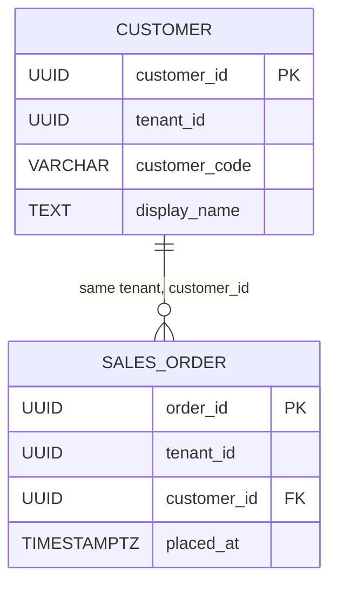
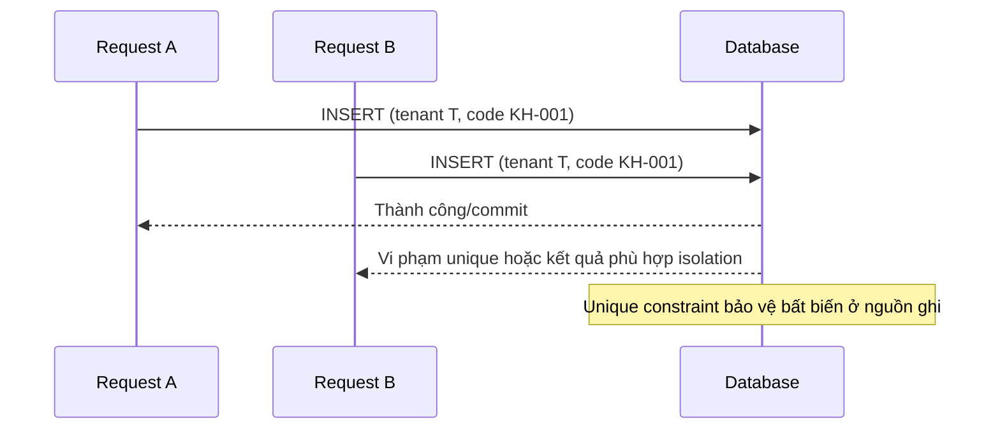

# Định danh có ý nghĩa nghiệp vụ và định danh kỹ thuật

Một ứng dụng quản lý khách hàng lưu mã `KH-001`. Người dùng gọi khách hàng bằng mã này, hệ thống báo cáo cũng hiển thị nó. Sau đó doanh nghiệp đổi quy tắc đặt mã thành `HCM-2026-001`, khách hàng chuyển sang một chi nhánh khác, hoặc hai công ty nhập dữ liệu có cùng mã `KH-001`. Nếu mã đang là khóa chính được hàng chục bảng tham chiếu, thay đổi nhỏ về nghiệp vụ có thể trở thành một cuộc di chuyển dữ liệu khó kiểm soát.

Thiết kế bền vững thường phân biệt **định danh mang ý nghĩa nghiệp vụ** với **định danh kỹ thuật dùng để nối các bản ghi**. Hai loại đều có giá trị; chúng trả lời những câu hỏi khác nhau và không nên được đánh đồng một cách vô thức.

Bài thuộc chương **Định danh và quan hệ** của module **DATA_PERSISTENCE_FUNDAMENTALS**. Module giúp người học hiểu lưu trữ dữ liệu bền vững trong ứng dụng Java, từ mô hình, lược đồ, truy vấn và chỉ mục đến transaction, isolation, concurrency; thiết kế ranh giới persistence, xử lý lỗi kết nối, tiến hóa schema, bảo mật, sao lưu và hiệu năng. Trong bài này, trọng tâm là cách xác định **đối tượng nào là cùng một thực thể**, chọn khóa ổn định, đặt ràng buộc duy nhất và giữ tính toàn vẹn của các quan hệ khi quy tắc nghiệp vụ thay đổi.

Sau khi học, bạn có thể:

- Phân biệt business identifier, natural key, candidate key, primary key và surrogate/technical identifier.
- Xác định **phạm vi duy nhất, quy tắc chuẩn hóa, khả năng thay đổi và tái sử dụng** của mỗi định danh.
- Thiết kế khóa chính, unique constraint và foreign key để giữ quan hệ trong mô hình nhiều tenant.
- Mô tả ranh giới Java/JDBC và API khi một thực thể có cả mã nghiệp vụ lẫn ID kỹ thuật.
- Lập phương án migration, merge/split, đồng bộ ID xuyên hệ thống và kiểm thử cạnh tranh tạo trùng.

## 1. Định danh nhằm giải quyết vấn đề gì?

Trước tiên hãy phân biệt ba việc:

1. **Nhận diện một thực thể:** bản ghi đơn hàng nào đại diện cho giao dịch mà khách vừa tạo?
2. **Tìm kiếm theo thông tin có ý nghĩa:** nhân viên nhập mã khách `KH-001` để mở hồ sơ.
3. **Liên kết các thực thể:** đơn hàng tham chiếu đúng khách hàng nào, dù tên, email hoặc mã hiển thị thay đổi?

Một giá trị có thể làm được cả ba, nhưng việc đó là một **quyết định thiết kế** phải được kiểm chứng. Tên hiển thị thường không duy nhất. Email có thể thay đổi hoặc được tái sử dụng; email cũng là thông tin cá nhân. Mã do một chi nhánh cấp có thể duy nhất **trong chi nhánh**, chứ không duy nhất toàn hệ thống.

### Thuật ngữ quan trọng

| Thuật ngữ | Ý nghĩa | Ví dụ |
| --- | --- | --- |
| **Business identifier** (định danh nghiệp vụ) | Giá trị giúp người hoặc hệ thống nghiệp vụ gọi tên/tra cứu một thực thể theo quy tắc của miền nghiệp vụ | Mã khách hàng, mã hóa đơn, SKU theo phạm vi danh mục |
| **Natural key** (khóa tự nhiên) | Một hoặc nhiều thuộc tính có sẵn trong dữ liệu nghiệp vụ, đủ để phân biệt thực thể trong phạm vi đã định | `(tenant_id, customer_code)` |
| **Candidate key** (khóa ứng viên) | Tập thuộc tính tối thiểu có tính duy nhất và có thể được chọn làm khóa cho quan hệ | `customer_id` hoặc `(tenant_id, customer_code)`, nếu đều được cưỡng chế duy nhất |
| **Primary key** | Khóa được chọn để nhận diện từng hàng trong bảng quan hệ; phải duy nhất và không null | `customer_id UUID PRIMARY KEY` |
| **Surrogate/technical key** (khóa thay thế/kỹ thuật) | ID cấp để tham chiếu ổn định, thường không mang ý nghĩa nghiệp vụ bên ngoài | UUID, số sequence, ID do dịch vụ cấp |
| **External identifier** | Định danh do hệ thống khác cấp | `crm_contact_id`, `erp_customer_id` |
| **Idempotency key** | Định danh của *một yêu cầu/ý định thao tác* nhằm xử lý retry | `request_key` của thao tác tạo đơn |

**Các khái niệm này không loại trừ lẫn nhau.** Một `customer_code` có thể là business identifier và một thành phần natural key; `customer_id` có thể là primary key kỹ thuật. Một mã quốc gia hay số giấy tờ không tự động trở thành khóa tốt: độ ổn định, tính duy nhất, độ nhạy cảm và phạm vi áp dụng cần được đánh giá.

### Ví dụ trực quan

```text
Khách hàng:
  customer_id    = 67b5d45a-f5bd-45ef-b55f-6a8f8c4500c5  (ID kỹ thuật)
  tenant_id      = 23a0882f-94c4-4b52-95bf-5482f5d6fc74  (phạm vi tổ chức)
  customer_code  = "KH-001"                               (mã nghiệp vụ)
  display_name   = "Công ty Minh An"                       (thông tin mô tả)

Đơn hàng:
  order_id       = 7de967f2-3301-4527-b9ba-cd722c804884  (ID kỹ thuật)
  customer_id    = 67b5d45a-f5bd-45ef-b55f-6a8f8c4500c5  (khóa tham chiếu)
```

Khi `customer_code` đổi thành `KH-2026-001`, đơn hàng vẫn tham chiếu đúng khách hàng qua `customer_id`. Điều kiện là chính sách của hệ thống quy định `customer_id` **không thay đổi theo các chỉnh sửa hồ sơ thông thường**.

## 2. Hai lớp định danh trả lời hai hợp đồng khác nhau

| Khía cạnh | Định danh có ý nghĩa nghiệp vụ | Định danh kỹ thuật |
| --- | --- | --- |
| **Mục tiêu** | Giao tiếp, tìm kiếm, quy tắc nghiệp vụ và đối soát | Liên kết dữ liệu và tham chiếu thực thể ổn định |
| **Người/quy trình cấp** | Quy tắc miền nghiệp vụ, đôi khi cơ quan hoặc đối tác ngoài | DB sequence/identity, UUID generator hoặc dịch vụ cấp ID |
| **Phạm vi duy nhất** | Có thể theo tenant, chi nhánh, loại thực thể, năm hoặc hệ thống nguồn | Thường chọn duy nhất trong DB/hệ thống; không mặc nhiên toàn cầu |
| **Khả năng thay đổi** | Tùy quy tắc; một số mã bất biến, một số được đổi | Nên bất biến trong vòng đời thực thể đã xác định |
| **Khả năng tái sử dụng** | Có thể bị tái sử dụng theo quy định, tạo rủi ro cho lịch sử | Thường không tái sử dụng cho thực thể khác |
| **Ý nghĩa khi nhìn vào** | Có thể suy ra thông tin về tổ chức, sản phẩm hoặc thời điểm | Thường không nên diễn giải như dữ liệu nghiệp vụ |
| **Rủi ro** | Đổi quy tắc, trùng scope, nhạy cảm, normalization, mất lịch sử | ID generation, migration, thứ tự/index, lộ ID và xác thực quyền |
| **Nơi hiển thị** | UI, chứng từ, trao đổi với khách/đối tác khi phù hợp | Dùng trong hệ thống/API có kiểm soát; không nhất thiết hiển thị |

Không phải cứ “natural key” là không được dùng làm khóa chính. Với một bảng tham chiếu nhỏ có mã **bất biến, ngắn, ổn định và do một nguồn duy nhất kiểm soát**, dùng mã làm primary key có thể đơn giản và hợp lý. Ngược lại, một **surrogate key** không được phép thay thế yêu cầu unique của nghiệp vụ: có ID kỹ thuật duy nhất mà vẫn cho phép hai khách hàng cùng `customer_code` trong một tenant là lỗi nếu nghiệp vụ cấm điều đó.

**Nguyên tắc cốt lõi:** chọn khóa để đảm bảo tính ổn định của quan hệ; đồng thời cưỡng chế mọi bất biến duy nhất của nghiệp vụ một cách độc lập.

## 3. Trước khi chọn khóa: viết hợp đồng định danh

Đối với mỗi định danh, hãy trả lời những câu hỏi sau:

| Câu hỏi | Vì sao quan trọng? | Ví dụ |
| --- | --- | --- |
| **Ai cấp?** | Tránh hai hệ cùng cấp một mã rồi va chạm | Mã sản phẩm do catalog service cấp |
| **Duy nhất trong phạm vi nào?** | `KH-001` có thể tồn tại ở hai công ty | `UNIQUE(tenant_id, customer_code)` |
| **Có thể thay đổi không?** | Phát sinh cập nhật khóa ngoại và lịch sử | Khách đổi email, đổi mã khách |
| **Có được tái sử dụng?** | ID cũ trong chứng từ có thể trỏ nhầm người mới | Mã hóa đơn đã cấp thường không nên tái sử dụng |
| **Có cần phân biệt chữ hoa/thường?** | `ab-01` và `AB-01` có được coi là một? | Chuẩn hóa uppercase theo hợp đồng |
| **Khoảng trắng/Unicode/locale xử lý thế nào?** | Hai biểu diễn nhìn giống nhau nhưng so sánh khác | Giới hạn ASCII hoặc quy tắc normalize nhất quán |
| **Có phải thông tin nhạy cảm?** | Dùng làm URL/log có thể làm lộ PII | Email, số điện thoại, giấy tờ |
| **Có vòng đời riêng không?** | Một mã có thể được đặt trước khi thực thể tồn tại | Reservation number khác order ID |
| **Có cần lưu định danh cũ?** | Chứng từ và liên kết lịch sử vẫn dùng mã trước đó | Alias/history với thời gian hiệu lực |
| **Khi tạo đồng thời thì sao?** | Check-then-insert có thể xảy ra race | Unique constraint và xử lý conflict |

Ví dụ “email là định danh khách hàng” còn thiếu nhiều quy tắc: địa chỉ có được cập nhật không, có tài khoản chung email không, có được tái sử dụng sau khi xóa không, so sánh không phân biệt hoa thường theo chuẩn nào, và ai được xem email. **Email thường phù hợp hơn với vai trò thuộc tính liên hệ/đăng nhập theo chính sách**, không nên mặc định là ID kỹ thuật bất biến.

Tương tự, `"0012"` không phải lúc nào tương đương số `12`. Nếu đó là mã khách hàng, mã có số 0 đầu thường phải được lưu bằng **chuỗi**, không tự ép kiểu số.

## 4. Khóa tự nhiên: ổn định và hữu ích tới đâu?

### 4.1. Ưu điểm của khóa nghiệp vụ

- Tra cứu trực tiếp và dễ đối soát với chứng từ, file nhập, phần mềm đối tác.
- Có thể biểu diễn một quy tắc duy nhất quan trọng mà không cần lớp mapping bổ sung.
- Đôi khi thích hợp làm khóa chính cho danh mục nhỏ, bất biến và được quản trị tập trung.

### 4.2. Chi phí và rủi ro

- **Quy tắc thay đổi:** mã chi nhánh được thêm tiền tố; công ty sáp nhập dẫn tới trùng mã.
- **Phạm vi có điều kiện:** unique theo tenant, năm, trạng thái hoạt động hoặc nguồn bên ngoài.
- **Kích thước của khóa:** khóa văn bản dài lặp lại trong foreign key/index có thể tăng chi phí lưu trữ và so sánh.
- **Chuẩn hóa:** khác biệt `"kh-001"`, `"KH-001"`, `" KH-001 "`; collation DB có thể khác Java.
- **Dữ liệu cá nhân:** email/điện thoại/giấy tờ có thể gây lộ thông tin và khó xử lý đổi/xóa.
- **Lịch sử:** một business code được đổi hoặc tái sử dụng có thể khiến chứng từ cũ trỏ sai thực thể.
- **Tương tác hệ thống:** cùng một mã có thể chỉ được nhận diện đúng nếu kèm tên hệ thống phát hành.

**Khóa ghép là bình thường.** Nếu mã khách duy nhất trong từng tenant, thì `(tenant_id, customer_code)` là một natural candidate key; chỉ `customer_code` không đủ. Khi dùng khóa ghép ở giao tiếp API hoặc sự kiện, không được quên mang theo scope tương ứng.

### 4.3. Định danh có ý nghĩa không nhất thiết phải “đọc là hiểu”

Mã đơn hàng `ORD-2026-000123` có thể giúp nhân viên đọc và trao đổi, nhưng **đừng suy luận năm tạo đơn hoặc thứ tự toàn cục từ chuỗi này** nếu đó không phải một hợp đồng được bảo đảm. Mã có thể cấp lại sau phục hồi, cấp trước khi giao dịch hoàn tất, hoặc di chuyển giữa hệ thống.

Nếu nghiệp vụ cần **thời điểm tạo**, hãy lưu một trường thời gian đáng tin cậy. Nếu cần **thứ tự sự kiện**, thiết kế sequence/log phù hợp. Nếu cần **mã hiển thị**, thiết kế chính sách cấp mã; không trộn các ý nghĩa vào cùng ID chỉ vì chuỗi có thể phân tách được.

## 5. Khóa kỹ thuật: chọn thế nào và đánh đổi gì?

### 5.1. Một số cách cấp ID thường gặp

| Cách cấp | Ưu điểm | Rủi ro, giới hạn cần kiểm chứng |
| --- | --- | --- |
| **DB sequence/identity số nguyên** | Gọn, dễ lập chỉ mục, cấp trong DB | Không mặc nhiên liên tục không lỗ hổng; di chuyển/gộp DB có thể va chạm |
| **UUID ngẫu nhiên (thường UUIDv4)** | Có thể cấp ngoài DB, xác suất va chạm rất nhỏ nếu sinh đúng | Chỉ mục có thể kém locality hơn ID tăng dần; kích thước lớn hơn số nguyên |
| **UUID có thành phần thời gian (ví dụ UUIDv7)** | Có tính sắp thứ tự tương đối theo thời gian sinh, có thể thuận lợi cho locality | Phụ thuộc thư viện/phiên bản/đồng hồ; không dùng thay timestamp nghiệp vụ hay đảm bảo thứ tự giao dịch |
| **ID phân tán dạng Snowflake-like** | Cho phép nhiều node cấp ID với cấu trúc đã định | Cần quản trị worker ID, đồng hồ, rollover, lỗi đồng hồ |
| **Khóa composite kỹ thuật** | Thể hiện rõ scope khi dữ liệu phân vùng theo tenant | Foreign key, truy vấn và index phức tạp hơn; phải thống nhất thứ tự cột |

Một UUID **không phải bảo chứng tuyệt đối không va chạm**. Nó vẫn cần primary key hoặc unique constraint để phát hiện trường hợp trùng. UUID cũng **không phải cơ chế cấp quyền**: biết hoặc đoán được ID không được phép dẫn tới đọc/sửa dữ liệu của người khác.

### 5.2. Trình tự và tính bí mật là hai vấn đề khác nhau

Dùng `BIGINT GENERATED ... AS IDENTITY` có thể dễ tối ưu index nhưng cũng có thể lộ thứ tự tăng nếu đưa trực tiếp vào URL. Điều này không phải lý do để chỉ dựa vào UUID nhằm bảo vệ tài nguyên. Mọi request phải được **xác thực và kiểm tra quyền theo object/tenant**, bất kể ID là số tăng hay UUID.

Không nên ép khóa kỹ thuật thành mã hiển thị khi nghiệp vụ muốn mã có quy tắc riêng. Nếu đổi công nghệ DB, mã hiển thị và ID kỹ thuật có thể cần vòng đời và cách di chuyển khác nhau.

## 6. Thiết kế SQL: một khách hàng có hai định danh

Xét nền tảng đa tenant:

- Mỗi khách có `customer_id` kỹ thuật, bất biến suốt vòng đời hồ sơ.
- Mỗi tenant cấp `customer_code` theo hợp đồng của mình; hai tenant được dùng cùng chuỗi.
- Mã khách có thể đổi nếu được phê duyệt; đơn hàng vẫn trỏ tới cùng khách.
- Mỗi đơn hàng phải thuộc **cùng tenant** với khách được tham chiếu.

Ví dụ dưới đây dùng **PostgreSQL**; ràng buộc unique và foreign key minh họa các nguyên tắc quan hệ, không phải yêu cầu mọi công nghệ lưu trữ có cú pháp giống nhau.

### 6.1. Bảng khách hàng

```sql
CREATE TABLE customer (
    customer_id   UUID PRIMARY KEY,
    tenant_id     UUID NOT NULL,
    customer_code VARCHAR(32) NOT NULL,
    display_name  TEXT NOT NULL,
    created_at    TIMESTAMPTZ NOT NULL DEFAULT CURRENT_TIMESTAMP,

    CONSTRAINT ck_customer_code
        CHECK (customer_code ~ '^[A-Z0-9-]{3,32}$'),

    CONSTRAINT uq_customer_code_per_tenant
        UNIQUE (tenant_id, customer_code),

    -- Cho phép khóa ngoại của đơn hàng kiểm tra cả ID lẫn tenant.
    CONSTRAINT uq_customer_tenant_and_id
        UNIQUE (tenant_id, customer_id)
);
```

Ở đây:

1. `customer_id` là **primary key kỹ thuật**; DB là nơi cuối cùng cưỡng chế uniqueness, kể cả khi ID do Java sinh.
2. `(tenant_id, customer_code)` là **định danh nghiệp vụ có scope**. Không đặt `UNIQUE(customer_code)` toàn cục nếu nghiệp vụ cho phép mã trùng giữa tenant.
3. `CHECK` giới hạn cú pháp ASCII uppercase; chuẩn hóa ở application phải tương thích. Cú pháp regex `~` là đặc thù PostgreSQL.
4. `UNIQUE(tenant_id, customer_id)` có phần dư thừa so với primary key toàn cục về mặt tính duy nhất, nhưng tạo **đích khóa ghép** để foreign key kiểm tra tenant nhất quán. Nó cũng tạo thêm index, cần đánh giá chi phí khi dữ liệu lớn.

Nếu muốn database tự tạo UUID, có thể dùng cơ chế được PostgreSQL và phiên bản/extension triển khai hỗ trợ, hoặc sinh ở Java. Bài này giả định Java gửi ID để không phụ thuộc hàm sinh ID của DB.

### 6.2. Bảng đơn hàng tham chiếu cả scope

```sql
CREATE TABLE sales_order (
    order_id     UUID PRIMARY KEY,
    tenant_id    UUID NOT NULL,
    customer_id  UUID NOT NULL,
    placed_at    TIMESTAMPTZ NOT NULL DEFAULT CURRENT_TIMESTAMP,

    CONSTRAINT fk_order_customer_same_tenant
        FOREIGN KEY (tenant_id, customer_id)
        REFERENCES customer (tenant_id, customer_id)
        ON UPDATE RESTRICT
        ON DELETE RESTRICT
);

CREATE INDEX ix_sales_order_customer
    ON sales_order (tenant_id, customer_id);
```

Chỉ dùng `FOREIGN KEY (customer_id) REFERENCES customer(customer_id)` có thể chứng minh đơn hàng trỏ tới **một khách hợp lệ**, nhưng **không tự chứng minh** `sales_order.tenant_id` bằng `customer.tenant_id`. Khóa ngoại ghép ngăn một đơn hàng của tenant A tham chiếu khách thuộc tenant B tại mức database.

`ON DELETE RESTRICT` là một lựa chọn minh họa để ngăn xóa khách đang có đơn. Hệ thống thật có thể dùng trạng thái ngừng hoạt động, lưu lịch sử hoặc chính sách retention phù hợp; không tự xóa dây chuyền chứng từ chỉ vì khách được “xóa” trong giao diện.

Sơ đồ quan hệ:



Để có tính nhất quán đa tenant, ngoài khóa ngoại còn cần **ủy quyền đọc/ghi và ranh giới truy vấn theo tenant**. Constraint không thay thế authorization.

### 6.3. Thay mã nghiệp vụ không làm thay khóa quan hệ

```sql
UPDATE customer
SET customer_code = 'HCM-2026-001'
WHERE tenant_id = :tenant_id
  AND customer_id = :customer_id;
```

`:tenant_id` và `:customer_id` biểu thị bind parameters của thư viện SQL; JDBC thuần dùng dấu `?`. Sau cập nhật, các dòng `sales_order.customer_id` **không đổi**. Nếu mã mới trùng trong cùng tenant, DB báo vi phạm `uq_customer_code_per_tenant`.

Nếu các hệ khác còn giữ mã cũ, cần thêm cơ chế alias/history hoặc thông báo đổi mã phù hợp; ID kỹ thuật ổn định không tự cập nhật dữ liệu đã copy sang báo cáo, bộ nhớ đệm hay hệ tích hợp.

## 7. Java: thể hiện rõ sự khác nhau giữa hai loại ID

Một cách giảm nhầm lẫn là dùng các **kiểu giá trị riêng** thay vì truyền mọi định danh qua `String`.

```java
import java.util.Locale;
import java.util.Objects;
import java.util.UUID;

record CustomerId(UUID value) {
    CustomerId {
        Objects.requireNonNull(value, "customerId");
    }
}

record TenantId(UUID value) {
    TenantId {
        Objects.requireNonNull(value, "tenantId");
    }
}

record CustomerCode(String value) {
    CustomerCode {
        Objects.requireNonNull(value, "customerCode");
        value = value.trim().toUpperCase(Locale.ROOT);
        if (!value.matches("[A-Z0-9-]{3,32}")) {
            throw new IllegalArgumentException("Invalid customer code");
        }
    }
}

record Customer(
        CustomerId id,
        TenantId tenantId,
        CustomerCode code,
        String displayName
) { }
```

Ví dụ dùng Java 17 để minh họa `record`. Quy tắc `trim + uppercase` chỉ phù hợp vì hợp đồng cố ý cho phép các ký tự ASCII nêu trên; với tên quốc tế, email hoặc các mã Unicode, cần đặc tả chuẩn hóa/collation riêng. Không tự áp dụng cùng một quy tắc cho mọi loại định danh.

### 7.1. Ghi khách bằng JDBC

```java
import java.sql.Connection;
import java.sql.PreparedStatement;
import java.sql.SQLException;
import java.util.UUID;
import javax.sql.DataSource;

final class JdbcCustomerWriter {
    private final DataSource dataSource;

    JdbcCustomerWriter(DataSource dataSource) {
        this.dataSource = dataSource;
    }

    CustomerId create(
            TenantId tenantId,
            CustomerCode code,
            String displayName
    ) throws SQLException {
        CustomerId id = new CustomerId(UUID.randomUUID());

        String sql = """
                INSERT INTO customer
                    (customer_id, tenant_id, customer_code, display_name)
                VALUES (?, ?, ?, ?)
                """;

        try (Connection connection = dataSource.getConnection();
             PreparedStatement statement = connection.prepareStatement(sql)) {
            statement.setObject(1, id.value());
            statement.setObject(2, tenantId.value());
            statement.setString(3, code.value());
            statement.setString(4, displayName);
            statement.executeUpdate();
        }

        return id;
    }
}
```

Đoạn mã giả định `DataSource`, driver và bảng đã cấu hình; với `autoCommit=true` lệnh insert thường chạy trong transaction tự động của connection. Khi tạo khách cùng các thao tác cần nguyên tử khác, phải quản lý transaction rõ ràng và chỉ trả xác nhận thành công sau commit theo hợp đồng.

**Điểm cần nhớ:** `UUID.randomUUID()` cấp ID kỹ thuật chứ không thực thi quy tắc duy nhất của `CustomerCode`. Hai request đồng thời vẫn có thể gửi cùng `(tenant_id, customer_code)`. **Unique constraint trong DB là lớp cưỡng chế cuối**, không thể thay bằng `SELECT` kiểm tra trước insert.

### 7.2. Phân biệt lỗi trùng mã với lỗi khác

Khi insert gặp lỗi, application cần phân loại:

- Trùng `customer_code` trong cùng tenant: có thể trả lỗi nghiệp vụ `CUSTOMER_CODE_ALREADY_EXISTS`.
- Trùng `customer_id` kỹ thuật (rất hiếm khi sinh UUID ngẫu nhiên đúng chuẩn): cần xử lý như xung đột kỹ thuật, không tự kết luận khách đã tồn tại theo mã.
- Lỗi khóa ngoại, kết nối, timeout, mất xác nhận commit: có ngữ nghĩa khác và không được tùy tiện đổi thành `ALREADY_EXISTS`.

Với PostgreSQL, SQLSTATE `23505` báo vi phạm unique constraint; cần phân biệt theo **constraint name** hoặc thông tin lỗi tin cậy trước khi ánh xạ thành lỗi nghiệp vụ. Một mã lỗi chung không cho biết chính xác khóa nào trùng. Nếu lỗi xảy ra **quanh commit**, trạng thái giao dịch có thể chưa rõ; hãy đối soát bằng định danh yêu cầu ổn định trước khi retry.

### 7.3. Tra cứu theo mã, lưu tham chiếu theo ID

```sql
-- Người dùng nhập mã trong phạm vi tenant đã xác thực:
SELECT customer_id, customer_code, display_name
FROM customer
WHERE tenant_id = :tenant_id
  AND customer_code = :normalized_customer_code;

-- Đơn hàng vẫn tham chiếu khách bằng customer_id:
SELECT o.order_id, o.placed_at, c.customer_code
FROM sales_order AS o
JOIN customer AS c
  ON c.tenant_id = o.tenant_id
 AND c.customer_id = o.customer_id
WHERE o.tenant_id = :tenant_id
  AND o.order_id = :order_id;
```

Điều kiện `tenant_id` trong truy vấn phải lấy từ **ngữ cảnh quyền truy cập đã xác thực**, không tin một tham số tenant tùy ý do client truyền. Với môi trường đa tenant nhạy cảm, có thể cần thêm row-level security hoặc tách lưu trữ tùy mô hình bảo mật.

## 8. Ràng buộc duy nhất phải chịu được ghi đồng thời

Cách làm dễ sai:

```text
Request A: SELECT customer WHERE code = 'KH-001' → không có
Request B: SELECT customer WHERE code = 'KH-001' → không có
Request A: INSERT customer_code = 'KH-001' → thành công
Request B: INSERT customer_code = 'KH-001' → cũng thử ghi
```

Nếu không có unique constraint hay một thao tác nguyên tử tương đương, hệ thống có thể tạo **hai khách cùng mã nghiệp vụ**, dù application đều “đã kiểm tra trước”.



Sơ đồ minh họa kết quả mà constraint cần đảm bảo trong mô hình tương ứng; việc transaction nào bị chờ, khi nào báo conflict và các lỗi khác phụ thuộc DB và isolation. Nếu các hệ phân tán cùng được phép ghi một namespace business code, phải có **cơ chế cấp quyền ghi/đồng thuận hoặc hòa giải** ở phạm vi global; unique của một DB cục bộ chưa đủ bảo vệ toàn hệ.

### Uniqueness không tự giải quyết idempotency

Hai request tạo khách có thể có **cùng mã** nhưng mang **ý định khác nhau**. Nếu client gửi lại sau timeout, API cần phân biệt “lệnh đã thực hiện nhưng phản hồi thất lạc” với “một thực thể khác đang dùng mã này”.

`request_key` (idempotency key) nhận diện **yêu cầu tạo** và thường được lưu với kết quả đã xử lý; `customer_id` nhận diện **thực thể khách**; `customer_code` là **mã nghiệp vụ**. Không nên trộn chúng thành một chỉ vì cùng cần uniqueness.

Ví dụ, với lệnh tạo khách có payload cố định, hệ thống có thể lưu `(tenant_id, request_key)` và kết quả trả về cùng transaction tạo khách. Khi retry cùng request key, phải so payload hoặc dấu vân tay payload theo hợp đồng, không âm thầm dùng lại kết quả cho một yêu cầu có nội dung khác.

## 9. Khi mã nghiệp vụ thay đổi, sáp nhập hoặc được tái sử dụng

### 9.1. Thay đổi mã

Đổi mã không phải lúc nào chỉ là một `UPDATE`. Cần xét:

- **Lịch sử:** chứng từ đã phát hành cần giữ mã tại thời điểm phát hành hay luôn hiện mã mới?
- **Tích hợp:** hệ thống ngoài dùng mã cũ có cần mapping/redirect không?
- **Đồng bộ:** cache, search index, báo cáo và sự kiện cập nhật mã có thể đến muộn.
- **Uniqueness:** mã cũ có được cấp cho khách mới ngay không, hay phải giữ lại một thời gian?
- **Kiểm toán:** ai đổi mã, vì sao, trước/sau là gì, tác động đến hồ sơ nào?

Với chứng từ pháp lý hoặc báo cáo theo thời điểm, có thể cần **lưu snapshot của mã hiển thị** vào chính chứng từ, song song với foreign key bất biến. Snapshot giữ nguyên thông tin đã xuất trình; khóa ngoại vẫn giúp truy vấn trạng thái khách hiện tại. Hai giá trị phục vụ **hai câu hỏi thời gian khác nhau**.

### 9.2. Alias và lịch sử mã

Nếu đối tác vẫn gửi mã cũ, có thể duy trì bảng alias có kiểm soát:

```sql
CREATE TABLE customer_code_alias (
    tenant_id     UUID NOT NULL,
    alias_code    VARCHAR(32) NOT NULL,
    customer_id   UUID NOT NULL,
    valid_from    TIMESTAMPTZ NOT NULL,
    valid_until   TIMESTAMPTZ,

    CONSTRAINT ck_alias_window
        CHECK (valid_until IS NULL OR valid_until > valid_from),

    CONSTRAINT fk_alias_customer
        FOREIGN KEY (tenant_id, customer_id)
        REFERENCES customer (tenant_id, customer_id)
);
```

Đây **chưa phải thiết kế hoàn chỉnh cho việc tái sử dụng alias theo thời gian**. Nếu nghiệp vụ yêu cầu **không bao giờ tái sử dụng một alias trong cùng tenant**, thêm `UNIQUE(tenant_id, alias_code)` là đủ cho quy tắc duy nhất đó. Nếu cho phép các khoảng hiệu lực khác nhau nhưng **không chồng lấp**, cần thêm constraint/logic phù hợp, ví dụ exclusion constraint đặc thù PostgreSQL, và xác định cách tra cứu theo thời điểm.

Đừng để tra cứu bằng mã cũ mơ hồ khi alias từng được gán cho nhiều khách. Nên quy định liệu mã cũ được giữ vĩnh viễn, có thời gian hiệu lực hay chỉ dùng cho đối soát lịch sử.

### 9.3. Merge và split thực thể

Khi phát hiện hai hồ sơ thực ra là một khách:

- Có thể cần chọn một `customer_id` làm hồ sơ còn hiệu lực và lưu mapping từ ID cũ.
- Cần kiểm tra những foreign key, thanh toán, quyền và chứng từ không được thay đổi lịch sử sai.
- Không xóa hồ sơ còn quan hệ hoặc tự thay `customer_id` chỉ để giảm số bản ghi.
- Cần chính sách merge, audit và cách các hệ tích hợp cập nhật tham chiếu.

Khi một thực thể nghiệp vụ bị **tách** thành hai, cũng không mặc định rằng chỉ sửa mã. Phải phân bổ các quan hệ theo bản chất thật của chúng. Đây là quyết định miền nghiệp vụ; kỹ thuật surrogate key chỉ giúp nhận diện rõ trước và sau, không tự quyết định cách chuyển quan hệ.

## 10. Định danh xuyên hệ thống: không có một ID toàn năng

Một khách ở CRM có `crm_contact_id`, ở ERP có `erp_customer_id`, còn dịch vụ nội bộ có `customer_id`. Các giá trị có thể khác dù chỉ tới cùng thực thể ngoài đời; cũng có thể **trùng chuỗi** nhưng đại diện cho thực thể khác nhau.

Giải pháp thường dùng là **bảng mapping theo nguồn**:

```sql
CREATE TABLE external_customer_identity (
    tenant_id      UUID NOT NULL,
    source_system  VARCHAR(64) NOT NULL,
    external_id    VARCHAR(128) NOT NULL,
    customer_id    UUID NOT NULL,

    CONSTRAINT pk_external_customer_identity
        PRIMARY KEY (tenant_id, source_system, external_id),

    CONSTRAINT fk_external_identity_customer
        FOREIGN KEY (tenant_id, customer_id)
        REFERENCES customer (tenant_id, customer_id)
);

CREATE INDEX ix_external_identity_customer
    ON external_customer_identity (tenant_id, customer_id);
```

Khóa `(tenant_id, source_system, external_id)` nói rõ **ai đã cấp external ID và trong phạm vi nào**. Nếu một nguồn có nhiều namespace (ví dụ mỗi công ty con có bộ ID riêng), cần đưa namespace tương ứng vào khóa mapping; `source_system` đơn lẻ có thể chưa đủ.

**Sự tương đương giữa hai bản ghi không được suy ra chỉ vì cùng tên/email.** Việc liên kết danh tính đòi hỏi quy tắc đối soát: dấu hiệu đáng tin, xác minh thủ công khi rủi ro cao, lịch sử merge/unmerge và cách giải quyết khi nguồn ngoài thay đổi ID.

### Thiết kế sự kiện và API

Một event có thể gửi:

```json
{
  "eventId": "27bed660-c895-4132-b6cb-bcfa7579a57b",
  "eventType": "CustomerCodeChanged",
  "tenantId": "23a0882f-94c4-4b52-95bf-5482f5d6fc74",
  "customerId": "67b5d45a-f5bd-45ef-b55f-6a8f8c4500c5",
  "oldCode": "KH-001",
  "newCode": "HCM-2026-001",
  "customerVersion": 8
}
```

- `customerId` nhận diện thực thể ổn định trong namespace của producer.
- `tenantId` là scope/ranh giới quyền và tính duy nhất.
- `oldCode` và `newCode` hỗ trợ đồng bộ các biểu diễn nghiệp vụ.
- `customerVersion` giúp consumer phát hiện event cũ/đảo thứ tự nếu phiên bản được cấp đơn điệu theo customer.
- `eventId` nhận diện bản tin để chống xử lý lặp; **khác** `customerId`.
- Consumer phải biết nguồn phát sự kiện, hợp đồng ID và chính sách mapping nếu mình không dùng cùng định danh.

Nếu các dịch vụ cùng chia sẻ ID kỹ thuật, điều đó là **một hợp đồng tích hợp**. Đừng tự giả định UUID đủ để phân biệt dữ liệu đến từ mọi tổ chức trên thế giới, hoặc tái tạo UUID từ tên/mã nghiệp vụ tùy tiện.

## 11. Soft delete, tái sử dụng mã và ràng buộc duy nhất

Một hệ thống có `deleted_at` có thể muốn cho phép khách mới dùng mã đã từng được dùng bởi hồ sơ đã xóa mềm. Trước khi thêm unique index, cần quyết định:

- **Quy tắc A:** mã không bao giờ được tái sử dụng trong tenant. Giữ `UNIQUE(tenant_id, customer_code)` cho cả hồ sơ đã xóa mềm.
- **Quy tắc B:** chỉ hồ sơ đang hoạt động phải có mã duy nhất. Có thể dùng partial unique index đặc thù PostgreSQL trên các dòng `deleted_at IS NULL`, nhưng phải giải quyết **tra cứu lịch sử và khôi phục hồ sơ cũ**.
- **Quy tắc C:** mã được tái sử dụng theo giai đoạn hiệu lực. Cần mô hình lịch sử theo thời gian và quy tắc không chồng lấp, thường phức tạp hơn unique đơn giản.

Ví dụ *nếu* chọn B và thay đổi schema để có cột `deleted_at`:

```sql
-- Ví dụ định hướng PostgreSQL, không chạy chồng lên UNIQUE
-- toàn bộ lịch sử nếu muốn cho phép tái sử dụng mã.
CREATE UNIQUE INDEX uq_active_customer_code
ON customer (tenant_id, customer_code)
WHERE deleted_at IS NULL;
```

Đoạn trên **không chạy trực tiếp trên schema `customer` ở mục 6** vì schema đó chưa có `deleted_at` và đã có unique toàn bộ lịch sử. Nó chỉ minh họa lựa chọn sau một migration có thiết kế; phải thay đổi ràng buộc cũ có kiểm soát, sao lưu/kiểm thử, và định nghĩa cách xử lý xung đột khi restore hồ sơ đã xóa.

**Cảnh báo:** nếu mã được tái sử dụng, một chứng từ cũ chứa riêng `customer_code` có thể trở nên mơ hồ. Phải giữ foreign key kỹ thuật, snapshot/historical identity hoặc tra cứu theo mốc thời gian rõ ràng.

## 12. Chỉ mục, hiệu năng và tiến hóa dữ liệu

### Khóa được chọn ảnh hưởng đến lưu trữ và truy vấn

Ở hệ quan hệ, primary key và unique thường được hỗ trợ bởi index. Một mã nghiệp vụ dài được dùng làm khóa chính sẽ xuất hiện trong nhiều khóa ngoại và cấu trúc truy cập; chi phí có thể lớn hơn một ID gọn. Tuy nhiên, ID kỹ thuật UUIDv4 ngẫu nhiên cũng có đặc tính phân bố insert khác sequence tăng dần; hiệu ứng thực tế phụ thuộc engine, loại index, kích thước dữ liệu, fillfactor, workload và cách phân vùng.

Trong ví dụ:

- `PRIMARY KEY(customer_id)` hỗ trợ truy cập theo ID.
- `UNIQUE(tenant_id, customer_code)` hỗ trợ tra cứu theo mã trong tenant, với thứ tự cột có ý nghĩa.
- `UNIQUE(tenant_id, customer_id)` phục vụ foreign key ghép nhưng tốn thêm index.
- `INDEX sales_order(tenant_id, customer_id)` giúp truy vấn đơn theo khách trong tenant; PostgreSQL không tự tạo index phía child chỉ vì có foreign key.

Không nên tạo hàng loạt index chỉ dựa vào danh sách cột. Kiểm tra `EXPLAIN`/query plan, độ chọn lọc, thứ tự cột, kích thước index và tác động ghi theo workload thật.

### Chuyển từ khóa nghiệp vụ sang khóa kỹ thuật

Giả sử hệ cũ dùng `customer_code` làm primary key và các bảng con tham chiếu trực tiếp. Một quy trình an toàn thường gồm:

1. **Khảo sát dữ liệu:** mã trùng, null, chuẩn hóa, tenant scope, khóa ngoại, log/event và các hệ phụ thuộc.
2. **Bổ sung ID mới:** thêm `customer_id`, backfill giá trị duy nhất cho mỗi thực thể; kiểm tra collision và không bỏ sót.
3. **Thêm ràng buộc:** tạo unique/PK phù hợp, xác minh quan hệ cũ và thiết kế foreign key mới; với hệ lớn cần tính locking và kế hoạch index.
4. **Ứng dụng tương thích tạm thời:** ghi/đọc cả ID cũ và mới có kiểm soát, không cho chúng lệch qua transaction; xử lý dữ liệu mới phát sinh trong backfill.
5. **Di chuyển bảng con và tích hợp:** backfill `customer_id` bằng mapping rõ scope, đối chiếu số dòng/quan hệ/nhật ký.
6. **Chuyển read/write path:** theo dõi lỗi và hiệu năng; giữ rollback plan đủ dữ liệu để quay lại trong giai đoạn chuyển tiếp.
7. **Dọn dẹp có kiểm soát:** chỉ bỏ foreign key/cột cũ khi mọi consumer và công cụ báo cáo đã chuyển, vẫn giữ business unique nếu nghiệp vụ cần.

**Không chỉ chạy `ALTER TABLE` rồi coi migration hoàn tất.** Nếu dữ liệu cũ có `KH-001` ở hai tenant nhưng bảng con không lưu tenant, việc backfill theo mã có thể nối nhầm khách hàng. Cần bổ sung bằng chứng để phân giải mapping và đánh dấu các dòng mơ hồ cần xử lý.

## 13. Các ngộ nhận thường gặp

| Ngộ nhận | Vì sao sai | Cách nghĩ đúng hơn |
| --- | --- | --- |
| “Có UUID thì không cần unique cho mã khách.” | UUID bảo vệ ID kỹ thuật; hai mã nghiệp vụ vẫn có thể trùng | Giữ unique theo đúng scope nghiệp vụ |
| “Tên/email có ý nghĩa nên luôn là primary key tốt.” | Có thể đổi, trùng, nhạy cảm hoặc tái sử dụng | Đánh giá ổn định, phạm vi và vòng đời |
| “Tự `SELECT` trước khi `INSERT` là chống trùng.” | Hai transaction có thể cùng thấy chưa tồn tại | Unique constraint hoặc thao tác nguyên tử |
| “Khóa ngoại theo customer ID là đủ cho mọi hệ đa tenant.” | Không chứng minh tenant của hàng con tương ứng | FK ghép hoặc biện pháp cưỡng chế tương đương |
| “UUID khó đoán nên không cần kiểm tra quyền.” | Không phải cơ chế authorization | Kiểm tra quyền trên mọi tài nguyên |
| “Business code luôn được suy ra từ ID kỹ thuật.” | Mã có vòng đời/chính sách riêng | Quản lý cấp mã theo hợp đồng |
| “Đổi mã khách thì đổi luôn ID của khách.” | Có thể phá mọi tham chiếu/hệ tích hợp | Tách mã nghiệp vụ thay đổi khỏi ID bất biến |
| “Cùng external ID là cùng khách ở mọi hệ.” | ID có namespace riêng | Lưu nguồn cấp và phạm vi, đối soát identity |
| “Số sequence phải liên tục không có lỗ hổng.” | Rollback, cache và failover có thể tạo khoảng trống | Không dùng sequence kỹ thuật làm chỉ số số lượng hoặc hóa đơn liên tục nếu chưa có cơ chế riêng |

## 14. Bộ tiêu chí kiểm thử định danh

Để nghiệm thu mô hình ở mục 6, hãy có các ca kiểm tra:

| Ca | Thao tác | Kỳ vọng |
| --- | --- | --- |
| **Tạo khác mã cùng tenant** | Tạo `KH-001`, `KH-002` | Hai `customer_id` riêng, không lỗi |
| **Tạo trùng mã cùng tenant** | Hai request đồng thời cùng `KH-001` | Chỉ một mã hoạt động; transaction còn lại nhận kết quả conflict phù hợp |
| **Trùng mã khác tenant** | Tạo `KH-001` cho tenant A và B | Được chấp nhận nếu scope được thiết kế như vậy |
| **Chuẩn hóa đầu vào** | `kh-001`, ` KH-001 ` | Cùng canonical code; unique constraint bảo vệ |
| **Đổi mã** | `KH-001 → HCM-2026-001` | ID không đổi; đơn hàng vẫn trỏ đúng khách |
| **Mã mới bị trùng** | Đổi sang mã đã có trong tenant | Bị từ chối nguyên tử; không làm mất mã cũ |
| **Tham chiếu sai tenant** | Đơn tenant A trỏ customer tenant B | Foreign key ghép chặn ghi |
| **Khóa ngoại không tồn tại** | Đơn trỏ ID không có | Bị DB từ chối |
| **Xóa khách có đơn** | Xóa khách đã được đơn tham chiếu | Bị `RESTRICT` từ chối theo schema ví dụ |
| **Retry tạo khách** | Mất phản hồi ở ranh giới commit rồi gửi lại | Có cơ chế idempotency/đối soát, không tạo hai thực thể vô ý |
| **External ID** | Cùng chuỗi ID ở hai source | Không tự coi là cùng thực thể |
| **Restore/migration** | Khôi phục và backfill ID | Mọi foreign key, mapping và số lượng quan hệ đúng như bản tham chiếu |

Unit test cho `CustomerCode` giúp kiểm tra normalization; integration test trên database thực chứng minh unique, foreign key và tính nguyên tử trong cạnh tranh. Mock repository **không chứng minh** được hành vi isolation, constraint hoặc deadlock ở DB triển khai.

Với permission/tenant, thêm test bảo mật: người dùng của tenant A không đọc được tài nguyên tenant B dù biết chính xác UUID. ID mạnh không thay thế test authorization.

## 15. Bài tập áp dụng

**Bài tập 1 — nhận diện khóa.** Một hệ thống có `employee_id` do DB cấp, `employee_code` do nhân sự cấp, email công việc và số điện thoại. Thuộc tính nào nên được dùng làm foreign key của bảng chấm công? Thuộc tính nào cần unique theo chính sách?

*Gợi ý:* Khóa tham chiếu kỹ thuật ổn định thường phù hợp; mã nhân viên có thể cần uniqueness theo đơn vị/quy tắc công ty. Email và số điện thoại không tự đảm bảo bất biến hay không đổi.

**Bài tập 2 — scope.** Hai doanh nghiệp cùng có mã khách `KH-101`. Nếu họ dùng chung database đa tenant, vì sao `UNIQUE(customer_code)` có thể sai? Có cần thêm unique nào khác?

*Gợi ý:* Cần `UNIQUE(tenant_id, customer_code)` nếu mã chỉ duy nhất trong tenant, cùng primary key kỹ thuật để nhận diện hàng. Phần khóa ngoại cần giữ tenant nhất quán.

**Bài tập 3 — race condition.** Hai request cùng gọi `SELECT` thấy mã chưa tồn tại, rồi cùng `INSERT`. Vì sao validation Java không đủ? Hãy mô tả cách xử lý vi phạm unique mà không biến lỗi mất kết nối thành “mã đã tồn tại”.

*Gợi ý:* Race được giải quyết ở constraint/transaction của DB; ứng dụng phân loại lỗi theo loại constraint và trạng thái commit, không bắt mọi `SQLException` thành một mã lỗi nghiệp vụ.

**Bài tập 4 — đổi mã.** Khách `customer_id=C1` đổi mã từ `KH-001` sang `KH-2026-001`. Đơn hàng đã phát hành năm trước cần hiển thị mã cũ, còn màn hình khách mới cần mã hiện tại. Bạn sẽ lưu những gì?

*Gợi ý:* Giữ foreign key `C1`; có thể lưu snapshot mã trên chứng từ và/hoặc lịch sử mã có hiệu lực, tùy yêu cầu audit và pháp lý.

**Bài tập 5 — hệ thống bên ngoài.** CRM A và ERP B cùng dùng external ID `12345`, nhưng đó là hai hồ sơ khác nhau. Thiết kế khóa cho bảng mapping sao cho không nối nhầm.

*Gợi ý:* Kết hợp source system, namespace/scope và external ID; chỉ map vào cùng local customer ID sau quy trình đối soát được xác nhận.

**Thực hành:** Tạo schema `customer` và `sales_order` trong database PostgreSQL thử nghiệm; viết Java JDBC hoặc repository tương đương để tạo khách, đổi mã và tạo đơn. Thử đồng thời hai request có cùng mã trong một tenant, thử cùng mã khác tenant, thử tham chiếu sai tenant và thử đổi mã sau khi đã có đơn. Ghi lại **trạng thái trước/sau, ID kỹ thuật, mã nghiệp vụ, ràng buộc DB kích hoạt và kết quả truy vấn quan hệ**. Bổ sung kiểm tra quyền truy cập tenant tại tầng API.

## Ghi nhớ

**Định danh nghiệp vụ giúp tổ chức nhận diện và giao tiếp với thực thể; định danh kỹ thuật giúp lưu trữ và liên kết thực thể ổn định.** Một khóa chính kỹ thuật không làm biến mất quy tắc unique của nghiệp vụ; một mã có ý nghĩa cũng không tự phù hợp làm khóa tham chiếu bất biến. Trong Java và database, hãy tách rõ scope, normalization, cấp ID, khả năng thay đổi, lịch sử, liên kết đa tenant, xử lý cạnh tranh, idempotency và tích hợp hệ thống khác. Thiết kế định danh tốt giúp tiến hóa lược đồ, bảo vệ quan hệ và tránh nối nhầm dữ liệu ngay cả khi mã nghiệp vụ thay đổi.
