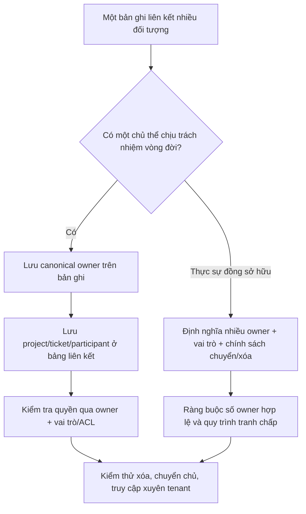
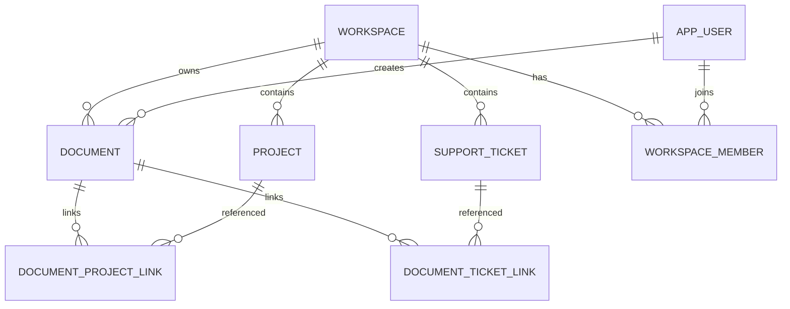
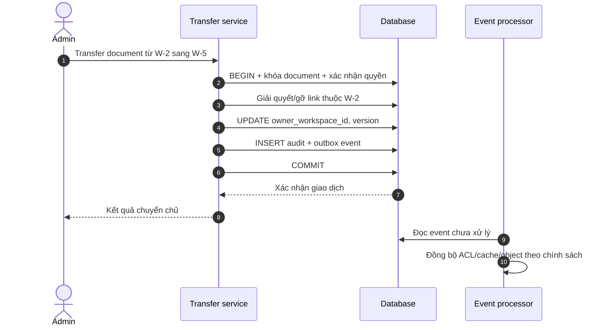

# Xác định chủ sở hữu khi dữ liệu có nhiều liên kết

> **Chương:** Định danh và quan hệ  
> **Học phần:** `DATA_PERSISTENCE_FUNDAMENTALS` — hiểu nguyên lý lưu trữ dữ liệu bền vững trong Java, từ mô hình dữ liệu, lược đồ, truy vấn, chỉ mục đến giao dịch, cô lập, đồng thời, bảo mật, thay đổi schema, sao lưu và hiệu năng.

Một tài liệu được người dùng An tải lên, xuất hiện trong hai dự án và được đính kèm vào một phiếu hỗ trợ. Ai **sở hữu** tài liệu đó? Người tải lên, dự án đầu tiên, phiếu hỗ trợ, hay tổ chức trả tiền lưu trữ? Khi xóa một dự án, tài liệu có bị xóa không? Ai được sửa, chuyển nhượng hoặc quyết định thời hạn lưu giữ?

Các câu hỏi này không thể giải quyết chỉ bằng cách chọn khóa chính hay thêm nhiều khóa ngoại. Khi dữ liệu có nhiều liên kết, phải tách **quyền sở hữu nghiệp vụ**, **quyền truy cập**, **quan hệ tham chiếu** và **trách nhiệm quản lý vòng đời**. Nếu trộn chúng, ứng dụng Java dễ xóa nhầm dữ liệu dùng chung, lộ dữ liệu giữa tenant, gây trùng bản ghi hoặc rơi vào trạng thái không rõ ai có quyền cập nhật.

Bài học giúp người học:

- Xác định **chủ sở hữu chuẩn** (*canonical owner*) khi một bản ghi được nhiều đối tượng tham chiếu.
- Phân biệt owner, creator, người chịu trách nhiệm, người được cấp quyền và bản ghi có quan hệ.
- Thiết kế quan hệ một-nhiều/nhiều-nhiều cùng khóa ngoại bảo vệ ranh giới workspace/tenant.
- Quy định điều gì xảy ra khi thêm/bỏ liên kết, xóa đối tượng cha, đổi chủ sở hữu và hết thời hạn lưu.
- Thực thi kiểm tra quyền và cập nhật các liên kết trong một giao dịch JDBC có kiểm soát đồng thời.
- Hiểu vì sao “owning side” trong JPA không đồng nghĩa với chủ sở hữu dữ liệu về mặt nghiệp vụ.

## 1. Bốn câu hỏi khác nhau đằng sau từ “sở hữu”

Giả sử tài liệu `D-101` do người dùng `U-7` tạo, thuộc không gian làm việc `W-2`, liên kết với dự án `P-3` và phiếu `T-8`.

| Câu hỏi | Câu trả lời minh họa | Hệ quả đối với persistence |
| --- | --- | --- |
| **Chủ sở hữu nghiệp vụ** là ai? | Workspace `W-2` | Có một nguồn sự thật về nơi tài liệu thuộc về và chính sách áp dụng |
| **Ai tạo ra** tài liệu? | Người dùng `U-7` | Lưu `created_by_user_id` để truy vết; không suy ra quyền hiện tại |
| **Ai được truy cập/chỉnh sửa?** | Thành viên có vai trò thích hợp, hoặc người được chia sẻ rõ ràng | Kiểm tra quyền ở thời điểm truy cập; không dựa vào việc biết ID |
| **Bản ghi nào đang liên kết?** | `P-3`, `T-8` | Quan hệ giúp tìm/hiển thị tài liệu, nhưng không tự quyết định owner |
| **Ai chịu trách nhiệm lưu giữ/xóa?** | Chính sách retention và quản trị của `W-2` | Xóa một liên kết không mặc nhiên xóa dữ liệu gốc |

Trong nhiều hệ thống, *owner* có thể là người dùng, tổ chức, nhóm, khách hàng hoặc một thực thể nghiệp vụ khác. Ví dụ này chọn **workspace** để minh họa vì tài liệu có thể được nhiều người và nhiều dự án dùng chung. Đó là một quyết định nghiệp vụ, không phải quy tắc bắt buộc cho mọi mô hình.

Cũng phải phân biệt **data steward** (người/bộ phận chịu trách nhiệm chất lượng và quản trị dữ liệu) với owner có quyền thao tác. Có trường hợp người steward xử lý yêu cầu kiểm toán nhưng không được trực tiếp xem dữ liệu nhạy cảm; các trách nhiệm có thể tách theo chính sách.

## 2. Vì sao không thể luôn suy chủ sở hữu từ liên kết?

Một thiết kế hấp dẫn nhưng sai trong nhiều trường hợp là:

```text
document.id = D-101
document.project_id = P-3
document.ticket_id = T-8
document.created_by = U-7
```

Nếu `project` và `ticket` thuộc các workspace khác nhau, owner của tài liệu là workspace nào? Nếu người dùng chuyển dự án, tài liệu có “đổi chủ” không? Nếu xóa phiếu hỗ trợ nhưng vẫn còn dự án đang dùng tài liệu, có được xóa blob/file gốc không?

Các trường `project_id`, `ticket_id` và `created_by` chỉ mô tả **quan hệ hoặc nguồn gốc**. Từ việc một bản ghi *liên quan* tới thực thể X không suy ra X *sở hữu* bản ghi đó, trừ khi miền nghiệp vụ đã quy định rõ điều này.

Ba kiểu lỗi thường gặp:

1. **Owner được suy từ liên kết đầu tiên:** thứ tự tạo liên kết vô tình quyết định quyền. Khi chuyển dự án đầu tiên, dữ liệu bị đổi owner ngoài ý muốn.
2. **Nhiều cột owner tùy chọn:** bản ghi có thể đồng thời mang `user_owner_id` và `project_owner_id` hoặc không mang gì, dẫn đến các tổ hợp vô nghĩa nếu thiếu bất biến.
3. **Dùng người tạo làm owner suốt đời:** khi nhân viên nghỉ việc hoặc bị thu hồi quyền, hồ sơ nghiệp vụ của tổ chức có thể bị mất khả năng truy cập hoặc bị xóa sai.

Một số tài sản **thực sự được đồng sở hữu**. Trường hợp đó phải xây quy tắc riêng: quyền của mỗi bên, ai chấp thuận xóa, cách xử lý khi một bên rời đi, ai chịu phí và cách bảo vệ tối thiểu một chủ sở hữu hợp lệ. Không thể giải quyết bằng việc vô tình có nhiều khóa ngoại.

## 3. Bộ câu hỏi để chọn chủ sở hữu chuẩn

Khi thiết kế một thực thể có nhiều liên kết, hãy trả lời theo trình tự:

1. **Ai có thẩm quyền tạo và chấp nhận dữ liệu?** Đó có phải chủ thể có thể quyết định dữ liệu tồn tại lâu dài?
2. **Nếu tất cả liên kết bị gỡ**, dữ liệu còn giá trị và cần tồn tại không? Nếu có, owner không nên được xác định duy nhất bằng một liên kết có thể gỡ.
3. **Nếu một đối tượng liên kết bị xóa**, có phải xóa luôn bản ghi hay chỉ xóa cạnh liên kết? Đặt rõ quy tắc vòng đời.
4. **Ai trả chi phí, quản lý bảo mật và retention?** Đây thường là dấu hiệu về ranh giới sở hữu tổ chức.
5. **Nếu owner thay đổi**, có phải chuyển quyền và thực hiện audit/approval không? Nếu có, chuyển chủ là một *nghiệp vụ riêng*.
6. **Một bản ghi có thể thuộc nhiều workspace cùng lúc không?** “Được chia sẻ sang workspace khác” thường là **quyền truy cập**, chưa chắc là đồng sở hữu.
7. **Owner có thể bị xóa trước bản ghi không?** Xác định cách từ chối xóa, chuyển chủ, lưu trữ hoặc thực hiện xóa theo chính sách.

Một quy tắc thực dụng là: **ghi owner trực tiếp, ổn định vào thực thể nghiệp vụ**, sau đó lưu các liên kết biến động ở bảng quan hệ riêng. Chỉ áp dụng quy tắc này nếu miền nghiệp vụ thật sự có một owner chuẩn; với đồng sở hữu chính thức, hãy mô hình hóa cấu trúc owner nhiều bên và các bất biến tương ứng.



## 4. Một mô hình cụ thể: tài liệu thuộc workspace, liên kết nhiều nơi

Trong ví dụ xuyên suốt:

- **`workspace`** là ranh giới nghiệp vụ và tenant.
- **`app_user`** là danh tính người dùng; một người có thể tham gia nhiều workspace.
- **`workspace_member`** lưu vai trò OWNER, EDITOR hoặc VIEWER theo từng workspace.
- **`document`** có một `owner_workspace_id` không rỗng; `created_by_user_id` chỉ ghi tác giả.
- **`project`** và **`support_ticket`** là hai loại đối tượng nằm trong một workspace.
- **`document_project_link`** và **`document_ticket_link`** lưu các liên kết nhiều-nhiều.



**Bất biến nghiệp vụ:** một tài liệu bình thường chỉ liên kết trực tiếp tới project/ticket **trong cùng workspace owner**. Chia sẻ cho workspace bên ngoài là luồng nghiệp vụ khác, có grant/ACL và quyền được kiểm soát rõ ràng. Bất biến này cho phép SQL kiểm tra thuộc tính tenant qua các khóa ngoại kết hợp.

### Lược đồ PostgreSQL minh họa

```sql
CREATE TABLE workspace (
    id BIGINT PRIMARY KEY,
    name TEXT NOT NULL
);

CREATE TABLE app_user (
    id BIGINT PRIMARY KEY,
    email TEXT NOT NULL UNIQUE
);

CREATE TABLE workspace_member (
    workspace_id BIGINT NOT NULL REFERENCES workspace(id),
    user_id BIGINT NOT NULL REFERENCES app_user(id),
    role VARCHAR(10) NOT NULL
        CHECK (role IN ('OWNER', 'EDITOR', 'VIEWER')),
    PRIMARY KEY (workspace_id, user_id)
);

CREATE TABLE project (
    id BIGINT PRIMARY KEY,
    workspace_id BIGINT NOT NULL REFERENCES workspace(id),
    name TEXT NOT NULL,
    UNIQUE (id, workspace_id)
);

CREATE TABLE support_ticket (
    id BIGINT PRIMARY KEY,
    workspace_id BIGINT NOT NULL REFERENCES workspace(id),
    title TEXT NOT NULL,
    UNIQUE (id, workspace_id)
);

CREATE TABLE document (
    id UUID PRIMARY KEY,
    owner_workspace_id BIGINT NOT NULL REFERENCES workspace(id),
    created_by_user_id BIGINT NOT NULL REFERENCES app_user(id),
    title TEXT NOT NULL CHECK (length(btrim(title)) BETWEEN 1 AND 240),
    status VARCHAR(12) NOT NULL DEFAULT 'ACTIVE'
        CHECK (status IN ('ACTIVE', 'ARCHIVED', 'DELETED')),
    version BIGINT NOT NULL DEFAULT 0 CHECK (version >= 0),
    created_at TIMESTAMPTZ NOT NULL DEFAULT CURRENT_TIMESTAMP,
    UNIQUE (id, owner_workspace_id)
);

CREATE TABLE document_project_link (
    document_id UUID NOT NULL,
    workspace_id BIGINT NOT NULL,
    project_id BIGINT NOT NULL,
    linked_at TIMESTAMPTZ NOT NULL DEFAULT CURRENT_TIMESTAMP,
    PRIMARY KEY (document_id, project_id),
    FOREIGN KEY (document_id, workspace_id)
        REFERENCES document(id, owner_workspace_id)
        ON DELETE CASCADE,
    FOREIGN KEY (project_id, workspace_id)
        REFERENCES project(id, workspace_id)
        ON DELETE CASCADE
);

CREATE TABLE document_ticket_link (
    document_id UUID NOT NULL,
    workspace_id BIGINT NOT NULL,
    ticket_id BIGINT NOT NULL,
    linked_at TIMESTAMPTZ NOT NULL DEFAULT CURRENT_TIMESTAMP,
    PRIMARY KEY (document_id, ticket_id),
    FOREIGN KEY (document_id, workspace_id)
        REFERENCES document(id, owner_workspace_id)
        ON DELETE CASCADE,
    FOREIGN KEY (ticket_id, workspace_id)
        REFERENCES support_ticket(id, workspace_id)
        ON DELETE CASCADE
);

CREATE INDEX idx_document_by_workspace
    ON document (owner_workspace_id, created_at DESC, id);

CREATE INDEX idx_project_documents
    ON document_project_link (workspace_id, project_id, document_id);

CREATE INDEX idx_ticket_documents
    ON document_ticket_link (workspace_id, ticket_id, document_id);
```

Lược đồ này minh họa PostgreSQL, không phải bản thiết kế hoàn chỉnh cho mọi hệ thống. Trong sản phẩm thật, cần cơ chế cấp phát ID, phân quyền theo loại document, giới hạn liên kết, dữ liệu file/blob, audit, retention, backup và kế hoạch migration.

**Vì sao có `UNIQUE(id, owner_workspace_id)` khi `id` đã là khóa chính?** PostgreSQL yêu cầu cặp cột tham chiếu bởi một composite foreign key phải có khóa unique/primary key hoặc cơ chế tương ứng. Khóa unique ghép giúp bảng liên kết chứng minh rằng `workspace_id` của chính nó khớp với owner của tài liệu. Nó là một chỉ mục bổ sung có chi phí lưu trữ/ghi; nếu thiết kế khác lấy khóa chính kết hợp (`workspace_id`, `id`), cần đánh giá lại API và mọi khóa ngoại.

**Hai khóa ngoại dùng chung `workspace_id`** buộc tài liệu và project/ticket cùng workspace. Nếu tài liệu thuộc W-2 còn project thuộc W-5, không có giá trị `workspace_id` nào trong bảng liên kết thỏa cả hai ràng buộc: thao tác thêm liên kết bị database từ chối. Kiểm tra ở application vẫn hữu ích để trả lỗi rõ, nhưng ràng buộc ở database chặn đường ghi khác hoặc lỗi concurrency.

`created_by_user_id` cố ý chỉ tham chiếu `app_user` thay vì `workspace_member`. Người tạo có thể rời workspace nhưng hồ sơ lịch sử vẫn cần tồn tại; không nên làm việc xóa membership phá vỡ hoặc xóa tác giả của tài liệu. Điều kiện người tạo phải có vai trò phù hợp **tại thời điểm tạo** sẽ được service kiểm tra trong giao dịch.

## 5. Quyền truy cập không tự phát sinh từ khóa ngoại

Một foreign key trả lời “bản ghi đích có tồn tại không?”; nó không trả lời “người gọi có được đọc nó không?”. Ngay cả khi người dùng đoán được UUID, việc biết ID không phải chứng minh quyền.

Một quy tắc truy cập đơn giản cho ví dụ:

| Hành động | Điều kiện tối thiểu minh họa |
| --- | --- |
| Xem document | Là thành viên workspace owner, có vai trò cho phép xem; tài liệu chưa bị xóa |
| Tạo document | Là OWNER/EDITOR của workspace và có quyền tạo tài liệu |
| Gắn document vào project | Có quyền sửa document **và** quyền liên kết với project, cùng tenant |
| Gỡ liên kết khỏi ticket | Có quyền sửa liên kết; không mặc nhiên xóa document gốc |
| Đổi owner | Qua nghiệp vụ chuyển quyền riêng, được cả hai phía cho phép theo chính sách |
| Xóa/purge | Có quyền phù hợp, qua retention, legal hold và audit nếu áp dụng |

Nếu tồn tại ACL riêng ở từng project/ticket, **chỉ** kiểm tra membership workspace là chưa đủ. Ví dụ thành viên VIEWER của workspace có thể không được phép xem project mật. Cần bổ sung điều kiện quyền cấp project/ticket hoặc chính sách hiển thị của document; bảng trên chỉ là quy tắc căn bản cho trường hợp không có ACL con.

### Truy vấn an toàn theo owner và danh tính người gọi

```sql
-- user_id phải lấy từ danh tính đã xác thực ở server,
-- không tin một ID bất kỳ do client gửi.
SELECT d.id, d.title, d.created_at
FROM document AS d
JOIN workspace_member AS m
  ON m.workspace_id = d.owner_workspace_id
WHERE d.id = ?
  AND m.user_id = ?
  AND d.status = 'ACTIVE';
```

Truy vấn theo project có thể chặn cả truy cập xuyên workspace:

```sql
SELECT d.id, d.title, d.created_at
FROM document_project_link AS link
JOIN document AS d
  ON d.id = link.document_id
 AND d.owner_workspace_id = link.workspace_id
JOIN workspace_member AS m
  ON m.workspace_id = link.workspace_id
WHERE link.workspace_id = ?
  AND link.project_id = ?
  AND m.user_id = ?
  AND d.status = 'ACTIVE'
ORDER BY d.created_at DESC, d.id DESC
LIMIT 50;
```

Nếu project có chính sách quyền riêng, bổ sung điều kiện đó trước khi trả kết quả. Trong thiết kế đa tenant lớn, có thể dùng PostgreSQL Row-Level Security (RLS) để bổ trợ lớp bảo vệ; cần cấu hình đúng vai trò kết nối, ngữ cảnh tenant của mỗi transaction và hành vi connection pool. RLS không thay thế việc hiểu quy tắc quyền nghiệp vụ.

## 6. Java JDBC: tạo tài liệu và liên kết trong một transaction

Giả sử request đã được xác thực, `actorUserId` do lớp security phía server lấy ra, không được client tùy ý gán. Service cần thực hiện **một đơn vị công việc nguyên tử**: kiểm tra quyền thành viên, tạo document có owner rõ ràng và liên kết vào project hợp lệ.

Dưới đây dùng Java 17+ và PostgreSQL JDBC:

```java
import java.sql.Connection;
import java.sql.PreparedStatement;
import java.sql.ResultSet;
import java.sql.SQLException;
import java.util.UUID;
import javax.sql.DataSource;

public final class DocumentService {
    private final DataSource dataSource;

    public DocumentService(DataSource dataSource) {
        this.dataSource = dataSource;
    }

    public UUID createAndAttachToProject(
            UUID documentId,
            long workspaceId,
            long projectId,
            long actorUserId,
            String title) throws SQLException {

        if (documentId == null || workspaceId <= 0 ||
                projectId <= 0 || actorUserId <= 0 ||
                title == null || title.isBlank() || title.length() > 240) {
            throw new IllegalArgumentException("Invalid document request");
        }

        try (Connection conn = dataSource.getConnection()) {
            conn.setAutoCommit(false);
            try {
                // FOR SHARE bảo vệ hàng membership khỏi đổi role/xóa
                // trong khi transaction đang xác nhận quyền tạo.
                String checkAccess = """
                    SELECT role FROM workspace_member
                    WHERE workspace_id = ? AND user_id = ?
                    FOR SHARE
                    """;
                try (PreparedStatement ps =
                         conn.prepareStatement(checkAccess)) {
                    ps.setLong(1, workspaceId);
                    ps.setLong(2, actorUserId);
                    try (ResultSet rows = ps.executeQuery()) {
                        if (!rows.next()) {
                            throw new SecurityException("Not a member");
                        }
                        String role = rows.getString("role");
                        if (!role.equals("OWNER") && !role.equals("EDITOR")) {
                            throw new SecurityException("Not allowed to edit");
                        }
                    }
                }

                String insertDocument = """
                    INSERT INTO document
                      (id, owner_workspace_id, created_by_user_id, title)
                    VALUES (?, ?, ?, ?)
                    """;
                try (PreparedStatement ps =
                         conn.prepareStatement(insertDocument)) {
                    ps.setObject(1, documentId);
                    ps.setLong(2, workspaceId);
                    ps.setLong(3, actorUserId);
                    ps.setString(4, title);
                    ps.executeUpdate();
                }

                String insertLink = """
                    INSERT INTO document_project_link
                      (document_id, workspace_id, project_id)
                    VALUES (?, ?, ?)
                    """;
                try (PreparedStatement ps =
                         conn.prepareStatement(insertLink)) {
                    ps.setObject(1, documentId);
                    ps.setLong(2, workspaceId);
                    ps.setLong(3, projectId);
                    ps.executeUpdate();
                }

                conn.commit();
                return documentId;
            } catch (SQLException | RuntimeException failure) {
                try {
                    conn.rollback();
                } catch (SQLException rollbackError) {
                    failure.addSuppressed(rollbackError);
                }
                throw failure;
            }
        }
    }
}
```

Điểm cần đọc từ ví dụ:

1. `owner_workspace_id` được ghi **trực tiếp** và không suy từ project đầu tiên.
2. Kiểm tra role có khóa hàng `FOR SHARE` (đặc trưng PostgreSQL) để tránh một transaction khác sửa/xóa membership giữa lúc service dùng quyền đó và hoàn tất thao tác. Quy tắc thu hồi quyền tức thời hơn nữa còn cần chính sách nhất quán ở toàn hệ thống.
3. Hai lệnh `INSERT` chạy cùng connection/transaction. Nếu project không tồn tại hoặc thuộc workspace khác, composite FK làm lệnh liên kết thất bại và toàn bộ transaction rollback; không để document mồ côi một cách vô ý.
4. `PreparedStatement` truyền tham số an toàn, `try-with-resources` đóng statement/connection, và lỗi rollback được giữ ở `suppressed` mà không che nguyên nhân chính.
5. `documentId` được cung cấp ổn định để hỗ trợ nhận diện yêu cầu. Nếu client retry sau khi commit nhưng mất HTTP response, cần thêm cơ chế **idempotency**: tra ID cũ, xác minh actor/owner/payload và trả kết quả cũ. Ví dụ không tự xử lý xung đột unique này thành thành công.
6. Nếu project có ACL riêng, phải kiểm tra quyền trên project trong **cùng transaction**, và cân nhắc khóa/quy tắc đồng thời với thao tác thu hồi quyền. Composite FK chỉ bảo đảm cùng workspace, không tự cấp phép truy cập project.
7. Nếu document còn kèm file ở object storage, transaction JDBC không bao trùm việc upload/xóa object. Cần lưu trạng thái xử lý hoặc outbox để đối soát và hoàn tất thay đổi giữa hai hệ thống.

Một điểm khác: nếu check quyền thất bại, code ném `SecurityException`, rollback và để tầng API ánh xạ thành phản hồi phù hợp; không được trả nguyên thông tin SQL/role nhạy cảm cho client.

## 7. Tách quan hệ tham chiếu khỏi vòng đời dữ liệu

Hãy phân biệt bốn thao tác có vẻ giống nhau:

| Thao tác | Điều cần thay đổi | Điều không được tự suy ra |
| --- | --- | --- |
| Gỡ tài liệu khỏi project | Xóa hàng `document_project_link` tương ứng | Không xóa document gốc nếu còn nghĩa vụ lưu |
| Xóa project | Xóa project; các hàng liên kết project có thể bị cascade | Document vẫn thuộc workspace của nó |
| Xóa document | Đánh dấu xóa hoặc purge theo chính sách; dọn link và blob phù hợp | Không xóa mọi project/ticket đã từng tham chiếu |
| Xóa workspace | Áp dụng quy trình sở hữu, retention, chuyển giao và audit | Không mặc định cascade xóa mọi dữ liệu ngay lập tức |

Trong lược đồ mẫu, `ON DELETE CASCADE` nằm **từ document/project/ticket tới bản ghi liên kết**, không phải từ project tới document. Xóa một project khiến các **cạnh liên kết** của nó được dọn; owner của document không đổi. Đây là ý nghĩa quan trọng của bảng nối nhiều-nhiều.

Nếu dữ liệu có thể bị yêu cầu giữ vì kiểm toán, khi người dùng chọn “Xóa tài liệu” có thể đổi `status='DELETED'`, ẩn khỏi truy vấn thông thường và tạo tác vụ purge sau thời hạn. Việc mềm hóa xóa không tự bảo đảm an toàn: cần chính sách riêng cho bản sao lưu, log, tìm kiếm, cache và object storage. Với dữ liệu phải xóa nhanh, quy trình có thể khác; định nghĩa chính xác theo nhu cầu nghiệp vụ và quy định áp dụng.

**Không cho lịch sử biến mất theo membership.** Một nhân viên rời workspace không có nghĩa tài liệu họ từng tạo được chuyển quyền hoặc bị xóa. `created_by_user_id` phục vụ audit; nếu chính sách xóa danh tính cá nhân yêu cầu ẩn danh, cần quy trình tách dữ liệu nhận dạng khỏi hồ sơ nghiệp vụ, thay vì tự động xóa chuỗi liên kết không kiểm soát.

## 8. Khi dữ liệu thật sự phải chuyển chủ

“Thêm tài liệu vào project khác” và “chuyển tài liệu sang workspace khác” là hai hành động có ý nghĩa rất khác:

- **Thêm liên kết:** owner vẫn là workspace ban đầu; chỉ có một cạnh mới.
- **Chia sẻ:** owner vẫn giữ nguyên, nhưng thêm quyền truy cập có phạm vi/hạn dùng theo chính sách.
- **Chuyển sở hữu:** thay đổi chủ thể chịu trách nhiệm vòng đời, quyền và có thể cả vùng lưu trữ, mã hóa, retention, phí và audit.

Với ràng buộc composite FK ở trên, việc cập nhật ngay `document.owner_workspace_id` khi tài liệu còn các liên kết cũ có thể bị từ chối. Đó là **hàng rào bảo vệ dữ liệu**, không phải hạn chế cần bỏ đi một cách vội vàng.

Một giao dịch chuyển chủ hợp lệ cần những bước sau:

1. Xác thực quyền chuyển của workspace nguồn và quyền tiếp nhận của workspace đích; kiểm tra ràng buộc hợp đồng, retention/legal hold và khả năng chuyển file.
2. Khóa hàng tài liệu, kiểm tra `version` và owner hiện tại để tránh hai tiến trình chuyển đồng thời.
3. Quyết định số phận các liên kết cũ: xóa, giữ bản sao chia sẻ, hoặc tạo liên kết mới trong workspace đích. Trong schema mẫu, **phải xóa hoặc chuyển đổi các link cũ** trước khi đổi owner vì composite FK.
4. Cập nhật owner, tăng version và ghi audit trong **cùng transaction** nếu tất cả dữ liệu liên quan đều ở một database.
5. Nếu còn ACL, object storage, search index hoặc message broker ngoài database, dùng quy trình có trạng thái/outbox và retry idempotent để hoàn tất và đối soát.
6. Sau commit, vô hiệu hóa cache và xác minh người ở workspace nguồn không còn quyền không hợp lệ; người ở workspace đích có quyền theo chính sách mới.



Đây là trình tự logic minh họa, **không** phải một lời hứa về atomicity trên object storage và database. Nếu tài liệu gắn nội dung thực ở hệ khác, có thể cần trạng thái `TRANSFERRING` hoặc bước chuyển quyền truy cập theo thứ tự an toàn để tránh rò rỉ dữ liệu trong lúc xử lý.

Nếu nghiệp vụ cho phép **đồng sở hữu thật sự**, thay cột owner đơn bằng quan hệ ownership độc lập với join truy cập, chẳng hạn `document_owner(document_id, workspace_id, ownership_role)`. Phải định nghĩa rõ số lượng owner, ít nhất một owner chịu trách nhiệm, quyền veto/chuyển chủ, và cơ chế transaction/constraint để không rơi vào trạng thái zero owner. Chỉ thêm bảng nhiều-nhiều mà không nêu các bất biến sẽ khiến trách nhiệm bị bỏ ngỏ.

## 9. Kiểm soát đồng thời khi nhiều liên kết thay đổi

Hai request có thể xảy ra cùng lúc:

- Request A gắn document D vào project P.
- Request B chuyển document D từ workspace W-2 sang W-5.
- Request C thu hồi quyền EDITOR của người đang gắn liên kết.

Nếu mỗi request chỉ kiểm tra dữ liệu ở Java rồi ghi sau, quyền và owner có thể thay đổi giữa chừng (**TOCTOU — time of check to time of use**). Để giữ bất biến:

- Kiểm tra quyền và ghi trong một transaction; dùng khóa hàng phù hợp khi chính sách cần bảo đảm quyền không đổi đến lúc commit.
- Dùng FK kết hợp bảo đảm link luôn thuộc cùng workspace.
- Sử dụng version để phát hiện cập nhật cạnh tranh ở document.
- Có thứ tự khóa nhất quán, retry có giới hạn cho deadlock/serialization failure khi phù hợp.
- Định nghĩa rõ hành vi khi thay đổi owner trong lúc request gắn link đang chạy.

Ví dụ optimistic locking:

```sql
UPDATE document
SET title = ?,
    version = version + 1
WHERE id = ?
  AND owner_workspace_id = ?
  AND version = ?;
```

Chỉ khi số hàng cập nhật bằng **1** mới coi lệnh thay đổi thành công; **0** có thể nghĩa là không còn document thuộc owner đó, đã bị chuyển chủ hoặc version đã đổi. Cần đọc trạng thái hiện tại và trả kết quả phù hợp với nghiệp vụ. Cơ chế version không thay thế kiểm tra role.

Thêm bảng link cũng cần transaction và ràng buộc duy nhất để không có cạnh trùng. Nếu một request retry làm phát sinh `PRIMARY KEY` conflict, không nên mặc định chuyển mọi lỗi unique thành thành công: phải xác minh liên kết hiện tại đúng cặp document/project và đúng quyền mong muốn.

Khi có nhiều worker/cụm Java, ràng buộc database quan trọng hơn khóa cục bộ trong JVM. `synchronized` hoặc `ReentrantLock` chỉ điều phối những thread chia sẻ cùng tiến trình, không bảo vệ các instance khác; nguồn sự thật chung phải chịu trách nhiệm đảm bảo toàn vẹn.

## 10. Trong JPA, “owning side” không phải chủ sở hữu nghiệp vụ

Trong Hibernate/JPA, thuật ngữ **owning side of association** thường chỉ phía chịu trách nhiệm cập nhật **khóa ngoại hoặc bảng nối** khi ORM đồng bộ quan hệ. Ví dụ:

```java
@Entity
@Table(name = "document")
class DocumentEntity {
    @Id
    UUID id;

    @ManyToOne(fetch = FetchType.LAZY, optional = false)
    @JoinColumn(name = "owner_workspace_id", nullable = false)
    WorkspaceEntity ownerWorkspace;
}
```

Đoạn trên mô tả trường FK ở document; `ownerWorkspace` ở đây thực sự có ý nghĩa nghiệp vụ vì schema đã quyết định như vậy. Tuy nhiên, nếu ánh xạ:

```java
@ManyToMany
@JoinTable(
    name = "document_project_link",
    joinColumns = @JoinColumn(name = "document_id"),
    inverseJoinColumns = @JoinColumn(name = "project_id")
)
Set<ProjectEntity> projects;
```

thì phía JPA quản lý bảng nối **không có nghĩa document sở hữu project, hoặc project sở hữu document**. Với các bảng link chứa `workspace_id`, `linked_at`, người tạo liên kết hoặc chính sách quyền, một **link entity riêng** thường minh bạch hơn `@ManyToMany` trực tiếp. Cần ánh xạ đầy đủ composite FK và quy tắc khóa; đoạn `@ManyToMany` trên chỉ minh họa thuật ngữ ORM, **chưa đủ** để triển khai các bất biến của schema PostgreSQL đã trình bày.

Chú ý thêm: `CascadeType.REMOVE` hoặc `orphanRemoval=true` của ORM có thể dẫn tới xóa đối tượng khi gỡ khỏi collection. Không bật cascade xóa thực thể chia sẻ chỉ vì thao tác gỡ liên kết trên UI. Hành vi ORM phải khớp đúng vòng đời đã được định nghĩa ở nghiệp vụ và database.

## 11. Bảo mật đa tenant và nguy cơ truy cập xuyên liên kết

Một API có thể kiểm tra quyền trên document nhưng quên kiểm tra quyền trên ticket; hoặc truy vấn liên kết bằng `project_id` mà không giới hạn tenant. Đây là lối vào phổ biến của lỗi **Broken Object Level Authorization (BOLA)**.

Ví dụ request nguy hiểm:

```text
POST /documents/{documentId}/projects/{projectId}
{
  "workspaceId": 5
}
```

Nếu server tin `workspaceId` do client gửi, chỉ kiểm tra document tồn tại, rồi liên kết với project ID được đoán, có thể làm lộ thông tin hoặc thay đổi dữ liệu ngoài quyền. Trong ví dụ của bài, phải:

1. Xác định người gọi từ phiên/token đã được xác thực.
2. Lấy owner của document và workspace của project từ nguồn đáng tin cậy; không tự nhận owner do client khai báo.
3. Kiểm tra cả quyền sửa document lẫn quyền liên kết project.
4. Dựa vào composite FK để chống dữ liệu xuyên workspace ngay cả khi đường ghi khác bỏ qua kiểm tra.
5. Trả lỗi phù hợp, không tiết lộ thông tin chi tiết về tài liệu/ticket bí mật chỉ qua khác biệt mã lỗi.
6. Giám sát các yêu cầu bị từ chối, nhưng không ghi thông tin nhạy cảm hoặc token vào log.

Có những trường hợp cần **chia sẻ xuyên tenant**. Hãy biểu diễn grant rõ ràng, chẳng hạn `document_share(document_id, grantee_workspace_id, permission, expires_at)`, và kiểm tra quyền ở mọi đường đọc/ghi. Grant truy cập không tự động biến grantee thành owner; owner vẫn quyết định thời hạn lưu và điều kiện thu hồi, trừ khi hợp đồng đồng sở hữu quy định khác.

Không dùng việc một người có thể thấy document thông qua link như bằng chứng rằng họ cũng được xem toàn bộ metadata của project hoặc người dùng khác. Các API cần projection và kiểm tra quyền theo dữ liệu thực sự trả ra.

## 12. Hiệu năng, audit và khả năng tiến hóa

Mô hình owner chuẩn + nhiều bảng link làm truy vấn rõ ràng nhưng tạo thêm join và chỉ mục. Thiết kế cần dựa trên mẫu truy cập:

| Mẫu truy vấn | Cấu trúc hỗ trợ | Điều cần đo |
| --- | --- | --- |
| Liệt kê document của workspace theo thời gian | `document(owner_workspace_id, created_at, id)` | `EXPLAIN`, phân trang, số hàng theo tenant |
| Tìm document của project | `document_project_link(workspace_id, project_id, document_id)` | Độ chọn lọc, index size, join cost |
| Tìm document của ticket | `document_ticket_link(workspace_id, ticket_id, document_id)` | Số liên kết/ticket, index scan |
| Tìm các project một document tham gia | Khóa chính bắt đầu bằng `document_id` | Số liên kết/document, truy vấn N+1 |
| Kiểm tra membership và role | PK `(workspace_id, user_id)` | Chi phí check quyền, cache invalidation |
| Tra cứu lịch sử chuyển owner | Audit/outbox riêng theo document ID | Retention, quyền đọc log, khả năng truy vết |

Đừng tự tạo hàng chục index trước khi đo; mọi index tăng chi phí ghi và dung lượng. ORM lazy loading có thể tạo lỗi N+1 khi duyệt nhiều document và truy cập collection project/ticket; dùng projection hoặc fetch có kiểm soát theo truy vấn thực tế. Nếu số cạnh liên kết rất lớn, pagination, batch, giới hạn mỗi loại liên kết và archive là một phần thiết kế.

**Audit nên tách khỏi quan hệ hiện tại.** Bảng link trả lời “đang gắn vào đâu”; nó không lưu đầy đủ “trước đây từng gắn vào đâu”. Nếu nghiệp vụ cần lịch sử, ghi event như `DOCUMENT_LINKED`, `DOCUMENT_UNLINKED`, `OWNERSHIP_TRANSFERRED` với actor, timestamp, owner trước/sau và request ID. Ghi audit cùng transaction của dữ liệu nghiệp vụ (hoặc outbox bền vững nếu gửi sang hệ khác), tránh nhật ký báo thành công cho thay đổi đã rollback.

**Tiến hóa schema:** nếu hệ thống cũ suy owner từ project đầu tiên, việc thêm `owner_workspace_id` cần quy trình migration cẩn trọng:

1. Xác định quy tắc backfill dựa trên nghiệp vụ, không tùy tiện lấy liên kết bất kỳ.
2. Tìm bản ghi có liên kết sang nhiều workspace và đưa vào danh sách cần giải quyết, không âm thầm chọn một workspace.
3. Thêm cột mới tạm cho phép `NULL` hoặc có trạng thái kiểm chứng thích hợp; backfill theo lô, đối soát.
4. Bổ sung ràng buộc unique/FK, kiểm tra link cross-tenant, sửa các trường hợp vi phạm có kiểm soát.
5. Triển khai code đọc/ghi tương thích, chuyển mọi request sang owner chuẩn, rồi mới áp `NOT NULL` khi dữ liệu hợp lệ.
6. Đo hiệu năng các truy vấn mới, thử rollback và kiểm chứng thao tác xóa/chuyển chủ.

Không thay đổi owner hàng loạt chỉ vì một dự án được chuyển workspace nếu tài liệu còn liên quan tới dự án khác; đó là thay đổi hợp đồng dữ liệu, cần nghiệp vụ xác nhận.

## 13. Bài tập áp dụng

**Bài A — phân biệt owner và link.** Một hóa đơn được tạo từ đơn hàng, gửi qua email và đính vào phiếu hỗ trợ. Ai sở hữu hóa đơn? Nếu ticket đóng hoặc email bị xóa, hóa đơn có được xóa không? Hãy chọn owner dựa trên trách nhiệm pháp lý/vòng đời thay vì số lượng link.

**Bài B — bảo vệ tenant.** Document D thuộc workspace 10, project P thuộc workspace 20. Hãy giải thích vì sao hai composite FK sử dụng `workspace_id` trong `document_project_link` khiến INSERT không hợp lệ, kể cả khi cả document và project đều tồn tại.

**Bài C — xóa project.** Một document đang gắn với hai project và một ticket. Người quản lý xóa một project. Hãy liệt kê những hàng nào cần xóa, những hàng nào vẫn tồn tại, và xử lý thế nào nếu document bị legal hold.

**Bài D — phân quyền.** Người U là VIEWER của workspace A, EDITOR của workspace B, đồng thời là người tạo một document cũ ở A. Hãy xác định U có thể xem/sửa document đó không, và việc `created_by_user_id` có được coi là quyền không.

**Bài E — chuyển chủ đồng thời.** Trong lúc admin chuyển document từ A sang B, worker khác thêm link mới trong A. Đề xuất khóa/giao dịch hoặc version để không tạo liên kết sai tenant; mô tả kết quả rollback/retry khi có xung đột.

**Bài F — JPA.** Một entity `Project` đánh dấu `mappedBy` cho quan hệ `@ManyToMany`. Điều này có nghĩa project không phải chủ sở hữu nghiệp vụ của tài liệu không? Phân biệt “owning side” của ORM và quy tắc owner từ nghiệp vụ.

## 14. Checklist trước khi chốt thiết kế

- [ ] Định nghĩa rõ **canonical owner**, creator, người được cấp quyền, người quản trị vòng đời và các liên kết.
- [ ] Xác định owner khi **không có link**, khi có **nhiều link** và khi link cuối bị gỡ.
- [ ] Không suy quyền truy cập từ UUID, creator hoặc khóa ngoại; kiểm tra quyền theo principal hiện tại.
- [ ] Có bảng liên kết riêng cho quan hệ nhiều-nhiều và khóa unique chống trùng.
- [ ] Bảo vệ ranh giới tenant bằng composite FK hoặc cơ chế ràng buộc tương đương, cùng kiểm tra authorization.
- [ ] Quy định cascade chỉ với các cạnh/thực thể thực sự thuộc vòng đời xóa; xét retention và legal hold.
- [ ] Thiết kế chuyển chủ thành nghiệp vụ có kiểm tra nguồn/đích, transaction, concurrency, audit và xử lý dữ liệu ngoài DB.
- [ ] Dùng transaction và version/khóa để xử lý xung đột cập nhật, thu hồi quyền, gỡ link và chuyển owner.
- [ ] Phân biệt JPA owning side với ownership nghiệp vụ; kiểm tra `CascadeType.REMOVE` và `orphanRemoval`.
- [ ] Có chỉ mục theo truy vấn, kế hoạch migration dữ liệu cũ, giám sát BOLA, audit và backup/restore.

**Nguyên tắc cốt lõi:** quan hệ tham chiếu nói dữ liệu **đang liên quan tới ai**, quyền truy cập nói **ai được thao tác**, còn chủ sở hữu chuẩn nói **ai chịu trách nhiệm và quyết định vòng đời dữ liệu**. Tách ba điều này và thực thi bất biến tại cả Java lẫn database sẽ giúp hệ thống có nhiều liên kết vẫn nhất quán, an toàn và có thể tiến hóa theo nhu cầu nghiệp vụ.
