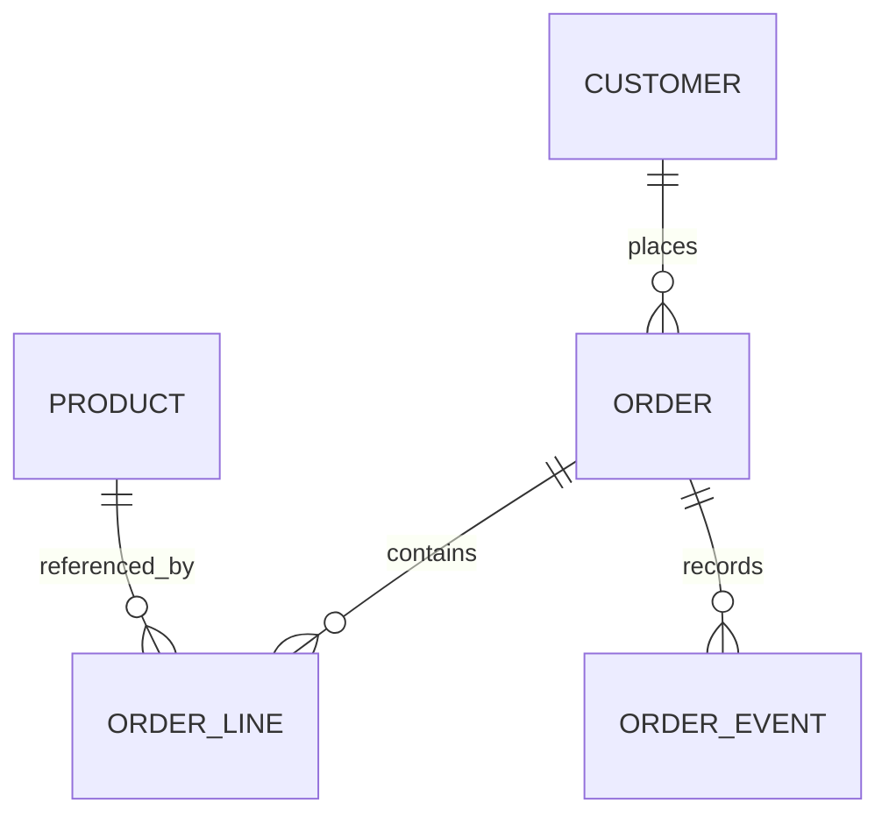
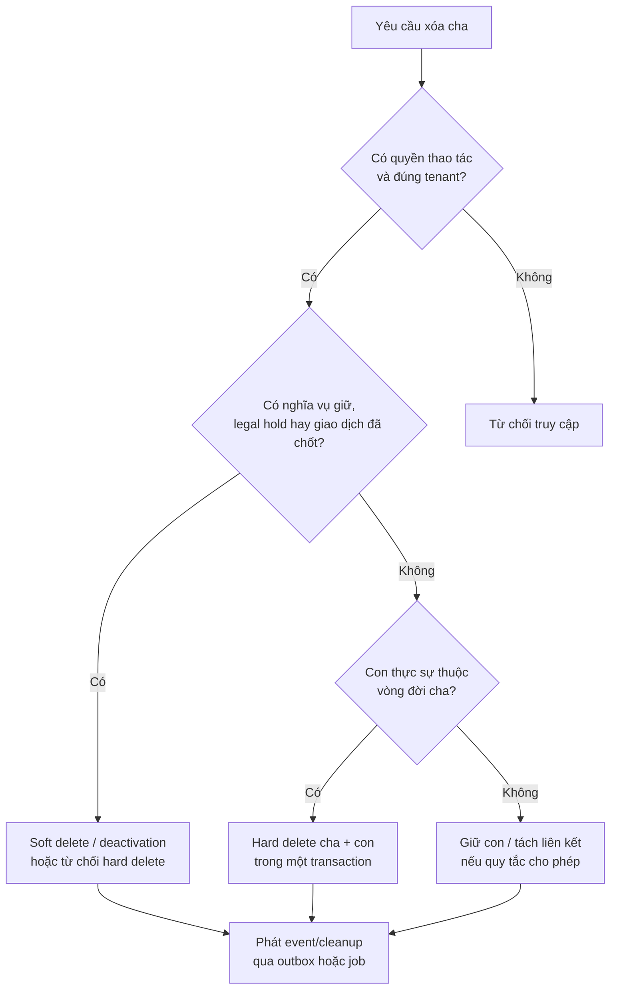

# Vòng đời bản ghi con khi cập nhật hoặc xóa bản ghi cha

## 1. Vấn đề: bản ghi cha đổi thì bản ghi con phải ra sao?

Trong một hệ thống persistence, dữ liệu hiếm khi tồn tại độc lập. Đơn hàng có nhiều dòng hàng, khách hàng có nhiều đơn, dự án có nhiều công việc, bài viết có bình luận, nhóm có thành viên và sản phẩm có lịch sử giá. Khi **bản ghi cha** thay đổi hoặc bị xóa, các bản ghi đang liên kết đến nó phải được xử lý theo quy tắc nghiệp vụ.

Ví dụ:

- Xóa một **dòng hàng** khỏi đơn nháp có nghĩa là xóa hẳn dòng đó, chỉ bỏ liên kết hay tạo một dòng lịch sử điều chỉnh?
- Xóa **đơn hàng** có được xóa hết dòng hàng không? Nếu đơn đã thanh toán thì có nghĩa vụ giữ bản ghi hay không?
- Xóa **khách hàng** có được xóa luôn các đơn đã phát sinh không?
- Một **sản phẩm** bị ngừng kinh doanh có nên làm mất những dòng hàng thuộc đơn trong quá khứ không?
- Đổi khóa định danh của bản ghi cha có cần cập nhật khóa ngoại ở các bản ghi con?
- Nếu hai tiến trình vừa thêm con vừa xóa cha, điều gì bảo vệ dữ liệu khỏi trạng thái mồ côi?

Đây là bài toán **vòng đời bản ghi con khi cập nhật hoặc xóa bản ghi cha**, nằm trong chủ đề **Định danh và quan hệ** của persistence. Nó liên quan trực tiếp đến lựa chọn mô hình, khóa, ràng buộc, transaction, isolation, kiểm soát đồng thời, lưu giữ dữ liệu và khôi phục trong ứng dụng Java.

**Nguyên tắc xuất phát:** Một quan hệ trong database không tự nói rằng bản ghi cha “sở hữu” bản ghi con theo nghĩa nghiệp vụ. Trước khi chọn `ON DELETE CASCADE` hoặc `orphanRemoval = true`, phải xác định **bản ghi con có được phép tồn tại độc lập không và có cần giữ lịch sử không**.

## 2. Phân biệt danh tính, quan hệ và sở hữu vòng đời

### 2.1. Khóa chính và khóa ngoại

Trong database quan hệ:

- **Khóa chính (primary key):** Xác định một bản ghi, ví dụ `orders.id`.
- **Khóa ngoại (foreign key):** Yêu cầu giá trị tham chiếu có hàng cha hợp lệ theo quy tắc của hệ quản trị, ví dụ `order_lines.order_id → orders.id`.
- **Ràng buộc quan hệ (referential integrity):** Ngăn hoặc xử lý các thay đổi có nguy cơ tạo ra tham chiếu không hợp lệ.
- **Sở hữu vòng đời (lifecycle ownership):** Quyết định nghiệp vụ: khi cha mất đi, con có được xóa cùng không?

Hai khái niệm cuối không giống nhau. Một foreign key có thể nối khách hàng với đơn hàng, nhưng đơn hàng đã thanh toán thường **không nên bị xóa dây chuyền** chỉ vì tài khoản khách bị ngừng hoạt động.

### 2.2. Ba kiểu quan hệ cần suy nghĩ riêng

| Kiểu quan hệ | Ví dụ | Bản ghi con có danh tính riêng? | Hành vi thường cân nhắc |
|---|---|---|---|
| **Con thuộc vòng đời cha** | Dòng hàng của **đơn nháp**, phần tử trong một biểu mẫu | Có thể có ID kỹ thuật, nhưng chỉ có ý nghĩa trong cha | Xóa con khi bị bỏ khỏi cha hoặc xóa cha, nếu được phép về nghiệp vụ |
| **Tham chiếu thực thể độc lập** | Đơn hàng tham chiếu khách hàng; dòng hàng tham chiếu sản phẩm | Có, và tồn tại độc lập | Ngăn xóa cha, chuyển trạng thái, giữ snapshot hoặc giải liên kết theo chính sách |
| **Liên kết nhiều–nhiều** | Người dùng thuộc nhóm; bài viết gắn nhãn | Hai đầu độc lập; hàng trung gian biểu diễn quan hệ | Xóa hàng liên kết, **không** xóa thực thể ở đầu bên kia |

Thực tế có thể phức tạp hơn: một bản ghi là con về mặt kỹ thuật nhưng là chứng từ phải giữ riêng về pháp lý, hoặc một “con” trở thành thực thể độc lập sau khi chuyển trạng thái. Không nên đánh đồng mọi quan hệ `@OneToMany` với quyền xóa dây chuyền.

### 2.3. Mô hình ví dụ cho bài học

Ta dùng một hệ thống bán hàng nhỏ:



- **Customer → Order:** Khách đặt đơn, nhưng đơn có thể cần tồn tại ngay cả khi khách không còn tài khoản đang hoạt động.
- **Order → OrderLine:** Các dòng hàng cấu thành đơn, thường có vòng đời gắn với đơn trong giai đoạn nháp.
- **Product → OrderLine:** Dòng hàng lưu một tham chiếu SKU và *snapshot* giá/tên ở thời điểm đặt; không được mất lịch sử khi sản phẩm đổi giá hoặc ngừng bán.
- **Order → OrderEvent:** Lịch sử sự kiện thường có chính sách bất biến, lưu giữ và kiểm toán riêng. Không mặc định xóa sự kiện chỉ vì xóa object `Order` trong Java.

Cùng một bảng `order_lines` có thể có **hai foreign key tới hai cha với hai quy tắc xóa khác nhau**: `order_id` được phép cascade trong một thiết kế nhất định, còn `product_id/sku` phải ngăn xóa sản phẩm được tham chiếu.

## 3. Các lựa chọn khi bản ghi cha bị xóa

Một hệ quản trị quan hệ cho phép định nghĩa hành vi khóa ngoại bằng `ON DELETE`. Với PostgreSQL:

| Chính sách | Khi xóa cha đang có con | Trường hợp nên cân nhắc | Lưu ý |
|---|---|---|---|
| **`NO ACTION`** | Kiểm tra ràng buộc; xóa cha thất bại nếu cuối thời điểm kiểm tra vẫn còn tham chiếu | Muốn ứng dụng xử lý quan hệ có chủ đích | Là mặc định trong PostgreSQL; constraint có thể được hoãn kiểm tra nếu khai báo deferrable phù hợp |
| **`RESTRICT`** | Ngăn thao tác xóa cha khi còn con tham chiếu | Dữ liệu con phải được giữ hoặc xử lý trước | Khác `NO ACTION` về khả năng hoãn kiểm tra trong PostgreSQL |
| **`CASCADE`** | Database tự xóa những hàng con tham chiếu | Con thực sự thuộc vòng đời cha và xóa là hợp lệ | Có thể kéo theo xóa rộng qua nhiều cấp FK |
| **`SET NULL`** | Đặt cột khóa ngoại ở con thành `NULL` | Con được phép tồn tại độc lập sau khi tách cha | Cột liên quan phải cho phép null theo thiết kế; cần kiểm tra invariant |
| **`SET DEFAULT`** | Đặt khóa ngoại ở con về giá trị default | Có thực thể mặc định có ý nghĩa nghiệp vụ | Default vẫn phải thỏa FK; không nên tạo “cha rác” chỉ để né lỗi |

**Không có lựa chọn nào luôn tốt nhất.** Với lịch sử giao dịch, `RESTRICT` hoặc giữ quan hệ thường an toàn hơn; với hàng chi tiết không còn ý nghĩa độc lập, `CASCADE` có thể đúng; với những bản ghi có thể tiếp tục độc lập, `SET NULL` có thể có ý nghĩa.

### 3.1. `NO ACTION` và `RESTRICT` không hoàn toàn đồng nhất

Ở PostgreSQL, `NO ACTION` là hành vi mặc định. Nếu constraint được khai báo `DEFERRABLE` và trì hoãn kiểm tra, transaction có thể tạm thời tồn tại tham chiếu chưa hợp lệ nhưng phải khôi phục tính hợp lệ trước mốc kiểm tra cuối cùng. `RESTRICT` không cho phép trì hoãn hành động ngăn xóa theo cách đó.

Ví dụ, khi muốn thay đổi cấu trúc tham chiếu trong một transaction, khả năng trì hoãn ràng buộc đôi khi hữu ích. Nhưng đó là kỹ thuật có điều kiện: không được lấy lý do “sẽ sửa lại sau” để chấp nhận dữ liệu mồ côi đã commit.

### 3.2. `ON UPDATE` là một quyết định riêng

`ON DELETE CASCADE` và `ON UPDATE CASCADE` không phải cùng một thao tác:

- `ON DELETE` xử lý khi hàng cha **bị xóa**.
- `ON UPDATE` xử lý khi **giá trị khóa được tham chiếu** ở cha thay đổi.
- Cập nhật những cột không phải khóa tham chiếu (ví dụ `orders.status`) thường **không** tự kích hoạt hành vi `ON UPDATE` của FK.

Nên ưu tiên khóa chính ổn định, chẳng hạn UUID nội bộ không đổi theo tên/email. Nếu cần sửa mã nghiệp vụ, thường tốt hơn là sửa một cột mã riêng có unique constraint, thay vì đổi khóa chính và cập nhật toàn bộ các khóa ngoại.

### 3.3. Hình dung kết quả của các hành động xóa

Giả sử `Parent P1` có hai con `C1`, `C2`:

```text
TRƯỚC:
P1
├── C1 (parent_id = P1)
└── C2 (parent_id = P1)

ON DELETE RESTRICT / NO ACTION:
DELETE P1 -> từ chối nếu vẫn còn C1, C2.

ON DELETE CASCADE:
DELETE P1 -> P1, C1, C2 đều bị xóa logic trong transaction.

ON DELETE SET NULL:
DELETE P1 -> P1 bị xóa; C1.parent_id và C2.parent_id = NULL.

ON DELETE SET DEFAULT:
DELETE P1 -> C1, C2 trỏ đến giá trị default hợp lệ.
```

Đây là hành vi của quan hệ dữ liệu, **không** phải cơ chế tự động xóa cache, file đính kèm, dữ liệu trên search index hoặc hệ thống bên ngoài.

## 4. Thiết kế DDL theo ý nghĩa từng quan hệ

Một lược đồ PostgreSQL minh họa:

```sql
CREATE TABLE customers (
    id UUID PRIMARY KEY,
    display_name TEXT NOT NULL,
    deactivated_at TIMESTAMPTZ
);

CREATE TABLE products (
    sku TEXT PRIMARY KEY,
    product_name TEXT NOT NULL,
    discontinued_at TIMESTAMPTZ
);

CREATE TABLE orders (
    id UUID PRIMARY KEY,
    customer_id UUID NOT NULL
        REFERENCES customers(id) ON DELETE RESTRICT,
    status TEXT NOT NULL
        CHECK (status IN ('DRAFT', 'CONFIRMED', 'CANCELLED')),
    version BIGINT NOT NULL DEFAULT 0 CHECK (version >= 0),
    created_at TIMESTAMPTZ NOT NULL DEFAULT now(),
    updated_at TIMESTAMPTZ NOT NULL DEFAULT now(),
    deleted_at TIMESTAMPTZ
);

CREATE TABLE order_lines (
    id UUID PRIMARY KEY,
    order_id UUID NOT NULL
        REFERENCES orders(id) ON DELETE CASCADE,
    line_no INTEGER NOT NULL CHECK (line_no > 0),
    sku TEXT NOT NULL
        REFERENCES products(sku) ON DELETE RESTRICT,
    quantity INTEGER NOT NULL CHECK (quantity > 0),
    unit_price NUMERIC(19, 2) NOT NULL CHECK (unit_price >= 0),
    UNIQUE (order_id, line_no)
);

CREATE INDEX ix_orders_customer ON orders(customer_id);
CREATE INDEX ix_order_lines_order ON order_lines(order_id);
CREATE INDEX ix_order_lines_sku ON order_lines(sku);
```

Ở đây:

- **Xóa khách hàng:** Nếu còn đơn, FK ở `orders.customer_id` ngăn xóa. Việc vô hiệu hóa tài khoản thường chỉ cập nhật `customers.deactivated_at`.
- **Xóa đơn:** FK của `order_lines.order_id` cho phép database xóa các dòng hàng theo `CASCADE`; nhưng **ứng dụng phải chặn xóa đơn không được phép**, ví dụ đơn đã xác nhận hoặc đang bị giữ theo chính sách.
- **Xóa sản phẩm:** Nếu dòng hàng còn tham chiếu SKU, FK ngăn xóa sản phẩm; có thể đặt `discontinued_at` thay vì xóa.
- **Sửa giá sản phẩm:** Không tự sửa `order_lines.unit_price`, vì đây là giá snapshot đã chốt của giao dịch.
- **Sửa trạng thái đơn:** Chỉ đổi `orders.status`, không phải “cập nhật khóa cha”; không tự phát sinh hành động FK nào.

Lưu ý đây là **schema minh họa**, chưa chứa toàn bộ kiểm soát phân quyền theo tenant, chính sách pháp lý, thuế, sổ cái và trạng thái thanh toán. Không nên dùng `ON DELETE CASCADE` trên đơn đã thanh toán nếu điều đó vi phạm yêu cầu giữ chứng từ; một thiết kế khác có thể sử dụng `RESTRICT` cho cả order line và yêu cầu quy trình purge chủ động.

### 4.1. Vì sao cần index trên khóa ngoại ở bảng con?

PostgreSQL tự tạo index hỗ trợ `PRIMARY KEY` và `UNIQUE`, nhưng **không mặc nhiên tạo index cho mọi cột foreign key ở bảng tham chiếu**.

Khi xóa cha hoặc cập nhật khóa được tham chiếu, database cần kiểm tra/xử lý những hàng con. Nếu thiếu index phù hợp trên cột FK, việc tìm hàng con có thể tốn nhiều I/O và ảnh hưởng độ trễ/khóa trên bảng lớn.

Các index `ix_orders_customer`, `ix_order_lines_order` và `ix_order_lines_sku` hỗ trợ những đường truy cập đã biết. Tuy nhiên index cũng làm tăng chi phí ghi; cần kiểm chứng bằng workload và `EXPLAIN (ANALYZE, BUFFERS)` trên dữ liệu thử nghiệm phù hợp, không tạo vô hạn index.

## 5. Vòng đời khi **cập nhật** bản ghi cha

Đổi một trường của cha **không đồng nghĩa** phải sửa tất cả bản ghi con. Cần xét bản chất field được đổi.

| Thay đổi ở cha | Con cần làm gì? | Điều cần bảo vệ |
|---|---|---|
| Khách đổi tên hiển thị | Đơn lịch sử thường không cần đổi; có thể giữ snapshot tên người nhận riêng | Không làm sai lịch sử đã chốt |
| Sản phẩm đổi tên/giá hiện tại | Dòng hàng đã đặt thường giữ nguyên tên/giá snapshot | Không tính lại giá cũ không có căn cứ |
| Đơn nháp đổi địa chỉ giao hàng | Có thể cập nhật một field ở `orders` hoặc snapshot giao hàng | Transaction theo invariant nghiệp vụ |
| Đơn đổi `DRAFT → CONFIRMED` | Thường khóa thao tác sửa dòng hàng; có thể tạo event/outbox | Không có đơn confirmed với dữ liệu chưa hợp lệ |
| Cha đổi khóa chính được tham chiếu | Cân nhắc `ON UPDATE CASCADE` hoặc migration có kiểm soát | Không làm mất liên kết, giữ atomicity |
| Cha đổi quyền/tenant | Cần đánh giá lại quyền của con và mọi đường truy cập | Không vượt ranh giới tenant |
| Cha bị soft delete | Con có thể cần ẩn/khóa chỉnh sửa, nhưng FK không tự xử lý | Không để con còn thao tác dù cha không hoạt động |

Điểm quan trọng: **FK chỉ kiểm soát tính hợp lệ tham chiếu**, không biết ý nghĩa trạng thái `CONFIRMED`, `ACTIVE` hay `DELETED`. Các quy tắc chuyển trạng thái phải được thiết kế ở ứng dụng, constraint/trigger phù hợp hoặc mô hình trạng thái riêng.

### 5.1. Không tự động truyền thay đổi field nghiệp vụ

Trong Java:

```java
order.setStatus(OrderStatus.CONFIRMED);
```

Lệnh trên không có nghĩa tất cả `OrderLine` phải đổi giá, SKU hoặc bị xóa. ORM có thể dirty-check và phát `UPDATE orders`; foreign key ở bảng con vẫn không đổi.

Nếu nghiệp vụ yêu cầu một thao tác liên quan đến nhiều bảng, ví dụ xác nhận đơn và tạo bản ghi giữ kho, phải xác định các câu SQL **cùng transaction**. `ON UPDATE CASCADE` không thay thế transaction xử lý nghiệp vụ.

### 5.2. Sửa danh sách con: thêm, thay đổi, bỏ hay thay thế toàn bộ?

Một payload cập nhật đơn có thể mang danh sách dòng hàng:

```json
{
  "orderId": "86e26820-5031-4ef1-af3a-49841936ef79",
  "expectedVersion": 4,
  "lines": [
    {"id": "b6695238-21ac-42e1-bdb9-c50c5c2e68e5", "sku": "BOOK-01", "quantity": 3},
    {"id": null, "sku": "PEN-02", "quantity": 1}
  ]
}
```

Trước khi ghi, phải xác định **hợp đồng cập nhật**:

1. **PATCH:** Chỉ sửa những dòng được liệt kê; dòng không xuất hiện có thể giữ nguyên.
2. **PUT/replace collection:** Danh sách mới là trạng thái đầy đủ mong muốn; những dòng cũ không còn xuất hiện có thể được xóa nếu nghiệp vụ cho phép.
3. **Commands riêng:** `AddLine`, `ChangeQuantity`, `RemoveLine` biểu diễn rõ từng ý định, tránh nhầm giữa “không gửi” và “muốn xóa”.

Nếu dùng `replace collection`, cần phân biệt ID dòng đang tồn tại, dòng mới và dòng bị bỏ; không được xóa mọi dòng rồi tạo lại một cách mù quáng. Việc đó có thể mất ID, audit, timestamp, liên kết đến giao nhận, hoặc gây lỗi ràng buộc khác.

### 5.3. Bảng quyết định khi thay danh sách con

| Dòng con | Có trong dữ liệu cũ? | Có trong yêu cầu mới? | Thao tác có thể phù hợp |
|---|---|---|---|
| A | Có | Có, nội dung không đổi | Giữ nguyên |
| B | Có | Có, quantity khác | `UPDATE` với validation/version |
| C | Có | Không (với hợp đồng replace) | `DELETE` hoặc đánh dấu loại bỏ theo vòng đời |
| D | Không | Có | `INSERT` sau kiểm tra quyền và khóa duy nhất |

Mọi thao tác ảnh hưởng một aggregate cần được thực hiện trong transaction phù hợp, có cơ chế chống concurrent update. **Thiếu một phần tử trong JSON không tự mang nghĩa xóa** nếu hợp đồng chỉ là PATCH.

## 6. Vòng đời khi **xóa** bản ghi cha

### 6.1. Hard delete và soft delete không tương đương

**Hard delete** xóa hàng khỏi tập dữ liệu logic của bảng:

```sql
DELETE FROM orders WHERE id = :order_id;
```

Với lược đồ ở trên, database có thể xóa `order_lines` theo `ON DELETE CASCADE`, còn `orders` không thể bị xóa nếu các quan hệ khác có FK ngăn xóa.

**Soft delete** chỉ đánh dấu không còn hoạt động:

```sql
UPDATE orders
SET deleted_at = now(),
    updated_at = now()
WHERE id = :order_id
  AND status = 'DRAFT'
  AND deleted_at IS NULL;
```

Với soft delete, hàng `orders` vẫn tồn tại; `ON DELETE CASCADE` **không chạy**. Các hàng `order_lines` vẫn tồn tại và có thể truy vấn bằng SQL nếu không lọc đúng. Muốn ẩn, khóa sửa hoặc đặt lịch purge con, phải thiết kế hành vi rõ ràng.

**Soft delete không phải xóa dữ liệu hoàn toàn**: payload vẫn có thể nằm trong database, cache, search index, log, replication và backup. Chính sách retention/erasure phải xác định khi nào và nơi nào thực hiện purge.

### 6.2. Không phải cha nào cũng được hard delete

| Trạng thái cha | Hành động thường an toàn hơn | Vì sao |
|---|---|---|
| Đơn nháp chưa dùng | Có thể cho phép xóa cùng các dòng nháp | Bản ghi con có thể không còn giá trị độc lập |
| Đơn đã xác nhận/đã thanh toán | Hủy nghiệp vụ, hoàn tiền hoặc lưu trữ thay vì xóa ngay | Cần lịch sử đối soát và nghĩa vụ giữ |
| Khách hàng có đơn lịch sử | Vô hiệu hóa tài khoản, hạn chế truy cập, xử lý dữ liệu cá nhân theo chính sách | Đơn hàng không nên tự mất theo tài khoản |
| Sản phẩm đã từng được đặt | Ngừng kinh doanh, không xóa SKU còn tham chiếu | Giữ giao dịch lịch sử |
| Hồ sơ thuộc legal hold | Tạm dừng purge theo phạm vi đã duyệt | Phải tôn trọng yêu cầu bảo quản hợp lệ |
| Tệp đính kèm của đơn nháp | Có thể xóa bằng workflow sau khi metadata không còn cần | DB và object storage không chung transaction |

Hành vi “xóa” trong API nên được phân biệt với “hủy nghiệp vụ” và “ngừng hiển thị”. Một `DELETE /orders/{id}` không nên mặc nhiên xóa toàn bộ lịch sử tài chính khi yêu cầu thực tế chỉ là “hủy đơn”.

### 6.3. Sơ đồ quyết định khi xóa cha



Sơ đồ là hướng ra quyết định, không phải máy trạng thái pháp lý đầy đủ. Nếu con thuộc quyền sở hữu của cha nhưng **cần lưu lịch sử riêng**, không thể chỉ suy từ ownership rằng mọi con nên xóa vật lý ngay.

## 7. JPA: `cascade` và `orphanRemoval` khác nhau

Ở tầng Java, JPA cung cấp các cơ chế quản lý vòng đời entity. Cần tách chúng khỏi khóa ngoại trong database.

### 7.1. Những cơ chế thường gặp

- `CascadeType.PERSIST`: Khi persist cha, có thể persist các entity liên quan được cấu hình.
- `CascadeType.MERGE`: Lan truyền merge từ cha sang entity liên quan.
- `CascadeType.REMOVE`: Khi remove cha, thao tác remove được lan truyền đến entity con theo mapping.
- `CascadeType.REFRESH` và `DETACH`: Lan truyền những thao tác tương ứng.
- `CascadeType.ALL`: Bao gồm các loại cascade nêu trên.
- `orphanRemoval = true`: Với quan hệ `@OneToOne`/`@OneToMany` phù hợp, entity con bị loại khỏi quan hệ sở hữu có thể được lên lịch xóa khi đồng bộ persistence context.

**Điểm khác biệt quan trọng:**

- `CascadeType.REMOVE` xử lý **khi xóa cha**.
- `orphanRemoval = true` xử lý **khi bỏ con khỏi quan hệ sở hữu**; việc remove cha cũng có thể làm con bị remove theo quy định JPA.
- `ON DELETE CASCADE` là hành vi **của database khi thực thi câu lệnh xóa**.
- Chúng có thể cùng tồn tại, nhưng không phải phép đồng nghĩa và có hành vi khác nhau về SQL, entity callbacks, cache và thời điểm thực thi.

### 7.2. Mapping đơn hàng và dòng hàng trong JPA

Ví dụ dùng Jakarta Persistence và một khóa riêng cho dòng hàng:

```java
import jakarta.persistence.*;
import java.math.BigDecimal;
import java.util.*;

@Entity
@Table(name = "orders")
public class OrderEntity {
    @Id
    private UUID id;

    @Version
    private long version;

    @OneToMany(
        mappedBy = "order",
        cascade = {CascadeType.PERSIST, CascadeType.MERGE},
        orphanRemoval = true
    )
    private List<OrderLineEntity> lines = new ArrayList<>();

    protected OrderEntity() {}

    public void addLine(OrderLineEntity line) {
        Objects.requireNonNull(line);
        if (lines.contains(line)) {
            return;
        }
        lines.add(line);
        line.assignOrder(this);
    }

    public boolean removeLine(UUID lineId) {
        Iterator<OrderLineEntity> it = lines.iterator();
        while (it.hasNext()) {
            OrderLineEntity line = it.next();
            if (line.getId().equals(lineId)) {
                it.remove();
                line.assignOrder(null);
                return true;
            }
        }
        return false;
    }
}

@Entity
@Table(name = "order_lines")
public class OrderLineEntity {
    @Id
    private UUID id;

    @ManyToOne(fetch = FetchType.LAZY, optional = false)
    @JoinColumn(name = "order_id", nullable = false)
    private OrderEntity order;

    @Column(name = "line_no", nullable = false)
    private int lineNo;

    @Column(name = "quantity", nullable = false)
    private int quantity;

    @Column(name = "unit_price", nullable = false)
    private BigDecimal unitPrice;

    protected OrderLineEntity() {}

    public UUID getId() { return id; }

    void assignOrder(OrderEntity order) {
        this.order = order;
    }
}
```

Mẫu trên minh họa cách đồng bộ **hai phía của quan hệ Java**; chưa phải toàn bộ entity production (constructor nghiệp vụ, validation, bảo vệ trạng thái đã chốt và cách khởi tạo ID cần bổ sung). Với entity đang **managed**, xóa dòng khỏi `lines` khi `orphanRemoval = true` có thể khiến ORM tạo `DELETE` cho dòng đó lúc flush.

**Cảnh báo khi thực hiện:** Trong mapping bidirectional, phía sở hữu FK là `OrderLineEntity.order`; chỉ sửa collection phía nghịch mà không đồng bộ phía sở hữu có thể làm trạng thái object không nhất quán. Khi bỏ con, dùng helper và cấu hình nhất quán. Không chuyển một entity được xem là “orphan” sang cha khác rồi trông chờ orphan-removal hoạt động như một thao tác reparent an toàn; nên mô hình hóa chuyển quan hệ bằng use case riêng.

### 7.3. `orphanRemoval` không phải lựa chọn cho mọi con

Nếu `OrderLine` là dữ liệu chứng từ không được xóa sau khi đơn đã xác nhận, `orphanRemoval = true` sẽ rất nguy hiểm nếu code cho phép gọi `removeLine` ở mọi trạng thái.

Cần **kiểm tra trạng thái cha, quyền và ràng buộc nghiệp vụ** trước khi sửa collection. Annotation ORM không hiểu rằng đơn `CONFIRMED` phải bất biến theo hợp đồng.

Với một quan hệ **nhiều–nhiều** giữa `User` và `Group`, xóa người dùng khỏi nhóm thường chỉ xóa hàng trong bảng trung gian. Không áp `CascadeType.REMOVE` để xóa hẳn nhóm chỉ vì người dùng rời nhóm.

### 7.4. `@Version` ở cha có tự tăng khi chỉ sửa con không?

Không nên mặc định mọi thay đổi trong collection con sẽ luôn tăng `@Version` của cha theo đúng cách mọi ORM/provider hoặc mapping sử dụng. Tùy ownership và cơ chế cập nhật, version cha có thể không được nâng khi chỉ sửa hàng con.

Nếu business coi **đơn hàng và các dòng** là một aggregate cần optimistic lock chung, hãy chọn cơ chế kiểm soát rõ ràng:

- Khóa cha bằng chế độ phù hợp như `OPTIMISTIC_FORCE_INCREMENT` khi dùng JPA, và kiểm tra khả năng thực tế của provider.
- Hoặc thực hiện câu `UPDATE orders SET version = version + 1 WHERE id = ? AND version = ?` trước khi chỉnh con trong cùng transaction.
- Hoặc thiết kế version/constraint tại chính các hàng con nếu chúng có vòng đời độc lập.

Quan trọng nhất là **mọi đường ghi cùng tuân thủ giao thức đồng thời**, kể cả batch và SQL chạy ngoài ORM.

### 7.5. JPA cascade không thay thế hành vi database

Một câu SQL xóa trực tiếp:

```sql
DELETE FROM orders WHERE id = :order_id;
```

không đi qua toàn bộ lifecycle callbacks và cơ chế `CascadeType.REMOVE` của JPA. Nếu FK có `ON DELETE CASCADE`, database vẫn có thể xóa các dòng liên quan. Ngược lại, bulk JPQL `DELETE` cũng không hoạt động giống việc gọi `entityManager.remove(entity)` cho từng entity.

Điều này ảnh hưởng:

- Callback/audit ở tầng entity.
- Persistence context hoặc second-level cache có thể giữ object đã cũ.
- Event nghiệp vụ nếu code chỉ phát trong callback JPA.
- Thời điểm flush/commit và ngoại lệ constraint.

Không dựa vào entity callback để bảo đảm mọi đường xóa; với tích hợp quan trọng, có thể dùng **outbox ở cùng transaction** hoặc cơ chế audit ở DB phù hợp và kiểm thử các đường ghi trực tiếp.

## 8. Ví dụ JDBC: xóa một con của đơn nháp an toàn

Ta xét use case **xóa một dòng khỏi đơn nháp**. Yêu cầu:

1. Chỉ chủ sở hữu hợp lệ được sửa đơn.
2. Đơn phải ở trạng thái `DRAFT` và chưa soft delete.
3. Client gửi `expectedVersion` để tránh ghi đè trạng thái đã thay đổi.
4. Dòng cần xóa phải **thuộc đúng đơn**, không được xóa dòng của đơn khác.
5. Đơn nháp phải còn ít nhất một dòng sau cập nhật (một quy tắc minh họa).
6. Tất cả thao tác phải cùng commit hoặc rollback.

Phần phân quyền theo người dùng/tenant giả định được service gọi kiểm tra trước đó **và phải được bảo vệ lại tại ranh giới dữ liệu nếu đó là invariant bảo mật**, không chỉ dựa trên input từ client.

### 8.1. Quy trình SQL

```sql
BEGIN;

-- Bước 1: khóa logic aggregate bằng optimistic version và cập nhật cha.
UPDATE orders
SET version = version + 1,
    updated_at = now()
WHERE id = :order_id
  AND version = :expected_version
  AND status = 'DRAFT'
  AND deleted_at IS NULL;

-- Nếu row count khác 1: ROLLBACK, trả xung đột/không được sửa.

-- Bước 2: xóa đúng con thuộc cha này.
DELETE FROM order_lines
WHERE id = :line_id AND order_id = :order_id;

-- Nếu row count khác 1: ROLLBACK.

-- Bước 3: nếu nghiệp vụ cấm đơn rỗng, kiểm tra:
SELECT count(*)
FROM order_lines
WHERE order_id = :order_id;

-- Nếu count = 0: ROLLBACK.
COMMIT;
```

Mẫu trên giả định mọi code có thể sửa lines đều **tuân thủ quy tắc cập nhật/khóa hàng cha trước**. Trong PostgreSQL, cập nhật `orders` giữ khóa hàng đến hết transaction, giúp các writer cũng dùng giao thức đó tuần tự hóa việc sửa aggregate.

Nếu có đường ghi trực tiếp vào `order_lines` bỏ qua quy tắc khóa cha, version cha không thể bảo vệ mọi cuộc đua. Khi đó cần sửa kiến trúc, thêm constraint/trigger hoặc áp isolation/locking tương ứng. Kiểm tra số dòng trong transaction cũng không đủ để bảo vệ invariant nhiều hàng nếu không có cơ chế đồng thời phối hợp.

### 8.2. Mẫu Java JDBC với transaction tường minh

```java
import javax.sql.DataSource;
import java.sql.*;
import java.util.UUID;

public final class DraftOrderEditor {
    private final DataSource dataSource;

    public DraftOrderEditor(DataSource dataSource) {
        this.dataSource = dataSource;
    }

    public void removeLine(
            UUID orderId, UUID lineId, long expectedVersion)
            throws SQLException {
        if (orderId == null || lineId == null || expectedVersion < 0) {
            throw new IllegalArgumentException("Invalid request");
        }

        try (Connection connection = dataSource.getConnection()) {
            connection.setAutoCommit(false);

            try {
                int changed;
                try (PreparedStatement ps = connection.prepareStatement("""
                    UPDATE orders
                    SET version = version + 1, updated_at = now()
                    WHERE id = ?
                      AND version = ?
                      AND status = 'DRAFT'
                      AND deleted_at IS NULL
                    """)) {
                    ps.setObject(1, orderId);
                    ps.setLong(2, expectedVersion);
                    changed = ps.executeUpdate();
                }

                if (changed != 1) {
                    throw new IllegalStateException(
                        "Order changed or is not editable");
                }

                int removed;
                try (PreparedStatement ps = connection.prepareStatement("""
                    DELETE FROM order_lines
                    WHERE id = ? AND order_id = ?
                    """)) {
                    ps.setObject(1, lineId);
                    ps.setObject(2, orderId);
                    removed = ps.executeUpdate();
                }

                if (removed != 1) {
                    throw new IllegalArgumentException(
                        "Line not found in requested order");
                }

                long remaining;
                try (PreparedStatement ps = connection.prepareStatement("""
                    SELECT count(*) FROM order_lines WHERE order_id = ?
                    """)) {
                    ps.setObject(1, orderId);
                    try (ResultSet rs = ps.executeQuery()) {
                        rs.next();
                        remaining = rs.getLong(1);
                    }
                }

                if (remaining == 0) {
                    throw new IllegalStateException(
                        "Draft order must have at least one line");
                }

                connection.commit();
            } catch (SQLException | RuntimeException failure) {
                try {
                    connection.rollback();
                } catch (SQLException rollbackError) {
                    failure.addSuppressed(rollbackError);
                }
                throw failure;
            }
        }
    }
}
```

Code minh họa với PostgreSQL/JDBC và Java có hỗ trợ text block. Trong hệ thống thực cần kiểm tra tenant/user ở đường ghi, constraint đầy đủ, phân loại lỗi HTTP, idempotency, deadlock, timeout và cơ chế phát sự kiện khi sửa đơn.

Nếu `commit()` lỗi do mất kết nối, kết quả có thể **không xác định**: không được khẳng định “dòng chưa bị xóa” chỉ vì client thấy timeout. Việc retry phải đọc lại trạng thái/version và dùng một command ID ổn định nếu thao tác cần idempotency mạnh.

### 8.3. Thử sửa một con của cha khác

Một request gửi `orderId=A` nhưng `lineId` thuộc `orderId=B`. Câu `DELETE ... WHERE id = ? AND order_id = ?` sẽ tác động **0 hàng**, và transaction rollback cả việc tăng version của A. Đây là bảo vệ quan trọng trước lỗi logic và nguy cơ truy cập chéo tài nguyên.

Nếu hệ thống đa tenant, điều kiện `order_id` **chưa đủ** khi ID bị đoán hoặc quyền truy cập chỉ được kiểm tra ở một lớp khác. Hãy thêm điều kiện tenant/owner phù hợp hoặc thiết kế khóa ghép/ràng buộc bảo đảm mọi dòng luôn thuộc đúng tenant.

## 9. Xóa cha: khi nào để database cascade, khi nào xóa có chủ đích?

### 9.1. Xóa dây chuyền trong một transaction

Với `order_lines.order_id REFERENCES orders(id) ON DELETE CASCADE`:

```sql
BEGIN;
DELETE FROM orders
WHERE id = :order_id
  AND status = 'DRAFT'
  AND deleted_at IS NULL;
-- Kiểm tra đúng 1 hàng đã xóa.
COMMIT;
```

Database tự xóa các `order_lines` tham chiếu khi xóa cha. Nếu transaction rollback, các xóa chưa commit cũng rollback. Đây là một ưu điểm khi **mọi con được phép xóa cùng cha**.

Nhưng câu SQL chỉ có điều kiện `status = 'DRAFT'` chưa kiểm tra đầy đủ quyền truy cập hoặc legal hold. Ở hệ thống thật, phải có điều kiện/khóa, kiểm tra quyền, chính sách retention và những ràng buộc khác trước khi cho phép xóa.

### 9.2. Xóa rõ từng bước khi có nghĩa vụ nghiệp vụ

Nếu xóa đơn cần:

- Ghi dữ liệu audit tối thiểu.
- Tạo event xóa cho hệ thống index/cache.
- Giải phóng reservation tồn kho.
- Ngừng các job đang xử lý đơn.
- Kiểm tra child record khác có legal hold.

Thì **chỉ bật cascade không đủ**. Cần một service thực thi nghiệp vụ trong transaction phù hợp và một workflow có trạng thái cho các tác động ngoài database.

Lưu ý việc “giải phóng tồn kho” không phải lúc nào cũng chỉ là tăng `stock.available`: phải dùng khóa idempotency, xác định reservation thực sự còn hiệu lực và bảo vệ cập nhật đồng thời. Không bù tồn kho mỗi khi người dùng bấm xóa đơn nếu việc trừ kho trước đó đã được hoàn tác bởi một bước khác.

### 9.3. Khi nào `SET NULL` thích hợp?

Ví dụ một `support_ticket` có thể do một agent phụ trách; khi agent rời công ty, ticket vẫn tồn tại và chờ phân công:

```sql
CREATE TABLE support_agents (
    id UUID PRIMARY KEY,
    active BOOLEAN NOT NULL DEFAULT TRUE
);

CREATE TABLE support_tickets (
    id UUID PRIMARY KEY,
    assigned_agent_id UUID
        REFERENCES support_agents(id) ON DELETE SET NULL,
    status TEXT NOT NULL
);
```

Xóa agent sẽ đưa `assigned_agent_id` về `NULL`, nếu được phép xóa agent và không có những tham chiếu khác cản trở. Cần quyết định ticket **có được unassigned không**, liệu cần audit agent cũ, và workflow phân công lại.

Nếu lịch sử ticket cần biết ai đã từng xử lý, phải lưu **event/history riêng** với retention và quyền phù hợp. `SET NULL` trên cột hiện tại sẽ làm mất liên kết hiện tại; nó không tự lưu lịch sử.

### 9.4. `SET DEFAULT` cần đích thật sự hợp lệ

Một cấu hình như:

```sql
owner_id UUID NOT NULL DEFAULT '00000000-0000-0000-0000-000000000001'
    REFERENCES owners(id) ON DELETE SET DEFAULT
```

chỉ có thể hoạt động đúng nếu bản ghi owner mặc định tồn tại và việc chuyển sở hữu về đó hợp lệ. Tạo “owner mặc định” để lách referential integrity có thể vô tình cấp quyền sai hoặc khiến dữ liệu mất người chịu trách nhiệm. Trong nhiều nghiệp vụ, `RESTRICT` và thao tác phân công lại có kiểm soát tốt hơn.

## 10. Quan hệ nhiều–nhiều: xóa liên kết, không xóa đầu bên kia

Một người dùng có thể thuộc nhiều nhóm và một nhóm có nhiều thành viên:

```sql
CREATE TABLE app_users (
    id UUID PRIMARY KEY
);

CREATE TABLE user_groups (
    id UUID PRIMARY KEY
);

CREATE TABLE memberships (
    user_id UUID NOT NULL
        REFERENCES app_users(id) ON DELETE CASCADE,
    group_id UUID NOT NULL
        REFERENCES user_groups(id) ON DELETE CASCADE,
    joined_at TIMESTAMPTZ NOT NULL DEFAULT now(),
    PRIMARY KEY (user_id, group_id)
);
```

Khi xóa một user, các hàng `memberships` của user đó bị xóa. **Nhóm vẫn tồn tại.** Khi xóa nhóm, các hàng membership của nhóm bị xóa; các user không bị xóa.

Nếu nghiệp vụ chỉ là “rời nhóm”, thao tác đúng là:

```sql
DELETE FROM memberships
WHERE user_id = :user_id
  AND group_id = :group_id;
```

Không gọi `entityManager.remove(group)` hay cấu hình `CascadeType.REMOVE` từ `User` sang `Group`. Một mapping `@ManyToMany(cascade = CascadeType.ALL)` rất dễ gây xóa những entity được chia sẻ giữa nhiều user.

Nếu hàng liên kết chứa trạng thái, vai trò, quyền và lịch sử, nó có thể cần được mô hình hóa thành **entity `Membership` có vòng đời riêng**, chứ không chỉ là bảng nối ẩn.

## 11. Reparenting: chuyển bản ghi con sang cha khác

Không phải mọi thay đổi quan hệ đều là thêm/xóa. Một task có thể chuyển từ dự án A sang dự án B; một document có thể chuyển folder.

Câu lệnh kỹ thuật:

```sql
UPDATE tasks
SET project_id = :new_project_id
WHERE id = :task_id
  AND project_id = :old_project_id;
```

Nhưng các câu hỏi nghiệp vụ gồm:

- Con có **được phép chuyển** khi đã hoàn tất hoặc bị khóa không?
- Quyền của người dùng với cả cha cũ, cha mới và con có được kiểm tra không?
- Hai cha có thuộc cùng tenant không?
- Thứ tự/số thứ tự trong cha mới có xung đột unique constraint không?
- Nếu con có dữ liệu tổng hợp/counter trong cha cũ và mới, cả hai cập nhật có cùng transaction không?
- Audit/history có cần ghi lại người chuyển, thời điểm và lý do không?

Nếu con là giá trị *owned* không có danh tính độc lập, việc chuyển cha có thể không được phép; một use case **sao chép tạo con mới** có khi đúng hơn reparent.

### 11.1. Tránh lỗi chuyển chéo tenant

Giả sử mỗi dự án và task thuộc một tenant. Một FK chỉ theo `project_id` chứng minh dự án tồn tại, nhưng **không tự chứng minh task và project cùng tenant**.

Có thể bổ sung FK ghép:

```sql
CREATE TABLE tenant_projects (
    tenant_id UUID NOT NULL,
    id UUID NOT NULL,
    name TEXT NOT NULL,
    PRIMARY KEY (tenant_id, id)
);

CREATE TABLE tenant_tasks (
    tenant_id UUID NOT NULL,
    id UUID NOT NULL,
    project_id UUID NOT NULL,
    title TEXT NOT NULL,
    PRIMARY KEY (tenant_id, id),
    FOREIGN KEY (tenant_id, project_id)
        REFERENCES tenant_projects(tenant_id, id)
        ON DELETE RESTRICT
);
```

FK ghép bảo vệ điều kiện “task chỉ trỏ tới project trong cùng tenant” ở database. Tuy nhiên ứng dụng vẫn phải xác thực/quản lý quyền của người gọi; FK không thay thế authorization.

## 12. Đồng thời: thêm con trong lúc cha đang bị xóa

Một lỗi phổ biến là dùng quy trình **đọc rồi hành động**:

1. Transaction A đọc `orders.status = 'DRAFT'`.
2. Transaction B đánh dấu xóa hoặc xóa đơn.
3. A thêm `order_lines` vì từng thấy đơn còn hoạt động.

### 12.1. Foreign key bảo vệ gì?

Khi cha bị **hard delete** và transaction con chèn FK mới, database có cơ chế khóa/kiểm tra để không commit một tham chiếu mồ côi. Một thao tác sẽ phải đợi, thất bại hoặc được thực hiện theo thứ tự hợp lệ tùy isolation và timing.

Nhưng FK **không bảo vệ trạng thái soft delete**. Cha vẫn tồn tại, nên A có thể thêm con dưới một đơn đã `deleted_at IS NOT NULL` nếu ứng dụng chỉ kiểm tra trạng thái từ trước.

### 12.2. Một giao thức phối hợp an toàn

Với các thao tác sửa aggregate:

1. Bắt đầu transaction.
2. Khóa hoặc cập nhật có điều kiện hàng cha tại nguồn có thẩm quyền.
3. Kiểm tra trạng thái còn cho phép sửa.
4. Thêm/sửa/xóa con trong **cùng transaction**.
5. Commit trước khi trả thành công.

Ví dụ PostgreSQL:

```sql
BEGIN;

SELECT id, status
FROM orders
WHERE id = :order_id
  AND deleted_at IS NULL
FOR UPDATE;

-- Nếu không tìm thấy, hoặc status không còn cho phép sửa: ROLLBACK.
INSERT INTO order_lines
    (id, order_id, line_no, sku, quantity, unit_price)
VALUES
    (:line_id, :order_id, :line_no, :sku, :quantity, :price);

COMMIT;
```

Nếu mọi writer của con tuân thủ khóa hàng cha trước, transaction soft-delete cũng khóa/ghi cùng hàng cha, hai thao tác được phối hợp. Với concurrency lớn, có thể dùng optimistic version hoặc cơ chế lock thích hợp; quan trọng là **cùng một quy ước trên mọi đường ghi**.

Lưu ý `SELECT ... FOR UPDATE` và `DELETE` có thể gây chờ khóa và deadlock nếu nhiều bảng được khóa theo thứ tự khác nhau. Giữ transaction ngắn và thống nhất thứ tự khóa.

## 13. Cập nhật hoặc xóa cha trong cây nhiều cấp

Một cây có thể như:

```text
Organization
  └─ Project
      └─ Task
          └─ Comment
              └─ AttachmentMetadata
```

Nếu mọi FK đều `ON DELETE CASCADE`, một câu `DELETE organization` có thể kéo theo xóa số lượng bản ghi rất lớn.

**Nguy cơ:**

- Một thao tác sai hoặc thiếu điều kiện tenant làm mất dữ liệu phạm vi rộng.
- Xóa khối lượng lớn tạo tải IO/WAL/lock và tăng độ trễ.
- Một số nhánh chứa dữ liệu cần giữ riêng, như audit log hoặc tài liệu pháp lý.
- Object files ở kho bên ngoài không bị xóa cùng transaction; metadata mất nhưng file vẫn còn.
- Cần kiểm soát quyền và tính khả thi của khôi phục khi thao tác nhầm.

### 13.1. Chọn ranh giới cascade có chủ đích

Có thể cho phép `Project → Task` cascade **chỉ** khi dự án thuộc loại nháp không có nghĩa vụ giữ; hoặc dùng `RESTRICT` để buộc quy trình purge phê duyệt theo từng phần.

Một chiến lược khác là:

- Đánh dấu cha `DELETING` trong transaction.
- Ngừng tạo con mới bằng quy tắc trạng thái và khóa.
- Dọn các loại con theo thứ tự phụ thuộc, từng batch có thể retry.
- Dọn dữ liệu ngoài DB bằng event/job có idempotency.
- Cuối cùng xóa cha khi mọi điều kiện đã đạt.

**Đánh đổi:** Workflow nhiều transaction không phải một xóa ACID duy nhất; cần trạng thái trung gian và cơ chế đối soát để hệ thống không phục vụ nửa cũ nửa mới.

### 13.2. Chu trình và nhiều con đường cascade

Nếu dữ liệu có vòng tham chiếu hoặc nhiều FK cùng trỏ qua các đường khác nhau, thứ tự xóa, deferrable constraint, cascade và trigger có thể phức tạp. Thiết kế cần phân tích chu trình, lựa chọn nơi ngắt bằng `SET NULL`/`RESTRICT` hoặc thực hiện xóa có chủ đích.

Không thêm cascade cho mọi FK chỉ để câu xóa không báo lỗi. Lỗi FK đôi khi là **tín hiệu rằng hệ thống đang cố xóa dữ liệu còn được sử dụng**.

## 14. Dữ liệu lịch sử, kiểm toán và chính sách giữ dữ liệu

Quan hệ cha–con thường có hai thời điểm rất khác nhau:

- **Vòng đời nghiệp vụ:** Đơn từ `DRAFT` sang `CONFIRMED`, rồi `CANCELLED`.
- **Vòng đời lưu trữ:** Bản ghi hoạt động, lưu kho, đủ điều kiện purge, bị xóa theo chính sách.

Một dòng hàng thuộc đơn nháp có thể xóa được; cùng dòng hàng sau khi xác nhận có thể trở thành chứng từ cần giữ. Một thiết kế chỉ có `ON DELETE CASCADE` không thể tự phân biệt hai trường hợp này.

### 14.1. Soft delete theo aggregate

Nếu soft delete đơn, có thể giữ lines nhưng mọi query phục vụ người dùng phải bảo đảm không làm lộ hoặc cho sửa đơn đã xóa mềm:

```sql
SELECT l.*
FROM order_lines AS l
JOIN orders AS o ON o.id = l.order_id
WHERE o.id = :order_id
  AND o.deleted_at IS NULL;
```

Không chỉ thêm filter vào một endpoint rồi cho rằng hệ thống đã an toàn. Các query báo cáo, export, job, API theo `line_id` và cache cần quy tắc tương ứng.

### 14.2. Retention và legal hold

Một yêu cầu xóa có thể bị trì hoãn vì:

- Chứng từ tài chính hoặc hợp đồng còn thời hạn lưu.
- Đơn đang tranh chấp hoặc điều tra hợp lệ.
- Một bản ghi con có nghĩa vụ lưu khác cha.
- Hệ thống đã nhận legal hold và phải ngừng purge.

Khi đó không được dựa duy nhất vào foreign key hoặc cascade để quyết định xóa. Quy trình purge cần kiểm tra trạng thái giữ và các ràng buộc có thẩm quyền **trước khi xóa**; việc gỡ hold phải có quy trình riêng.

**Không nhầm hard delete ở bảng nguồn với xóa mọi bản sao:** dữ liệu còn có thể hiện diện trong cache, search index, read replica, log, backup và object storage theo lịch tương ứng. Cần nêu rõ phạm vi thực thi và thời gian đối soát.

### 14.3. Audit và transactional outbox

Nếu phải thông báo việc xóa đơn cho hệ thống tìm kiếm:

1. Trong cùng DB transaction, thực hiện cập nhật/xóa hợp lệ và ghi một hàng `outbox` mô tả sự kiện.
2. Commit transaction.
3. Publisher đọc outbox đã commit và gửi sự kiện.
4. Consumer xóa/điều chỉnh read model, xử lý sự kiện trùng bằng ID hoặc version.
5. Đối soát event còn tồn đọng và bảo vệ retention của chính outbox.

```mermaid
sequenceDiagram
    participant A as Java service
    participant D as Primary DB
    participant W as Outbox worker
    participant S as Search/Cache

    A->>D: BEGIN; validate delete
    A->>D: Delete/update parent and children
    A->>D: INSERT outbox event
    A->>D: COMMIT
    D-->>A: Commit success
    W->>D: Read committed outbox
    D-->>W: ParentDeleted event
    W->>S: Remove derived records
    S-->>W: Ack
    W->>D: Mark event delivered
```

Nếu database đã commit nhưng publisher chết, sự kiện vẫn còn trong outbox để gửi lại. Nếu gửi thành công nhưng publisher chưa ghi nhận ACK, sự kiện có thể được gửi lặp. **Outbox không mặc nhiên tạo exactly-once delivery**; consumer cần idempotency.

Audit log phải có **mục đích và thời hạn giữ riêng**, tránh ghi toàn bộ payload nhạy cảm của bản ghi đã xóa vào audit rồi giữ vô hạn.

## 15. Cập nhật đồng thời, khóa và isolation

Tính nguyên tử và tính đúng đắn của quan hệ cần phối hợp nhiều lớp:

| Cơ chế | Bảo vệ điều gì? | Điều không tự bảo vệ |
|---|---|---|
| `FOREIGN KEY` | Con không tham chiếu đến cha không tồn tại tại thời điểm kiểm tra có hiệu lực | Cha đã soft delete, quyền nghiệp vụ |
| `UNIQUE` | Không trùng khóa hoặc tổ hợp thuộc tính | Chuyển trạng thái hợp lệ của cha |
| `CHECK` | Điều kiện cục bộ trên hàng, ví dụ quantity dương | Tổng invariant trải nhiều hàng |
| Một DB transaction | All-or-nothing cho các thao tác tham gia | Email, broker, object storage ngoài transaction |
| `SELECT ... FOR UPDATE` | Điều phối writer theo hàng đã khóa | Writer không tuân thủ giao thức, lỗi quyền |
| Optimistic version | Phát hiện cập nhật dựa trên version cũ | Đường ghi bỏ qua version, invariant nhiều hàng không bảo vệ |
| `SERIALIZABLE` | Ngữ nghĩa tương đương lịch thực thi tuần tự theo bảo đảm DBMS | Bất kỳ side effect ngoài DB; cần retry khi serialization failure |

Ví dụ, nếu hai admin cùng thay toàn bộ dòng hàng của một đơn, mỗi người dựa trên `version = 8`, chỉ một thao tác cập nhật `orders WHERE version = 8` được phép thành công. Người còn lại phải đọc lại rồi áp dụng quyết định phù hợp.

Nếu cả hai chỉnh trực tiếp `order_lines` mà không cập nhật/khóa cha, version cha không có tác dụng. Mức isolation như `READ COMMITTED` cũng không mặc nhiên loại trừ mọi **write skew** ở nhiều hàng; cần thiết kế theo invariant cụ thể.

## 16. Hiệu năng và vận hành khi thay đổi vòng đời cha–con

### 16.1. Xóa một cha có nhiều con

Nếu một cha có hàng triệu con, câu `DELETE parent` với cascade có thể:

- Tạo nhiều bản ghi log/undo/WAL.
- Giữ khóa lâu, gây chờ và deadlock với transaction khác.
- Kích hoạt nhiều trigger/constraint và bảo trì index.
- Làm chậm replica hoặc mở rộng thời gian vacuum.
- Gây timeout ứng dụng dù DB tiếp tục xử lý hoặc kết quả commit không rõ.

Giải pháp tùy invariant:

- Chặn thêm con mới bằng trạng thái `DELETING` và giao thức ghi.
- Xóa theo batch có khóa/idempotency nếu nghiệp vụ chấp nhận trạng thái trung gian.
- Dùng partition cho dữ liệu có retention cùng điều kiện, **chỉ** khi mọi hàng trong partition đều được phép xóa.
- Chuyển archive trước khi purge nếu dữ liệu cần giữ.
- Giám sát lock wait, số con quá hạn, độ dài transaction và replication lag.

Không chạy purge nhiều triệu hàng chỉ vì một thao tác HTTP có timeout ngắn.

### 16.2. N+1 query và load collection JPA

Khi xóa cha qua ORM, tùy mapping, provider có thể tải collection rồi phát nhiều câu `DELETE` cho từng con; trong khi database cascade có thể xử lý một câu xóa cha hiệu quả hơn. Nhưng DB cascade **không** kích hoạt mọi callback ORM và có thể khiến persistence context còn giữ dữ liệu cũ.

Cần đo thực tế: số SQL, latency, lock time và hành vi cache, audit. Nếu chọn bulk delete, thiết kế lại cách phát event/cleanup để không mất side effect quan trọng.

### 16.3. Index, phân vùng và khóa

Một index theo `child.parent_id` thường cần thiết để kiểm tra FK và tìm con. Với hệ đa tenant, có thể cần index ghép theo `(tenant_id, parent_id)`. Chọn index dựa trên điều kiện query, phân phối dữ liệu, chi phí ghi và benchmark.

Đừng giữ transaction mở trong lúc gọi API ngoài, gửi email hoặc chờ người dùng xác nhận. Thao tác ngoài DB nên được điều phối sau commit qua workflow bền vững.

## 17. Kiểm thử vòng đời cha–con

Một bộ kiểm thử cần bao phủ **cập nhật**, **xóa**, **cạnh tranh**, **phân quyền**, **rollback** và **khôi phục**.

| Kịch bản | Cách thiết lập | Kết quả cần kiểm chứng |
|---|---|---|
| Xóa cha có FK `RESTRICT` | Cha còn con độc lập | Xóa bị từ chối, không mất con |
| Xóa cha có `CASCADE` | Đơn nháp có nhiều dòng, điều kiện xóa hợp lệ | Cha và các dòng liên quan cùng biến mất sau commit |
| `CASCADE` rồi rollback | Xóa cha trong transaction, sau đó gây lỗi | Cả cha và con vẫn tồn tại |
| `SET NULL` | Con cho phép không có cha | Cha mất, con còn và FK thành null |
| Soft delete cha | Đánh dấu `deleted_at` | Con không bị xóa vật lý; query và quyền cập nhật phù hợp |
| Bỏ con khỏi collection JPA | Managed parent, `orphanRemoval=true` | Sau flush/commit con được xóa theo mapping; kiểm tra bằng context mới |
| Bỏ con khỏi collection không orphan removal | Mapping không bật orphan removal | Không tự suy rằng row con đã bị xóa; xem FK/mapping cụ thể |
| Hai writer sửa lines | Cùng `expectedVersion`, thao tác khác nhau | Một giao dịch bị phát hiện xung đột, tránh lost update |
| Thêm con trong lúc xóa cha | Chạy hai transaction cạnh tranh | Không có orphan; soft delete không nhận thêm con |
| Request trỏ con thuộc cha khác | Gửi `lineId` của đơn B trong request của A | Không xóa con B, transaction A rollback |
| Xóa một đầu many-to-many | User rời nhóm | Chỉ membership mất, nhóm và user còn |
| Dữ liệu legal hold | Cha/con đủ hạn nhưng đang bị giữ | Purge bị chặn theo phạm vi đã duyệt |
| Cache/index chậm | Primary commit xóa, worker chưa đồng bộ | Có độ trễ rõ ràng và cơ chế retry/reindex |
| Restore backup cũ | Bản backup chứa cha/con đã xóa sau mốc chụp | Áp dụng lại quyết định xóa cần thiết trước khi phục vụ |

### 17.1. Kiểm chứng bằng connection hoặc context mới

Sau khi gọi `entityManager.remove(parent)` hoặc `order.getLines().remove(...)`, đọc lại trong **cùng persistence context** có thể phản ánh object đang được quản lý, không chứng minh commit đã hoàn tất.

Để test persistence, nên đọc qua một transaction/connection mới sau commit. Với rollback, xác nhận cả hàng cha và hàng con còn đúng trạng thái đã commit trước đó.

### 17.2. Ví dụ assertion ý tưởng

```java
@Test
void removingDraftOrderRemovesOwnedLines() {
    UUID orderId = fixtures.createDraftOrderWithTwoLines();

    orderService.deleteDraft(orderId);

    // Các query xác minh chạy sau commit bằng context/connection mới.
    assertFalse(orderQueries.exists(orderId));
    assertEquals(0L, lineQueries.countByOrder(orderId));
}

@Test
void deletingCustomerWithOrdersIsRejected() {
    UUID customerId = fixtures.createCustomerWithConfirmedOrder();

    assertThrows(RuntimeException.class,
        () -> customerService.hardDelete(customerId));

    assertTrue(customerQueries.exists(customerId));
    assertEquals(1L, orderQueries.countByCustomer(customerId));
}
```

Đây chỉ là mẫu test, với fixture/service/query helper cần được triển khai. Nếu `customerService` chọn vô hiệu hóa thay cho hard delete, phải kiểm thử đúng hợp đồng đó thay vì luôn chờ FK violation.

## 18. Sai lầm thường gặp

**“Có `@OneToMany` thì xóa cha nên xóa con.”** Mapping mô tả quan hệ nhưng không quyết định nghĩa vụ giữ hoặc danh tính độc lập của con.

**“`CascadeType.REMOVE` và `ON DELETE CASCADE` là một.”** Một cơ chế thuộc vòng đời ORM, một cơ chế thuộc FK ở database. Native/bulk delete, callback và cache có thể khác.

**“Xóa con khỏi `List` là xóa khỏi database.”** Nếu không có orphan removal hoặc thao tác ghi rõ, việc xóa phần tử trong Java có thể không làm mất row ở database; với mapping bidirectional phải cập nhật đúng phía sở hữu quan hệ.

**“Soft delete cha sẽ kích hoạt `ON DELETE CASCADE`.”** Không có câu `DELETE` vật lý ở hàng cha thì FK cascade không chạy.

**“Xóa khách hàng phải xóa tất cả đơn.”** Đơn hàng có thể là chứng từ lịch sử cần giữ; nên định nghĩa rõ deactivate/anonymize/retention thay vì xóa theo cây.

**“`ON DELETE SET NULL` tự lưu lại cha cũ.”** Nó chỉ đổi FK hiện tại; muốn giữ lịch sử cần dữ liệu audit/assignment history riêng.

**“Version cha tự bảo vệ mọi thay đổi ở con.”** Nếu có đường ghi con không kiểm tra/khóa cha, vẫn có race và lost update.

**“Foreign key bảo vệ cả quyền tenant.”** FK đơn giản chỉ xác nhận hàng cha tồn tại; có thể cần khóa ghép theo tenant và authorization ở service.

**“Database cascade xóa luôn file, cache, search và backup.”** Chỉ các hàng bị ảnh hưởng trong database theo FK được thực thi; các hệ khác có vòng đời và cơ chế đồng bộ riêng.

**“Một lệnh xóa thành công nghĩa là có thể khôi phục dễ dàng.”** Hard delete có thể ảnh hưởng nhiều bảng, log và backup; cần chính sách khôi phục và đánh giá hậu quả trước khi cho phép thao tác.

## 19. Bài tập thực hành

### Bài tập A — Chọn hành động khóa ngoại

Cho các quan hệ:

1. `Invoice → InvoiceLine`: hóa đơn đã phát hành phải giữ nguyên.
2. `DraftForm → DraftField`: field không có ý nghĩa sau khi xóa form nháp.
3. `SupportTicket → AssignedAgent`: ticket có thể chưa được phân công.
4. `Product → OrderLine`: đơn đã chốt phải giữ lịch sử sản phẩm.
5. `User ↔ Group`: liên kết nhiều–nhiều.

Hãy chọn `RESTRICT`, `CASCADE`, `SET NULL` hoặc một quy trình nghiệp vụ khác. Giải thích không chỉ theo mô hình quan hệ mà còn theo vòng đời, retention và khả năng khôi phục.

### Bài tập B — PATCH và replace collection

Đơn nháp có ba dòng A, B, C. Client gửi danh sách chỉ có A (sửa quantity) và D (mới). Hãy mô tả hai kết quả khác nhau nếu API định nghĩa đây là:

- PATCH: chỉ sửa những dòng được nêu.
- Replace: danh sách là trạng thái đầy đủ mong muốn.

Thêm `expectedVersion` và quy tắc xử lý nếu dòng C đã được tiến trình khác sửa trước khi client gửi.

### Bài tập C — Đua giữa soft delete và thêm con

Một transaction đọc thấy đơn chưa bị xóa, sau đó một transaction khác đặt `deleted_at`. Transaction đầu vẫn chèn một `order_line` vì FK hợp lệ.

Hãy thiết kế giao thức khóa hàng cha hoặc optimistic locking để chặn tình huống này, kể cả khi cùng hệ thống có đường ghi từ batch job.

### Bài tập D — Nhiều tenant

Một tenant A biết `project_id` của tenant B và cố tạo task trỏ đến project đó. Thiết kế ràng buộc FK ghép và cơ chế authorization để vừa ngăn lưu tham chiếu chéo tenant vừa không làm lộ thông tin của tenant B.

### Bài tập E — Xóa cây nhiều triệu bản ghi

Một tổ chức có 10 triệu task và comment. Dữ liệu đã đủ hạn purge nhưng một số dự án đang bị legal hold.

Hãy so sánh xóa dây chuyền một transaction với workflow `DELETING` theo batch. Thiết kế điều kiện chặn xóa, thứ tự thao tác, event cleanup, metric backlog và khả năng resume sau crash.

### Bài tập F — Xóa vật lý nhưng còn bản sao

Đơn đã bị xóa ở PostgreSQL, song search index vẫn tìm thấy và file PDF vẫn tải được. Hãy xác định phần nào thuộc cùng DB transaction, phần nào cần outbox/worker và cách xác minh xóa hoàn tất trong phạm vi chính sách.

### Gợi ý suy luận

Với mỗi bài tập, đi theo chuỗi:

1. **Con thuộc ai?** Nó có danh tính và ý nghĩa độc lập hay chỉ tồn tại cùng cha?
2. **Dữ liệu đã chốt chưa?** Có trạng thái nghiệp vụ, ràng buộc giữ hoặc legal hold không?
3. **Hành động trên quan hệ là gì?** Xóa con, giữ con, tách FK, chuyển cha, soft delete hay archive?
4. **Ai bảo vệ invariant?** DB constraint, transaction, version/lock và authorization ở đâu?
5. **Hệ ngoài DB xử lý thế nào?** Cache, search, file, broker, backup và audit.
6. **Kiểm chứng kết quả?** Test commit/rollback, đồng thời, hiệu năng và khôi phục.

## 20. Checklist trước khi triển khai

1. Có phân biệt rõ **quan hệ tham chiếu** và **sở hữu vòng đời** cho từng FK không?
2. Với mỗi cha, đã quyết định hành vi khi **cập nhật trạng thái, cập nhật khóa, soft delete và hard delete** chưa?
3. Các trường hợp dùng `ON DELETE CASCADE` có bảo đảm mọi con được phép xóa không, kể cả dữ liệu lịch sử?
4. Những FK dùng `SET NULL` có cho phép null và có ý nghĩa khi con không còn cha không?
5. Các foreign key và index trên phía con đã được thiết kế/đo theo query và workload chưa?
6. JPA mapping có phân biệt `cascade`, `orphanRemoval`, phía sở hữu quan hệ và cơ chế DB cascade không?
7. API cập nhật collection đã xác định PATCH hay replace, ID con, validation và chính sách xóa chưa?
8. Có kiểm soát optimistic version, lock và mọi đường ghi để tránh thêm/sửa con khi cha đang xóa không?
9. Có kiểm tra tenant, quyền cập nhật và điều kiện `child.parent_id` trong các thao tác ghi không?
10. Với nhiều–nhiều, thao tác xóa liên kết có tránh xóa nhầm entity được chia sẻ không?
11. Chính sách lưu giữ, chứng từ, legal hold và thao tác purge có tách khỏi “bấm xóa” của người dùng không?
12. Các hệ thống ngoài database được đồng bộ bằng outbox/worker có retry, idempotency và đối soát không?
13. Xóa lớn có kế hoạch giới hạn lock/WAL, batch, index, monitoring và khả năng resume không?
14. Đã kiểm thử rollback, concurrency, cache cũ, backup restore và thay đổi schema qua nhiều phiên bản chưa?

**Nguyên tắc cốt lõi:** Vòng đời của bản ghi con phải được quyết định bởi **ý nghĩa nghiệp vụ và quan hệ sở hữu**, rồi mới mã hóa bằng foreign key, JPA mapping và transaction. Chỉ xóa dây chuyền khi con thực sự có thể mất cùng cha; giữ hoặc tách liên kết khi con có giá trị độc lập; và luôn tính đến concurrent updates, retention, quyền truy cập cùng những bản sao tồn tại ngoài database.
