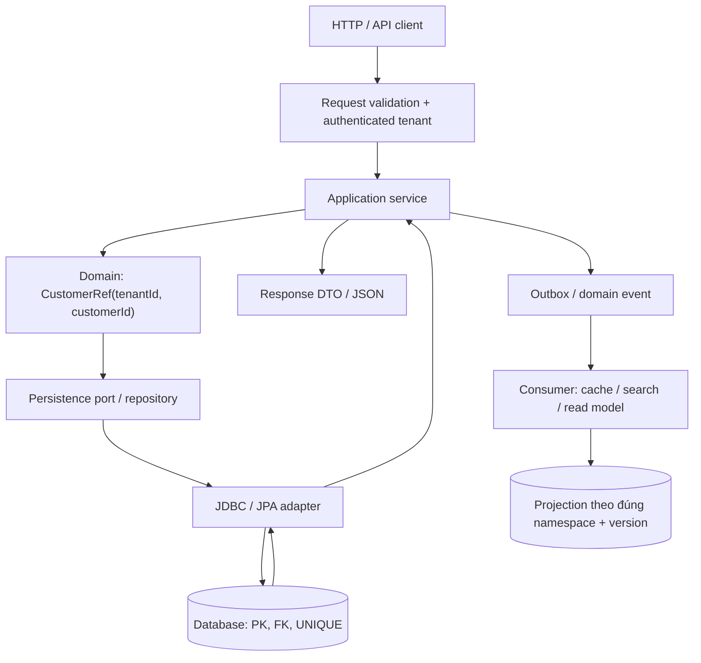
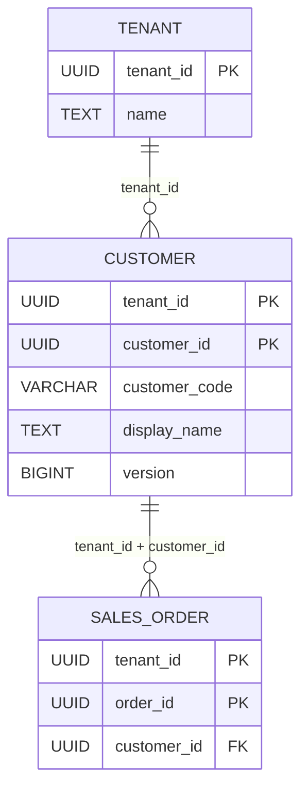

# Bảo toàn danh tính khi chuyển dữ liệu qua các tầng ứng dụng

Một người dùng mở hồ sơ khách hàng có mã `KH-001`. Ứng dụng Java đọc bản ghi từ PostgreSQL, ánh xạ thành một đối tượng domain, chuyển thành JSON, lưu cache và phát sự kiện cho hệ thống báo cáo. Sau đó công ty A và công ty B cùng có khách hàng mang mã `KH-001`. Nếu một lớp trong đường đi chỉ giữ mã này và làm mất thông tin về công ty sở hữu, hai khách hàng khác nhau có thể bị xem là cùng một người. Không có câu lệnh SQL hay thông báo lỗi nào nhất thiết xuất hiện: chương trình vẫn chạy, nhưng **danh tính đã bị thay đổi trong quá trình chuyển dữ liệu**.

Bài học thuộc chương **Định danh và quan hệ** của module **DATA_PERSISTENCE_FUNDAMENTALS**. Module xây dựng kiến thức về lưu trữ dữ liệu bền vững trong ứng dụng Java: mô hình dữ liệu, lược đồ, truy vấn và chỉ mục, transaction, isolation và đồng thời; ranh giới persistence, xử lý lỗi kết nối, tiến hóa schema, bảo mật, sao lưu và hiệu năng. Trong phạm vi đó, bài này tập trung vào câu hỏi: **khi cùng một thực thể đi qua API, DTO, domain, ORM/JDBC, database, sự kiện, cache và các hệ thống tích hợp, điều gì chứng minh nó vẫn là cùng một thực thể?**

Sau bài học, bạn có thể:

- Phân biệt **danh tính thực thể** với **giá trị thuộc tính**, **đối tượng Java**, **mã nghiệp vụ**, **phiên bản** và **định danh của một yêu cầu/sự kiện**.
- Thiết kế hợp đồng định danh gồm **namespace, tenant, loại thực thể, ID, khả năng thay đổi và nguồn cấp**.
- Bảo toàn ID qua ánh xạ Java/DTO/JSON/JDBC/JPA mà không tự sinh lại, bỏ mất scope hay đổi kiểu gây mất giá trị.
- Giữ toàn vẹn khóa ngoại và quyền truy cập khi chuyển dữ liệu giữa những tầng hoặc những hệ thống khác nhau.
- Kiểm thử đường đi khứ hồi (*round-trip*), retry, thay đổi mã, import, merge và sự kiện đến sai thứ tự.

## 1. Cùng một thực thể khác với cùng một giá trị

Hãy xét hai khách hàng:

| Thuộc tính | Khách hàng A | Khách hàng B |
| --- | --- | --- |
| Tenant | `company-A` | `company-B` |
| Mã nghiệp vụ | `KH-001` | `KH-001` |
| ID kỹ thuật | `c8407dae-ef9c-4fa0-9025-938d7fe77a93` | `a34de7b6-beb7-4d20-84be-b67bced3e42f` |
| Tên hiển thị | `Minh An` | `Minh An` |

Hai bản ghi trùng cả mã và tên nhưng **không cùng danh tính**. Ngược lại, khách hàng A đổi tên thành `Minh An Group` và mã thành `KH-2026-001` mà không thay đổi chủ thể nghiệp vụ thì **vẫn là cùng thực thể**.

Để suy luận nhất quán, có thể xem danh tính quan sát được tại một ranh giới tích hợp là một bộ:

```text
Identity = (source/namespace, tenant-or-scope, entity-type, stable-entity-id)
```

Đây là **mô hình khái niệm**, không yêu cầu mọi bảng phải lưu cả bốn trường. Chẳng hạn một database có thể cấp `customer_id` là khóa chính toàn cục trong riêng database đó; nhưng khi truyền ID sang một nền tảng khác, vẫn cần biết **ai đã cấp ID và nó thuộc loại đối tượng nào**.

Một số ngộ nhận cần phân biệt sớm:

- **Cùng đối tượng Java trong bộ nhớ** (`a == b`) không phải định nghĩa chung cho việc cùng một thực thể qua hai request hoặc hai JVM.
- **Hai object có cùng toàn bộ dữ liệu** không nhất thiết là một thực thể. Hai hóa đơn độc lập có thể giống từng trường giá trị.
- **Cùng entity ID** trong đúng namespace thường biểu thị một thực thể, ngay cả khi trạng thái các bản đọc khác nhau do thời điểm hoặc phiên bản.
- **Cùng business code** chưa đủ nếu mã chỉ duy nhất trong tenant, chi nhánh, thời kỳ hoặc hệ thống nguồn.
- **Cùng `eventId`** nói về cùng một bản tin hoặc lần phát, không phải cùng thực thể; một thực thể có thể sinh hàng nghìn sự kiện.

### Danh tính, trạng thái và phiên bản

Nên đặt ba câu hỏi riêng biệt:

1. **Đây là ai/cái gì?** Ví dụ khách hàng `C1` trong tenant `T1`.
2. **Trạng thái hiện tại là gì?** Ví dụ `displayName = "Minh An"`, `customerCode = "KH-001"`.
3. **Đây là phiên bản thứ mấy?** Ví dụ `version = 17`.

Thay đổi số điện thoại, địa chỉ hoặc tên không tự tạo ra thực thể mới. Thay đổi `version` cũng không đổi danh tính. Nếu một bản ghi được tách thành hai chủ thể hoặc hai hồ sơ được hợp nhất, đó mới có thể là **chuyển đổi danh tính có quyết định nghiệp vụ**, cần lịch sử và mapping rõ ràng.

## 2. Danh tính đi qua những ranh giới nào?

Trong ứng dụng Java điển hình, danh tính đi qua nhiều tầng:



Mỗi cạnh có thể làm mất ngữ nghĩa nếu ánh xạ sai. Ví dụ:

| Ranh giới | Lỗi thường gặp | Hợp đồng cần bảo toàn |
| --- | --- | --- |
| HTTP → DTO | Client gửi ID dưới dạng số làm mất chữ số, hoặc tự chọn tenant khác | Kiểu/format ID, tenant đã xác thực, validation |
| DTO → domain | Gộp `customerId` và `orderId` vì cả hai là `String` | Loại định danh, phạm vi, quy tắc tạo/tra cứu |
| Domain → repository | Tìm khách chỉ bằng `customer_code`, bỏ `tenant_id` | Khóa tra cứu đầy đủ và quyền truy cập |
| JDBC/ORM → entity | Tạo UUID mới khi hydrate một hàng có sẵn | Giữ nguyên primary key từ DB |
| Entity → response | Trả mã nghiệp vụ thay cho ID kỹ thuật nhưng API gọi là `id` | Ý nghĩa và stability của từng field |
| Transaction → sự kiện | Thay đổi đã commit nhưng event thiếu ID ổn định | ID thực thể, namespace, eventId, version |
| Sự kiện → consumer | Event cũ tạo lại hồ sơ đã xóa hoặc ghi đè bản mới | Phiên bản, tombstone, idempotency |
| Cache → client | Khóa cache chỉ là `KH-001`; dữ liệu tenant khác đè lên | Khóa cache mang scope và entity ID |
| Import/ETL → database | Nguồn A và B có cùng external ID `123`, bị gộp | Source namespace + external ID + mapping |
| Backup/restore → ứng dụng | Khôi phục ID cũ nhưng hệ phụ thuộc ở phiên bản mới | Mốc phục hồi, ID mapping, đối soát phụ thuộc |

Bảo toàn danh tính không nhất thiết là **giữ nguyên một chuỗi byte**. Một UUID có thể đi từ chuỗi chuẩn sang kiểu `UUID` và trở lại chuỗi chuẩn; điều quan trọng là **giá trị định danh và namespace không đổi**. Nhưng với mã nghiệp vụ `"000123"`, byte và chữ số 0 đầu lại có thể là thành phần quan trọng của giá trị.

## 3. Viết hợp đồng định danh trước khi viết mapper

Để một ID sống sót qua nhiều lớp, cần định nghĩa ít nhất:

| Thành phần | Câu hỏi | Ví dụ hợp đồng |
| --- | --- | --- |
| **Tên và loại** | ID này nhận diện thực thể gì? | `customerId`, không dùng `id` mơ hồ trong DTO nhiều thực thể |
| **Nguồn cấp** | Dịch vụ/DB nào được phép cấp? | Customer service cấp `CustomerId` |
| **Namespace** | Cùng chuỗi ở hai hệ có được xem là một? | `(sourceSystem, externalId)` |
| **Phạm vi duy nhất** | ID duy nhất toàn DB hay chỉ trong tenant? | `(tenantId, customerId)` tại ranh giới đa tenant |
| **Bất biến** | Có đổi khi đổi tên hoặc mã hiển thị không? | Không đổi trong vòng đời khách |
| **Chính sách tái sử dụng** | Xóa xong có cấp lại ID được không? | Không tái sử dụng entity ID kỹ thuật |
| **Biểu diễn** | UUID string, số 64 bit, chuỗi tùy biến? | UUID dạng chuỗi chuẩn trong JSON |
| **Quan hệ với business code** | Mã `KH-001` có thể thay đổi không? | Có thể đổi; vẫn giữ ID kỹ thuật |
| **Quyền truy cập** | Ai được sử dụng ID để đọc/sửa? | Luôn kiểm tra quyền theo tenant và tài nguyên |
| **Lịch sử/migration** | Khi merge hoặc đổi nguồn cấp sẽ xử lý thế nào? | Alias/mapping có lưu vết và kiểm tra tham chiếu |

Không suy ra ý nghĩa từ tên biến `id`. Nếu đối tượng domain là đơn hàng, `orderId` và `customerId` phải là hai loại khác nhau dù đều dùng UUID.

### Business key không nhất thiết là entity ID

Ví dụ mã `KH-001` là business key để người dùng tìm khách. Nếu hợp đồng cho phép đổi mã, nó **không nên trở thành cơ sở duy nhất cho quan hệ lâu dài**. Khi cần giữ mã trên hóa đơn đã phát hành, có thể lưu **snapshot mã tại thời điểm phát hành** riêng với khóa ngoại trỏ tới khách hiện tại.

### Namespace quan trọng khi tích hợp

Một CRM có external ID `12345` và một ERP cũng có external ID `12345` không có nghĩa đang nói về một khách. Cần phân biệt:

```text
(CRM, tenant-A, customer, "12345")
(ERP, tenant-A, customer, "12345")
```

Nếu nhà cung cấp có các namespace con (ví dụ nhiều tài khoản hoặc công ty con), khóa mapping phải chứa cả **source account/namespace**. Cùng chữ số chỉ có ý nghĩa bên trong phạm vi mà bên cấp ID bảo đảm.

## 4. Biểu diễn ID: đừng để serialization thay đổi giá trị

### 4.1. ID số nguyên lớn qua JavaScript/JSON

Java `long` có 64 bit có dấu, còn JavaScript `Number` thường dùng IEEE 754 binary64, chỉ biểu diễn chính xác **mọi số nguyên** tới `Number.MAX_SAFE_INTEGER = 9_007_199_254_740_991`.

Ví dụ:

```javascript
const original = 9007199254740993n;
const converted = Number(original);

console.log(converted);                       // 9007199254740992
console.log(Number.isSafeInteger(converted)); // false
```

Nếu server gửi một ID `long` lớn dưới dạng JSON number, client JavaScript có thể biến nó thành một ID khác trước khi gửi ngược về API. Hai người dùng có thể bị tra cứu sai hoặc đường cập nhật báo “không tìm thấy”.

**Giải pháp:** định danh không cần phép toán số thường nên được vận chuyển dưới dạng **chuỗi**. Nếu API thật sự cần số nguyên lớn, khai báo rõ kiểu integer lớn, cách parse và giới hạn của từng client; đừng coi mọi JSON consumer đều xử lý giống Java.

### 4.2. Mã chứa số 0 đầu và Unicode

`"000123"` và `"123"` có thể là **hai business code khác nhau**. Không ép mã thành `int` rồi xuất trở lại. Tương tự, quy tắc phân biệt hoa thường hoặc chuẩn hóa Unicode phải thuộc hợp đồng miền nghiệp vụ, không phụ thuộc ngẫu nhiên vào collation database hoặc `String.toLowerCase()` dùng locale mặc định.

Đối với UUID, có thể chuẩn hóa cách biểu diễn khi xuất JSON nhưng phải dùng **parser** và kiểu dữ liệu phù hợp, không viết lại chuỗi bằng thao tác cắt ký tự tùy tiện.

### 4.3. `null`, ID chưa cấp và placeholder

Một entity chưa được lưu có thể **chưa có database-generated ID**. Không dùng chuỗi `"0"`, `"unknown"` hoặc UUID toàn số 0 làm ID tạm nếu chúng có thể vô tình va chạm với quy ước thật. Mô hình hóa rõ:

- Đối tượng đang được tạo có thể chưa có ID do DB cấp.
- Đối tượng đã tồn tại và được tham chiếu phải có ID hợp lệ.
- Lỗi `NOT_FOUND` khác với ID sai định dạng và khác với không có quyền truy cập.

Nếu dùng UUID do ứng dụng cấp ngay từ đầu, có thể tạo ID trước khi ghi, nhưng **cấp ID không đồng nghĩa bản ghi đã được commit**.

## 5. Java: dùng kiểu định danh để ngăn tráo nhầm

Một cách đơn giản với Java 17 là dùng record riêng cho từng loại ID và một kiểu tham chiếu mang scope. Các record này minh họa **hợp đồng định danh**, không phải ORM entity.

```java
import java.util.Objects;
import java.util.UUID;

record TenantId(UUID value) {
    TenantId {
        Objects.requireNonNull(value, "tenantId");
    }

    static TenantId parse(String text) {
        return new TenantId(UUID.fromString(text));
    }
}

record CustomerId(UUID value) {
    CustomerId {
        Objects.requireNonNull(value, "customerId");
    }

    static CustomerId parse(String text) {
        return new CustomerId(UUID.fromString(text));
    }
}

record OrderId(UUID value) {
    OrderId {
        Objects.requireNonNull(value, "orderId");
    }
}

// Danh tính được sử dụng ở ranh giới tra cứu đa tenant.
record CustomerRef(TenantId tenantId, CustomerId customerId) {
    CustomerRef {
        Objects.requireNonNull(tenantId, "tenantId");
        Objects.requireNonNull(customerId, "customerId");
    }
}

record CustomerView(
        CustomerRef ref,
        String customerCode,
        String displayName,
        long version
) { }
```

Nhờ các kiểu riêng, compiler không cho đưa một `OrderId` trực tiếp vào chỗ cần `CustomerId`. `CustomerRef` chứa cả tenant để tránh bỏ scope khi truyền giữa service và repository.

Một record dùng `equals` theo **tất cả các thành phần giá trị**. Vì thế `CustomerView` có cùng ID nhưng khác tên/version **không bằng nhau theo `equals` mặc định**. Đây là điều bình thường: **bằng nhau về snapshot dữ liệu** khác với **cùng danh tính thực thể**.

Nếu muốn biết hai snapshot có trỏ cùng một khách:

```java
static boolean sameCustomer(CustomerView left, CustomerView right) {
    return left.ref().equals(right.ref());
}
```

Đừng so `displayName` hoặc `customerCode` để suy ra identity.

### Không tạo ID mới khi chuyển từ database thành domain

Đây là lỗi mapper nguy hiểm:

```java
// Sai: mỗi lần đọc một hàng lại sinh ra "thực thể mới" theo danh tính.
CustomerId wrongId = new CustomerId(UUID.randomUUID());
```

ID mới chỉ nên được cấp ở **luồng tạo thực thể mới**. Khi hydrate một hàng từ DB, phải lấy **ID đã lưu trên hàng đó**; khi serialize/deserialize thì parse lại cùng ID.

## 6. Tách DTO khỏi domain mà không đánh mất identity

Giả sử API `GET /customers/{customerId}` trả về:

```json
{
  "customerId": "c8407dae-ef9c-4fa0-9025-938d7fe77a93",
  "customerCode": "KH-001",
  "displayName": "Minh An",
  "version": 12
}
```

Khách hàng chỉ nhận các trường cần thiết. `tenantId` có thể lấy từ ngữ cảnh tenant đã xác thực trên server; không nhất thiết phải để client tự chọn tenant trong body.

DTO và mapper Java:

```java
record CustomerResponse(
        String customerId,
        String customerCode,
        String displayName,
        long version
) { }

final class CustomerMapper {
    static CustomerResponse toResponse(CustomerView customer) {
        return new CustomerResponse(
                customer.ref().customerId().value().toString(),
                customer.customerCode(),
                customer.displayName(),
                customer.version()
        );
    }

    static CustomerRef toRef(TenantId authenticatedTenant, String rawId) {
        // UUID.fromString ném IllegalArgumentException khi ID sai cú pháp.
        // Tầng HTTP ánh xạ trường hợp này thành lỗi đầu vào phù hợp.
        return new CustomerRef(
                authenticatedTenant,
                CustomerId.parse(rawId)
        );
    }
}
```

**Những điều mapper phải giữ:**

- `customerId` mang đúng UUID từ domain, không tự gán mới hoặc dùng nhầm `customerCode`.
- Tenant gắn với **bối cảnh đã xác thực**. Nếu URL có tenant, phải kiểm tra quyền của principal với tenant đó; không tin tham số tenant chỉ vì nó hợp lệ về cú pháp.
- `version` là **phiên bản trạng thái**, không phải entity ID.
- Mapper phải được kiểm thử **đi và về** ở các định danh phải bảo toàn; những trường được cố tình bỏ khỏi response phải có lý do.
- Không trộn ID với mã hóa/ẩn danh UI: một public alias có thể dùng ở bên ngoài, nhưng mapping alias → internal ID cần cơ chế riêng và kiểm tra quyền.

### Đừng tạo danh tính bằng nội dung của DTO

Hai request `POST /customers` có cùng `displayName` và `customerCode` không tự động là cùng một yêu cầu. Chúng có thể đại diện hai lần nhấn nút trùng, hoặc xung đột nghiệp vụ giữa hai người dùng. **Idempotency key** nhận diện yêu cầu cần chống lặp; **business code** thể hiện quy tắc unique; **entity ID** nhận diện khách đã tạo. Các trách nhiệm này phải được thiết kế riêng.

## 7. Bảo toàn danh tính tại database và khóa ngoại

Ví dụ PostgreSQL sau sử dụng primary key ghép `(tenant_id, customer_id)` để biểu diễn trực tiếp scope. UUID được ứng dụng hoặc một thành phần có thẩm quyền cấp.

```sql
CREATE TABLE tenant (
    tenant_id UUID PRIMARY KEY,
    name TEXT NOT NULL
);

CREATE TABLE customer (
    tenant_id UUID NOT NULL REFERENCES tenant (tenant_id),
    customer_id UUID NOT NULL,
    customer_code VARCHAR(32) NOT NULL,
    display_name TEXT NOT NULL,
    version BIGINT NOT NULL DEFAULT 1 CHECK (version >= 1),

    CONSTRAINT pk_customer PRIMARY KEY (tenant_id, customer_id),
    CONSTRAINT uq_customer_code UNIQUE (tenant_id, customer_code)
);

CREATE TABLE sales_order (
    tenant_id UUID NOT NULL,
    order_id UUID NOT NULL,
    customer_id UUID NOT NULL,
    created_at TIMESTAMPTZ NOT NULL DEFAULT CURRENT_TIMESTAMP,

    CONSTRAINT pk_sales_order PRIMARY KEY (tenant_id, order_id),
    CONSTRAINT fk_sales_order_customer
        FOREIGN KEY (tenant_id, customer_id)
        REFERENCES customer (tenant_id, customer_id)
        ON DELETE RESTRICT
);

CREATE INDEX ix_sales_order_customer
    ON sales_order (tenant_id, customer_id);
```

Ở đây, foreign key ghép không cho một đơn hàng của tenant A trỏ tới khách tenant B, kể cả nếu có client cố tình truyền UUID khách của tenant B. **Khóa ngoại bảo vệ tính nhất quán quan hệ**, không thay thế kiểm tra quyền truy cập tại application/API.

Mô hình quan hệ:



**Mọi lựa chọn về scope phải nhất quán.** Nếu hệ thống dùng `customer_id` duy nhất toàn database thay vì khóa ghép, vẫn cần bảo vệ quan hệ tenant bằng ràng buộc hoặc thiết kế tương đương; chỉ có FK theo UUID khách không tự xác minh tenant của đơn.

### JDBC: đọc đúng khóa, ánh xạ đúng kiểu

Ví dụ repository đọc một khách theo tham chiếu đầy đủ:

```java
import java.sql.Connection;
import java.sql.PreparedStatement;
import java.sql.ResultSet;
import java.sql.SQLException;
import java.util.Optional;
import java.util.UUID;
import javax.sql.DataSource;

final class JdbcCustomerReader {
    private final DataSource dataSource;

    JdbcCustomerReader(DataSource dataSource) {
        this.dataSource = dataSource;
    }

    Optional<CustomerView> findByRef(CustomerRef ref) throws SQLException {
        String sql = """
                SELECT tenant_id, customer_id, customer_code,
                       display_name, version
                FROM customer
                WHERE tenant_id = ? AND customer_id = ?
                """;

        try (Connection connection = dataSource.getConnection();
             PreparedStatement ps = connection.prepareStatement(sql)) {
            ps.setObject(1, ref.tenantId().value());
            ps.setObject(2, ref.customerId().value());

            try (ResultSet rows = ps.executeQuery()) {
                if (!rows.next()) {
                    return Optional.empty();
                }

                // Đọc lại ID từ hàng thực tế, không sinh ID mới.
                TenantId dbTenant = new TenantId(
                        UUID.fromString(rows.getString("tenant_id")));
                CustomerId dbCustomer = new CustomerId(
                        UUID.fromString(rows.getString("customer_id")));

                CustomerRef actualRef = new CustomerRef(dbTenant, dbCustomer);
                if (!actualRef.equals(ref)) {
                    throw new SQLException("Identity mismatch in result");
                }

                return Optional.of(new CustomerView(
                        actualRef,
                        rows.getString("customer_code"),
                        rows.getString("display_name"),
                        rows.getLong("version")
                ));
            }
        }
    }
}
```

Đoạn mã dùng Java 17 và bảng minh họa ở trên. Driver thật có thể hỗ trợ `getObject(..., UUID.class)`; ví dụ dùng `getString()` để làm rõ việc parse. Trong production cần chuẩn hóa cách ánh xạ `SQLException`, connection timeout và kiểm tra quyền/authorization. Với request chỉ đọc, `findByRef` không tự chứng minh caller được phép xem đối tượng; đó là trách nhiệm application/security boundary.

### Cập nhật phải bám đúng identity, không chỉ mã nghiệp vụ

```sql
UPDATE customer
SET display_name = :new_name,
    version = version + 1
WHERE tenant_id = :tenant_id
  AND customer_id = :customer_id
  AND version = :expected_version;
```

Đây là mẫu **optimistic concurrency**: nếu số hàng được cập nhật là 0, có thể bản ghi không tồn tại hoặc version đã thay đổi; ứng dụng cần xác định kết quả phù hợp, không suy ra một nguyên nhân duy nhất. Các dấu `:...` là bind parameters ở thư viện hỗ trợ named parameters; JDBC thuần dùng `?`.

Điều quan trọng: `customerId` xác định **thực thể nào**, còn `expectedVersion` xác định **snapshot nào** của thực thể đang được cập nhật. Thay ID bằng version hoặc thay version bằng ID đều làm sai ngữ nghĩa.

## 8. JPA/Hibernate: identity của entity và identity của object

JPA quản lý các entity trong một **persistence context**. Trong một context và đối với cùng entity identity, provider thường quản lý một managed instance tương ứng; nhưng ở hai transaction/context khác nhau, cùng một hàng DB có thể được biểu diễn bằng **hai object Java khác nhau**.

```text
Request 1 / EntityManager A:
    CustomerEntity@A -> (tenant=T1, customer=C1)

Request 2 / EntityManager B:
    CustomerEntity@B -> (tenant=T1, customer=C1)

A != B theo tham chiếu object, nhưng cả hai cùng DB identity.
```

Một số bẫy phổ biến:

- Dùng `==` để so hai JPA entity được load ở các context khác nhau.
- Dùng `equals()/hashCode()` dựa trên tên/email/mã nghiệp vụ có thể thay đổi; khi một entity nằm trong `HashSet` rồi đổi trường dùng làm hash, khả năng tìm lại đối tượng có thể bị hỏng.
- Dùng DB-generated ID chưa được cấp trong `equals()/hashCode()` mà không xử lý vòng đời transient → persisted; một số chiến lược khiến hash thay đổi sau persist.
- Quên rằng Hibernate proxy, lazy loading và inheritance có thể ảnh hưởng cách so sánh `getClass()`/`instanceof` và việc truy cập thuộc tính.
- Dùng `merge(detached)` mà tưởng tham số được truyền vào luôn trở thành managed instance; JPA trả về một managed copy tương ứng, và phải sử dụng giá trị trả về theo hợp đồng provider.
- Tự tạo JPA entity mới từ DTO của bản ghi đã tồn tại rồi gọi `persist`, làm insert trùng thay vì cập nhật đúng ID.

Không có một cách `equals()/hashCode()` duy nhất đúng cho mọi entity và chiến lược cấp ID. Hãy chọn cách tương thích với **ID ổn định**, entity lifecycle, proxy/provider, collection và ranh giới aggregate; kiểm thử trên JPA provider thực. Với value object/DTO, so sánh theo giá trị là hợp lý; với domain entity, phải nói rõ khi nào so theo identity.

**Đặc biệt khi dùng khóa ghép đa tenant:** mapping JPA phải bảo toàn cả `tenantId` và `customerId`. Nếu DAO/repository chỉ dùng một phần khóa, lỗi có thể biểu hiện như tra cứu nhầm khách hoặc vi phạm cách ly dữ liệu.

## 9. Sự kiện bất đồng bộ: phân biệt bốn loại định danh

Một khách thay đổi mã sẽ tạo **một thay đổi trạng thái** nhưng có thể sinh nhiều bản tin và nhiều lần xử lý. Ví dụ event:

```json
{
  "eventId": "9d91ed81-d82b-4c89-a7ca-0e932e11c4e8",
  "eventType": "CustomerCodeChanged",
  "source": "customer-service",
  "tenantId": "23a0882f-94c4-4b52-95bf-5482f5d6fc74",
  "customerId": "c8407dae-ef9c-4fa0-9025-938d7fe77a93",
  "customerVersion": 13,
  "oldCode": "KH-001",
  "newCode": "KH-2026-001",
  "correlationId": "37a81711-6e1f-4eaa-8ac2-ea71269068d9"
}
```

Các trường không thay thế nhau:

| Trường | Nhận diện điều gì? | Quy tắc cần bảo toàn |
| --- | --- | --- |
| `customerId` | Thực thể khách hàng trong namespace của nguồn | Không đổi khi đổi mã |
| `tenantId` | Scope của thực thể và kiểm tra quyền | Không được mất khi gửi đến consumer đa tenant |
| `eventId` | Một bản tin/sự kiện đã công bố | Dùng để dedupe khi nhận lại cùng event |
| `customerVersion` | Phiên bản trạng thái của khách | Giúp chống bản cũ ghi đè bản mới |
| `correlationId` | Chuỗi xử lý/trace liên quan | Không được dùng làm ID của thực thể |
| `idempotencyKey` (nếu có trong request) | Ý định thao tác khi client retry | Thường không giống `eventId` hay `customerId` |

Sự kiện có thể được **phát lại** khi publisher chết sau broker ack nhưng trước khi ghi nhận tiến độ. Vì vậy consumer phải có chính sách idempotent. Một event mới có thể mô tả cùng khách nhưng có `eventId` khác và `customerVersion` lớn hơn.

### Dedupe và version phải gắn với đúng scope

Nếu read model có một hàng cho mỗi khách, khóa của projection không thể chỉ là `customerCode` vì mã có thể đổi hoặc trùng ở tenant khác. Thường dùng:

```text
Projection identity:
  (source, tenantId, customerId)

State:
  customerCode, displayName, sourceVersion, deleted
```

Khi nhận một event mang **trạng thái đầy đủ có thể thay thế**, chỉ cập nhật projection nếu phiên bản mới hơn; nếu nhận lại cùng event, bỏ qua hoặc trả cùng kết quả.

**Giới hạn:** nếu event là thao tác *delta* (“tăng điểm thưởng 10”), không được bỏ qua `version=12` chỉ vì `version=13` đến trước mà vẫn muốn bảo toàn tất cả thay đổi. Cần đảm bảo trình tự, phát hiện khoảng trống, hoặc xây lại từ nguồn. Version để so dữ liệu mới/cũ khác với ID để nhận diện thực thể.

### Xóa dữ liệu và tombstone

Giả sử khách bị xóa ở `version=20`, sau đó consumer nhận lại event đổi mã ở `version=18`. Nếu xóa luôn mọi dấu vết về identity/version, hệ thống nhận có thể **tạo lại khách đã xóa**. Một tombstone (dấu xóa) gắn với `(source, tenantId, customerId, version=20)` giúp từ chối event cũ. Thời gian giữ tombstone phải phù hợp retention, retry/replay và thiết bị offline.

## 10. Cache, search và read model: cùng ID nhưng khác thời điểm

Trong cache, một khóa kiểu `customer:KH-001` không có tenant sẽ gây trùng giữa công ty A và B. Nếu mã khách thay đổi, cache cũ còn có thể trỏ nhầm hoặc giữ dữ liệu lỗi thời.

Một cache key có thể dùng:

```text
customer:{tenantUuid}:{customerUuid}
```

Tên cụ thể tùy cache và namespace triển khai. Giá trị cache nên có `version` hoặc timestamp/watermark phù hợp để application đánh giá freshness. Trong môi trường nhiều hệ, có thể cần thêm `source` nếu ID có nguồn cấp độc lập.

Với search index và read model:

- **Identity** xác định tài liệu nào đang được cập nhật.
- **Version** xác định bản cập nhật nào được phép ghi đè.
- **Business code** là trường để tìm kiếm/hiển thị, không mặc định là khóa tài liệu.
- **Tombstone/soft delete** cho phép chống sự kiện cũ hồi sinh bản ghi.
- **Tenant authorization** vẫn cần được thực thi khi đọc từ index, không chỉ khi ghi từ nguồn.

Một bản cache có ID đúng nhưng `displayName` cũ là **stale state**, không nhất thiết là **nhầm identity**. Cần phân biệt hai loại lỗi khi chẩn đoán.

## 11. Import, export và tích hợp: giữ đúng nguồn cấp ID

Dữ liệu CSV hoặc JSON xuất từ CRM có thể chứa:

```csv
source_account,external_customer_id,name
crm-east,000123,Minh An
crm-west,000123,Minh An
```

Nếu import bỏ `source_account` hoặc ép `external_customer_id` từ chuỗi sang số, có thể:

- Gộp hai khách khác nhau thành một.
- Làm mất số 0 đầu và không tìm lại được external ID gốc.
- Sinh lại UUID kỹ thuật mỗi lần import, gây tạo trùng hoặc mất liên kết.
- Gắn một dòng đơn hàng với khách sai khi mapping theo tên/email trùng.

Một bảng mapping giữa external ID và ID nội bộ có thể là:

```sql
CREATE TABLE external_customer_map (
    tenant_id UUID NOT NULL,
    source_account VARCHAR(80) NOT NULL,
    external_customer_id VARCHAR(128) NOT NULL,
    local_customer_id UUID NOT NULL,

    CONSTRAINT pk_external_customer_map
        PRIMARY KEY (tenant_id, source_account, external_customer_id),

    CONSTRAINT fk_external_map_customer
        FOREIGN KEY (tenant_id, local_customer_id)
        REFERENCES customer (tenant_id, customer_id)
);

CREATE INDEX ix_external_map_local
    ON external_customer_map (tenant_id, local_customer_id);
```

Một external ID có thể được **tái sử dụng hoặc tái cấp** theo chính sách nguồn. Khi đó mapping còn cần thời gian hiệu lực, phiên bản nguồn hoặc quy trình xử lý trùng. Không suy ra liên kết identity chỉ từ `name` hoặc `email` khi thiếu bằng chứng nghiệp vụ.

### Khôi phục/import lại không được tự cấp ID mới cho bản ghi cũ

Một luồng import an toàn thường là:

1. Đọc định danh nguồn **như chuỗi với scope**, không tự chuyển sang số nếu source không quy định.
2. Tra mapping hiện có theo `(tenant, sourceAccount, externalId)`.
3. Nếu đã có mapping, cập nhật **đúng local customer ID** theo version/quy tắc.
4. Nếu chưa có mapping, thực hiện quy trình tạo thực thể mới **có kiểm tra match và conflict**, cấp local ID một lần, ghi mapping và thực thể trong ranh giới transaction phù hợp.
5. Nếu có nhiều ứng viên match hoặc lịch sử merge, đánh dấu chờ đối soát thay vì tự quyết định.
6. Giữ thống kê trước/sau: số record mới, cập nhật, bỏ qua, xung đột và quan hệ bị ảnh hưởng.

Với import chạy song song, “SELECT rồi INSERT” không đủ để chống mapping trùng. Dùng unique/PK tại nguồn lưu, thao tác upsert/transaction có điều kiện và kiểm tra lỗi theo hợp đồng. Khi retry sau mất kết nối ở commit, trạng thái có thể chưa rõ; dùng khóa nghiệp vụ/idempotency ổn định để đối soát.

## 12. Đổi mã, hợp nhất/tách thực thể và thay khóa khi migration

Danh tính không chỉ bị mất khi serialize. Nó còn có thể bị đổi nhầm khi tiến hóa schema.

### Thay business code

Khách `C1` đổi `KH-001` thành `KH-2026-001`. ID kỹ thuật và khóa ngoại đơn hàng **không cần đổi**. Nhưng chứng từ cũ có thể cần hiển thị mã lúc phát hành; khi đó giữ snapshot lịch sử song song với reference ID.

Nếu mã cũ có thể tái sử dụng, chỉ dựa vào `customerCode` khi import hóa đơn lịch sử sẽ tạo tham chiếu sai. Cần ID kỹ thuật hoặc alias theo mốc thời gian, kèm phạm vi và nguồn.

### Hợp nhất hai hồ sơ

Giả sử `C1` và `C2` được xác nhận thực sự là cùng khách. Không đơn giản đổi mọi `C2` thành `C1` rồi xóa hồ sơ: hóa đơn, quyền, thanh toán, audit và sự kiện đã phát có thể cần giữ lịch sử.

Một kế hoạch có thể gồm:

- Quyết định **canonical ID** theo chính sách và lưu mapping `C2 → C1` có lý do/nguồn xác minh.
- Di chuyển những quan hệ **được phép** theo transaction hoặc workflow có kiểm chứng.
- Giữ chứng từ/audit cần thiết và xử lý tham chiếu đến ID cũ.
- Phát sự kiện merge có đủ namespace, old IDs, canonical ID, version và idempotency.
- Không cho consumer nhầm việc merge danh tính với xóa dữ liệu thông thường.

### Tách một thực thể

Khi hồ sơ `C1` phải tách thành `C1` và `C3`, phải có quy tắc phân bổ đơn hàng, hợp đồng và lịch sử. **Không thể suy ra phân bổ chỉ từ UUID**. Quyết định cần đến từ nghiệp vụ và được ghi nhận trong quá trình migration.

### Di chuyển từ natural key sang surrogate key

Nếu hệ cũ dùng `(tenant_id, customer_code)` làm khóa tham chiếu và muốn dùng `(tenant_id, customer_id)`, một migration thường cần:

1. Kiểm kê dữ liệu và những nơi đang tham chiếu business code.
2. Thêm `customer_id`, backfill duy nhất cho từng thực thể và lưu mapping đầy đủ scope.
3. Bổ sung unique, FK và index mới, kiểm tra mọi mối quan hệ cũ.
4. Triển khai giai đoạn tương thích, đảm bảo record mới có **cả hai biểu diễn nhất quán**.
5. Chuyển bảng con, API, sự kiện, cache key và hệ tích hợp theo lộ trình kiểm thử.
6. Đối soát số dòng, khóa mồ côi, trùng mapping và kết quả đọc/ghi; chỉ bỏ khóa cũ sau khi các consumer đã chuyển.

Không tự gán `customer_id` mới mỗi lần chạy lại backfill. Hãy dùng mapping ổn định và thao tác idempotent để migration có thể tiếp tục an toàn sau lỗi.

## 13. Bảo mật: biết ID không có nghĩa được sở hữu đối tượng

Một đường API như `GET /customers/{customerId}` dễ mắc lỗi *IDOR/BOLA* (truy cập đối tượng vượt quyền) nếu controller kiểm tra người dùng đăng nhập nhưng không kiểm tra **người dùng có quyền với customer đó**.

Các nguyên tắc:

- Xác thực principal và xác định tenant/organization đã được cấp quyền.
- Tra cứu bằng ID có scope hoặc điều kiện tương đương; không cho request tự gán tenant khác nếu không được phép.
- Kiểm tra quyền **trên object và hành động**, không chỉ kiểm tra UUID có đúng format.
- Không dùng “UUID ngẫu nhiên khó đoán” như cơ chế bảo mật.
- Không để cache/search/read model bỏ qua tenant filter rồi trả dữ liệu từ tenant khác.
- Tránh đưa ID chứa thông tin cá nhân như email/số giấy tờ vào URL và log nếu không cần thiết; chọn ID kỹ thuật khi phù hợp.

Việc bảo toàn identity còn giúp truy vết audit: log các sự kiện quan trọng nên ghi source, tenant, entity ID, action, version và correlation ID, nhưng phải giới hạn dữ liệu cá nhân và bí mật. Không dùng `correlationId` để thay entity ID trong chính sách quyền.

## 14. Thiết kế phép thử round-trip và invariant

Một kiểm thử nhỏ có thể xác nhận mapper Java không làm mất tham chiếu:

```java
import java.util.UUID;

class IdentityRoundTripExample {
    static void verify() {
        TenantId tenant = new TenantId(
                UUID.fromString("23a0882f-94c4-4b52-95bf-5482f5d6fc74"));
        CustomerId id = new CustomerId(
                UUID.fromString("c8407dae-ef9c-4fa0-9025-938d7fe77a93"));

        CustomerRef before = new CustomerRef(tenant, id);
        CustomerView customer = new CustomerView(
                before, "KH-001", "Minh An", 12);

        CustomerResponse dto = CustomerMapper.toResponse(customer);
        CustomerRef after = CustomerMapper.toRef(tenant, dto.customerId());

        if (!before.equals(after)) {
            throw new AssertionError("Identity changed across mapper");
        }
    }
}
```

Đây chỉ là một kiểm tra mapper không cần DB; không chứng minh uniqueness, foreign key, transaction, security hoặc hành vi của JSON serializer. Trong sản phẩm thật, cần **integration/contract tests** cho từng ranh giới dữ liệu.

| Kịch bản | Kiểm thử | Điều kiện đạt |
| --- | --- | --- |
| **DTO round-trip** | `CustomerRef → DTO → parse` | Tenant và customer ID không đổi |
| **Đổi mã nghiệp vụ** | Đổi `KH-001` thành `KH-2026-001` | ID kỹ thuật và quan hệ đơn hàng không đổi |
| **Hai tenant cùng mã** | Cùng `KH-001` ở hai tenant | Không gộp, không rò cache/search |
| **Định danh lớn** | `9007199254740993` qua JavaScript/JSON | Không bị làm tròn nếu hợp đồng yêu cầu giữ nguyên |
| **Mã có số 0 đầu** | Import `"000123"` qua CSV | Không biến thành `"123"` |
| **DTO khác state nhưng cùng ID** | Hai snapshot của khách cùng ID, version khác | Phép so identity trả đúng; phép so snapshot được hiểu riêng |
| **FK đa tenant** | Tạo đơn tenant A trỏ customer tenant B | DB/ngữ cảnh quyền từ chối |
| **Hai request cùng mã** | Tạo khách đồng thời ở cùng tenant | Unique constraint giữ bất biến |
| **Retry tạo khách** | Mất phản hồi ở commit rồi retry | Không tạo bản ghi trùng do kết quả chưa rõ |
| **Event phát trùng/sai thứ tự** | Gửi `v12`, `v11`, `v12` | Với full-state event, projection không trở về bản cũ |
| **Xóa rồi replay** | Xóa `v20`, phát lại event `v18` | Không hồi sinh khách nhờ tombstone/version |
| **Mapping ngoại hệ** | Hai source dùng `externalId="123"` | Không nối nhầm nếu source/scope khác |
| **Migration chạy lại** | Chạy backfill hai lần | Không sinh ID mới cho thực thể cũ; quan hệ vẫn đúng |
| **Authorization** | Tenant A biết UUID khách tenant B | API không trả/sửa dữ liệu tenant B |
| **Backup/restore** | Khôi phục DB rồi đối soát external mapping/event | Không mất liên kết hoặc trỏ nhầm identity |

**Phân tầng kiểm thử đúng phạm vi:**

- Unit test cho wrapper ID, mapper, normalization và phân biệt identity/equality.
- Contract test cho DTO/JSON/schema giữa các dịch vụ.
- Integration test với database thật cho PK, unique, FK và giao dịch đồng thời.
- Consumer test cho event dedupe, version và tombstone.
- End-to-end/failure test cho retry, migration, phục hồi và quyền truy cập.

Mock repository có thể xác nhận application gọi phương thức với `CustomerRef` đúng, nhưng **không chứng minh** database cưỡng chế unique/FK hoặc JPA mapping đúng. Với ORM, cần test trên provider và schema thực tế.

## 15. Danh sách kiểm tra khi review một luồng persistence

Khi một thực thể đi từ API đến database và trở lại, hãy trả lời:

1. **Danh tính là gì?** ID bất biến, loại thực thể, namespace và tenant có được khai báo?
2. **ID được cấp ở đâu?** Có lớp nào vô tình `UUID.randomUUID()` khi đang đọc hoặc đồng bộ không?
3. **Mã nghiệp vụ có thể đổi không?** Mã có unique đúng scope, có chuẩn hóa và lưu lịch sử khi cần?
4. **Mỗi mapper có giữ ID không?** DTO, JSON, JPA entity và JDBC result có dùng đúng trường và kiểu?
5. **Các quan hệ có giữ scope không?** Foreign key và truy vấn có ngăn tham chiếu chéo tenant?
6. **Danh tính có bị thay bởi số thứ tự/phiên bản không?** Entity ID, event ID, idempotency key và correlation ID có được tách rõ?
7. **Có thể trả về bản cũ không?** Cache/search/replica dùng key và version phù hợp?
8. **Lỗi sau commit được xử lý thế nào?** Retry có giữ ý định tạo và chống trùng không?
9. **Import/migration có thể chạy lại không?** Mapping external → local và backfill có giữ nguyên entity ID?
10. **Ai có quyền truy cập?** Việc biết ID có bị xem nhầm là bằng chứng sở hữu?
11. **Có thể đối soát sau sự cố không?** Audit, reference mapping, mốc phiên bản và số lượng quan hệ có đủ?

Nếu không trả lời được một mục, đó là **điểm cần làm rõ trong hợp đồng và phép thử**, thay vì chờ lỗi dữ liệu xuất hiện ở production.

## 16. Bài tập áp dụng

**Bài tập 1 — cùng tên hay cùng danh tính?** Hai bản ghi có tên `Minh An` và mã `KH-001`, nhưng khác tenant và UUID. Có thể gộp thành một khách không?

*Gợi ý:* Không thể chỉ dựa vào hai thuộc tính đó. Danh tính bao gồm scope/namespace và ID được cấp; việc gộp là quyết định đối soát nghiệp vụ cần bằng chứng.

**Bài tập 2 — lỗi mapper.** Một mapper `CustomerEntity → CustomerResponse` đã bỏ `tenantId`, sau đó endpoint ghi nhận `tenantId` từ body do client gửi. Lỗi thiết kế ở đâu và làm sao sửa?

*Gợi ý:* Scope có thể bị thay bằng thông tin không đáng tin cậy. Tenant nên lấy từ ngữ cảnh đã xác thực và kiểm tra quyền; repository phải tra cứu cùng scope.

**Bài tập 3 — ba loại ID.** Một request tạo khách mang `requestKey=R7`, server tạo `customerId=C9` và phát event `eventId=E4`. Nếu publisher gửi lại E4, nếu client gửi lại R7 hoặc nếu khách đổi tên, ID nào cần giữ và dùng ở đâu?

*Gợi ý:* `C9` nhận diện thực thể; `R7` chống thực hiện lại cùng ý định tạo; `E4` chống xử lý trùng cùng bản tin; đổi tên không tạo khách mới.

**Bài tập 4 — JSON số lớn.** Java server dùng `long customerId=9007199254740993`, client JavaScript parse qua `Number` rồi gọi API update. Vì sao cập nhật có thể nhắm sai thực thể? Thiết kế giao tiếp nào tránh mất ID?

*Gợi ý:* Binary64 không giữ chính xác mọi số nguyên lớn. Dùng chuỗi ID theo hợp đồng; không parse qua `Number` khi yêu cầu bảo toàn tuyệt đối.

**Bài tập 5 — tích hợp CRM.** Hai tài khoản CRM `east` và `west` có external customer ID `000123`. Thiết kế bảng mapping để lần import thứ hai không tạo lại UUID mới và không gộp hai khách.

*Gợi ý:* Khóa mapping phải gồm source account/namespace, tenant và external ID dưới dạng chuỗi; insert/upsert cần có constraint, transaction và logic retry phù hợp.

**Bài tập 6 — merge hồ sơ.** Customer `C1` và `C2` được xác nhận là một người. Bạn chọn `C1` làm canonical ID. Cần làm gì để đơn hàng cũ, audit, consumer và sự kiện liên quan `C2` không mất ý nghĩa?

*Gợi ý:* Lưu mapping/alias C2 → C1 có kiểm toán; xác định quan hệ được chuyển; thiết kế event và đối soát, không xóa mù dữ liệu lịch sử.

**Thực hành:** Trong PostgreSQL thử nghiệm, tạo bảng `customer` và `sales_order` với khóa ghép tenant. Viết `CustomerRef`, repository JDBC và DTO bằng Java 17. Sau đó thử: đọc/ghi khứ hồi, đổi mã nhưng không đổi ID, hai tenant cùng mã, FK sai tenant, event trùng, import cùng external ID ở hai nguồn và request truy cập chéo tenant. Lập bảng gồm **ID trước/sau mỗi tầng, nguồn cấp, tenant, version, trạng thái và kết quả kỳ vọng**. Báo cáo mọi bước làm thay đổi identity hoặc bỏ mất scope.

## Ghi nhớ

**Bảo toàn danh tính nghĩa là giữ đúng thực thể và phạm vi của nó qua mỗi ranh giới dữ liệu, không phải giữ nguyên mọi thuộc tính hoặc giữ nguyên một object Java.** Entity ID, business code, version, event ID và idempotency key phục vụ các câu hỏi khác nhau. Trong module persistence Java, cần tách các loại ID, áp dụng mapping có kiểu, khóa ngoại và uniqueness đúng scope, bảo vệ quyền truy cập, chống retry và sự kiện trùng, duy trì mapping khi tích hợp/migration, rồi chứng minh bằng kiểm thử round-trip và đối soát sau sự cố.
