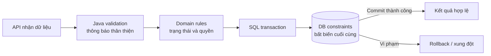

# Ràng buộc duy nhất và tính toàn vẹn dữ liệu

Khi ứng dụng Java ghi đơn hàng, khách hàng hay giao dịch thanh toán vào cơ sở dữ liệu, việc câu lệnh `INSERT` thành công chưa đủ để chứng minh dữ liệu đúng. Hệ thống còn phải bảo đảm **không có hai bản ghi cùng chiếm một định danh bị cấm trùng**, **không tồn tại tham chiếu đến bản ghi không hợp lệ**, **giá trị thuộc miền cho phép** và **những thay đổi liên quan được thực hiện nhất quán**.

Ví dụ, hai yêu cầu đăng ký cùng một mã hội viên có thể đến đồng thời; cả hai đều kiểm tra thấy mã chưa tồn tại trước khi chèn. Nếu không có ràng buộc tại tầng persistence, cơ sở dữ liệu có thể lưu hai khách hàng với cùng mã, dù từng luồng Java đều “đã kiểm tra”.

Bài học thuộc chương **Lược đồ và ràng buộc** của module **DATA_PERSISTENCE_FUNDAMENTALS**. Trong quá trình thiết kế dữ liệu bền vững, lược đồ, truy vấn và chỉ mục cho Java, người học cần hiểu ràng buộc bảo vệ điều gì, giới hạn của chúng, cách xử lý xung đột trong giao dịch và cách thay đổi schema mà vẫn giữ nguyên tính toàn vẹn. Các ví dụ dùng PostgreSQL và SQL quan hệ; cú pháp, khả năng trì hoãn kiểm tra và khóa đồng thời có thể khác ở hệ quản trị khác.

## 1. Biến quy tắc nghiệp vụ thành bất biến dữ liệu

**Bất biến (invariant)** là điều kiện phải đúng ở những thời điểm hệ thống cam kết trạng thái hợp lệ. Chẳng hạn:

- Một `order_id` chỉ biểu diễn một đơn hàng trong phạm vi tenant.
- Một mã đơn do đối tác cấp chỉ ánh xạ đến một đơn nội bộ trong cùng tenant và đối tác.
- Một dòng hàng có số lượng dương và tham chiếu đơn hàng tồn tại.
- Một tài khoản hội viên đang hoạt động không được trùng mã hội viên với tài khoản khác trong phạm vi quy định.
- Một khoản thanh toán có mã giao dịch từ cổng thanh toán không được được ghi nhận hai lần dưới dạng hai giao dịch nghiệp vụ khác nhau.

Để biến các quy tắc này thành thiết kế, cần trả lời:

1. **Quy tắc áp dụng cho đối tượng nào?** Khách hàng, đơn, dòng hàng hay giao dịch?
2. **Phạm vi duy nhất là gì?** Toàn hệ thống, mỗi tenant, mỗi đối tác, mỗi đơn, hay chỉ bản ghi đang hoạt động?
3. **Trạng thái nào phải đáp ứng quy tắc?** Luôn luôn, chỉ khi đã chốt, hay tại cuối transaction?
4. **Ai có thể cùng ghi?** Một request, nhiều thread Java, nhiều instance hay nhiều dịch vụ?
5. **Khi vi phạm sẽ xử lý ra sao?** Từ chối, báo xung đột, đối soát, hoặc thực hiện một thao tác idempotent đã được chứng minh?
6. **Dữ liệu cũ có đáp ứng không?** Quy tắc mới có thể làm migration thất bại dù code mới đã đúng.

Ví dụ “email không được trùng” còn mơ hồ. Cần định nghĩa email **có được rỗng không**, so sánh có phân biệt hoa/thường không, có cho phép cùng email ở hai tenant không, và email của tài khoản đã xóa mềm có được dùng lại không.

> Đặt ràng buộc theo **ngữ nghĩa nghiệp vụ thực tế**. Một index `UNIQUE` trên cột sai có thể ngăn thao tác hợp lệ; thiếu `UNIQUE` trên bộ cột đúng lại để lọt dữ liệu trùng.

## 2. Các lớp toàn vẹn và công cụ bảo vệ

| Lớp toàn vẹn | Câu hỏi | Công cụ thường dùng |
| --- | --- | --- |
| **Định danh thực thể** (*entity integrity*) | Mỗi hàng có khóa không rỗng, không trùng? | `PRIMARY KEY`, ID ổn định |
| **Miền giá trị** (*domain integrity*) | Kiểu, độ dài, khoảng giá trị, trạng thái hợp lệ? | Data type, `NOT NULL`, `CHECK`, domain type |
| **Duy nhất nghiệp vụ** | Có hai hàng cùng sử dụng mã bị cấm trùng? | `UNIQUE`, unique index theo predicate |
| **Toàn vẹn tham chiếu** | Hàng con có tham chiếu đúng hàng cha? | `FOREIGN KEY`, chính sách cập nhật/xóa |
| **Toàn vẹn xuyên hàng** | Một tài nguyên có bị giữ trùng khoảng thời gian? | Ràng buộc đặc thù, exclusion constraint, transaction/locking |
| **Nhất quán giao dịch** | Một thao tác cập nhật nhiều hàng có cùng commit/rollback? | Transaction, isolation và kiểm soát đồng thời |
| **Nhất quán qua dịch vụ** | DB, hàng đợi và hệ thống ngoài có cùng nhìn nhận kết quả? | Outbox, idempotency, trạng thái trung gian và đối soát |
| **Toàn vẹn lịch sử** | Sự kiện, chứng từ và phiên bản có còn truy vết được? | Audit, version, ràng buộc và chính sách lưu giữ |

Ràng buộc **không phải một loại kiểm tra duy nhất**. `CHECK` bảo vệ biểu thức trên hàng; `FOREIGN KEY` bảo vệ quan hệ; `UNIQUE` bảo vệ tính duy nhất; transaction bảo vệ một nhóm thay đổi. Quy tắc không diễn đạt được bằng một constraint đơn giản có thể cần transaction có khóa, trigger, mô hình dữ liệu khác hoặc giao thức nghiệp vụ.

### Phân chia trách nhiệm giữa Java và database



Kiểm tra ở Java nên báo lỗi sớm và giúp người dùng hiểu cách sửa. **Constraint ở database là tuyến bảo vệ cuối** cho mọi đường ghi: API, import, worker, script migration và các instance chạy đồng thời. Không được loại bỏ DB constraint chỉ vì form đã kiểm tra.

Ngược lại, không dùng DB constraint làm cơ chế phân quyền duy nhất; `UNIQUE` không biết người gọi có được phép đặt đơn, và `FOREIGN KEY` không tự kiểm tra quyền truy cập của actor.

## 3. PRIMARY KEY: bất biến nhận diện mỗi hàng

`PRIMARY KEY` xác định một hàng bằng một hoặc nhiều cột. Trong SQL quan hệ, PK áp đặt hai điều kiện: **duy nhất** và **không được NULL** đối với thành phần khóa.

Ví dụ PostgreSQL:

```sql
CREATE TABLE tenants (
    tenant_id UUID PRIMARY KEY,
    name      TEXT NOT NULL
);

CREATE TABLE customers (
    tenant_id   UUID NOT NULL REFERENCES tenants(tenant_id),
    customer_id UUID NOT NULL,
    full_name   TEXT NOT NULL,
    created_at  TIMESTAMPTZ NOT NULL DEFAULT now(),
    PRIMARY KEY (tenant_id, customer_id)
);
```

Đối với bảng `customers`, bộ `(tenant_id, customer_id)` định danh duy nhất một khách hàng. Hai tenant **có thể** dùng cùng giá trị `customer_id` nếu thiết kế thực sự cho phép; hai hàng cùng bộ khóa thì không.

### Khóa kỹ thuật và khóa nghiệp vụ

- **Khóa thay thế** (*surrogate key*) như UUID hoặc sequence thường ổn định và phù hợp làm tham chiếu.
- **Khóa tự nhiên/nghiệp vụ** như mã hội viên được doanh nghiệp cấp có thể có nghĩa ngoài hệ thống.
- Dùng surrogate PK **không loại bỏ** nhu cầu UNIQUE đối với mã nghiệp vụ. Hai hàng có UUID khác nhau vẫn có thể vi phạm quy tắc mã hội viên không trùng.
- Một mã nghiệp vụ chỉ là khóa bền vững nếu nơi cấp bảo đảm tính duy nhất, không đổi và phạm vi rõ ràng.

Không nên dùng email, tên hiển thị hoặc thứ tự dòng CSV làm PK khi các giá trị đó có thể thay đổi hoặc tái sử dụng. Quyết định ID cần phục vụ vòng đời bản ghi, quan hệ FK, API và dữ liệu lịch sử.

## 4. UNIQUE: ngăn trùng theo đúng phạm vi

`UNIQUE` buộc các giá trị khóa của những hàng khác nhau không trùng nhau theo ngữ nghĩa so sánh của DB và các quy tắc `NULL` liên quan.

Giả sử mỗi đối tác có thể cấp một mã đơn duy nhất **trong từng tenant**:

```sql
CREATE TABLE orders (
    tenant_id         UUID NOT NULL,
    order_id          UUID NOT NULL,
    customer_id       UUID NOT NULL,
    source_system     VARCHAR(80) NOT NULL,
    external_order_id VARCHAR(160) NOT NULL,
    status            VARCHAR(24) NOT NULL,
    total_amount      NUMERIC(19, 2) NOT NULL,
    row_version       BIGINT NOT NULL DEFAULT 0,
    created_at        TIMESTAMPTZ NOT NULL DEFAULT now(),

    CONSTRAINT pk_orders
        PRIMARY KEY (tenant_id, order_id),

    CONSTRAINT uq_orders_external_source
        UNIQUE (tenant_id, source_system, external_order_id),

    CONSTRAINT fk_orders_customer
        FOREIGN KEY (tenant_id, customer_id)
        REFERENCES customers (tenant_id, customer_id),

    CONSTRAINT ck_orders_status
        CHECK (status IN ('CREATED', 'CONFIRMED', 'PAID',
                         'CANCELLED', 'REFUNDED')),

    CONSTRAINT ck_orders_total
        CHECK (total_amount >= 0),

    CONSTRAINT ck_orders_version
        CHECK (row_version >= 0)
);
```

Các quy tắc được diễn đạt riêng:

- `PRIMARY KEY (tenant_id, order_id)` bảo vệ identity nội bộ.
- `UNIQUE (tenant_id, source_system, external_order_id)` bảo vệ ánh xạ từ nguồn ngoài.
- `FOREIGN KEY (tenant_id, customer_id)` bảo đảm đơn tham chiếu khách hàng trong đúng tenant.
- `CHECK` bảo vệ trạng thái, số tiền không âm và phiên bản không âm.

Ở ví dụ này `external_order_id` là bắt buộc; nếu một số đơn nội bộ **không có mã ngoài**, cần thay đổi mô hình, ví dụ bảng ánh xạ ngoài riêng với chỉ những hàng có ID nguồn. Không nên điền chuỗi rỗng giả để vượt qua `NOT NULL`.

### Vì sao không chỉ dùng UNIQUE trên một cột?

```text
Tenant T1, Partner A, external_order_id = SO-17
Tenant T1, Partner B, external_order_id = SO-17
Tenant T2, Partner A, external_order_id = SO-17
```

Ba mã ngoài ở trên **có thể cùng tồn tại**. Nếu đặt `UNIQUE(external_order_id)` toàn bảng, hệ thống sẽ từ chối những đơn hợp lệ. Nếu chỉ đặt `UNIQUE(tenant_id, external_order_id)`, lại vô tình cấm hai đối tác thuộc cùng tenant cấp cùng mã. Bộ khóa phải chứa đúng **namespace của nơi cấp mã**.

### UNIQUE constraint và unique index

Trong PostgreSQL, tạo `PRIMARY KEY` hoặc `UNIQUE` constraint thường tạo một unique B-tree index để thực thi kiểm tra. Một `CREATE UNIQUE INDEX` cũng có thể áp đặt uniqueness, đồng thời cho phép các dạng expression hoặc partial predicate mà constraint bảng thông thường không diễn đạt trực tiếp.

Khác biệt quan trọng:

| Khía cạnh | `UNIQUE` constraint | Unique index trực tiếp |
| --- | --- | --- |
| Mục tiêu chính | Diễn đạt bất biến của bảng | Enforce uniqueness và tạo access path |
| Dùng biểu thức như `lower(email)` | Không trực tiếp qua cú pháp cột constraint thông thường | Có |
| Chỉ áp dụng hàng theo điều kiện (*partial*) | Không trực tiếp | Có |
| `DEFERRABLE` | Có trên constraint phù hợp | Unique index độc lập không deferrable |
| Là khóa đích của FK | Theo điều kiện hỗ trợ của DB | PostgreSQL cho phép tham chiếu bộ cột có unique index **không partial**, ngoài PK/UNIQUE phù hợp |
| Tác động hiệu năng | Có index hỗ trợ, tốn chi phí ghi | Có index hỗ trợ, tốn chi phí ghi |

Ở PostgreSQL, khóa mà FK tham chiếu phải đáp ứng các điều kiện về uniqueness và độ khả dụng của index/constraint; **không thể dùng partial unique index làm đích FK** chỉ vì nó duy nhất trên một tập hàng.

## 5. NULL và những trường hợp uniqueness dễ hiểu sai

Trong PostgreSQL mặc định, `UNIQUE` cho phép **nhiều hàng chứa NULL** ở thành phần khóa; các giá trị NULL được xử lý như *không bằng nhau* trong kiểm tra uniqueness theo mặc định.

Ví dụ:

```sql
CREATE TABLE employee_directory (
    employee_id UUID PRIMARY KEY,
    badge_code  TEXT UNIQUE
);

INSERT INTO employee_directory(employee_id, badge_code)
VALUES
    ('11111111-1111-1111-1111-111111111111', NULL),
    ('22222222-2222-2222-2222-222222222222', NULL);
-- Cả hai hàng đều có thể được chấp nhận trong PostgreSQL mặc định.
```

Nếu nghiệp vụ **không cho phép thiếu mã**, dùng `NOT NULL` kết hợp `UNIQUE`. Nếu cho phép thiếu nhưng chỉ muốn có **tối đa một hàng NULL**, PostgreSQL 15+ hỗ trợ:

```sql
CREATE TABLE employee_directory_strict (
    employee_id UUID PRIMARY KEY,
    badge_code  TEXT,
    CONSTRAINT uq_badge UNIQUE NULLS NOT DISTINCT (badge_code)
);
```

`NULLS NOT DISTINCT` khiến những giá trị NULL được xem là bằng nhau khi kiểm tra uniqueness. Cú pháp và semantics này không phổ biến đồng nhất giữa các DB; phải kiểm tra phiên bản/engine.

### CHECK và NULL là câu chuyện khác

Trong PostgreSQL, một `CHECK` được thỏa nếu biểu thức có giá trị **TRUE hoặc UNKNOWN (NULL)**. Chẳng hạn:

```sql
CREATE TABLE inventory_adjustments (
    adjustment_id UUID PRIMARY KEY,
    quantity      INTEGER CHECK (quantity > 0)
);
```

Đoạn trên **vẫn cho phép `quantity = NULL`** vì điều kiện `quantity > 0` trả UNKNOWN. Để buộc luôn là số dương:

```sql
quantity INTEGER NOT NULL CHECK (quantity > 0)
```

Vì thế, `CHECK` không tự thay `NOT NULL`. Khi thiết kế dữ liệu, cần xác định tường minh sự khác nhau giữa *thiếu dữ liệu*, *giá trị chưa biết* và *giá trị không hợp lệ*.

## 6. Unique có điều kiện: tài khoản đang hoạt động và xóa mềm

Một yêu cầu thường gặp: “Trong mỗi tenant, một email chỉ có thể được dùng bởi **một tài khoản đang hoạt động**; tài khoản đã xóa mềm không còn giữ email.”

Một unique index có điều kiện trong PostgreSQL:

```sql
ALTER TABLE customers
ADD COLUMN email TEXT,
ADD COLUMN deleted_at TIMESTAMPTZ;

CREATE UNIQUE INDEX uq_customers_active_email
ON customers (tenant_id, lower(email))
WHERE deleted_at IS NULL AND email IS NOT NULL;
```

Với ví dụ trên:

- Hai hàng đang hoạt động ở **cùng tenant** không thể có email mà `lower(email)` cho kết quả giống nhau.
- Hai tenant có thể sử dụng cùng email.
- Hàng đã xóa mềm không nằm trong tập uniqueness do predicate `deleted_at IS NULL`.
- Hàng không có email bị loại khỏi index do `email IS NOT NULL`.
- Khi **khôi phục** tài khoản đã xóa mềm, thao tác đưa `deleted_at` về NULL vẫn có thể thất bại do trùng email với tài khoản khác đang hoạt động.

**Điều kiện quan trọng:** chuẩn hóa bằng `lower` chỉ phù hợp khi quy tắc so sánh email của sản phẩm thực sự xác định điều đó. Unicode, collation và quy tắc của nhà cung cấp email có thể khiến “trông giống nhau” không đồng nghĩa “cùng danh tính”. Không tự bỏ dấu chấm, phần sau dấu `+` hay ký tự phân biệt mà không có hợp đồng nghiệp vụ rõ ràng.

### Partial unique index không phải khóa tham chiếu tổng quát

Bảng `orders` không thể dùng một FK đến “email đang hoạt động” chỉ vì có partial unique index ở trên: hàng có thể ngừng hoạt động và predicate thay đổi. FK nên trỏ đến ID ổn định, ví dụ `(tenant_id, customer_id)`, thay vì một thuộc tính có thể đổi hoặc bị loại khỏi điều kiện uniqueness.

Nếu sản phẩm quy định **email đã xóa vẫn bị giữ vĩnh viễn**, partial unique index phía trên không đúng. Có thể cần uniqueness trên mọi tài khoản, bảng email đã cấp, tombstone hoặc chính sách lưu giữ khác; phải cân bằng cả quyền riêng tư và khả năng tái sử dụng địa chỉ.

## 7. Composite UNIQUE và dữ liệu có nhiều tenant

Với hệ thống SaaS, uniqueness thường thuộc về **bộ khóa**, không phải một trường đơn lẻ.

| Quy tắc | Khóa phù hợp trong ví dụ | Khóa dễ gây sai |
| --- | --- | --- |
| Mã sản phẩm duy nhất trong tenant | `(tenant_id, sku)` | `sku` toàn hệ thống |
| Mã đơn từ đối tác duy nhất theo nguồn | `(tenant_id, source_system, external_id)` | `external_id` |
| Số thứ tự dòng duy nhất trong đơn | `(tenant_id, order_id, line_no)` | `line_no` |
| Một học viên chỉ có một đăng ký đang hoạt động cho khóa học | Partial unique trên `(tenant_id, student_id, course_id)` | `UNIQUE(student_id, course_id)` thiếu tenant hoặc trạng thái |
| Một giao dịch provider chỉ được ghi một lần | `(provider_account_id, provider_transaction_id)` nếu provider cam kết phạm vi đó | Chỉ `provider_transaction_id` nếu nhiều tài khoản có thể trùng |

**Tính duy nhất không tự bảo đảm phân quyền.** Một `UNIQUE(tenant_id, code)` ngăn trùng mã trong tenant, nhưng API vẫn cần kiểm tra actor có quyền thao tác trên tenant và hàng đó. Khi thiết kế FK, gồm `tenant_id` trong cả hai phía giúp DB bảo vệ quan hệ cùng tenant.

Nếu uniqueness cần áp dụng **toàn cụm** trong hệ thống shard/partition, phải kiểm tra phạm vi constraint mà engine thực thi. Một unique index cục bộ ở mỗi shard không tự ngăn hai shard chứa cùng khóa.

### Partitioned table trong PostgreSQL

Ở PostgreSQL, một `PRIMARY KEY` hoặc `UNIQUE` áp dụng cho **bảng partitioned** có các hạn chế: các cột khóa phân vùng phải nằm trong bộ cột ràng buộc đối với cơ chế partition tương ứng. Lý do là các index vật lý trên các partition riêng lẻ không tự tạo một index toàn cục cho mọi hàng.

Ví dụ bảng partition theo `created_at` có thể gặp khó nếu muốn bảo đảm `order_number` duy nhất toàn bộ lịch sử mà không đưa khóa phân vùng vào uniqueness. Thêm `created_at` vào unique key **thay đổi ngữ nghĩa**: cùng mã đơn ở ngày khác có thể không bị coi là trùng. Khi đó nên cân nhắc bảng đăng ký ID/khóa duy nhất riêng, chiến lược định tuyến hoặc công nghệ hỗ trợ ràng buộc ở phạm vi cần thiết.

## 8. FOREIGN KEY: toàn vẹn tham chiếu giữa các bản ghi

`FOREIGN KEY` buộc một bộ giá trị trong bảng con tham chiếu đến bản ghi tương ứng trong bảng cha có khóa hợp lệ. Trong ví dụ:

```sql
CONSTRAINT fk_orders_customer
    FOREIGN KEY (tenant_id, customer_id)
    REFERENCES customers (tenant_id, customer_id)
```

DB ngăn tạo đơn tham chiếu đến khách hàng không tồn tại trong cùng tenant. Một hàng ở tenant A không thể “mượn” `customer_id` từ tenant B để thỏa FK.

### Không đồng nhất FK với index của cột con

Trong PostgreSQL, tạo FK **không tự tạo index trên cột tham chiếu ở bảng con**. Nếu thường xuyên tìm đơn theo khách, hoặc cần xóa/cập nhật khách, cân nhắc index:

```sql
CREATE INDEX ix_orders_by_customer
ON orders (tenant_id, customer_id, created_at DESC);
```

Index có thể cải thiện truy vấn và kiểm tra liên quan đến FK, nhưng cũng tốn dung lượng và chi phí ghi. Chọn theo query plan và số liệu thực thay vì tạo index cho mọi cột một cách máy móc.

### Chính sách khi bản ghi cha bị xóa

| Chính sách | Ý nghĩa chung | Tình huống cần cân nhắc |
| --- | --- | --- |
| `RESTRICT` / `NO ACTION` | Ngăn thao tác làm vi phạm FK, với khác biệt kiểm tra tùy engine/khả năng defer | Đơn hàng phải giữ liên kết với khách hàng hợp lệ |
| `CASCADE` | Xóa/cập nhật lan sang hàng con theo cấu hình | Các chi tiết chỉ có ý nghĩa khi cha tồn tại |
| `SET NULL` | Xóa liên kết bằng cách đặt cột tham chiếu về NULL | Chỉ phù hợp nếu FK nullable và nghiệp vụ cho phép |
| `SET DEFAULT` | Chuyển liên kết sang giá trị mặc định | Cần có giá trị đích phù hợp và hợp lệ |

Không bật `ON DELETE CASCADE` cho bản ghi thanh toán/audit chỉ để tránh lỗi xóa cha. Dữ liệu cần giữ theo nghĩa vụ pháp lý hoặc phục vụ đối soát thường cần chiến lược lưu trữ/ẩn danh hóa phù hợp.

## 9. CHECK, NOT NULL và tính đúng của miền dữ liệu

Một số quy tắc có thể áp đặt ngay trên một hàng.

Ví dụ các dòng hàng:

```sql
CREATE TABLE order_lines (
    tenant_id      UUID NOT NULL,
    order_id       UUID NOT NULL,
    line_no        INTEGER NOT NULL CHECK (line_no > 0),
    sku            VARCHAR(80) NOT NULL,
    quantity       INTEGER NOT NULL CHECK (quantity > 0),
    unit_price     NUMERIC(19, 2) NOT NULL CHECK (unit_price >= 0),
    PRIMARY KEY (tenant_id, order_id, line_no),
    CONSTRAINT fk_lines_order
        FOREIGN KEY (tenant_id, order_id)
        REFERENCES orders (tenant_id, order_id)
);
```

Các ràng buộc này bảo vệ:

- Dòng hàng phải thuộc một đơn tồn tại.
- Một đơn không có hai dòng cùng `line_no`.
- Số lượng là số nguyên dương.
- Đơn giá thuộc kiểu số thập phân cố định phù hợp và không âm.

Tuy nhiên, tính đúng nghiệp vụ còn gồm:

- `total_amount` trên `orders` có bằng tổng các dòng, thuế, phí, giảm giá được chốt không?
- Có đủ tồn kho để chấp nhận đơn?
- Đơn đã `PAID` có được quay về `CREATED` không?
- Hai lần thanh toán có tạo trùng nghĩa vụ kế toán không?

Các quy tắc này thường liên quan **nhiều hàng hoặc lịch sử trạng thái**, không thể chỉ dùng một `CHECK` trên một hàng.

### Giới hạn của CHECK

Trong PostgreSQL, `CHECK` được thiết kế cho điều kiện trên **hàng hiện tại**. Không dùng subquery hoặc giả định `CHECK` có thể duyệt an toàn các hàng khác để xác định tổng tiền. Có thể dùng transaction và các bảng tổng hợp được cập nhật đồng bộ, trigger hoặc thiết kế khác nếu cần enforce invariant liên hàng.

Nếu `CHECK` gọi hàm do người dùng viết mà hàm thay đổi hành vi theo thời gian, dữ liệu cũ có thể không còn đáp ứng quy tắc mới dù constraint chưa được kiểm tra lại toàn bảng. Nên ưu tiên biểu thức ổn định, định nghĩa version và migration rõ khi thay đổi logic.

## 10. Toàn vẹn xuyên hàng: các khoảng thời gian không chồng nhau

Ràng buộc UNIQUE bảo vệ **bằng nhau** của một bộ khóa, nhưng đôi khi quy tắc là “các khoảng thời gian không được giao nhau”.

Ví dụ đặt phòng: cùng phòng không thể có hai lượt đặt đã xác nhận với khoảng thời gian chồng lấn. Chỉ `UNIQUE(room_id, start_at)` không đủ: hai lịch có giờ bắt đầu khác nhau vẫn có thể đè nhau.

Trong PostgreSQL có thể dùng **exclusion constraint** với loại range và GiST; ví dụ minh họa độc lập với schema đơn hàng:

```sql
-- Cần quyền cài extension trong database đích.
CREATE EXTENSION IF NOT EXISTS btree_gist;

CREATE TABLE room_bookings (
    booking_id UUID PRIMARY KEY,
    room_id    INTEGER NOT NULL,
    during     TSTZRANGE NOT NULL,
    state      TEXT NOT NULL
        CHECK (state IN ('CONFIRMED', 'CANCELLED')),
    CHECK (NOT isempty(during)),
    EXCLUDE USING gist (
        room_id WITH =,
        during WITH &&
    ) WHERE (state = 'CONFIRMED')
);
```

Cấu trúc này dùng toán tử `&&` để kiểm tra khoảng giao nhau và áp dụng ràng buộc cho hàng `CONFIRMED`. Nó giúp chặn các giao dịch đặt chỗ cạnh tranh trong phạm vi mà constraint thực thi. Cần thống nhất biên khoảng `[)`, timezone, khoảng mở/vô hạn, trường hợp đặt lại và chiến lược hủy trước khi dùng thật.

Đây là tính năng cụ thể của PostgreSQL; với DB khác, thiết kế có thể cần khóa tài nguyên và kiểm tra overlap trong transaction ở mức cô lập thích hợp.

## 11. Vì sao kiểm tra ở Java trước INSERT vẫn có thể sai?

Giả sử quy tắc một tenant chỉ có một mã hội viên `VIP-42`.

```text
Thời điểm       Request A                Request B
---------------------------------------------------------------
T1              SELECT exists -> false
T2                                       SELECT exists -> false
T3              INSERT VIP-42
T4                                       INSERT VIP-42
T5              COMMIT                   COMMIT
```

Nếu bảng thiếu constraint, cả hai có thể ghi thành công. Đây là **race condition kiểm tra rồi hành động** (*check-then-act*).

Khi có `UNIQUE(tenant_id, membership_code)`, DB phối hợp kiểm tra uniqueness dưới ghi đồng thời. Một giao dịch có thể phải chờ giao dịch còn lại, và nếu cả hai tranh cùng giá trị thì **không thể cả hai commit** hai hàng vi phạm cùng ràng buộc.

**Không được suy rằng mọi SELECT trước đó đủ để ngăn race**, kể cả khi đã dùng transaction ở mức isolation mặc định. Database constraint là tuyến bảo vệ trực tiếp cho invariant uniqueness.

### Snapshot và uniqueness

Ở PostgreSQL, bản ghi chưa commit có thể không hiển thị trong snapshot thông thường của một giao dịch khác, nhưng kiểm tra unique index vẫn phải tính tới xung đột với giao dịch đồng thời. Vì thế lỗi uniqueness hoặc sự chờ khóa có thể xảy ra dù câu `SELECT` trước đó trả “không có hàng”.

Điều này cũng giải thích vì sao xử lý conflict không đơn thuần là `if (!exists) save`. Cần quyết định theo kết quả `INSERT` thực tế và trạng thái transaction.

## 12. INSERT, ON CONFLICT và giao thức idempotent

Với PostgreSQL, `INSERT ... ON CONFLICT` giúp xử lý tranh chấp trên unique index hoặc constraint khi thao tác INSERT. Ví dụ:

```sql
INSERT INTO orders (
    tenant_id, order_id, customer_id,
    source_system, external_order_id, status, total_amount
)
VALUES (
    :tenant_id, :order_id, :customer_id,
    :source_system, :external_order_id, 'CREATED', :total_amount
)
ON CONFLICT (tenant_id, source_system, external_order_id)
DO NOTHING
RETURNING order_id;
```

- Nếu chèn được, `RETURNING` trả ID của đơn vừa tạo.
- Nếu bỏ qua vì conflict ở bộ khóa đã chỉ định, `RETURNING` không trả hàng.
- `DO NOTHING` **không có nghĩa** request mới có cùng nội dung và cùng ý định với bản ghi trước.
- Sau khi không chèn, ứng dụng cần đọc mapping hiện có và **so sánh các thông tin nghiệp vụ liên quan**; nếu nội dung khác, phải báo xung đột hoặc xử lý theo hợp đồng cập nhật.

**Chi tiết đồng thời:** ở PostgreSQL `READ COMMITTED`, một câu `INSERT ... ON CONFLICT DO NOTHING` có thể không chèn vì xung đột với giao dịch đồng thời mà hàng đó **chưa hiển thị trong snapshot của cùng câu lệnh**. Nếu cần tra bản ghi hiện có, hãy dùng **câu SELECT riêng sau đó**, trong transaction có chính sách isolation/retry được thiết kế phù hợp; không dựa vào một biểu thức SQL lồng ghép sẽ luôn thấy hàng vừa khiến `DO NOTHING`.

### ON CONFLICT DO UPDATE không tự biến lệnh thành đúng nghiệp vụ

Ví dụ cập nhật mù:

```sql
INSERT INTO some_table (business_key, value)
VALUES (:business_key, :value)
ON CONFLICT (business_key)
DO UPDATE SET value = EXCLUDED.value;
```

Câu lệnh hợp lệ về cú pháp nhưng có thể **ghi đè giá trị nghiệp vụ đã chốt** nếu hai request khác nhau dùng cùng `business_key`. Chỉ upsert các trường được phép thay đổi, áp dụng điều kiện version/trạng thái và giữ lịch sử khi cần. Với thanh toán hoặc bút toán, cần xem xét mô hình append-only và nghiệp vụ điều chỉnh, không tùy tiện overwrite.

### Khác biệt giữa uniqueness và idempotency

| Khóa | Nhận diện gì? | Ví dụ |
| --- | --- | --- |
| `order_id` | Một thực thể đơn hàng | Đơn O-17 |
| `(source, external_order_id)` | Ánh xạ mã đơn từ nguồn | Đối tác A, đơn X-100 |
| `idempotency_key` | Một ý định thực hiện lệnh có thể bị gửi lại | Request thanh toán lần đầu và retry |
| `message_id` | Một thông điệp trong luồng xử lý | Event đã được broker giao lại |
| `row_version` | Phiên bản trạng thái của một hàng | Đơn được thay đổi từ v5 lên v6 |

Một đơn có thể nhận nhiều thanh toán hợp lệ hoặc nhiều lần hoàn tiền, tùy nghiệp vụ. Đặt `UNIQUE(order_id)` ở bảng giao dịch thanh toán có thể **cấm thao tác hợp lệ**. Phải định nghĩa uniqueness theo **đơn vị nghiệp vụ** thật sự, ví dụ transaction ID của provider trong namespace của tài khoản provider.

Để retry an toàn, ghi khóa idempotency và fingerprint của request ở nơi bền vững trong thời hạn đủ dài; cùng khóa mà payload khác cần được nhận diện là xung đột. Nhiều hệ thống phải đồng thời dùng unique constraint, idempotency, transaction và đối soát với provider bên ngoài.

## 13. Giao dịch và thời điểm kiểm tra ràng buộc

Nhiều ràng buộc được kiểm tra trong khi thực thi câu lệnh; một số loại có thể được **hoãn đến cuối transaction** (*deferred*), tùy engine và cách khai báo.

Ví dụ PostgreSQL cho một ràng buộc unique có thể trì hoãn:

```sql
CREATE TABLE seat_assignments (
    event_id      UUID NOT NULL,
    attendee_id   UUID NOT NULL,
    seat_number   INTEGER NOT NULL,
    PRIMARY KEY (event_id, attendee_id),
    CONSTRAINT uq_seat_per_event
        UNIQUE (event_id, seat_number)
        DEFERRABLE INITIALLY IMMEDIATE
);
```

Nếu cần **hoán đổi chỗ** cho hai người trong cùng sự kiện, một cập nhật trung gian có thể tạm thời tạo trùng `seat_number`. Trong transaction có thể:

```sql
BEGIN;
SET CONSTRAINTS uq_seat_per_event DEFERRED;

UPDATE seat_assignments
SET seat_number = CASE
    WHEN attendee_id = :attendee_a THEN :seat_b
    WHEN attendee_id = :attendee_b THEN :seat_a
    ELSE seat_number
END
WHERE event_id = :event_id
  AND attendee_id IN (:attendee_a, :attendee_b);

COMMIT;
```

Nếu cuối transaction vẫn có hai người cùng chỗ trong một sự kiện, `COMMIT` thất bại. Cần lưu ý:

- Trong PostgreSQL, `UNIQUE`, `PRIMARY KEY`, `FOREIGN KEY` và `EXCLUDE` có các khả năng deferrable phù hợp; `NOT NULL` và `CHECK` không được trì hoãn theo cùng cách.
- Ràng buộc `DEFERRABLE` không thể được dùng làm bộ phân giải conflict trong `INSERT ... ON CONFLICT` ở PostgreSQL.
- Một constraint `UNIQUE` được tạo qua cú pháp bảng có thể được khai báo deferrable; **unique index trực tiếp** không có tùy chọn tương đương.
- Cần quyết định rõ giao dịch nào được phép có trạng thái trung gian và giữ thời gian transaction ngắn hợp lý.

Đừng dùng deferred constraints để che giấu thao tác ghi thiếu trật tự; nó hữu ích khi nghiệp vụ thực sự cần trạng thái trung gian, nhưng lỗi có thể xuất hiện ở `COMMIT` và Java phải xử lý rollback/response tương ứng.

## 14. Referential integrity và nhiều thao tác trong một giao dịch

Giả sử tạo đơn và dòng hàng:

```sql
BEGIN;

INSERT INTO orders (
    tenant_id, order_id, customer_id,
    source_system, external_order_id, status, total_amount
)
VALUES (
    :tenant_id, :order_id, :customer_id,
    :source_system, :external_order_id, 'CREATED', :total_amount
);

INSERT INTO order_lines (
    tenant_id, order_id, line_no, sku, quantity, unit_price
)
VALUES
    (:tenant_id, :order_id, 1, :sku_a, 2, :price_a),
    (:tenant_id, :order_id, 2, :sku_b, 1, :price_b);

COMMIT;
```

Nếu một dòng hàng vi phạm `CHECK` hoặc FK, toàn bộ giao dịch phải rollback, tránh có một đơn được coi là hoàn tất nhưng thiếu dòng hàng. Với ứng dụng thực, tổng tiền phải được tính và chốt theo quy tắc thuế/giảm giá/làm tròn; schema ở đây chỉ bảo đảm miền giá trị, **chưa tự chứng minh tổng tiền khớp chi tiết**.

### Ghi DB và phát sự kiện

Giao dịch DB không bao trùm một request HTTP đến hệ thống ngoài. Nếu ứng dụng ghi đơn thành công nhưng chết trước khi phát event, dịch vụ downstream có thể không biết đơn đã tạo.

Một mô hình thường dùng là **transactional outbox**: trong cùng transaction, lưu đơn và một hàng sự kiện phải phát. Worker gửi event sau khi commit. Consumer cần chống xử lý trùng vì event có thể được giao lại.

Uniqueness của `event_id` và `processed_message_id` có thể hỗ trợ dedup, nhưng cần được đặt đúng phạm vi consumer và kết hợp với transaction nghiệp vụ. Không ghi trạng thái “đã xử lý” trong transaction riêng trước khi tác dụng nghiệp vụ hoàn tất.

## 15. Java/JDBC: nhận lỗi constraint và rollback đúng

Đoạn mã Java 17 minh họa ghi đơn trong một transaction. Các bảng và ràng buộc tương ứng với schema phía trên.

```java
import javax.sql.DataSource;
import java.math.BigDecimal;
import java.sql.Connection;
import java.sql.PreparedStatement;
import java.sql.SQLException;
import java.util.UUID;

public final class OrderWriter {
    private final DataSource dataSource;

    public OrderWriter(DataSource dataSource) {
        this.dataSource = dataSource;
    }

    public UUID create(
            UUID tenantId,
            UUID customerId,
            String source,
            String externalId,
            BigDecimal total) throws SQLException {

        UUID orderId = UUID.randomUUID();

        String sql = """
                INSERT INTO orders (
                    tenant_id, order_id, customer_id,
                    source_system, external_order_id,
                    status, total_amount
                )
                VALUES (?, ?, ?, ?, ?, 'CREATED', ?)
                """;

        try (Connection connection = dataSource.getConnection()) {
            connection.setAutoCommit(false);
            try {
                try (PreparedStatement statement =
                             connection.prepareStatement(sql)) {
                    statement.setObject(1, tenantId);
                    statement.setObject(2, orderId);
                    statement.setObject(3, customerId);
                    statement.setString(4, source);
                    statement.setString(5, externalId);
                    statement.setBigDecimal(6, total);
                    statement.executeUpdate();
                }

                // Ví dụ gọn chỉ ghi orders; trong thực tế có thể ghi
                // order_lines và outbox trong CÙNG transaction.
                connection.commit();
                return orderId;
            } catch (SQLException error) {
                try {
                    connection.rollback();
                } catch (SQLException rollbackError) {
                    error.addSuppressed(rollbackError);
                }
                throw error;
            }
        }
    }
}
```

Những điểm cần hiểu:

- `PreparedStatement` chuyển tham số an toàn; không ghép dữ liệu đầu vào vào SQL.
- Database xử lý `PRIMARY KEY`, `UNIQUE`, `FOREIGN KEY` và `CHECK` dù phía Java đã xác thực.
- `commit()` có thể phát sinh lỗi, nhất là với deferred constraints; đoạn `catch` bao cả bước commit.
- Nếu phát sinh lỗi trong giao dịch PostgreSQL, cần **rollback** trước khi tái sử dụng transaction/connection.
- `UUID.randomUUID()` tạo ID nội bộ; nó không thay thế ràng buộc uniqueness của `externalId`.
- Ở môi trường Spring, transaction manager có thể đảm nhiệm `commit/rollback`; không tự quản lý connection theo cách trên nếu đã dùng `@Transactional` và connection được framework quản lý.

### Phân loại lỗi để trả API đúng nghĩa

PostgreSQL có SQLSTATE thường gặp:

| SQLSTATE | Loại lỗi | Hướng xử lý |
| --- | --- | --- |
| `23505` | `unique_violation` | Xác định constraint nào vi phạm; có thể trả 409 Conflict hoặc xem xét retry idempotent |
| `23503` | `foreign_key_violation` | Kiểm tra bản ghi liên quan, phạm vi tenant và workflow |
| `23502` | `not_null_violation` | Kiểm tra trường bắt buộc và input mapping |
| `23514` | `check_violation` | Kiểm tra miền giá trị và quy tắc nghiệp vụ |
| `40001` | `serialization_failure` | Có thể retry **toàn bộ transaction** nếu thao tác an toàn để thử lại |
| `40P01` | `deadlock_detected` | Retry toàn bộ transaction theo chính sách giới hạn, đo nguyên nhân |

Không nên ánh xạ mọi lỗi `23505` thành “đơn đã tồn tại”: có thể là conflict trên PK kỹ thuật, unique email hoặc mã nguồn. Khi cần phân biệt, kiểm tra **tên constraint** qua metadata lỗi do driver cung cấp (và quy tắc được phép triển khai), không phân tích chuỗi lỗi theo ngôn ngữ tùy tiện. Không trả nguyên SQL, thông tin index hoặc dữ liệu cá nhân từ exception cho client.

**Retry an toàn:** chỉ retry khi hành động có thể lặp đúng ngữ nghĩa, có giới hạn số lần và cơ chế chống trùng tác dụng. Không retry vô hạn trên lỗi UNIQUE của cùng payload khác nội dung.

## 16. JPA/Hibernate và ranh giới giữa validation và constraint

JPA cho phép khai báo metadata như:

```java
import jakarta.persistence.*;
import java.util.UUID;

@Entity
@Table(
    name = "membership_accounts",
    uniqueConstraints = {
        @UniqueConstraint(
            name = "uq_membership_tenant_code",
            columnNames = {"tenant_id", "membership_code"}
        )
    }
)
public class MembershipAccount {
    @Id
    @Column(name = "account_id", nullable = false)
    private UUID accountId;

    @Column(name = "tenant_id", nullable = false)
    private UUID tenantId;

    @Column(name = "membership_code", nullable = false)
    private String membershipCode;

    protected MembershipAccount() {}
}
```

Metadata mapping **không tự chứng minh** constraint đã tồn tại đúng trên production: điều đó phụ thuộc cách triển khai schema, DDL migration và cấu hình ORM. Trong môi trường thật, nên có migration được kiểm soát, kiểm chứng constraint thực tế và xử lý lỗi tại ranh giới service.

Một số lưu ý:

- `@Column(unique = true)` biểu đạt uniqueness trên một cột cho DDL sinh từ ORM; nó không thay thế migration và có thể sai phạm vi tenant.
- `@Table(uniqueConstraints = ...)` biểu diễn khóa ghép cơ bản, nhưng không thay được mọi partial/expression unique index đặc thù PostgreSQL.
- Bean Validation như `@NotNull`, `@Positive` giúp báo lỗi sớm nhưng không bảo vệ mọi writer và mọi race.
- Exception constraint có thể xảy ra tại `flush()` **hoặc `commit()`**; `save()` của repository chưa nhất thiết thực thi SQL ngay.
- Khi transaction đã bị đánh dấu rollback-only, đừng bắt exception rồi cố commit tiếp; phân tách bước xử lý xung đột ra ngoài transaction đã thất bại.

### Giới hạn minh họa của entity

Đoạn `MembershipAccount` chỉ trình bày metadata uniqueness. Nếu cần FK ghép tenant, khóa chính ghép, trạng thái xóa mềm hoặc version, phải thiết kế entity mapping và DDL nhất quán. Không suy rằng một `@UniqueConstraint` trên hai cột đã hoàn thành cơ chế isolation giữa tenant hoặc authorization cho API.

## 17. Ràng buộc và chỉ mục ảnh hưởng hiệu năng

Bảo toàn toàn vẹn có **chi phí kỹ thuật**, nhưng bỏ constraint thường còn đắt hơn vì dữ liệu sai khó phục hồi.

| Cấu trúc | Chi phí phát sinh | Lợi ích |
| --- | --- | --- |
| PK/UNIQUE index | Dung lượng, ghi index, WAL, kiểm tra xung đột | Bảo vệ identity/uniqueness và tra cứu khóa |
| FK | Kiểm tra tham chiếu khi thay đổi cha/con; có thể gây chờ/lock | Ngăn bản ghi mồ côi và tham chiếu sai |
| CHECK/NOT NULL | Đánh giá điều kiện khi ghi | Chặn giá trị không hợp lệ ở nguồn |
| Partial/expression index | Tính predicate/biểu thức, bảo trì index | Enforce quy tắc có điều kiện, có thể giảm kích thước index |
| Exclusion constraint | Index chuyên biệt và xử lý xung đột | Bảo vệ quy tắc giao nhau/phạm vi |
| Trigger/custom logic | Chi phí thực thi, khó quan sát nếu phức tạp | Enforce quy tắc không biểu đạt đơn giản bằng constraint |

Một unique index vừa là ràng buộc vừa là access path. Nếu truy vấn đã được đáp ứng bởi index do PK/UNIQUE sinh ra, **không tạo thêm chỉ mục trùng** chỉ vì muốn “tăng tốc”.

Chọn thứ tự cột trong composite index/constraint cần xét phạm vi uniqueness **và** mẫu truy vấn. Ví dụ index `(tenant_id, source_system, external_order_id)` hỗ trợ tìm khi có tenant và source; truy vấn chỉ theo `external_order_id` có thể không tận dụng tốt tiền tố. Nếu cần tra cứu khác, có thể phải thêm secondary index phù hợp sau khi đo.

Đối với hệ thống lớn, theo dõi thời gian chờ lock, số lỗi uniqueness, I/O/WAL, độ trễ commit và chi phí index maintenance. Các constraint có thể làm lộ nút thắt contention khi nhiều request tranh cùng khóa; cần giải quyết từ mô hình nghiệp vụ hoặc phân phối tải, không xóa constraint để che vấn đề.

## 18. Thêm constraint vào bảng đã có dữ liệu

Dữ liệu sản xuất có thể đã tồn tại nhiều năm trước khi nhóm phát triển thêm quy tắc uniqueness. Không được giả định chạy `ALTER TABLE ADD UNIQUE` sẽ thành công hoặc không ảnh hưởng thời gian hoạt động.

### 18.1. Khảo sát dữ liệu trùng

Với bảng cũ `legacy_orders` và bộ mã ngoài cần duy nhất:

```sql
SELECT
    tenant_id,
    source_system,
    external_order_id,
    COUNT(*) AS duplicates
FROM legacy_orders
GROUP BY tenant_id, source_system, external_order_id
HAVING COUNT(*) > 1
ORDER BY duplicates DESC;
```

Cần xem xét thêm:

- Các cột khóa có NULL hay chuỗi rỗng không?
- Có ký tự Unicode, khoảng trắng, hoa/thường hoặc mã từ hệ thống ngoài cần chuẩn hóa không?
- Hai hàng trùng mã có thật sự là cùng một thực thể hay là hai thực thể hợp lệ bị dùng chung mã?
- Những FK, thanh toán, audit và outbox nào đang trỏ đến các hàng có thể cần gộp?
- Quy tắc mới áp dụng cho toàn bộ dữ liệu hay chỉ trạng thái còn hoạt động?

**Không tùy tiện xóa bản ghi “trùng”** để làm migration chạy được. Cần quyết định nghiệp vụ, giữ lịch sử và cập nhật các tham chiếu một cách nhất quán.

### 18.2. Thêm unique index có kiểm soát

Ở PostgreSQL, có thể cân nhắc:

```sql
-- Ví dụ trên một bảng legacy, chưa có index tương đương.
-- Chạy ngoài transaction block.
CREATE UNIQUE INDEX CONCURRENTLY uq_legacy_external_order
ON legacy_orders (tenant_id, source_system, external_order_id);
```

`CREATE INDEX CONCURRENTLY` giảm một số loại chặn ghi khi xây chỉ mục, nhưng:

- Vẫn cần tài nguyên CPU/I/O/WAL và có thể kéo dài nếu nhiều transaction đang hoạt động.
- Có thể thất bại nếu dữ liệu trùng còn tồn tại hoặc các ghi mới tạo trùng trong quá trình build.
- Khi lỗi, PostgreSQL có thể để lại **index không hợp lệ**; phải kiểm tra catalog và xử lý theo runbook trước khi retry.
- Không được chạy câu lệnh này trong transaction block.
- Với bộ khóa có cột nullable, uniqueness mặc định vẫn theo semantics NULL; cần chọn chính sách đúng trước khi tạo index.

Nếu index là loại đủ điều kiện (không partial/expression, cấu hình phù hợp), có thể liên kết vào một `UNIQUE` constraint bằng `ALTER TABLE ... ADD CONSTRAINT ... UNIQUE USING INDEX ...`. Không dùng quy trình này cho partial unique index hoặc expression unique index vì chúng không tương thích với cú pháp constraint thông thường.

### 18.3. Bổ sung FK/CHECK cho dữ liệu cũ

PostgreSQL hỗ trợ quy trình `NOT VALID` rồi `VALIDATE CONSTRAINT` đối với một số loại constraint như FK và CHECK:

```sql
-- Ví dụ độc lập trên bảng legacy có các cột liên quan.
ALTER TABLE legacy_order_lines
ADD CONSTRAINT fk_legacy_lines_order
FOREIGN KEY (tenant_id, order_id)
REFERENCES legacy_orders (tenant_id, order_id)
NOT VALID;

-- Sau khi xử lý dữ liệu không hợp lệ:
ALTER TABLE legacy_order_lines
VALIDATE CONSTRAINT fk_legacy_lines_order;
```

Phải bảo đảm bảng cha có khóa được phép tham chiếu là `(tenant_id, order_id)`; nếu thiếu, câu lệnh sẽ lỗi. `NOT VALID` không có nghĩa cho phép mọi ghi mới vi phạm: với FK/CHECK ở PostgreSQL, constraint mới vẫn được enforce cho các thao tác ghi mới phù hợp, còn dữ liệu cũ cần bước validation riêng.

**Không có shortcut tương đương `UNIQUE NOT VALID` chung** để bỏ qua kiểm tra uniqueness cũ trong PostgreSQL; muốn thêm uniqueness mà không làm gián đoạn quá mức, cần xử lý bản ghi trùng và dùng chiến lược xây index/migration phù hợp.

### 18.4. Trình tự triển khai an toàn

1. Chốt quy tắc nghiệp vụ, phạm vi, NULL và dữ liệu lịch sử cần giữ.
2. Chạy truy vấn đo hiện trạng, xác định số xung đột, phân nhóm nguyên nhân.
3. Sửa các writer mới để tuân thủ hợp đồng; vẫn cần lớp bảo vệ chống race trong giai đoạn chuyển đổi.
4. Dọn/đối soát dữ liệu cũ theo batch và kiểm tra tham chiếu.
5. Tạo constraint/index bằng cách hạn chế downtime phù hợp phiên bản DB.
6. Kiểm chứng constraint thực tồn tại, trạng thái index hợp lệ và thử ghi vi phạm có kiểm soát.
7. Theo dõi lỗi phát sinh, lock time, p95 write latency và số bản ghi mới.
8. Gỡ đường ghi tương thích cũ chỉ sau khi bảo đảm mọi producer đã chuyển.

Nếu cần thay khóa chính hoặc uniqueness của dữ liệu partitioned, kế hoạch migration có thể phức tạp hơn; phải kiểm tra từng bảng con, consumer, replication và backup.

## 19. Kiểm tra ràng buộc trong thử nghiệm và vận hành

Một hệ thống có thể có DDL đúng trên máy phát triển nhưng thiếu constraint ở production do migration chưa chạy hoặc bị lỗi. Kiểm chứng phải dựa trên **schema thực tế của môi trường đích**.

### 19.1. Các tình huống kiểm chứng quan trọng

| Thử nghiệm | Kết quả mong đợi |
| --- | --- |
| Chèn hai hàng có cùng bộ UNIQUE trong cùng tenant | Hàng thứ hai bị từ chối hoặc xử lý theo hợp đồng upsert |
| Chèn hai hàng cùng mã nhưng khác tenant/namespace được phép | Cả hai được chấp nhận |
| Chèn khóa NULL hoặc email rỗng | Hành vi đúng theo `NOT NULL`, unique semantics và quy tắc input |
| Chèn order có customer khác tenant | FK ghép từ chối |
| Chèn dòng hàng `quantity <= 0` | CHECK từ chối |
| Hai request cùng chèn một khóa trong cạnh tranh thực | Không tồn tại hai hàng đã commit vi phạm |
| Khôi phục bản ghi đã xóa mềm có email trùng | Partial uniqueness từ chối nếu có xung đột |
| Swap hai seat trong transaction với deferred unique | Commit thành công chỉ khi trạng thái cuối hợp lệ |
| Migration gặp dữ liệu trùng cũ | Phát hiện và xử lý trước khi đánh dấu hoàn tất |
| Restore backup rồi replay event | Uniqueness và FK vẫn nhất quán; retry không sinh bản ghi trùng |

**Đừng viết test chỉ để lặp lại cấu trúc DDL.** Hãy kiểm tra các ranh giới nghiệp vụ dễ sai: hai thread/transaction độc lập, retry sau timeout, NULL, case-folding, soft delete/restore và dữ liệu nhập cũ. Đối với concurrent tests, cần dùng DB thật hoặc môi trường tương đương, vì mock repository không mô phỏng cơ chế uniqueness/locking của database.

### 19.2. Giám sát lỗi integrity

Các chỉ số hữu ích:

- Số lần vi phạm constraint theo tên và nghiệp vụ (không ghi dữ liệu nhạy cảm).
- Tỷ lệ tạo đơn trùng hoặc idempotent retry.
- Số FK violation từ import và worker.
- Tỷ lệ transaction rollback, deadlock và serialization failure.
- Thời gian đợi lock/commit và thay đổi p95/p99 latency ghi.
- Số bản ghi mồ côi phát hiện trong hệ thống chưa có FK, hoặc trong kho dữ liệu ngoài DB.
- Trạng thái migration, unique index invalid và tốc độ backfill.

Tăng lỗi UNIQUE có thể là dấu hiệu **API bị retry nhiều**, lỗi giao thức idempotency hoặc hành vi người dùng thay đổi. Trước khi “giảm lỗi” bằng cách bỏ constraint, phải xác định nguyên nhân ở tầng request và mô hình nghiệp vụ.

### 19.3. Backup, phục hồi và dữ liệu bên ngoài

Backup của một database giao dịch cần phục hồi **cùng thời điểm logic** cho các bảng có FK và mapping. Khôi phục đơn hàng một thời điểm nhưng mapping external ID ở thời điểm khác có thể làm ứng dụng nhận diện nhầm khi replay.

Nếu dữ liệu còn nằm ở object storage, search index hoặc hệ thống ngoài, constraint trong DB không thể tự bảo đảm consistency xuyên những nơi đó. Cần ràng buộc nguồn chân lý, cơ chế đối soát và tái tạo projection. RPO/RTO cũng phải được kiểm chứng bằng restore thật, bao gồm các bảng trạng thái idempotency và outbox.

## 20. Bài tập tình huống: đăng ký khóa học cho nhiều tenant

Một nền tảng học trực tuyến quản lý `students`, `courses` và `enrollments`. Yêu cầu:

- Mỗi học viên thuộc một tenant.
- Mỗi khóa học thuộc một tenant.
- Một học viên chỉ được có **một đăng ký đang hoạt động** trên mỗi khóa học; đăng ký đã hủy có thể được tạo lại như một lần đăng ký mới.
- Một đăng ký có ngày bắt đầu và trạng thái; API có thể bị retry.
- Phải ngăn đăng ký học viên tenant A vào khóa học tenant B.

Thiết kế PostgreSQL minh họa:

```sql
CREATE TABLE students (
    tenant_id UUID NOT NULL,
    student_id UUID NOT NULL,
    display_name TEXT NOT NULL,
    PRIMARY KEY (tenant_id, student_id)
);

CREATE TABLE courses (
    tenant_id UUID NOT NULL,
    course_id UUID NOT NULL,
    title TEXT NOT NULL,
    PRIMARY KEY (tenant_id, course_id)
);

CREATE TABLE enrollments (
    tenant_id UUID NOT NULL,
    enrollment_id UUID NOT NULL,
    student_id UUID NOT NULL,
    course_id UUID NOT NULL,
    state TEXT NOT NULL
        CHECK (state IN ('ACTIVE', 'CANCELLED', 'COMPLETED')),
    enrolled_at TIMESTAMPTZ NOT NULL DEFAULT now(),
    PRIMARY KEY (tenant_id, enrollment_id),
    FOREIGN KEY (tenant_id, student_id)
        REFERENCES students (tenant_id, student_id),
    FOREIGN KEY (tenant_id, course_id)
        REFERENCES courses (tenant_id, course_id)
);

-- Chỉ một đăng ký ACTIVE cho mỗi học viên và khóa học
-- trong cùng tenant.
CREATE UNIQUE INDEX uq_active_enrollment
ON enrollments (tenant_id, student_id, course_id)
WHERE state = 'ACTIVE';
```

**Phân tích:**

1. PK `(tenant_id, enrollment_id)` nhận diện một lần đăng ký cụ thể, kể cả khi đã hủy.
2. FK ghép với tenant ngăn tham chiếu chéo tổ chức.
3. Partial unique index ngăn hai lần đăng ký `ACTIVE` cùng học viên/khóa học trong một tenant.
4. Nếu cần chặn `ACTIVE` và `COMPLETED` cùng lúc, predicate `state = 'ACTIVE'` **không đủ**; phải định nghĩa lại quy tắc.
5. Khi hủy một đăng ký, hàng cũ vẫn có thể giữ lịch sử; một đăng ký mới có ID mới có thể được tạo.
6. API retry cùng một yêu cầu nên có khóa idempotency hoặc cơ chế nhận diện ý định, ngoài uniqueness của trạng thái hiện tại.
7. Nếu đổi trạng thái `CANCELLED → ACTIVE`, DB sẽ kiểm tra partial unique index và từ chối khi đã có đăng ký ACTIVE khác.
8. Nếu cần kiểm soát học phí, tiến độ hoặc thời gian học giữa nhiều bảng, cần transaction và quy tắc bổ sung.

### Câu hỏi tự kiểm tra

1. Vì sao `UNIQUE(order_id)` trên bảng payment có thể là ràng buộc sai, dù có vẻ “chống thanh toán trùng”?
2. Khi nào `UNIQUE(tenant_id, external_id)` thiếu thông tin phạm vi?
3. Vì sao `UNIQUE(email)` mặc định không cấm nhiều `NULL` trong PostgreSQL?
4. Khi muốn email không rỗng và không trùng, cần kết hợp những ràng buộc nào?
5. Partial unique index cho bản ghi đang hoạt động có hệ quả gì khi khôi phục bản ghi đã xóa mềm?
6. Vì sao `CHECK(quantity > 0)` có thể không từ chối `NULL`?
7. FK ghép tenant ngăn được lỗi nào mà FK chỉ trên local ID có thể bỏ sót?
8. Vì sao hai request cùng thấy `exists == false` vẫn có thể tranh chấp ở `INSERT`?
9. `ON CONFLICT DO NOTHING` có chứng minh nội dung của hai request giống nhau không?
10. Điều gì khác nhau giữa constraint `UNIQUE DEFERRABLE` và unique index trực tiếp ở PostgreSQL?
11. Khi nào cần exclusion constraint thay vì UNIQUE?
12. Vì sao không thể áp dụng `CHECK` đơn giản để bảo vệ tổng tiền của nhiều dòng hàng?
13. Khi thêm UNIQUE cho bảng cũ có hàng trùng, cần khảo sát và xử lý điều gì?
14. `CREATE UNIQUE INDEX CONCURRENTLY` có thể thất bại theo cách nào và cần kiểm tra gì sau lỗi?
15. Tại sao lỗi constraint có thể xảy ra ở bước `commit()` của Java thay vì `save()`?
16. Làm thế nào thử nghiệm cạnh tranh hai transaction mà không dựa vào mock repository?
17. Vì sao biết khóa chính của đơn không có nghĩa người dùng được phép đọc đơn đó?
18. Khi phục hồi và replay event, các bảng mapping/idempotency cần có đặc điểm gì để không tạo dữ liệu trùng?

**Bài tập mở rộng:** với schema `enrollments`, bổ sung một lần **đăng ký giữ chỗ** có thời hạn 15 phút. Thiết kế cách tránh hai request chiếm cùng suất cuối cùng của khóa học, làm sạch giữ chỗ hết hạn, xử lý retry và đồng bộ trạng thái thanh toán. Giải thích phần nào có thể diễn đạt bằng UNIQUE/CHECK/FK, phần nào cần transaction và kiểm soát đồng thời ở nghiệp vụ.

Ràng buộc duy nhất và tính toàn vẹn dữ liệu là nền tảng để một hệ thống persistence **bảo vệ sự thật nghiệp vụ ngay tại nơi lưu**. `PRIMARY KEY`, `UNIQUE`, `NOT NULL`, `CHECK` và `FOREIGN KEY` giữ những bất biến khác nhau; transaction, isolation và xử lý conflict giúp các bất biến đó đứng vững trước nhiều luồng ghi đồng thời. Khi thiết kế đúng phạm vi uniqueness, xác định ý nghĩa của NULL và trạng thái, kiểm tra dữ liệu cũ trước migration và xử lý lỗi trong Java một cách có chủ đích, nhóm phát triển sẽ giảm dữ liệu trùng, tránh tham chiếu sai và có cơ sở tin cậy để truy vấn, sao lưu, phục hồi và tiến hóa schema.
