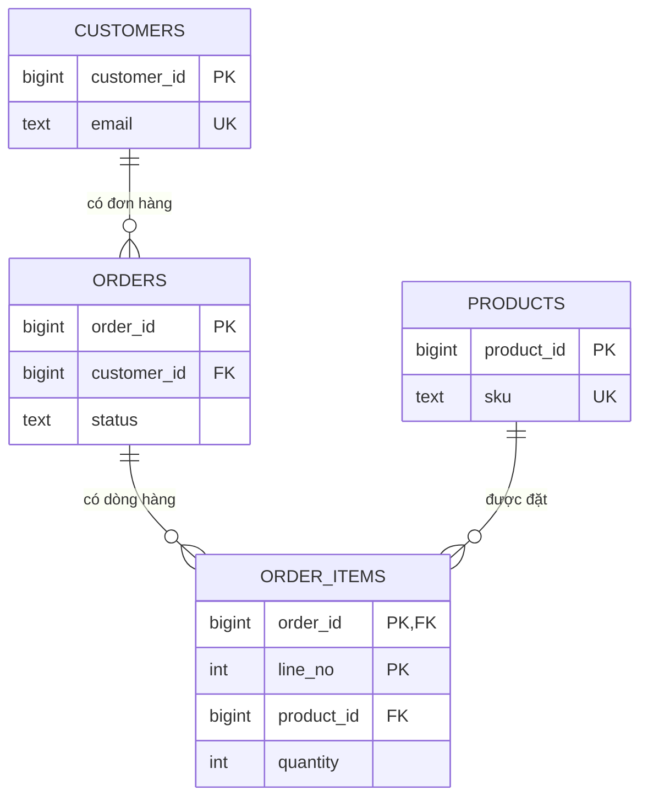

# Khóa chính, khóa ngoại và kiểm tra điều kiện

Một hệ thống có thể viết đúng câu lệnh `INSERT` và `UPDATE` nhưng vẫn lưu dữ liệu sai: hai đơn hàng trùng mã, một đơn hàng tham chiếu khách hàng không tồn tại, hoặc một dòng hàng có số lượng âm. **Ràng buộc dữ liệu (constraints)** đặt những điều kiện bắt buộc ngay tại ranh giới lưu trữ, giúp bảo vệ dữ liệu cả khi có nhiều chương trình, nhiều luồng hoặc nhiều phiên giao dịch cùng ghi.

Trong chương **Lược đồ và ràng buộc** của `DATA_PERSISTENCE_FUNDAMENTALS`, bài học tập trung vào ba nhóm nền tảng của cơ sở dữ liệu quan hệ: **khóa chính (PRIMARY KEY)** định danh bản ghi, **khóa ngoại (FOREIGN KEY)** bảo vệ quan hệ giữa các bản ghi và **điều kiện kiểm tra (CHECK)** giới hạn giá trị hợp lệ. Những ràng buộc này cần được thiết kế cùng với kiểu dữ liệu, `NOT NULL`, `UNIQUE`, giao dịch, chỉ mục và ranh giới persistence trong ứng dụng Java.

Các ví dụ SQL sử dụng **PostgreSQL** để minh họa cụ thể. Ý tưởng áp dụng rộng rãi cho cơ sở dữ liệu quan hệ, nhưng cú pháp, khả năng trì hoãn kiểm tra ràng buộc, cách xử lý `NULL` và thao tác thay đổi schema có thể khác giữa PostgreSQL, MySQL, SQL Server, Oracle hoặc SQLite.

## Mục tiêu học tập

Sau bài này, bạn có thể:

- Giải thích ý nghĩa và phạm vi bảo đảm của `PRIMARY KEY`, `FOREIGN KEY`, `CHECK`, `UNIQUE` và `NOT NULL`.
- Chọn khóa tự nhiên, khóa thay thế hoặc khóa ghép phù hợp với dữ liệu và thao tác truy cập.
- Xác định quan hệ cha–con, các hành vi khi xóa/cập nhật bản ghi cha và chỉ mục cần thiết.
- Viết ràng buộc `CHECK` đúng với ngữ nghĩa ba giá trị của SQL, đặc biệt khi trường có thể nhận `NULL`.
- Phân biệt bất biến trong một hàng với bất biến xuyên hàng/bảng cần giao dịch hoặc cơ chế bổ sung.
- Đưa lỗi ràng buộc về phản hồi nghiệp vụ an toàn trong Java và triển khai thay đổi schema trên dữ liệu đang tồn tại.

## 1. Vì sao phải kiểm tra dữ liệu ngay trong cơ sở dữ liệu?

Giả sử API kiểm tra khách hàng tồn tại trước khi tạo đơn:

```text
Yêu cầu A: SELECT customer WHERE id = 42  → có khách hàng
Yêu cầu B: DELETE customer WHERE id = 42  → xóa khách hàng
Yêu cầu A: INSERT order(customer_id = 42)  → dữ liệu mồ côi nếu không có FK
```

Đoạn logic "kiểm tra rồi ghi" ở ứng dụng có **khoảng trống đồng thời** (*time-of-check to time-of-use*). Một dịch vụ khác, job nhập dữ liệu hoặc phiên giao dịch song song có thể thay đổi dữ liệu ở giữa hai bước. Dựa riêng vào validation của DTO hoặc ORM không bảo đảm dữ liệu giữ được tính đúng đắn ở mọi đường ghi.

Ràng buộc ở cơ sở dữ liệu giúp bảo vệ **data integrity** trong phạm vi mà hệ quản trị hỗ trợ, kể cả khi có cập nhật đồng thời. Tuy nhiên, chúng không thay thế mọi quy tắc nghiệp vụ, kiểm tra quyền, tính đúng đắn khi tích hợp nhiều dịch vụ hay chiến lược phục hồi khi mất kết nối.

Có thể hình dung ba câu hỏi cốt lõi:

| Ràng buộc | Câu hỏi nó trả lời | Ví dụ |
|---|---|---|
| `PRIMARY KEY` | Bản ghi này là bản ghi **nào**, và có bị trùng định danh không? | `orders.order_id` |
| `FOREIGN KEY` | Bản ghi được tham chiếu có **tồn tại hợp lệ** không? | `orders.customer_id → customers.customer_id` |
| `CHECK` | Giá trị của **hàng này** có thỏa điều kiện hợp lệ không? | `order_items.quantity > 0` |
| `NOT NULL` | Trường bắt buộc đã có giá trị chưa? | `orders.customer_id IS NOT NULL` |
| `UNIQUE` | Giá trị hoặc tổ hợp giá trị có bị trùng không? | `products.sku` |

## 2. Khóa chính (PRIMARY KEY): định danh một hàng

**Khóa chính** là một cột hoặc nhóm cột có giá trị xác định duy nhất mỗi hàng trong bảng. Trong hệ quan hệ thông thường, khóa chính đồng thời bảo đảm **duy nhất** và **không `NULL`**. Mỗi bảng có nhiều nhất một ràng buộc `PRIMARY KEY`, nhưng khóa đó có thể gồm nhiều cột.

```sql
CREATE TABLE customers (
    customer_id bigint GENERATED ALWAYS AS IDENTITY,
    email       text NOT NULL,
    CONSTRAINT pk_customers PRIMARY KEY (customer_id),
    CONSTRAINT uq_customers_email UNIQUE (email),
    CONSTRAINT ck_customers_email_nonblank CHECK (btrim(email) <> '')
);
```

Trong ví dụ này, `customer_id` là khóa chính được hệ quản trị sinh giá trị, còn `email` là **khóa ứng viên/định danh nghiệp vụ được yêu cầu duy nhất**. Một khách hàng đổi email vẫn giữ nguyên `customer_id`, vì vậy các đơn hàng đã tạo không cần thay khóa tham chiếu. Ví dụ cố ý đơn giản hóa chính sách chuẩn hóa email; phân biệt chữ hoa/chữ thường, địa chỉ quốc tế và quy tắc trùng email là quyết định nghiệp vụ riêng, không được suy ra chỉ từ `UNIQUE(email)`.

### Khóa tự nhiên, khóa thay thế và khóa ghép

| Kiểu khóa | Ví dụ | Điểm mạnh | Lưu ý |
|---|---|---|---|
| Khóa tự nhiên (*natural key*) | Mã SKU ổn định do nghiệp vụ quản lý | Dễ hiểu, có ý nghĩa với nghiệp vụ | Có thể thay đổi, bị tái sử dụng hoặc chịu quy tắc chuẩn hóa phức tạp |
| Khóa thay thế (*surrogate key*) | `customer_id` số tự tăng, UUID | Ổn định, ít phụ thuộc thông tin nghiệp vụ | Vẫn cần `UNIQUE` cho giá trị nghiệp vụ không được trùng |
| Khóa ghép (*composite key*) | `(order_id, line_no)` | Diễn đạt sự duy nhất **trong phạm vi cha** | Mọi tham chiếu đến hàng con có thể cần nhiều cột |

Khóa thay thế **không tự động chống trùng nghiệp vụ**. Chẳng hạn, có thể tạo hai sản phẩm khác `product_id` nhưng cùng `sku` nếu không bổ sung ràng buộc `UNIQUE(sku)`.

Khóa ghép hữu ích khi một giá trị chỉ duy nhất bên trong một ngữ cảnh. Dòng số 1 của đơn hàng A và dòng số 1 của đơn hàng B là hai bản ghi khác nhau; khóa `(order_id, line_no)` thể hiện đúng điều đó.

### Khóa chính và chỉ mục

Trong PostgreSQL, khai báo `PRIMARY KEY` tạo chỉ mục B-tree duy nhất để thực thi ràng buộc. Điều này giúp tra cứu theo khóa, nhưng **không có nghĩa mọi truy vấn đều được tối ưu**. Truy vấn thường xuyên lọc theo `customer_id` và sắp `created_at` có thể cần một chỉ mục khác. Cũng không nên đồng nhất thứ tự khóa chính với thứ tự vật lý cố định của hàng trên đĩa.

## 3. Khóa ngoại (FOREIGN KEY): bảo vệ tính toàn vẹn tham chiếu

**Khóa ngoại** là một cột hoặc nhóm cột ở bảng con tham chiếu đến khóa phù hợp ở bảng cha, thường là `PRIMARY KEY` hoặc `UNIQUE`. Khi giá trị tham chiếu **khác `NULL`** và ràng buộc được áp dụng, hệ quản trị không cho tồn tại quan hệ trỏ đến hàng cha không hợp lệ.

Trong hệ thống đặt hàng:



Một khách hàng có thể có nhiều đơn, một đơn có nhiều dòng, và một sản phẩm có thể xuất hiện trong nhiều dòng của nhiều đơn. Ký hiệu `PK,FK` của `order_id` trong `ORDER_ITEMS` cho thấy cùng một cột có thể vừa là **thành phần khóa chính ghép** vừa là **khóa ngoại**.

### Hành vi khi xóa hoặc cập nhật bản ghi cha

Ràng buộc khóa ngoại cần chính sách khi hàng cha được `DELETE` hoặc khóa cha được `UPDATE`:

| Hành vi | Ý nghĩa | Khi nào nên cân nhắc |
|---|---|---|
| `NO ACTION` | Không cho phép vi phạm tham chiếu tại thời điểm kiểm tra; ở PostgreSQL có thể được trì hoãn nếu constraint được khai báo `DEFERRABLE` | Mặc định hợp lý khi muốn kiểm soát quan hệ trong giao dịch |
| `RESTRICT` | Chặn thao tác gây mất tham chiếu; trong PostgreSQL không thể trì hoãn tác động này | Không cho xóa khách hàng còn đơn hàng cần lưu giữ |
| `CASCADE` | Xóa/cập nhật khóa cha kéo theo thay đổi tương ứng ở hàng con | Dữ liệu con hoàn toàn phụ thuộc vòng đời cha và việc xóa là có chủ đích |
| `SET NULL` | Gán khóa ngoại con về `NULL` sau khi xóa/cập nhật cha | Quan hệ là tùy chọn và cột cho phép `NULL` |
| `SET DEFAULT` | Đặt giá trị mặc định cho khóa ngoại con | Giá trị mặc định vẫn phải đáp ứng quan hệ tham chiếu |

**Cẩn trọng với `ON DELETE CASCADE` trong dữ liệu nghiệp vụ.** Xóa một khách hàng không nên mặc nhiên xóa lịch sử đơn hàng hoặc hóa đơn chỉ vì thuận tiện khi viết SQL. Chính sách lưu giữ và yêu cầu kiểm toán phải được xác định trước. `SET NULL` không phù hợp nếu `customer_id` được khai báo `NOT NULL`. Với dữ liệu đã được lập hóa đơn hoặc thanh toán, nhiều hệ thống dùng hủy/ẩn theo trạng thái thay vì xóa vật lý.

Trong PostgreSQL, một khóa ngoại có thể dùng `NO ACTION DEFERRABLE INITIALLY DEFERRED` khi cần trì hoãn kiểm tra đến cuối giao dịch. Khả năng này có giới hạn riêng theo sản phẩm: không nên hiểu mọi loại ràng buộc hoặc mọi hành vi `ON DELETE` đều trì hoãn được.

### Có khóa ngoại là đã có chỉ mục trên bảng con?

**Không nhất thiết.** PostgreSQL yêu cầu khóa ở bảng được tham chiếu đủ điều kiện duy nhất và có cấu trúc hỗ trợ kiểm tra, nhưng **không tự động tạo chỉ mục trên cột khóa ngoại ở bảng con**. Khi xóa/cập nhật cha, hoặc khi `JOIN` và lọc theo khóa ngoại, thiếu chỉ mục ở bảng con có thể khiến hệ quản trị phải đọc nhiều hàng.

Ví dụ, nếu thường tra đơn theo khách hàng và thời gian, chỉ mục `(customer_id, created_at DESC)` trên `orders` có ích. Với `order_items`, khóa chính `(order_id, line_no)` đã bắt đầu bằng `order_id`, nên một chỉ mục bổ sung chỉ cho `order_id` có thể dư thừa; còn lọc theo `product_id` có thể cần chỉ mục riêng. Cần kiểm tra kế hoạch thực thi và tác động đến ghi trước khi thêm chỉ mục.

## 4. CHECK: giới hạn điều kiện hợp lệ trên hàng

`CHECK` buộc một biểu thức điều kiện phải thỏa quy tắc của SQL khi thêm hoặc sửa hàng. Trong PostgreSQL, hàng bị từ chối khi biểu thức `CHECK` cho kết quả **FALSE**; kết quả **TRUE** hoặc **UNKNOWN** (`NULL` trong phép so sánh) đều không vi phạm `CHECK`.

```sql
CREATE TABLE products (
    product_id    bigint GENERATED ALWAYS AS IDENTITY,
    sku           text NOT NULL,
    list_price    numeric(14, 2) NOT NULL,
    available_qty integer NOT NULL DEFAULT 0,
    CONSTRAINT pk_products PRIMARY KEY (product_id),
    CONSTRAINT uq_products_sku UNIQUE (sku),
    CONSTRAINT ck_products_list_price CHECK (list_price >= 0),
    CONSTRAINT ck_products_available_qty CHECK (available_qty >= 0)
);
```

`CHECK (available_qty >= 0)` bảo đảm một hàng sản phẩm không lưu tồn kho âm. `numeric(14,2)` biểu diễn số thập phân chính xác ở mức độ phù hợp để lưu tiền với hai chữ số sau dấu thập phân trong ví dụ; ứng dụng phải có quy tắc tiền tệ, thuế, làm tròn và dải giá trị riêng.

### Cạm bẫy: `CHECK` không đồng nghĩa với `NOT NULL`

Xét bảng sau:

```sql
CREATE TABLE check_demo (
    quantity integer,
    CONSTRAINT ck_quantity_positive CHECK (quantity > 0)
);

-- Lệnh này được chấp nhận trong PostgreSQL:
INSERT INTO check_demo (quantity) VALUES (NULL);
```

Vì `NULL > 0` cho kết quả **UNKNOWN**, `CHECK` không chặn hàng đó. Nếu số lượng là bắt buộc, phải viết:

```sql
quantity integer NOT NULL CHECK (quantity > 0)
```

Đồng thời phân biệt `0`, `NULL`, chuỗi rỗng và giá trị không có trường; chúng có ý nghĩa khác nhau tùy kiểu dữ liệu và nghiệp vụ. Ví dụ `CHECK (status IN ('DRAFT', 'PAID'))` cũng cho phép `NULL` nếu `status` không có `NOT NULL`.

### CHECK làm tốt và không làm tốt việc gì?

`CHECK` thích hợp cho bất biến **trong một hàng**, ví dụ số lượng dương, giá không âm, `started_at < ended_at` hay trạng thái thuộc tập được phép. Nó **không phải công cụ trực tiếp** để kiểm tra tổng tiền của một đơn bằng tổng các dòng hàng khác, kiểm tra số ghế đã bán ở nhiều hàng hoặc xác thực sự tồn tại của khóa ở bảng khác.

Trong PostgreSQL, biểu thức `CHECK` được thiết kế để phụ thuộc vào dữ liệu của chính hàng; không dùng truy vấn con để kiểm tra các hàng khác. Tránh phụ thuộc vào hàm tùy ý có kết quả thay đổi theo thời gian hoặc dữ liệu ngoài hàng: PostgreSQL giả định biểu thức kiểm tra ổn định với cùng dữ liệu, và dữ liệu cũ có thể không được tự kiểm tra lại khi hành vi hàm thay đổi.

Ví dụ lịch hẹn muốn bảo đảm `starts_at < ends_at` dùng `CHECK` hợp lý; nhưng điều kiện **không có hai lịch hẹn trùng giờ trong cùng một phòng** cần thiết kế khác, như ràng buộc `EXCLUDE` trên khoảng thời gian của PostgreSQL nếu phù hợp, hoặc chiến lược khóa/giao dịch. Chỉ dùng `CHECK` cho thời gian bắt đầu/kết thúc không giải quyết việc trùng lịch giữa nhiều hàng.

## 5. Thiết kế lược đồ đơn hàng hoàn chỉnh

Giả sử ứng dụng cần: một khách hàng đặt nhiều đơn; mỗi đơn chứa nhiều dòng hàng; dòng hàng ghi sản phẩm, số lượng và giá tại thời điểm mua. Dùng khóa thay thế cho `customers`, `products`, `orders`, khóa ghép `(order_id, line_no)` cho `order_items`. Chúng ta đã tạo `customers` và `products` ở trên; phần tiếp theo tạo `orders` và `order_items`:

```sql
CREATE TABLE orders (
    order_id     bigint GENERATED ALWAYS AS IDENTITY,
    customer_id  bigint NOT NULL,
    status       text NOT NULL DEFAULT 'DRAFT',
    created_at   timestamptz NOT NULL DEFAULT now(),
    CONSTRAINT pk_orders PRIMARY KEY (order_id),
    CONSTRAINT fk_orders_customer FOREIGN KEY (customer_id)
        REFERENCES customers (customer_id) ON DELETE RESTRICT,
    CONSTRAINT ck_orders_status CHECK (
        status IN ('DRAFT', 'PLACED', 'PAID', 'CANCELLED')
    )
);

CREATE TABLE order_items (
    order_id    bigint NOT NULL,
    line_no     integer NOT NULL,
    product_id  bigint NOT NULL,
    quantity    integer NOT NULL,
    unit_price  numeric(14, 2) NOT NULL,
    CONSTRAINT pk_order_items PRIMARY KEY (order_id, line_no),
    CONSTRAINT fk_order_items_order FOREIGN KEY (order_id)
        REFERENCES orders (order_id) ON DELETE RESTRICT,
    CONSTRAINT fk_order_items_product FOREIGN KEY (product_id)
        REFERENCES products (product_id) ON DELETE RESTRICT,
    CONSTRAINT ck_order_items_line_no CHECK (line_no > 0),
    CONSTRAINT ck_order_items_quantity CHECK (quantity > 0),
    CONSTRAINT ck_order_items_unit_price CHECK (unit_price >= 0)
);

CREATE INDEX idx_orders_customer_created
    ON orders (customer_id, created_at DESC);

CREATE INDEX idx_order_items_product
    ON order_items (product_id);
```

Các quyết định quan trọng:

1. `orders.order_id` là định danh ổn định, độc lập với khách hàng và ngày đặt.
2. `orders.customer_id NOT NULL` cùng `fk_orders_customer` buộc mọi đơn có một khách hàng hợp lệ. Nếu cho phép đơn của khách vãng lai, phải thiết kế chủ đơn hoặc quan hệ tùy chọn rõ ràng thay vì bỏ `NOT NULL` tùy tiện.
3. `order_items` có **khóa chính ghép**: một đơn không có hai dòng cùng `line_no`, nhưng nhiều đơn có thể có dòng số 1.
4. `unit_price` lưu **ảnh chụp giá bán của dòng hàng**. `products.list_price` có thể thay đổi sau khi đặt đơn; khóa ngoại đến sản phẩm không thay thế dữ liệu lịch sử này.
5. `ON DELETE RESTRICT` thể hiện quyết định giữ lịch sử. Xóa một đơn đang có dòng hàng hoặc một sản phẩm từng được mua sẽ bị chặn; quy trình xóa, ẩn hoặc lưu trữ dữ liệu cần được xây riêng.

`CHECK` ở `orders.status` chỉ giới hạn **tập giá trị**, không bảo đảm trình tự chuyển trạng thái. Ví dụ, `PAID → DRAFT` vẫn có thể được database chấp nhận nếu chỉ có constraint này. Quy tắc chuyển trạng thái cần lệnh nghiệp vụ có điều kiện, trigger hoặc một cơ chế nhất quán khác.

### Kết quả khi vi phạm ràng buộc

Giả sử đã có đơn `order_id = 100` và sản phẩm `product_id = 20` trong dữ liệu thử nghiệm:

```sql
-- Sai CHECK: số lượng phải dương.
INSERT INTO order_items
    (order_id, line_no, product_id, quantity, unit_price)
VALUES (100, 1, 20, -2, 750000.00);

-- Sai FK nếu product_id = 999999 không tồn tại.
INSERT INTO order_items
    (order_id, line_no, product_id, quantity, unit_price)
VALUES (100, 2, 999999, 1, 750000.00);

-- Sai PK nếu (100, 1) đã tồn tại.
INSERT INTO order_items
    (order_id, line_no, product_id, quantity, unit_price)
VALUES (100, 1, 20, 1, 750000.00);
```

Ba lệnh trên là **các tình huống kiểm tra độc lập**, không phải một script có thể chạy nối tiếp mà không xử lý lỗi. PostgreSQL sẽ đặt transaction vào trạng thái lỗi sau một câu lệnh thất bại bên trong transaction, cần `ROLLBACK` hoặc `ROLLBACK TO SAVEPOINT` trước khi thử câu kế tiếp. Lệnh thứ ba chỉ vi phạm khóa chính nếu tổ hợp `(100,1)` đã thực sự có hàng; thứ tự kiểm tra lỗi có thể phụ thuộc dữ liệu hiện tại.

## 6. Quan hệ nhiều cột và dữ liệu đa khách hàng (multi-tenant)

Trong ứng dụng có nhiều tổ chức dùng chung cơ sở dữ liệu, mỗi dự án có thể dùng `project_id` chỉ duy nhất trong phạm vi tổ chức. Viết FK chỉ trên `project_id` có thể tham chiếu nhầm dự án của tổ chức khác, ngay cả khi bản thân dự án có tồn tại.

```sql
CREATE TABLE tenant_projects (
    tenant_id  bigint NOT NULL,
    project_id bigint NOT NULL,
    name       text NOT NULL,
    PRIMARY KEY (tenant_id, project_id)
);

CREATE TABLE tenant_tasks (
    tenant_id  bigint NOT NULL,
    task_id    bigint NOT NULL,
    project_id bigint NOT NULL,
    title      text NOT NULL,
    PRIMARY KEY (tenant_id, task_id),
    CONSTRAINT fk_task_project_within_tenant
        FOREIGN KEY (tenant_id, project_id)
        REFERENCES tenant_projects (tenant_id, project_id)
);
```

Nhờ khóa ngoại **ghép** `(tenant_id, project_id)`, một task trong tổ chức A không thể trỏ đến dự án chỉ có trong tổ chức B. Dù vậy, FK **không kiểm tra người dùng có quyền truy cập tổ chức A hay không**. Phân quyền vẫn phải được áp dụng ở API/query và, nếu thích hợp, chính sách bảo mật cấp hàng như PostgreSQL Row Level Security.

Trong khóa ngoại ghép cho phép `NULL`, PostgreSQL mặc định dùng `MATCH SIMPLE`: nếu bất kỳ thành phần khóa tham chiếu là `NULL`, hàng có thể không phải đối chiếu đầy đủ với hàng cha. Vì vậy, ví dụ dùng `NOT NULL` cho cả hai thành phần; các quan hệ tùy chọn cần quy tắc rõ ràng, có thể cân nhắc `MATCH FULL` tùy mô hình.

## 7. Ranh giới của ràng buộc và vai trò giao dịch

Một constraint chỉ bảo vệ điều nó được khai báo. Ví dụ, `CHECK (available_qty >= 0)` giữ tồn kho không âm, nhưng không tự bảo đảm đơn hàng đã đặt đúng số hàng hoặc không bị trừ kho hai lần.

### Cập nhật tồn kho có điều kiện

Ứng dụng nhận yêu cầu mua 3 đơn vị sản phẩm. Tránh mô hình “đọc số lượng 5 về Java, trừ 3 và ghi lại 2” khi có nhiều luồng cùng đặt, vì cả hai luồng có thể đều đọc 5 và ghi đè nhau. Có thể dùng một lệnh SQL kiểm tra và cập nhật trên cùng hàng:

```sql
-- Câu lệnh minh họa; 42 là product_id ví dụ.
UPDATE products
SET available_qty = available_qty - 3
WHERE product_id = 42
  AND available_qty >= 3;
```

Ứng dụng cần kiểm tra **số hàng được cập nhật**: `0` nghĩa là không tìm thấy sản phẩm hoặc số lượng còn lại không đủ; `1` nghĩa là thao tác thành công trên hàng đó. Trong hệ quan hệ hỗ trợ transaction phù hợp, lệnh cập nhật có điều kiện được đồng bộ với các thay đổi đồng thời theo cơ chế khóa/MVCC của hệ quản trị. Khi thao tác đặt hàng còn tạo đơn và dòng hàng, hãy đặt các bước cần nhất quán **trong cùng transaction**, có chiến lược xử lý deadlock, timeout và retry cho đúng tính chất của lệnh.

### Những bất biến không thể biểu diễn bằng CHECK một hàng

| Quy tắc nghiệp vụ | Vì sao PK/FK/CHECK đơn giản chưa đủ | Cơ chế thường cần thêm |
|---|---|---|
| Tổng tiền đơn = tổng giá × số lượng các dòng | So sánh dữ liệu ở nhiều hàng | Tính toán trong giao dịch, lock/version, hoặc trigger nhất quán |
| Một phòng không có hai lịch đặt trùng giờ | Phải so sánh các khoảng thời gian ở nhiều hàng | Exclusion constraint phù hợp (PostgreSQL) hoặc chiến lược khóa/giao dịch |
| Đơn `PAID` không được quay về `DRAFT` | `CHECK` trên trạng thái hiện tại không biết trạng thái trước | `UPDATE ... WHERE status = ...`, state machine, kiểm soát đồng thời |
| Không cho bán vượt tồn kho | Nhiều giao dịch cùng trừ số lượng | Cập nhật số lượng có điều kiện hoặc đặt chỗ với locking phù hợp |
| Một đơn phải có ít nhất một dòng khi xác nhận | Hàng cha phải kiểm tra tập hàng con | Quy trình xác nhận trong transaction; trigger nếu thực sự cần |

`UNIQUE` cũng là ràng buộc quan trọng để loại bỏ một dạng lỗi đồng thời: hai phiên cùng kiểm tra “email chưa tồn tại” rồi cùng `INSERT`. Một chỉ mục/constraint duy nhất của cơ sở dữ liệu sẽ ngăn trùng, còn logic **kiểm tra trước** ở ứng dụng vẫn hữu ích để đưa thông báo sớm nhưng không thay thế được `UNIQUE`.

Đối với hệ thống phân tán, FK của một cơ sở dữ liệu không tự mở rộng qua hai dịch vụ hoặc hai database độc lập. Khi đơn hàng nằm ở service A còn khách hàng nằm ở service B, cần xác định danh tính nguồn, quy tắc xác thực tham chiếu, xử lý sự kiện cập nhật/xóa và cơ chế đối soát khi dữ liệu đến trễ. Không thể dùng FK nội bộ làm bằng chứng rằng trạng thái ngoài database luôn nhất quán.

## 8. Tích hợp Java: để database kiểm tra, ứng dụng giải thích lỗi

Trong Java, validation ở API và domain vẫn có tác dụng phát hiện sớm các lỗi dễ hiểu như số lượng bằng 0. Tuy nhiên, kết quả ghi vào database mới là điểm quyết định cuối cùng khi có nhiều tác nhân cùng thao tác. **Không được coi `SELECT` kiểm tra tồn tại là thay thế cho FK/UNIQUE**.

Ví dụ JDBC với PostgreSQL, giả sử `customers` và `products` đã có bản ghi hợp lệ. Phương thức sau tạo đơn nháp và một dòng hàng trong **một transaction**:

```java
import java.math.BigDecimal;
import java.sql.Connection;
import java.sql.PreparedStatement;
import java.sql.ResultSet;
import java.sql.SQLException;
import javax.sql.DataSource;

final class OrderWriter {
    private final DataSource dataSource;

    OrderWriter(DataSource dataSource) {
        this.dataSource = dataSource;
    }

    long createDraftOrder(
        long customerId, long productId, int quantity, BigDecimal unitPrice
    ) throws SQLException {
        // Kiểm tra sớm để thông báo rõ; DB vẫn thực thi CHECK/FK cuối cùng.
        if (quantity <= 0 || unitPrice == null || unitPrice.signum() < 0) {
            throw new IllegalArgumentException("Dòng hàng không hợp lệ");
        }

        try (Connection connection = dataSource.getConnection()) {
            connection.setAutoCommit(false);
            try {
                long orderId;
                try (PreparedStatement statement = connection.prepareStatement(
                    "INSERT INTO orders (customer_id, status) " +
                    "VALUES (?, 'DRAFT') RETURNING order_id"
                )) {
                    statement.setLong(1, customerId);
                    try (ResultSet rows = statement.executeQuery()) {
                        if (!rows.next()) {
                            throw new SQLException("Không nhận được order_id");
                        }
                        orderId = rows.getLong(1);
                    }
                }

                try (PreparedStatement statement = connection.prepareStatement(
                    "INSERT INTO order_items " +
                    "(order_id, line_no, product_id, quantity, unit_price) " +
                    "VALUES (?, ?, ?, ?, ?)"
                )) {
                    statement.setLong(1, orderId);
                    statement.setInt(2, 1);
                    statement.setLong(3, productId);
                    statement.setInt(4, quantity);
                    statement.setBigDecimal(5, unitPrice);
                    statement.executeUpdate();
                }

                connection.commit();
                return orderId;
            } catch (SQLException failure) {
                try {
                    connection.rollback();
                } catch (SQLException rollbackFailure) {
                    failure.addSuppressed(rollbackFailure);
                }
                throw failure;
            }
        }
    }
}
```

Đoạn này dùng `RETURNING order_id` của PostgreSQL; nếu đổi database, cần thay bằng cú pháp trả khóa được hỗ trợ hoặc API lấy generated keys. `PreparedStatement` gắn tham số theo kiểu dữ liệu, tránh ghép SQL từ đầu vào người dùng. Transaction được `commit` khi cả hai `INSERT` thành công; nếu có lỗi SQL thì rollback để không tạo đơn nháp thiếu dòng. Ứng dụng production còn cần xác thực người dùng, giới hạn số lượng, timeout, retry có kiểm soát và quản lý trạng thái connection trong pool.

### Diễn giải lỗi ràng buộc thành lỗi nghiệp vụ

PostgreSQL có **SQLSTATE** cho các nhóm lỗi toàn vẹn:

| SQLSTATE | Loại lỗi | Phản hồi nghiệp vụ điển hình |
|---|---|---|
| `23505` | Vi phạm `UNIQUE` hoặc `PRIMARY KEY` | Mã/giá trị đã tồn tại; xử lý trùng hoặc xung đột |
| `23503` | Vi phạm `FOREIGN KEY` | Thực thể được tham chiếu không tồn tại hoặc không thể xóa cha |
| `23514` | Vi phạm `CHECK` | Giá trị không thuộc miền hợp lệ |
| `23502` | Vi phạm `NOT NULL` | Thiếu thông tin bắt buộc |

Trong Java có thể đọc `SQLException.getSQLState()` để phân nhóm, sau đó kiểm tra **tên constraint** hoặc ngữ cảnh thao tác để ánh xạ đúng trường và lỗi; cùng SQLSTATE `23503` có thể xuất hiện khi tạo đơn với khách hàng không tồn tại hoặc khi xóa khách hàng còn đơn. Một số driver cho phép lấy thêm thông tin có cấu trúc về constraint; tránh phụ thuộc vào việc cắt chuỗi thông báo lỗi do database trả về. Trả thông báo an toàn cho API, không công khai SQL hoặc dữ liệu nhạy cảm trong thông báo cho khách hàng.

Không phải mọi lỗi JDBC đều có thể thử lại: lỗi `CHECK`, `UNIQUE`, `NOT NULL` do dữ liệu sai sẽ không được chữa bằng cách gửi lại y hệt. Lỗi deadlock/serialization hoặc mất kết nối cần quy tắc riêng; nếu client không biết lần ghi trước đã commit hay chưa, phải dùng khóa idempotency hoặc kiểm tra trạng thái trước khi phát lại thao tác có tác dụng phụ.

## 9. Tiến hóa schema trên dữ liệu đang hoạt động

Tạo constraint ở bảng mới tương đối đơn giản; thêm ràng buộc vào bảng có hàng triệu bản ghi cần kế hoạch riêng. Nếu dữ liệu hiện có vi phạm, lệnh thêm constraint có thể thất bại hoặc phải kiểm tra dữ liệu rất lâu.

Quy trình thay đổi nên gồm:

1. **Khảo sát dữ liệu hiện tại.** Tìm khóa trùng, khóa ngoại mồ côi, trường `NULL`, giá trị vượt giới hạn hoặc trạng thái lạ. Đo số lượng và phân loại nguyên nhân, không sửa mù quáng.
2. **Thống nhất hợp đồng mới.** Quy định từ phiên bản ứng dụng nào sẽ ghi dữ liệu hợp lệ; đồng bộ cấu hình, validation và migration.
3. **Chọn cách bổ sung constraint phù hợp engine.** Với bảng lớn cần cân nhắc thời gian khóa, tải ghi và khả năng chạy lặp lại an toàn.
4. **Làm sạch dữ liệu cũ.** Dùng quy trình có log, kiểm tra và khả năng khôi phục; giữ lịch sử khi nghiệp vụ yêu cầu.
5. **Xác minh và giám sát.** Kiểm tra constraint đã được xác thực và truy vấn thường gặp không bị chậm bất thường; theo dõi lỗi phát sinh sau triển khai.

### Ví dụ PostgreSQL: thêm CHECK theo hai bước

Giả sử giới hạn nghiệp vụ mới là mỗi dòng hàng đặt tối đa 1.000 sản phẩm, còn bảng `order_items` đã có dữ liệu. Có thể dùng `NOT VALID` cho `CHECK` để thêm ràng buộc trước, sau đó sửa dữ liệu cũ và xác thực:

```sql
ALTER TABLE order_items
ADD CONSTRAINT ck_order_items_quantity_upper_bound
CHECK (quantity <= 1000) NOT VALID;

-- Tìm các hàng cũ đang vi phạm chính sách mới.
SELECT order_id, line_no, quantity
FROM order_items
WHERE quantity > 1000;

-- Sau khi xử lý các trường hợp cũ theo quy tắc nghiệp vụ:
ALTER TABLE order_items
VALIDATE CONSTRAINT ck_order_items_quantity_upper_bound;
```

Trong PostgreSQL, constraint `CHECK ... NOT VALID` vẫn được áp dụng cho các hàng **mới hoặc được cập nhật** sau khi thêm; bước `VALIDATE CONSTRAINT` kiểm tra các hàng cũ và sẽ thất bại nếu còn vi phạm. Cách này cũng có thể dùng với **một số khóa ngoại**; không có nghĩa `NOT VALID` áp dụng như nhau cho mọi loại constraint. Đặc biệt, xây `UNIQUE`/`PRIMARY KEY` trên dữ liệu cũ đòi hỏi xử lý trùng và cơ chế triển khai riêng, có thể liên quan đến tạo index và thời gian khóa.

Với FK trên bảng lớn, cần kiểm tra chỉ mục ở **bảng tham chiếu** và các truy vấn thực tế, đồng thời quản lý đúng thứ tự chuyển đổi ứng dụng và dữ liệu. Không nên tắt ràng buộc tùy tiện khi nhập dữ liệu rồi để dữ liệu sai tồn tại trong hệ thống hoạt động.

## 10. Những lỗi thiết kế thường gặp

| Thiết kế hoặc giả định | Điều có thể xảy ra | Cách xử lý |
|---|---|---|
| Chỉ dùng `id` tự sinh, bỏ `UNIQUE` cho mã nghiệp vụ | Hai sản phẩm cùng SKU hoặc hai yêu cầu tạo cùng một mã | Khai báo uniqueness cho định danh nghiệp vụ thực sự phải duy nhất |
| `CHECK (quantity > 0)` nhưng cho `NULL` | Hàng `quantity = NULL` vẫn qua kiểm tra | Kết hợp `NOT NULL` với `CHECK` |
| Tin rằng FK luôn tạo index ở bảng con | `JOIN`/xóa cha chậm khi con có nhiều hàng | Xem execution plan và tạo index có ích trên cột FK |
| `ON DELETE CASCADE` với dữ liệu lịch sử | Xóa cha kéo theo xóa đơn/hóa đơn ngoài ý muốn | Chọn chính sách vòng đời, thường là `RESTRICT` hoặc lưu trữ mềm |
| Kiểm tra tồn tại hoặc trùng bằng `SELECT` trước rồi mới `INSERT` | Hai transaction chạy đồng thời vượt qua kiểm tra | Dùng constraint, xử lý lỗi và transaction đúng |
| Dùng `CHECK` để bảo vệ số liệu nhiều hàng | Tổng tiền, tồn kho hoặc lịch phòng vẫn sai | Dùng cơ chế giao dịch/lock và constraint phù hợp |
| FK chỉ trên `project_id` trong hệ multi-tenant | Có thể trỏ đến dự án thuộc tenant khác | Dùng khóa tham chiếu ghép `(tenant_id, project_id)` phù hợp |
| Thay đổi constraint trực tiếp mà chưa kiểm tra dữ liệu cũ | Migration thất bại hoặc khóa bảng quá lâu | Khảo sát dữ liệu, triển khai theo giai đoạn, đo ảnh hưởng |

## 11. Bài tập vận dụng

Hệ thống quản lý phòng họp cần lưu `rooms`, `bookings` và `users`. Mỗi phòng thuộc một văn phòng, mỗi booking ghi người đặt, phòng, thời gian bắt đầu/kết thúc, số người và trạng thái. Các yêu cầu:

- Mỗi booking có ID riêng; mỗi phòng có mã phòng duy nhất **trong cùng văn phòng**.
- Booking phải tham chiếu người đặt và phòng còn hợp lệ.
- `starts_at` phải trước `ends_at`; `attendee_count` phải dương.
- Không được có hai booking đang có hiệu lực chồng lấn thời gian trong cùng phòng.
- Khi nhân viên nghỉ việc, hệ thống vẫn phải giữ lịch sử booking cho mục đích kiểm toán.

Hãy thực hiện các bước:

1. Đề xuất `PRIMARY KEY` của mỗi bảng, một hoặc nhiều `UNIQUE` cần thiết và lý do dùng khóa tự nhiên hay khóa thay thế.
2. Viết `FOREIGN KEY` từ `bookings` sang `rooms` và `users`; chọn `ON DELETE` và giải thích tại sao.
3. Viết `NOT NULL` và `CHECK` cho khoảng thời gian, số người và trạng thái.
4. Chỉ ra quy tắc **không chồng lấn booking** có thể giải quyết bằng `CHECK` đơn giản hay không. Đề xuất cơ chế bổ sung phù hợp với PostgreSQL hoặc transaction có kiểm soát đồng thời.
5. Giả sử bảng đã có 20 triệu booking, mô tả cách bổ sung quy tắc mới `attendee_count <= 100` mà vẫn kiểm soát được dữ liệu cũ và tải hệ thống.

**Gợi ý tự kiểm tra:** `(office_id, room_code)` là ứng viên `UNIQUE` cho mã phòng theo văn phòng. `CHECK (starts_at < ends_at)` chỉ so sánh trường của **một** booking. Giữ lịch sử người đặt có thể cần `ON DELETE RESTRICT`, cơ chế vô hiệu hóa tài khoản hoặc thông tin snapshot, tùy chính sách dữ liệu. Khi chọn giải pháp chống chồng lấn, luôn kiểm tra trường hợp **hai người đặt cùng lúc**.

## Ghi nhớ

`PRIMARY KEY` xác định duy nhất một hàng, `FOREIGN KEY` giữ quan hệ tham chiếu hợp lệ, còn `CHECK` giới hạn các giá trị hợp lệ của từng hàng. `NOT NULL` và `UNIQUE` bổ sung những bảo đảm thiết yếu mà ba ràng buộc trên không luôn thay thế được. Chúng là một phần của **hợp đồng persistence**: cần chọn khóa theo nghiệp vụ, hiểu tác động khi xóa cha, bảo vệ các bất biến xuyên hàng bằng giao dịch hoặc cơ chế phù hợp, xử lý vi phạm rõ ràng trong Java và triển khai thay đổi schema theo cách kiểm chứng được trên dữ liệu đang hoạt động.
