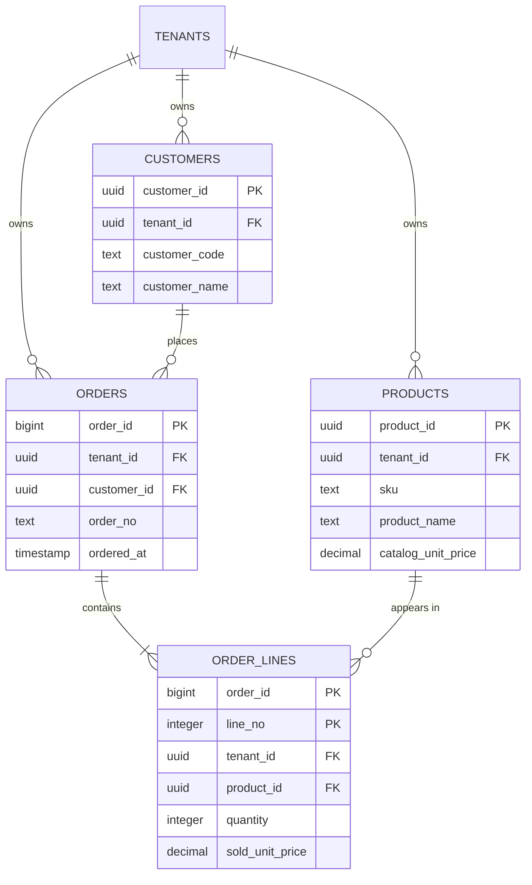

# Chuẩn hóa và giảm lặp dữ liệu ở mức nền tảng

## Mục tiêu học tập

Sau bài học này, bạn có thể:

1. Giải thích vì sao lặp cùng một **sự thật nghiệp vụ** tại nhiều hàng làm phát sinh lỗi cập nhật, thêm và xóa dữ liệu.
2. Đọc một bảng dữ liệu, nhận diện **phụ thuộc hàm**, **khóa ứng viên** và ranh giới giữa các thực thể.
3. Vận dụng **dạng chuẩn thứ nhất (1NF), thứ hai (2NF), thứ ba (3NF)** trong tình huống thực tế; nhận biết khi nào cần cân nhắc dạng chuẩn Boyce–Codd (BCNF).
4. Tách bảng thành những quan hệ có thể ghép lại đúng, bảo vệ tính toàn vẹn bằng **PRIMARY KEY, UNIQUE, FOREIGN KEY, NOT NULL, CHECK**.
5. Thiết kế repository Java truy vấn dữ liệu đã chuẩn hóa bằng phép JOIN, tránh cả lỗi dữ liệu và truy vấn N+1 không cần thiết.
6. Phân biệt **lặp dữ liệu có hại** với **bản chụp lịch sử hoặc bản đọc được nhân bản có chủ đích**, và biết cách kiểm soát mỗi lựa chọn.
7. Lập kế hoạch chuyển đổi schema với dữ liệu đang tồn tại, giao dịch, chỉ mục, giám sát và khả năng phục hồi.

Đây là bài thuộc chương **Lược đồ và ràng buộc** của module **DATA_PERSISTENCE_FUNDAMENTALS**. Trọng tâm là nền tảng thiết kế lưu trữ bền vững cho ứng dụng Java: chọn mô hình dữ liệu, xác định ranh giới persistence, tổ chức bảng, tối ưu truy vấn, bảo đảm giao dịch và tính đúng đắn khi schema thay đổi. Các ví dụ dùng PostgreSQL để minh họa SQL; khái niệm chuẩn hóa là của mô hình quan hệ và cần được vận dụng theo khả năng hệ quản trị thực tế.

## 1. Vì sao cần chuẩn hóa?

Giả sử mỗi dòng sản phẩm trong đơn hàng được lưu chung trong một bảng lớn:

| tenant_id | order_no | line_no | ordered_at | customer_code | customer_name | product_sku | product_name | quantity | sold_unit_price |
| --- | --- | ---: | --- | --- | --- | --- | --- | ---: | ---: |
| T1 | SO-100 | 1 | 2026-11-20 | C01 | An Phát | P10 | Bàn làm việc | 1 | 1500000 |
| T1 | SO-100 | 2 | 2026-11-20 | C01 | An Phát | P20 | Ghế văn phòng | 2 | 650000 |
| T1 | SO-101 | 1 | 2026-11-21 | C01 | An Phát | P10 | Bàn làm việc | 1 | 1500000 |
| T2 | SO-100 | 1 | 2026-11-21 | C01 | Minh Đức | P10 | Bàn họp | 1 | 2400000 |

Bảng này vẫn có thể hữu ích làm dữ liệu xuất báo cáo, nhưng là lựa chọn rủi ro nếu nó trở thành nơi **duy nhất giữ mọi thông tin gốc**.

- **Bất thường cập nhật (update anomaly):** khách `C01` của tenant `T1` đổi tên. Nếu tên khách nằm ở nhiều dòng đơn, sửa thiếu một dòng khiến một khách có nhiều tên hiện tại khác nhau.
- **Bất thường thêm (insert anomaly):** muốn thêm sản phẩm `P30` vào danh mục nhưng chưa có đơn hàng. Nếu mọi thông tin phải nằm trong dòng đơn, việc thêm sản phẩm bị phụ thuộc vào một đơn không tồn tại.
- **Bất thường xóa (delete anomaly):** xóa dòng đơn cuối cùng dùng `P20` có thể đồng thời làm mất thông tin duy nhất về sản phẩm ấy.
- **Lãng phí lưu trữ và truyền tải:** tên khách, tên sản phẩm, thời điểm đặt đơn bị lặp theo số dòng đơn. Tải ghi và công sức kiểm tra tính đúng đắn tăng theo số bản sao.

**Chuẩn hóa (normalization)** là cách tổ chức các quan hệ dựa trên ý nghĩa và phụ thuộc dữ liệu nhằm giảm những bất thường này. Mục tiêu quan trọng hơn “cắt nhỏ bảng” là **một sự thật được quản lý nhất quán tại nơi có trách nhiệm sở hữu nó**.

Không phải mọi giá trị giống nhau ở nhiều bảng đều là trùng lặp có hại. Ví dụ `sold_unit_price` của dòng đơn là **đơn giá lúc bán**, còn giá trong danh mục là **giá hiện hành**: hai thông tin mang ý nghĩa thời gian khác nhau và có thể đều cần được lưu.

## 2. Khái niệm cốt lõi: khóa và phụ thuộc hàm

### 2.1. Khóa nhận diện một hàng

Một **superkey** là tập thuộc tính có thể phân biệt mọi hàng trong quan hệ. **Khóa ứng viên (candidate key)** là superkey tối thiểu: bỏ bất kỳ thuộc tính nào cũng không còn bảo đảm duy nhất. Một khóa ứng viên được chọn làm **PRIMARY KEY**, các khóa ứng viên khác có thể được bảo vệ bằng `UNIQUE`.

Trong bảng dòng đơn thô, nếu quy tắc nghiệp vụ là “mỗi dòng được đánh số duy nhất bên trong một đơn của một tenant” thì:

```text
(tenant_id, order_no, line_no) -> đúng một dòng đơn
```

Đó là một khóa ghép có ý nghĩa. Riêng `order_no` không duy nhất toàn hệ thống vì tenant `T1` và `T2` đều có thể đặt mã `SO-100`.

Nếu sau này thêm `order_id` toàn cục làm khóa kỹ thuật, **quy tắc duy nhất của `(tenant_id, order_no)` vẫn cần ràng buộc riêng**. Thêm một ID không tự bảo vệ các khóa nghiệp vụ.

### 2.2. Phụ thuộc hàm (functional dependency)

Ký hiệu `X → Y` nghĩa là: theo quy tắc dữ liệu, **hai hàng có cùng giá trị X phải có cùng giá trị Y**. Đây là một ràng buộc ngữ nghĩa của dữ liệu, không chỉ là tương quan tình cờ trong vài bản ghi hiện tại.

Các phụ thuộc giả định trong ví dụ:

```text
(tenant_id, order_no)          -> ordered_at, customer_code
(tenant_id, customer_code)     -> customer_name
(tenant_id, product_sku)       -> product_name
(tenant_id, order_no, line_no) -> product_sku, quantity, sold_unit_price
```

Chúng chỉ đúng nếu nghiệp vụ xác nhận: mã khách không bị tái sử dụng cho khách khác trong cùng tenant, mã sản phẩm là duy nhất trong tenant, thời điểm đặt hàng là thuộc tính của **đơn**, và mỗi dòng có đúng một đơn giá lúc bán.

Nếu mã khách có thể đổi, hoặc cùng mã sản phẩm được tái sử dụng qua các thời kỳ, cần xem xét ID ổn định hơn và mô hình hiệu lực theo thời gian. Không nên áp một phụ thuộc hàm chỉ vì dữ liệu mẫu “trông có vẻ” khớp.

### 2.3. Sự phụ thuộc không tự biến mất nhờ đổi tên cột

Đổi `customer_name` thành `display_name`, thêm một `id` tăng dần hoặc đưa tất cả cột vào JSON vẫn không giải quyết vấn đề nếu nhiều hàng tiếp tục giữ bản sao độc lập của **tên khách hiện tại**. Phải điều chỉnh **nơi dữ liệu được quản lý, ràng buộc và cập nhật**.

## 3. Dạng chuẩn thứ nhất (1NF): mỗi thuộc tính có miền giá trị xác định

Ở mức nền tảng, 1NF yêu cầu một quan hệ gồm các hàng và các thuộc tính có giá trị theo miền xác định, không coi “nhóm cột lặp” hay “danh sách tùy ý trong một ô” là các cột con độc lập của cùng quan hệ.

Ví dụ thiết kế khó truy vấn:

```text
orders:
order_no | product_1 | qty_1 | product_2 | qty_2 | product_3 | qty_3
SO-100   | P10       | 1     | P20       | 2     | NULL      | NULL
```

Những câu hỏi xuất hiện ngay: nếu một đơn có 4 dòng thì làm thế nào? Tìm mọi đơn chứa `P10` cần tìm ở bao nhiêu cột? Ràng buộc FK tới sản phẩm đặt ở đâu? Dạng hợp lý hơn là quan hệ một đơn có nhiều dòng:

```text
orders(order_id, order_no, ...)
order_lines(order_id, line_no, product_id, quantity, ...)
```

Một dòng sản phẩm trở thành một hàng có khóa rõ ràng, không cần tự thêm `product_4`, `qty_4` cho đơn tiếp theo.

**Lưu ý về tính “nguyên tử”:** khái niệm nguyên tử phụ thuộc vào **miền dữ liệu và phép toán cần hỗ trợ**. Một chuỗi địa chỉ, một số điện thoại hay một giá trị JSON không tự động làm bảng vi phạm 1NF chỉ vì có thể tách nó thành nhiều phần. Tuy nhiên, nếu ứng dụng thường xuyên lọc, nối, ràng buộc và cập nhật độc lập các thành phần bên trong, thiết kế các cột/bảng có cấu trúc sẽ giúp kiểm soát tốt hơn. Tránh dùng câu “1NF cấm hoàn toàn JSON/array” như một luật máy móc áp cho mọi hệ quản trị.

## 4. Dạng chuẩn thứ hai (2NF): không phụ thuộc vào một phần khóa ứng viên

**2NF** yêu cầu đã đạt 1NF và mọi thuộc tính không thuộc khóa ứng viên phải phụ thuộc **đầy đủ vào toàn bộ mỗi khóa ứng viên**, thay vì chỉ vào một tập con thực sự của khóa ứng viên ghép.

Với khóa ứng viên của bảng thô:

```text
(tenant_id, order_no, line_no)
```

thời điểm đặt đơn `ordered_at` và mã khách `customer_code` lại chỉ cần:

```text
(tenant_id, order_no)
```

Tức là một **phần** của khóa ghép đã xác định được thông tin đầu đơn. Vì vậy đặt các thuộc tính ấy lặp trong từng dòng sản phẩm tạo phụ thuộc bộ phận (*partial dependency*) và bất thường cập nhật.

Tách dữ liệu thành:

```text
orders:
  (tenant_id, order_no) -> ordered_at, customer_code

order_lines:
  (tenant_id, order_no, line_no) -> product_sku, quantity, sold_unit_price
```

Khi một đơn có mười dòng, `ordered_at` được lưu một lần ở bảng đầu đơn, không phải mười lần. Dòng đơn chỉ giữ dữ liệu riêng của dòng và khóa tham chiếu đến đơn.

**Một điểm dễ nhầm:** nếu bảng có khóa ứng viên gồm đúng một cột, nó không thể vi phạm 2NF vì phụ thuộc vào *một phần không rỗng của khóa đơn*; nhưng vẫn có thể vi phạm 3NF. Thêm cột `row_id` làm PK đơn vì thế không tự động chuẩn hóa các phụ thuộc nghiệp vụ vốn có. Khi phân tích dạng chuẩn, phải xét **các khóa ứng viên thực sự**, không chỉ PK kỹ thuật được thêm sau.

## 5. Dạng chuẩn thứ ba (3NF): loại phụ thuộc bắc cầu gây lặp

**3NF** đi xa hơn: thông tin về một thực thể không nên được nhân bản qua thực thể khác chỉ vì hai thực thể có liên hệ.

Sau khi tách `orders` và `order_lines`, giả sử bảng `orders` vẫn chứa:

```text
tenant_id | order_no | customer_code | customer_name
```

Quy tắc:

```text
(tenant_id, order_no)      -> customer_code
(tenant_id, customer_code) -> customer_name
```

cho thấy tên khách được xác định **gián tiếp qua khách hàng**. Nếu tên khách là thông tin hiện hành của một khách, hãy để bảng `customers` quản lý nó và bảng đơn giữ khóa tham chiếu tới khách.

Tương tự, `product_name` thuộc danh mục `products` khi nó biểu diễn **tên sản phẩm hiện hành**; `order_lines` chỉ lưu tham chiếu `product_id`.

Mô hình sau bước này:



**Phát biểu chính xác hơn:** một quan hệ ở 3NF nếu với mọi phụ thuộc hàm không tầm thường `X → A`, ít nhất một điều kiện đúng: `X` là superkey, hoặc `A` là **thuộc tính khóa** (*prime attribute*, xuất hiện trong một khóa ứng viên). Quy tắc thực hành “thuộc tính không khóa phụ thuộc vào khóa, toàn bộ khóa, và không bắc cầu” là cách nhớ tiện lợi cho tình huống đơn giản, nhưng không thay cho định nghĩa khi có nhiều khóa ứng viên chồng lấn.

**BCNF** chặt hơn: trong mọi phụ thuộc hàm không tầm thường `X → Y`, `X` phải là superkey. BCNF hữu ích khi 3NF vẫn để lại bất thường do các khóa ứng viên chồng lấn. Một số phép tách thành BCNF có thể làm khó việc bảo toàn trực tiếp mọi phụ thuộc hàm bằng ràng buộc trong từng bảng; vì vậy ở mức nền tảng cần ưu tiên nhận diện đúng quy tắc, kết quả ghép dữ liệu và khả năng bảo vệ ràng buộc trước khi đẩy tối đa dạng chuẩn.

## 6. Lược đồ PostgreSQL đã chuẩn hóa

Sau đây là lược đồ minh họa có khóa kỹ thuật ổn định, ràng buộc mã nghiệp vụ trong phạm vi tenant và các khóa ngoại ghép để chặn liên kết chéo tenant.

```sql
CREATE TABLE tenants (
    tenant_id uuid PRIMARY KEY,
    tenant_name text NOT NULL
);

CREATE TABLE customers (
    customer_id uuid PRIMARY KEY,
    tenant_id uuid NOT NULL REFERENCES tenants(tenant_id),
    customer_code text NOT NULL,
    customer_name text NOT NULL,
    CONSTRAINT uq_customer_code_per_tenant
        UNIQUE (tenant_id, customer_code),
    CONSTRAINT uq_customer_identity_per_tenant
        UNIQUE (tenant_id, customer_id)
);

CREATE TABLE products (
    product_id uuid PRIMARY KEY,
    tenant_id uuid NOT NULL REFERENCES tenants(tenant_id),
    sku text NOT NULL,
    product_name text NOT NULL,
    catalog_unit_price numeric(18,2) NOT NULL
        CHECK (catalog_unit_price >= 0),
    CONSTRAINT uq_product_sku_per_tenant
        UNIQUE (tenant_id, sku),
    CONSTRAINT uq_product_identity_per_tenant
        UNIQUE (tenant_id, product_id)
);

CREATE TABLE orders (
    order_id bigint GENERATED ALWAYS AS IDENTITY PRIMARY KEY,
    tenant_id uuid NOT NULL REFERENCES tenants(tenant_id),
    order_no text NOT NULL,
    customer_id uuid NOT NULL,
    ordered_at timestamptz NOT NULL DEFAULT now(),
    CONSTRAINT uq_order_no_per_tenant
        UNIQUE (tenant_id, order_no),
    CONSTRAINT uq_order_identity_per_tenant
        UNIQUE (tenant_id, order_id),
    CONSTRAINT fk_order_customer_same_tenant
        FOREIGN KEY (tenant_id, customer_id)
        REFERENCES customers (tenant_id, customer_id)
);

CREATE TABLE order_lines (
    tenant_id uuid NOT NULL,
    order_id bigint NOT NULL,
    line_no integer NOT NULL CHECK (line_no > 0),
    product_id uuid NOT NULL,
    quantity integer NOT NULL CHECK (quantity > 0),
    sold_unit_price numeric(18,2) NOT NULL
        CHECK (sold_unit_price >= 0),
    PRIMARY KEY (order_id, line_no),
    CONSTRAINT fk_line_order_same_tenant
        FOREIGN KEY (tenant_id, order_id)
        REFERENCES orders (tenant_id, order_id),
    CONSTRAINT fk_line_product_same_tenant
        FOREIGN KEY (tenant_id, product_id)
        REFERENCES products (tenant_id, product_id)
);

CREATE INDEX idx_orders_tenant_ordered
    ON orders (tenant_id, ordered_at DESC, order_id DESC);

CREATE INDEX idx_orders_tenant_customer
    ON orders (tenant_id, customer_id);

CREATE INDEX idx_lines_tenant_product
    ON order_lines (tenant_id, product_id);
```

Lược đồ minh họa một phương án cụ thể, **không phải công thức duy nhất**.

- `orders.order_id` là PK đơn cho đường tham chiếu nội bộ. `UNIQUE (tenant_id, order_no)` giữ đúng phạm vi duy nhất của số đơn nghiệp vụ.
- `customers` và `products` giữ tên hiện hành tại một nơi. `orders` chỉ giữ `customer_id`; `order_lines` chỉ giữ `product_id`.
- `order_lines.quantity` và `order_lines.sold_unit_price` thuộc riêng giao dịch đã xảy ra, không được suy ra từ trạng thái danh mục hôm nay.
- `order_lines.tenant_id` có vẻ lặp với `orders.tenant_id` nhưng được giữ để **ràng buộc trực tiếp** rằng cả đơn và sản phẩm đều thuộc tenant của dòng đơn. Hai `UNIQUE (tenant_id, id)` trong bảng cha tuy dư về tính duy nhất do ID đã là PK, vẫn cần thiết cho các FK ghép trong PostgreSQL.
- Khóa `PRIMARY KEY (order_id, line_no)` đảm bảo một đơn không có hai dòng mang cùng thứ tự. Những đơn của tenant khác có thể có cùng `line_no` mà không xung đột.
- PostgreSQL tạo chỉ mục hỗ trợ PK và UNIQUE, nhưng **không tự tạo mọi chỉ mục trên cột ở phía tham chiếu FK**. Các index được bổ sung theo mẫu truy vấn/kiểm tra FK cần đo thực tế; thêm index cũng làm tăng chi phí ghi.

Với dữ liệu nhiều tenant, ngay cả khi khóa ngoại đã bảo đảm không gắn nhầm khách hoặc sản phẩm, lớp Java/API vẫn phải **xác thực người dùng và kiểm tra quyền truy cập** trên tenant/bản ghi. Ràng buộc toàn vẹn không thay thế kiểm soát quyền.

### 6.1. So sánh trách nhiệm của các ràng buộc

| Ràng buộc | Bảo vệ điều gì? | Không tự bảo vệ điều gì? |
| --- | --- | --- |
| `PRIMARY KEY (order_id, line_no)` | Duy nhất và khác NULL cho cặp khóa dòng | Khách hàng nào được phép xem đơn |
| `UNIQUE (tenant_id, order_no)` | Một số đơn không trùng trong một tenant | Mọi tenant phải dùng cùng quy tắc số đơn |
| `FOREIGN KEY (tenant_id, customer_id)` | Khách được gắn vào đơn tồn tại trong đúng tenant | Đơn đã thanh toán hay chưa |
| `NOT NULL` | Trường bắt buộc phải có giá trị | Giá trị có đúng nội dung nghiệp vụ hay không |
| `CHECK (quantity > 0)` | Số lượng là số nguyên dương | Tồn kho còn đủ để bán hay không |
| Transaction | Nhóm thay đổi có ranh giới commit/rollback của database | Tự động đảm bảo nhất quán giữa các database độc lập |

Để giữ tồn kho không âm khi nhiều giao dịch cùng mua, phải bổ sung cơ chế kiểm soát đồng thời thích hợp (ví dụ cập nhật có điều kiện, khóa hàng, giao dịch và xử lý xung đột). Chuẩn hóa lược đồ tự nó không giải quyết mọi race condition.

## 7. Ghép dữ liệu đúng bằng JOIN

Sau khi tách bảng, màn hình chi tiết đơn hàng cần kết hợp những sự thật liên quan:

```sql
SELECT
    o.order_id,
    o.order_no,
    o.ordered_at,
    c.customer_name,
    l.line_no,
    p.sku,
    p.product_name,
    l.quantity,
    l.sold_unit_price
FROM orders AS o
JOIN customers AS c
  ON c.tenant_id = o.tenant_id
 AND c.customer_id = o.customer_id
JOIN order_lines AS l
  ON l.tenant_id = o.tenant_id
 AND l.order_id = o.order_id
JOIN products AS p
  ON p.tenant_id = l.tenant_id
 AND p.product_id = l.product_id
WHERE o.tenant_id = ?
  AND o.order_no = ?
ORDER BY l.line_no;
```

Dấu `?` ở đây là placeholder của **JDBC**, phải gắn tham số bằng prepared statement. Các điều kiện JOIN bao gồm tenant để đường truy vấn cũng phản ánh phạm vi dữ liệu. `JOIN` loại đơn không có dòng; nếu giao diện phải hiển thị cả đơn rỗng thì cân nhắc `LEFT JOIN` và logic đọc kết quả phù hợp.

Repository Java minh họa (Java 17+, PostgreSQL JDBC driver, `Connection` được truyền từ tầng quản lý vòng đời):

```java
import java.math.BigDecimal;
import java.sql.Connection;
import java.sql.PreparedStatement;
import java.sql.ResultSet;
import java.sql.SQLException;
import java.util.ArrayList;
import java.util.List;
import java.util.UUID;

public final class OrderDetailsRepository {
    public record OrderLineView(
            long orderId,
            String orderNo,
            String customerName,
            int lineNo,
            String sku,
            String productName,
            int quantity,
            BigDecimal soldUnitPrice) {}

    public List<OrderLineView> findLines(
            Connection connection, UUID tenantId, String orderNo)
            throws SQLException {

        String sql = """
            SELECT o.order_id, o.order_no, c.customer_name,
                   l.line_no, p.sku, p.product_name,
                   l.quantity, l.sold_unit_price
            FROM orders o
            JOIN customers c
              ON c.tenant_id = o.tenant_id
             AND c.customer_id = o.customer_id
            JOIN order_lines l
              ON l.tenant_id = o.tenant_id
             AND l.order_id = o.order_id
            JOIN products p
              ON p.tenant_id = l.tenant_id
             AND p.product_id = l.product_id
            WHERE o.tenant_id = ? AND o.order_no = ?
            ORDER BY l.line_no
            """;

        try (PreparedStatement ps = connection.prepareStatement(sql)) {
            ps.setObject(1, tenantId);
            ps.setString(2, orderNo);

            try (ResultSet rs = ps.executeQuery()) {
                List<OrderLineView> rows = new ArrayList<>();
                while (rs.next()) {
                    rows.add(new OrderLineView(
                        rs.getLong("order_id"),
                        rs.getString("order_no"),
                        rs.getString("customer_name"),
                        rs.getInt("line_no"),
                        rs.getString("sku"),
                        rs.getString("product_name"),
                        rs.getInt("quantity"),
                        rs.getBigDecimal("sold_unit_price")));
                }
                return rows;
            }
        }
    }
}
```

Đây là **đọc dữ liệu đã chuẩn hóa** bằng một câu SQL, thay vì:

1. Lấy đơn.
2. Lặp qua từng dòng để hỏi sản phẩm.
3. Lặp thêm để hỏi tên khách hoặc dữ liệu liên quan.

Cách thứ hai dễ tạo hiện tượng **N+1 queries**: một truy vấn ban đầu kéo theo rất nhiều truy vấn nhỏ, mỗi truy vấn chịu độ trễ mạng. ORM như JPA/Hibernate cũng có thể gặp N+1 nếu cấu hình lazy loading và các màn hình đọc không được xem xét. Có thể giải quyết bằng JOIN thích hợp, batch fetch, projection hoặc các truy vấn chuyên biệt; không phải vì đã chuẩn hóa thì phải gọi database một lần cho mỗi thực thể.

Cần theo dõi kế hoạch truy vấn bằng `EXPLAIN (ANALYZE, BUFFERS)` trên môi trường thử nghiệm và dữ liệu đại diện. Index phục vụ tra cứu số đơn và dòng theo đơn giúp truy vấn này, nhưng không phải mọi JOIN nhiều bảng đều chậm; chi phí phụ thuộc số hàng, độ chọn lọc, thống kê và kế hoạch của database.

## 8. Chuẩn hóa không có nghĩa “không bao giờ lặp dữ liệu”

Một nguyên tắc thực tế: **nếu dữ liệu được sao chép, phải xác định bản sao phản ánh cùng một sự thật hay một sự thật khác về thời gian/trạng thái**.

### 8.1. Bản chụp lịch sử là thông tin nghiệp vụ độc lập

Danh mục sản phẩm có thể đổi giá từ 1.500.000 lên 1.700.000. Một đơn đã thanh toán ở giá 1.500.000 không thể tính lại theo giá mới.

```text
products.catalog_unit_price  = 1.700.000  (giá hiện hành)
order_lines.sold_unit_price  = 1.500.000  (giá của giao dịch)
```

Đây là **hai sự thật khác nhau**, không phải lỗi chuẩn hóa phải xóa đi. Tương tự, hóa đơn có thể cần giữ địa chỉ giao hàng, tên người mua hoặc thuế suất *tại thời điểm phát hành*. Nếu ứng dụng cần giữ lịch sử chính xác, hãy mô hình hóa snapshot hoặc bảng phiên bản với thời điểm hiệu lực, thay vì dựa hoàn toàn vào thông tin hiện hành.

### 8.2. Dữ liệu tổng hợp hoặc bảng đọc được nhân bản có chủ đích

Một trang quản trị truy vấn thống kê hàng triệu đơn thường xuyên có thể cần:

- Bảng tổng hợp số lượng/giá trị bán theo ngày và tenant.
- Materialized view hoặc bảng projection được cập nhật từ luồng sự kiện.
- Cache cho thông tin ít thay đổi.
- Kho phân tích riêng cho truy vấn tổng hợp hoặc báo cáo phức tạp.

Khi đó, quan trọng là quy ước rõ **nguồn dữ liệu có thẩm quyền**, độ trễ chấp nhận được, cách cập nhật bản sao, retry, idempotency và tác vụ sửa lệch (*reconciliation*). Cần biết bản sao là nhất quán ngay trong transaction hay chỉ **nhất quán sau một khoảng trễ**.

### 8.3. Quyết định dựa trên số đo

| Ưu tiên | Thiết kế nền tảng nên chọn | Khi nào xem xét nhân bản? |
| --- | --- | --- |
| Tính đúng đắn và dễ bảo trì | Chuẩn hóa dữ liệu gốc, ràng buộc ở database | Khi đường đọc đã có vấn đề hiệu năng đo được |
| Màn hình tra cứu một đơn | JOIN các bảng chủ và dòng đơn | Khi SLA không đáp ứng dù truy vấn/index đã tối ưu |
| Báo cáo theo tháng trên dữ liệu lớn | Có thể sử dụng nhóm truy vấn hoặc hệ phân tích | Bảng tổng hợp/materialized view thường phù hợp |
| Thông tin cần đóng băng lịch sử | Lưu snapshot có ý nghĩa riêng | Không coi snapshot là dữ liệu trùng cần xóa |
| Tải ghi rất cao, dữ liệu phân tán | Xem xét mô hình lưu trữ và ranh giới transaction | Projection theo truy vấn, chấp nhận trade-off nhất quán |

**Ngược lại, quá chuẩn hóa cũng có chi phí.** Chia mỗi thuộc tính nhỏ thành một bảng làm tăng JOIN, khó đọc schema và tăng công sức vận hành mà không hẳn loại bỏ một bất thường thực tế. Mức chuẩn hóa phù hợp phải gắn với **phụ thuộc dữ liệu và nhu cầu sử dụng**, không phải số bảng càng nhiều càng tốt.

## 9. Tính đúng đắn của phép tách bảng

Sau khi tách một bảng thành nhiều quan hệ, cần kiểm tra hai tiêu chí:

1. **Ghép không mất mát (lossless join):** việc nối lại theo khóa đúng phải khôi phục được các bộ dữ liệu có ý nghĩa ban đầu, không sinh bản ghi “ảo” hoặc làm mất tổ hợp hợp lệ.
2. **Bảo toàn phụ thuộc (dependency preservation):** các quy tắc quan trọng có thể được kiểm tra bằng ràng buộc trên những quan hệ đã tách, nếu có thể, tránh phải JOIN nhiều bảng mỗi lần kiểm tra.

Ví dụ tách `orders` ra khỏi `order_lines` dựa vào phụ thuộc `(tenant_id, order_no) → ordered_at, customer_code`. Khi lưu khóa liên kết chính xác và đặt FK, dữ liệu dòng đơn vẫn tìm lại đúng thông tin đầu đơn.

Một cách tách **sai** là chỉ giữ `customer_name` ở dòng đơn rồi ghép lại theo tên để tìm khách hàng. Hai khách có thể trùng tên, nên phép JOIN có thể tạo nhiều kết quả giả. Hãy dùng khóa ổn định `customer_id` và ràng buộc tham chiếu.

Một lỗi khác là bỏ `tenant_id` khi mã chỉ duy nhất trong tenant: JOIN theo `order_no` có thể ghép đơn của tenant `T1` với dòng đơn tenant `T2`. Điều kiện JOIN phải dựa trên khóa và phạm vi duy nhất đã thiết kế.

**Các ràng buộc không tạo ra quy tắc nghiệp vụ từ hư không.** Ví dụ `FOREIGN KEY` bảo đảm tham chiếu tồn tại nhưng không tự chứng minh giá bán lịch sử hợp lệ, số lượng hàng thực có trong kho, hoặc mỗi đơn được thanh toán đúng một lần.

## 10. Quan hệ nhiều-nhiều và chuẩn hóa

Một mối quan hệ nhiều-nhiều, ví dụ sinh viên và khóa học, thường cần **bảng kết hợp**:

```sql
CREATE TABLE students (
    student_id uuid PRIMARY KEY,
    full_name text NOT NULL
);

CREATE TABLE courses (
    course_id uuid PRIMARY KEY,
    title text NOT NULL
);

CREATE TABLE enrollments (
    student_id uuid NOT NULL REFERENCES students(student_id),
    course_id uuid NOT NULL REFERENCES courses(course_id),
    enrolled_at timestamptz NOT NULL DEFAULT now(),
    PRIMARY KEY (student_id, course_id)
);
```

Bảng `enrollments` biểu diễn **sự thật “học viên này ghi danh khóa học này”**; `enrolled_at` thuộc về quan hệ đó. Không nên tạo các cột `course_1`, `course_2` trong `students` hay nhét chuỗi danh sách mã khóa học vào một cột rồi mất khả năng đặt FK trực tiếp.

Nếu người học được phép ghi danh nhiều lần cho cùng khóa trong các kỳ học khác nhau, `(student_id, course_id)` **không còn đủ** làm khóa. Thêm một `term_id` hoặc `enrollment_id`, tùy quy tắc, và bổ sung unique constraint để chặn trường hợp trùng trong cùng kỳ.

Thiết kế khóa phụ thuộc vào ý nghĩa của dữ liệu; không chọn khóa chỉ từ một vài bản ghi mẫu.

## 11. Chuẩn hóa, giao dịch và kiểm soát đồng thời

Tách bảng làm phát sinh trường hợp một thao tác nghiệp vụ cần ghi vào **nhiều bảng**. Ví dụ tạo một đơn gồm đầu đơn và ba dòng hàng:

```text
BEGIN
  INSERT orders ... RETURNING order_id
  INSERT order_lines (line_no = 1) ...
  INSERT order_lines (line_no = 2) ...
  INSERT order_lines (line_no = 3) ...
COMMIT
```

Trong PostgreSQL, các câu ghi này nên nằm trong **một transaction** nếu nghiệp vụ không cho phép đơn chỉ tồn tại với một phần dòng sản phẩm. Nếu xảy ra lỗi trước commit, thực hiện rollback thay vì để một nửa thay đổi được ghi bền vững.

Với JDBC, cần có lớp điều phối transaction kiểm soát `Connection`, `setAutoCommit(false)`, `commit()`, `rollback()` và đóng tài nguyên đúng cách; repository chỉ thực hiện phần truy cập dữ liệu được giao. Một phương thức riêng lẻ trả `order_id` không đồng nghĩa transaction đã commit.

Những ràng buộc sau vẫn cần cho tính đúng đắn dưới ghi đồng thời:

- `UNIQUE (tenant_id, order_no)` chặn hai request tạo cùng mã đơn trong một tenant ngay cả khi cả hai đều đã đọc thấy “chưa có”.
- `FOREIGN KEY` chặn tham chiếu đến khách hoặc sản phẩm không tồn tại trong phạm vi đã khai báo.
- `CHECK` chặn những giá trị không hợp lệ ở mức từng hàng, chẳng hạn số lượng âm.
- Các bất biến liên quan **nhiều hàng**, chẳng hạn “tồn kho không được âm” hoặc “chỉ một chỗ ngồi được bán”, cần thiết kế khóa/giao dịch/cập nhật có điều kiện hoặc ràng buộc phù hợp. Chuẩn hóa không giải quyết thay.

Nếu client bị timeout sau khi gửi thao tác tạo, có thể giao dịch đã commit hoặc chưa; không nên tạo bản ghi mới vô hạn khi retry. Dùng **idempotency key** ổn định, unique constraint và chiến lược trả kết quả thống nhất để ngăn lặp ý định nghiệp vụ. Đây là trách nhiệm của thiết kế đường ghi, không phụ thuộc số lượng bảng.

## 12. Chuyển từ bảng thô sang schema chuẩn hóa

Một hệ thống đang vận hành không thể chỉ xóa bảng cũ rồi tạo bảng mới. Có thể tiến hành theo các giai đoạn:

1. **Xác định phụ thuộc thực sự:** làm rõ phạm vi tenant, khóa sản phẩm, mã khách, mã đơn, dữ liệu lịch sử và trường nào được phép thay đổi.
2. **Kiểm kê chất lượng dữ liệu:** tìm cùng mã khách nhưng nhiều tên, dòng đơn trùng số, sản phẩm có SKU mâu thuẫn hoặc khóa ngoại thiếu.
3. **Tạo bảng và ràng buộc mới:** triển khai schema với PK/UNIQUE/FK/CHECK; xây dựng kế hoạch index và thời điểm kiểm tra dữ liệu.
4. **Backfill có đối soát:** nạp tenant, khách, sản phẩm trước; ánh xạ sang ID ổn định; sau đó nạp đơn và dòng đơn. Không tự gộp hai thực thể khác nhau chỉ vì trùng tên hiển thị.
5. **Chuyển đường ghi:** có thể cần giai đoạn tương thích/dual-write hoặc phát sự kiện thay đổi để đồng bộ dữ liệu mới; xác định rõ nguồn chân lý, thứ tự và cách phục hồi.
6. **Chuyển đường đọc:** đổi repository/API sang JOIN từ bảng mới; đo độ trễ và số lượng truy vấn; kiểm tra những đơn có nhiều dòng và có bản ghi lịch sử.
7. **Kiểm tra trước khi loại bỏ đường cũ:** so sánh số đơn, số dòng, tổng giá trị theo đơn, bản ghi thiếu khóa và sai tenant. Hoàn tất backup, rollback plan và cutover trước khi bỏ bảng cũ.

**Không chỉ so sánh số lượng hàng.** Hai lược đồ có thể có cùng tổng số đơn nhưng sai ánh xạ khách, sai giá bán hoặc thiếu dòng của một đơn. Cần kiểm tra các bất biến nghiệp vụ qua nhiều mức, có ngưỡng sai lệch rõ ràng và cách điều tra.

Thêm `UNIQUE` có thể thất bại nếu dữ liệu cũ có trùng. Thêm `FOREIGN KEY` có thể thất bại nếu có dữ liệu mồ côi. Trên bảng lớn, tạo index hay xác minh ràng buộc có thể ảnh hưởng đến truy vấn/khóa tùy hệ quản trị. Cần dùng khả năng DDL trực tuyến của database khi thích hợp, chạy thử với tải đại diện và theo dõi hiệu năng sau chuyển đổi.

## 13. Những hiểu lầm thường gặp

| Quan niệm | Vấn đề | Cách hiểu đúng |
| --- | --- | --- |
| “Càng ít bảng càng nhanh” | Bảng rộng lặp dữ liệu và tăng bất thường cập nhật | Xem mẫu truy vấn, dung lượng và ràng buộc trước |
| “Chuẩn hóa là tách mọi cột thành bảng riêng” | Tạo JOIN phức tạp mà không giải quyết phụ thuộc nào | Tách theo khóa, phụ thuộc và ý nghĩa thực thể |
| “Có primary key là đủ toàn vẹn” | Không bảo vệ mã nghiệp vụ hoặc tham chiếu chéo tenant | Bổ sung UNIQUE, FK, CHECK, NOT NULL thích hợp |
| “Giá hiện hành nên thay thế giá lúc bán” | Làm sai lịch sử đơn hàng | Lưu snapshot giao dịch hoặc phiên bản giá |
| “JOIN luôn gây chậm” | Phụ thuộc index, chọn lọc và kế hoạch thực thi | Benchmark, tối ưu đường đọc trước khi nhân bản |
| “Unique constraint thay được idempotency” | ID/mã mới vẫn có thể biểu diễn yêu cầu lặp | Thiết kế idempotency key và hợp đồng retry |
| “Chỉ cần kiểm tra trùng ở Java” | Hai transaction có thể cùng vượt kiểm tra | Ràng buộc unique tại database và xử lý lỗi |
| “1NF cấm JSON trong mọi trường hợp” | Nhầm thuộc tính có miền giá trị với nhu cầu truy vấn | Chọn kiểu theo mô hình và quy tắc cần bảo vệ |
| “Mọi bản sao dữ liệu đều sai” | Bỏ mất bản chụp lịch sử hoặc bảng đọc cần thiết | Phân biệt snapshot độc lập và dữ liệu nhân bản |

## 14. Bài tập vận dụng

### Bài 1 — Nhận diện phụ thuộc

Một bảng chứa:

```text
school_id, class_code, class_name,
student_id, student_name, enrollment_year,
teacher_id, teacher_name
```

Giả sử:

- `(school_id, class_code)` xác định một lớp trong một trường.
- `student_id` định danh học viên toàn hệ thống.
- Một học viên có thể học nhiều lớp qua các năm.
- Giáo viên được phân công cho lớp có thể thay đổi theo năm.

Hãy trả lời:

1. Những phụ thuộc hàm nào phải được xác nhận trước khi tách bảng?
2. Những thuộc tính nào thuộc về học viên, lớp, giáo viên và **quan hệ ghi danh/phân công**?
3. Nếu mỗi học viên chỉ được ghi danh một lần trong mỗi lớp mỗi năm, ràng buộc duy nhất nào phù hợp?
4. Vì sao chỉ lưu `teacher_name` trong bảng lớp làm thay đổi giáo viên khó kiểm soát?
5. Nếu cần biết giáo viên của lớp ở **năm trước**, nên dùng snapshot hay bảng phân công có thời điểm hiệu lực?

**Gợi ý:** xem `students(student_id, student_name)`, `classes(class_id, school_id, class_code, class_name)`, `teachers(teacher_id, teacher_name)`, `enrollments(student_id, class_id, enrollment_year)` và một quan hệ phân công giáo viên theo lớp/năm. Nếu quy tắc cho phép, đặt `UNIQUE (student_id, class_id, enrollment_year)`. Các quy tắc lịch sử cần mô hình hóa theo thời gian, thay vì ghi đè tên hoặc ID giáo viên và mất thông tin cũ.

### Bài 2 — Sửa thiết kế bảng đơn hàng

Bảng đầu vào:

```text
order_no | customer_email | customer_name | sku_list | qty_list | current_price_list
```

Yêu cầu:

- Một khách có thể đặt nhiều đơn.
- Cùng email có thể xuất hiện trong nhiều tenant.
- Giá hiện hành của sản phẩm có thể thay đổi sau khi bán.
- Đơn có thể chứa nhiều sản phẩm; mỗi sản phẩm có thể xuất hiện trong nhiều đơn.

Hãy đề xuất các bảng và khóa. Sau đó giải thích cách tránh bốn lỗi: email trùng giữa tenant, giá lịch sử thay đổi, xóa đơn làm mất khách và hai request tạo cùng số đơn.

**Đáp án gợi ý:** tách `customers`, `products`, `orders`, `order_lines` và `tenants` khi cần. Dùng `UNIQUE (tenant_id, email)` nếu email là bắt buộc và được chuẩn hóa theo chính sách, `UNIQUE (tenant_id, order_no)` cho số đơn và FK cho các quan hệ. Dòng đơn giữ `sold_unit_price`; cơ chế transaction và kiểm tra unique ngăn ghi sai khi đồng thời. Nếu email có thể trùng hoặc thay đổi theo quy tắc thực tế, chọn customer ID ổn định làm khóa tham chiếu thay vì khóa theo email.

### Câu hỏi tự kiểm tra

1. Một bảng có PK đơn nhưng chứa cả `customer_id` và `customer_name` hiện hành có chắc đã chuẩn hóa tới 3NF chưa? Vì sao?
2. Với PK `(order_id, line_no)`, `ordered_at` chỉ phụ thuộc `order_id`. Dấu hiệu này liên quan trực tiếp đến dạng chuẩn nào?
3. Vì sao phép ghép hai bảng theo một tên hiển thị không đảm bảo khôi phục đúng dữ liệu gốc?
4. Vì sao `UNIQUE (tenant_id, order_no)` khác với `UNIQUE (order_no)`?
5. Tại sao lưu `sold_unit_price` trên dòng đơn không nhất thiết là dữ liệu lặp sai?
6. Khi nào bạn nên xem xét bảng tổng hợp thay vì thêm nhiều JOIN vào báo cáo toàn hệ thống?

## 15. Checklist trước khi chốt schema

- Các phụ thuộc hàm xuất phát từ **quy tắc nghiệp vụ được xác nhận**, không suy đoán từ vài dòng dữ liệu mẫu.
- Mỗi bảng có khóa phù hợp; quan hệ một-nhiều và nhiều-nhiều được biểu diễn rõ.
- Cột nào thuộc thông tin hiện hành, cột nào là snapshot lịch sử hoặc phiên bản đã được phân biệt.
- PK, UNIQUE, FK, NOT NULL và CHECK bảo vệ được các bất biến có thể kiểm tra ở database.
- Phạm vi tenant, giá trị NULL, chính sách xóa và cập nhật khóa tham chiếu được định nghĩa rõ.
- Đường đọc phổ biến có kế hoạch JOIN, index và phân trang phù hợp; đã cân nhắc tránh N+1 ở Java/ORM.
- Đường ghi nhiều bảng nằm trong transaction đúng ranh giới nghiệp vụ, có xử lý lỗi và retry/idempotency khi cần.
- Bản dữ liệu nhân bản có nguồn thẩm quyền, quy tắc cập nhật, giám sát độ trễ và đối soát.
- Chuyển đổi schema có kế hoạch backfill, kiểm tra dữ liệu lịch sử, triển khai tương thích và rollback.

**Điểm cốt lõi:** chuẩn hóa giúp tách các sự thật theo đúng nơi chúng thuộc về, để thay đổi một khách hàng, sản phẩm hay đơn hàng không buộc sửa nhiều bản sao không kiểm soát. Khi đi cùng ràng buộc, transaction và truy vấn được thiết kế tốt, nó là nền tảng để ứng dụng Java duy trì dữ liệu bền vững, nhất quán và dễ phát triển.
