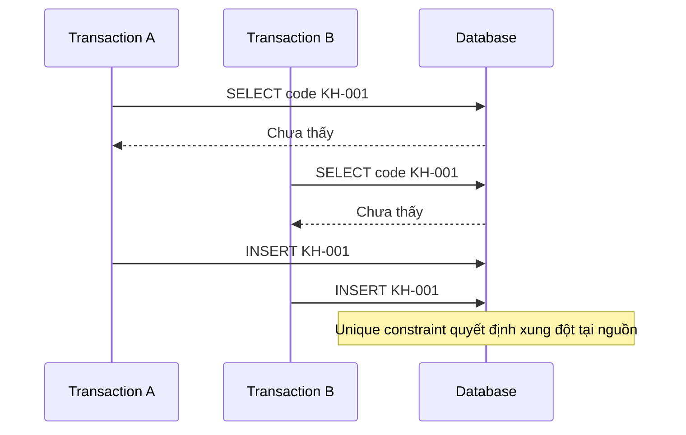
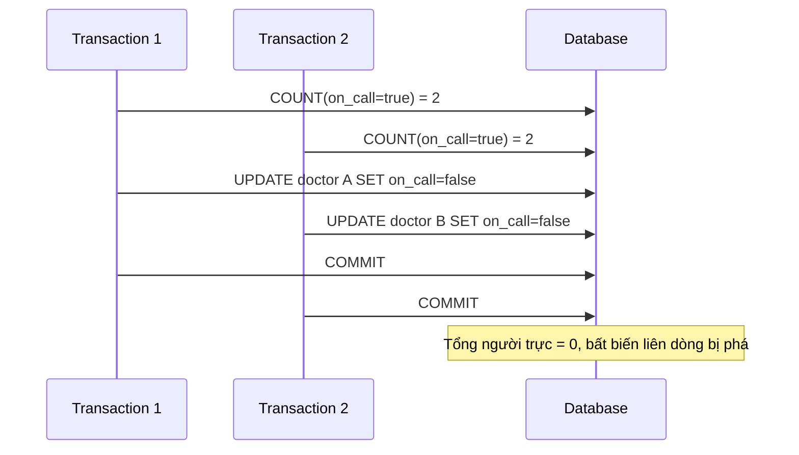
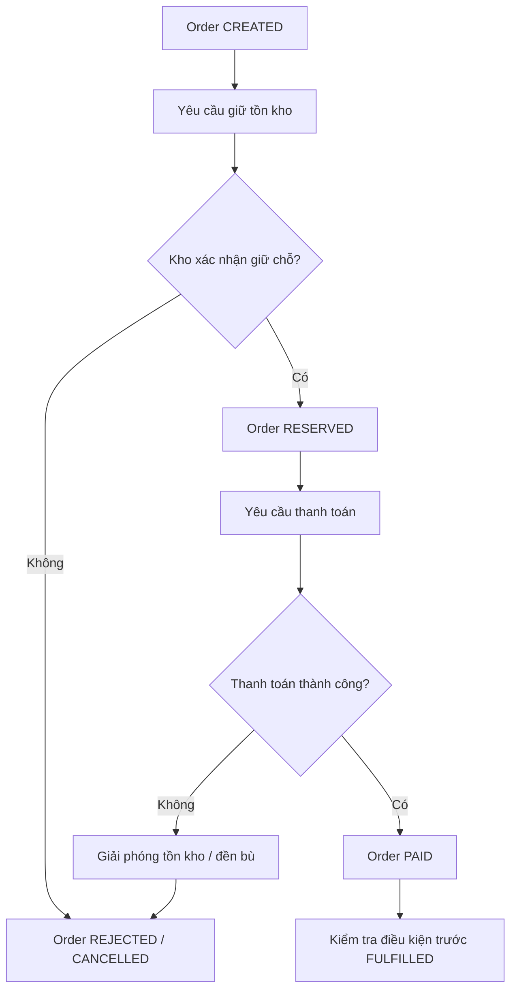

# Bảo toàn bất biến trải trên nhiều trường hoặc bản ghi

Một hệ thống bán hàng ghi một hóa đơn có `total_amount = 150.000` nhưng tổng các dòng hàng chỉ là `140.000`. Một dịch vụ khác kiểm tra “còn một sản phẩm trong kho”, rồi hai yêu cầu cùng đặt thành công. Hệ thống đặt phòng cũng có thể chấp nhận hai lịch trùng nhau vì cả hai transaction đã nhìn thấy phòng còn trống lúc bắt đầu.

Các thao tác này có thể đều **hợp lệ về kiểu dữ liệu** và mỗi câu lệnh SQL riêng lẻ có thể thành công. Vấn đề nằm ở **bất biến (invariant)**: quy tắc phải đúng với *toàn bộ trạng thái dữ liệu được chấp nhận*, đôi khi liên quan nhiều cột, nhiều hàng hoặc nhiều bảng và phải tiếp tục đúng dưới tải đồng thời.

Bài này thuộc chương **Lược đồ và ràng buộc** của module **DATA_PERSISTENCE_FUNDAMENTALS**. Module giúp người học hiểu lưu trữ dữ liệu bền vững trong Java: từ mô hình dữ liệu, schema, truy vấn/chỉ mục đến transaction, isolation, concurrency; thiết kế ranh giới persistence, xử lý lỗi kết nối, tiến hóa schema, bảo mật, sao lưu và tối ưu hiệu năng. Trọng tâm của bài là cách **phát biểu bất biến**, chọn cơ chế bảo vệ tương ứng và **kiểm thử dưới tình huống cạnh tranh**, thay vì chỉ xác nhận một đoạn validation Java hoạt động khi chạy tuần tự.

Sau bài học, bạn có thể:

- Phân biệt bất biến **một trường**, **nhiều trường trên cùng hàng**, **nhiều hàng**, **nhiều bảng** và **xuyên dịch vụ**.
- Dùng `NOT NULL`, `CHECK`, `UNIQUE`, `FOREIGN KEY` và những cơ chế chuyên biệt đúng phạm vi, hiểu giới hạn của từng loại.
- Nhận ra lỗi *check-then-act*, lost update và write skew; chọn update có điều kiện, khóa hoặc cô lập `SERIALIZABLE` với retry phù hợp.
- Thiết kế transaction và lớp Java/JDBC bảo toàn bất biến khi ghi nhiều bản ghi.
- Lập kế hoạch áp dụng ràng buộc cho dữ liệu cũ và xây phép thử nghiệm thu với database thật.

## 1. Bất biến là gì và áp dụng tại thời điểm nào?

Bất biến là điều kiện về dữ liệu phải được giữ đúng theo hợp đồng nghiệp vụ. Ví dụ:

- Giá và số lượng của một dòng đơn không âm.
- Khi hóa đơn ở trạng thái `PAID`, phải có thời điểm thanh toán hợp lệ.
- Mã khách chỉ được dùng một lần **trong cùng tenant**.
- Đơn hàng không tham chiếu khách của tenant khác.
- Số tồn kho còn có thể đặt không được âm.
- Hai lịch đặt phòng đã xác nhận không được chồng lấp cho cùng phòng.
- Tổng các dòng bút toán của một chứng từ đã hạch toán phải cân bằng.

Có thể mô hình hóa trạng thái lưu trữ là `S` và bất biến là điều kiện `I(S)`. Một giao dịch được chấp nhận phải đưa hệ thống từ trạng thái hợp lệ sang trạng thái hợp lệ:

```text
I(S_before) = true
      |
  transaction T
      |
I(S_after_commit) = true
```

Điều này **không** có nghĩa mọi trạng thái trung gian trong transaction phải thỏa mọi bất biến. Ví dụ chuyển tiền có thể cập nhật hai tài khoản hoặc nhiều bút toán lần lượt, sau đó mới hoàn tất kiểm tra trước commit. **Khả năng trì hoãn kiểm tra** phụ thuộc loại ràng buộc, database và thiết kế giao dịch.

Phải phân biệt:

| Khái niệm | Câu hỏi | Ví dụ |
| --- | --- | --- |
| **Validation của đầu vào** | Request có đúng hình dạng và thuộc miền cho phép? | Số lượng gửi lên là số nguyên dương |
| **Bất biến dữ liệu** | Trạng thái đã chấp nhận có thể vi phạm một quy tắc không? | Tổng hàng đặt không vượt tồn kho khả dụng |
| **Ràng buộc của DB** | Engine kiểm tra được quy tắc nào tại nơi ghi? | `CHECK(quantity > 0)`, khóa ngoại, unique |
| **Ranh giới transaction** | Những thay đổi nào thành công/rollback cùng nhau? | Ghi reservation và trừ tồn kho |
| **Cô lập đồng thời** | Hai transaction có thể cùng quan sát điều kiện cũ rồi gây sai không? | Cùng thấy còn một phòng |
| **Nhất quán xuyên hệ thống** | Ngoài DB chính, cache/broker/dịch vụ khác hội tụ thế nào? | Tạo đơn xong mới đồng bộ chỉ mục |

Validation của Java quan trọng để trả lỗi thân thiện, nhưng **không thay thế ràng buộc nguyên tử ở phía nguồn ghi**. Một câu `SELECT` xác nhận dữ liệu hợp lệ lúc 10:00:00 không tự đảm bảo nó vẫn hợp lệ khi câu `INSERT` thực hiện sau đó.

## 2. Phân loại bất biến theo phạm vi

| Phạm vi | Ví dụ | Cơ chế thường phù hợp |
| --- | --- | --- |
| **Một cột** | `quantity > 0`, `price IS NOT NULL` | Kiểu cột, `NOT NULL`, `CHECK` |
| **Nhiều cột một hàng** | `end_at > start_at`; hóa đơn `PAID` phải có `paid_at` | `CHECK`, generated column, validation |
| **Nhiều hàng cùng bảng** | Mã khách duy nhất trong tenant; không có hai lịch trùng | `UNIQUE`/unique index, exclusion constraint, transaction/locking |
| **Hai bảng có quan hệ** | Đơn thuộc khách hợp lệ cùng tenant | `FOREIGN KEY`, khóa ghép, kiểm soát quyền |
| **Tổng hợp nhiều hàng/bảng** | Tổng hóa đơn bằng tổng dòng; tổng bút toán cân bằng | Thiết kế tránh lặp, transaction + khóa/trigger hoặc `SERIALIZABLE` |
| **Nhiều database/dịch vụ** | Không giao hàng khi chưa thu tiền; hệ thống tồn kho và đơn tách biệt | Owner rõ, idempotency, workflow/outbox/đối soát; chấp nhận và kiểm soát trạng thái trung gian |

**Quy tắc lựa chọn:** ưu tiên biểu diễn bất biến bằng **constraint khai báo** khi database hỗ trợ chính xác. Với quy tắc vượt phạm vi constraint, chọn một giao thức ghi mà **mọi writer** phải tuân thủ, bảo vệ bằng transaction và kiểm tra dưới đồng thời. Không hứa rằng `CHECK` có thể tra cứu an toàn tùy ý sang các bảng khác.

## 3. Bất biến liên trường trong cùng một hàng

Xét một hóa đơn có số tiền hàng, giảm giá, thuế, tổng, trạng thái và thời điểm phát hành/thanh toán.

Hợp đồng ví dụ:

1. Các số tiền đã lưu không âm; giảm giá không vượt tiền hàng.
2. `total_amount = subtotal_amount - discount_amount + tax_amount`.
3. `DRAFT` chưa có ngày phát hành/thanh toán; `ISSUED` đã phát hành nhưng chưa thanh toán; `PAID` có ngày thanh toán không trước ngày phát hành.
4. Mọi giá trị liên quan không được `NULL`.

### 3.1. DDL minh họa trên PostgreSQL

```sql
CREATE TABLE invoice (
    tenant_id UUID NOT NULL,
    invoice_id UUID NOT NULL,
    status TEXT NOT NULL
        CHECK (status IN ('DRAFT', 'ISSUED', 'PAID')),

    subtotal_amount NUMERIC(19, 2) NOT NULL,
    discount_amount NUMERIC(19, 2) NOT NULL DEFAULT 0,
    tax_amount NUMERIC(19, 2) NOT NULL DEFAULT 0,
    total_amount NUMERIC(19, 2) NOT NULL,

    issued_at TIMESTAMPTZ,
    paid_at TIMESTAMPTZ,

    CONSTRAINT pk_invoice PRIMARY KEY (tenant_id, invoice_id),

    CONSTRAINT ck_invoice_money CHECK (
        subtotal_amount >= 0
        AND discount_amount >= 0
        AND tax_amount >= 0
        AND discount_amount <= subtotal_amount
        AND total_amount = subtotal_amount - discount_amount + tax_amount
    ),

    CONSTRAINT ck_invoice_status_dates CHECK (
        (status = 'DRAFT'
            AND issued_at IS NULL
            AND paid_at IS NULL)
        OR
        (status = 'ISSUED'
            AND issued_at IS NOT NULL
            AND paid_at IS NULL)
        OR
        (status = 'PAID'
            AND issued_at IS NOT NULL
            AND paid_at IS NOT NULL
            AND paid_at >= issued_at)
    )
);
```

Các `CHECK` trên có thể kiểm tra nhiều cột **của cùng một hàng**. Một request đặt `status='PAID'` mà không có `paid_at` sẽ bị từ chối, kể cả khi ứng dụng quên validation.

Lưu ý:

- `NOT NULL` cần được khai báo rõ. Trong SQL, biểu thức `CHECK` có kết quả **TRUE hoặc UNKNOWN** thường được coi là không vi phạm; `NULL` có thể khiến một biểu thức boolean thành `UNKNOWN` nếu không kiểm soát.
- `NUMERIC(19,2)` biểu diễn số thập phân chính xác trong miền được hỗ trợ, nhưng ứng dụng vẫn phải quy định tiền tệ, đơn vị, quy tắc rounding và kiểm tra việc ép scale.
- `total_amount` ở đây cố ý được lưu cùng các thành phần để minh họa bất biến liên trường. Có thể chọn **generated column** hoặc **tính lại khi đọc** để giảm cơ hội lệch, nếu phù hợp với khả năng engine và nhu cầu truy vấn.
- `CHECK` không thay thế logic chuyển trạng thái hợp lệ theo lịch sử. Ví dụ `PAID → DRAFT` có thể tạo một hàng hợp lệ theo cấu trúc nhưng vi phạm quy tắc vòng đời; điều đó cần transaction/điều kiện cập nhật hoặc chính sách domain bổ sung.

### 3.2. Vì sao kiểm tra trạng thái cuối chưa đủ cho workflow?

Giả sử nghiệp vụ cấm sửa hóa đơn sau khi đã thanh toán. Nếu chỉ dựa trên `ck_invoice_status_dates`, ứng dụng vẫn có thể cập nhật tổng tiền của hóa đơn `PAID` sang giá trị khác rồi lưu thành công, miễn là công thức tiền còn đúng.

Một cách bảo vệ đường ghi là cập nhật có điều kiện:

```sql
UPDATE invoice
SET discount_amount = :new_discount,
    total_amount = subtotal_amount - :new_discount + tax_amount
WHERE tenant_id = :tenant_id
  AND invoice_id = :invoice_id
  AND status = 'DRAFT'
  AND :new_discount >= 0
  AND :new_discount <= subtotal_amount;
```

Đây là cú pháp *named parameters* của một số thư viện; JDBC thuần dùng `?`. Ứng dụng phải kiểm tra số hàng ảnh hưởng và xử lý trường hợp 0 hàng (không có hóa đơn, trạng thái khác hoặc điều kiện không thỏa). Nếu nhiều code path có quyền sửa hóa đơn, tất cả phải tuân thủ quy tắc, hoặc đặt thêm cơ chế cưỡng chế tại database như trigger/quyền ghi thích hợp.

**Bất biến trạng thái** thường kết hợp điều kiện trên **trạng thái hiện tại** và **trạng thái kế tiếp**, khác với chỉ kiểm tra hình dạng một hàng.

## 4. Ràng buộc duy nhất trải trên nhiều hàng

Ví dụ: trong cùng tenant, không có hai khách hàng cùng `customer_code`.

```sql
CREATE TABLE customer (
    tenant_id UUID NOT NULL,
    customer_id UUID NOT NULL,
    customer_code VARCHAR(40) NOT NULL,
    display_name TEXT NOT NULL,

    CONSTRAINT pk_customer
        PRIMARY KEY (tenant_id, customer_id),

    CONSTRAINT uq_customer_code
        UNIQUE (tenant_id, customer_code)
);
```

`UNIQUE(tenant_id, customer_code)` bảo vệ quy tắc **trải trên nhiều hàng** khi hai transaction đồng thời tạo mã trùng, điều mà `SELECT` kiểm tra trước thường không thể bảo đảm.

Cần định nghĩa **phạm vi và cách so khớp**:

- `UNIQUE(customer_code)` toàn cục có thể sai nếu các tenant được phép dùng cùng mã.
- Nếu `customer_code` được phép `NULL`, hành vi của ràng buộc unique đối với nhiều `NULL` khác với suy nghĩ “mọi hàng đều duy nhất”. Ở PostgreSQL, mặc định `NULL` không được xem là bằng nhau trong unique; PostgreSQL 15+ hỗ trợ lựa chọn `NULLS NOT DISTINCT`. Với mã bắt buộc, khai báo `NOT NULL` rõ ràng.
- `"kh-001"` và `"KH-001"` có được xem như nhau không phụ thuộc hợp đồng chuẩn hóa, collation hoặc index trên biểu thức. Không để Java và DB áp dụng hai quy tắc khác nhau rồi hy vọng unique đúng ý.
- Nếu cho phép tái sử dụng mã sau khi xóa mềm, unique trên *mọi bản ghi* và unique trên *bản ghi hoạt động* là hai chính sách khác nhau. PostgreSQL có **partial unique index** cho trường hợp sau, nhưng cần cân nhắc lịch sử và phục hồi.

### Kiểm tra trước rồi ghi: race condition



Nếu không có ràng buộc nguyên tử, cả hai có thể ghi thành công. Với `UNIQUE`, database phải ngăn trạng thái cuối có hai hàng trùng theo hợp đồng; transaction nào chờ hay bị từ chối phụ thuộc engine/isolation.

Đừng coi mã lỗi vi phạm unique là lỗi kết nối có thể retry vô điều kiện. Cũng không được tự động suy ra một duplicate key nghĩa là **chính request này đã từng thành công**. Đó là vấn đề riêng của idempotency.

## 5. Ràng buộc quan hệ trải trên nhiều bảng

Giả sử đơn hàng phải thuộc một khách đã tồn tại **trong chính tenant của đơn**.

```sql
CREATE TABLE sales_order (
    tenant_id UUID NOT NULL,
    order_id UUID NOT NULL,
    customer_id UUID NOT NULL,
    created_at TIMESTAMPTZ NOT NULL DEFAULT CURRENT_TIMESTAMP,

    CONSTRAINT pk_order PRIMARY KEY (tenant_id, order_id),

    CONSTRAINT fk_order_customer
        FOREIGN KEY (tenant_id, customer_id)
        REFERENCES customer (tenant_id, customer_id)
        ON DELETE RESTRICT
);
```

Ở đây:

- `PRIMARY KEY (tenant_id, order_id)` giữ danh tính đơn hàng trong tenant.
- `FOREIGN KEY (tenant_id, customer_id)` kiểm tra **cả quan hệ và phạm vi tenant**.
- Nếu chỉ có `customer_id` làm FK và một cột tenant riêng trên order, FK đó **không tự kiểm tra** hai tenant bằng nhau.
- `ON DELETE RESTRICT` chọn chính sách chặn xóa khách còn đơn; trường hợp muốn lưu lịch sử, vô hiệu hóa hoặc xóa mềm cần được quyết định riêng.
- FK không phải authorization. API vẫn phải kiểm tra người dùng có quyền đối với tenant và customer đó.

FK bảo vệ việc một bản ghi trỏ tới bản ghi hợp lệ; nó **không** tự bảo vệ tổng tiền đơn hàng bằng tổng các dòng, hay trạng thái giao hàng phù hợp thanh toán từ dịch vụ khác.

## 6. Bất biến tổng hợp nhiều dòng: hóa đơn và các dòng hàng

Một bất biến quan trọng:

```text
invoice.subtotal_amount
  = SUM(invoice_line.line_total)
    cho mọi dòng của invoice đó
```

Giả sử mọi dòng có `quantity > 0`, `unit_price >= 0`, và làm tròn từng dòng về 2 chữ số thập phân theo quy tắc ví dụ.

```sql
CREATE TABLE invoice_line (
    tenant_id UUID NOT NULL,
    invoice_id UUID NOT NULL,
    line_no INTEGER NOT NULL CHECK (line_no > 0),

    quantity NUMERIC(18, 3) NOT NULL CHECK (quantity > 0),
    unit_price NUMERIC(19, 2) NOT NULL CHECK (unit_price >= 0),
    line_total NUMERIC(19, 2) NOT NULL,

    CONSTRAINT pk_invoice_line
        PRIMARY KEY (tenant_id, invoice_id, line_no),

    CONSTRAINT fk_invoice_line
        FOREIGN KEY (tenant_id, invoice_id)
        REFERENCES invoice (tenant_id, invoice_id)
        ON DELETE RESTRICT,

    CONSTRAINT ck_invoice_line_total
        CHECK (line_total = ROUND(quantity * unit_price, 2))
);
```

`CHECK` có thể đảm bảo **mỗi dòng tính đúng**, nhưng **không thể tự đảm bảo** tổng các dòng bằng `invoice.subtotal_amount`. Một `CHECK` của hàng `invoice` trong PostgreSQL không thể đơn giản chứa `SELECT SUM(...) FROM invoice_line` để kiểm tra bảng khác. Ngay cả khi dùng hàm tự viết đọc bảng khác trong `CHECK`, đó không phải cách bảo vệ toàn vẹn liên dòng đáng tin cậy với mọi thay đổi và đồng thời.

### 6.1. Chiến lược A — không lưu tổng bị trùng lặp

Nếu không cần lưu `subtotal_amount` trên header, tính từ dòng hàng khi đọc:

```sql
SELECT COALESCE(SUM(line_total), 0) AS subtotal_amount
FROM invoice_line
WHERE tenant_id = :tenant_id
  AND invoice_id = :invoice_id;
```

Ưu điểm: giảm số nơi cần đồng bộ cùng một thông tin. Đổi lại, tổng cần được tính khi đọc hoặc duy trì ở một read model có hợp đồng trễ; các truy vấn phức tạp có thể tốn chi phí.

Nếu một báo cáo đọc header và lines bằng **nhiều câu lệnh ở những thời điểm khác nhau**, tổng và danh sách có thể không cùng snapshot. Tùy yêu cầu, cần transaction đọc với isolation thích hợp hoặc một truy vấn snapshot nhất quán.

### 6.2. Chiến lược B — lưu tổng và cập nhật trong cùng transaction

Nếu nghiệp vụ hoặc hiệu năng yêu cầu lưu tổng trên header, tất cả đường thêm/sửa/xóa dòng hàng phải cập nhật header **cùng một transaction**. Một giao thức đơn giản:

1. Khóa hàng `invoice` tương ứng (ví dụ `SELECT ... FOR UPDATE`).
2. Kiểm tra trạng thái hóa đơn có cho sửa dòng không.
3. Thêm/sửa/xóa `invoice_line` theo quy tắc.
4. Tính lại tổng các dòng từ trạng thái phù hợp trong transaction.
5. Cập nhật `invoice.subtotal_amount` và `total_amount`, giữ `ck_invoice_money`.
6. Commit hoặc rollback toàn bộ.

Ví dụ ý tưởng PostgreSQL khi chỉnh các dòng của *một* hóa đơn:

```sql
BEGIN;

SELECT status
FROM invoice
WHERE tenant_id = :tenant_id
  AND invoice_id = :invoice_id
FOR UPDATE;

-- Từ kết quả: chỉ tiếp tục nếu hóa đơn tồn tại và đang DRAFT.
-- INSERT / UPDATE / DELETE các invoice_line của hóa đơn.

UPDATE invoice AS i
SET subtotal_amount = lines.subtotal,
    total_amount = lines.subtotal - i.discount_amount + i.tax_amount
FROM (
    SELECT COALESCE(SUM(line_total), 0) AS subtotal
    FROM invoice_line
    WHERE tenant_id = :tenant_id
      AND invoice_id = :invoice_id
) AS lines
WHERE i.tenant_id = :tenant_id
  AND i.invoice_id = :invoice_id
  AND i.status = 'DRAFT';

COMMIT;
```

Đây là **quy trình minh họa**, không phải script thực thi nguyên vẹn: các câu `:...` cần bind parameters, bước chỉnh dòng được viết riêng, phải kiểm tra kết quả khóa/trạng thái và số hàng cập nhật, và phải bảo đảm *mọi* writer tuân thủ quy tắc khóa. Với PostgreSQL ở `READ COMMITTED`, các lệnh chạy sau khi lấy khóa sẽ thấy snapshot phù hợp theo quy tắc isolation; nếu đổi isolation, cần kiểm tra lại behavior và xử lý lỗi serialization.

**Rủi ro lớn:** một job import trực tiếp vào `invoice_line` mà bỏ qua việc khóa/cập nhật header có thể phá bất biến. Nếu yêu cầu là “không thể phá ngay cả khi có nhiều đường ghi”, nên cân nhắc **trigger/constraint trigger**, quyền ghi qua stored procedure duy nhất hoặc mô hình khác đặt ràng buộc ở nguồn DB. Các cơ chế đó vẫn cần được thiết kế đúng đồng thời và kiểm thử, không phải phép màu tự động.

### 6.3. Chiến lược C — trạng thái phê duyệt/phát hành

Một lựa chọn khác là cho phép hóa đơn `DRAFT` chưa cân bằng ở một số bước nội bộ, nhưng bắt buộc **đúng tổng và quy tắc liên quan trước khi chuyển sang `ISSUED`**. Khi phát hành:

- Khóa hóa đơn và đảm bảo không còn đường ghi dòng đồng thời ngoài giao thức.
- Kiểm tra có đủ dòng, tính đúng subtotal/discount/tax, xác nhận invariant.
- Thực hiện chuyển trạng thái và ghi nhận phiên bản trong cùng transaction.
- Cấm chỉnh các dòng của hóa đơn đã phát hành, hoặc buộc qua quy trình điều chỉnh có lịch sử.

Hợp đồng phải chỉ rõ bất biến áp dụng **mọi trạng thái** hay chỉ **trạng thái cuối đã công bố**. Câu “tổng luôn đúng” và “tổng đúng khi phát hành” là hai yêu cầu khác nhau.

## 7. Bất biến về tồn kho và nhiều giao dịch cạnh tranh

Giả sử nguồn tồn kho lưu `available` và yêu cầu:

```text
available >= 0
Mỗi reservation thành công phải trừ đúng quantity khỏi available.
Không có hai reservation đồng thời cùng dùng một đơn vị hàng cuối cùng.
```

### 7.1. Cách không an toàn: đọc rồi quyết định ngoài DB

```text
Ban đầu: available = 1

Transaction A: SELECT available → 1
Transaction B: SELECT available → 1
A: kiểm tra Java "1 >= 1" → đúng
B: kiểm tra Java "1 >= 1" → đúng
A: ghi reservation và cập nhật stock theo giá trị cũ
B: ghi reservation và cập nhật stock theo giá trị cũ

=> Có thể bán vượt hoặc bị mất cập nhật, tùy cách viết.
```

Chỉ đặt `CHECK(available >= 0)` có thể ngăn số tồn âm, nhưng **không đủ nếu ứng dụng cập nhật available từ giá trị đã đọc cũ** hoặc không gắn việc trừ tồn với ghi reservation. Chẳng hạn hai luồng đều ghi `available = 0` có thể không vi phạm CHECK nhưng lại có **hai reservation** cho cùng đơn vị tồn.

### 7.2. Ghi có điều kiện nguyên tử

Một cấu trúc đơn giản:

```sql
CREATE TABLE stock (
    sku TEXT PRIMARY KEY,
    available INTEGER NOT NULL CHECK (available >= 0)
);

CREATE TABLE reservation (
    reservation_id UUID PRIMARY KEY,
    sku TEXT NOT NULL REFERENCES stock (sku),
    quantity INTEGER NOT NULL CHECK (quantity > 0),
    request_key TEXT NOT NULL UNIQUE
);
```

Thay vì tách kiểm tra số tồn và cập nhật:

```sql
UPDATE stock
SET available = available - :qty
WHERE sku = :sku
  AND available >= :qty;
```

Đây là **một thao tác ghi có điều kiện**. Với transaction/locking mà PostgreSQL áp dụng cho `UPDATE` trên cùng hàng, các yêu cầu cạnh tranh sẽ không cùng trừ dựa trên giá trị cũ một cách vô kiểm soát. Ứng dụng phải kiểm tra số hàng được cập nhật: 1 là cập nhật có hiệu lực **trong transaction hiện tại**; 0 là không thỏa điều kiện hoặc không có SKU.

Nhưng **chưa đủ**: phải tạo `reservation` trong *cùng transaction* với lệnh trừ tồn. Nếu insert reservation thất bại mà stock đã commit thì xuất hiện mất cân đối. Ngược lại, nếu insert thành công nhưng stock không trừ được, reservation đó cũng phải rollback.

### 7.3. Ví dụ Java/JDBC: một ranh giới transaction

Đoạn mã sau dùng PostgreSQL/JDBC, minh họa cập nhật có điều kiện và thêm reservation trong cùng connection/transaction. **Nó cố ý không tự trả kết quả thành công cho request_key gửi lặp**: trường hợp retry cần một tầng tra cứu/idempotency ledger có hợp đồng riêng. Ví dụ tập trung vào bất biến tồn kho.

```java
import java.sql.Connection;
import java.sql.PreparedStatement;
import java.sql.SQLException;
import java.util.UUID;
import javax.sql.DataSource;

final class ReservationService {
    private final DataSource dataSource;

    ReservationService(DataSource dataSource) {
        this.dataSource = dataSource;
    }

    boolean reserve(String sku, int quantity, String requestKey)
            throws SQLException {
        if (sku == null || sku.isBlank() || requestKey == null
                || requestKey.isBlank() || quantity <= 0) {
            throw new IllegalArgumentException("Invalid reservation input");
        }

        try (Connection connection = dataSource.getConnection()) {
            connection.setAutoCommit(false);
            boolean commitStarted = false;
            try {
                int updated;
                try (PreparedStatement update = connection.prepareStatement("""
                        UPDATE stock
                        SET available = available - ?
                        WHERE sku = ? AND available >= ?
                        """)) {
                    update.setInt(1, quantity);
                    update.setString(2, sku);
                    update.setInt(3, quantity);
                    updated = update.executeUpdate();
                }

                if (updated == 0) {
                    connection.rollback();
                    return false;
                }

                try (PreparedStatement insert = connection.prepareStatement("""
                        INSERT INTO reservation
                            (reservation_id, sku, quantity, request_key)
                        VALUES (?, ?, ?, ?)
                        """)) {
                    insert.setObject(1, UUID.randomUUID());
                    insert.setString(2, sku);
                    insert.setInt(3, quantity);
                    insert.setString(4, requestKey);
                    insert.executeUpdate();
                }

                commitStarted = true;
                connection.commit();
                return true;
            } catch (SQLException failure) {
                if (commitStarted) {
                    // Mất kết nối khi COMMIT có thể để lại kết quả chưa rõ.
                    throw new CommitOutcomeUnknownException(failure);
                }
                try {
                    connection.rollback();
                } catch (SQLException rollbackFailure) {
                    failure.addSuppressed(rollbackFailure);
                }
                throw failure;
            }
        }
    }

    static final class CommitOutcomeUnknownException
            extends RuntimeException {
        CommitOutcomeUnknownException(SQLException cause) {
            super("Reconcile request_key before retrying", cause);
        }
    }
}
```

**Giới hạn cần hiểu trước khi áp dụng:**

- `request_key` được unique để ngăn trùng *bản ghi reservation*, nhưng phương thức trên **chưa thực hiện trọn vẹn idempotency**. Retry một thao tác đã thành công có thể đụng unique hoặc trả `false` do tồn kho mới không đủ. Production phải có cơ chế đọc kết quả theo `request_key` và đối chiếu payload trước khi quyết định trả kết quả cũ hay tạo lại.
- Nếu lỗi xảy ra trong lúc `commit()`, kết quả có thể chưa xác định; **không retry mù** vì có thể trừ tồn thêm lần nữa. Đối soát bằng khóa yêu cầu ổn định ở nguồn ghi có thẩm quyền.
- Nếu `close()` của connection/pool thất bại sau commit đã xác nhận, tầng xử lý lỗi cũng phải phân biệt lỗi cleanup và kết quả commit. Ví dụ không phải một transaction framework hoàn chỉnh.
- Với lỗi `SERIALIZATION_FAILURE`/deadlock, retry cần bao bọc **cả transaction** theo chính sách giới hạn số lần, backoff và idempotency, không lặp riêng một câu SQL tùy ý.
- `CHECK(available >= 0)` là lớp phòng vệ bổ sung cho các đường ghi khác; mọi cách cập nhật tồn kho phải tuân thủ cùng quy tắc nghiệp vụ.

Bảo toàn bất biến không chỉ là “transaction có commit”; cần kiểm tra **các hành động gắn với nhau đều được thực hiện hoặc cùng rollback** và không có code path lách giao thức.

## 8. Write skew: khi mỗi hàng đều hợp lệ nhưng tập hợp lại sai

Hãy xét lịch trực của một đội có hai bác sĩ A và B. Bất biến là **luôn có ít nhất một bác sĩ trực**.

Ban đầu cả A và B đều trực:

```text
doctor_id   on_call
A           true
B           true
```

Hai transaction song song:

1. T1 đọc thấy hai người đang trực, quyết định cho A nghỉ, cập nhật hàng A.
2. T2 cũng đọc thấy hai người đang trực, quyết định cho B nghỉ, cập nhật hàng B.
3. Mỗi transaction sửa **một hàng khác nhau**; mỗi hàng riêng lẻ đều hợp lệ.
4. Nếu mức cô lập cho phép *write skew*, cả hai có thể commit và không còn ai trực.



Sơ đồ là **kịch bản có thể xảy ra trong cấu hình cô lập cho phép**, không phải tuyên bố mọi database đều cho hai transaction commit như vậy. PostgreSQL `REPEATABLE READ` theo snapshot isolation có thể cho phép write skew; `SERIALIZABLE` sử dụng cơ chế phát hiện để ngăn lịch sử không tương đương tuần tự, nhưng ứng dụng phải xử lý transaction bị hủy/retry.

### Hai hướng bảo vệ

**Hướng A — khóa một hàng đại diện cho tập cần bảo vệ**

Giả sử có bảng `duty_team(team_id, ...)`. Mọi transaction muốn sửa trạng thái trực của bác sĩ thuộc đội phải:

1. `SELECT ... FROM duty_team WHERE team_id = ? FOR UPDATE` để lấy khóa cùng một hàng team.
2. Sau khi khóa được cấp, **đọc lại** số người trực trong transaction ở mức cô lập phù hợp (ví dụ PostgreSQL `READ COMMITTED`).
3. Thực hiện thay đổi nếu sau thay đổi vẫn còn ít nhất một người trực.
4. Commit/rollback; mọi đường ghi phải tuân thủ quy ước khóa.

Nếu một writer bỏ qua khóa chung, bảo đảm có thể bị phá. Nếu dùng isolation khác, cần phân tích snapshot/serialization thay vì mặc định khóa parent tự làm mọi query nhìn thấy dữ liệu mới.

**Hướng B — dùng `SERIALIZABLE` và retry toàn transaction**

Với engine thực hiện serializable isolation đúng hợp đồng, DB có thể phát hiện lịch sử nguy hiểm và hủy một transaction. Application phải bắt lỗi serialization, **retry toàn bộ ca sử dụng** có giới hạn, đồng thời đảm bảo side effect ngoài DB không bị gửi trùng. Chỉ gắn nhãn `@Transactional(isolation = SERIALIZABLE)` không có nghĩa không còn lỗi: cần thử trên engine thật và xử lý retry.

Lựa chọn nào phù hợp phụ thuộc số lượng bản ghi, tần suất tranh chấp, chi phí khóa, đường ghi và yêu cầu latency.

## 9. Ràng buộc không chồng lấp theo khoảng thời gian

Một quy tắc “không có hai lịch đã xác nhận trùng nhau cho cùng phòng” cũng là bất biến **giữa nhiều hàng**.

Cách đơn giản nhưng sai:

```text
SELECT xem phòng có lịch trùng hay chưa
→ nếu không thấy thì INSERT lịch mới
```

Hai giao dịch có thể cùng nhìn thấy phòng trống trước khi một trong hai insert. `CHECK(start_at < end_at)` chỉ bảo vệ **một lịch hợp lệ**, không tự cấm hai lịch chồng nhau.

### Ví dụ PostgreSQL với exclusion constraint

PostgreSQL có thể diễn đạt điều kiện này ở mức database bằng kiểu khoảng thời gian và GiST:

```sql
-- Cần quyền/cấu hình phù hợp để cài extension.
CREATE EXTENSION IF NOT EXISTS btree_gist;

CREATE TABLE room_booking (
    booking_id BIGINT GENERATED ALWAYS AS IDENTITY PRIMARY KEY,
    room_id BIGINT NOT NULL,
    start_at TIMESTAMPTZ NOT NULL,
    end_at TIMESTAMPTZ NOT NULL,
    state TEXT NOT NULL
        CHECK (state IN ('DRAFT', 'CONFIRMED', 'CANCELLED')),

    CONSTRAINT ck_booking_interval
        CHECK (start_at < end_at),

    CONSTRAINT ex_no_overlap_confirmed_room
        EXCLUDE USING gist (
            room_id WITH =,
            tstzrange(start_at, end_at, '[)') WITH &&
        )
        WHERE (state = 'CONFIRMED')
);
```

Giải thích:

- `[)` nghĩa là **bao gồm đầu, loại trừ cuối**. Lịch kết thúc 10:00 và lịch kế tiếp bắt đầu 10:00 được phép tiếp giáp.
- `&&` kiểm tra hai khoảng thời gian có giao nhau.
- `EXCLUDE` ngăn hai hàng `CONFIRMED` cùng `room_id` có khoảng thời gian giao nhau, dưới khả năng ràng buộc của PostgreSQL.
- Hàng `DRAFT` và `CANCELLED` không tham gia điều kiện của constraint ví dụ; chuyển từ `DRAFT` sang `CONFIRMED` cũng phải vượt qua kiểm tra.
- Với đa tenant, cần thêm scope tương ứng (như `tenant_id`) vào thiết kế, không coi `room_id` luôn duy nhất toàn hệ thống.
- Độ lệch múi giờ, DST, quy tắc thời gian check-in/check-out và khoảng bảo trì phải được định nghĩa ngoài cú pháp SQL.

Exclusion constraint là **tính năng riêng PostgreSQL**, không phải cú pháp SQL phổ dụng. Nếu engine không có cơ chế tương đương, cân nhắc locking theo tài nguyên, reservation slot có unique, hoặc transaction serializable và phép thử concurrent bookings.

## 10. Bất biến nhiều bảng và transaction: chọn nơi bảo vệ

Không phải quy tắc nào cũng có thể viết thành `CHECK` hoặc `FOREIGN KEY`:

- Tổng debit bằng tổng credit trong một bút toán đã hạch toán.
- Tổng số thành viên đang hoạt động của một nhóm không vượt giới hạn gói.
- Đơn hàng chỉ được chuyển sang `FULFILLED` khi mọi dòng hàng hợp lệ và tồn kho đã được giữ chỗ.
- Một lịch tổng thể phải có ít nhất một người trực, dù các hàng trực phân tán.

Có ba hướng thiết kế thường gặp:

| Hướng | Ý tưởng | Rủi ro/điều kiện |
| --- | --- | --- |
| **Đổi mô hình để bất biến thành một hàng** | Ví dụ counter của nhóm nằm trên một hàng được update có điều kiện | Cần đồng bộ counter với bản ghi thành viên trong cùng transaction; nguy cơ hotspot |
| **Giao thức transaction + lock** | Tất cả writer khóa cùng aggregate root, kiểm tra và ghi | Mọi đường ghi phải tuân thủ, bao gồm batch/import và migration |
| **Trigger/procedure/constraint trigger** | Đưa logic vào DB để kiểm tra/cập nhật khi DML xảy ra | Dễ sai nếu không hiểu thứ tự trigger, concurrency, bulk write, deadlock; cần test thật |
| **`SERIALIZABLE` với retry** | DB phát hiện lịch sử gây vi phạm | Có thể abort/retry; phải đọc và kiểm tra đủ predicate cần bảo vệ |
| **State machine/finalization** | Cho phép dữ liệu draft trung gian, chỉ công bố khi bất biến đạt | Cần khóa/ngăn mọi thay đổi sau khi final hoặc quy trình sửa có kiểm soát |

### 10.1. Ví dụ: chứng từ kế toán cân bằng

Một bút toán có nhiều `journal_line` với `debit`, `credit`. Bất biến phát biểu:

```text
Với mọi journal đã POSTED:
    SUM(debit_amount) = SUM(credit_amount)
    và số dòng, đơn vị tiền, tài khoản phải hợp lệ.
```

Mỗi dòng có thể thỏa `CHECK(debit_amount >= 0 AND credit_amount >= 0)`. Nhưng việc tổng debit bằng tổng credit **không phải một điều kiện trên cùng hàng**.

Một phương án là:

1. Khi journal ở trạng thái `DRAFT`, cho phép ghi dòng với transaction rõ ràng.
2. Khi `POST`, khóa hàng `journal`, kiểm tra đầy đủ các dòng và tổng.
3. Chuyển trạng thái sang `POSTED` trong cùng transaction.
4. Cấm thay đổi dòng của journal đã `POSTED`, kể cả khi có thao tác trực tiếp từ batch/import.
5. Nếu phát hiện sai sau khi posted, dùng bút toán điều chỉnh/reversal có audit thay vì sửa âm thầm lịch sử.

Các quy tắc liên quan **phải được cưỡng chế tại mọi đường ghi**. Nếu một trigger chỉ kiểm tra lúc `POST` nhưng sau đó có quyền insert dòng mới vào journal đã posted, invariant vẫn có thể bị phá. Quyền DB, procedure và trigger có thể bổ sung lớp phòng vệ khi yêu cầu nghiêm ngặt.

### 10.2. Constraint trigger và `DEFERRABLE`

Trong PostgreSQL, một số constraint như `FOREIGN KEY`, `UNIQUE` và `EXCLUDE` có các khả năng trì hoãn kiểm tra tùy loại và khai báo; `CHECK` thông thường **không phải deferrable**. PostgreSQL cũng có **constraint trigger** có thể khai báo `DEFERRABLE` và kiểm tra ở cuối transaction theo điều kiện được thiết kế.

Tuy nhiên, **đợi đến cuối transaction không tự giải quyết race**: hai transaction song song có thể cùng kiểm tra một tập bản ghi trước khi nhìn thấy thay đổi của nhau. Nếu dùng trigger kiểm tra tổng, phải xem cơ chế khóa hoặc isolation đủ mạnh và cách xử lý serialization failure. Một trigger đọc `SUM(...)` mà không bảo vệ predicate/tập hàng cần kiểm soát có thể vẫn cho phép write skew.

Với transaction có giai đoạn tạm thời không hợp lệ, hãy phân biệt rõ ràng:

- Trạng thái trung gian nào được phép trong transaction?
- Ai có quyền chuyển sang trạng thái công bố?
- Check nào kiểm ở từng statement, check nào được trì hoãn?
- Transaction đồng thời nào có thể thay đổi dữ liệu liên quan?
- Khi rollback hoặc failover, invariant được bảo vệ tại đâu?

## 11. Cô lập giao dịch không đồng nghĩa một chính sách chung

Tên mức cô lập quen thuộc như `READ COMMITTED`, `REPEATABLE READ`, `SERIALIZABLE` không đủ để suy ra mọi engine có hành vi giống nhau đối với predicate, khóa và snapshot.

| Tình huống | Rủi ro | Cách xử lý thường cần cân nhắc |
| --- | --- | --- |
| **Lost update** | Hai transaction đọc cùng giá trị cũ rồi ghi đè | Cập nhật nguyên tử, optimistic version, lock |
| **Write skew** | Hai transaction sửa các hàng khác nhau nhưng vi phạm invariant tập hợp | Khóa aggregate chung hoặc serializable với retry |
| **Phantom/predicate race** | Kiểm tra “không có lịch trùng”, rồi hàng mới xuất hiện | Exclusion/unique hoặc locking/serializable có hợp đồng |
| **Stale read** | Đọc từ replica/cache chưa cập nhật | Dùng nguồn có thẩm quyền hoặc hợp đồng freshness phù hợp |
| **Deadlock** | Các transaction khóa tài nguyên theo thứ tự khác nhau | Quy ước thứ tự khóa, timeout và retry toàn transaction |
| **Serialization failure** | DB hủy một transaction để duy trì tính tuần tự | Retry có giới hạn và idempotency, không bỏ qua lỗi |
| **Unknown commit outcome** | Mất kết nối sau khi gửi COMMIT | Đối soát qua ID yêu cầu; không tự coi rollback |

**Cách chọn cơ chế:**

- Nếu bất biến được DB biểu diễn trực tiếp (`UNIQUE`, `FK`, `EXCLUDE`), ưu tiên cơ chế đó.
- Với invariant cần đọc/tính tổng, xét **đổi mô hình** hoặc **khóa một aggregate root** để giảm phạm vi tranh chấp.
- Nếu nhiều transaction cần bảo vệ predicate phức tạp, cân nhắc `SERIALIZABLE` và viết retry đúng.
- Nếu nhiều vùng/partition/DB cùng ghi, một transaction local không tự bảo vệ invariant toàn cục.

Hãy kiểm tra behavior với **engine, isolation và cấu hình thực tế**, không chỉ bằng unit test sử dụng mock DAO.

## 12. Khi một bất biến trải qua nhiều database hoặc dịch vụ

Ví dụ:

- Dịch vụ đặt hàng sở hữu đơn.
- Dịch vụ kho sở hữu lượng hàng còn lại.
- Dịch vụ thanh toán sở hữu giao dịch thanh toán.

Yêu cầu “đơn đã giao phải có thanh toán hợp lệ và tồn kho đã được đặt trước” không thể được một `CHECK` trong một database đơn lẻ tự chứng minh khi trạng thái có thẩm quyền nằm tại các dịch vụ độc lập.

Một luồng có thể mô tả bằng trạng thái rõ ràng:



Tại đây cần phân biệt:

- **Bất biến cứng tại nguồn:** dịch vụ kho không cho available âm trong giao dịch của chính nó; dịch vụ thanh toán không ghi trùng một giao dịch theo khóa idempotency.
- **Điều kiện liên dịch vụ:** thứ tự các bước, state machine, sự kiện, retry, timeout, bù trừ và đối soát phải được định nghĩa.
- **Trạng thái trung gian được phép:** đơn ở `RESERVED` nhưng chưa `PAID` là trạng thái hợp lệ nếu workflow thiết kế như vậy, không được gọi chung là dữ liệu hỏng.
- **Công bố kết quả:** chỉ chuyển `FULFILLED` khi đã kiểm tra bằng chứng từ các nguồn có thẩm quyền theo hợp đồng.

Transactional outbox, inbox/idempotent consumer hoặc saga có thể giúp đảm bảo truyền thay đổi và xử lý lỗi; **không biến nhiều database tự động thành một ACID transaction**. Nếu yêu cầu toàn cục không bao giờ được vi phạm, cần cân nhắc một điểm điều phối/nguồn ghi duy nhất hoặc giao thức đồng thuận/transaction phân tán thích hợp với chi phí và giới hạn được công nhận.

## 13. Thiết kế ranh giới Java: không giấu invariant trong một setter

Một quy tắc liên trường có thể được thể hiện trong domain để trả lỗi sớm:

```java
import java.math.BigDecimal;
import java.util.Objects;

record InvoiceAmounts(
        BigDecimal subtotal,
        BigDecimal discount,
        BigDecimal tax,
        BigDecimal total
) {
    InvoiceAmounts {
        Objects.requireNonNull(subtotal);
        Objects.requireNonNull(discount);
        Objects.requireNonNull(tax);
        Objects.requireNonNull(total);

        if (subtotal.signum() < 0 || discount.signum() < 0
                || tax.signum() < 0 || discount.compareTo(subtotal) > 0) {
            throw new IllegalArgumentException("Invalid invoice amounts");
        }

        BigDecimal expected = subtotal.subtract(discount).add(tax);
        if (total.compareTo(expected) != 0) {
            throw new IllegalArgumentException("Invoice total mismatch");
        }
    }
}
```

Nhưng một `record` Java chỉ xác minh dữ liệu **trong tiến trình đang thực thi**. Nó không tự ngăn:

- SQL trực tiếp từ công cụ quản trị.
- Một phiên bản ứng dụng cũ có validation khác.
- Batch/ETL bỏ qua application service.
- Hai request đồng thời tranh chấp trên cùng tập bản ghi.
- Sự kiện từ kho khác đến trễ và cập nhật lại dữ liệu dẫn xuất.

Vì vậy cần phân lớp:

| Lớp | Trách nhiệm | Hạn chế |
| --- | --- | --- |
| **Domain/validation** | Diễn đạt quy tắc dễ hiểu, trả lỗi sớm | Không bảo vệ các đường ghi ngoài ứng dụng |
| **Application service** | Điều phối nghiệp vụ, transaction, authorization, retry | Phải tuân thủ đúng isolation và giao thức khóa |
| **Repository/JDBC/JPA** | Truy cập các hàng cần thiết, cập nhật có điều kiện, quản lý mapping | Framework không tự bảo đảm invariant liên dòng |
| **Database schema** | Cưỡng chế `NOT NULL`, `CHECK`, `UNIQUE`, `FK` và các constraint khả dụng | Không phải mọi invariant đều diễn đạt khai báo được |
| **Vận hành/đối soát** | Kiểm tra sai lệch dữ liệu cũ, lỗi import/migration/replica | Không tự phòng ngừa mọi lỗi tại thời điểm ghi |

`@Transactional` hữu ích để xác định một ranh giới transaction được framework quản lý, nhưng cần kiểm tra **lời gọi có thực sự đi qua transaction proxy**, transaction có bao trùm các câu lệnh cần thiết không, và **hệ thống nào thực sự tham gia**. Một lời gọi HTTP sang dịch vụ khác không tự trở thành thành phần của transaction DB địa phương.

## 14. Xử lý lỗi constraint chính xác và an toàn

Database trả lỗi constraint là một phần của hợp đồng. Với PostgreSQL thường gặp:

| SQLSTATE | Loại lỗi | Gợi ý xử lý |
| --- | --- | --- |
| `23505` | Unique violation | Phân biệt constraint name, trả lỗi nghiệp vụ phù hợp hoặc đối soát idempotency |
| `23503` | Foreign key violation | Không tìm thấy quan hệ hợp lệ hoặc thao tác xóa/sửa bị chặn; không tự diễn giải thiếu quyền |
| `23514` | Check violation | Giá trị không đáp ứng invariant trên hàng |
| `23P01` | Exclusion violation | Lịch/tài nguyên có xung đột theo exclusion constraint |
| `40001` | Serialization failure | Retry **toàn transaction** khi ca sử dụng cho phép, có giới hạn |
| `40P01` | Deadlock detected | Retry toàn transaction với chính sách phù hợp |
| Lỗi khi `COMMIT`/mất kết nối | Outcome có thể chưa rõ | Đối soát bằng định danh ổn định trước khi retry |

Không dùng một `catch(SQLException)` để trả chung “mã đã tồn tại”; lỗi `23505` cũng cần phân biệt **ràng buộc nào** bị vi phạm. Không công khai stack trace, tên bảng nhạy cảm hoặc dữ liệu người dùng khác trong HTTP response.

Nếu xử lý retry, phải tách lỗi **xung đột nghiệp vụ đã xác định** khỏi lỗi **transient kỹ thuật**, và bảo đảm không lặp side effect như gửi email/thu tiền. Với outcome commit chưa rõ, sử dụng request key và truy vấn nguồn có thẩm quyền để xác định đã có kết quả hay chưa; đọc từ replica chậm có thể dẫn đến kết luận sai.

## 15. Áp dụng bất biến lên dữ liệu cũ và tiến hóa schema

Khi thêm constraint vào bảng đã có hàng triệu dòng, câu hỏi không chỉ là “DDL có chạy được không” mà là **dữ liệu lịch sử đã đạt invariant chưa**, ứng dụng cũ có tiếp tục ghi sai không, và migration có tạo khóa/bottleneck ở production không.

Một tiến trình có thể gồm:

1. **Phát biểu invariant chính xác:** định nghĩa scope, xử lý `NULL`, các trạng thái được phép, phiên bản schema và owner.
2. **Khảo sát dữ liệu cũ:** truy vấn tìm hàng không hợp lệ, duplicate key, orphan FK, tổng hóa đơn lệch và khoảng lịch trùng.
3. **Thống nhất chính sách sửa:** từ chối, backfill, gộp bản ghi, giữ lịch sử hay đưa sang trạng thái chờ xử lý; không xóa mù dữ liệu.
4. **Triển khai code tương thích:** đảm bảo mọi đường ghi mới tuân thủ quy tắc trước khi siết constraint, hoặc dùng chế độ áp dụng dần được engine hỗ trợ.
5. **Thêm/kiểm tra ràng buộc:** chọn phương án giảm locking thích hợp, đánh giá kích thước index và thời gian migration.
6. **Xác minh trên DB thật:** chạy các ca biên, đồng thời, rollback, failover và thao tác từ phiên bản ứng dụng cũ/mới.
7. **Quan sát và đối soát:** theo dõi số vi phạm phát hiện, lỗi constraint mới, retry, deadlock và thời gian truy vấn.
8. **Dọn đường ghi lỗi thời:** chỉ bỏ logic/column cũ sau khi phụ thuộc đã chuyển và có đường rollback phù hợp.

### Một số lưu ý PostgreSQL

- `NOT VALID`/`VALIDATE CONSTRAINT` có thể hữu ích khi áp dụng **CHECK** hoặc **FOREIGN KEY** cho dữ liệu đang tồn tại; cần hiểu điều kiện kiểm tra đối với **ghi mới** và **hàng cũ** của từng trạng thái.
- Không thể áp dụng mọi loại constraint bằng cùng cú pháp `NOT VALID`. Đặc biệt, thêm `UNIQUE` thường cần kiểm tra/trị duplicate và chiến lược index thích hợp.
- `CREATE UNIQUE INDEX CONCURRENTLY` giúp giảm một số dạng chặn ghi nhưng có điều kiện vận hành, có thể thất bại nếu dữ liệu trùng hoặc thay đổi cạnh tranh; không được chạy tùy ý bên trong transaction block.
- Constraint trigger, exclusion và thay đổi kiểu cột có đặc tính locking, hiệu năng và khả năng rollback riêng.

**Chuyển đổi schema là một phần của bài toán bảo toàn bất biến**. Một ràng buộc đúng cho dữ liệu mới nhưng vẫn còn hàng cũ vi phạm, hoặc một ứng dụng cũ ghi ngược quy tắc, là trạng thái phải được quản trị minh bạch thay vì tuyên bố “đã có constraint”.

## 16. Kiểm thử: phải chủ động tạo cạnh tranh

Unit test gọi validation với `quantity = -1` chỉ chứng minh kiểm tra đầu vào, không chứng minh một invariant liên dòng.

| Ca thử | Cách tạo tình huống | Điều kiện đạt |
| --- | --- | --- |
| **Liên trường hợp lệ** | `subtotal=100, discount=10, tax=5, total=95` | Insert/commit thành công |
| **Liên trường sai** | `total=94` cùng các thành phần trên | DB từ chối bằng check phù hợp |
| **Trạng thái/giờ không khớp** | `status=PAID` nhưng `paid_at=NULL` | Bị từ chối kể cả khi bỏ validation Java |
| **Unique đồng thời** | Hai transaction insert cùng `(tenant, customer_code)` | Không thể commit hai bản trùng |
| **Khóa ngoại đa tenant** | Order tenant A trỏ khách tenant B | Bị từ chối |
| **Thêm/sửa/xóa dòng hóa đơn** | Nhiều writer sửa cùng invoice | Tổng header khớp dòng sau mọi commit thành công |
| **Writer bỏ qua giao thức** | Batch trực tiếp vào `invoice_line` | Bị chặn bằng quyền/trigger hoặc được phát hiện là lỗ hổng cần sửa |
| **Trừ tồn kho cạnh tranh** | 100 request cùng đặt 1 món khi còn 10 | Không hơn 10 reservation thành công, không có stock âm, số lần trừ khớp |
| **Retry sau timeout** | Gửi cùng request key hai lần | Không trừ kho hai lần; kết quả được đối soát đúng |
| **Write skew** | Hai transaction cho hai bác sĩ nghỉ | Không kết thúc với 0 người trực |
| **Lịch chồng lấp** | Hai transaction xác nhận cùng phòng, giờ giao nhau | Tối đa một lịch được xác nhận trong khoảng xung đột |
| **Lịch tiếp giáp** | Một lịch kết thúc lúc lịch tiếp theo bắt đầu | Được chấp nhận nếu hợp đồng dùng `[)` |
| **Serialization/deadlock** | Cố ý tạo cạnh tranh gây abort | Retry có giới hạn, không nhân đôi side effect |
| **Migration có dữ liệu bẩn** | Nạp duplicate/orphan rồi thêm constraint | Phát hiện, phân loại, không mất dữ liệu âm thầm |
| **Restore/đối soát** | Khôi phục DB và đối chiếu tổng/khóa ngoại | Bất biến được kiểm tra, sai lệch được xử lý |

Các thử nghiệm cạnh tranh phải chạy trên **database engine và isolation level thực**, với nhiều connection/transaction **thật**. Mock repository hoặc in-memory DB có thể khác về locking, unique semantics và anomaly.

### Một lịch kiểm thử hai transaction

Để kiểm tra viết lệch (write skew), tạo hai connection A và B, đặt isolation theo cấu hình đang dùng:

```text
A: BEGIN
B: BEGIN

A: SELECT số người đang trực → 2
B: SELECT số người đang trực → 2

A: UPDATE doctor_A SET on_call = false
B: UPDATE doctor_B SET on_call = false

A: COMMIT
B: COMMIT

ASSERT số người trực >= 1
```

Nếu cả hai commit và phép assert thất bại, thiết kế chưa bảo vệ invariant trong kịch bản này. Sau khi bổ sung khóa parent hoặc `SERIALIZABLE` + retry, chạy lại, đồng thời kiểm tra đường ghi tương tự từ batch/admin.

Đối với test tồn kho, không chỉ assert `available >= 0`: cần đối chiếu **số reservation được chấp nhận**, lượng đã trừ và kết quả của các request retry. Một trạng thái không âm nhưng tạo quá nhiều đơn cũng là sai nghiệp vụ.

## 17. Checklist review một bất biến nhiều trường hoặc bản ghi

Trước khi triển khai, trả lời đủ các câu hỏi:

- **Bất biến là một mệnh đề chính xác nào?** Có phép tính, phạm vi tenant, đơn vị, trạng thái và xử lý `NULL` rõ ràng?
- **Được phép sai ở trạng thái nào?** Không bao giờ sau commit, hay chỉ khi đơn đã `ISSUED/POSTED`?
- **Nguồn có thẩm quyền nằm ở đâu?** Một database, một aggregate hay nhiều dịch vụ?
- **Constraint khai báo nào bảo vệ được trực tiếp?** `NOT NULL`, `CHECK`, `UNIQUE`, `FK`, `EXCLUDE`?
- **Có dữ liệu dẫn xuất trùng lặp không?** Có thể bỏ cột tổng hoặc dùng generated column không?
- **Phải khóa/đọc những hàng nào?** Có predicate trên tập hàng và nguy cơ write skew không?
- **Có bao nhiêu đường ghi?** API, job, migration, manual SQL, message consumer có cùng quy tắc?
- **Lúc xảy ra race hệ thống làm gì?** Chờ, báo unique conflict, rollback hay serialization failure?
- **Lúc commit mất phản hồi thì sao?** Có idempotency/đối soát ở nguồn không?
- **Có hệ thống ngoài transaction không?** Trạng thái trung gian, bù trừ và hội tụ được định nghĩa?
- **Dữ liệu cũ có đạt quy tắc mới không?** Kế hoạch backfill và kiểm chứng?
- **Phép thử nào chứng minh điều đó?** Có multi-connection, case lỗi biên, restore và đo hiệu năng?

## 18. Bài tập áp dụng

**Bài tập 1 — liên trường.** Một bảng `subscription` có `start_at`, `end_at` (có thể null nếu chưa xác định ngày kết thúc), `state` và `cancelled_at`. Hãy đề xuất các `NOT NULL`/`CHECK` để `end_at` nếu có phải sau `start_at`, và trạng thái `CANCELLED` có `cancelled_at` hợp lệ. Vì sao phải xét semantics của `NULL`?

*Gợi ý:* `start_at NOT NULL`, `CHECK(end_at IS NULL OR end_at > start_at)` và điều kiện trạng thái/`cancelled_at` rõ. Nếu bỏ các ràng buộc null cần thiết, `UNKNOWN` trong CHECK có thể cho dữ liệu chưa được kiểm tra như ý.

**Bài tập 2 — tổng hóa đơn.** Header lưu `subtotal=100`, nhưng lines có tổng 90. Vì sao `CHECK (subtotal >= 0)` chưa đủ? Hãy chọn một trong ba chiến lược: không lưu tổng, transaction khóa header, hoặc kiểm tra tại bước phát hành; phân tích điểm có thể bị vượt qua.

*Gợi ý:* Quy tắc phụ thuộc nhiều hàng. Nếu lưu tổng, mọi đường sửa line phải đồng bộ header/khóa, hoặc DB phải cưỡng chế bằng cơ chế thích hợp. Nếu chỉ kiểm ở bước phát hành, phải cấm sửa line sau phát hành.

**Bài tập 3 — tồn kho.** Kho còn 1, hai request đồng thời đều đọc `available=1`. Tại sao chỉ dùng `CHECK(available >= 0)` không đảm bảo chỉ một reservation thành công khi ứng dụng ghi lại `available=0` dựa trên giá trị cũ?

*Gợi ý:* Có thể xảy ra lost update; cả hai reservation cùng ghi dù tồn kho không âm. Dùng update có điều kiện nguyên tử và insert reservation trong một transaction, đối soát retry theo request key.

**Bài tập 4 — lịch phòng.** Hai phòng có thể đặt cùng giờ; nhưng một phòng không được có hai booking `CONFIRMED` chồng lấp. Hãy thiết kế phạm vi constraint và giải thích vì sao lịch 09:00–10:00 với 10:00–11:00 có thể hợp lệ.

*Gợi ý:* Điều kiện theo `room_id` (và tenant nếu cần), khoảng `[start,end)`. PostgreSQL có thể dùng `EXCLUDE USING gist`; engine khác cần thiết kế thay thế.

**Bài tập 5 — write skew.** Hai bác sĩ cùng trực và mỗi người có thể nghỉ nếu còn người khác. Vì sao snapshot isolation có thể cho cả hai nghỉ dù mỗi người chỉ sửa một hàng? Nêu hai cơ chế bảo vệ.

*Gợi ý:* Mỗi transaction đọc tập hai người rồi sửa một hàng khác; không có xung đột ghi trên cùng hàng. Khóa một hàng team chung và kiểm tra lại, hoặc dùng serializable + retry toàn transaction.

**Bài tập 6 — dữ liệu phân tán.** Đơn hàng, tồn kho và thanh toán thuộc ba dịch vụ có database riêng. Có thể giải quyết quy tắc “chỉ giao hàng khi đã thu tiền và giữ tồn” bằng một `CHECK` của DB đơn hàng không?

*Gợi ý:* Không, vì dữ liệu có thẩm quyền nằm ngoài transaction của DB đó. Cần owner, trạng thái nghiệp vụ, kiểm tra xác nhận từ các hệ, idempotency, workflow và đối soát, với hợp đồng về trạng thái trung gian.

**Thực hành có kiểm soát:** Tạo các bảng `invoice`/`invoice_line`, `customer`/`sales_order`, `stock`/`reservation` trong một PostgreSQL thử nghiệm. Viết service JDBC cho hai luồng: chỉnh dòng hóa đơn và đặt hàng. Chạy các nhóm request đồng thời, cố ý bỏ qua một bước, mô phỏng timeout trước/sau COMMIT, thử constraint violation rồi rollback. Lập báo cáo gồm **bất biến, vị trí cưỡng chế, đường ghi, isolation, tình huống race, kết quả sau commit và cơ chế đối soát**. Đây là bằng chứng thực tế tốt hơn việc chỉ nhìn vào annotation validation.

## Ghi nhớ

**Bất biến trải trên nhiều trường hoặc bản ghi là quy tắc về trạng thái tổng thể, không chỉ về tính hợp lệ của từng giá trị đầu vào.** `CHECK` bảo vệ tốt quan hệ trên một hàng; `UNIQUE` và `FOREIGN KEY` bảo vệ duy nhất và liên kết; cơ chế đặc thù như exclusion constraint bảo vệ các trường hợp nhiều hàng nhất định. Với tổng hợp và điều kiện phụ thuộc nhiều bản ghi, phải thiết kế transaction, locking hoặc isolation có thể chứng minh, đảm bảo mọi writer tuân thủ, và xử lý lỗi/retry đúng. Đối với nhiều dịch vụ, bất biến được bảo vệ bằng quyền sở hữu dữ liệu cùng workflow được kiểm chứng. **Chỉ coi thiết kế là đạt khi nó chịu được đồng thời và có bằng chứng từ database thực**, không phải khi một câu `SELECT` hoặc một unit test chạy tuần tự trả kết quả đúng.
