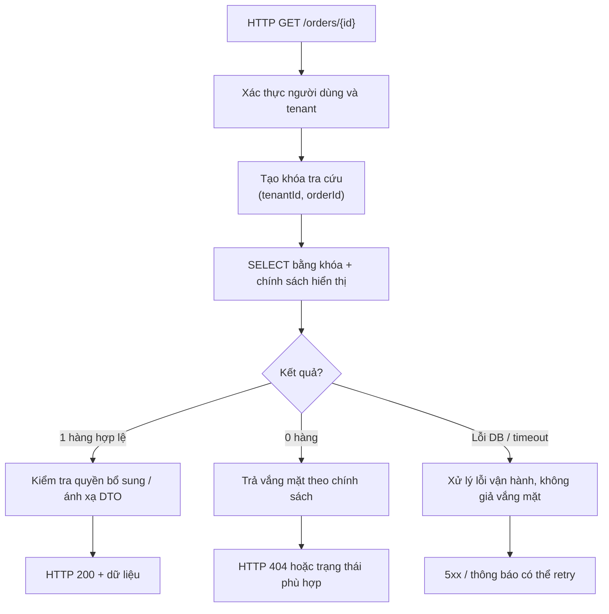
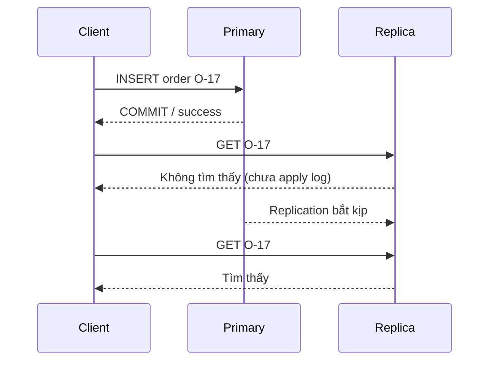
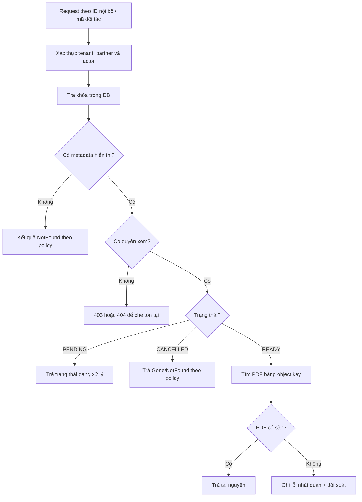

# Đọc theo khóa và biểu diễn trường hợp không tìm thấy

Một ứng dụng Java thường nhận một định danh, chẳng hạn `orderId` hoặc `customerId`, rồi cần lấy đúng bản ghi tương ứng. Khi bản ghi tồn tại, câu chuyện khá đơn giản: đọc dữ liệu, ánh xạ sang đối tượng và trả về cho tầng nghiệp vụ. Khi không có kết quả, quyết định trở nên quan trọng hơn: **trả `null`, `Optional.empty()`, ném ngoại lệ, trả HTTP 404, hay thử lại?**

Cần phân biệt “không tìm thấy bản ghi phù hợp” với “không được phép xem bản ghi”, “bản ghi đã bị xóa mềm”, “đang đọc replica chưa cập nhật” và “database không thể trả lời”. Nếu gộp tất cả vào một kết quả rỗng, hệ thống có thể che giấu lỗi vận hành, tạo bản ghi trùng hoặc để lộ thông tin giữa các tenant.

Bài học nằm trong chương **Thao tác dữ liệu** của module **DATA_PERSISTENCE_FUNDAMENTALS**. Mục tiêu là thiết kế đường đọc theo khóa từ SQL, repository và Java service tới API, đặt trong bối cảnh persistence bền vững: mô hình dữ liệu, lược đồ và chỉ mục, giao dịch, cô lập, kiểm soát đồng thời, bảo mật, phục hồi và hiệu năng.

## 1. Mục tiêu và tình huống xuất phát

Sau bài học, người học có thể:

1. Phân biệt khóa định danh, khóa tra cứu và các điều kiện giới hạn khả năng nhìn thấy bản ghi.
2. Viết truy vấn đọc theo khóa trả về **0 hoặc 1 hàng** dựa trên constraint được thiết kế đúng.
3. Biểu diễn trường hợp vắng mặt bằng `Optional<T>` hoặc kiểu kết quả có ý nghĩa, không đồng nhất với lỗi truy cập dữ liệu.
4. Dùng JDBC, JPA/Spring Data hoặc tầng repository với hợp đồng trả kết quả rõ ràng.
5. Ánh xạ kết quả đọc sang HTTP 200, 404, 403, 410 hay 5xx theo đúng chính sách API.
6. Đánh giá tác động của transaction, xóa mềm, quyền theo tenant, cache và replica đến ý nghĩa “không tìm thấy”.
7. Kiểm thử cả trường hợp bản ghi có thật, vắng mặt, bị che theo quyền, đã xóa và database gặp lỗi.

### Tình huống minh họa

Giả sử API phục vụ yêu cầu:

```http
GET /api/orders/19b5246b-ccbc-410b-a02f-dcde7a29df97
Authorization: Bearer <access-token>
```

Đường xử lý dự kiến:



Một định danh trong URL không tự mang theo quyền truy cập. `orderId` giúp chọn đối tượng; danh tính người dùng và chính sách bảo mật quyết định đối tượng đó có được lộ hay không.

## 2. “Đọc theo khóa” là một hợp đồng dữ liệu

**Khóa định danh** là một giá trị hoặc một bộ giá trị được thiết kế để xác định duy nhất một thực thể trong phạm vi đã nêu. **Khóa truy cập** là giá trị hoặc bộ giá trị dùng trong điều kiện tìm kiếm. Chúng có thể giống nhau, nhưng không nhất thiết.

| Loại khóa | Ví dụ | Kết quả mong muốn |
| --- | --- | --- |
| Khóa chính của đơn | `(tenant_id, order_id)` | Tối đa một đơn |
| Khóa nghiệp vụ duy nhất | `(tenant_id, source_system, external_order_id)` | Tối đa một ánh xạ đến đơn |
| Khóa ngoại | `(tenant_id, customer_id)` trong bảng đơn | Có thể tìm nhiều đơn của một khách |
| Chỉ mục tìm kiếm | `(tenant_id, status, created_at)` | Một danh sách đơn |
| Khóa đối tượng ngoài DB | `bucket + object_key` | Một object hoặc một version, tùy hợp đồng |
| Khóa phân vùng | `tenant_id` hoặc ngày tạo | Xác định vùng dữ liệu, không tự bảo đảm duy nhất |

Gọi một phương thức là `findOneByStatus` không khiến `status` trở thành khóa duy nhất. Nhiều đơn có trạng thái `PAID`. Nếu nghiệp vụ yêu cầu lấy đúng một hàng, phải có **bất biến duy nhất** tương ứng trong schema hoặc hợp đồng dữ liệu.

### 2.1. Ba kết quả cần phân biệt

Với truy vấn được kỳ vọng trả tối đa một hàng:

| Số hàng phù hợp | Ý nghĩa | Xử lý |
| --- | --- | --- |
| **0** | Không có hàng *phù hợp với điều kiện đọc tại thời điểm và góc nhìn hiện tại* | Trả giá trị vắng mặt có chủ đích |
| **1** | Có một hàng thỏa khóa và bộ lọc | Đọc, kiểm tra quyền và ánh xạ dữ liệu |
| **Nhiều hơn 1** | Giả định duy nhất đã sai, hoặc truy vấn JOIN nhân dòng | Điều tra constraint/truy vấn; không âm thầm lấy hàng đầu |

Một câu `SELECT ... LIMIT 1` không chứng minh dữ liệu là duy nhất; nó chỉ cắt kết quả. Nếu bộ khóa phải duy nhất, đặt `PRIMARY KEY` hoặc `UNIQUE` ở database và kiểm tra đúng phạm vi.

### 2.2. “Không tìm thấy” luôn phụ thuộc ngữ cảnh

Truy vấn:

```sql
SELECT *
FROM orders
WHERE order_id = :order_id;
```

và truy vấn:

```sql
SELECT *
FROM orders
WHERE tenant_id = :authorized_tenant_id
  AND order_id = :order_id
  AND deleted_at IS NULL;
```

có thể trả kết quả khác nhau. Truy vấn thứ hai định nghĩa “tìm thấy” là **một đơn thuộc tenant được phép và chưa bị xóa mềm**. Giá trị vắng mặt của nó không chứng minh rằng ID chưa từng tồn tại trong toàn bộ database.

Do đó, chữ ký repository và tài liệu API cần mô tả điều kiện đọc: theo tenant, trạng thái hiển thị, thời điểm, phiên bản hay khả năng tồn tại vật lý.

## 3. Thiết kế schema và khóa trước khi viết Java

Ví dụ PostgreSQL cho hệ thống nhiều tenant:

```sql
CREATE TABLE customers (
    tenant_id   UUID NOT NULL,
    customer_id UUID NOT NULL,
    full_name   TEXT NOT NULL,
    PRIMARY KEY (tenant_id, customer_id)
);

CREATE TABLE orders (
    tenant_id    UUID NOT NULL,
    order_id     UUID NOT NULL,
    customer_id  UUID NOT NULL,
    status       VARCHAR(24) NOT NULL
        CHECK (status IN ('CREATED', 'PAID', 'CANCELLED')),
    total_amount NUMERIC(19, 2) NOT NULL
        CHECK (total_amount >= 0),
    row_version  BIGINT NOT NULL DEFAULT 0,
    created_at   TIMESTAMPTZ NOT NULL DEFAULT now(),
    deleted_at   TIMESTAMPTZ,
    PRIMARY KEY (tenant_id, order_id),
    FOREIGN KEY (tenant_id, customer_id)
        REFERENCES customers (tenant_id, customer_id)
);
```

Hai quyết định chính:

- `PRIMARY KEY (tenant_id, order_id)` bảo đảm tối đa một hàng ứng với bộ khóa trong bảng.
- FK ghép `(tenant_id, customer_id)` ngăn đơn của tenant này tham chiếu khách hàng của tenant khác.

Truy vấn tìm đơn còn hoạt động:

```sql
SELECT
    order_id, customer_id, status, total_amount,
    row_version, created_at
FROM orders
WHERE tenant_id = :tenant_id
  AND order_id = :order_id
  AND deleted_at IS NULL;
```

Nếu không có hàng, đó là kết quả vắng mặt **theo hợp đồng chỉ đọc đơn chưa xóa**. Nếu cần biết bản ghi đã bị xóa mềm, phải có một đường đọc khác với quyền phù hợp.

### 3.1. Chỉ mục của khóa chính và truy vấn thực tế

PostgreSQL thường tạo một unique B-tree index cho PK. Với điều kiện `tenant_id = ... AND order_id = ...`, index từ PK có thể phục vụ tìm kiếm rất hiệu quả. Thông thường **không cần tạo lại một index trùng hệt**.

Tuy nhiên, “đọc theo một khóa” không đồng nghĩa mọi truy vấn đều cần index mới:

- Một bảng rất nhỏ có thể được quét tuần tự hiệu quả hơn.
- Chỉ mục ghép có thứ tự cột; tìm theo cột thứ hai mà bỏ cột đầu có thể khác về hiệu năng.
- Bộ lọc `deleted_at IS NULL` và quyền có thể ảnh hưởng access plan.
- Mọi index tăng chi phí ghi, dung lượng, WAL và bảo trì.

Dùng `EXPLAIN`, `EXPLAIN (ANALYZE, BUFFERS)` trong môi trường phù hợp và đo dữ liệu thực. Không dùng câu `LIMIT 1` để che việc thiếu ràng buộc duy nhất.

### 3.2. Khóa nghiệp vụ không phải lúc nào cũng bền vững

Email, số điện thoại và tên hiển thị thường thay đổi. Nếu API đọc khách hàng theo email, phương thức có thể là `findByCurrentEmail` chứ không nên giả định đó là ID bất biến.

Với ID từ hệ thống ngoài, cần namespace:

```sql
CREATE TABLE external_order_ids (
    tenant_id         UUID NOT NULL,
    source_system     VARCHAR(80) NOT NULL,
    external_order_id VARCHAR(160) NOT NULL,
    order_id          UUID NOT NULL,
    PRIMARY KEY (tenant_id, source_system, external_order_id),
    FOREIGN KEY (tenant_id, order_id)
        REFERENCES orders (tenant_id, order_id)
);
```

Khóa `(tenant_id, source_system, external_order_id)` chỉ ra đúng một ánh xạ. Nếu không có ánh xạ, điều đó chưa nhất thiết có nghĩa đơn nội bộ không tồn tại; có thể mã nguồn chưa được đăng ký hoặc đang chờ đồng bộ.

## 4. Biểu diễn sự vắng mặt: không đồng nhất với lỗi

Tầng persistence cần đưa ra một **hợp đồng trả kết quả** đủ rõ để caller không phải đoán ý nghĩa.

| Tình huống | Biểu diễn phù hợp | Không nên làm |
| --- | --- | --- |
| Truy vấn hợp lệ, không có hàng phù hợp | `Optional.empty()`, kiểu `NotFound`, hoặc `null` nếu API đã định nghĩa chặt chẽ | Ném “database unavailable” |
| Có hàng | `Optional.of(value)`, `Found(value)` | Trả payload không kiểm tra quyền |
| Kết nối hỏng, timeout, lỗi SQL | Ngoại lệ/kiểu lỗi vận hành riêng | Trả `Optional.empty()` |
| Nhiều hàng dù khóa phải duy nhất | Lỗi bất biến/dữ liệu hoặc truy vấn | Chỉ lấy hàng đầu và tiếp tục |
| Bản ghi bị xóa mềm | `NotFound` hoặc `Gone` tùy quyền và hợp đồng | Mặc định tiết lộ lịch sử xóa cho mọi caller |
| Người dùng không có quyền | Kết quả từ lớp authorization, có thể che sự tồn tại | Xem ID khó đoán là có quyền |
| Replica chưa thấy ghi mới | Kết quả chưa đồng bộ với primary theo consistency contract | Kết luận “chưa từng tồn tại” |
| Không parse được dữ liệu đã đọc | Lỗi dữ liệu/cấu trúc hoặc compatibility | Coi như không có bản ghi |

### 4.1. Vì sao `Optional<T>` phù hợp cho một phép tìm đơn giản?

`Optional<OrderSnapshot>` thể hiện một phép đọc **có thể có hoặc không có một giá trị**. Caller buộc phải xem xét trường hợp vắng mặt thông qua API của kiểu đó.

```java
Optional<OrderSnapshot> result = repository.findActiveById(key);

if (result.isPresent()) {
    OrderSnapshot order = result.get();
    // Xử lý đơn hợp lệ.
} else {
    // Không có đơn đang hiển thị tương ứng với key.
}
```

Có thể diễn đạt gọn hơn bằng `map`, `orElseGet` hoặc `orElseThrow`, tùy tầng nghiệp vụ. `Optional` **không biểu diễn nguyên nhân vắng mặt**; nếu cần phân biệt “đã xóa”, “đang chờ công bố” hay “không tồn tại”, nên dùng một kiểu kết quả chi tiết hơn.

Quy ước hữu ích cho Java:

- Phương thức repository kiểu `findBy...` trả `Optional<T>` khi tối đa một hàng và vắng mặt là bình thường.
- Phương thức bắt buộc tồn tại kiểu `require...` có thể chuyển `Optional.empty()` thành ngoại lệ miền nghiệp vụ.
- Không trả `null` từ phương thức khai báo `Optional<T>`; dùng `Optional.empty()`.
- Không nhét `null` vào `Optional.of(...)`. Nếu mapping cho phép giá trị nullable, cần xử lý rõ.
- Không dùng `Optional` để nuốt `SQLException` hay lỗi kết nối.

### 4.2. Phân biệt “không có hàng” với “cột có giá trị NULL”

Hai tình huống rất khác:

```text
SELECT trả 0 hàng:
    -> Không có bản ghi phù hợp.

SELECT trả 1 hàng, note = NULL:
    -> Có bản ghi, riêng trường note chưa có giá trị.
```

Nếu map một hàng mà `note` là `NULL` thành `Optional.empty()` cho toàn bộ entity, ứng dụng đã đánh mất sự tồn tại của bản ghi. `ResultSet.next()` trong JDBC xác định **có hàng hay không**; các getter của cột xác định **giá trị bên trong hàng**. Với cột primitive getter, có thể cần `wasNull()` để phân biệt SQL NULL với giá trị mặc định primitive.

### 4.3. Ngoại lệ cho “không thấy” nên đặt ở đúng tầng

Repository có thể coi vắng mặt là kết quả bình thường:

```java
Optional<OrderSnapshot> findActiveById(OrderKey key);
```

Nhưng nghiệp vụ “xác nhận một đơn” yêu cầu đơn phải tồn tại, nên service có thể ném:

```java
OrderSnapshot order = repository.findActiveById(key)
        .orElseThrow(() -> new OrderNotFoundException(key.orderId()));
```

Đây là **ngoại lệ nghiệp vụ**, không phải lỗi database. Nó nên được ánh xạ sang kết quả hợp đồng API (ví dụ 404) tại ranh giới HTTP, không bị bắt chung với mọi ngoại lệ để trả 500 hoặc che lỗi.

## 5. JDBC: đọc đúng một hàng bằng khóa

Ví dụ Java 17 dưới đây đọc một đơn đang hoạt động. `tenantId` phải đến từ ngữ cảnh tenant đã được xác thực; `orderId` được parse/kiểm tra trước khi truy vấn. Ví dụ không tự xử lý toàn bộ phân quyền theo chủ đơn.

```java
import javax.sql.DataSource;
import java.math.BigDecimal;
import java.sql.Connection;
import java.sql.PreparedStatement;
import java.sql.ResultSet;
import java.sql.SQLException;
import java.util.Objects;
import java.util.Optional;
import java.util.UUID;

public final class JdbcOrderReader {
    private final DataSource dataSource;

    public JdbcOrderReader(DataSource dataSource) {
        this.dataSource = Objects.requireNonNull(dataSource);
    }

    public record OrderKey(UUID tenantId, UUID orderId) {
        public OrderKey {
            Objects.requireNonNull(tenantId, "tenantId");
            Objects.requireNonNull(orderId, "orderId");
        }
    }

    public record OrderSnapshot(
            UUID orderId,
            UUID customerId,
            String status,
            BigDecimal totalAmount,
            long rowVersion) {}

    public Optional<OrderSnapshot> findActiveById(OrderKey key)
            throws SQLException {

        String sql = """
                SELECT order_id, customer_id, status,
                       total_amount, row_version
                FROM orders
                WHERE tenant_id = ?
                  AND order_id = ?
                  AND deleted_at IS NULL
                """;

        try (Connection connection = dataSource.getConnection();
             PreparedStatement statement = connection.prepareStatement(sql)) {

            statement.setObject(1, key.tenantId());
            statement.setObject(2, key.orderId());

            try (ResultSet result = statement.executeQuery()) {
                if (!result.next()) {
                    return Optional.empty();
                }

                OrderSnapshot order = new OrderSnapshot(
                        result.getObject("order_id", UUID.class),
                        result.getObject("customer_id", UUID.class),
                        result.getString("status"),
                        result.getBigDecimal("total_amount"),
                        result.getLong("row_version"));

                // PK bảo đảm tối đa một hàng theo bộ khóa trong bảng.
                return Optional.of(order);
            }
        }
    }
}
```

Những nguyên tắc cần chú ý:

- Dùng `PreparedStatement` thay vì nối chuỗi đầu vào vào SQL để tránh SQL injection và xử lý kiểu dữ liệu đúng.
- Phân biệt `!result.next()` (không có hàng) với lỗi `executeQuery()` hoặc `getConnection()`.
- Dùng `try-with-resources` để đóng `ResultSet`, `PreparedStatement` và `Connection`.
- PK của ví dụ bảo đảm 0 hoặc 1 hàng khi truy vấn trực tiếp bảng `orders` với đủ bộ khóa; với một JOIN 1-N khác, không thể suy rằng kết quả vẫn một hàng.
- Không bắt `SQLException` rồi trả `Optional.empty()`. Caller cần biết dịch vụ dữ liệu đã thất bại.
- `row_version` được khai báo `NOT NULL` với mặc định; nếu là cột nullable, `getLong` cần `wasNull()` để biết có NULL hay không.
- Ví dụ không thiết lập timeout và policy retry; ứng dụng production nên dùng connection pool, query/transaction timeout và giám sát phù hợp.

### 5.1. Khi nghi ngờ dữ liệu trùng

Một phương thức tìm theo mã nghiệp vụ chưa được bảo vệ bằng UNIQUE có thể trả hai hàng. Nên xử lý như **vi phạm bất biến**, không dùng `LIMIT 1` để chọn tùy ý.

```java
try (ResultSet rs = statement.executeQuery()) {
    if (!rs.next()) {
        return Optional.empty();
    }

    OrderSnapshot first = mapOrder(rs);

    if (rs.next()) {
        throw new IllegalStateException(
                "Expected at most one matching order");
    }

    return Optional.of(first);
}
```

Trong đoạn minh họa này, `mapOrder` là hàm ánh xạ nội bộ giả định đã được viết. Nếu truy vấn JOIN một-nhiều tạo bản sao cùng order, phải sửa shape của truy vấn và mapping; không kết luận ngay có hai thực thể cùng identity.

## 6. Java API: `Optional`, ngoại lệ và kiểu kết quả tường minh

### 6.1. Lựa chọn thiết kế theo ý nghĩa của hàm

| Chữ ký Java | Thông điệp với caller | Khi thích hợp |
| --- | --- | --- |
| `Optional<Order> findById(Key key)` | Có thể không có hàng | Repository, truy vấn không bắt buộc |
| `Order requireById(Key key)` | Không có hàng là lỗi của thao tác được yêu cầu | Nghiệp vụ cần thực thể tồn tại |
| `List<Order> findByCustomer(Key key)` | Có thể có 0..N kết quả | Truy vấn danh sách |
| `LookupResult lookup(Key key)` | Cần phân biệt trạng thái có nghĩa trong miền | Nhìn thấy / đã xóa / đang xử lý |
| `Order getReference(...)` | Chưa nhất thiết đã đọc hoặc xác minh tồn tại | ORM proxy/association, **không phải kiểm tra tồn tại** |

**Không dùng một kiểu kết quả duy nhất cho mọi thao tác.** Phép tra đúng một ID khác phép lấy danh sách, khác yêu cầu cập nhật một thực thể bắt buộc có.

### 6.2. Kiểu kết quả khi cần phân biệt nhiều trạng thái

Java 17 có thể dùng sealed interface:

```java
import java.util.Objects;

public sealed interface DocumentLookup
        permits DocumentLookup.Found,
                DocumentLookup.NotFound,
                DocumentLookup.Pending,
                DocumentLookup.Gone {

    record Found(DocumentSnapshot document) implements DocumentLookup {
        public Found {
            Objects.requireNonNull(document);
        }
    }

    record NotFound() implements DocumentLookup {}

    record Pending() implements DocumentLookup {}

    record Gone() implements DocumentLookup {}
}
```

Trong ví dụ, `DocumentSnapshot` là kiểu dữ liệu miền đã được định nghĩa ở nơi khác. Kiểu kết quả giúp caller biết một document đang `PENDING` hay đã xóa. **Không tự động trả các trạng thái này cho mọi người dùng:** chỉ nên tiết lộ `Gone` hay `Pending` khi người gọi có quyền biết sự tồn tại và vòng đời của tài nguyên.

Một lỗi DB vẫn nên được biểu diễn bằng đường lỗi riêng, ví dụ ngoại lệ hạ tầng hoặc một kiểu `Failure` có cấu trúc, chứ không nhét vào `NotFound`. Nếu dùng hệ thống functional với `Either<Error, Option<Value>>`, ý nghĩa cũng là tách **lỗi đọc** khỏi **kết quả đọc vắng mặt**.

### 6.3. Vì sao `null` dễ gây lỗi?

Hàm `Order findById(...)` trả `null` khi vắng mặt khiến caller dễ vô tình dereference:

```java
Order order = repository.findById(orderId);
sendInvoice(order.customerId()); // Có thể NullPointerException.
```

`Optional<Order>` không tự động làm logic đúng, nhưng đẩy trạng thái vắng mặt vào chữ ký phương thức. Trong code legacy dùng `null`, nên có quy tắc rõ và chuyển sang `Optional` tại ranh giới repository để tránh lan truyền cách biểu diễn mơ hồ.

Không dùng `Optional` làm field bắt buộc của JPA entity chỉ vì repository trả Optional: đó là hai bài toán khác nhau về mapping và API.

## 7. JPA và Spring Data: find, getReference và “không tìm thấy”

JPA thường truy xuất theo khóa chính bằng `EntityManager.find(...)`:

```java
OrderEntity entity = entityManager.find(OrderEntity.class, orderPk);

if (entity == null) {
    // Không tìm thấy theo identity và các chính sách filter phù hợp.
}
```

Với Spring Data JPA:

```java
Optional<OrderEntity> result = repository.findById(orderPk);
```

Hai cách trên có thể phù hợp cho tra cứu, nhưng cần hiểu:

- `find`/`findById` nhắm đến identity (PK), không tự bao gồm bộ lọc nghiệp vụ “chưa xóa” trừ khi được mapping/filter/query cấu hình phù hợp.
- `getReference(...)` hoặc `getReferenceById(...)` thường lấy reference/proxy mà **không bắt buộc thực hiện SELECT ngay**. Việc truy cập proxy có thể phát hiện thực thể không tồn tại sau đó; không dùng chúng như phép thử “có bản ghi hay không”.
- Trong cùng persistence context, entity có thể đã có sẵn trong cache cấp một; điều đó khác với snapshot luôn mới từ database.
- Truy cập quan hệ lazy ngoài transaction/session có thể gây lỗi loading; nó không có nghĩa bản ghi không tồn tại.
- Với composite key, `@EmbeddedId` hoặc `@IdClass` cần mapping thống nhất cùng PK/FK thật sự của schema.

### 7.1. Ví dụ repository Spring Data có điều kiện hiển thị

```java
public interface OrderRepository
        extends JpaRepository<OrderEntity, OrderPk> {

    Optional<OrderEntity> findByTenantIdAndOrderIdAndDeletedAtIsNull(
            UUID tenantId,
            UUID orderId);
}
```

Đây là **minh họa tên phương thức** khi entity có các thuộc tính trực tiếp `tenantId`, `orderId` và `deletedAt`. Nếu `tenantId`/`orderId` nằm trong một `@EmbeddedId`, đường dẫn thuộc tính trong derived query sẽ khác, ví dụ cần truy cập qua `id`. Khi triển khai, phải chỉnh tên phương thức theo entity mapping thực tế hoặc dùng JPQL/SQL tường minh.

Đặc biệt, đừng để thông tin tenant được lấy vô điều kiện từ request body. Service phải suy ra tenant được phép từ phiên xác thực và kiểm tra quyền truy cập hàng nếu nghiệp vụ yêu cầu.

## 8. Từ repository đến HTTP: 404, 403, 410 và 5xx

Khi API yêu cầu một tài nguyên đơn lẻ, cần ánh xạ các trạng thái theo hợp đồng của ứng dụng.

| Trường hợp | HTTP thường xem xét | Ghi chú |
| --- | --- | --- |
| Đơn tồn tại và caller có quyền | **200 OK** | Trả DTO chỉ chứa thông tin được phép |
| Không có tài nguyên hiển thị theo khóa | **404 Not Found** | Không tiết lộ liệu tài nguyên khác tenant có tồn tại |
| Caller đã xác thực nhưng không có quyền đối với tài nguyên và chính sách cho phép tiết lộ | **403 Forbidden** | Không bắt buộc phải lộ rằng ID hợp lệ |
| Tài nguyên từng tồn tại, đã bị xóa vĩnh viễn và được phép công bố | **410 Gone** | Chỉ dùng khi hệ thống thực sự biết tình trạng đó và hợp đồng API cần phân biệt |
| Dữ liệu đang chờ xử lý và caller có quyền biết | **200/202** hoặc trạng thái miền rõ ràng | Phụ thuộc hợp đồng resource/job |
| Database timeout, pool cạn hoặc không truy cập được | **5xx**, thường 503 khi dịch vụ tạm không khả dụng | Không trả 404 để che sự cố |
| ID trong URL sai cú pháp | **400 Bad Request** hoặc quy tắc router tương đương | Không cần truy vấn DB khi parse đã thất bại |

Một phản hồi 404 **không chứng minh** ID chưa từng được cấp. Có thể đó là một tài nguyên đã xóa mềm, chưa được đồng bộ đến nơi đọc, hoặc không được phép nhìn thấy theo chính sách bảo mật.

### 8.1. Thiết kế service và controller

Giả sử service tìm đơn trong đúng tenant được phép và thực thi các chính sách bổ sung khi cần:

```java
public OrderView requireVisibleOrder(
        AuthenticatedActor actor,
        UUID orderId) {

    UUID tenantId = actor.authorizedTenantId();

    return orderRepository
            .findActiveById(new OrderKey(tenantId, orderId))
            .filter(order -> authorization.canRead(actor, order))
            .map(orderMapper::toView)
            .orElseThrow(() -> new OrderNotFoundException(orderId));
}
```

Ví dụ dùng các kiểu đã có trong ứng dụng (`AuthenticatedActor`, `OrderKey`, `OrderView`, v.v.). Điểm quan trọng: **lọc quyền trước khi lộ dữ liệu**. Nếu chính sách muốn che sự tồn tại, cả “không có hàng” lẫn “không được xem” có thể được ánh xạ về 404 sau bước xác thực. Với những API khác, 403 là lựa chọn phù hợp nếu người gọi được phép biết tài nguyên tồn tại.

Ví dụ controller (Spring MVC):

```java
@GetMapping("/api/orders/{id}")
public ResponseEntity<OrderView> getOrder(
        @PathVariable UUID id,
        Authentication authentication) {

    AuthenticatedActor actor =
            authenticatedActorFactory.from(authentication);

    OrderView view = orderService.requireVisibleOrder(actor, id);

    return ResponseEntity.ok()
            .cacheControl(CacheControl.noStore())
            .body(view);
}
```

Các thành phần là ví dụ kiến trúc, không phải dự án có thể biên dịch nguyên khối nếu chưa định nghĩa type/service. Ngoại lệ `OrderNotFoundException` cần một handler để trả 404 đồng nhất; lỗi `DataAccessException` hoặc lỗi kết nối không được handler đó bắt thành 404.

### 8.2. Có nên trả 200 với `null`?

Nếu một endpoint mang nghĩa “lấy một đơn”, trả `200 OK` kèm literal JSON `null` có thể khiến client không phân biệt tài nguyên thiếu với payload hợp lệ. Thông thường 404 rõ ràng hơn. Nhưng API thiết kế kiểu **lookup có trạng thái** hoặc batch lookup có thể trả 200 với cấu trúc:

```json
{
  "key": "order-42",
  "found": false,
  "value": null
}
```

Cấu trúc này phù hợp **nếu hợp đồng API định nghĩa như vậy** và client không dựa vào 404 để điều khiển luồng. Không có yêu cầu mọi giao diện đều dùng cùng một kiểu biểu diễn.

## 9. Đọc theo khóa trong hệ thống nhiều tenant và bảo mật

**Insecure Direct Object Reference (IDOR)** xảy ra khi API nhận ID do người dùng cung cấp rồi trả bản ghi mà không kiểm tra quyền đối với đối tượng đó.

Ví dụ không an toàn:

```sql
SELECT *
FROM orders
WHERE order_id = :order_id;
```

Nếu `order_id` có thể được đoán hoặc lộ qua log, người dùng tenant A có thể thử ID của tenant B. UUID ngẫu nhiên khiến đoán khó hơn nhưng **không thay thế authorization**.

Truy vấn tốt hơn về phạm vi:

```sql
SELECT o.order_id, o.customer_id, o.status
FROM orders AS o
WHERE o.tenant_id = :authorized_tenant_id
  AND o.order_id = :order_id
  AND o.deleted_at IS NULL;
```

Tuy vậy, một tenant có nhiều người dùng với quyền khác nhau: biết `tenant_id` chưa chắc cho phép xem mọi đơn trong tenant. Tùy chính sách, có thể thêm điều kiện owner, dùng bảng quyền, filter trong service hoặc Row-Level Security (RLS) ở DB.

### 9.1. 404 hay 403 khi không có quyền?

Có hai cách thiết kế hợp lệ tùy bối cảnh:

- **Che sự tồn tại:** tài nguyên ngoài phạm vi quyền trả 404, tránh xác nhận ID có thật.
- **Báo thiếu quyền:** trả 403 khi sản phẩm có thể cho người gọi biết tài nguyên tồn tại nhưng không có quyền thao tác.

Điều không hợp lệ là để endpoint đọc dữ liệu trước khi kiểm tra quyền rồi vô tình trả thông tin nhạy cảm kèm thông báo lỗi. Quy tắc trả trạng thái phải nhất quán và có test.

### 9.2. Không tin tham số tenant từ client

```text
GET /api/tenants/{tenantId}/orders/{orderId}
```

Ngay cả khi route có `tenantId`, server phải xác nhận caller có quyền truy cập tenant đó. Các bộ lọc SQL không tự bảo đảm tham số đã được xác thực. Với RLS, cần đặc biệt kiểm tra cách connection pooling thiết lập/đặt lại ngữ cảnh tenant để không tái sử dụng context sai giữa các request.

## 10. Xóa mềm, lưu trữ lịch sử và trạng thái không tìm thấy

`deleted_at IS NULL` giúp chỉ đọc các bản ghi chưa xóa mềm. Điều này là một quyết định nghiệp vụ, không chỉ là cách tối ưu truy vấn.

| Trạng thái bản ghi | Đường đọc công khai | Đường đọc quản trị/audit |
| --- | --- | --- |
| Đang hoạt động | Có thể trả 200 nếu có quyền | Có thể trả dữ liệu với lịch sử |
| Đã xóa mềm | Thường 404 | Có thể trả trạng thái đã xóa nếu được phép |
| Đã archive khỏi DB hoạt động | Thường 404 hoặc điều hướng tới API lịch sử | Có thể truy vấn kho lưu trữ khác |
| Đã xóa vật lý | Không có bản ghi | Có thể chỉ còn tombstone hoặc audit tối thiểu theo chính sách |
| Đang đồng bộ/chưa công bố | Tùy hợp đồng | Có thể trả trạng thái pending cho người có quyền |

Một hàng xóa mềm không nên được coi là “đã hoàn toàn biến mất khỏi hệ thống”. FK, audit, chỉ mục unique, backup và sự kiện cũ vẫn có thể liên quan tới nó.

Đặc biệt, nếu uniqueness chỉ áp dụng cho bản ghi đang hoạt động, **khôi phục** bản ghi đã xóa mềm có thể thất bại vì một bản ghi mới đã dùng lại khóa nghiệp vụ. Xử lý trường hợp này bằng workflow có kiểm soát, không tự phục hồi mù.

### 10.1. `404` không đồng nghĩa được phép tạo lại

Một workflow có thể làm:

```text
findById(key) -> không có
insert(key, data) -> tạo mới
```

Nếu record bị ẩn do xóa mềm, quyền, replica lag hoặc vừa bị transaction khác tạo, suy luận “không có” sẽ sai. Nếu dùng read-before-create, vẫn cần `UNIQUE`/`PRIMARY KEY` và xử lý xung đột. API tạo mới nên có quy tắc danh tính, idempotency và trạng thái riêng; không để 404 từ một truy vấn có filter quyết định toàn bộ quá trình.

## 11. Tính nhất quán: không tìm thấy ở thời điểm nào?

Trong một database có transaction và nhiều replica, kết quả đọc phụ thuộc **thời điểm quan sát** và nguồn đọc.

### 11.1. Đọc sau ghi

Giả sử client tạo đơn thành công trên primary, sau đó ngay lập tức gọi GET qua read replica:



Đây là **replica lag**, không nhất thiết là mất dữ liệu. Nếu API cần *read-your-writes*, có thể:

- Đọc từ primary trong khoảng sau ghi hoặc cho những truy vấn cần nhất quán mạnh.
- Dùng session stickiness hoặc cơ chế nhận biết commit position và chờ replica bắt kịp, nếu nền tảng hỗ trợ.
- Trả kết quả tạo kèm thông tin cần thiết và chỉ thực hiện đọc lại khi phù hợp.
- Ghi rõ mô hình consistency của endpoint cho client.

Không retry vô hạn mọi 404: tài nguyên có thể thực sự không tồn tại, và thử lại liên tục gây tải không cần thiết. Retry chỉ hợp lý khi **có căn cứ** rằng nguồn đọc đang trễ hoặc thao tác bất đồng bộ chưa hoàn tất.

### 11.2. Race giữa đọc và cập nhật

Một lần đọc trả “có đơn đang hoạt động” không bảo đảm đơn vẫn hoạt động tại thời điểm gọi `UPDATE` sau đó. Giữa hai câu SQL, giao dịch khác có thể xóa, hủy hoặc thay đổi version.

Ví dụ cập nhật có điều kiện:

```sql
UPDATE orders
SET status = 'PAID',
    row_version = row_version + 1
WHERE tenant_id = :tenant_id
  AND order_id = :order_id
  AND deleted_at IS NULL
  AND row_version = :expected_version
RETURNING order_id;
```

Không có hàng được cập nhật có thể do:

- ID không tồn tại.
- Bản ghi đã bị xóa mềm.
- Version đã thay đổi.
- Điều kiện quyền/trạng thái bổ sung không còn thỏa.

Vì vậy, `UPDATE ... RETURNING` trả 0 hàng **không tự có nghĩa là 404**. Để trả 409 Conflict hay 404, có thể cần truy vấn chẩn đoán sau đó theo chính sách quyền và isolation; hãy nhớ trạng thái có thể tiếp tục đổi trong lúc chẩn đoán. Nếu thao tác phải bảo vệ bất biến, dùng transaction, optimistic locking hoặc `SELECT ... FOR UPDATE` khi thích hợp.

### 11.3. Isolation và snapshot

- Với `READ COMMITTED` của PostgreSQL, các câu lệnh SELECT liên tiếp trong transaction có thể quan sát các trạng thái đã commit khác nhau.
- Với `REPEATABLE READ`, transaction thường thấy một snapshot ổn định theo quy tắc engine, nhưng giao dịch vẫn cần xử lý xung đột cập nhật.
- Với `SERIALIZABLE`, cơ sở dữ liệu có thể hủy một transaction để bảo đảm khả năng tuần tự hóa; ứng dụng phải retry toàn bộ giao dịch khi phù hợp và an toàn.

Không dùng isolation cao hơn như cách tự động “biến Optional.empty thành đúng mãi mãi”. Kết quả vắng mặt chỉ đúng trong snapshot và phạm vi truy vấn của nó. Database constraints và giao thức nghiệp vụ mới bảo vệ việc tạo/cập nhật sau đó.

## 12. Cache và “negative caching”

Đọc theo khóa là ứng viên phổ biến cho cache:

```text
cacheKey = (tenantId, orderId, visibilityPolicyVersion)
value    = OrderSnapshot hoặc kết quả vắng mặt có TTL
```

**Negative caching** lưu tạm kết quả “không tìm thấy” để tránh lặp truy vấn DB cho các key không tồn tại. Nó có thể hữu ích nhưng cũng mang rủi ro:

- Bản ghi vừa được tạo nhưng cache vẫn giữ “không có”.
- Bản ghi đang chờ replica đồng bộ bị cache là không tồn tại quá lâu.
- Dùng cache key thiếu tenant khiến kết quả giữa tổ chức bị trộn.
- Cache chung của `403` và `404` có thể làm rò rỉ hoặc che sai quyền người dùng.
- Một lỗi DB bị map thành “not found” rồi cache sẽ làm sự cố kéo dài ngay cả khi DB phục hồi.

Các quy tắc hữu ích:

1. Chỉ cache **kết quả vắng mặt đã được xác nhận theo hợp đồng**, không cache exception hạ tầng như miss.
2. Dùng TTL ngắn hoặc cơ chế invalidation khi tạo/khôi phục tài nguyên; không có một TTL đúng cho mọi nghiệp vụ.
3. Gắn cache key với đúng namespace/tenant và điều kiện nhìn thấy; không đưa secret vào key/log.
4. Nếu quyền thay đổi thường xuyên, ưu tiên cache dữ liệu nội bộ rồi **kiểm tra quyền mỗi lần trả**, hoặc cache theo policy/actor có version và giới hạn rõ.
5. Theo dõi hit/miss, stale read, tỷ lệ cache và độ trễ; đừng coi hiệu năng tốt hơn là đủ nếu mất tính đúng.

Đối với HTTP, phản hồi 404 đôi khi có thể được cache theo chính sách cache của giao thức và header. Với dữ liệu riêng tư hoặc dễ thay đổi, nên thiết lập `Cache-Control` phù hợp (ví dụ `no-store` khi cần); tránh để CDN dùng chung kết quả của tài nguyên cá nhân.

## 13. Phân biệt lỗi vận hành với kết quả không tồn tại

Một truy vấn SQL hoàn tất hợp lệ và không trả hàng khác hẳn một truy vấn không thể thực hiện.

| Tình huống | Đặc điểm | Cách xử lý |
| --- | --- | --- |
| `ResultSet.next() == false` | Truy vấn thành công, 0 hàng | Trả vắng mặt |
| Mất kết nối, pool hết connection | Không có câu trả lời đáng tin từ nguồn dữ liệu | Báo lỗi hạ tầng, giám sát, có thể retry có kiểm soát |
| Timeout query | Chưa có kết quả đọc theo hợp đồng | Không biến thành 404 |
| Lỗi cú pháp SQL / mapping | Lỗi triển khai | Sửa code/schema, không retry mù |
| Bản ghi hỏng/không parse được | Có dữ liệu nhưng không đọc hợp lệ | Báo lỗi tính toàn vẹn/compatibility |
| Kết quả nhiều hàng khi phải duy nhất | Constraint hoặc câu truy vấn sai | Lỗi bất biến, đối soát |
| Không có quyền / bị RLS lọc | Không thấy bản ghi trong góc nhìn quyền | Xử lý theo chính sách authorization, không suy ra vắng mặt vật lý |

### 13.1. Retry đọc an toàn khác với retry ghi

Phép GET về nguyên tắc không tạo hiệu ứng nghiệp vụ như thanh toán, nên retry ở tầng HTTP/DB thường ít nguy hiểm hơn retry write. Tuy nhiên:

- Retry liên tục khi DB quá tải có thể gây *retry storm*.
- Timeout cần ngân sách tổng cho request, không chỉ timeout từng lần.
- Nếu kết quả đọc vắng mặt là hợp lệ, **không mặc định retry 404**.
- Retry trên bản ghi có thể thay đổi giữa hai lần đọc; caller phải hiểu snapshot/consistency.
- Nếu GET âm thầm gây side effect như ghi sự kiện thanh toán, đó là thiết kế API sai cần sửa.

Dùng backoff và jitter cho lỗi tạm thời, circuit breaker khi hợp lý và metrics phân loại rõ `not_found`, `forbidden`, `timeout`, `unavailable`.

### 13.2. Log và quan sát có kiểm soát

Các chỉ số nên tách:

- `lookup_found_total` và `lookup_not_found_total` theo tài nguyên/luồng.
- `lookup_error_total` theo loại lỗi vận hành.
- p50/p95/p99 latency và tốc độ đọc.
- Tỷ lệ 404 theo endpoint và tenant/nguồn đã được ẩn danh phù hợp.
- Replica lag, cache negative-hit và các tình huống đọc sau ghi.
- Lỗi mapping, dữ liệu hỏng hoặc phát hiện trùng khóa.

Không log toàn bộ dữ liệu khách hàng hoặc token chỉ để điều tra 404. Có thể dùng trace ID và định danh kỹ thuật không nhạy cảm, phân quyền cho log và chính sách lưu giữ rõ ràng.

## 14. Hiệu năng của đọc theo khóa

Một phép đọc theo PK với index thường hiệu quả, nhưng hiệu năng thực tế phụ thuộc vào nhiều yếu tố:

- Bảng/index có vừa trong RAM hay phải đọc nhiều page đĩa?
- Khóa có quá rộng hoặc composite key quá dài?
- Dữ liệu liên quan nằm trong bảng khác, ORM có tự phát sinh N+1 query?
- Một request đọc một bản ghi hay thực ra đọc thêm hàng trăm quan hệ?
- Connection pool có bị tranh chấp, transaction đọc có bị giữ quá lâu?
- Replica/cache có giảm tải nhưng tạo dữ liệu cũ hoặc vi phạm SLO?
- Dữ liệu có được partition theo tenant/ngày, và truy vấn có đủ điều kiện để prune partition?

### 14.1. Chỉ SELECT các trường cần thiết

```sql
-- Khi chỉ cần trạng thái và phiên bản:
SELECT status, row_version
FROM orders
WHERE tenant_id = :tenant_id
  AND order_id = :order_id;
```

Tải nguyên entity với các blob hoặc quan hệ lazy không cần thiết có thể làm tăng I/O, network và bộ nhớ. DTO projection giúp giảm dữ liệu truyền, nhưng phải giữ quyền và logic mapping đúng.

### 14.2. Đọc nhiều khóa trong một lần

Nếu API cần đọc 100 đơn, gọi repository 100 lần có thể tạo nhiều round trip. Có thể batch bằng điều kiện `IN`, `ANY` hay một bảng tạm theo công cụ đang dùng; kết quả là **tập những khóa tìm thấy**.

Ví dụ PostgreSQL:

```sql
SELECT order_id, status, total_amount
FROM orders
WHERE tenant_id = :tenant_id
  AND order_id = ANY(:order_ids);
```

Cách bind mảng UUID phụ thuộc driver/JDBC; đoạn SQL chỉ minh họa ý tưởng. Khi caller yêu cầu 100 khóa nhưng chỉ nhận 97 hàng, cần trả rõ **3 khóa nào không tìm thấy**, không lấy thứ tự hàng từ DB làm thứ tự đầu vào.

Khi batch theo nhiều tenant, phải kiểm tra quyền đối với từng khóa hoặc giới hạn tập khóa theo ngữ cảnh được phép. Với tập ID rất lớn, tránh câu SQL vô hạn; phân lô theo giới hạn engine và đo query plan.

### 14.3. Phân biệt `exists` và `find`

Đôi khi caller chỉ cần biết có bản ghi hiển thị hay không:

```sql
SELECT EXISTS (
    SELECT 1
    FROM orders
    WHERE tenant_id = :tenant_id
      AND order_id = :order_id
      AND deleted_at IS NULL
);
```

`EXISTS` phù hợp để kiểm tra sự có mặt trong **snapshot của câu truy vấn**, nhưng không bảo đảm bản ghi còn tồn tại ở bước ghi tiếp theo. Dùng `exists` rồi `insert` không thay thế `UNIQUE`, và dùng `exists` rồi `update` không thay thế optimistic locking/transaction.

Khi caller cần dữ liệu, đọc hai lần kiểu `existsById` rồi `findById` thường tạo round trip thừa và tăng cơ hội gặp race. Gọi `findById` một lần và xử lý `Optional` sẽ hợp lý hơn trong nhiều trường hợp.

## 15. Test hợp đồng đọc theo khóa

Một tập kiểm thử nên có cả hành vi bình thường lẫn các ranh giới dễ sai.

| Test | Dữ liệu/điều kiện | Kết quả mong muốn |
| --- | --- | --- |
| Có bản ghi | PK hợp lệ, hàng đang hoạt động | `Found`/`Optional.of` |
| Không có bản ghi | PK hợp lệ nhưng không tồn tại | `NotFound`/`Optional.empty` |
| ID sai định dạng | Chuỗi URL không parse thành UUID | Lỗi đầu vào (thường 400), không gọi DB |
| Bản ghi của tenant khác | ID chỉ có ở tenant khác | Không lộ dữ liệu; 404 hoặc xử lý theo chính sách |
| Bản ghi cùng tenant nhưng actor không được xem | Authz deny | Không trả nội dung; trạng thái theo hợp đồng |
| Bản ghi bị xóa mềm | `deleted_at != NULL` | Đường đọc công khai trả vắng mặt |
| Cột nullable | Có hàng nhưng trường tùy chọn NULL | Vẫn trả bản ghi; field tùy chọn đúng |
| Database timeout | Query không hoàn tất | Lỗi hạ tầng, không trả 404 |
| Nhiều hàng ngoài giả định uniqueness | Dữ liệu lỗi hoặc JOIN làm nhân hàng | Phát hiện lỗi, không chọn ngẫu nhiên |
| Replica lag | Vừa ghi thành công nhưng replica chưa bắt kịp | Hành vi đúng theo consistency contract |
| Negative cache stale | Miss đã cache rồi tài nguyên được tạo | Invalidated hoặc hết TTL như hợp đồng |
| Read-then-update race | Version thay đổi giữa các bước | Trả conflict/retry an toàn theo nghiệp vụ |
| Khôi phục bản ghi đã xóa | Chuyển sang active theo policy | Lookup quan sát trạng thái mới, cache cập nhật |
| Batch lookup thiếu một số ID | Danh sách ID gồm có/không tồn tại | Biết đúng ID nào thiếu, không phụ thuộc thứ tự SQL |

Một test repository dùng database thật hoặc môi trường tương đương giúp xác nhận unique constraint, FK, transaction isolation và semantics của `NULL`. Mock chỉ chứng minh logic Java đã viết, **không chứng minh** database thực thi như mong muốn.

### 15.1. Test lỗi DB khác test không tìm thấy

Một mẫu test nên bảo vệ nguyên tắc:

```java
// Pseudocode: repository trả một giá trị vắng mặt hợp lệ.
when(repository.findActiveById(key))
        .thenReturn(Optional.empty());
assertThrows(OrderNotFoundException.class,
        () -> service.requireOrder(actor, key.orderId()));

// Pseudocode: lỗi đọc không bị đổi thành NotFound.
when(repository.findActiveById(key))
        .thenThrow(new DataAccessResourceFailureException("DB unavailable"));
assertThrows(DataAccessResourceFailureException.class,
        () -> service.requireOrder(actor, key.orderId()));
```

Tên lớp exception thuộc ứng dụng/framework và ví dụ có thể cần các import, mock và setup tương ứng. Điều cần kiểm tra là **kết quả vắng mặt đi một nhánh; lỗi hạ tầng đi nhánh khác**.

## 16. Case study: tra cứu hóa đơn qua mã nội bộ và mã đối tác

Một dịch vụ hóa đơn Java có hai cách tra cứu:

- `GET /invoices/{invoiceId}`: tra theo ID nội bộ.
- `GET /partners/{partnerId}/invoices/{externalInvoiceNo}`: tra theo mã từ đối tác.

Yêu cầu:

- Cùng một `externalInvoiceNo` có thể được hai đối tác sử dụng.
- Mỗi tenant chỉ đọc hóa đơn của mình; một nhân viên có thể bị giới hạn quyền theo phòng ban.
- Hóa đơn đã hủy vẫn lưu để audit nhưng không có trong API tra cứu công khai thông thường.
- Dữ liệu metadata lưu trong database; PDF có thể được lưu ở object storage.
- Đôi khi metadata vừa được tạo nhưng file PDF còn đang xử lý.
- Dịch vụ có read replica và cache cho các lượt đọc phổ biến.

### 16.1. Mô hình khóa và trạng thái

```sql
CREATE TABLE invoices (
    tenant_id       UUID NOT NULL,
    invoice_id      UUID NOT NULL,
    department_id   UUID NOT NULL,
    status          TEXT NOT NULL
        CHECK (status IN ('PENDING', 'READY', 'CANCELLED')),
    pdf_object_key  TEXT,
    row_version     BIGINT NOT NULL DEFAULT 0,
    PRIMARY KEY (tenant_id, invoice_id)
);

CREATE TABLE partner_invoice_ids (
    tenant_id           UUID NOT NULL,
    partner_id          UUID NOT NULL,
    external_invoice_no TEXT NOT NULL,
    invoice_id          UUID NOT NULL,
    PRIMARY KEY (tenant_id, partner_id, external_invoice_no),
    FOREIGN KEY (tenant_id, invoice_id)
        REFERENCES invoices (tenant_id, invoice_id)
);
```

Nếu PDF đang xử lý, metadata có thể ở trạng thái `PENDING`. Đây là **bản ghi đã tồn tại** dù nội dung file chưa sẵn sàng. Vì vậy, một phương thức `findInvoiceMetadata` không nên trả `Optional.empty()` chỉ vì `pdf_object_key` đang NULL.

### 16.2. Tra cứu theo mã ngoài

```sql
SELECT
    i.invoice_id,
    i.department_id,
    i.status,
    i.pdf_object_key
FROM partner_invoice_ids AS m
JOIN invoices AS i
  ON i.tenant_id = m.tenant_id
 AND i.invoice_id = m.invoice_id
WHERE m.tenant_id = :authorized_tenant_id
  AND m.partner_id = :partner_id
  AND m.external_invoice_no = :external_invoice_no;
```

Các nhánh kết quả:

| Kết quả query | Ý nghĩa miền nghiệp vụ | Hướng phản hồi |
| --- | --- | --- |
| 0 hàng | Không có ánh xạ hiển thị trong tenant/partner | 404 theo hợp đồng |
| Hàng `PENDING` | Hóa đơn có thật nhưng PDF chưa sẵn sàng | Trạng thái job/pending được phép |
| Hàng `READY`, caller có quyền phòng ban | Có dữ liệu sẵn sàng | 200 metadata, hoặc tải PDF sau kiểm tra quyền |
| Hàng `CANCELLED` | Vẫn tồn tại cho audit | Thường 404 ở API công khai; admin có thể xem lịch sử |
| Hàng có thật nhưng caller không có quyền phòng ban | Không được phép lộ | 403/404 theo chính sách |
| DB lỗi | Không xác định được trạng thái | 5xx, có giám sát và retry hợp lý |
| DB nói READY nhưng file thiếu | Trạng thái xuyên DB-object không nhất quán | Lỗi/đối soát; không gọi đó là invoice không tồn tại |

### 16.3. Đường xử lý có khả năng phục hồi



Trong quy trình này, có **hai phép đọc theo hai khóa khác nhau**: lookup hóa đơn theo ID/mã đối tác ở DB và lookup file theo object key ở object storage. “File không thấy” **không đồng nghĩa** “hóa đơn không thấy”. Cần tách nguyên nhân và biết nguồn chân lý của trạng thái.

## 17. Những sai lầm phổ biến và cách sửa

**Sai lầm 1 — Bắt mọi ngoại lệ rồi trả null.** Khi database mất kết nối, ứng dụng báo “không thấy đơn” và có thể tạo lại dữ liệu. Hãy chỉ trả vắng mặt khi query thành công và không có hàng phù hợp.

**Sai lầm 2 — Dùng `LIMIT 1` thay cho uniqueness.** Dữ liệu trùng vẫn tồn tại; caller nhận một hàng tùy ý. Thiết kế PK/UNIQUE và kiểm tra kỳ vọng số hàng.

**Sai lầm 3 — Truy vấn chỉ theo ID mà bỏ tenant.** Có thể lộ dữ liệu giữa tổ chức. Dùng khóa đủ phạm vi và kiểm tra quyền ở service/DB.

**Sai lầm 4 — Dùng `exists` trước `find` khi chỉ cần đọc.** Tăng truy vấn và tạo cơ hội race. Dùng `find` và xử lý vắng mặt một lần.

**Sai lầm 5 — Biến cột NULL thành “không có entity”.** Cần phân biệt thiếu hàng với giá trị thuộc tính chưa có.

**Sai lầm 6 — Cho rằng `getReference` đã xác minh tồn tại.** ORM có thể trả proxy chưa SELECT; lỗi xuất hiện khi dùng reference.

**Sai lầm 7 — Đọc từ replica chưa đồng bộ rồi kết luận bản ghi chưa được tạo.** Hợp đồng read-after-write phải xác định rõ nguồn đọc và tính nhất quán.

**Sai lầm 8 — Cache 404 quá lâu hoặc thiếu tenant/policy trong key.** Tạo stale miss và rủi ro sai quyền. Thiết kế TTL, invalidation và key namespace.

**Sai lầm 9 — Coi 0 hàng ở UPDATE là 404 chắc chắn.** Có thể là conflict version, xóa mềm hoặc điều kiện nghiệp vụ thay đổi. Chẩn đoán theo chính sách và giữ transaction đúng.

**Sai lầm 10 — Trả `410 Gone` cho mọi tài nguyên đã xóa mềm.** Trạng thái đó có thể làm lộ sự tồn tại trước đây, chỉ dùng khi caller được phép biết.

**Sai lầm 11 — Nạp toàn bộ entity/quan hệ khi chỉ cần vài cột.** Làm tăng I/O, N+1 và độ trễ. Dùng projection khi phù hợp.

**Sai lầm 12 — Đổi 404 từ một phép đọc có filter thành lệnh INSERT.** Record có thể bị ẩn hoặc đang được ghi đồng thời. Bảo vệ create bằng constraint, transaction và idempotency.

## 18. Bài tập và câu hỏi tự kiểm tra

**Bài tập 1 — Đọc theo khóa với JDBC.** Dùng schema `orders` ở phần 3. Viết `Optional<OrderSnapshot> findActiveById(OrderKey key)`, một hàm `requireActiveOrder` chuyển vắng mặt thành `OrderNotFoundException`, và một HTTP handler trả 404 đúng hợp đồng. Kiểm thử khi `total_amount` hoặc thuộc tính tùy chọn có NULL và khi query phát sinh `SQLException`.

**Bài tập 2 — Read-after-write.** Giả sử POST tạo đơn thành công, nhưng GET ngay sau đó qua replica trả 404. Viết hai phương án xử lý: đọc primary cho read-your-writes hoặc theo dõi vị trí commit chờ replica bắt kịp. So sánh latency, độ phức tạp và hành vi timeout.

**Bài tập 3 — Multi-tenant authorization.** Một nhân viên tenant A thử ID của đơn tenant B. Viết truy vấn có phạm vi tenant và điều kiện quyền theo phòng ban. Quyết định API có trả 403 hay 404 và giải thích nguy cơ tiết lộ sự tồn tại.

**Bài tập 4 — Cache âm.** Thiết kế cache cho phép tra tài liệu mới tạo với TTL ngắn. Nêu cache key, chính sách invalidation khi tạo/phục hồi/xóa, và cách tránh cache lỗi kết nối như kết quả NotFound.

### Câu hỏi tự kiểm tra

1. Vì sao `SELECT` trả 0 hàng không chứng minh ID chưa từng tồn tại?
2. Khác biệt giữa `findById` trả `Optional.empty()` và lỗi kết nối DB là gì?
3. Khi nào `Optional<T>` đủ dùng, khi nào cần kiểu `Found/NotFound/Pending/Gone`?
4. `ResultSet.next() == false` khác gì một hàng có `note = NULL`?
5. Vì sao index trên `status` không biến `status` thành khóa duy nhất?
6. Tại sao phải có `UNIQUE` ngay cả khi Java kiểm tra `exists` trước khi tạo?
7. `EntityManager.getReference` có bảo đảm bản ghi tồn tại khi được gọi không?
8. Nếu API nhận `tenantId` từ path, bước nào xác định tenant thực sự được phép?
9. Vì sao đôi khi nên trả 404 thay cho 403 với tài nguyên không được phép?
10. Khi có replica lag, vì sao 404 ngay sau POST có thể không phải lỗi mất dữ liệu?
11. Nếu `UPDATE ... WHERE row_version = ?` ảnh hưởng 0 hàng, tại sao chưa đủ để xác định 404?
12. Negative caching cần điều kiện nào để không giữ kết quả cũ quá lâu?
13. Khi batch đọc 100 khóa mà chỉ có 97 kết quả, caller nên nhận thông tin gì?
14. Tại sao hóa đơn `PENDING` có metadata nhưng chưa có PDF không nên được xem là không có bản ghi?
15. Những thử nghiệm nào giúp phân biệt lỗi hạ tầng với kết quả vắng mặt hợp lệ?

**Kết luận:** Đọc theo khóa là thao tác tưởng đơn giản nhưng chứa một hợp đồng quan trọng: **phép đọc thành công và không có hàng** là một kết quả có nghĩa, khác với **lỗi khi truy cập dữ liệu** và khác với **không có quyền nhìn thấy dữ liệu**. Khi thiết kế khóa/constraint đúng, dùng `Optional` hoặc kiểu kết quả phù hợp, giữ ranh giới tenant, hiểu snapshot và replica, đồng thời xử lý HTTP/cache/retry nhất quán, ứng dụng Java có thể biểu diễn sự vắng mặt rõ ràng mà không che giấu lỗi, gây trùng dữ liệu hoặc làm lộ thông tin.
