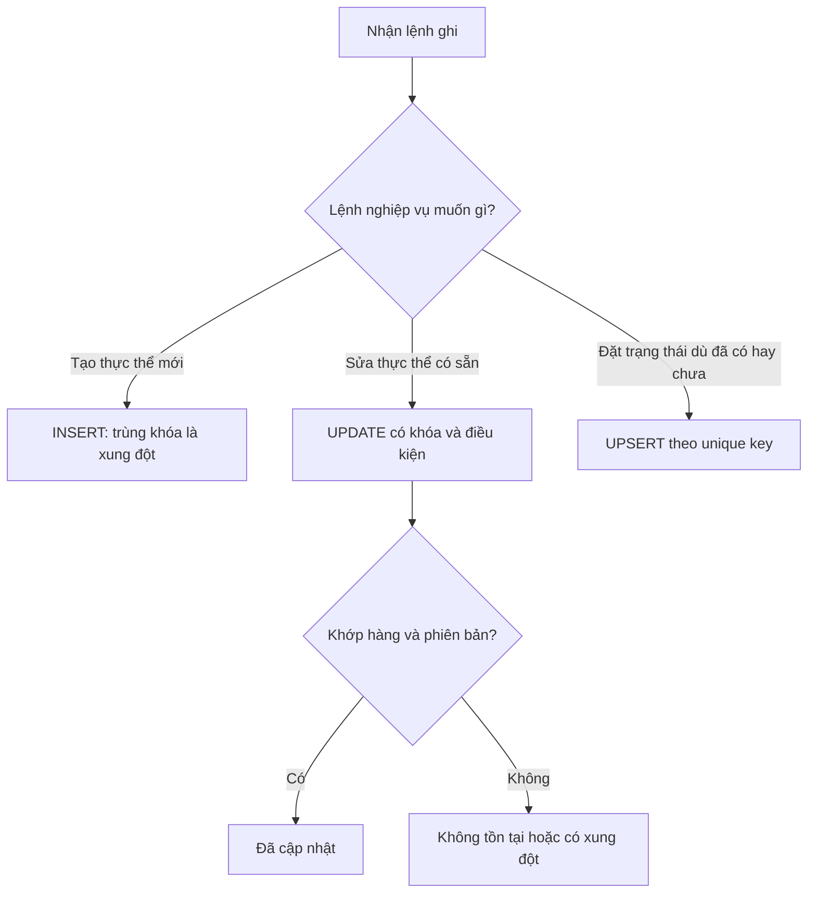

# Phân biệt tạo mới, cập nhật và upsert

Khi nhận yêu cầu lưu thông tin, ứng dụng cần biết chính xác thao tác mong muốn là **tạo một bản ghi mới**, **thay đổi bản ghi đã tồn tại**, hay **tạo nếu chưa có và cập nhật nếu đã có**. Ba thao tác này có thể cho kết quả giống nhau khi nhìn vào trạng thái cuối cùng, nhưng khác nhau về điều kiện thực thi, cách xử lý trùng khóa, cập nhật đồng thời, quyền truy cập và khả năng thử lại sau lỗi kết nối.

Bài học thuộc chương **Thao tác dữ liệu** của `DATA_PERSISTENCE_FUNDAMENTALS`. Chúng ta dùng ví dụ lưu tùy chọn người dùng để hiểu `INSERT`, `UPDATE` và **upsert** trong PostgreSQL, sau đó đối chiếu với MongoDB và thiết kế ranh giới persistence trong Java. Các ví dụ tập trung vào tính đúng đắn của dữ liệu, ràng buộc, giao dịch, hiệu năng và vận hành; câu lệnh SQL cụ thể có thể khác ở hệ quản trị khác.

## Mục tiêu học tập

Sau bài học, bạn có thể:

- Phân biệt hợp đồng nghiệp vụ và kết quả của tạo mới, cập nhật và upsert.
- Hiểu tác động của khóa chính, ràng buộc `UNIQUE`, điều kiện `WHERE` và số hàng bị ảnh hưởng.
- Viết `INSERT`, `UPDATE` có điều kiện và `INSERT ... ON CONFLICT ... DO UPDATE` trong PostgreSQL.
- Nhận diện lỗi mất cập nhật (*lost update*), xử lý xung đột bằng phiên bản và thiết kế thử lại an toàn.
- Lựa chọn thao tác phù hợp cho đơn hàng, thanh toán, cấu hình, dữ liệu đồng bộ và bộ đếm.
- Định nghĩa phương thức repository Java để không che giấu sự khác biệt giữa các thao tác.

## 1. Cùng là ghi dữ liệu, nhưng ba hợp đồng khác nhau

Xét một bản ghi tùy chọn của người dùng `user_id = 42`, có giao diện sáng/tối và lựa chọn nhận thông báo.

| Thao tác | Điều kiện ban đầu | Khi chưa có hàng | Khi đã có hàng | Kỳ vọng khi xung đột |
|---|---|---|---|---|
| **Create / Insert** | Muốn thêm một thực thể mới | Tạo hàng | Từ chối nếu trùng khóa duy nhất | Báo trùng hoặc xử lý theo hợp đồng tạo |
| **Update** | Muốn sửa thực thể đang tồn tại | Không tạo hàng | Sửa hàng khớp điều kiện | Có thể phát hiện phiên bản cũ hoặc không đủ quyền |
| **Upsert** | Muốn bảo đảm hàng có trạng thái mục tiêu | Tạo hàng | Cập nhật hàng theo khóa xung đột | Hệ quản trị quyết định nhánh tạo/cập nhật một cách nhất quán theo cơ chế hỗ trợ |

Sự khác biệt này là **ngữ nghĩa nghiệp vụ**, không chỉ tên hàm. Ví dụ API tạo thanh toán không được âm thầm cập nhật khoản thanh toán cũ khi nhận cùng mã giao dịch nhưng số tiền khác. Ngược lại, một tác vụ đồng bộ cấu hình có thể được phép tạo cấu hình mặc định khi chưa có và cập nhật khi đã có.

Sơ đồ lựa chọn đơn giản:



Trước khi chọn thao tác, hãy trả lời: **định danh nào được coi là duy nhất**, có được phép ghi đè dữ liệu trước đó không, thao tác có cần giữ lịch sử không và điều gì được trả về nếu hàng không tồn tại?

## 2. Chuẩn bị lược đồ và định danh

Ví dụ PostgreSQL dưới đây có một hàng tùy chọn cho mỗi người dùng. Để bài học tự chạy độc lập, bảng được trình bày không có bảng `users`; trong hệ thống thật, nếu cùng cơ sở dữ liệu và có bảng người dùng, cần xem xét thêm khóa ngoại `user_id` đến bảng đó.

```sql
CREATE TABLE user_preferences (
    user_id           bigint PRIMARY KEY,
    theme             text NOT NULL DEFAULT 'SYSTEM',
    marketing_opt_in  boolean NOT NULL DEFAULT false,
    revision          bigint NOT NULL DEFAULT 0,
    created_at        timestamptz NOT NULL DEFAULT now(),
    updated_at        timestamptz NOT NULL DEFAULT now(),
    CONSTRAINT ck_user_preferences_theme
        CHECK (theme IN ('LIGHT', 'DARK', 'SYSTEM')),
    CONSTRAINT ck_user_preferences_revision
        CHECK (revision >= 0)
);
```

`PRIMARY KEY (user_id)` bảo đảm mỗi người chỉ có một hàng và cung cấp khóa nhận diện xung đột. `CHECK` chặn những giá trị giao diện không hợp lệ, `NOT NULL` chặn thiếu trường bắt buộc. `revision` được dùng để phát hiện hai yêu cầu cùng sửa một trạng thái cũ. `created_at` ghi thời điểm tạo hàng, còn `updated_at` do lệnh cập nhật chủ động thay đổi; `DEFAULT now()` **không tự cập nhật** cột này mỗi khi chạy `UPDATE`.

Trong trường hợp một thực thể có khóa thay thế tự sinh (`id`) và một mã nghiệp vụ (`external_id`), cần đặt `UNIQUE` cho mã nghiệp vụ nếu không được trùng. UPSERT chỉ phát hiện xung đột trên **khóa hoặc ràng buộc duy nhất mà câu lệnh sử dụng**; khóa tự tăng không thay thế quy tắc duy nhất của nghiệp vụ.

## 3. Tạo mới bằng INSERT

`INSERT` diễn đạt yêu cầu **thêm một hàng mới**. Nếu khóa không trùng và mọi ràng buộc hợp lệ, PostgreSQL thêm hàng; nếu trùng `user_id`, thao tác báo vi phạm khóa duy nhất.

```sql
INSERT INTO user_preferences
    (user_id, theme, marketing_opt_in)
VALUES
    (42, 'DARK', true)
RETURNING user_id, theme, revision, created_at;
```

Ở đây `revision` nhận giá trị mặc định `0`, các trường thời gian dùng `now()`. `RETURNING` trả lại giá trị cơ sở dữ liệu đã ghi, giúp ứng dụng biết định danh và phiên bản. Nếu chạy lại câu lệnh với `user_id = 42` khi hàng đã tồn tại, PostgreSQL phát sinh lỗi vi phạm khóa chính, **không ghi đè** giá trị cũ.

Một số điểm quan trọng:

- **Kiểm tra tồn tại trước không đủ:** hai phiên đồng thời đều có thể đọc thấy chưa tồn tại rồi cùng `INSERT`. Ràng buộc duy nhất mới là điểm ngăn lưu trùng.
- **ID do database sinh:** ví dụ khác có thể dùng `GENERATED ... AS IDENTITY` và đọc lại qua `RETURNING`. Không suy ID mới bằng `MAX(id) + 1`, vì các phiên đồng thời có thể chọn cùng số.
- **Lỗi lặp yêu cầu:** client mất phản hồi sau khi `INSERT` thành công có thể phát lại yêu cầu. Lần sau gặp trùng khóa; ứng dụng phải phân biệt yêu cầu lặp hợp lệ với một yêu cầu khác đang dùng cùng khóa.
- **Dữ liệu không hợp lệ:** sai `CHECK`, `NOT NULL` hoặc `FOREIGN KEY` vẫn phải thất bại dù không trùng khóa chính.

### INSERT ... ON CONFLICT DO NOTHING có phải upsert?

```sql
INSERT INTO user_preferences (user_id, theme)
VALUES (42, 'DARK')
ON CONFLICT (user_id) DO NOTHING
RETURNING user_id;
```

Câu lệnh **tạo nếu chưa có, giữ nguyên nếu đã có**. Nó thường được gọi là *insert-if-absent* hoặc *insert-ignore*, khác với upsert có nhánh cập nhật. Nếu trùng khóa, `RETURNING` không trả hàng nào; không được kết luận người dùng đã có giá trị `'DARK'` vì hàng cũ có thể là `'LIGHT'`. Với yêu cầu idempotency, cần so sánh dữ liệu của yêu cầu trước khi coi việc trùng là thành công tương đương.

## 4. Cập nhật bằng UPDATE

`UPDATE` sửa **những hàng đáp ứng điều kiện `WHERE`**. Nếu không hàng nào khớp, PostgreSQL không tự tạo hàng mới.

```sql
UPDATE user_preferences
SET theme = 'LIGHT',
    revision = revision + 1,
    updated_at = now()
WHERE user_id = 42
RETURNING user_id, theme, revision, updated_at;
```

Nếu hàng `user_id = 42` tồn tại, thao tác thay đổi giao diện và tăng phiên bản. Nếu không tồn tại, kết quả `RETURNING` rỗng và **số hàng cập nhật là 0**. Không có lỗi SQL chỉ vì điều kiện `WHERE` không khớp.

**Cẩn thận với `WHERE`:** thiếu điều kiện có thể thay đổi mọi hàng của bảng. Ở ứng dụng đa tenant, `WHERE` còn cần áp dụng các điều kiện phân vùng/tenant và quyền truy cập phù hợp. Việc tìm được một ID không tự chứng minh người gọi được phép sửa hàng đó.

### Cập nhật có điều kiện để chống mất dữ liệu

Giả sử hai trình duyệt cùng đọc cấu hình ở `revision = 4`. Trình duyệt A đổi sang `'DARK'`, trong khi B sửa một trường khác dựa trên phiên bản 4. Nếu cả hai ghi đè toàn bộ hàng, lần ghi sau có thể xóa thay đổi của lần trước. Có thể dùng **optimistic locking**:

```sql
UPDATE user_preferences
SET theme = 'DARK',
    revision = revision + 1,
    updated_at = now()
WHERE user_id = 42
  AND revision = 4
RETURNING user_id, theme, revision;
```

Nếu A cập nhật trước, `revision` thành 5. B dùng điều kiện `revision = 4` sẽ cập nhật **0 hàng**, từ đó biết dữ liệu đã thay đổi hoặc hàng không tồn tại/không được truy cập. Ứng dụng có thể đọc lại để phân biệt và quyết định báo xung đột, yêu cầu người dùng xem lại, hay trộn thay đổi theo quy tắc nghiệp vụ. Không nên thử lại bằng cách bỏ điều kiện phiên bản, vì như vậy biến lỗi thành ghi đè ngầm.

Khi chỉ muốn cập nhật các trường được gửi, hãy phân biệt **không gửi trường** với **gửi `null` để xóa giá trị**. Một API kiểu PATCH có thể bảo tồn những trường vắng mặt, còn một yêu cầu thay thế toàn bộ tài nguyên cần hợp đồng rõ ràng. Dùng `COALESCE(:param, existing_value)` bừa bãi sẽ khiến ứng dụng không thể chủ động đặt trường về `NULL`.

### UPDATE cộng dồn khác với UPDATE gán giá trị

```sql
-- Hai lần thực hiện sẽ tăng 2: thao tác không idempotent.
UPDATE counters SET value = value + 1 WHERE counter_id = 7;

-- Hai lần thực hiện có thể tạo cùng giá trị cuối nhưng vẫn có các
-- tác dụng phụ khác nếu có trigger, revision hoặc updated_at.
UPDATE counters SET value = 10 WHERE counter_id = 7;
```

Với các bộ đếm, trừ tồn kho hoặc cộng số dư, cần xác định chính sách xử lý yêu cầu trùng. Một phép cộng atomic trong database có thể ngăn kiểu mất cập nhật do đọc–sửa–ghi ở client, nhưng **không ngăn việc cộng hai lần** khi cùng sự kiện bị phát lại.

## 5. Upsert: tạo nếu chưa có, cập nhật nếu đã có

**Upsert** ghép hai nhánh nghiệp vụ trong một câu lệnh hoặc API mà hệ lưu trữ hỗ trợ: nếu không có hàng cùng khóa duy nhất thì tạo, nếu có xung đột phù hợp thì thực hiện cập nhật. PostgreSQL dùng `INSERT ... ON CONFLICT ... DO UPDATE`.

```sql
INSERT INTO user_preferences
    (user_id, theme, marketing_opt_in)
VALUES
    (42, 'DARK', true)
ON CONFLICT (user_id) DO UPDATE
SET theme = EXCLUDED.theme,
    marketing_opt_in = EXCLUDED.marketing_opt_in,
    revision = user_preferences.revision + 1,
    updated_at = now()
RETURNING user_id, theme, marketing_opt_in, revision;
```

Trong cú pháp PostgreSQL, `EXCLUDED.theme` và `EXCLUDED.marketing_opt_in` là các giá trị **được đề xuất để chèn** nhưng dẫn tới xung đột. Khi chưa có hàng, cơ sở dữ liệu chèn bản ghi với `revision = 0`; khi đã có hàng cùng `user_id`, nó thay các trường đã nêu và tăng phiên bản. Các trường không được đưa vào phần `SET`, như `created_at`, giữ nguyên ở nhánh cập nhật.

Với ràng buộc duy nhất phù hợp, PostgreSQL xử lý nhánh insert/update theo cơ chế nguyên tử của `ON CONFLICT DO UPDATE` ngay cả khi có các phiên đồng thời. Đây không đồng nghĩa với giao dịch toàn bộ quy trình nghiệp vụ ở **nhiều bảng**, và không bảo đảm cập nhật dữ liệu theo ý định của người dùng nếu nhiều client gửi trạng thái cũ. Upsert này có tính **last-writer-wins về nội dung** trong tình huống các cập nhật liên tiếp cùng khóa; nó không yêu cầu `expectedRevision`.

### Tránh cập nhật khi dữ liệu không đổi

Lệnh upsert vừa viết sẽ tăng `revision` và thay `updated_at` ngay cả khi người dùng gửi lại đúng giá trị hiện có. Nếu muốn tránh thay đổi không cần thiết:

```sql
INSERT INTO user_preferences
    (user_id, theme, marketing_opt_in)
VALUES
    (42, 'DARK', true)
ON CONFLICT (user_id) DO UPDATE
SET theme = EXCLUDED.theme,
    marketing_opt_in = EXCLUDED.marketing_opt_in,
    revision = user_preferences.revision + 1,
    updated_at = now()
WHERE (user_preferences.theme, user_preferences.marketing_opt_in)
      IS DISTINCT FROM (EXCLUDED.theme, EXCLUDED.marketing_opt_in)
RETURNING user_id, theme, marketing_opt_in, revision;
```

`IS DISTINCT FROM` so sánh có xét `NULL` theo nghĩa hai giá trị khác nhau, tránh một số bất ngờ của toán tử `<>`. Với cấu hình này:

- Hàng chưa tồn tại: chèn và trả một hàng.
- Hàng đã tồn tại nhưng giá trị khác: cập nhật và trả một hàng.
- Hàng đã tồn tại với cùng giá trị: không chạy nhánh cập nhật; `RETURNING` **không trả hàng**.

Vì vậy, `0` hàng trả về trong trường hợp này **không có nghĩa là thất bại**; có thể là trạng thái đã đúng như yêu cầu. Muốn trả lại cấu hình hiện tại thì cần hợp đồng đọc tiếp phù hợp, đồng thời kiểm tra quyền và dữ liệu quan trọng. `WHERE` của `DO UPDATE` chỉ kiểm soát nhánh cập nhật sau khi phát hiện xung đột; nó không thay thế điều kiện phiên bản của một lệnh sửa có yêu cầu chống ghi đè.

### Upsert không giống UPDATE rồi INSERT

Mẫu dễ sai:

```text
if (SELECT theo khóa không thấy hàng) {
    INSERT hàng mới;
} else {
    UPDATE hàng cũ;
}
```

Hai phiên A và B có thể cùng thấy chưa có, rồi cùng chèn. Nếu không có `UNIQUE`, kết quả là **hai bản ghi trùng nghiệp vụ**; nếu có `UNIQUE`, một phiên gặp lỗi. Mẫu `UPDATE` trước, thấy 0 hàng rồi `INSERT` cũng có cuộc đua tương tự. Với PostgreSQL, hãy ưu tiên `ON CONFLICT` khi đúng là cần upsert theo khóa duy nhất. Nếu dùng hệ quản trị khác, kiểm tra cơ chế upsert/MERGE cụ thể, mức cô lập và khả năng retry; không mặc định mọi API tên `upsert` có cùng bảo đảm đồng thời.

## 6. Khi nào không nên chọn upsert?

Upsert tiện lợi nhưng có thể **che giấu lỗi nghiệp vụ** nếu thực thể không được phép tự tạo hoặc dữ liệu cũ không được phép bị thay thế.

| Tình huống | Thao tác phù hợp hơn | Lý do |
|---|---|---|
| Tạo đơn hàng mới bằng mã yêu cầu duy nhất | `INSERT`, ràng buộc duy nhất và idempotency key | Trùng mã nhưng nội dung khác phải báo xung đột, không ghi đè đơn |
| Sửa địa chỉ giao của đơn chưa gửi | `UPDATE ... WHERE order_id = ? AND status = 'DRAFT'` | Không được tạo đơn mới khi ID sai hoặc đơn đã khóa |
| Đồng bộ tùy chọn giao diện từ máy khách | Upsert theo `user_id` khi chấp nhận ghi đè | Cho phép tạo lần đầu và đặt trạng thái mong muốn |
| Thay đổi số dư hoặc tăng bộ đếm | Lệnh biến đổi có điều kiện, transaction/idempotency | Upsert gán trạng thái mới có thể xóa thay đổi đồng thời; cộng lặp có thể nhân đôi |
| Ghi nhận kết quả thanh toán từ cổng bên ngoài | Dựa trên khóa sự kiện duy nhất và trạng thái chuyển hợp lệ | Cùng ID nhưng số tiền/kết quả khác là bất thường cần đối soát |
| Cập nhật tài liệu đã được người dùng mở để chỉnh sửa | `UPDATE` với `expectedRevision` | Tránh bản lưu cũ ghi đè bản mới |

Ngay cả với cấu hình được phép upsert, hãy đặt câu hỏi: **Ai sở hữu giá trị cuối cùng?** Nếu hai thiết bị chỉnh sửa offline rồi đồng bộ, last-writer-wins có thể mất cập nhật. Có thể cần version, thời gian được xác thực ở server, chính sách merge từng trường hoặc buộc người dùng giải quyết xung đột.

## 7. Idempotency, thử lại và lỗi kết nối

Một thao tác **idempotent** cho cùng trạng thái quan sát được khi thực hiện nhiều lần so với một lần, trong phạm vi hợp đồng đã xác định. Không thể suy ra idempotency chỉ từ tên lệnh.

| Lệnh | Phát lại cùng yêu cầu | Nhận xét |
|---|---|---|
| `INSERT` cùng primary key | Lần hai thường gặp xung đột unique | Có thể là chính sách đúng cho tạo mới; cần phân biệt yêu cầu trùng |
| `UPDATE SET theme = 'DARK'` | Giá trị `theme` cuối cùng giống nhau | Trigger, timestamp, version hoặc nhật ký vẫn có thể thay đổi |
| `UPDATE SET total = total + 100` | Cộng thêm mỗi lần | Không idempotent, cần chống xử lý trùng |
| Upsert `SET theme = EXCLUDED.theme` | Giá trị mục tiêu giống nhau | Có thể cập nhật metadata nhiều lần nếu không có điều kiện tránh thay đổi |
| Upsert tăng `revision` mỗi lần | Phiên bản thay đổi theo số lần phát lại | Không idempotent với toàn bộ trạng thái hàng |

Giả sử client gửi yêu cầu tạo đơn, server `COMMIT` thành công nhưng kết nối đứt trước khi client nhận phản hồi. Client **không biết chắc** đơn có được tạo hay chưa. Không được phát lại một câu lệnh tạo ID mới và mặc định tạo đơn thứ hai là đúng.

Giải pháp thường dùng là **idempotency key** do client gửi cho từng ý định nghiệp vụ, cùng ràng buộc duy nhất ở database và thông tin để đối chiếu nội dung yêu cầu. Khi nhận lại cùng key, server trả kết quả đã lưu nếu nội dung tương đương; nếu key bị tái sử dụng với nội dung khác, trả xung đột. Việc ghi kết quả và trạng thái xử lý cần đặt trong ranh giới transaction hoặc quy trình phục hồi được thiết kế rõ.

Ví dụ ràng buộc một mã đặt hàng bên ngoài không được trùng:

```sql
CREATE TABLE orders (
    order_id         bigint GENERATED ALWAYS AS IDENTITY PRIMARY KEY,
    request_key      text NOT NULL UNIQUE,
    customer_id      bigint NOT NULL,
    amount_vnd       bigint NOT NULL CHECK (amount_vnd >= 0),
    status           text NOT NULL DEFAULT 'CREATED'
);

-- Mỗi request_key chỉ tạo tối đa một hàng.
INSERT INTO orders (request_key, customer_id, amount_vnd)
VALUES ('req-8301', 42, 150000)
ON CONFLICT (request_key) DO NOTHING
RETURNING order_id;
```

Nếu không có hàng trả về, ứng dụng phải đọc bản ghi có `request_key = 'req-8301'` và so sánh `customer_id`, `amount_vnd` cùng các trường tham gia hợp đồng idempotency, thay vì mặc nhiên coi đây là yêu cầu giống hệt. Trong hệ thống thật còn phải xác định phạm vi key theo người dùng/tenant, thời gian tồn tại key, bảo mật và cách xử lý công việc bất đồng bộ đã phát sinh.

## 8. Ranh giới giao dịch và kiểm soát đồng thời

`INSERT`, `UPDATE` hay upsert là thao tác ghi trên database, nhưng nghiệp vụ có thể gồm **nhiều bước cần nguyên tử**. Ví dụ tạo đơn và trừ tồn kho không trở nên an toàn chỉ vì phần lưu đơn dùng upsert.

```sql
BEGIN;

UPDATE products
SET available_qty = available_qty - 2
WHERE product_id = 10
  AND available_qty >= 2;

-- Ứng dụng phải kiểm tra cập nhật đúng một hàng;
-- chỉ sau đó mới tạo đơn và dòng hàng tương ứng.

COMMIT;
```

Đây là **khung minh họa**, không phải transaction đặt hàng hoàn chỉnh: chưa có phần `INSERT` đơn/dòng, xử lý rollback, khóa idempotency, kiểm tra trạng thái và thanh toán. Nếu `UPDATE` tác động 0 hàng, ứng dụng phải từ chối hoặc rollback theo hợp đồng. Nếu thao tác cần đảm bảo đồng thời trên nhiều bảng, các bước thuộc cùng giao dịch ở cùng database phải được phối hợp và kiểm tra kết quả trước commit.

Các khái niệm cần tách biệt:

- **Atomicity:** thay đổi trong một transaction được áp dụng cùng nhau hoặc không áp dụng, trong phạm vi DB và cơ chế giao dịch hỗ trợ.
- **Isolation:** phiên giao dịch nhìn thấy thay đổi của phiên khác ra sao; quyết định nguy cơ lost update, write skew, phantom và retry.
- **Durability:** khi nào dữ liệu đã được xác nhận lưu bền vững, phụ thuộc hệ quản trị/cấu hình ghi và replication.
- **Conflict detection:** khóa duy nhất, điều kiện phiên bản hoặc khóa hàng bảo vệ những bất biến khác nhau; không có cơ chế nào tự giải quyết mọi xung đột nghiệp vụ.

Một upsert **không thể tự cập nhật nguyên tử cả** cơ sở dữ liệu vận hành, bộ nhớ đệm, hàng đợi và dịch vụ thanh toán khác. Nếu cần truyền sự kiện sau commit, cân nhắc outbox/event-driven flow phù hợp và cơ chế idempotency cho consumer; một thao tác đã commit có thể bị phát lại khi hệ thống phục hồi.

## 9. Hiện thực ranh giới persistence trong Java

Tên phương thức repository nên thể hiện hợp đồng rõ ràng: `createPreference`, `updatePreferenceIfRevision`, `setPreference` hoặc `upsertPreference`. Một tên chung chung như `save` dễ che giấu việc hệ thống sẽ tạo mới, ghi đè hay bỏ qua xung đột.

Ví dụ JDBC với PostgreSQL cho thao tác cập nhật có kiểm tra phiên bản:

```java
import java.sql.Connection;
import java.sql.PreparedStatement;
import java.sql.SQLException;
import javax.sql.DataSource;

final class PreferenceRepository {
    private final DataSource dataSource;

    PreferenceRepository(DataSource dataSource) {
        this.dataSource = dataSource;
    }

    boolean updateThemeIfRevision(
        long userId, String nextTheme, long expectedRevision
    ) throws SQLException {
        String sql = """
            UPDATE user_preferences
            SET theme = ?, revision = revision + 1, updated_at = now()
            WHERE user_id = ? AND revision = ?
            """;

        try (Connection connection = dataSource.getConnection();
             PreparedStatement statement = connection.prepareStatement(sql)) {
            statement.setString(1, nextTheme);
            statement.setLong(2, userId);
            statement.setLong(3, expectedRevision);
            return statement.executeUpdate() == 1;
        }
    }
}
```

Ví dụ dùng **Java text blocks** (Java 15+), `DataSource` quản lý kết nối, và `PreparedStatement` để gắn tham số. Kết quả `true` nghĩa là đã cập nhật đúng một hàng; `false` có thể là **không tồn tại**, **không khớp phiên bản**, hoặc bị điều kiện truy cập ở một truy vấn thực tế loại bỏ. Lớp service quyết định đọc lại hoặc trả xung đột phù hợp. Các ràng buộc như `CHECK` vẫn được PostgreSQL kiểm tra và có thể phát sinh `SQLException`.

Ví dụ dùng upsert trong JDBC, với chính sách *đặt cấu hình cuối cùng* và không cần phát hiện phiên bản cũ:

```java
int setPreference(
    DataSource dataSource, long userId, String theme, boolean optIn
) throws SQLException {
    String sql = """
        INSERT INTO user_preferences (user_id, theme, marketing_opt_in)
        VALUES (?, ?, ?)
        ON CONFLICT (user_id) DO UPDATE
        SET theme = EXCLUDED.theme,
            marketing_opt_in = EXCLUDED.marketing_opt_in,
            revision = user_preferences.revision + 1,
            updated_at = now()
        """;

    try (Connection connection = dataSource.getConnection();
         PreparedStatement statement = connection.prepareStatement(sql)) {
        statement.setLong(1, userId);
        statement.setString(2, theme);
        statement.setBoolean(3, optIn);
        return statement.executeUpdate();
    }
}
```

Đây là phương thức minh họa có thể nằm trong một repository. Nhánh cập nhật cũng tăng `revision`, nhờ đó một client đang giữ phiên bản cũ sẽ bị phương thức `updateThemeIfRevision` từ chối nếu có ghi xen vào. Tuy nhiên, bản thân upsert này **không kiểm tra phiên bản mà client đã đọc**: lệnh đồng bộ đến sau vẫn có thể ghi đè giá trị mới hơn. Trong hệ thống thực tế, mọi đường ghi phải tuân thủ một chính sách nhất quán về phiên bản; chỉ dùng upsert kiểu này khi nghiệp vụ thực sự cho phép đặt lại trạng thái theo thứ tự ghi.

### Diễn giải SQLSTATE trong PostgreSQL

| SQLSTATE | Ý nghĩa thường gặp | Hành động |
|---|---|---|
| `23505` | Vi phạm `UNIQUE` hoặc `PRIMARY KEY` | Xem đây là trùng/xung đột; đối chiếu request nếu có idempotency key |
| `23503` | Vi phạm `FOREIGN KEY` | Kiểm tra quan hệ/định danh tham chiếu; không thử lại mù quáng |
| `23514` | Vi phạm `CHECK` | Báo dữ liệu ngoài miền cho phép |
| `23502` | Vi phạm `NOT NULL` | Báo thiếu trường bắt buộc |
| `40001` | Serialization failure | Có thể thử lại **toàn bộ transaction** theo chính sách an toàn |
| `40P01` | Deadlock detected | Có thể thử lại có giới hạn khi thao tác đáp ứng yêu cầu idempotency |

Sử dụng `SQLException.getSQLState()` và, khi driver hỗ trợ, thông tin tên constraint để phân loại. Không phát tán câu SQL hoặc thông báo lỗi thô chứa dữ liệu nhạy cảm ra client. Mất kết nối ngay sau lệnh có thể tạo **kết quả không chắc chắn**; trước khi gửi lại thao tác có tác dụng phụ, ứng dụng phải biết cách phát hiện lần trước đã thành công hay chưa.

## 10. Đối chiếu với MongoDB và các hệ khác

Trong MongoDB, cùng ba ý tưởng có API khác:

```javascript
// CREATE: lỗi duplicate key nếu _id đã tồn tại.
db.user_preferences.insertOne({
  _id: "user-42",
  theme: "DARK",
  marketingOptIn: true
});

// UPDATE: chỉ tác động khi đã có tài liệu khớp.
db.user_preferences.updateOne(
  { _id: "user-42" },
  { $set: { theme: "LIGHT" } }
);

// UPSERT: tạo tài liệu nếu không khớp, cập nhật nếu đã có.
db.user_preferences.updateOne(
  { _id: "user-42" },
  {
    $set: { theme: "DARK", marketingOptIn: true },
    $setOnInsert: { createdAt: new Date() }
  },
  { upsert: true }
);
```

Trong `updateOne`, `matchedCount` cho biết có tài liệu khớp điều kiện hay không, `modifiedCount` cho biết số tài liệu thực sự được sửa, còn `upsertedId` xuất hiện khi thao tác upsert đã chèn mới. `matchedCount = 1` và `modifiedCount = 0` có thể là bản ghi đã mang giá trị cần đặt; không nên đồng nhất với việc không tìm thấy. `$setOnInsert` chỉ gán trường khi tạo mới; `$set` áp dụng trên nhánh cập nhật và nhánh tạo.

MongoDB có atomicity cho thao tác trên **một tài liệu**, nhưng nhất quán xuyên nhiều tài liệu/collection cần thiết kế giao dịch hoặc quy trình phối hợp. Nếu bộ lọc upsert dựa trên trường không có chỉ mục duy nhất phù hợp, các upsert cạnh tranh có thể tạo tài liệu trùng theo định danh nghiệp vụ. Sử dụng khóa duy nhất và điều kiện cập nhật phù hợp cho yêu cầu kiểm soát đồng thời.

Cũng cần phân biệt thao tác **replace** với **partial update**. Trong MongoDB, `replaceOne` thay tài liệu phù hợp bằng tài liệu mới (với quy tắc riêng cho `_id`); trong SQL, `UPDATE` chỉ thay những cột được nêu trong `SET`. Một thao tác thay thế toàn bộ dữ liệu có thể vô tình xóa các trường cũ không còn xuất hiện trong payload. Không suy rằng `save`, `replace`, `update` và `upsert` của mọi ORM/driver có cùng ngữ nghĩa; phải đọc đúng API của thư viện đã chọn.

## 11. Hiệu năng, schema evolution, bảo mật và quan sát

### Tối ưu theo đường ghi

- **Chỉ mục đúng khóa:** `ON CONFLICT (user_id)` cần khóa duy nhất phù hợp; quá nhiều index làm tăng chi phí ghi. Đặt các index cho truy vấn đọc theo workload thật, không tự tạo mọi index chỉ vì có trường mới.
- **Ghi có điều kiện:** `UPDATE ... WHERE revision = ?` và `IS DISTINCT FROM` giúp tránh cập nhật không mong muốn. Tuy nhiên, điều kiện phức tạp hay trigger vẫn có chi phí, cần đo thực tế.
- **Batch:** nhiều `INSERT` nhỏ có thể được gom batch khi phù hợp, nhưng phải xử lý từng lỗi/ràng buộc và hiểu hành vi transaction. Một `ON CONFLICT DO UPDATE` nhiều hàng trong PostgreSQL không cho cùng một hàng đích bị tác động nhiều lần trong một câu lệnh; hãy loại trùng khóa trong batch trước.
- **Thống kê:** theo dõi số insert mới, số update, số thao tác không có hàng khớp, số unique conflict và độ trễ p95/p99. Tỷ lệ xung đột tăng có thể chỉ ra lỗi client hoặc nhu cầu khóa/điều phối khác.

### Khi schema thay đổi

Giả sử thêm cột `locale` với giá trị mặc định. Cần quyết định chính sách với hàng cũ và payload cũ: khi tạo mới, `DEFAULT` có tác dụng nếu cột không được nêu; khi update, cột không được nêu trong `SET` giữ nguyên. Trong upsert, phải chủ động chọn nhánh cập nhật có sửa `locale` hay không. Sử dụng `EXCLUDED.locale` mà client không cung cấp cột này có thể đặt giá trị mặc định hoặc ngoài ý định, tùy câu lệnh và schema. Khi nâng cấp nhiều phiên bản ứng dụng, cần hợp đồng rõ ràng trước khi bật writer mới và backfill dữ liệu cũ.

**Migration** cần bảo toàn ràng buộc `UNIQUE`/khóa ngoại, dữ liệu lịch sử và ý nghĩa cập nhật. Thêm cột `revision` cho bảng đang hoạt động phải xác định giá trị ban đầu, cập nhật các đường ghi, và triển khai reader/writer có tương thích phiên bản. Không được bật một nửa cơ chế optimistic locking khi các job cũ vẫn có thể cập nhật mà không tăng revision.

### Phân quyền và audit

API phải xác minh người dùng được phép sửa đúng bản ghi/tenant. Một upsert không kiểm tra quyền có thể tạo ra bản ghi ở tenant khác hoặc ghi đè dữ liệu ngoài phạm vi. Dùng điều kiện truy cập phù hợp, chính sách Row Level Security nếu có, và kiểm tra kết quả trong ngữ cảnh xác thực. Ghi audit cho những thay đổi quan trọng: ai đã yêu cầu, lúc nào, key nào, giá trị nào thay đổi, transaction hoặc trace ID nào liên quan. Audit có thể cần được ghi cùng transaction hoặc qua outbox để tránh mất sự kiện khi hệ thống gặp lỗi.

## 12. Những sai lầm thường gặp

| Sai lầm | Hậu quả | Cách sửa |
|---|---|---|
| Dùng upsert cho mọi thao tác `save` | Tạo hàng khi ID sai, hoặc ghi đè dữ liệu cũ | Chọn create/update/upsert theo hợp đồng nghiệp vụ |
| `SELECT` kiểm tra chưa tồn tại rồi `INSERT` | Hai request đồng thời tạo trùng hoặc xung đột | Ràng buộc unique và xử lý lỗi; dùng upsert nếu đúng nhu cầu |
| `UPDATE` không có `WHERE` hoặc thiếu tenant | Ghi vào quá nhiều hàng hoặc sai phạm vi | Ràng buộc khóa/tenant, phân quyền và kiểm tra số hàng thay đổi |
| Bỏ qua kết quả `UPDATE` = 0 | API báo thành công dù bản ghi không tồn tại hoặc bị conflict | Phân biệt not found/conflict/no-op theo hợp đồng |
| Upsert ghi đè toàn bộ payload | Mất thay đổi từ client khác | Dùng version, merge có chủ đích hoặc giới hạn trường được cập nhật |
| Retry lệnh tăng tiền, bộ đếm hay tạo ID mới | Tạo giao dịch trùng hoặc tác dụng phụ nhân đôi | Idempotency key và transaction/đối soát |
| Tăng version trong một số đường ghi nhưng bỏ qua đường khác | Optimistic locking không phát hiện đầy đủ | Thống nhất quy tắc tăng version cho **mọi** writer |
| Coi `DO NOTHING` là cập nhật thành công | Dữ liệu cũ giữ nguyên dù payload mới khác | Đọc/so sánh hoặc trả kết quả conflict rõ ràng |
| Tin rằng upsert một hàng cập nhật đồng bộ mọi hệ khác | API, cache, hàng đợi và báo cáo lệch nhau | Transaction nội bộ, outbox, eventual consistency và đối soát |

## 13. Bài tập vận dụng

Ứng dụng quản lý ghi chú cá nhân có API tạo ghi chú mới và cập nhật nội dung, đồng thời đồng bộ từ hai thiết bị có thể dùng offline. Mỗi ghi chú có `note_id`, `owner_id`, `title`, `body`, `revision`, `created_at`, `updated_at`. Yêu cầu: không tạo trùng, không mất chỉnh sửa cũ, và thử lại an toàn khi client mất kết nối.

1. Thiết kế `PRIMARY KEY`, một khóa yêu cầu idempotency cho thao tác tạo và ràng buộc phân quyền theo `owner_id`.
2. Viết SQL `INSERT ... RETURNING` tạo ghi chú và định nghĩa phản hồi khi `note_id` hoặc idempotency key đã tồn tại.
3. Viết `UPDATE` có `WHERE note_id = ? AND owner_id = ? AND revision = ?`, trả về phiên bản mới; trình bày cách phân biệt không tồn tại, không được phép và xung đột.
4. Đánh giá việc dùng upsert để đồng bộ hai bản ghi chú offline cùng `note_id`. Nếu thiết bị A và B sửa từ `revision = 3`, giải thích vì sao upsert last-writer-wins có thể làm mất dữ liệu và đề xuất quy tắc xử lý.
5. Trình bày cách xử lý khi server đã commit thao tác tạo nhưng client mất phản hồi, và cách đo số lượt retry/xung đột mà không lộ nội dung ghi chú vào log.

**Gợi ý:** tạo ghi chú mới có định danh và chính sách trùng rõ ràng nên dùng **create với unique constraint và idempotency**. Chỉnh sửa ghi chú đã tồn tại dùng **update với expectedRevision**. Upsert chỉ thích hợp nếu chính sách nghiệp vụ thực sự cho phép tự tạo hoặc ghi đè; việc đồng bộ nội dung nhiều thiết bị thường cần phiên bản, so sánh thay đổi và đôi khi yêu cầu người dùng xử lý xung đột.

## Ghi nhớ

**Tạo mới** bảo vệ ý định thêm thực thể và phải xử lý trùng định danh; **cập nhật** chỉ sửa hàng đang tồn tại, nên kiểm tra điều kiện, số hàng chịu tác động và phiên bản; **upsert** gộp hai nhánh tạo/cập nhật khi nghiệp vụ cho phép, nhưng có thể che giấu xung đột hoặc ghi đè dữ liệu nếu dùng tùy tiện. Trong ứng dụng Java, phải kết hợp hợp đồng repository rõ ràng với khóa duy nhất, transaction, kiểm soát đồng thời, idempotency, xử lý lỗi kết nối và kiểm tra quyền để dữ liệu được lưu bền vững, đúng nghĩa và có thể phục hồi.
