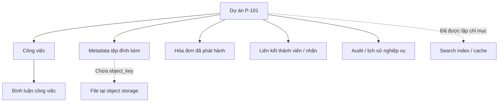
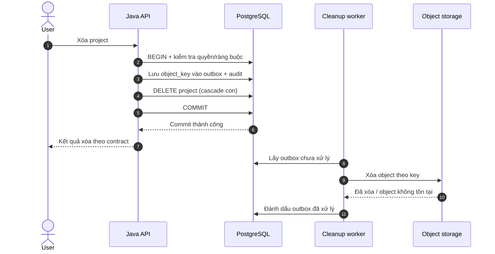

# Xóa một bản ghi và ảnh hưởng tới dữ liệu liên quan

> **Chương:** Thao tác dữ liệu  
> **Học phần:** `DATA_PERSISTENCE_FUNDAMENTALS` — lưu trữ dữ liệu bền vững trong Java, từ mô hình dữ liệu, schema, truy vấn, chỉ mục đến transaction, isolation, kiểm soát đồng thời, lỗi kết nối, thay đổi schema, bảo mật, backup và hiệu năng.

Trong một ứng dụng quản lý dự án, người dùng bấm **Xóa dự án**. Dự án có 200 công việc, 10.000 bình luận, 20 tệp đính kèm ở object storage và ba hóa đơn đã phát hành. Nếu ứng dụng chỉ chạy `DELETE FROM project WHERE id = ?` thì điều gì xảy ra?

Câu trả lời phụ thuộc vào **quan hệ khóa ngoại**, chính sách **vòng đời dữ liệu**, cách thực thi **transaction**, dữ liệu còn lưu ở hệ thống khác và quyền của người dùng thực hiện lệnh. Database có thể tự động xóa các hàng con theo `ON DELETE CASCADE`, chặn thao tác bằng `RESTRICT`, đặt khóa ngoại thành `NULL`, hoặc chỉ đánh dấu bản ghi đã xóa. Không phương án nào đúng cho mọi nghiệp vụ.

Bài này hướng dẫn cách dự báo và kiểm soát toàn bộ hậu quả khi xóa một bản ghi. Mục tiêu không chỉ là chạy SQL thành công mà còn là **không để lại dữ liệu mồ côi, không xóa nhầm bằng chứng nghiệp vụ, không lộ dữ liệu sau xóa logic và có thể khôi phục/đối soát khi lỗi**.

Sau bài học, người học có thể:

- Đọc và giải thích ảnh hưởng của `DELETE` tới bản ghi được tham chiếu qua `FOREIGN KEY`.
- Phân biệt `RESTRICT`, `NO ACTION`, `CASCADE`, `SET NULL`, `SET DEFAULT` và xóa logic (*soft delete*).
- Chọn quy tắc xóa theo mức phụ thuộc và yêu cầu lưu giữ của từng thực thể.
- Viết transaction PostgreSQL/JDBC có kiểm tra quyền, kiểm soát đồng thời, lưu sự kiện audit và outbox để dọn dữ liệu ngoài DB.
- Dự báo ảnh hưởng của xóa số lượng lớn tới lock, MVCC, WAL, index và thời gian phản hồi.
- Thiết kế chính sách khôi phục, retention và bài kiểm thử các trường hợp thất bại.

## 1. Một lệnh DELETE có thể chạm tới những gì?

Một bản ghi có thể được tham chiếu bởi rất nhiều phần khác của hệ thống, không chỉ các bảng ngay cạnh nó.



Từ góc nhìn nghiệp vụ, những nhánh này có bản chất khác nhau:

| Dữ liệu liên quan | Ví dụ | Khi xóa dự án, có thể muốn gì? |
| --- | --- | --- |
| **Thành phần phụ thuộc vòng đời** | Công việc nháp, bình luận gắn riêng với công việc | Xóa cùng dự án nếu không có nghĩa vụ giữ |
| **Quan hệ nhiều-nhiều** | Link tới nhãn, nhóm người tham gia | Chỉ gỡ *cạnh liên kết*, không xóa nhãn hay người dùng |
| **Bản ghi độc lập có nghĩa vụ lưu** | Hóa đơn, thanh toán, biên bản phê duyệt | Chặn xóa hoặc lưu trữ/ẩn dự án; không hủy chứng từ |
| **Lịch sử/audit** | Người xóa, thời điểm và nguyên nhân | Giữ dấu vết theo chính sách; không tự cascade xóa |
| **Dữ liệu ở hệ ngoài** | File trong object storage, chỉ mục tìm kiếm, cache | Dọn hoặc vô hiệu hóa riêng; SQL transaction không bao trùm trực tiếp |
| **Bản sao vận hành** | Replica, backup, WAL, export | Cần quản lý vòng đời/retention; không coi là đã biến mất ngay |

**Xóa có hiệu lực với ai?** Database xử lý những quan hệ mà schema thực sự quy định. Những liên kết chỉ tồn tại trong code Java, file lưu riêng hoặc dữ liệu phân tích không tự tuân theo khóa ngoại.

## 2. Khóa ngoại quyết định điều gì khi xóa hàng cha?

Một khóa ngoại (**foreign key**) bảo vệ tính hợp lệ của quan hệ. Khi bản ghi được tham chiếu bị xóa, chính sách `ON DELETE` quyết định cách xử lý các hàng đang tham chiếu.

| Hành vi | Khi xóa bản ghi cha | Phù hợp khi | Rủi ro nếu chọn sai |
| --- | --- | --- | --- |
| `ON DELETE RESTRICT` | Chặn xóa khi còn hàng con tham chiếu | Hóa đơn hoặc dữ liệu độc lập không được mất quan hệ | Người dùng không thể xóa nếu chưa giải quyết phụ thuộc |
| `ON DELETE NO ACTION` (thường là mặc định) | Kiểm tra ràng buộc và từ chối nếu quan hệ không hợp lệ khi kiểm tra | Cần bảo vệ quan hệ; có thể dùng constraint deferrable ở DBMS hỗ trợ | Nhầm với `RESTRICT` trong các transaction thay đổi thứ tự |
| `ON DELETE CASCADE` | Xóa các hàng con tham chiếu | Dữ liệu con không có nghĩa độc lập, có cùng vòng đời | Một lệnh xóa nhỏ có thể xóa hàng triệu bản ghi |
| `ON DELETE SET NULL` | Đặt cột FK của hàng con thành `NULL` | Liên kết là tùy chọn; hàng con vẫn có nghĩa khi không còn cha | Không áp dụng nếu cột `NOT NULL`; mất ngữ cảnh lịch sử |
| `ON DELETE SET DEFAULT` | Đặt FK thành giá trị mặc định | Có giá trị cha “mặc định” hợp lệ theo nghiệp vụ | Giá trị mặc định vẫn phải thỏa FK; không tự tạo cha hợp lệ |

Trong PostgreSQL, `NO ACTION` có thể được trì hoãn nếu constraint được khai báo `DEFERRABLE`; `RESTRICT` không cho phép trì hoãn thao tác kiểm tra theo cách đó. Với nhiều tình huống thông thường cả hai đều biểu hiện là “không thể xóa cha khi còn con”, nhưng không nên coi chúng hoàn toàn đồng nghĩa khi thiết kế transaction.

**CASCADE chỉ nói tới các hàng con của quan hệ ấy.** Nó không có nghĩa “xóa mọi thứ liên quan trên toàn hệ thống”. Với một chuỗi quan hệ `project → work_item → comment` đều có `CASCADE`, việc xóa project có thể gây xóa theo nhiều cấp; với invoice có `RESTRICT`, toàn bộ câu lệnh có thể bị từ chối.

Ví dụ đơn giản:

```sql
CREATE TABLE department (
    id BIGINT PRIMARY KEY,
    name TEXT NOT NULL
);

CREATE TABLE employee (
    id BIGINT PRIMARY KEY,
    department_id BIGINT REFERENCES department(id)
        ON DELETE SET NULL
);

-- Xóa department có thể để employee tồn tại với department_id = NULL.
-- Nếu department_id là NOT NULL, schema này cần chính sách khác.
```

Khi không có khóa ngoại, database có thể để lại các giá trị `department_id` trỏ tới bản ghi đã mất. Xóa thành công **không chứng minh** dữ liệu còn nhất quán nếu toàn vẹn quan hệ chỉ được kiểm tra trong Java.

## 3. Quyết định chính sách xóa theo quan hệ nghiệp vụ

Trước khi viết câu SQL, lập bảng “ma trận xóa”:

| Đối tượng | Có thể tồn tại độc lập? | Quy tắc đề xuất | Căn cứ nghiệp vụ |
| --- | --- | --- | --- |
| Công việc chưa có nghĩa vụ lưu riêng | Không, phụ thuộc dự án | `CASCADE` khi **hard delete** dự án đã được phép | Cùng vòng đời |
| Bình luận gắn riêng với công việc | Thường không | `CASCADE` theo công việc hoặc lưu lịch sử nếu cần | Phụ thuộc cách dùng và audit |
| Link dự án – nhãn | Cạnh liên kết không có nghĩa độc lập | Xóa link; **không** xóa nhãn | Nhãn còn được dự án khác dùng |
| Hóa đơn đã phát hành | Có, cần giữ theo chính sách | `RESTRICT`, không cho hard delete trực tiếp | Chứng từ phải giữ/đối soát |
| Ghi chú độc lập tham chiếu dự án | Có thể | `SET NULL` nếu chấp nhận mất liên kết; hoặc lưu snapshot | Không phải quan hệ sở hữu |
| File đính kèm độc quyền của dự án | Metadata có thể phụ thuộc; object ở hệ ngoài | Xóa metadata trong DB, dọn object qua outbox | Database không quản lý object storage |
| Audit sự kiện xóa | Có nghĩa độc lập trong thời hạn lưu | Không cascade xóa; lưu snapshot tối thiểu | Có thể điều tra và phục hồi quy trình |

Không nên chọn `CASCADE` chỉ vì thao tác đơn giản hơn. **Câu hỏi chính:** nếu bản ghi con biến mất, có mất dữ liệu không thể tái tạo hoặc vi phạm một cam kết nào không? Nếu có, thường phải giữ, chặn xóa hoặc xây quy trình archive riêng.

Đừng tự giả định “mọi bảng tên `project_*` đều thuộc vòng đời project”. Một bảng `project_invoice` có thể chứa hóa đơn đã phát hành và có nghĩa vụ lưu độc lập; một bảng `project_tag_link` chỉ là bảng nối.

## 4. Lược đồ PostgreSQL minh họa: dự án, công việc, hóa đơn và file

Giả sử mỗi dự án thuộc một `workspace`. Để tránh liên kết giữa các tenant, một số khóa ngoại bao gồm cả `workspace_id`.

```sql
CREATE TABLE workspace (
    id BIGINT PRIMARY KEY,
    name TEXT NOT NULL
);

CREATE TABLE workspace_member (
    workspace_id BIGINT NOT NULL REFERENCES workspace(id),
    user_id BIGINT NOT NULL,
    role VARCHAR(10) NOT NULL CHECK (role IN ('OWNER', 'ADMIN', 'VIEWER')),
    PRIMARY KEY (workspace_id, user_id)
);

CREATE TABLE project (
    id UUID PRIMARY KEY,
    workspace_id BIGINT NOT NULL REFERENCES workspace(id),
    name TEXT NOT NULL,
    status VARCHAR(12) NOT NULL DEFAULT 'ACTIVE'
        CHECK (status IN ('ACTIVE', 'ARCHIVED', 'DELETING')),
    deleted_at TIMESTAMPTZ,
    version BIGINT NOT NULL DEFAULT 0 CHECK (version >= 0),
    created_at TIMESTAMPTZ NOT NULL DEFAULT CURRENT_TIMESTAMP,
    UNIQUE (id, workspace_id)
);

CREATE TABLE work_item (
    id UUID PRIMARY KEY,
    workspace_id BIGINT NOT NULL,
    project_id UUID NOT NULL,
    title TEXT NOT NULL,
    FOREIGN KEY (project_id, workspace_id)
        REFERENCES project(id, workspace_id) ON DELETE CASCADE
);

CREATE TABLE invoice (
    id UUID PRIMARY KEY,
    workspace_id BIGINT NOT NULL,
    project_id UUID NOT NULL,
    invoice_number TEXT NOT NULL UNIQUE,
    issued_at TIMESTAMPTZ NOT NULL,
    FOREIGN KEY (project_id, workspace_id)
        REFERENCES project(id, workspace_id) ON DELETE RESTRICT
);

CREATE TABLE project_attachment (
    id UUID PRIMARY KEY,
    workspace_id BIGINT NOT NULL,
    project_id UUID NOT NULL,
    object_key TEXT NOT NULL,
    FOREIGN KEY (project_id, workspace_id)
        REFERENCES project(id, workspace_id) ON DELETE CASCADE
);

-- Giữ ý định xóa object dù metadata attachment đã cascade.
CREATE TABLE object_deletion_outbox (
    id UUID PRIMARY KEY,
    workspace_id BIGINT NOT NULL,
    project_id UUID NOT NULL,
    object_key TEXT NOT NULL,
    created_at TIMESTAMPTZ NOT NULL DEFAULT CURRENT_TIMESTAMP,
    processed_at TIMESTAMPTZ
);

-- Audit không phụ thuộc vào FK tới project bị purge.
CREATE TABLE deletion_audit (
    id UUID PRIMARY KEY,
    workspace_id BIGINT NOT NULL,
    subject_project_id UUID NOT NULL,
    actor_user_id BIGINT NOT NULL,
    event_type TEXT NOT NULL,
    project_name_snapshot TEXT NOT NULL,
    created_at TIMESTAMPTZ NOT NULL DEFAULT CURRENT_TIMESTAMP
);

CREATE INDEX idx_work_item_project ON work_item (project_id);
CREATE INDEX idx_invoice_project ON invoice (project_id);
CREATE INDEX idx_attachment_project ON project_attachment (project_id);
CREATE INDEX idx_pending_object_delete
    ON object_deletion_outbox (created_at, id)
    WHERE processed_at IS NULL;
```

**Ý nghĩa của schema:**

1. Xóa `project` mà không có invoice tham chiếu sẽ xóa các hàng `work_item` và `project_attachment` nhờ `CASCADE`.
2. Nếu có bất kỳ `invoice` tham chiếu, `RESTRICT` ngăn xóa project. Không giải quyết bằng cách tự động xóa hóa đơn.
3. Trong cùng một hàng con, cặp `(project_id, workspace_id)` phải khớp với cặp khóa unique của project. Điều này bảo vệ ranh giới tenant ngay cả khi service Java gửi nhầm workspace.
4. Khóa ngoại chỉ xử lý các hàng trong database. Nó **không xóa tệp** có đường dẫn `object_key` ở object storage.
5. `object_deletion_outbox` giữ lại key để xử lý sau commit. `deletion_audit` giữ dấu vết theo chính sách, không phụ thuộc vào việc project còn tồn tại.
6. Ví dụ coi `object_key` là đối tượng chỉ thuộc một attachment. Nếu một object được nhiều bản ghi chia sẻ, cần reference counting hoặc quy tắc quyền sở hữu riêng; không thể xóa object chỉ vì một link bị gỡ.

Về **xóa logic**, schema cho phép `deleted_at` và `status` để diễn đạt các trạng thái nghiệp vụ. Quy tắc đồng bộ giữa hai trường và các luồng xử lý phải được đặt rõ, không chỉ tạo cột rồi mặc định các truy vấn biết lọc.

## 5. Thử xóa và quan sát tác động của khóa ngoại

Trước khi xóa thật, đếm phụ thuộc để người vận hành biết dự kiến phạm vi ảnh hưởng:

```sql
SELECT 'work_items' AS relation, count(*) AS rows_count
FROM work_item
WHERE project_id = :project_id
UNION ALL
SELECT 'invoices', count(*)
FROM invoice
WHERE project_id = :project_id
UNION ALL
SELECT 'attachments', count(*)
FROM project_attachment
WHERE project_id = :project_id;
```

`:project_id` ở đây là **ký hiệu tham số minh họa** dùng cho công cụ hỗ trợ named parameters. PostgreSQL SQL thuần không tự hiểu `:project_id` và JDBC `PreparedStatement` mặc định dùng dấu `?`. Không xây lệnh bằng cách nối ID vào chuỗi SQL.

Trong môi trường thử nghiệm đã tạo dữ liệu phù hợp:

```sql
BEGIN;

DELETE FROM project
WHERE id = '00000000-0000-0000-0000-000000000101'
  AND workspace_id = 42;

-- Nếu có invoice, lệnh DELETE thất bại do FK RESTRICT.
-- Sau lỗi SQL trong transaction PostgreSQL, cần ROLLBACK;
-- không tiếp tục dùng transaction bị abort.

ROLLBACK;
```

Một câu lệnh `DELETE` đơn lẻ là nguyên tử theo transaction: nếu cascade đang xóa hàng con rồi gặp ràng buộc không thỏa, PostgreSQL rollback hiệu ứng của câu lệnh. Nhưng nếu ứng dụng xóa từng bảng bằng **nhiều transaction tự commit**, thất bại giữa chừng có thể để hệ thống trong trạng thái dở dang.

**Tính toán phạm vi xóa trước chỉ phục vụ xem trước.** Giữa lúc đếm và lúc xóa, một request khác có thể thêm invoice hoặc attachment. Không coi kết quả `SELECT COUNT(*)` là cơ chế bảo đảm duy nhất; hãy dùng transaction, lock phù hợp và ràng buộc FK để phân xử tại thời điểm thực hiện.

## 6. Xóa vật lý, xóa logic và lưu trữ

Không phải mỗi thao tác người dùng gọi là “xóa” đều nên thực thi `DELETE` ngay.

| Phương án | Thực hiện | Ưu điểm | Rủi ro/chi phí |
| --- | --- | --- | --- |
| **Hard delete** | `DELETE` hàng DB | Không còn hàng hiện hành; giải phóng về mặt logic | Khó hoàn tác nếu không có backup; cascade có thể rộng |
| **Soft delete** | `UPDATE ... SET deleted_at = NOW()` | Có thể khôi phục, hỗ trợ quy trình duyệt/xóa trì hoãn | Dữ liệu vẫn tồn tại; mọi đường đọc phải lọc đúng |
| **Archive** | Đổi trạng thái hoặc chuyển sang kho lưu trữ | Giảm dữ liệu hoạt động, giữ chứng từ/lịch sử | Cần quy tắc truy cập, truy vấn lịch sử và khôi phục |
| **Anonymize/retention purge** | Xóa/ẩn danh dữ liệu theo chính sách | Giảm dữ liệu nhạy cảm không cần thiết | Phải xử lý dữ liệu liên quan, bản sao và nghĩa vụ giữ |

### Soft delete **không** kích hoạt `ON DELETE CASCADE`

```sql
UPDATE project
SET deleted_at = CURRENT_TIMESTAMP,
    status = 'ARCHIVED',
    version = version + 1
WHERE id = ?
  AND workspace_id = ?
  AND deleted_at IS NULL;
```

Câu lệnh này **không** xóa work_item, invoice hay attachment; khóa ngoại vẫn nhìn thấy project. Nếu API truy vấn công việc trực tiếp theo ID mà không xét trạng thái project, người dùng vẫn có thể truy cập dữ liệu tưởng đã bị xóa. Phải kiểm soát tất cả đường đọc/ghi qua repository, service và chính sách authorization.

Ví dụ truy vấn chỉ lấy dự án còn hoạt động:

```sql
SELECT id, name
FROM project
WHERE workspace_id = ?
  AND deleted_at IS NULL
  AND status = 'ACTIVE'
ORDER BY created_at DESC, id DESC;
```

Một chỉ mục partial có thể hỗ trợ truy vấn này và cho phép dùng lại một tên chỉ trong phạm vi bản ghi đang hoạt động nếu nghiệp vụ cho phép:

```sql
CREATE UNIQUE INDEX uq_active_project_name
ON project (workspace_id, lower(name))
WHERE deleted_at IS NULL;
```

Tuy nhiên, **khôi phục một project cũ** có thể bị chặn nếu đã có project khác cùng tên được tạo sau khi xóa logic. Phải quyết định rõ chính sách khôi phục/đổi tên; không tự bỏ constraint để “khôi phục bằng mọi giá”.

Soft delete không đồng nghĩa tuân thủ yêu cầu xóa dữ liệu cá nhân. Dữ liệu vẫn có thể nằm trong database, cache, search index, file, export, WAL, replica và backup. Đánh giá retention, legal hold và quy trình purge theo yêu cầu áp dụng.

## 7. Transaction Java JDBC: kiểm tra quyền, bảo vệ và xóa

Một API xóa phải xác định **ai được phép yêu cầu** và **kết quả** của lệnh. Ví dụ sau minh họa hard delete có điều kiện: chỉ `OWNER` hoặc `ADMIN` trong workspace có quyền; hóa đơn còn tham chiếu thì **từ chối**; các object key được ghi vào outbox **trong cùng transaction** trước khi các hàng attachment bị cascade.

Giả định PostgreSQL phiên bản có hỗ trợ `gen_random_uuid()`, schema ở trên đã được tạo và tầng HTTP đã xác thực `actorUserId`. Cần thêm xử lý exception thành status HTTP phù hợp ở lớp ngoài.

```java
import java.sql.Connection;
import java.sql.PreparedStatement;
import java.sql.ResultSet;
import java.sql.SQLException;
import java.util.UUID;
import javax.sql.DataSource;

public final class ProjectDeletionService {
    private final DataSource dataSource;

    public ProjectDeletionService(DataSource dataSource) {
        this.dataSource = dataSource;
    }

    public void deleteProject(UUID projectId, long workspaceId, long actorUserId)
            throws SQLException {
        if (projectId == null || workspaceId <= 0 || actorUserId <= 0) {
            throw new IllegalArgumentException("Invalid delete request");
        }

        try (Connection conn = dataSource.getConnection()) {
            conn.setAutoCommit(false);
            try {
                // Khóa project và membership; kiểm tra quyền trong transaction.
                String authorization = """
                    SELECT p.name
                    FROM project p
                    JOIN workspace_member m
                      ON m.workspace_id = p.workspace_id
                    WHERE p.id = ? AND p.workspace_id = ?
                      AND p.deleted_at IS NULL
                      AND p.status = 'ACTIVE'
                      AND m.user_id = ?
                      AND m.role IN ('OWNER', 'ADMIN')
                    FOR UPDATE OF p
                    FOR SHARE OF m
                    """;
                String projectName;
                try (PreparedStatement ps = conn.prepareStatement(authorization)) {
                    ps.setObject(1, projectId);
                    ps.setLong(2, workspaceId);
                    ps.setLong(3, actorUserId);
                    try (ResultSet rs = ps.executeQuery()) {
                        if (!rs.next()) {
                            throw new SecurityException(
                                "Project unavailable or deletion not allowed");
                        }
                        projectName = rs.getString("name");
                    }
                }

                // Hiển thị lỗi nghiệp vụ dễ hiểu; FK vẫn là lớp bảo vệ cuối.
                try (PreparedStatement ps = conn.prepareStatement(
                        "SELECT count(*) FROM invoice " +
                        "WHERE project_id = ? AND workspace_id = ?")) {
                    ps.setObject(1, projectId);
                    ps.setLong(2, workspaceId);
                    try (ResultSet rs = ps.executeQuery()) {
                        rs.next();
                        if (rs.getLong(1) > 0) {
                            throw new IllegalStateException(
                                "Project has invoices; archive it instead");
                        }
                    }
                }

                // Ghi ý định xóa các object trước khi metadata bị cascade.
                String insertOutbox = """
                    INSERT INTO object_deletion_outbox
                      (id, workspace_id, project_id, object_key)
                    SELECT gen_random_uuid(), workspace_id, project_id, object_key
                    FROM project_attachment
                    WHERE project_id = ? AND workspace_id = ?
                    """;
                try (PreparedStatement ps = conn.prepareStatement(insertOutbox)) {
                    ps.setObject(1, projectId);
                    ps.setLong(2, workspaceId);
                    ps.executeUpdate();
                }

                String insertAudit = """
                    INSERT INTO deletion_audit
                      (id, workspace_id, subject_project_id, actor_user_id,
                       event_type, project_name_snapshot)
                    VALUES (gen_random_uuid(), ?, ?, ?, 'PROJECT_HARD_DELETED', ?)
                    """;
                try (PreparedStatement ps = conn.prepareStatement(insertAudit)) {
                    ps.setLong(1, workspaceId);
                    ps.setObject(2, projectId);
                    ps.setLong(3, actorUserId);
                    ps.setString(4, projectName);
                    ps.executeUpdate();
                }

                try (PreparedStatement ps = conn.prepareStatement(
                        "DELETE FROM project WHERE id = ? AND workspace_id = ?")) {
                    ps.setObject(1, projectId);
                    ps.setLong(2, workspaceId);
                    if (ps.executeUpdate() != 1) {
                        throw new IllegalStateException("Project changed");
                    }
                }

                conn.commit();
            } catch (SQLException | RuntimeException failure) {
                try {
                    conn.rollback();
                } catch (SQLException rollbackFailure) {
                    failure.addSuppressed(rollbackFailure);
                }
                throw failure;
            }
        }
    }
}
```

**Tại sao thứ tự này quan trọng?** Sau khi project bị xóa, `ON DELETE CASCADE` sẽ xóa metadata attachment. Nếu ứng dụng đợi đến lúc ấy mới truy vấn `object_key`, nó có thể không còn danh sách object phải dọn. Ghi outbox trước rồi commit cùng lệnh xóa giúp bảo đảm rằng **không có xóa thành công trong DB mà mất danh sách công việc dọn file**.

Các giới hạn cần hiểu:

- Câu `count(*)` chỉ làm thông báo dễ hiểu hơn; **FK `RESTRICT` là lớp bảo vệ cuối** nếu invoice được thêm đồng thời. Khi bị từ chối, toàn transaction rollback cả outbox và audit.
- `FOR UPDATE OF p` khóa project; `FOR SHARE OF m` khóa membership vừa dùng kiểm tra quyền trong thời gian transaction. Mô hình quyền phức tạp có thể cần thêm kiểm tra trên đối tượng con và xử lý race khi thu hồi quyền.
- Đoạn code chỉ thực hiện **một lần xóa thành công**. Nếu HTTP timeout sau commit và client retry, project không còn; phải có idempotency key/record hoặc chính sách phản hồi `already deleted` để phân biệt retry với xóa sai ID. Không nên mặc định mọi `SecurityException` là project thật sự không tồn tại.
- Trong môi trường nhiều tenant, `workspaceId` phải được ràng buộc với principal đã xác thực. Không tin tham số tenant do client khai báo mà không kiểm tra membership.
- Không gọi API xóa object storage **bên trong transaction DB** rồi mong rollback có thể phục hồi file. File đã xóa ở hệ khác không tự quay lại khi SQL rollback.

Với nhiều triệu work_item/attachment, xóa đồng bộ trong một HTTP request có thể tạo transaction lớn, giữ lock lâu và làm tăng WAL, replication lag. Khi ấy nên dùng quy trình xóa theo trạng thái và theo lô, không ép toàn bộ vào một lệnh thời gian thực.

## 8. Outbox: xóa dữ liệu ngoài database sau commit

Object storage, cache, search engine và message broker không tham gia trực tiếp vào transaction JDBC thông thường. Một thiết kế an toàn thường có hai giai đoạn:



Cần thiết kế outbox worker theo **at-least-once**: nếu worker xóa object xong nhưng chết trước khi đánh dấu `processed_at`, nó có thể thử xóa lần nữa. Với API xóa object, thường có thể coi “object đã không còn” là kết quả thành công, nhưng phải xác định theo semantics cụ thể của storage provider.

Nếu object được chia sẻ giữa nhiều bản ghi, xóa theo `object_key` ngay lập tức có thể phá tài liệu khác. Khi đó cần **bản ghi chủ sở hữu object**, số lượng tham chiếu hoặc garbage collection bảo đảm không còn tham chiếu nào còn hợp lệ trước khi dọn; đừng nhầm metadata `attachment` với quyền sở hữu nội dung.

Đối với search index và cache, hãy lưu hoặc phát sự kiện `PROJECT_DELETED` cùng transaction hoặc outbox để worker cập nhật. Trong khoảng giữa DB commit và cache invalidation, dữ liệu cũ có thể còn xuất hiện; nếu yêu cầu bảo mật không cho phép, đường đọc phải luôn kiểm tra trạng thái/authorization tại nguồn sự thật hoặc có cơ chế thu hồi ngay phù hợp.

**Không xóa file trước khi database xác nhận** nếu việc khôi phục file sau rollback là không thể. Nếu nghiệp vụ cần xóa vĩnh viễn nội dung nhạy cảm, phải có trạng thái tiến trình, cơ chế đối soát và cam kết thời gian purge cho hệ ngoài thay vì coi HTTP response là bằng chứng tất cả bản sao đã biến mất.

## 9. Đồng thời: thêm dữ liệu con trong lúc đang xóa

Giả sử hai request xảy ra cùng lúc:

- Request A xóa project.
- Request B thêm một invoice hoặc work_item vào project đó.

Nếu A chỉ kiểm tra `count(*)` rồi B ghi dữ liệu con, hệ thống có race. Database sẽ dùng khóa và kiểm tra FK tại lúc thay đổi; trong PostgreSQL, quá trình kiểm tra FK và xóa hàng cha điều phối các transaction tương ứng. Kết quả hợp lệ có thể là: thao tác thêm con bị từ chối, hoặc xóa cha bị chặn bởi `RESTRICT`, hoặc transaction chờ cho đến khi điều kiện được xác định.

Chính sách nghiệp vụ cần trả lời:

1. Khi project bắt đầu bị xóa logic, có cho tạo công việc mới không?
2. Khi project đang trong giai đoạn `DELETING`, những endpoint nào phải từ chối ghi?
3. Nếu hai admin cùng xóa một project, yêu cầu thứ hai được trả `already deleted` hay lỗi?
4. Nếu một worker xử lý chậm, phải có lease/idempotency như thế nào để không chạy hai luồng purge chồng nhau?

Ví dụ thêm công việc với khóa trạng thái project:

```sql
-- Trong transaction của thao tác tạo work_item:
SELECT id
FROM project
WHERE id = ? AND workspace_id = ?
  AND status = 'ACTIVE' AND deleted_at IS NULL
FOR SHARE;

-- Chỉ khi hàng project còn hợp lệ và được khóa phù hợp:
INSERT INTO work_item (id, workspace_id, project_id, title)
VALUES (?, ?, ?, ?);
```

Lệnh `FOR SHARE` có thể phải chờ một transaction đang xóa/đổi trạng thái; nó bảo vệ điều kiện tồn tại trong lúc thực thi transaction. Việc kiểm tra quyền của người tạo, bắt deadlock/serialization failure và retry an toàn vẫn phải được xử lý. Không dùng `synchronized` trong một JVM làm cơ chế nhất quán cho nhiều instance Java.

Với xóa logic:
 
```sql
UPDATE project
SET status = 'DELETING',
    version = version + 1
WHERE id = ?
  AND workspace_id = ?
  AND status = 'ACTIVE'
  AND version = ?;
```

Chỉ coi thao tác claim thành công nếu affected rows bằng **1**. Sau đó worker thực hiện các bước purge theo một workflow có tiến độ và thông tin idempotency; tránh để một bản ghi ở `DELETING` vô thời hạn khi worker chết.

## 10. JPA/Hibernate: cascade của ORM khác cascade của database

Trong JPA, các cấu hình như `CascadeType.REMOVE` và `orphanRemoval = true` điều khiển hành vi của **persistence context/ORM** khi thao tác với entity hoặc collection. `ON DELETE CASCADE` là ràng buộc tại **database**. Hai cơ chế có thể cùng tồn tại nhưng không có nghĩa luôn tương đương.

```java
@Entity
class ProjectEntity {
    @Id
    UUID id;

    @OneToMany(mappedBy = "project",
               cascade = CascadeType.REMOVE,
               orphanRemoval = true)
    private java.util.List<WorkItemEntity> items =
        new java.util.ArrayList<>();
}
```

Ví dụ trên mô tả quan hệ vòng đời phụ thuộc ở phía ORM nhưng **không đủ** để thay thế schema và kiểm tra xóa ở DB. Khi ORM xóa entity, nó có thể tải dữ liệu liên quan hoặc sinh các lệnh xóa riêng; khi chạy `DELETE` SQL trực tiếp, cascade ở JPA **không tự chạy**. Tương tự, `orphanRemoval` có thể xóa một work item khi nó bị gỡ khỏi collection, dù người dùng chỉ có ý định bỏ liên kết.

Đặc biệt cẩn thận với `@ManyToMany`: hai phía thường là các thực thể độc lập. Không bật `CascadeType.REMOVE` tới nhãn, người dùng hoặc tài sản dùng chung, nếu gỡ một liên kết không có nghĩa phải hủy đối tượng bên kia.

**Quy tắc triển khai:** quyết định quyền sở hữu và vòng đời trước, rồi ánh xạ `cascade` của ORM và `ON DELETE` của database theo đúng chính sách. Kiểm thử trên DBMS thực tế, đặc biệt khi dùng native SQL, batch delete hoặc xóa đồng thời.

## 11. Vận hành: MVCC, WAL, chỉ mục và khối lượng xóa lớn

Trong PostgreSQL, `DELETE` đánh dấu các phiên bản hàng không còn nhìn thấy đối với snapshot phù hợp; nó thường **không ngay lập tức thu nhỏ file dữ liệu trên đĩa**. VACUUM xử lý dead tuples để tái sử dụng không gian; việc thu hồi dung lượng vật lý về hệ thống file là câu chuyện khác, cần phương án phù hợp và có thể ảnh hưởng vận hành.

Một lệnh xóa project có hàng triệu công việc và bình luận có thể gây:

- **Lock kéo dài**, làm các request đọc/ghi phải chờ và tăng thời gian phản hồi.
- **WAL/redo log lớn**, áp lực replication và backup.
- **Dead tuples/index bloat**, tăng dung lượng và công việc dọn dẹp.
- **Thời gian rollback dài**, nếu thao tác lỗi sau khi đã thay đổi lượng lớn dữ liệu.
- **Lỗi do timeout hoặc pool cạn connection**, ảnh hưởng các API khác.

Các chiến lược cần cân nhắc:

| Khối lượng/đặc điểm | Chiến lược có thể phù hợp | Điều cần chú ý |
| --- | --- | --- |
| Ít hàng con, không có nghĩa vụ giữ | Một transaction hard delete có FK cascade | Quan sát kết quả, xử lý lỗi và audit |
| Nhiều hàng con có thể xóa theo lô | Mark `DELETING`, ngừng ghi mới, xóa theo batch | Workflow bền vững, không để trạng thái dở dang |
| Dữ liệu theo thời gian/partition riêng | Drop/detach partition khi toàn bộ phạm vi đủ điều kiện | Không làm khi còn dữ liệu cần giữ hoặc FK ngăn cản |
| Có hóa đơn/audit bắt buộc lưu | Archive/ẩn thay vì hard delete | Phân quyền, retention, hiển thị lịch sử |
| Có object ngoài database | Outbox + worker cleanup, đối soát | Idempotency, chia sẻ object, retry và giám sát |

Nếu `DELETE` không có `WHERE`:
 
```sql
DELETE FROM work_item;
```

toàn bộ hàng trong bảng thuộc phạm vi quyền truy cập có thể bị xóa, kèm hậu quả dây chuyền tương ứng. Với job quản trị, chuẩn bị điều kiện lọc, xem số hàng dự kiến, dùng transaction và kiểm tra affected rows/`RETURNING`, kiểm soát quyền thao tác. Không dùng `TRUNCATE ... CASCADE` như lối tắt để xóa một thực thể: lệnh đó có phạm vi và hành vi khóa/xóa dữ liệu khác, có thể tác động tới cả bảng.

## 12. Khôi phục, kiểm toán và dữ liệu đã xóa

**Hard delete thường không có nút Undo đơn giản.** Nếu transaction chưa commit, `ROLLBACK` có thể hủy thay đổi trong DB. Sau commit, việc phục hồi thường cần bản sao/backup hoặc dữ liệu lưu để tái dựng, trong khi phải bảo đảm không xóa ngược những thay đổi hợp lệ xảy ra sau đó.

Một số kịch bản:

- **Xóa nhầm đã commit:** xem backup/point-in-time recovery, khôi phục vào môi trường cách ly rồi chọn dữ liệu cần đối soát; không nhất thiết rollback toàn bộ hệ thống production về quá khứ.
- **Soft delete nhầm:** chuyển trạng thái trở lại sau khi kiểm tra quyền, uniqueness, liên kết và dữ liệu liên quan còn hợp lệ.
- **Xóa DB nhưng worker chưa dọn file:** outbox còn hàng pending; retry/giám sát cho đến khi hoàn tất.
- **File đã xóa nhưng DB rollback:** nếu hệ thống làm sai thứ tự, không thể kỳ vọng transaction JDBC phục hồi file; có thể phải dựa vào object versioning/backup nếu được cấu hình.
- **Dữ liệu cá nhân cần xóa theo yêu cầu:** phải tính retention, backup, log, cache, bản sao phân tích và cơ sở pháp lý; xóa một hàng không chứng minh đã xóa hết mọi bản sao.

Phục hồi cần phân biệt **RPO** (mức dữ liệu có thể mất trong phạm vi sự cố được xác định) và **RTO** (thời gian phục hồi mục tiêu). Replication không thay thế backup: thao tác xóa nhầm có thể được nhân bản rất nhanh sang replica.

**Audit tối thiểu** nên mô tả ai yêu cầu xóa, thực thể nào, workspace/tenant, khi nào, quyết định chính sách, kết quả commit, request ID và các bước cleanup. Nếu lưu audit trong cùng DB, phải chọn cấu trúc không làm FK tới bản ghi đã xóa ngăn việc giữ audit; lưu snapshot tối thiểu và bảo vệ thông tin nhạy cảm. Không coi log ứng dụng ngoài DB là bằng chứng giao dịch đã commit.

## 13. Bài tập ứng dụng

**Bài A — chọn ON DELETE.** Một thư viện có `book`, `book_copy`, `borrow_record` và `book_tag_link`. Hãy chọn quy tắc xóa cho từng quan hệ. Vì sao lịch sử mượn có thể cần giữ ngay cả khi bản sách không còn?

**Bài B — đọc hành vi cascade.** Một project có hai work item, ba attachment và một invoice. Với schema của bài, chạy `DELETE project` sẽ thành công hay thất bại? Các bảng con và outbox thay đổi ra sao nếu transaction thất bại?

**Bài C — SQL và ngoại lệ.** Thử xóa một project không có invoice nhưng có nhiều attachment. Vì sao phải ghi outbox *trước* khi delete? Điều gì xảy ra nếu worker xóa object thành công rồi chết trước khi cập nhật `processed_at`?

**Bài D — soft delete.** Người dùng xóa logic một project, nhưng endpoint `GET /work-items/{id}` vẫn truy vấn trực tiếp bảng `work_item`. Hãy xác định lỗ hổng truy cập và sửa điều kiện đọc/authorization.

**Bài E — cạnh tranh dữ liệu.** Transaction A chuẩn bị xóa project, transaction B thêm invoice vào đó. Vì sao chỉ kiểm tra số invoice bằng `COUNT(*)` trước xóa chưa đủ? Ràng buộc FK và lock giúp đảm bảo điều gì?

**Bài F — vận hành.** Một project có 10 triệu work item. Hãy phác thảo quy trình `DELETING` + worker theo lô, cách dừng tạo item mới, checkpoint, khả năng retry và số liệu cần theo dõi.

**Bài G — khôi phục.** Một người quản trị xóa nhầm project đã commit từ hai giờ trước, còn có nhiều cập nhật mới ở các project khác. Tại sao không đơn giản phục hồi toàn bộ production từ snapshot hai giờ trước? Đề xuất cách khôi phục và đối soát có giới hạn phạm vi.

## 14. Checklist trước khi thực hiện xóa dữ liệu

- [ ] Đã xác định **đối tượng chủ**, các khóa ngoại trực tiếp/gián tiếp và dữ liệu ngoài DB liên quan.
- [ ] Phân loại dữ liệu theo vòng đời: thành phần phụ thuộc, liên kết chia sẻ, chứng từ, audit, file và cache.
- [ ] Chọn `RESTRICT`, `NO ACTION`, `CASCADE`, `SET NULL` hoặc chiến lược khác dựa vào nghiệp vụ, không dựa vào sự tiện lợi.
- [ ] Biết thao tác là hard delete, soft delete, archive hay purge; API và giao diện dùng từ ngữ phù hợp.
- [ ] Kiểm tra quyền của actor và workspace/tenant; không tin ID hoặc vai trò do client tự khai báo.
- [ ] Dùng transaction, FK, lock/version phù hợp; kiểm soát thay đổi liên kết và request đồng thời.
- [ ] Có audit và outbox/idempotency cho file, cache, search và hệ ngoài; không coi SQL cascade là xóa mọi bản sao.
- [ ] Có chính sách với invoice, retention, legal hold và việc khôi phục dữ liệu đã xóa.
- [ ] Đã thử trên DBMS thực, bao gồm xóa bị chặn, xóa thành công, rollback, crash giữa commit/response và worker retry.
- [ ] Dự báo số hàng bị ảnh hưởng, lock, WAL, index/dead tuples, replica lag và thời gian phục hồi; dùng batch nếu cần.

**Nguyên tắc cốt lõi:** xóa một bản ghi là thay đổi **đồ thị quan hệ và vòng đời dữ liệu**, không chỉ loại bỏ một hàng. Hãy xác định quan hệ nào phải bị xóa, quan hệ nào phải được giữ, dữ liệu ở đâu cần dọn sau commit và cách kiểm chứng kết quả. Khi ranh giới này được thể hiện bằng schema, transaction, quyền truy cập và quy trình phục hồi rõ ràng, ứng dụng Java mới có thể xóa dữ liệu an toàn và dự đoán được.
