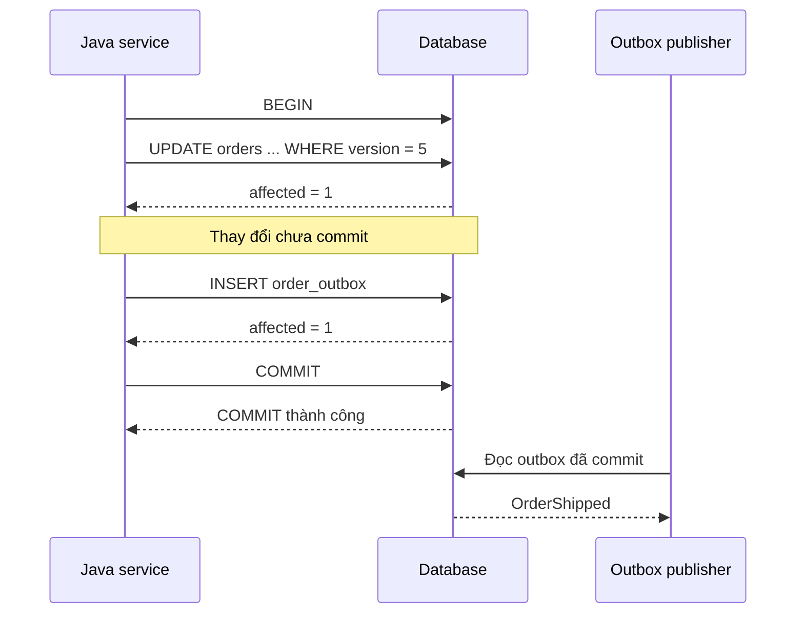

# Kiểm tra số bản ghi bị ảnh hưởng

## 1. Vì sao phải kiểm tra số bản ghi sau thao tác ghi?

Trong ứng dụng Java, việc gọi thành công một phương thức `update()` hoặc không gặp ngoại lệ SQL **không đủ** để khẳng định yêu cầu nghiệp vụ đã được thực hiện đúng. Câu lệnh có thể chạy hợp lệ nhưng không khớp với hàng nào; nó cũng có thể tác động nhiều hàng hơn dự kiến do thiếu điều kiện `WHERE`.

Xét thao tác xác nhận một đơn hàng:

```sql
UPDATE orders
SET status = 'CONFIRMED'
WHERE id = :order_id
  AND status = 'NEW';
```

Có ít nhất ba tình huống:

- **1 hàng** được cập nhật: một hàng thỏa điều kiện tại thời điểm DB thực thi lệnh.
- **0 hàng** được cập nhật: không có hàng nào thỏa **toàn bộ** điều kiện; chưa biết đơn không tồn tại, đã xác nhận, đã hủy hay có vấn đề khác.
- **Nhiều hàng** được cập nhật: nếu `id` là khóa chính của bảng này thì kỳ vọng trên thường không cho phép; cần xem lại truy vấn, schema hoặc cách diễn giải kết quả.

**Số bản ghi bị ảnh hưởng** (*affected row count*, *update count*) là tín hiệu quan trọng để xác minh một thao tác ghi đã tác động đúng phạm vi được phép. Nó đặc biệt hữu ích khi:

- Cập nhật hoặc xóa **đúng một** bản ghi bằng ID.
- Chuyển trạng thái theo điều kiện, ví dụ `NEW → CONFIRMED`.
- Trừ tồn kho **chỉ khi** số lượng còn đủ.
- Phát hiện cập nhật cạnh tranh bằng **optimistic locking**.
- Bảo vệ phạm vi tenant hoặc chủ sở hữu trong câu lệnh.
- Kiểm tra `DELETE`, `INSERT ... ON CONFLICT`, thao tác bulk và batch.
- Quyết định **commit hay rollback** khi một use case ghi nhiều bảng.
- Đo lường số hàng đã xử lý trong job dữ liệu.

Bài này thuộc chủ đề **Thao tác dữ liệu** của mô-đun persistence: kết hợp Java, SQL, schema, transaction, isolation và xử lý lỗi để đánh giá đúng kết quả thao tác ghi, thay vì chỉ kiểm tra lời gọi phương thức đã trả về.

**Thông điệp cốt lõi:** *Row count cho biết điều gì đã được câu lệnh ghi tác động theo ngữ nghĩa DBMS/driver; nó không tự chứng minh transaction đã commit, không giải thích vì sao không khớp và không thay thế các ràng buộc nghiệp vụ.*

## 2. Đọc row count theo hợp đồng nghiệp vụ

Trước khi viết SQL, phải xác định **số hàng hợp lệ** cho thao tác.

| Thao tác | Row count kỳ vọng | Nếu kết quả khác |
|---|---:|---|
| Đổi trạng thái một đơn theo `id` và `version` | Chính xác 1 | `0`: thất bại điều kiện hoặc xung đột; `>1`: lỗi thiết kế nghiêm trọng |
| Xóa một dòng hàng thuộc đúng đơn | Chính xác 1, trừ khi API xóa idempotent | `0`: không khớp; cần hợp đồng rõ |
| Trừ tồn kho một SKU nếu đủ hàng | Chính xác 1 | `0`: không có SKU hoặc không đủ hàng |
| Chèn một đơn mới theo khóa duy nhất | Chính xác 1 | Lỗi unique/constraint hoặc hành vi UPSERT cần phân tích |
| `INSERT ... ON CONFLICT DO NOTHING` | `0` hoặc `1` | `0` thường nghĩa là đã bỏ qua chèn do conflict; phải kiểm tra dữ liệu cũ |
| Đánh dấu tất cả phiên hết hạn | Từ 0 đến nhiều | `0` có thể bình thường; cần đo số đã xử lý |
| Xóa theo `WHERE tenant_id = ?` và tập ID | Không vượt số ID hợp lệ, đôi khi cần chính xác N | Thiếu hoặc thừa phải được giải thích, không mặc định thành công |
| Ghi nhiều bảng trong một transaction | Kiểm tra riêng từng câu lệnh | Một bước sai ⇒ rollback toàn bộ nhóm theo invariant |

**Một câu lệnh ảnh hưởng 0 hàng không nhất thiết là lỗi SQL.** Nó thường là phản hồi bình thường của database khi predicate không khớp. Ứng dụng phải quyết định `0` là “không tìm thấy”, “không đủ điều kiện”, “đã hoàn tất từ trước”, “xung đột” hay “không có việc gì cần làm”.

Tương tự, `1` không tự đồng nghĩa nghiệp vụ thành công. Nếu lệnh có thể tác động nhầm hàng của tenant khác do kiểm tra quyền sai, “1 hàng” chỉ cho thấy đã có thay đổi, không chứng minh thay đổi **được phép**.

## 3. Row count thực chất được tính ở đâu?

Row count do **hệ lưu trữ/driver** cung cấp sau khi xử lý một câu lệnh. Nó không nhất thiết là số object Java đã thay đổi, số hàng được quét, số dòng trả về từ một câu `SELECT` hay số lần trigger được thực thi.

Phân biệt:

| Khái niệm | Cách hiểu |
|---|---|
| **Số hàng khớp điều kiện** | Các hàng thỏa `WHERE` theo ngữ nghĩa truy vấn và thời điểm xử lý |
| **Số hàng báo là bị ảnh hưởng** | Giá trị DBMS/driver trả về cho DML theo quy ước của nó |
| **Số hàng có giá trị thật sự khác trước** | Có thể khác số hàng khớp nếu `UPDATE` gán giá trị cũ |
| **Số hàng trả về bởi `RETURNING`** | Tập hàng mà câu DML chủ động trả về từ các hàng được chèn/sửa/xóa |
| **Số hàng trong bảng sau commit** | Kết quả đã tồn tại sau giao dịch, có thể chịu tác động của các câu lệnh khác |
| **Số bản ghi liên quan được xử lý gián tiếp** | Có thể gồm trigger hoặc FK cascade; không được mặc định cộng vào update count |

Ví dụ:

```sql
UPDATE orders
SET status = 'NEW'
WHERE id = :order_id AND status = 'NEW';
```

Có engine/driver báo hàng được **khớp/cập nhật** dù giá trị cuối không khác; engine khác hoặc tùy chế độ driver có thể phân biệt hàng thực sự đổi giá trị. PostgreSQL thường báo số hàng được cập nhật bởi câu lệnh ngay cả khi gán cùng giá trị. Một số cấu hình MySQL có thể phân biệt **matched rows** và **changed rows**, đặc biệt với `UPDATE` hoặc cú pháp upsert riêng.

**Không dùng quy tắc “row count = 0 nghĩa là giá trị không thay đổi” trên mọi DBMS.** Phải kiểm tra hợp đồng của engine, driver và câu SQL đang dùng. Khi cần biết **giá trị mới cụ thể**, dùng `RETURNING` hoặc đọc lại dữ liệu theo transaction/isolation đã thiết kế.

## 4. JDBC: lấy kết quả bằng `executeUpdate()`

Trong JDBC, `Statement.executeUpdate(...)` và `PreparedStatement.executeUpdate()` dùng cho các câu DML không trả về result set theo đường gọi tương ứng. Chúng trả về một `int` là update count, hoặc `0` với một số lệnh không báo hàng bị ảnh hưởng theo hợp đồng JDBC.

```java
import java.sql.Connection;
import java.sql.PreparedStatement;
import java.sql.SQLException;

int setCancelled(Connection connection, java.util.UUID orderId)
        throws SQLException {
    String sql = """
        UPDATE orders
        SET status = 'CANCELLED'
        WHERE id = ? AND status = 'NEW'
        """;

    try (PreparedStatement ps = connection.prepareStatement(sql)) {
        ps.setObject(1, orderId);
        return ps.executeUpdate();
    }
}
```

Sử dụng:

```java
int affected = setCancelled(connection, orderId);
if (affected != 1) {
    throw new IllegalStateException(
        "Không thể chuyển đơn NEW sang CANCELLED");
}
```

Ví dụ trên giả định connection đang được quản lý bởi transaction thích hợp. Nếu `connection` có `autoCommit=true`, một câu DML thông thường có thể tự commit sau khi thực thi thành công theo cách driver/database hoạt động. Nếu use case cần ghi nhiều bảng, phải mở transaction và chỉ commit sau khi kiểm tra **tất cả** kết quả.

### 4.1. Vì sao dùng prepared statement?

Prepared statement gắn tham số bằng kiểu dữ liệu, tránh nối ID hoặc input người dùng trực tiếp vào chuỗi SQL. Điều này vừa rõ logic, vừa giảm nguy cơ SQL injection và lỗi escaping.

```java
ps.setObject(1, orderId);
```

Không viết:

```java
String sql = "DELETE FROM orders WHERE id = '" + userInput + "'";
```

Đối với truy vấn có quyền theo tenant, `tenantId` phải lấy từ ngữ cảnh xác thực đã được kiểm tra, **không tin hoàn toàn vào một `tenantId` do client tự khai**.

### 4.2. `executeLargeUpdate()`

Với những câu lệnh có khả năng tác động số lượng hàng rất lớn, JDBC cung cấp API `executeLargeUpdate()` trả về `long`:

```java
long removed;
try (PreparedStatement ps = connection.prepareStatement("""
    DELETE FROM temporary_events
    WHERE expires_at < ?
    """)) {
    ps.setObject(1, cutoff);
    removed = ps.executeLargeUpdate();
}
```

Cần kiểm tra API và khả năng hỗ trợ của driver, cũng như type-binding của tham số ngày giờ. `long` giúp biểu diễn count lớn hơn giới hạn `int` nhưng **không khiến một thao tác xóa khổng lồ an toàn hoặc nhanh hơn**. Với purge lớn, batch và theo dõi tải thường cần thiết.

### 4.3. `execute()` và `getUpdateCount()`

Một số lệnh/procedure có thể tạo result set, update count hoặc nhiều kết quả. JDBC `execute()` cho biết kết quả đầu tiên là result set hay không; sau đó có thể dùng `getResultSet()`, `getUpdateCount()` và `getMoreResults()` theo hợp đồng.

```java
boolean hasResultSet = statement.execute(sql);
if (!hasResultSet) {
    int count = statement.getUpdateCount();
    // -1 có nghĩa không còn update count ở vị trí kết quả hiện tại.
}
```

Không nhầm `-1` của `getUpdateCount()` với “-1 hàng được cập nhật”. Nếu một câu lệnh có nhiều kết quả, phải lặp đúng quy tắc JDBC; không chỉ lấy count đầu tiên rồi mặc định đã hiểu toàn bộ kết quả.

## 5. Ví dụ đầy đủ: chuyển đơn từ PAID sang SHIPPED

Đây là trường hợp điển hình cần **chính xác 1 hàng**. Yêu cầu nghiệp vụ:

1. Đơn thuộc tenant đang xác thực.
2. Đơn đang ở trạng thái `PAID`.
3. Client dựa trên đúng phiên bản `version` đã đọc.
4. Chỉ một transaction được chuyển trạng thái thành công.
5. Trong **cùng DB transaction**, ghi một sự kiện outbox để hệ thống khác nhận thông báo.
6. Chỉ trả thành công sau `COMMIT`; nếu SQL/ghi outbox lỗi thì rollback.

### 5.1. Schema PostgreSQL minh họa

```sql
CREATE TABLE orders (
    id UUID PRIMARY KEY,
    tenant_id UUID NOT NULL,
    status TEXT NOT NULL
        CHECK (status IN ('NEW', 'PAID', 'SHIPPED', 'CANCELLED')),
    version BIGINT NOT NULL DEFAULT 0 CHECK (version >= 0),
    updated_at TIMESTAMPTZ NOT NULL DEFAULT now()
);

CREATE TABLE order_outbox (
    event_id UUID PRIMARY KEY,
    order_id UUID NOT NULL REFERENCES orders(id),
    tenant_id UUID NOT NULL,
    event_type TEXT NOT NULL,
    created_at TIMESTAMPTZ NOT NULL DEFAULT now(),
    published_at TIMESTAMPTZ
);
```

Một khóa chính `orders.id` bảo đảm câu `UPDATE ... WHERE id = ?` không thể khớp nhiều hàng đã commit trong bảng này. Trường `version` dùng cho optimistic concurrency; `tenant_id` giới hạn phạm vi.

Trong hệ thống multi-tenant đầy đủ, cần xem xét row-level security hoặc ràng buộc tenant ở tất cả các bảng quan hệ; chỉ có cột `tenant_id` trong outbox chưa tự bảo đảm sự kiện và đơn thuộc cùng tenant nếu thiếu quy tắc ghi/ràng buộc tương ứng.

### 5.2. Câu lệnh có điều kiện

```sql
UPDATE orders
SET status = 'SHIPPED',
    version = version + 1,
    updated_at = now()
WHERE id = :order_id
  AND tenant_id = :tenant_id
  AND status = 'PAID'
  AND version = :expected_version;
```

Câu lệnh chỉ cập nhật được một hàng nếu **đồng thời** thỏa ID, tenant, trạng thái và version. Nếu hai request cùng nhìn thấy `version=5` rồi cùng gửi lệnh, chỉ request nào cập nhật thành công theo giao thức này mới nhận `affected=1`; request còn lại không được tự suy ra thành công.

### 5.3. Java/JDBC: kiểm tra count trước khi ghi outbox

```java
import javax.sql.DataSource;
import java.sql.*;
import java.util.UUID;

public final class ShipmentService {
    private final DataSource dataSource;

    public ShipmentService(DataSource dataSource) {
        this.dataSource = dataSource;
    }

    public void markShipped(
            UUID trustedTenantId,
            UUID orderId,
            long expectedVersion) throws SQLException {
        if (trustedTenantId == null || orderId == null
                || expectedVersion < 0) {
            throw new IllegalArgumentException("Invalid command");
        }

        try (Connection c = dataSource.getConnection()) {
            c.setAutoCommit(false);
            try {
                int changed;
                try (PreparedStatement ps = c.prepareStatement("""
                    UPDATE orders
                    SET status = 'SHIPPED',
                        version = version + 1,
                        updated_at = now()
                    WHERE id = ? AND tenant_id = ?
                      AND status = 'PAID' AND version = ?
                    """)) {
                    ps.setObject(1, orderId);
                    ps.setObject(2, trustedTenantId);
                    ps.setLong(3, expectedVersion);
                    changed = ps.executeUpdate();
                }

                if (changed != 1) {
                    throw new IllegalStateException(
                        "Order not eligible or version conflict");
                }

                try (PreparedStatement ps = c.prepareStatement("""
                    INSERT INTO order_outbox
                        (event_id, order_id, tenant_id, event_type)
                    VALUES (?, ?, ?, 'OrderShipped')
                    """)) {
                    ps.setObject(1, UUID.randomUUID());
                    ps.setObject(2, orderId);
                    ps.setObject(3, trustedTenantId);
                    if (ps.executeUpdate() != 1) {
                        throw new IllegalStateException(
                            "Outbox insert count mismatch");
                    }
                }

                c.commit();
            } catch (SQLException | RuntimeException failure) {
                try {
                    c.rollback();
                } catch (SQLException rollbackFailure) {
                    failure.addSuppressed(rollbackFailure);
                }
                throw failure;
            }
        }
    }
}
```

Ở đây, row count không chỉ được ghi log; nó trở thành **điều kiện quyết định có được commit hay không**. Nếu update ảnh hưởng 0 hàng, insert outbox không được chạy và transaction được rollback. Nếu insert outbox lỗi, thay đổi `orders` cũng bị rollback.

**Giới hạn quan trọng:** Ví dụ không có khóa idempotency cho lệnh gửi hàng. Nếu `commit()` phát sinh lỗi mạng/timeout, kết quả commit có thể **chưa xác định**: database có thể đã commit dù Java không nhận xác nhận. Ứng dụng không nên khẳng định đơn vẫn ở `PAID` chỉ vì thấy ngoại lệ; cần tra cứu trạng thái theo khóa nghiệp vụ hoặc command ID ổn định trước khi retry.

### 5.4. Vì sao `affected = 1` vẫn chưa phải kết quả cuối cùng?

Tại mốc `executeUpdate()`, database có thể đã thay đổi một hàng **trong transaction đang mở**. Nếu câu `INSERT order_outbox` thất bại hoặc `commit()` bị rollback, trạng thái đã commit có thể vẫn là `PAID`.



**Kết luận:** Số hàng bị ảnh hưởng xác minh thao tác **trong transaction**, còn commit xác nhận kết quả của **nhóm thao tác** theo bảo đảm của hệ lưu trữ.

## 6. Hiểu đúng khi kết quả bằng 0

`affected == 0` không nêu nguyên nhân. Với câu lệnh:

```sql
UPDATE orders
SET status = 'SHIPPED', version = version + 1
WHERE id = :order_id
  AND tenant_id = :tenant_id
  AND status = 'PAID'
  AND version = :version;
```

Có nhiều khả năng:

- Không tồn tại đơn mang ID đã cung cấp.
- Đơn tồn tại nhưng thuộc tenant khác.
- Đơn đã ở `SHIPPED`, `CANCELLED` hoặc trạng thái khác `PAID`.
- Đơn vẫn `PAID` nhưng `version` đã tăng do writer khác.
- Đơn bị xóa/ẩn hoặc không còn thỏa chính sách cập nhật.
- Với DBMS/driver có cách đếm khác, câu SQL cố gán giá trị cũ có thể báo số ảnh hưởng theo quy ước khác nhau; ở mẫu này version tăng nên khi thực sự cập nhật sẽ có thay đổi.

**Đừng kết luận “không tìm thấy ID” chỉ từ count = 0.** Nếu cần phân loại lỗi cho người dùng, hãy xác định hành vi rõ:

| Trường hợp | Cách xử lý có thể phù hợp |
|---|---|
| Không có hàng hoặc không được quyền xem | Trả một thông điệp chung không làm lộ sự tồn tại của tài nguyên |
| Version không khớp | HTTP `409 Conflict` hoặc yêu cầu tải lại theo hợp đồng |
| Trạng thái không cho phép | Lỗi quy tắc nghiệp vụ; nêu trạng thái chỉ khi người gọi có quyền |
| Yêu cầu đã hoàn tất trước đó | Trả kết quả idempotent **nếu** xác minh đúng cùng command/payload |
| Không rõ commit trước đó có thành công | Tra cứu bằng command ID và đối soát, không tạo tác động kép |

Nếu quyết định đọc lại để giải thích `0`, chú ý dữ liệu có thể tiếp tục thay đổi sau lần đọc. **Phân loại nguyên nhân bằng SELECT sau UPDATE không khôi phục tính nguyên tử của một yêu cầu ghi**. Các invariant vẫn phải được bảo vệ bằng predicate và constraint ở thao tác ghi.

### 6.1. Không làm lộ dữ liệu tenant khác

Một antipattern:

```java
int changed = updateWithinTenant(orderId, tenantId);
if (changed == 0 && existsGlobally(orderId)) {
    return "Order exists, but belongs to someone else";
}
```

Cách này có thể làm lộ sự tồn tại của đơn hàng bên ngoài phạm vi người dùng. Khi thiết kế API, sự phân biệt giữa “không tồn tại” và “không có quyền” phải theo chính sách bảo mật. Có thể chỉ trả thông báo “không tìm thấy hoặc không được phép”, đồng thời ghi audit kỹ thuật có kiểm soát.

## 7. Optimistic locking: row count là tín hiệu phát hiện xung đột

Giả sử hai yêu cầu A và B cùng đọc `orders.version = 8`.

1. A gửi lệnh cập nhật với `WHERE version = 8`.
2. B cũng gửi lệnh với `WHERE version = 8`.
3. A cập nhật thành `version = 9` rồi commit.
4. B không còn khớp `version = 8` và nhận `affected = 0` (hoặc thất bại transaction theo isolation/cấu hình).

Đây là một cách áp dụng **compare-and-swap** tại database:

```sql
UPDATE orders
SET delivery_address = :new_address,
    version = version + 1
WHERE id = :order_id
  AND tenant_id = :tenant_id
  AND version = :expected_version;
```

Ứng dụng chỉ được công bố cập nhật thành công khi row count đúng kỳ vọng và transaction commit. Nếu `0` do version xung đột, không được “sửa nhanh” bằng cách bỏ điều kiện version rồi ghi đè dữ liệu mới.

### 7.1. Row count cần đi cùng việc cập nhật version

Nếu một đường ghi khác làm:

```sql
UPDATE orders
SET delivery_address = :new_address
WHERE id = :order_id;
```

thì nó **không kiểm tra, không tăng version**, làm suy yếu cơ chế optimistic locking. Dù những writer có dùng JPA `@Version`, batch SQL hoặc script vận hành ngoài ORM cũng phải tuân thủ giao thức tương ứng.

### 7.2. Giao dịch nhiều hàng cần cách bảo vệ khác

Một lệnh ảnh hưởng đúng một hàng không tự chứng minh invariant trên **nhiều hàng**. Ví dụ hai giao dịch cùng kiểm tra tổng hạn mức, mỗi giao dịch sửa một hàng khác nhau, có thể vi phạm tổng nếu isolation không phù hợp.

Khi invariant trải nhiều hàng, phải kết hợp constraint, khóa, serialization hoặc thiết kế lại điểm tranh chấp. Kiểm tra row count từng câu lệnh vẫn cần, nhưng **không thay thế isolation/concurrency control**.

## 8. Trừ tồn kho: kết hợp predicate và row count

Một lỗi phổ biến:

```java
int available = stockDao.readAvailable(sku);
if (available >= quantity) {
    stockDao.setAvailable(sku, available - quantity);
}
```

Hai request có thể cùng đọc số lượng cũ và cùng ghi, gây oversell hoặc lost update. Hãy đưa điều kiện “đủ tồn” vào câu lệnh ghi:

```sql
UPDATE stock
SET available = available - :quantity
WHERE sku = :sku
  AND available >= :quantity;
```

Kiểm tra:

```java
int updated = statement.executeUpdate();
if (updated != 1) {
    throw new InsufficientStockOrMissingSkuException();
}
```

Để làm việc đúng, `quantity` phải được validate là số dương, schema nên có `CHECK (available >= 0)` và khóa/điều kiện phải nhắm đúng SKU. Với PostgreSQL `READ COMMITTED`, các `UPDATE` cạnh tranh trên cùng một hàng được phối hợp bằng khóa hàng và việc đánh giá điều kiện tại thời điểm thực thi phù hợp.

Nếu giao dịch còn tạo reservation hoặc đơn hàng, giảm tồn kho và insert reservation phải nằm trong **cùng transaction**. Khi row count = 0, rollback mọi ghi trước đó của use case. Đừng chỉ ghi log rồi tiếp tục tạo reservation.

## 9. `INSERT`, UPSERT và hành vi khi có xung đột

### 9.1. Insert thông thường

```sql
INSERT INTO orders(id, tenant_id, status)
VALUES (:id, :tenant_id, 'NEW');
```

Trong schema có khóa chính `id`, insert một hàng hợp lệ thường báo count = 1; nếu ID trùng, database có thể ném lỗi constraint. Không nên kỳ vọng “chèn trùng thì trả count = 0” với insert thông thường.

### 9.2. PostgreSQL `ON CONFLICT DO NOTHING`

```sql
INSERT INTO request_records(request_id, payload_hash)
VALUES (:request_id, :payload_hash)
ON CONFLICT (request_id) DO NOTHING;
```

Trên PostgreSQL, khi câu lệnh bỏ qua chèn do conflict tương ứng, row count thường bằng 0. **0 không tự xác nhận yêu cầu trùng có cùng ý nghĩa nghiệp vụ.** Cần đọc lại dữ liệu theo request ID và so sánh hash/payload, đồng thời xử lý cạnh tranh và kết quả commit không xác định.

Ví dụ trong transaction:

```text
affected = 1  -> yêu cầu mới được chèn; tiếp tục nghiệp vụ
affected = 0  -> có thể đã có request_id; đọc/trả kết quả cũ nếu payload khớp
SQL exception -> rollback, phân loại lỗi
```

Nếu upsert được thiết kế để idempotent, row count giúp phân biệt **nhánh mới** với nhánh **bỏ qua**, nhưng không thay thế một bảng lưu kết quả hoặc khóa giao dịch khi client retry.

### 9.3. `ON CONFLICT DO UPDATE`

```sql
INSERT INTO counters(counter_key, value)
VALUES (:key, 1)
ON CONFLICT (counter_key)
DO UPDATE SET value = counters.value + 1;
```

Trong PostgreSQL, câu lệnh có thể báo hàng được insert hoặc update, nhưng count không tự cho biết đó là **insert mới** hay **update hàng cũ**. Nếu nghiệp vụ cần biết trạng thái/hàng cụ thể, cân nhắc `RETURNING` và một thiết kế rõ ràng.

Cú pháp upsert ở các DBMS khác có quy tắc count khác nhau; đặc biệt không mang nguyên suy luận PostgreSQL sang MySQL `ON DUPLICATE KEY UPDATE` hoặc `REPLACE` mà chưa kiểm tra tài liệu của engine/driver.

## 10. `DELETE` và số hàng bị ảnh hưởng

Xóa một dòng thuộc đúng đơn:

```sql
DELETE FROM order_lines
WHERE id = :line_id
  AND order_id = :order_id;
```

- `1`: trực tiếp xóa một hàng khớp.
- `0`: không có hàng thỏa cả hai điều kiện.
- `>1`: trái với kỳ vọng nếu `id` thực sự là khóa duy nhất và query chỉ nhắm bảng này.

Với một API xóa idempotent, có thể quyết định **0 hàng là thành công về mặt trạng thái cuối**: “tài nguyên không còn tồn tại trong phạm vi bạn được phép quản lý”. Nhưng đó là **hợp đồng API** và yêu cầu bảo mật, không phải ý nghĩa tự thân của row count. Nếu hành động xóa có side effect như hoàn tồn kho, phải đảm bảo không làm lặp side effect khi gọi lại.

### 10.1. Xóa cha có `ON DELETE CASCADE`

Giả sử xóa một đơn có năm dòng hàng:

```sql
DELETE FROM orders WHERE id = :order_id;
```

Database có thể trực tiếp xóa **1 hàng orders** và gián tiếp xóa **5 hàng order_lines** do FK `ON DELETE CASCADE`. **Không được mặc định update count là 6.** PostgreSQL báo số hàng bị xóa trực tiếp bởi câu `DELETE`, không phải tổng tất cả hàng bị cascade/trigger xử lý.

Nếu cần audit số dòng con được xóa, thiết kế quy trình đếm/ghi nhận hoặc dùng cơ chế phù hợp, đặt trong transaction với điều kiện và isolation thích hợp. Lệnh `DELETE` trên bảng cha không bảo đảm xóa cache, file, search index hoặc backup ở các hệ khác.

### 10.2. Soft delete không phải hard delete

```sql
UPDATE orders
SET deleted_at = now()
WHERE id = :order_id AND deleted_at IS NULL;
```

Đây là một `UPDATE`: count = 1 thể hiện một hàng được đánh dấu, **không phải hàng đã biến mất khỏi database**. Những bản ghi con và bản sao vẫn cần chính sách truy vấn, quyền truy cập và retention riêng.

## 11. Bulk update: nhiều hàng là bình thường nhưng phải có giới hạn

Trong job dọn dẹp hoặc chuyển trạng thái theo lô:

```sql
UPDATE sessions
SET state = 'EXPIRED'
WHERE state = 'ACTIVE'
  AND expires_at < :cutoff;
```

Row count có thể là 0, 12 hoặc 20.000 tùy dữ liệu. Với loại thao tác này, việc ép `affected == 1` là sai.

Cần định nghĩa:

- Tập dữ liệu được phép thao tác theo `tenant_id`, thời hạn, trạng thái hoặc batch ID.
- **Số hàng tối đa** trong một transaction nếu cần giới hạn tải.
- Nếu phải xử lý chính xác **N ID** thì khi nào chấp nhận một ID đã được xử lý trước đó?
- Tỷ lệ hàng thành công, thất bại, bị bỏ qua và cần retry.
- Hành vi nếu số hàng đột biến vượt ngưỡng dự kiến.

Ví dụ, trong chức năng admin xóa một tập 100 đơn, nếu row count = 70 thì không thể chỉ trả “đã xóa 100”. Nhưng cũng không thể kết luận lỗi từ con số 70 mà không biết 30 đơn kia đã bị xóa, thuộc tenant khác, bị legal hold hay trạng thái không cho phép.

**Không dùng `SELECT COUNT(*)` trước rồi tin rằng dữ liệu không đổi khi `UPDATE/DELETE` chạy sau đó.** Hai câu lệnh có thể quan sát các tập hàng khác nhau khi có writer khác, trừ khi ranh giới transaction/isolation hoặc khóa được thiết kế để bảo vệ điều kiện đó.

### 11.1. Đặt giới hạn batch thay vì xóa không giới hạn

Với PostgreSQL, có thể chọn tập ID theo thứ tự, khóa và xử lý theo lô:

```sql
WITH candidates AS (
    SELECT id
    FROM sessions
    WHERE state = 'ACTIVE' AND expires_at < now()
    ORDER BY expires_at, id
    LIMIT 100
    FOR UPDATE SKIP LOCKED
)
UPDATE sessions AS s
SET state = 'EXPIRED'
FROM candidates AS c
WHERE s.id = c.id
RETURNING s.id;
```

Câu lệnh trả ID của các hàng được cập nhật, cho phép ghi nhận công việc đã xử lý. Mẫu này có thể chạy nhiều lần, nhưng cần kiểm soát starvation, retry và backlog; `SKIP LOCKED` không bảo đảm thứ tự toàn cục.

## 12. `RETURNING`: xác minh bản ghi và giá trị sau cập nhật

Đôi khi chỉ một con số là chưa đủ. PostgreSQL hỗ trợ `RETURNING` để trả những hàng do DML chèn, sửa hoặc xóa:

```sql
UPDATE orders
SET status = 'SHIPPED',
    version = version + 1,
    updated_at = now()
WHERE id = :order_id
  AND tenant_id = :tenant_id
  AND status = 'PAID'
  AND version = :expected_version
RETURNING id, status, version, updated_at;
```

Nếu kết quả trả về:

- **1 hàng:** Có dữ liệu trực tiếp từ thao tác cập nhật, gồm version mới.
- **0 hàng:** Không có hàng nào thỏa toàn bộ điều kiện.
- **Nhiều hàng:** Nếu schema/query kỳ vọng 1 thì phải xem là lỗi logic nghiêm trọng.

Trong JDBC với PostgreSQL, một lệnh DML có `RETURNING` sinh result set, nên dùng `executeQuery()` hoặc API tương ứng thay vì mặc định `executeUpdate()`:

```java
try (PreparedStatement ps = connection.prepareStatement("""
    UPDATE orders
    SET status = 'SHIPPED', version = version + 1
    WHERE id = ? AND tenant_id = ?
      AND status = 'PAID' AND version = ?
    RETURNING id, status, version
    """)) {

    ps.setObject(1, orderId);
    ps.setObject(2, trustedTenantId);
    ps.setLong(3, expectedVersion);

    try (ResultSet rs = ps.executeQuery()) {
        if (!rs.next()) {
            throw new IllegalStateException("No eligible order");
        }

        long newVersion = rs.getLong("version");

        if (rs.next()) {
            throw new IllegalStateException(
                "Unexpected multiple updated rows");
        }

        // newVersion là giá trị từ UPDATE trong transaction.
        // Chưa được coi là durable cho đến khi commit thành công.
    }
}
```

`RETURNING` đặc biệt hữu ích khi database tính timestamp, version hoặc generated columns. Nhưng giá trị được trả về vẫn thuộc **transaction đang mở**: lỗi ở bước sau vẫn có thể rollback.

Một số DBMS có cú pháp khác (ví dụ `OUTPUT`) hoặc khả năng returning khác; đây không phải cú pháp SQL di động cho mọi hệ quản trị.

## 13. JDBC batch: không thể luôn kiểm tra `count == 1`

Với `PreparedStatement.addBatch()` và `executeBatch()`:

```java
try (PreparedStatement ps = connection.prepareStatement("""
    UPDATE orders
    SET status = 'CANCELLED', version = version + 1
    WHERE id = ? AND status = 'NEW'
    """)) {

    for (java.util.UUID id : orderIds) {
        ps.setObject(1, id);
        ps.addBatch();
    }

    int[] counts = ps.executeBatch();

    for (int count : counts) {
        if (count == java.sql.Statement.SUCCESS_NO_INFO) {
            // Driver báo lệnh thành công nhưng không biết row count.
        } else if (count == java.sql.Statement.EXECUTE_FAILED) {
            // Phần tử này thất bại khi driver cho phép tiếp tục batch.
        } else if (count == 0) {
            // Không khớp hàng nào theo ngữ nghĩa lệnh/driver.
        } else if (count == 1) {
            // Một hàng được báo là cập nhật.
        } else {
            // Count ngoài hợp đồng của UPDATE theo ID.
        }
    }
}
```

Theo JDBC:

- Giá trị **không âm** thường là update count của phần tử tương ứng.
- `Statement.SUCCESS_NO_INFO` (thường `-2`) nghĩa là lệnh thành công nhưng driver không cung cấp số hàng.
- `Statement.EXECUTE_FAILED` (thường `-3`) có thể xuất hiện khi driver tiếp tục xử lý batch sau một phần tử thất bại.
- `BatchUpdateException` có thể chứa các update count đã biết để phục vụ phân tích; cách driver dừng/tiếp tục khác nhau.
- `executeLargeBatch()` trả `long[]` khi cần khả năng đếm số lượng lớn và driver hỗ trợ.

**Không xem `SUCCESS_NO_INFO` là “0 hàng”.** Nếu nghiệp vụ bắt buộc xác minh chính xác mỗi ID ảnh hưởng đúng một hàng, phải cân nhắc dùng DML với `RETURNING`, chia lô nhỏ có xác minh hoặc thay đổi cách ghi phù hợp.

### 13.1. Giao dịch cho batch

Nếu use case yêu cầu **toàn bộ batch hoặc không có gì**, hãy chạy với `autoCommit=false`, kiểm tra các kết quả trước `commit()` và rollback nếu bất kỳ phần tử nào không thỏa hợp đồng.

Nếu mục tiêu là **xử lý từng bản ghi độc lập** và chấp nhận một phần thành công, hãy thiết kế transaction theo từng hàng hoặc từng nhóm, lưu trạng thái và lỗi của mỗi bản ghi. Đừng ngẫu nhiên để auto-commit khiến một phần batch thành công rồi báo “batch đã thất bại hoàn toàn”.

Khi xử lý `BatchUpdateException`, không được suy ra các lệnh chưa có count chắc chắn chưa thực hiện. Cần đánh giá khả năng driver, kết quả transaction và có cơ chế retry/idempotency. Nếu `commit` timeout, tình trạng commit của cả lô cũng có thể chưa rõ.

## 14. Spring JDBC và Spring Data JPA

### 14.1. Spring `JdbcTemplate.update()`

Ví dụ Spring JDBC:

```java
int affected = jdbcTemplate.update("""
    UPDATE orders
    SET status = ?, version = version + 1
    WHERE id = ? AND tenant_id = ?
      AND status = ? AND version = ?
    """,
    "SHIPPED", orderId, trustedTenantId, "PAID", expectedVersion);

if (affected != 1) {
    throw new IllegalStateException("Conflict or not eligible");
}
```

`JdbcTemplate.update()` trả một `int` là số hàng bị ảnh hưởng theo driver. Nó không tự biết `1` có hợp lệ với nghiệp vụ hay không. Với nhiều lệnh ghi cần cùng commit, đặt chúng trong một transaction Spring phù hợp.

### 14.2. Bulk JPQL và `executeUpdate()`

Với JPA:

```java
int affected = entityManager.createQuery("""
    UPDATE OrderEntity o
    SET o.status = :newStatus,
        o.version = o.version + 1
    WHERE o.id = :id
      AND o.tenantId = :tenantId
      AND o.status = :oldStatus
      AND o.version = :expectedVersion
    """)
    .setParameter("newStatus", OrderStatus.SHIPPED)
    .setParameter("oldStatus", OrderStatus.PAID)
    .setParameter("id", orderId)
    .setParameter("tenantId", trustedTenantId)
    .setParameter("expectedVersion", expectedVersion)
    .executeUpdate();
```

`executeUpdate()` của JPA trả số entity bị ảnh hưởng theo ngữ nghĩa bulk query của provider/JPA; không nên suy ra luôn bằng tổng số row vật lý nếu inheritance mapping tạo nhiều thao tác SQL.

**Lưu ý quan trọng về bulk update:**

- Bulk JPQL đi trực tiếp tới database, **không cập nhật trạng thái các entity managed** đang nằm trong persistence context.
- Nó thường **bỏ qua dirty checking và lifecycle callbacks** của entity cho từng hàng.
- Bulk update **không tự áp dụng optimistic version check/increment** theo cách ORM cập nhật từng entity. Mã phải khai báo rõ điều kiện và cập nhật version nếu cần.
- Sau bulk update có thể cần `clear()`, `refresh()` hoặc dùng một context mới trước khi đọc tiếp, nhưng không tùy tiện clear khi còn thay đổi chưa flush.
- Row count của bulk update không chứng minh transaction đã commit thành công.

### 14.3. Spring Data repository `@Modifying`

Một repository có thể khai báo:

```java
@Modifying
@Query("""
    update OrderEntity o
    set o.status = :nextStatus,
        o.version = o.version + 1
    where o.id = :id
      and o.tenantId = :tenantId
      and o.status = :currentStatus
      and o.version = :expectedVersion
    """)
int updateStatusIfVersionMatches(
    @Param("id") UUID id,
    @Param("tenantId") UUID tenantId,
    @Param("currentStatus") OrderStatus currentStatus,
    @Param("nextStatus") OrderStatus nextStatus,
    @Param("expectedVersion") long expectedVersion
);
```

Đây là mảnh khai báo Spring Data JPA, giả định đã có entity, imports, mapping và transaction manager phù hợp. Service gọi repository phải kiểm tra giá trị trả về và bảo vệ ranh giới transaction. Một repository trả `void` sẽ bỏ mất tín hiệu mà use case có thể cần.

Với JPA `@Version` trong cập nhật entity managed, provider thường phát hiện optimistic lock và ném ngoại lệ khi xung đột, thay vì yêu cầu ứng dụng tự xem `int`. Cả hai cách cần được xử lý đúng, không trộn tùy tiện bulk update với entity managed cùng context mà bỏ qua các nguy cơ stale state.

## 15. Kiểm tra count trong transaction nhiều bước

Hãy xét việc chuyển tiền giữa hai ví ở cùng database. Một transaction có thể cần:

1. Tạo bản ghi transfer theo khóa yêu cầu duy nhất.
2. Trừ ví nguồn **nếu đủ số dư**.
3. Cộng ví đích **nếu tồn tại và hợp lệ**.
4. Ghi bút toán/cân đối theo mô hình sổ cái.
5. Commit.

```sql
BEGIN;

UPDATE wallets
SET balance_minor = balance_minor - :amount
WHERE id = :source_id
  AND balance_minor >= :amount;
-- Kỳ vọng 1. Nếu 0: ROLLBACK.

UPDATE wallets
SET balance_minor = balance_minor + :amount
WHERE id = :destination_id;
-- Kỳ vọng 1. Nếu 0: ROLLBACK.

-- Ghi ledger/transfer với unique key và invariant thích hợp.
-- Chỉ COMMIT khi tất cả bước đã được kiểm tra.

COMMIT;
```

Đây là phác thảo minh họa, chưa phải xử lý thanh toán production: cần kiểm tra amount dương, đồng tiền, idempotency, quyền sở hữu, khóa theo thứ tự nhất quán và các ràng buộc ledger. Nếu ví nguồn trừ thành công (count 1) nhưng ví đích không tồn tại (count 0), **không được commit khoản trừ**.

Một lỗi nguy hiểm:

```java
debitSource();                  // Count = 1
creditDestination();            // Count = 0
connection.commit();            // Vẫn commit!
```

Nếu không kiểm tra count bước hai, transaction có thể commit dữ liệu không thỏa invariant, dù về mặt ACID nó vẫn nguyên tử theo nhóm lệnh đã thực thi. **Atomicity không bảo đảm SQL đúng nghiệp vụ.**

### 15.1. Cần tránh hai kiểu “thành công giả”

- **Thành công giả theo câu lệnh:** Không gặp SQLException nhưng row count = 0.
- **Thành công giả theo transaction:** Mọi câu lệnh báo số hàng phù hợp, nhưng bước sau thất bại hoặc commit không được xác nhận.

Vì vậy tiêu chuẩn công bố kết quả phải có cả **điều kiện trên từng thao tác** và **kết quả hoàn tất transaction**.

## 16. Đặt điều kiện trong SQL, không chỉ kiểm tra trước ở Java

Đọc trước rồi cập nhật:

```java
Order order = repository.load(orderId);
if (order.getStatus().equals("PAID")) {
    repository.markShipped(orderId);
}
```

Nếu giao dịch khác chuyển trạng thái giữa lần đọc và lần ghi, lệnh sau có thể ghi đè một thay đổi mới. Đưa predicate vào thao tác ghi:

```sql
UPDATE orders
SET status = 'SHIPPED'
WHERE id = :id
  AND status = 'PAID';
```

Sau đó kiểm tra row count. Nếu có khả năng hai kiểu cập nhật cùng thấy `PAID` nhưng cần phân biệt ai thắng, thêm `version` hoặc điều kiện thích hợp.

Với điều kiện trải nhiều hàng, câu SQL đơn giản có thể chưa bảo vệ đủ; cần phân tích isolation, khóa, constraint và cách tổ chức dữ liệu.

### 16.1. Count không thay thế kiểm tra đầu vào

Với câu:

```sql
UPDATE stock
SET available = available - :quantity
WHERE sku = :sku AND available >= :quantity;
```

Nếu `quantity = -5`, predicate có thể luôn đúng với số tồn không âm và lệnh sẽ **tăng** tồn kho thay vì trừ. Row count = 1 vẫn không chứng minh thao tác “giữ 5 sản phẩm” hợp lệ. Java và schema cần validation `quantity > 0`, cùng quy tắc điều chỉnh số lượng riêng nếu hỗ trợ hoàn kho.

## 17. Số hàng trả về, trigger và tác động phụ

Khi câu SQL chạy, database có thể thực hiện thêm công việc:

- FK `ON DELETE CASCADE` xóa bản ghi con.
- Trigger cập nhật bảng audit hoặc tính toán dữ liệu dẫn xuất.
- Generated columns được cập nhật theo công thức.
- Một stored procedure gọi nhiều DML.
- Quy tắc đặc thù của view hoặc DBMS can thiệp vào câu lệnh.

**Update count thường chỉ mô tả kết quả trực tiếp của câu lệnh theo ngữ nghĩa DBMS**, không phải tổng tất cả side effect. Đừng dùng một giá trị `int` để suy ra “đã xóa tổng cộng N bản ghi trong hệ thống”.

Nếu cần audit hoặc đối soát tác động nhiều bảng:

- Thiết kế thao tác ghi có transaction rõ ràng.
- Dùng bảng audit/outbox với ràng buộc và row count riêng.
- Dùng `RETURNING` khi cần danh sách ID tác động trực tiếp.
- Tính hoặc kiểm chứng số bản ghi dẫn xuất theo quy tắc được xác định.
- Đối với cache, search và broker, dùng event có thể retry; không giả định update count bao trùm chúng.

## 18. Lỗi, timeout và retry: có count rồi vẫn phải thận trọng

### 18.1. Lỗi trước commit

Nếu câu lệnh `UPDATE` báo `affected = 1`, nhưng một câu `INSERT` sau đó vi phạm `UNIQUE`, transaction có thể phải rollback. Không trả thành công hoặc phát một side effect không hoàn tác được dựa trên count của câu đầu tiên.

### 18.2. Không nhận được phản hồi commit

Nếu Java gọi `connection.commit()` và mất kết nối trước khi nhận xác nhận, có hai khả năng: database đã commit hoặc chưa. Số hàng đã được báo thành công ở những lệnh trước **không giải quyết được sự bất định này**.

Với nghiệp vụ không được lặp như thanh toán, giữ hàng hoặc chuyển tiền:

- Dùng **request/command ID ổn định**.
- Lưu khóa và kết quả nghiệp vụ trong cùng transaction khi phù hợp.
- Khi retry, kiểm tra đã có kết quả tương ứng và xác minh payload giống nhau.
- Có cơ chế đối soát trạng thái tại nguồn dữ liệu có thẩm quyền.
- Không gửi tác động ngoài database trước commit mà chưa có chiến lược bù trừ.

### 18.3. Deadlock và serialization failure

Nếu DBMS hủy một transaction vì deadlock hoặc serialization failure, có thể retry **toàn bộ** transaction theo quy tắc giới hạn và backoff, đọc lại dữ liệu theo mỗi lần thử. Không chỉ lặp câu `UPDATE` riêng rồi bỏ qua bước validation và invariant.

### 18.4. Bảo đảm đúng thứ tự xử lý

Hai sự kiện `OrderShipped` và `OrderCancelled` có thể đến lệch thứ tự ở hệ thống phụ thuộc. Count trong nguồn DB không ngăn read model ghi dữ liệu cũ đè dữ liệu mới. Event nên mang version hoặc cơ chế thứ tự tương đương để consumer xử lý idempotent theo nguyên tắc đã chọn.

## 19. Quan trắc: đếm các thao tác khác với đếm lỗi

Row count có thể là một metric hữu ích:

| Metric gợi ý | Ý nghĩa | Điều bất thường |
|---|---|---|
| `order_status_update_rows` | Số hàng thực sự được báo cập nhật | Một lệnh theo ID báo >1 |
| `optimistic_conflicts_total` | Số yêu cầu có row count 0 do xung đột đã được xác định | Tăng mạnh ở giờ cao điểm |
| `stock_reservation_rejected_total` | Số yêu cầu trừ kho không thỏa điều kiện | Bất thường về tồn kho/nhu cầu |
| `purge_rows_per_batch` | Số hàng xử lý theo từng batch | Tụt về 0 trong khi backlog tăng |
| `bulk_update_over_expected_total` | Số lần count vượt ngưỡng an toàn | Nguy cơ query thiếu điều kiện |
| `db_commit_outcome_unknown_total` | Số lần không xác định kết quả commit | Lỗi mạng/driver cần đối soát |
| `outbox_backlog` | Số event chưa được đồng bộ | Read model có thể chậm |

Đừng gắn ID đơn, email hoặc dữ liệu cá nhân làm nhãn metric có cardinality lớn. Thường chỉ cần operation, status/result, tenant class hoặc nhóm tài nguyên có kiểm soát, kèm trace ID trong log kỹ thuật được phân quyền.

Các chỉ số cần phân biệt: **câu lệnh thực thi**, **hàng bị ảnh hưởng**, **transaction commit thành công**, **yêu cầu nghiệp vụ hoàn tất** và **side effect downstream được xác nhận**. Chúng không phải cùng một số.

## 20. Kiểm thử row count và tính đúng đắn

Một bộ kiểm thử nên có cả đường thành công, không khớp, nhiều writer và rollback:

| Tình huống | Thiết lập | Kết quả mong đợi |
|---|---|---|
| Cập nhật đúng đơn | `id` hợp lệ, status `PAID`, version đúng | Count 1, version tăng sau commit |
| Sai version | Dùng version cũ | Count 0 hoặc xung đột phù hợp |
| Sai trạng thái | Đơn `CANCELLED` | Count 0, không phát event `Shipped` |
| Sai tenant | ID thuộc tenant khác | Count 0, không lộ trạng thái tài nguyên |
| Đơn không tồn tại | ID chưa từng có | Count 0, hành vi API rõ ràng |
| Hai writer đồng thời | Cùng `version` | Tối đa một cập nhật thành công theo giao thức |
| Outbox insert thất bại | `UPDATE` count 1 rồi gây lỗi outbox | Transaction rollback cả đơn và outbox |
| Trừ kho vượt tồn | Kho còn 1, yêu cầu 2 | Count 0, không tạo reservation |
| Xóa bằng FK cascade | Một cha có nhiều con | Count trực tiếp không mặc định bao gồm số con |
| UPSERT trùng request ID | Gửi hai lần cùng khóa | Không có tác động nghiệp vụ kép |
| Batch có hàng không khớp | Một phần tử là ID sai | Hợp đồng batch quyết định rollback hay partial success |
| Commit timeout | Cắt kết nối tại ranh giới commit | Không retry bằng lệnh mới một cách mù quáng; có đối soát |

### 20.1. Mẫu test tích hợp cho optimistic version

```java
@Test
void staleVersionMustNotShipOrder() {
    UUID orderId = fixtures.createPaidOrderAtVersion(3);

    // Lần đầu thành công và transaction đã commit.
    shipmentService.markShipped(tenantId, orderId, 3);

    // Lần thứ hai dùng phiên bản cũ phải thất bại.
    assertThrows(IllegalStateException.class,
        () -> shipmentService.markShipped(tenantId, orderId, 3));

    // Query xác minh ở connection/transaction mới.
    assertEquals("SHIPPED", orderQueries.status(orderId));
    assertEquals(4L, orderQueries.version(orderId));
    assertEquals(1L, outboxQueries.countShipEvents(orderId));
}
```

Đây là mẫu ý tưởng JUnit, giả định các fixture, service và query helper đã được xây dựng. Kiểm thử cần xác minh trạng thái **sau commit qua connection hoặc persistence context mới**, không chỉ nhìn object Java đang được quản lý bởi ORM.

### 20.2. Kiểm thử rollback khi một bước count = 0

```java
@Test
void failedStockUpdateRollsBackReservation() {
    UUID requestId = UUID.randomUUID();
    fixtures.setAvailable("BOOK-01", 0);

    assertThrows(InsufficientStockException.class,
        () -> reservationService.reserve(requestId, "BOOK-01", 1));

    assertFalse(reservationQueries.exists(requestId));
    assertEquals(0, stockQueries.available("BOOK-01"));
}
```

Nếu service chèn reservation trước rồi mới giảm stock, test phải chứng minh transaction **rollback reservation** khi giảm kho trả count 0. Nếu chỉ kiểm tra `executeUpdate()` trả 0 mà không xác minh dữ liệu sau lỗi, test chưa chứng minh atomicity.

### 20.3. Điều kiện test để tránh kết quả giả

- Mỗi test phải làm rõ transaction boundary. Nếu chính phương thức test được `@Transactional` và framework rollback tự động, có thể che lỗi service commit sai.
- Kiểm thử cạnh tranh cần nhiều connection/transaction độc lập, không chỉ gọi hai lần tuần tự.
- Không dựa vào hành vi giả lập của mock JDBC để khẳng định locking/isolation của PostgreSQL thật.
- Với batch, test đúng driver và DBMS đích vì `SUCCESS_NO_INFO`, retry và cách xử lý lỗi có thể khác.
- Khi cần xác minh số hàng xóa bởi cascade, truy vấn các bảng liên quan ở mốc phù hợp, không suy tổng từ update count của `DELETE` cha.

## 21. Những ngộ nhận cần tránh

**“Không có exception nghĩa là update thành công.”** Không. Câu lệnh hợp lệ có thể ảnh hưởng 0 hàng vì điều kiện không khớp.

**“Row count 0 luôn là bản ghi không tồn tại.”** Không. Có thể sai version, tenant, trạng thái, hoặc được bỏ qua do conflict.

**“Row count 1 luôn là thành công nghiệp vụ.”** Không. Nó không chứng minh quyền, invariant nhiều hàng, outbox hay commit thành công.

**“Row count >0 chứng minh dữ liệu đã bền.”** Không. Giao dịch có thể chưa commit hoặc bị rollback.

**“`UPDATE` gán cùng giá trị thì count luôn là 0.”** Không. Cách đếm phụ thuộc DBMS/driver, và PostgreSQL thường tính hàng được cập nhật ngay cả khi giá trị không đổi.

**“Xóa cha cascade 5 con thì `DELETE` phải trả 6.”** Không. Không mặc định cộng các tác động FK/trigger vào count trực tiếp.

**“Cứ kiểm tra `executeBatch()[i] == 1` là đủ.”** Không. Có thể gặp `SUCCESS_NO_INFO` hoặc exception với phần kết quả đã biết; phải theo hợp đồng driver và transaction.

**“Đọc `SELECT COUNT(*)` trước bảo đảm `UPDATE` sau sẽ ảnh hưởng bấy nhiêu.”** Không. Có thể có cập nhật đồng thời; cần điều kiện/khóa/isolation đúng.

**“JPA bulk update sẽ tự làm entity trong context đồng bộ.”** Không. Bulk DML có thể khiến entity managed còn dữ liệu cũ và không tự thực hiện version check/increment.

**“Có số hàng bị ảnh hưởng nên không cần log/audit và idempotency.”** Không. Row count không giải thích nguyên nhân lỗi, không xử lý commit outcome không xác định hoặc phát sự kiện trùng.

## 22. Tình huống tự luyện tập

### Bài tập A — Chuyển trạng thái theo version

Đơn có `status=PAID, version=7`. Hai worker đồng thời gửi lệnh `markShipped(version=7)`.

1. Hãy viết câu `UPDATE` có điều kiện theo ID, tenant, trạng thái và version.
2. Mỗi worker có thể nhận count nào trong môi trường PostgreSQL `READ COMMITTED`?
3. Nếu worker nhận count 0, vì sao không được ghi đè bằng câu `UPDATE WHERE id=?`?
4. Làm sao kiểm tra kết quả sau khi một worker gặp timeout ở `commit()`?

### Bài tập B — Xóa danh sách theo tenant

Admin yêu cầu xóa 12 bản ghi trong tenant A. Câu `DELETE` trả count 9.

Hãy nêu ít nhất bốn nguyên nhân hợp lệ; phân biệt những điều có thể kết luận từ row count và những điều chỉ biết được khi truy vấn/đối soát có quyền. Thiết kế response để không tiết lộ tài nguyên thuộc tenant B.

### Bài tập C — Job bulk

Job đổi trạng thái `ACTIVE → EXPIRED` và đặt `expires_at < now()`. Một đợt chạy count = 0.

Khi nào đây là kết quả bình thường? Khi nào là tín hiệu job bị hỏng? Hãy đề xuất metric backlog, query kiểm tra và cách tránh race với tiến trình gia hạn phiên.

### Bài tập D — Batch JDBC

Một `executeBatch()` trả `[1, SUCCESS_NO_INFO, 0]`.

1. Có thể khẳng định tất cả ba ID đã được sửa không?
2. Nếu yêu cầu là all-or-nothing, xử lý thế nào?
3. Nếu yêu cầu là partial success, cần thông tin gì để trả đúng cho client?
4. Vì sao cần kiểm thử với driver thật?

### Bài tập E — UPSERT và idempotency

Ứng dụng chèn `request_id` vào bảng có khóa duy nhất bằng `ON CONFLICT DO NOTHING`. Lần retry báo count 0.

Hãy thiết kế các bước kiểm tra để phân biệt “cùng request, cùng payload, có thể trả kết quả cũ” với “cùng khóa nhưng payload khác, phải từ chối”, và nêu cách xử lý nếu kết quả commit chưa xác định.

### Bài tập F — SQL RETURNING

Viết câu PostgreSQL cập nhật `orders.status` và tăng `version` theo điều kiện cũ, trả `id, status, version`. Hãy giải thích vì sao dùng JDBC `executeQuery()` với `RETURNING` có thể hữu ích hơn `executeUpdate()`, nhưng vẫn không chứng minh commit.

### Bài tập G — Xóa cha và con

Một đơn hàng có sáu dòng hàng. Xóa cha bằng `ON DELETE CASCADE` trả count 1. Hãy giải thích vì sao đó không phải lỗi, và cách kiểm tra tất cả dòng con đã được xóa sau commit.

### Gợi ý tư duy

Với mỗi tình huống, trả lời tuần tự:

1. **Hợp đồng nghiệp vụ:** Thao tác cần chính xác 1 hàng, từ 0 đến N, hay chính xác N?
2. **Predicate:** ID, tenant, version, trạng thái và điều kiện dữ liệu đã nằm trong `WHERE` chưa?
3. **Result:** Row count phản ánh trực tiếp câu lệnh nào và DBMS/driver báo theo quy ước nào?
4. **Transaction:** Cần rollback những bước nào khi count lệch kỳ vọng?
5. **Concurrency:** Điều kiện có còn đúng dưới hai writer cạnh tranh không?
6. **Commit/retry:** Nếu kết quả chưa rõ, có idempotency và đối soát không?
7. **Observability:** Cần ghi nhận count, conflict và backlog như thế nào?

## 23. Checklist khi triển khai thao tác ghi

1. Đã xác định row count kỳ vọng theo **quy tắc nghiệp vụ**, không theo thói quen “cứ phải bằng 1” chưa?
2. Query có lọc đúng **khóa, tenant, quyền, trạng thái, version** và điều kiện liên quan không?
3. Các cột cần unique/FK/check đã được bảo vệ ở database chưa?
4. Sau `executeUpdate()` hoặc tương đương, có kiểm tra count **trước khi** tiếp tục bước phụ thuộc không?
5. Khi `0`, API có phân biệt an toàn giữa missing, conflict, invalid state và idempotent replay không?
6. Khi count lớn bất ngờ, có dừng thao tác hoặc rollback theo ngưỡng bảo vệ không?
7. Với JPA bulk DML, có quản lý stale persistence context và version rõ không?
8. Với batch, có xử lý `SUCCESS_NO_INFO`, `EXECUTE_FAILED`, `BatchUpdateException` và partial execution không?
9. Với UPSERT, có hiểu quy ước row count của DBMS, so sánh request payload và khóa idempotency không?
10. Với `DELETE` cascade, có phân biệt count trực tiếp với hàng con và side effect bên ngoài không?
11. Tất cả bước cần all-or-nothing có dùng **cùng transaction** và chỉ xác nhận sau `commit()` không?
12. Khi commit timeout, có quy trình đối soát kết quả mà không tạo tác động kép không?
13. Đã kiểm thử các trường hợp **0, 1, >1, rollback, concurrent writers, retry và commit không rõ** chưa?
14. Số liệu giám sát có phân biệt lệnh thực thi, hàng ảnh hưởng, transaction thành công và nghiệp vụ hoàn tất không?

**Nguyên tắc ghi nhớ:** Hãy coi số bản ghi bị ảnh hưởng là **một điều kiện xác nhận quan trọng tại ranh giới ghi dữ liệu**, không phải chỉ số phụ để ghi log. Kết hợp row count với khóa, ràng buộc, điều kiện cập nhật, transaction và kiểm soát đồng thời, rồi mới quyết định công bố kết quả hoặc retry. Cách tiếp cận này giúp ứng dụng Java tránh “thành công giả”, giữ invariant và xử lý lỗi persistence có kiểm chứng.
