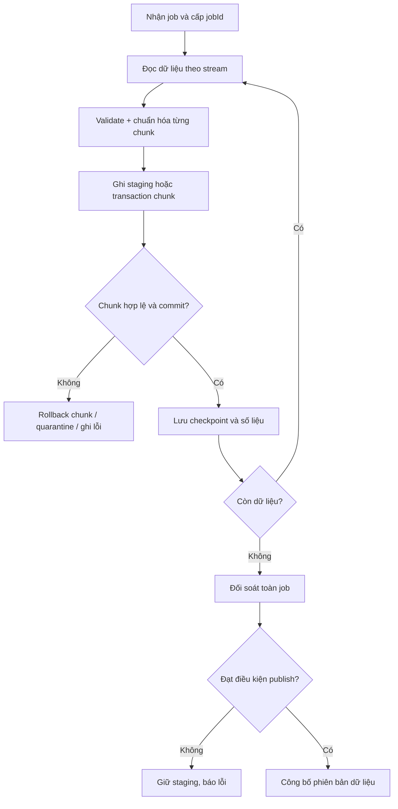
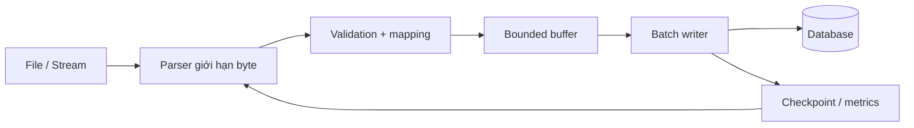

# Thao tác hàng loạt và giới hạn kích thước lô

Một job đồng bộ nhập 200.000 sản phẩm. Cách đơn giản là lặp qua danh sách và gọi `INSERT` cho từng dòng. Job chạy được nhưng mất nhiều phút, giữ kết nối lâu và tạo nhiều lượt đi-về giữa ứng dụng với database. Khi gom 5.000 câu lệnh vào một batch, bộ nhớ tăng mạnh; một bản ghi lỗi khiến khó xác định phần nào đã được ghi. Khi đưa cả file vào một transaction, lock và WAL kéo dài, rollback có thể rất tốn thời gian.

**Thao tác hàng loạt (bulk/batch operations) không chỉ là tăng số câu SQL trong một lần gửi.** Cần chọn kích thước lô, ranh giới transaction, giới hạn tài nguyên, cách xử lý lỗi và cơ chế tiếp tục sau retry sao cho phù hợp với dữ liệu và hợp đồng nghiệp vụ.

Bài thuộc chương **Thao tác dữ liệu** của module **DATA_PERSISTENCE_FUNDAMENTALS**. Module giúp người học hiểu lưu trữ dữ liệu bền vững trong ứng dụng Java: lựa chọn mô hình dữ liệu, schema, truy vấn và chỉ mục; transaction, isolation, kiểm soát đồng thời; thiết kế ranh giới persistence, xử lý lỗi kết nối, tiến hóa schema, bảo mật, sao lưu và tối ưu hiệu năng. Bài này tập trung vào **cách ghi, đọc và xóa nhiều bản ghi hiệu quả nhưng vẫn giữ tính đúng đắn, khả năng phục hồi và giới hạn tài nguyên**.

Sau bài học, bạn có thể:

- Phân biệt **batch size**, **transaction chunk size** và **toàn bộ kích thước job**.
- Dùng JDBC batch và hiểu kết quả thực thi, lỗi batch, update counts và rollback.
- Cấu hình Hibernate/JPA batching, flush/clear và nhận biết đường ghi không thật sự batching.
- Tính đến giới hạn tham số, kích thước payload, bộ nhớ, lock, WAL, replication và timeout.
- Chọn bulk load chuyên dụng, staging table hoặc xử lý theo chunk khi dữ liệu lớn.
- Thiết kế retry/idempotency, checkpoint, quarantine và phép đo để job có thể tiếp tục an toàn.

## 1. Vì sao cần batch và đâu là chi phí thật?

Khi ghi từng hàng, ứng dụng thường thực hiện chu trình:

```text
Java: bind row 1 -> execute -> wait
Java: bind row 2 -> execute -> wait
Java: bind row 3 -> execute -> wait
...
Database: parse/execute/ack cho từng lệnh
```

Mỗi lần gọi có thể phát sinh chi phí cố định: network round trip, protocol, parse/plan, đồng bộ transaction log, quản lý statement và chuyển đổi dữ liệu. Khi gom lệnh:

```text
Java: bind row 1 -> addBatch
Java: bind row 2 -> addBatch
Java: bind row 3 -> addBatch
Java: executeBatch -> receive update counts
```

Ứng dụng giảm số lượt trao đổi và có thể tận dụng tối ưu của driver/database. Tuy nhiên, batch không làm biến mất các chi phí sau:

- Database vẫn phải kiểm tra constraint, index, trigger, quyền và transaction.
- Dữ liệu vẫn phải serialize, truyền qua mạng và ghi vào log/storage.
- Batch quá lớn làm tăng bộ nhớ phía Java/driver, thời gian xử lý một lượt và phạm vi lỗi.
- Transaction quá dài có thể giữ lock lâu, tăng bloat/WAL hoặc ảnh hưởng replica và workload khác.
- Câu lệnh quá nhiều tham số có thể vượt giới hạn engine/driver.
- Việc gom lệnh không tự làm thao tác trở nên idempotent hoặc nguyên tử ở phạm vi toàn job.

Batch phù hợp khi các thao tác có cấu trúc lặp lại và có thể thực thi theo nhóm. Nếu mỗi bản ghi cần logic khác nhau, truy vấn nhiều nguồn hoặc side effect bên ngoài, có thể cần pipeline có bước phân loại và điều phối thay vì một batch SQL lớn.

## 2. Ba kích thước cần tách biệt

Một lỗi thiết kế phổ biến là dùng từ “batch size” cho mọi con số.

| Khái niệm | Ý nghĩa | Ví dụ |
| --- | --- | --- |
| **Batch size** | Số lệnh/hàng gom vào một lần gửi batch | 200 dòng mỗi lần thực thi |
| **Transaction chunk size** | Số bản ghi commit/rollback cùng nhau trong một transaction | 1.000 dòng mỗi transaction |
| **Job size** | Tổng số bản ghi của toàn bộ file hoặc lần đồng bộ | 200.000 dòng |

Ví dụ một job 200.000 dòng có thể dùng:

```text
Job size             = 200,000 rows
Transaction chunk   = 1,000 rows
JDBC batch size      = 200 rows

Mỗi transaction:
  executeBatch 200 rows
  executeBatch 200 rows
  executeBatch 200 rows
  executeBatch 200 rows
  executeBatch 200 rows
  COMMIT 1,000 rows
```

Trong ví dụ, batch size là 200 nhưng transaction chứa 1.000 hàng. Năm lần batch thuộc cùng một transaction. Nếu lần thứ tư thất bại và transaction rollback, cả 1.000 hàng của chunk hiện tại được rollback theo hợp đồng transaction; các chunk đã commit trước đó vẫn còn.

### Khi nào transaction size bằng batch size?

- Đặt hai giá trị bằng nhau giúp đơn giản hóa và giới hạn phạm vi lỗi.
- Tách chúng cho phép giảm round trip mà vẫn commit theo nhóm lớn hơn.
- Với dữ liệu nhạy cảm, transaction chunk có thể nhỏ để giới hạn thời gian lock/rollback.
- Với job cần all-or-nothing trên toàn file, có thể dùng một transaction lớn, nhưng phải chấp nhận chi phí và giới hạn tương ứng hoặc chọn staging/swap.

Không có con số chuẩn cho mọi hệ thống. Giá trị phù hợp phụ thuộc driver, engine, schema/index, độ rộng hàng, network, workload đồng thời và yêu cầu phục hồi.

## 3. Chọn ranh giới nguyên tử trước khi chọn số lượng

Hãy xác định **đơn vị nghiệp vụ nào phải thành công cùng nhau**:

- Một dòng nhập độc lập?
- Một khách hàng cùng các địa chỉ và mapping external ID?
- Một hóa đơn cùng toàn bộ dòng hàng?
- Một nhóm cập nhật tồn kho và reservation?
- Toàn bộ file nhập có được công bố như một phiên bản duy nhất?

Nếu mỗi dòng độc lập, có thể commit theo chunk nhỏ và tiếp tục sau lỗi. Nếu header hóa đơn không được lệch khỏi lines, phải commit chúng cùng transaction cho mỗi hóa đơn; không cắt chunk giữa aggregate nếu việc đó tạo trạng thái không hợp lệ. Nếu người dùng chỉ được thấy toàn bộ file sau khi kiểm tra, dùng **staging rồi publish** hoặc cơ chế version/swap phù hợp.



**Commit chunk** và **publish job** là hai mốc khác nhau. Một chunk đã commit vào staging không nhất thiết đã xuất hiện với người dùng cuối.

## 4. JDBC batch: gom các lệnh lặp lại

JDBC hỗ trợ batch qua `PreparedStatement.addBatch()` và `executeBatch()`. Dùng prepared statement giúp tái sử dụng cấu trúc SQL và bind dữ liệu, đồng thời tránh nối chuỗi đầu vào vào câu SQL.

```java
import java.sql.Connection;
import java.sql.PreparedStatement;
import java.sql.SQLException;
import java.util.List;
import javax.sql.DataSource;

record ProductRow(String sku, String name, int quantity) {}

final class ProductBatchWriter {
    private final DataSource dataSource;

    ProductBatchWriter(DataSource dataSource) {
        this.dataSource = dataSource;
    }

    void insertBatch(List<ProductRow> rows) throws SQLException {
        String sql = """
                INSERT INTO product (sku, name, quantity)
                VALUES (?, ?, ?)
                """;

        try (Connection connection = dataSource.getConnection()) {
            connection.setAutoCommit(false);
            try (PreparedStatement ps = connection.prepareStatement(sql)) {
                for (ProductRow row : rows) {
                    ps.setString(1, row.sku());
                    ps.setString(2, row.name());
                    ps.setInt(3, row.quantity());
                    ps.addBatch();
                }

                ps.executeBatch();
                connection.commit();
            } catch (SQLException failure) {
                try {
                    connection.rollback();
                } catch (SQLException rollbackFailure) {
                    failure.addSuppressed(rollbackFailure);
                }
                throw failure;
            }
        }
    }
}
```

Đây là ví dụ tối giản: toàn bộ danh sách thành một batch và một transaction nên không phù hợp với danh sách không giới hạn. Với job lớn, đọc và ghi theo chunk hữu hạn, giới hạn byte/record và tránh giữ toàn bộ file trong RAM.

Các điểm quan trọng:

- `addBatch()` thêm bộ tham số của một lần thực thi vào batch; nó chưa có nghĩa dữ liệu đã được gửi hoặc commit.
- `executeBatch()` thực thi các lệnh đã gom và trả về mảng update counts theo hợp đồng driver.
- `commit()` xác nhận transaction; executeBatch thành công không đồng nghĩa transaction đã commit nếu auto-commit tắt.
- `clearBatch()` có thể dùng để xóa lệnh đang chờ sau khi thực thi; tránh để batch tích lũy ngoài dự kiến.
- Bind lại **mọi tham số** cho từng hàng, đặc biệt giá trị nullable; tránh vô tình mang tham số của dòng trước sang dòng sau.
- Dùng một connection/transaction cho các thao tác cần nguyên tử cùng nhau; không chia sẻ cùng Connection cho nhiều thread đồng thời.

### Đọc update counts

Các phần tử của mảng update counts thường có ý nghĩa:

| Giá trị | Ý nghĩa |
| --- | --- |
| Số nguyên không âm | Số hàng bị ảnh hưởng bởi lệnh tương ứng, theo driver |
| `Statement.SUCCESS_NO_INFO` (−2) | Lệnh thành công nhưng không biết số hàng ảnh hưởng |
| `Statement.EXECUTE_FAILED` (−3) | Lệnh thất bại trong batch nếu driver trả mã này |

Không giả định mọi driver đều trả chính xác một hàng cho mỗi lệnh, hoặc hỗ trợ batch với mọi kiểu SQL/parameter. Đọc tài liệu driver và kiểm thử phiên bản thực tế.

## 5. Lỗi batch và BatchUpdateException

Nếu một lệnh trong batch thất bại, driver có thể ném `BatchUpdateException`. Mảng update counts có thể phản ánh lệnh đã thành công trước lỗi, hoặc chứa marker thất bại, tùy driver và cách tiếp tục thực thi.

```java
import java.sql.BatchUpdateException;
import java.sql.SQLException;
import java.sql.Statement;

static void inspectBatchFailure(BatchUpdateException error) {
    int[] counts = error.getUpdateCounts();

    for (int i = 0; i < counts.length; i++) {
        int count = counts[i];
        if (count == Statement.EXECUTE_FAILED) {
            System.out.println("Command " + i + " failed");
        } else if (count == Statement.SUCCESS_NO_INFO) {
            System.out.println("Command " + i + " succeeded; count unknown");
        } else {
            System.out.println("Command " + i + " affected " + count);
        }
    }

    for (SQLException next = error.getNextException();
         next != null;
         next = next.getNextException()) {
        System.out.println("Batch detail: " + next.getSQLState());
    }
}
```

**Không dùng update counts như bằng chứng rằng các hàng đã commit.** Trong transaction tường minh, nếu chunk phải all-or-nothing và batch có lỗi, thông thường cần rollback toàn bộ transaction chunk. Một số driver có thể dừng tại lệnh lỗi, một số có thể tiếp tục lệnh còn lại; kết quả cụ thể phụ thuộc driver/database.

| Chính sách | Hành vi | Phù hợp khi |
| --- | --- | --- |
| **Atomic chunk** | Một dòng lỗi làm rollback cả chunk transaction | Các dòng có quan hệ hoặc cần tính nhất quán cùng nhau |
| **Quarantine từng dòng** | Ghi nhận dòng lỗi, tiếp tục dòng độc lập hợp lệ | File import cho phép bỏ dòng sai theo hợp đồng |
| **Atomic job** | Toàn bộ job thành công hoặc không công bố thay đổi | Thay thế snapshot/danh mục phải đồng nhất |
| **Staging + publish** | Ghi từng chunk nhưng chỉ công bố sau đối soát | File lớn cần retry mà không lộ trạng thái dở dang |

Nếu muốn bỏ qua một dòng lỗi trong khi giữ các dòng khác của cùng transaction, có thể cân nhắc savepoint hoặc chia batch nhỏ hơn. Không phải engine/driver nào cũng xử lý batch + savepoint giống nhau; phải kiểm thử thực tế.

Không bắt tất cả lỗi thành “skip row”. Lỗi unique có thể là xung đột nghiệp vụ; lỗi FK có thể do thiếu dữ liệu cha; lỗi kết nối hoặc hết dung lượng là lỗi hạ tầng cần dừng/retry job. Phân loại bằng SQLSTATE/constraint/error code và ghi lại nguồn lỗi.

## 6. JDBC: batch size và transaction chunk size độc lập

Đoạn mã sau minh họa một chunk hữu hạn. Mỗi transaction commit tối đa số hàng do tầng gọi quyết định; trong transaction, executeBatch được gọi theo batchSize.

```java
import java.sql.BatchUpdateException;
import java.sql.Connection;
import java.sql.PreparedStatement;
import java.sql.SQLException;
import java.util.List;
import javax.sql.DataSource;

final class ChunkedProductImporter {
    private final DataSource dataSource;

    ChunkedProductImporter(DataSource dataSource) {
        this.dataSource = dataSource;
    }

    void importChunk(List<ProductRow> chunk, int batchSize)
            throws SQLException {
        if (batchSize <= 0) {
            throw new IllegalArgumentException("batchSize must be positive");
        }
        if (chunk.isEmpty()) {
            return;
        }

        String sql = """
                INSERT INTO product (sku, name, quantity)
                VALUES (?, ?, ?)
                """;

        try (Connection connection = dataSource.getConnection()) {
            connection.setAutoCommit(false);
            try (PreparedStatement ps = connection.prepareStatement(sql)) {
                int pending = 0;

                for (ProductRow row : chunk) {
                    ps.setString(1, row.sku());
                    ps.setString(2, row.name());
                    ps.setInt(3, row.quantity());
                    ps.addBatch();
                    pending++;

                    if (pending == batchSize) {
                        ps.executeBatch();
                        ps.clearBatch();
                        pending = 0;
                    }
                }

                if (pending > 0) {
                    ps.executeBatch();
                    ps.clearBatch();
                }

                connection.commit();
            } catch (BatchUpdateException batchFailure) {
                try {
                    connection.rollback();
                } catch (SQLException rollbackFailure) {
                    batchFailure.addSuppressed(rollbackFailure);
                }
                throw batchFailure;
            } catch (SQLException failure) {
                try {
                    connection.rollback();
                } catch (SQLException rollbackFailure) {
                    failure.addSuppressed(rollbackFailure);
                }
                throw failure;
            }
        }
    }
}
```

Trong ví dụ, `chunk` là transaction chunk; `batchSize` chỉ điều khiển số lệnh gửi mỗi lần. Tầng gọi phải đọc file theo stream, chia thành chunk hữu hạn và lưu checkpoint sau mỗi commit thành công.

Nếu chunk thứ 8 lỗi, các chunk 1–7 có thể đã commit. Job cần **job ID, nguồn dữ liệu ổn định và quy tắc resume/idempotency** để không tạo trùng khi chạy lại từ đầu. Mã trên chưa thực hiện checkpoint hoặc deduplication; nó chỉ minh họa transaction cho một chunk.

### Commit outcome chưa xác định

Nếu kết nối đứt khi gửi `COMMIT`, server có thể đã commit nhưng phản hồi không tới Java. Kết quả là **commit outcome chưa xác định**. Không retry chunk mù quáng nếu thao tác không idempotent. Dùng khóa nguồn hoặc batch ID để truy vấn trạng thái ở database có thẩm quyền rồi mới quyết định tiếp tục.

## 7. Giới hạn kích thước lô: không chỉ là số hàng

Một batch có thể thất bại dù số hàng không lớn vì từng hàng chứa payload lớn hoặc câu lệnh có nhiều tham số.

### Giới hạn tham số và kích thước câu lệnh

Nếu mỗi hàng có `c` cột bind và một multi-row statement có `n` hàng, câu lệnh có thể cần khoảng `n × c` tham số. Ví dụ 400 hàng × 12 cột = 4.800 tham số.

Mỗi engine/driver có giới hạn riêng về:

- Số tham số bind trong một statement/protocol message.
- Độ dài câu SQL và kích thước packet.
- Kích thước request/response, frame hoặc message.
- Số phần tử trong `IN (...)`.
- Kích thước một row, một cột LOB và tổng payload.
- Số lệnh có thể được giữ trong batch phía client.

Không có ngưỡng universal áp dụng cho mọi database. Giới hạn thay đổi theo engine, phiên bản, driver và cấu hình. Tra tài liệu của hệ đang triển khai và kiểm tra bằng integration test.

### JDBC batch và multi-row INSERT không giống nhau

JDBC batch có thể gửi nhiều lần thực thi của cùng một prepared statement. Multi-row insert tạo một câu SQL có nhiều nhóm VALUES:

```sql
INSERT INTO product (sku, name, quantity)
VALUES
    (?, ?, ?),
    (?, ?, ?),
    (?, ?, ?);
```

Hai cách có chi phí, giới hạn tham số và khả năng trả generated keys khác nhau. Driver có thể tối ưu batch thành multi-row hoặc giao thức khác, nhưng đó là hành vi cần kiểm tra theo driver/cấu hình.

### Giới hạn theo byte

Giả sử mỗi hàng có vài cột ngắn, một trường mô tả tới 8 KiB và một JSON document tới 32 KiB. Một batch 500 hàng có thể tạo payload hàng chục MiB trước overhead của protocol, driver và object Java. Giới hạn theo **số hàng** không đủ; cần cả giới hạn byte, chiều dài field và số lượng record.

| Giới hạn | Mục đích |
| --- | --- |
| Max bytes mỗi file | Ngăn payload đầu vào vượt ngân sách |
| Max bytes mỗi record | Tránh một dòng cực lớn |
| Max records mỗi chunk | Giới hạn số object và công việc một lần |
| Max bytes mỗi chunk | Giới hạn bộ nhớ và payload thực truyền |
| Max bind parameters mỗi statement | Không vượt giới hạn driver/engine |
| Max duration mỗi transaction | Giảm lock/timeout và rollback dài |
| Max concurrent chunks/jobs | Backpressure cho database và connection pool |

## 8. Đọc theo stream và backpressure

Đừng đọc toàn bộ tệp 5 GB vào `List<ProductRow>` rồi mới bắt đầu ghi. Một pipeline tốt có thể:

1. Đọc từng record từ file/stream.
2. Kiểm tra định dạng, kích thước, encoding và schema.
3. Chuẩn hóa và chuyển thành domain row.
4. Thêm vào buffer tới khi đạt ngưỡng record hoặc byte.
5. Gửi chunk và đợi commit/ack phù hợp.
6. Ghi checkpoint rồi mới tiếp tục đọc thêm.



**Backpressure** nghĩa là tốc độ đọc/parse không được vượt xa khả năng ghi và commit của database trong thời gian dài. Nếu dùng queue giữa producer/consumer, queue phải có giới hạn; queue vô hạn chỉ chuyển vấn đề từ database sang heap JVM.

Khi buffer đầy, producer phải chờ, giảm tốc độ đọc hoặc áp dụng chính sách dừng. Với nhiều worker ghi song song, giới hạn tổng số chunk đang chạy để tránh cạn connection pool, tăng lock contention và tạo burst WAL.

### Kích thước byte theo encoding

`String.length()` không phải số byte UTF-8. Nếu giới hạn payload truyền theo byte, đo theo encoding thật hoặc đếm byte trực tiếp khi stream. Cũng tính overhead khi serialize JSON/CSV, escaping, header và metadata; kích thước object Java trong heap còn lớn hơn byte trên đĩa.

## 9. Hibernate/JPA: batching không tự xảy ra chỉ vì dùng saveAll

ORM cung cấp persistence context để quản lý entity và dirty checking. Nếu nạp hàng trăm nghìn entity mà không flush/clear, persistence context có thể giữ nhiều object, snapshot và metadata trong heap.

### Cấu hình JDBC batching

Ví dụ cấu hình Hibernate:

```properties
hibernate.jdbc.batch_size=50
hibernate.order_inserts=true
hibernate.order_updates=true
hibernate.jdbc.batch_versioned_data=true
```

- `hibernate.jdbc.batch_size`: số lệnh DML tối đa gom vào batch, tùy Hibernate version/driver.
- `hibernate.order_inserts`: sắp xếp insert để tăng cơ hội gom cùng loại SQL.
- `hibernate.order_updates`: sắp xếp update; có thể ảnh hưởng thứ tự khóa/deadlock, cần benchmark.
- `hibernate.jdbc.batch_versioned_data`: điều khiển batch DML có version; xác minh behavior với driver trả update counts.

Đây là cấu hình minh họa; kiểm tra tên thuộc tính, default và behavior theo phiên bản Hibernate thực tế.

**`@BatchSize` không đồng nghĩa JDBC DML batching.** Annotation này thường liên quan batching khi tải association/proxy, không phải tự gom insert/update. Spring Data `saveAll()` thường lặp qua entity và gọi cơ chế lưu tương ứng; batching thực tế phụ thuộc provider, generator, cấu hình và transaction. Kiểm tra SQL log/metrics thay vì suy ra từ tên method.

### flush() và clear() để giới hạn persistence context

```java
import jakarta.persistence.EntityManager;
import java.util.List;

final class JpaProductImporter {
    private static final int FLUSH_INTERVAL = 50;

    void persistProducts(EntityManager entityManager, List<Product> products) {
        int count = 0;
        for (Product product : products) {
            entityManager.persist(product);
            count++;

            if (count % FLUSH_INTERVAL == 0) {
                entityManager.flush();
                entityManager.clear();
            }
        }

        entityManager.flush();
        entityManager.clear();
    }
}
```

`flush()` đồng bộ thay đổi đang chờ từ persistence context xuống database trong transaction hiện tại; nó **không commit**. `clear()` detach các entity khỏi persistence context, giúp giảm bộ nhớ nhưng cũng khiến object đang dùng không còn managed. Cẩn trọng với lazy loading, quan hệ chưa flush, cascade và logic cần tiếp tục sửa entity sau clear.

Ví dụ giả định transaction đã mở ở tầng gọi và danh sách hữu hạn. Với dữ liệu rất lớn, nguồn cũng nên được đọc theo stream/chunk thay vì giữ cả list.

### IDENTITY có thể ảnh hưởng batching

Một số chiến lược sinh ID cần lấy khóa ngay sau từng insert. Với Hibernate, `GenerationType.IDENTITY` thường ngăn batching insert theo một số phiên bản/cấu hình vì provider phải thực hiện insert để lấy generated key. Sequence-based generator hoặc ID cấp ở ứng dụng có thể tạo điều kiện batching tốt hơn. Kiểm tra provider/version và đo bằng SQL log.

### Bulk JPQL update khác entity-by-entity

Một câu bulk update:

```sql
UPDATE Product p
SET p.active = false
WHERE p.lastSeenAt < :cutoff
```

có thể cập nhật nhiều hàng trực tiếp tại database mà không load từng entity. Nhưng bulk JPQL/SQL thường **bỏ qua** dirty checking, callback/lifecycle của entity và có thể không cập nhật version theo cách mong muốn. Entity đang nằm trong persistence context có thể stale; cần clear/refresh và xử lý optimistic locking/audit rõ ràng.

Bulk operation nhanh hơn không có nghĩa có cùng semantics với gọi setter trên từng entity.

## 10. Bulk load chuyên dụng và staging table

Khi tải hàng trăm nghìn hoặc hàng triệu dòng, JDBC batch có thể chưa phải phương án hiệu quả nhất. Database thường có công cụ bulk load chuyên dụng:

| Hệ quản trị | Cơ chế thường gặp | Lưu ý |
| --- | --- | --- |
| PostgreSQL | `COPY FROM STDIN` / binary COPY | Dùng API driver phù hợp; kiểm tra encoding, format, transaction và quyền |
| MySQL | `LOAD DATA [LOCAL] INFILE` | Cân nhắc quyền file, cấu hình local infile, delimiter/escaping và bảo mật |
| SQL Server | `BULK INSERT`, `bcp`, bulk copy API | Kiểm tra recovery model, constraint/trigger, batch và quyền |
| Oracle | SQL*Loader / direct path load | Cấu hình direct path, index/constraint và recovery theo hướng dẫn |

Đây là cơ chế riêng của từng engine, không phải API portable. Cần xác định có giữ trigger/constraint, generated values, logging và transaction semantics như yêu cầu không.

### Staging giúp tách nạp dữ liệu khỏi công bố

Một workflow phổ biến:

1. Nạp file vào bảng staging với `job_id` và `source_row_number`.
2. Kiểm tra schema, duplicate, foreign key, business invariant và tổng số.
3. Ghi dòng lỗi vào bảng quarantine/error report.
4. Chuyển dữ liệu hợp lệ sang bảng đích bằng câu lệnh set-based.
5. Đối soát số dòng, tổng tiền, khóa và manifest.
6. Publish phiên bản hoặc đánh dấu job hoàn tất.

Ví dụ bảng staging:

```sql
CREATE TABLE product_import_stage (
    job_id UUID NOT NULL,
    source_row_number BIGINT NOT NULL,
    sku TEXT NOT NULL,
    name TEXT NOT NULL,
    quantity INTEGER NOT NULL,
    row_status TEXT NOT NULL DEFAULT 'PENDING',
    error_code TEXT,
    PRIMARY KEY (job_id, source_row_number)
);
```

Khóa ghép `(job_id, source_row_number)` giúp retry cùng file không tạo nhiều bản staging cho một dòng nếu thao tác nạp được thiết kế idempotent. `job_id` phải ổn định cho cùng lần nhập; nếu mỗi retry tự tạo job ID mới, constraint không ngăn duplicate giữa các lần chạy.

### Publish tách khỏi chunk commit

Nếu ứng dụng chỉ được đọc dataset đã hoàn chỉnh, có thể lưu `dataset_version` hoặc `job_id` rồi chỉ đổi con trỏ active version khi toàn bộ job qua kiểm tra. Người đọc truy vấn phiên bản đang active; chunk staging đã commit không bị nhìn thấy trước publish.

Cần tính đến index, storage cho hai phiên bản, thời gian giữ phiên bản cũ và cách rollback publish.

## 11. Retry, idempotency và checkpoint

Một job dài có thể bị dừng giữa chừng do deploy, timeout, mất mạng hoặc lỗi database. Muốn resume an toàn, cần xác định **đã xử lý tới đâu** và **retry có tạo trùng không**.

Các thành phần thường cần:

- `job_id`: nhận diện một lần nhập logic.
- `source_id` hoặc khóa duy nhất của dòng nguồn: xác định dòng nào đã xử lý.
- `source_version`/checksum/manifest: chứng minh retry đang dùng cùng dữ liệu nguồn.
- `chunk_number` hoặc checkpoint: vị trí đã commit, không chỉ vị trí đã đọc.
- Unique constraint/upsert: chống tạo trùng ở nguồn ghi.
- Trạng thái job: `RECEIVED`, `PROCESSING`, `FAILED`, `READY_TO_PUBLISH`, `PUBLISHED`.
- Kết quả từng dòng/chunk: thành công, lỗi có thể retry, lỗi dữ liệu cần sửa.

**Checkpoint phải ghi sau khi chunk commit thành công**, hoặc được ghi cùng transaction nếu nằm trong cùng database và có thể tham gia atomicity. Nếu checkpoint ghi trước dữ liệu, job có thể bỏ qua phần chưa commit; nếu dữ liệu commit trước nhưng checkpoint mất, job có thể phát lại chunk và cần idempotency để an toàn.

Không dùng số dòng file làm định danh duy nhất nếu nguồn có thể thay đổi thứ tự. Nếu retry dùng file khác byte, row 100 có thể là bản ghi khác. Tốt hơn là dùng stable source key, batch manifest/checksum và version. Với file không có khóa nguồn ổn định, phải quy định retry yêu cầu cùng đúng file hay dedupe theo nội dung/nghiệp vụ.

### Commit outcome chưa rõ

Nếu connection đứt khi `COMMIT`, không thể dựa vào exception để kết luận chunk chưa được ghi. Trước retry:

1. Tra cứu `job_id` + `chunk_id`/source keys ở database có thẩm quyền.
2. Đối chiếu số dòng hoặc trạng thái chunk.
3. Nếu đã commit, cập nhật checkpoint/reconcile.
4. Nếu chưa commit, chạy lại chunk theo chính sách.
5. Nếu không xác định được, giữ job ở trạng thái cần đối soát, không tự nhân đôi dữ liệu.

Với thao tác tăng/giảm số dư hoặc tồn kho, upsert cộng thêm giá trị không tự idempotent. Cần định danh thao tác hoặc version.

## 12. Giữ quan hệ và thứ tự trong batch

Nhiều dữ liệu cần được ghi theo thứ tự:

- Bảng cha trước bảng con để thỏa foreign key.
- Dòng hóa đơn cùng header trong một transaction chunk.
- Xóa bảng con trước bảng cha khi constraint yêu cầu.
- Cùng một aggregate không bị hai worker cập nhật thiếu kiểm soát.
- Các update cùng tài nguyên nên có thứ tự khóa nhất quán để giảm deadlock.

Nếu batch gom lệnh từ nhiều aggregate, hãy sắp xếp theo thứ tự ổn định khi cần, nhưng không thay đổi thứ tự nghiệp vụ của sự kiện hoặc dòng có ý nghĩa. Hibernate `order_updates` có thể cải thiện grouping nhưng cũng có thể thay đổi thứ tự SQL; phải xem xét khóa và trigger.

Khi nhiều worker chạy song song, chia partition theo **khóa ổn định** (ví dụ `tenant_id` hoặc `customer_id`) để thao tác cùng aggregate đi về một worker, hoặc dùng locking/version tại database. Chia ngẫu nhiên theo số dòng có thể khiến cùng một thực thể bị ghi cạnh tranh ở nhiều worker.

## 13. Transaction chunk và tác động vận hành

Transaction chunk quá lớn có thể:

- Giữ row/table lock lâu và chặn request tương tác.
- Tăng WAL/redo/undo, áp lực disk và replication lag.
- Khi rollback, phải hoàn tác nhiều thao tác và mất thời gian.
- Giữ snapshot lâu, ảnh hưởng vacuum/MVCC tùy engine.
- Tạo transaction timeout hoặc vượt resource của connection.
- Làm khó xác định bản ghi gây lỗi và kéo dài thời gian phục hồi job.

Chunk quá nhỏ có thể:

- Tăng số lần commit và round trip.
- Tạo overhead transaction/log flush lớn.
- Giảm throughput do chi phí cố định lặp lại.
- Tạo quá nhiều checkpoint/metadata.

**Mục tiêu là cân bằng throughput với phạm vi rollback, độ trễ, lock và khả năng tiếp tục.** Không chọn chunk size chỉ từ benchmark chạy một mình khi production có workload đồng thời.

### Giá trị khởi đầu để benchmark

| Tham số | Khoảng minh họa | Theo dõi |
| --- | --- | --- |
| JDBC batch size | 100–250 lệnh | Thời gian executeBatch, payload, driver memory |
| Transaction chunk | 500–2.000 dòng | Commit latency, lock duration, rollback time |
| Reader buffer | Giới hạn byte hoặc vài chunk nhỏ | Heap, GC, tốc độ parse |
| Concurrent writers | 1–4 worker ban đầu | Pool wait, lock wait, deadlock, DB CPU |
| Job max duration | Theo SLA thực tế | Timeout, checkpoint age, retry count |

Đây chỉ là điểm bắt đầu cho benchmark. Với LOB lớn có thể cần batch 5–20 hàng; với bảng hẹp và driver tốt có thể dùng nhiều hơn. Điều chỉnh dựa trên số đo và điều kiện gần production.

## 14. Đo hiệu năng và chọn batch size bằng thực nghiệm

Nên đo ít nhất:

- Records/second và bytes/second.
- Thời gian parse/validate, bind, executeBatch, commit và toàn chunk.
- P50/P95/P99 latency của commit/chunk.
- Số batch, số chunk, kích thước trung bình/tối đa và số record lỗi.
- Heap, allocation rate, GC pause, queue depth.
- Connection pool wait, active connections, lock wait, deadlock.
- DB CPU, I/O, WAL/redo, replication lag, index growth.
- Retry count, checkpoint age, job completion time.

Một phép thử có ích so sánh nhiều cấu hình trong cùng điều kiện:

```text
Run A: batch 50,  tx chunk 500
Run B: batch 100, tx chunk 500
Run C: batch 200, tx chunk 1,000
Run D: batch 500, tx chunk 1,000

For each run:
  same dataset and schema
  same concurrent workload
  measure throughput + tail latency
  measure memory + lock + WAL
  verify row counts and business invariants
```

Nếu throughput tăng nhưng P99 của API tương tác tăng mạnh, replication lag vượt SLA hoặc job rollback mất nhiều phút, cấu hình mới có thể không phù hợp. Benchmark phải kiểm tra **tính đúng** cùng hiệu năng; job nhanh hơn nhưng bỏ sót/nhân đôi dòng là thất bại.

## 15. Đọc hàng loạt cũng cần giới hạn

Batch không chỉ dành cho ghi. Đọc tất cả bản ghi cùng lúc có thể làm heap cạn hoặc giữ cursor/transaction quá lâu.

Các cách thường dùng:

- **Pagination theo keyset:** lấy các hàng có khóa lớn hơn mốc cuối, ORDER BY theo khóa ổn định; phù hợp khi dữ liệu thay đổi và tránh offset lớn.
- **JDBC fetch size/cursor:** driver có thể stream kết quả theo nhóm; cấu hình và yêu cầu transaction phụ thuộc driver/engine.
- **Projection/DTO:** chỉ lấy cột cần dùng, tránh hydrate entity/LOB không cần thiết.
- **Partition theo khóa hoặc thời gian:** chia công việc có ranh giới ổn định.
- **Giới hạn đồng thời:** không mở nhiều cursor/transaction dài mà không đo resource.

Ví dụ keyset pagination:

```sql
SELECT customer_id, display_name
FROM customer
WHERE tenant_id = :tenant_id
  AND customer_id > :last_seen_id
ORDER BY customer_id
LIMIT :page_size;
```

`customer_id` phải tạo thứ tự ổn định và phù hợp cho phân trang. Nếu dữ liệu có thể thêm/xóa trong lúc chạy, cần định nghĩa snapshot/watermark và cách xử lý record mới. Offset lớn có thể khiến DB bỏ qua nhiều hàng và dễ đọc lặp/bỏ sót nếu thứ tự không ổn định.

**Fetch size không phải transaction chunk size.** Nó điều khiển cách driver lấy kết quả (nếu driver hỗ trợ), còn transaction xác định phạm vi commit/rollback.

## 16. Những bẫy phổ biến khi dùng bulk operations

| Bẫy | Hệ quả | Cách kiểm soát |
| --- | --- | --- |
| Batch quá lớn | Heap cao, timeout, payload vượt giới hạn | Giới hạn theo record và byte, benchmark |
| Một transaction cho toàn job | Lock lâu, rollback lớn, khó resume | Chunk hoặc staging/publish |
| Nhầm executeBatch với commit | Báo thành công trước khi transaction được xác nhận | Chỉ checkpoint/công bố sau commit |
| Bỏ qua BatchUpdateException | Dữ liệu một phần, không rõ dòng lỗi | Phân tích update counts, rollback/quarantine |
| Retry chunk không idempotent | Duplicate hoặc cộng/trừ hai lần | Stable keys, unique constraint, đối soát |
| Coi saveAll là batching | Vẫn có thể phát N statement riêng | Kiểm tra SQL log/metrics và cấu hình provider |
| Không flush/clear với ORM | Persistence context tăng không giới hạn | Flush/clear theo interval; transaction chunk |
| Bulk JPQL bỏ qua entity lifecycle | Cache/entity stale, audit/version sai | Clear/refresh, cập nhật audit/version rõ |
| Generated key không hỗ trợ batch | Provider phải insert từng dòng | Kiểm tra generator/driver, sequence/app ID nếu phù hợp |
| Cắt chunk giữa aggregate | Header/detail hoặc parent/child lệch | Chunk theo aggregate/khóa nghiệp vụ |
| Không giới hạn concurrency | Pool cạn, lock contention, DB quá tải | Bounded workers và backpressure |
| Checkpoint ghi sai thứ tự | Bỏ sót hoặc xử lý lặp | Gắn checkpoint với commit và idempotency |
| Dùng IN quá dài | Vượt giới hạn bind/SQL | Chia nhóm, array/temp table/staging |
| Xóa hàng loạt thiếu kiểm soát | Cascade/trigger/log phình, lock lớn | Xóa theo chunk, archive/partition, dry run |

## 17. Kiểm thử batch và tiêu chí nghiệm thu

Batch writer cần kiểm tra **số lượng, nội dung, tính nguyên tử và khả năng tiếp tục**, không chỉ kiểm tra method không ném exception.

| Ca kiểm thử | Cách thực hiện | Kết quả mong đợi |
| --- | --- | --- |
| Batch nhỏ hợp lệ | Insert 1–10 hàng | Số hàng và dữ liệu đúng |
| Nhiều batch trong một chunk | Chunk lớn hơn batch size | Tổng hàng đúng, không mất batch cuối |
| Chunk cuối chưa đủ batch size | Số hàng không chia hết batch size | Hàng còn lại vẫn được execute/commit |
| Lỗi giữa batch | Một row vi phạm unique/FK | Hành vi theo policy: rollback chunk hoặc quarantine |
| Lỗi sau vài chunk | Chunk 3 thất bại, chunk 1–2 đã commit | Resume không tạo trùng chunk đã commit |
| Timeout khi commit | Mất phản hồi sau khi gửi COMMIT | Đối soát bằng job/chunk ID, không retry mù |
| Giới hạn byte | Một record rất lớn hoặc chunk quá lớn | Từ chối/chia chunk trước khi cạn RAM |
| Parameter limit | Batch/multi-row statement có nhiều bind | Chia batch theo giới hạn engine/driver |
| FK/order dependency | Child tới trước parent | Giao thức sắp xếp hoặc staging xử lý đúng |
| Concurrent jobs | Hai job cùng upsert khóa nguồn | Unique/version bảo vệ, không lost update |
| ORM memory | Import lớn với flush/clear | Heap ổn định, entity state đúng |
| Bulk JPQL | Update nhiều hàng khi entity đã managed | Persistence context được clear/refresh |
| Publish staging | Job lỗi trước publish | Người dùng không thấy dữ liệu dở dang |
| Data reconciliation | Đối chiếu count, sum, key, manifest | Kết quả đúng theo nguồn |

### Đo cả tính đúng lẫn khả năng phục hồi

Ví dụ manifest có 50.000 dòng nguồn, trong đó 49.970 hợp lệ và 30 bị quarantine theo chính sách. Nghiệm thu phải chứng minh:

- 49.970 dòng hợp lệ đã được ghi/publish đúng một lần.
- 30 dòng lỗi có số dòng nguồn và mã lỗi truy vết được.
- Tổng đầu vào = thành công + quarantine + chưa xử lý.
- Tổng tiền/số lượng/khóa tham chiếu phù hợp quy tắc nghiệp vụ.
- Retry cùng job không nhân đôi kết quả.
- Checkpoint phản ánh phần đã commit; không đánh dấu phần mới chỉ đọc/đang chờ commit.
- Job có thể dừng và tiếp tục mà không lộ trạng thái không hợp lệ.

## 18. Bài tập áp dụng

**Bài tập 1 — phân biệt kích thước.** Job có 120.000 dòng, JDBC batch size 200, transaction chunk 1.000. Có bao nhiêu lần executeBatch và bao nhiêu transaction nếu mọi chunk đủ 1.000 dòng?

*Gợi ý:* 5 lần executeBatch trong mỗi transaction; 120 transaction, tổng 600 lần executeBatch.

**Bài tập 2 — lỗi giữa batch.** executeBatch ném BatchUpdateException sau khi một số lệnh đã chạy. Vì sao update counts không đủ chứng minh các hàng đã commit? Nếu chunk phải all-or-nothing, xử lý thế nào?

*Gợi ý:* Update counts phản ánh thực thi theo driver, không phải commit. Rollback transaction chunk và chỉ ghi checkpoint sau commit.

**Bài tập 3 — giới hạn tham số.** Một multi-row insert có 16 cột bind mỗi hàng. Nếu giới hạn giả định của engine là 4.000 tham số cho statement, tối đa bao nhiêu hàng theo giới hạn đó? Vì sao vẫn cần kiểm tra kích thước byte?

*Gợi ý:* 250 hàng về mặt số tham số; payload và overhead có thể chạm giới hạn khác trước đó.

**Bài tập 4 — retry.** Job đã commit chunk 1–4, mất kết nối khi commit chunk 5. Vì sao không thể chỉ đọc checkpoint cục bộ rồi chạy lại chunk 5? Cần metadata nào để đối soát?

*Gợi ý:* Outcome commit có thể chưa rõ; cần job ID, chunk/source key, trạng thái đã ghi trong DB và unique/idempotency để xác minh.

**Bài tập 5 — Hibernate.** Importer dùng saveAll 100.000 entity và heap tăng liên tục. Những cấu hình/cơ chế nào cần kiểm tra?

*Gợi ý:* JDBC batching thực tế, hibernate.jdbc.batch_size, ID generator, flush/clear, transaction chunk và việc có giữ toàn bộ list/entity hay không.

**Bài tập 6 — staging.** Vì sao dữ liệu có thể đã commit từng chunk mà chưa được công bố cho người dùng? Hãy mô tả cách dùng job_id hoặc dataset version để publish nguyên tử.

*Gợi ý:* Chunk commit vào staging; chỉ chuyển active version/con trỏ sau khi đối soát toàn job.

**Thực hành có kiểm soát:** Tạo bảng sản phẩm trong PostgreSQL thử nghiệm. Viết importer JDBC đọc CSV theo stream, giới hạn cả byte và số record, chia transaction chunk 1.000 và JDBC batch 200. Cố ý tạo một dòng trùng SKU ở chunk giữa, dừng job gần thời điểm commit, rồi chạy lại cùng job_id. Đối chiếu số dòng thành công, lỗi/quarantine, checkpoint, dữ liệu trùng, thời gian commit, heap và số lần retry. Sau đó so sánh với cấu hình Hibernate batching có flush/clear.

Báo cáo phải nêu **batch size, transaction size, job size, ranh giới nguyên tử, giới hạn byte/parameter, chính sách lỗi, idempotency, số đo hiệu năng và bằng chứng đối soát**.

## Ghi nhớ

**Batch size điều khiển số lệnh gom trong một lần gửi; transaction chunk size xác định phạm vi commit/rollback; job size là tổng khối lượng công việc.** Chúng có liên quan nhưng không thay thế nhau. JDBC batch, Hibernate batching và bulk load chuyên dụng có giới hạn cùng semantics khác nhau; executeBatch hoặc flush không phải commit. Một thiết kế tốt đọc theo stream, giới hạn record/byte/parameter/concurrency, chọn chunk theo aggregate và yêu cầu nguyên tử, xử lý BatchUpdateException, retry/idempotency/checkpoint và chỉ publish sau đối soát. Chọn kích thước lô bằng số đo thực tế về throughput, latency, memory, lock và WAL, rồi chứng minh dừng/chạy lại không làm mất hoặc nhân đôi dữ liệu.
