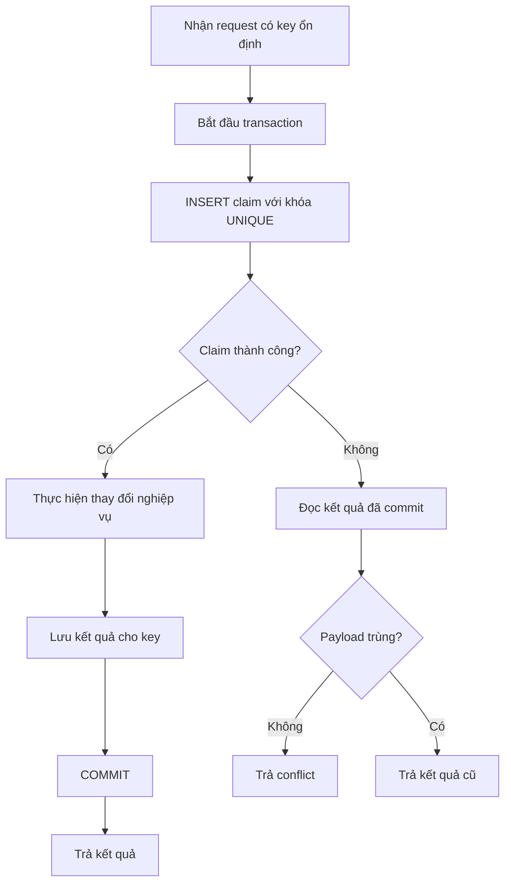
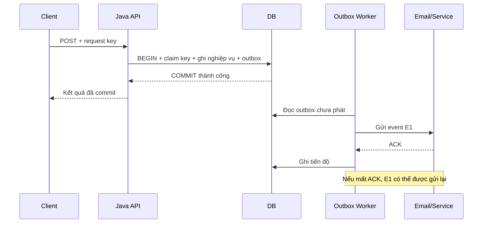

# Xác định tính lũy đẳng của từng thao tác ghi

## 1. Vì sao một yêu cầu ghi có thể được thực hiện nhiều lần?

Người dùng nhấn “Xác nhận thanh toán”. Ứng dụng Java gửi yêu cầu xuống cơ sở dữ liệu và nhận phản hồi bị timeout. Đến thời điểm timeout, có ít nhất hai khả năng:

- Giao dịch đã thất bại trước khi commit: chưa có thay đổi được xác nhận.
- Giao dịch đã commit, nhưng phản hồi thành công không đến được Java hoặc trình duyệt.

Nếu client gửi lại cùng thao tác, hệ thống có tạo thêm đơn hàng, trừ tiền lần hai hoặc gửi hai thông báo không? Muốn trả lời, cần xác định **tính lũy đẳng** (*idempotency*) của chính thao tác ghi và của **toàn bộ hiệu ứng nghiệp vụ** mà thao tác kích hoạt.

Bài thuộc chương **Thao tác dữ liệu** của module `DATA_PERSISTENCE_FUNDAMENTALS`. Nội dung giúp người học chuyển yêu cầu nghiệp vụ thành quy tắc ghi dữ liệu bền vững, lựa chọn lược đồ, truy vấn, chỉ mục và ranh giới persistence trong Java; xử lý giao dịch, cô lập, đồng thời, lỗi kết nối, schema evolution, bảo mật, sao lưu và hiệu năng.

### Mục tiêu học tập

Sau bài học, bạn có thể:

1. Phân loại một thao tác `INSERT`, `UPDATE`, `DELETE`, `UPSERT` hoặc thao tác nhiều bước là lũy đẳng hay không.
2. Phân biệt trạng thái cuối cùng của dữ liệu với phản hồi HTTP và các tác dụng phụ như email, outbox, audit, thanh toán.
3. Thiết kế `request_id`/idempotency key, ràng buộc `UNIQUE` và kết quả lưu bền vững để thử lại an toàn.
4. Giải thích hành vi sau timeout đúng lúc `COMMIT` mà không tự kết luận giao dịch đã thất bại.
5. Viết đường xử lý bằng PostgreSQL và Java/JDBC có kiểm soát đồng thời.
6. Đưa ra test mô phỏng request lặp, đổi payload, cạnh tranh ghi và lỗi giữa các bước.

## 2. Định nghĩa chính xác: lặp thao tác không làm thay đổi kết quả trạng thái thêm lần nữa

Với một thao tác `f` áp dụng lên trạng thái `S`, cách diễn đạt toán học quen thuộc là:

\[
f(f(S)) = f(S)
\]

Nghĩa là **áp dụng lại cùng thao tác có cùng ý nghĩa** không làm trạng thái đang xét thay đổi thêm so với áp dụng một lần. Tuy nhiên trong ứng dụng thật phải xác định rõ **trạng thái nào** được tính:

- Chỉ một hàng ở DB nóng?
- Cả hàng nghiệp vụ, lịch sử, outbox và số dư?
- Toàn hệ thống bao gồm kho dữ liệu bên ngoài, email và API thanh toán?

Một câu `UPDATE` có thể giữ nguyên giá trị cột chính sau lần thứ hai nhưng vẫn cập nhật `updated_at`, tăng `version`, ghi audit hoặc kích hoạt trigger. Do đó, **lũy đẳng ở cấp một trường không nhất thiết lũy đẳng ở cấp nghiệp vụ**.

### 2.1. Ví dụ hai thao tác dễ nhầm

Giả sử `quantity = 10`:

```sql
-- A: Đặt giá trị tuyệt đối
UPDATE inventory SET quantity = 12 WHERE sku = 'BOOK-JAVA';

-- B: Tăng tương đối
UPDATE inventory SET quantity = quantity + 2
WHERE sku = 'BOOK-JAVA';
```

- Chạy A một lần: `quantity = 12`. Chạy A lần thứ hai: vẫn `12`. **A lũy đẳng về số lượng**, nếu không có hiệu ứng khác.
- Chạy B một lần: `quantity = 12`. Chạy B lần thứ hai: `14`. **B không lũy đẳng**.

Sự khác nhau là “**đặt trạng thái đích**” và “**thực hiện một thay đổi mới**”. Nhưng ngay cả thao tác đặt trạng thái đích cũng cần xem xét điều kiện, tác dụng phụ và cách hệ thống phân biệt một yêu cầu cũ với một ý định mới.

### 2.2. Lũy đẳng không bắt buộc trả cùng một mã phản hồi

Hai lần `DELETE /tickets/42` có thể cho kết quả:

```text
Lần đầu:  204 No Content  -> bản ghi không còn
Lần sau:  404 Not Found   -> bản ghi vẫn không còn
```

Đây vẫn có thể là thao tác lũy đẳng về **trạng thái tài nguyên**. Việc HTTP trả mã khác nhau không tự phủ định tính lũy đẳng. Nếu hợp đồng API muốn trả lại chính xác ID, body và mã kết quả như lần đầu, cần định nghĩa thêm cơ chế ghi nhớ phản hồi (*response replay*).

Tương tự, một thao tác có thể không lũy đẳng nhưng trở nên **an toàn khi retry cùng request ID** nhờ kiểm soát trùng và trả lại kết quả đã lưu. Đó là hai cách nhìn liên quan nhưng khác nhau.

## 3. Bảng phân loại từng kiểu thao tác ghi

Bảng sau giả định không có trigger, audit hoặc hành vi phụ khác, trừ khi nêu rõ.

| Thao tác | Chạy hai lần với cùng input | Lũy đẳng theo trạng thái đích? | Điểm phải kiểm tra |
| --- | --- | --- | --- |
| `INSERT` tạo hàng mới với ID do DB sinh | Thường tạo hai hàng khác nhau | Không | Cần business key hoặc idempotency key |
| `INSERT` cùng PK và DB chặn xung đột | Lần hai bị từ chối | Trạng thái nguồn không thay đổi thêm | Xử lý lỗi/đối chiếu kết quả, không coi mọi conflict đều thành công |
| `INSERT ... ON CONFLICT DO NOTHING` | Lần trùng không thêm hàng | Thường có đối với hàng mục tiêu | Có bỏ qua sai lệch payload hoặc hiệu ứng khác không? |
| `UPDATE ... SET status = 'PAID'` | Giá trị `status` vẫn `PAID` | Có thể có ở một cột | Trigger, `version`, `updated_at`, outbox có lặp không? |
| `UPDATE ... SET quantity = quantity + 1` | Tăng hai lần | Không | Phải nhận diện cùng ý định nếu có retry |
| `UPDATE ... SET updated_at = CURRENT_TIMESTAMP` | Thời gian đổi theo lần chạy | Không | Không coi lệnh này là “ghi lại y nguyên” |
| `UPDATE ... SET version = version + 1` | Version tăng mỗi lần | Không | CAS giúp chống ghi cũ nhưng không tự replay kết quả |
| `DELETE FROM ... WHERE id = ?` | Lần sau không còn hàng để xóa | Thường có với tập hàng cuối | Trigger, side effect và chính sách HTTP có thể khác |
| Xóa mềm bằng `SET deleted_at = CURRENT_TIMESTAMP` không điều kiện | Thời gian xóa đổi khi retry | Không | Dùng điều kiện `deleted_at IS NULL` nếu muốn chỉ ghi lần đầu |
| `UPSERT` chỉ đặt giá trị đã định | Phụ thuộc nhánh conflict | Có điều kiện | `DO UPDATE` có tăng counter, update timestamp hoặc trigger không? |
| Ghi tiền vào ledger bằng một event mới | Hai lần thành hai giao dịch | Không | Khóa yêu cầu, unique và lưu kết quả trong transaction |
| Gửi email hoặc gọi API thanh toán | Có thể tạo hai hiệu ứng ngoài DB | Không mặc định | Cần idempotency ở hệ thống đích hoặc cơ chế chống xử lý lặp |

**Không có quy tắc “DELETE luôn lũy đẳng” hay “PUT luôn an toàn” khi bỏ qua hiệu ứng nghiệp vụ.** HTTP method diễn tả hợp đồng dự kiến; mã triển khai và trạng thái bên ngoài mới quyết định kết quả.

## 4. Tách “ý định nghiệp vụ” khỏi “lần gửi request”

Một người có thể thật sự muốn tăng số lượng hai lần, mỗi lần `+5`. Ngược lại, một lần `+5` bị timeout rồi client gửi lại **cùng một ý định** thì phải chỉ tăng một lần.

Nếu chống lặp chỉ bằng `sku` và `delta`, hệ thống không phân biệt hai trường hợp trên.

### 4.1. Ba khóa có vai trò khác nhau

| Định danh | Ý nghĩa | Ví dụ |
| --- | --- | --- |
| `aggregate_id` | Đối tượng nghiệp vụ được sửa | `sku = BOOK-JAVA` |
| `request_id` / `idempotency_key` | Một **ý định ghi logic** cụ thể | `f5a6...` |
| `event_id` | Một bản ghi sự kiện dùng để truyền/tiêu thụ | `event-873` |

Một người nhập kho `+5` vào thứ Hai và `+5` vào thứ Ba phải dùng **hai request ID**. Nếu request thứ Hai bị timeout và gửi lại, cần giữ **cùng request ID**.

Idempotency key nên được tạo một lần cho một ý định, giữ nguyên qua retry, không tạo UUID mới ngay trong mỗi attempt của client. ID cũng cần có **phạm vi**: theo người dùng, tenant, loại thao tác hay endpoint; tránh key của người dùng A chiếm namespace của B.

### 4.2. Payload phải được đối chiếu

Giả sử request key `R1` lần đầu có:

```json
{"sku":"BOOK-JAVA","delta":5}
```

Lần tiếp theo cũng `R1` nhưng payload là:

```json
{"sku":"BOOK-JAVA","delta":50}
```

Đây không phải cùng ý định. Phải trả lỗi conflict theo hợp đồng và **không** âm thầm phát lại kết quả `+5` như thể đã thực hiện `+50`. Có thể lưu các trường nghiệp vụ chuẩn hóa hoặc fingerprint của request sau khi canonicalize. Một hash của JSON thô có thể thay đổi vì thứ tự key/format dù ý nghĩa như nhau; còn canonicalization sai lại có thể đánh đồng các payload khác nhau.

Nên giới hạn thời hạn giữ idempotency key dựa trên cửa sổ retry, nghĩa vụ đối soát và vòng đời nghiệp vụ. **Nếu xóa key quá sớm, một retry rất muộn có thể bị coi là yêu cầu mới**.

## 5. INSERT: tạo mới mặc định không lũy đẳng

Ví dụ bảng phiếu hỗ trợ:

```sql
CREATE TABLE tickets (
    id         BIGINT GENERATED ALWAYS AS IDENTITY PRIMARY KEY,
    owner_id   BIGINT NOT NULL,
    request_id UUID NOT NULL,
    title      VARCHAR(200) NOT NULL,
    created_at TIMESTAMPTZ NOT NULL DEFAULT CURRENT_TIMESTAMP,
    CONSTRAINT uq_ticket_request UNIQUE (owner_id, request_id),
    CONSTRAINT ck_ticket_owner CHECK (owner_id > 0),
    CONSTRAINT ck_ticket_title CHECK (length(btrim(title)) > 0)
);
```

Nếu không có `UNIQUE(owner_id, request_id)`, cùng một yêu cầu có thể tạo hai ID và hai bản ghi. Ràng buộc unique bảo vệ **cùng ý định** được nhận diện bằng key; nó không cấm người dùng tạo phiếu mới thật sự có cùng tiêu đề.

Một cách insert:

```sql
INSERT INTO tickets (owner_id, request_id, title)
VALUES (:owner_id, :request_id, :title)
ON CONFLICT (owner_id, request_id) DO NOTHING
RETURNING id, title, created_at;
```

Các dấu `:...` là placeholder khái niệm; với JDBC thuần dùng `?`.

- Nếu tạo mới thành công, `RETURNING` cho thông tin hàng đã thêm.
- Nếu conflict và `DO NOTHING`, kết quả **không có hàng**; service cần truy vấn hàng hiện có, kiểm tra owner và title/payload tương ứng.
- Không dùng `SELECT MAX(id)` để đoán ID của request cũ hoặc mới.
- Trong một transaction chưa commit, ID từ `RETURNING` không có nghĩa thay đổi đã được xác nhận bền vững.

Nếu lưu yêu cầu tạo trên một bảng idempotency riêng, phải đảm bảo hàng phiếu và bản ghi kết quả được commit **nguyên tử**. Nếu ghi phiếu trước, commit, rồi mới lưu key chống trùng, một crash ở giữa sẽ mở cửa tạo bản sao khi retry.

## 6. UPDATE: phân biệt gán trạng thái, phép tính tương đối và điều kiện

### 6.1. Gán một giá trị tuyệt đối

```sql
UPDATE tickets
SET title = 'Không đăng nhập được'
WHERE id = :ticket_id AND owner_id = :owner_id;
```

Nếu không có trigger, phiên bản tăng, timestamp thay đổi hay audit bổ sung, lặp câu này giữ `title` ở cùng giá trị. Nhưng ví dụ sau **khác**:

```sql
UPDATE tickets
SET title = 'Không đăng nhập được',
    version = version + 1,
    updated_at = CURRENT_TIMESTAMP
WHERE id = :ticket_id;
```

Nó có thể giữ nguyên title nhưng **thay đổi version và updated_at** mỗi lần. Nếu sự kiện `TicketUpdated` được phát đi trên mỗi lần update, consumer còn thấy hai sự kiện khác nhau. Cần xem toàn bộ miền trạng thái.

### 6.2. Tăng/giảm tương đối

```sql
UPDATE inventory_items
SET quantity = quantity + :delta
WHERE sku = :sku;
```

Phép cộng **không lũy đẳng** khi `delta ≠ 0`. Câu SQL có thể nguyên tử theo cơ chế DB, nhưng tính nguyên tử của *mỗi lần* không ngăn *hai lần* được thực thi.

Với nghiệp vụ cộng tiền, tăng điểm tích lũy hoặc giảm tồn kho, phải nhận diện một lần điều chỉnh bằng request ID/ledger entry ID và lưu nó trong cùng transaction với thay đổi giá trị.

### 6.3. Optimistic locking có đủ không?

```sql
UPDATE inventory_items
SET quantity = quantity + :delta,
    version = version + 1
WHERE sku = :sku
  AND version = :expected_version;
```

Điều kiện phiên bản giúp phát hiện ghi đè dựa trên trạng thái cũ. Sau lần đầu thành công, retry với version cũ cập nhật 0 hàng. Tuy nhiên, 0 hàng có thể do **yêu cầu đã hoàn thành** hoặc **người khác vừa thay đổi**. Không thể tự suy ra kết quả nghiệp vụ của request trước đó chỉ từ 0 hàng.

**Optimistic locking giải quyết xung đột phiên bản; idempotency key giải quyết lặp lại cùng ý định.** Hai cơ chế bổ sung, không thay thế nhau.

### 6.4. Gán trạng thái nghiệp vụ

```sql
UPDATE orders
SET status = 'PAID'
WHERE id = :order_id AND status = 'DRAFT';
```

Lặp lại sau lần đầu sẽ tác động 0 hàng; trạng thái vẫn là `PAID`. Nhưng ứng dụng không nên cứ thấy trạng thái `PAID` là coi mọi yêu cầu thanh toán đã thành công: có thể đơn được thanh toán bởi giao dịch khác, số tiền khác hoặc phương thức khác. Nếu cần đối chiếu một giao dịch thanh toán cụ thể, phải lưu `payment_request_id` hoặc khóa tương đương gắn với đúng giao dịch và kiểm soát các tác dụng phụ.

## 7. DELETE: khác nhau giữa xóa vật lý, xóa logic và yêu cầu xóa lặp

### 7.1. Xóa vật lý

```sql
DELETE FROM tickets
WHERE id = :ticket_id AND owner_id = :owner_id;
```

Sau lần đầu xóa thành công, cùng hàng không còn trong bảng. Lệnh thứ hai thường xóa 0 hàng, vì vậy **trạng thái tập hàng không đổi thêm**. Nhưng cần xem:

- `ON DELETE CASCADE` có xóa các bản ghi con khi xóa lần đầu không?
- Trigger xóa có gửi thông báo, ghi audit hoặc gọi logic ngoài DB không?
- Client được quyền biết bản ghi vốn không tồn tại hay không?
- Bản ghi có còn ở cache, search index hoặc backup sau khi DB xóa không?

Nếu muốn idempotency end-to-end của yêu cầu xóa, có thể cần ghi nhận command ID và điều phối việc xóa ở hệ thống ngoài DB. **Xóa hàng khỏi một DB chưa đồng nghĩa xóa khỏi mọi bản sao**.

### 7.2. Xóa logic

Câu lệnh sau làm thay đổi timestamp trên mỗi lần lặp:

```sql
UPDATE tickets
SET deleted_at = CURRENT_TIMESTAMP
WHERE id = :ticket_id;
```

Cách bảo vệ lần đầu:

```sql
UPDATE tickets
SET deleted_at = CURRENT_TIMESTAMP
WHERE id = :ticket_id
  AND deleted_at IS NULL;
```

Lần sau cập nhật 0 hàng, `deleted_at` không bị thay đổi nữa. Đây là lũy đẳng **về dữ liệu hàng** nếu không có tác dụng phụ thêm. Nếu API cần trả đúng thời điểm xóa đầu tiên, đọc trạng thái hiện tại hoặc lưu response theo key đã định.

### 7.3. Xóa rồi tạo lại cùng ID/khóa nghiệp vụ

Lũy đẳng không có nghĩa một lệnh `DELETE` vô điều kiện luôn an toàn khi có các thao tác xen giữa:

```text
A: DELETE /resources/42 -> xóa bản ghi cũ
B: CREATE resource 42 -> bản ghi mới với cùng ID nghiệp vụ
A: retry DELETE /resources/42 -> xóa nhầm bản ghi mới
```

Nếu cho phép tái sử dụng khóa, cần thêm version/generation ID, điều kiện `If-Match`/ETag hoặc idempotency record để phân biệt phiên bản tài nguyên được nhắm tới. Tính lũy đẳng thường được mô tả với **cùng thao tác trên trạng thái thích hợp**, không bảo vệ mọi lịch sử xen kẽ.

## 8. UPSERT: bản chất phụ thuộc nhánh cập nhật

`INSERT ... ON CONFLICT DO UPDATE` có thể là lựa chọn đúng khi nghiệp vụ là “đặt dữ liệu catalog về trạng thái mong muốn”:

```sql
INSERT INTO product_catalog (external_id, name, price)
VALUES (:id, :name, :price)
ON CONFLICT (external_id) DO UPDATE
SET name = EXCLUDED.name,
    price = EXCLUDED.price;
```

Lặp cùng input có thể giữ các cột `name` và `price` ổn định. Tuy nhiên nếu thêm:

```sql
SET stock = product_catalog.stock + EXCLUDED.stock
```

thì lặp cùng input sẽ cộng kho nhiều lần. Tương tự, nếu nhánh conflict luôn đổi `updated_at`, tăng `revision` hoặc kích hoạt trigger, không thể coi toàn bộ trạng thái là lũy đẳng.

Với `DO NOTHING`, lệnh có thể không ghi thêm lần thứ hai nhưng vẫn cần **so sánh nội dung hiện có**. Cùng key nhưng giá trị khác có thể là xung đột cần trả lỗi, không phải thành công.

### 8.1. Idempotent “set” khác “merge”

Một API đồng bộ sản phẩm có thể nhận cả bản ghi với `catalog_version`. Nếu những yêu cầu v3 và v2 đến sai thứ tự, chỉ đặt giá trị theo payload mà không kiểm tra phiên bản có thể làm dữ liệu **lùi từ v3 về v2**. Cần quy tắc nguồn dữ liệu, phiên bản tăng đơn điệu hoặc so sánh thứ tự nếu muốn bảo vệ khỏi retry cũ.

Lũy đẳng khi gửi lại **cùng request** khác với tính đơn điệu khi nhận **nhiều request khác nhau** đến sai thứ tự.

## 9. Thiết kế khóa chống lặp và trạng thái kết quả

Một thiết kế tổng quát có thể dùng bảng `idempotency_requests` để lưu định danh, phạm vi, loại thao tác, fingerprint/payload và kết quả.

```sql
CREATE TABLE idempotency_requests (
    tenant_id    BIGINT NOT NULL,
    operation    VARCHAR(80) NOT NULL,
    request_key  UUID NOT NULL,
    payload_hash BYTEA NOT NULL,
    http_status  INTEGER,
    response_body JSONB,
    created_at   TIMESTAMPTZ NOT NULL DEFAULT CURRENT_TIMESTAMP,
    expires_at   TIMESTAMPTZ NOT NULL,
    PRIMARY KEY (tenant_id, operation, request_key),
    CONSTRAINT ck_idempotency_response
        CHECK (
            (http_status IS NULL AND response_body IS NULL)
            OR
            (http_status IS NOT NULL)
        )
);
```

Cần xác định:

- `tenant_id`, `operation` và `request_key` tạo namespace. Với hệ thống có user/endpoint riêng, thay đổi phạm vi cho phù hợp.
- `payload_hash` phải là hash của **request đã chuẩn hóa có quy tắc**, không bỏ qua trường ảnh hưởng nghiệp vụ. Không ghi plain token/secret vào hash input nếu quy trình logging có thể làm lộ.
- `http_status` và `response_body` dùng khi muốn trả lại kết quả đã xác nhận. Không phải mọi API đều cần lưu nguyên response HTTP; với một số nghiệp vụ, lưu `resource_id` và kết quả tối thiểu là đủ.
- `expires_at` mô tả chính sách giữ key. Dọn record chỉ sau khi chắc chắn retry muộn không gây hiệu ứng ngoài ý muốn, hoặc có lớp unique nghiệp vụ độc lập bảo vệ.
- Schema ví dụ cho phép một hàng mới có kết quả `NULL` **bên trong transaction chưa commit**; đường xử lý đúng phải điền kết quả rồi commit. Không được để một hàng “đang xử lý” bị commit mà không có giao thức lease/recovery.

Nếu muốn hỗ trợ tác vụ chạy nhiều phút qua nhiều hệ thống, có thể dùng trạng thái `PROCESSING/COMPLETED/FAILED` và lease. Khi đó phải thiết kế *fencing token*, timeout, gia hạn lease và cách xử lý worker chết; một cột `PROCESSING` đơn giản không đủ chống hai worker cùng thực thi side effect.

## 10. Giao thức claim → thực thi → lưu kết quả → commit

Đối với một thao tác hoàn toàn nằm trong **cùng cơ sở dữ liệu**, đường an toàn thông dụng là:



Điểm quan trọng: **claim, thay đổi nghiệp vụ và kết quả trả lại phải commit nguyên tử**. Với PostgreSQL, unique conflict của một request trùng đang chờ giao dịch khác có thể buộc bên đến sau chờ kết quả của bên trước. Sau khi transaction đầu commit, bên sau mới tra lại kết quả từ một câu SQL mới ở isolation phù hợp, ví dụ `READ COMMITTED`.

Nếu transaction đầu rollback, claim cũng rollback; một attempt khác có thể giành key và thực hiện đúng một lần. Nếu commit thành công nhưng phản hồi mất, key và kết quả vẫn tồn tại để attempt mới đối chiếu.

### 10.1. Ba tình huống khi tranh cùng key

| Tình huống | Kết quả an toàn |
| --- | --- |
| Attempt A đang xử lý, B đến cùng key | Chờ/serialize ở unique constraint hoặc báo đang xử lý theo giao thức |
| A rollback trước commit | Claim và nghiệp vụ biến mất; B có thể thực thi |
| A commit nhưng phản hồi timeout | B tìm kết quả đã lưu và trả lại, không áp dụng thay đổi lần nữa |

Nếu dùng `ON CONFLICT DO NOTHING`, trong PostgreSQL `READ COMMITTED` kết quả kiểm tra xung đột và snapshot của một câu lệnh có thể khác nhau khi có transaction đồng thời. Bởi vậy, khi nhận biết key đã tồn tại, **đọc kết quả trong câu lệnh mới sau đó**, thay vì ghép tất cả thành một truy vấn phức tạp rồi mặc định hàng conflict chắc chắn nhìn thấy.

### 10.2. “Giữ key” và “commit phản hồi” không được cách xa tùy tiện

Thiết kế nguy hiểm:

```text
Transaction 1:
    INSERT idempotency_key
    COMMIT

Gọi dịch vụ nghiệp vụ:
    tăng số dư hoặc tạo đơn hàng

Transaction 2:
    lưu kết quả
    COMMIT
```

Một crash sau transaction 1 để lại key nhưng chưa có kết quả. Retry thấy key sẽ không biết nên thực thi, tiếp tục chờ hay trả lỗi. Nếu chưa có lease/recovery rõ ràng, cách này dễ tạo thao tác bị kẹt.

Ngược lại, nếu **thực hiện nghiệp vụ rồi mới ghi key ở transaction khác**, crash giữa hai bước cho phép retry thực hiện lần hai. Cần cùng transaction DB, hoặc một **workflow phân tán** với trạng thái, đối soát và idempotency ở hệ thống đích.

## 11. Ví dụ PostgreSQL: tăng tồn kho an toàn theo request ID

Tình huống: kho có `quantity = 10`, mỗi request mang `tenant_id`, `request_key`, `sku` và `delta`. Yêu cầu `+5` bị gửi lại phải chỉ tăng một lần; một request khác `+5` vẫn phải tăng thêm đúng một lần.

### 11.1. Lược đồ nguồn và sổ lệnh

```sql
CREATE TABLE inventory_items (
    tenant_id BIGINT NOT NULL,
    sku       VARCHAR(80) NOT NULL,
    quantity  BIGINT NOT NULL CHECK (quantity >= 0),
    PRIMARY KEY (tenant_id, sku)
);

CREATE TABLE stock_commands (
    tenant_id       BIGINT NOT NULL,
    request_key     UUID NOT NULL,
    sku             VARCHAR(80) NOT NULL,
    delta           BIGINT NOT NULL CHECK (delta <> 0),
    quantity_after  BIGINT CHECK (
        quantity_after IS NULL OR quantity_after >= 0
    ),
    created_at      TIMESTAMPTZ NOT NULL DEFAULT CURRENT_TIMESTAMP,
    PRIMARY KEY (tenant_id, request_key),
    FOREIGN KEY (tenant_id, sku)
        REFERENCES inventory_items (tenant_id, sku)
);

INSERT INTO inventory_items (tenant_id, sku, quantity)
VALUES (7, 'BOOK-JAVA', 10);
```

Lưu `sku` và `delta` trong bảng lệnh giúp nhận diện key bị tái sử dụng với payload khác. `quantity_after` là kết quả của **lần thực thi đầu**, khác với giá trị hiện tại nếu các lệnh khác đã tăng/giảm sau đó.

Trong mẫu này, `quantity_after` có thể là `NULL` tạm thời trong transaction đang tạo command; service **phải điền giá trị trước khi commit**. Nếu nhiều thành phần có quyền ghi trực tiếp vào bảng này, cần tăng bảo vệ bằng stored procedure, quyền DB thích hợp hoặc kiểm tra trạng thái hoàn tất để không cho commit hàng chưa có kết quả.

### 11.2. Lệnh claim theo ràng buộc duy nhất

```sql
INSERT INTO stock_commands (tenant_id, request_key, sku, delta)
VALUES (:tenant_id, :request_key, :sku, :delta)
ON CONFLICT (tenant_id, request_key) DO NOTHING
RETURNING request_key;
```

- Trả về một hàng: request giành được key và **được quyền** thực hiện thay đổi trong cùng transaction.
- Không trả hàng: key đã được giành bởi request khác; **không tăng kho**. Tra bản ghi đã commit và đối chiếu payload.
- Không mở một transaction thứ hai chỉ để tăng kho sau khi claim đã được commit; như vậy phá tính nguyên tử.

Sau khi claim thành công:

```sql
UPDATE inventory_items
SET quantity = quantity + :delta
WHERE tenant_id = :tenant_id
  AND sku = :sku
  AND quantity + :delta >= 0
RETURNING quantity;
```

Nếu không trả đúng một hàng, lệnh không thể hoàn thành vì không có SKU hoặc làm kho âm; rollback **cả claim**. Phép cộng `BIGINT` tràn phạm vi có thể gây lỗi DB và cũng phải rollback.

Cuối cùng, lưu kết quả:

```sql
UPDATE stock_commands
SET quantity_after = :actual_quantity_after
WHERE tenant_id = :tenant_id
  AND request_key = :request_key
  AND quantity_after IS NULL;
```

Chỉ commit khi cập nhật đúng một hàng. Các bước trên phải cùng một transaction và cùng connection.

### 11.3. Đường đọc khi key đã tồn tại

```sql
SELECT sku, delta, quantity_after
FROM stock_commands
WHERE tenant_id = :tenant_id
  AND request_key = :request_key;
```

Service phải so khớp `sku` và `delta` với payload hiện tại. Nếu khác, trả conflict. Nếu giống và `quantity_after` đã có, trả lại kết quả đã lưu mà **không cộng thêm**.

Bảng `stock_commands` trong ví dụ cũng là một dạng ledger lệnh. Nó không nhất thiết ghi tất cả biến đổi nếu có đường ghi khác bypass quy trình. Trong hệ thống thật, nên kiểm soát quyền ghi và thực hiện thay đổi tồn kho qua một ranh giới thống nhất.

## 12. Java 17/JDBC: một service xử lý cùng key đúng một lần tại DB

Mã sau giả định PostgreSQL và DDL ở mục 11, mức cô lập `READ COMMITTED`, cùng một `Connection` cho mọi câu SQL. Nó minh họa **nguyên tử giữa command record và thay đổi tồn kho**. Vì số lượng là `BIGINT`, overflow sẽ được DB phát hiện và transaction rollback.

```java
import java.sql.Connection;
import java.sql.PreparedStatement;
import java.sql.ResultSet;
import java.sql.SQLException;
import java.util.Objects;
import java.util.UUID;
import javax.sql.DataSource;

public final class IdempotentInventoryService {
    private final DataSource dataSource;

    public IdempotentInventoryService(DataSource dataSource) {
        this.dataSource = Objects.requireNonNull(dataSource);
    }

    public long adjust(
            long tenantId, UUID requestKey, String sku, long delta)
            throws SQLException {

        if (tenantId <= 0 || requestKey == null
                || sku == null || sku.isBlank() || delta == 0) {
            throw new IllegalArgumentException("Request không hợp lệ");
        }

        try (Connection connection = dataSource.getConnection()) {
            connection.setTransactionIsolation(
                    Connection.TRANSACTION_READ_COMMITTED);
            connection.setAutoCommit(false);

            try {
                boolean claimed;
                try (PreparedStatement statement =
                        connection.prepareStatement("""
                            INSERT INTO stock_commands
                                (tenant_id, request_key, sku, delta)
                            VALUES (?, ?, ?, ?)
                            ON CONFLICT (tenant_id, request_key) DO NOTHING
                            RETURNING request_key
                            """)) {
                    statement.setLong(1, tenantId);
                    statement.setObject(2, requestKey);
                    statement.setString(3, sku);
                    statement.setLong(4, delta);

                    try (ResultSet rows = statement.executeQuery()) {
                        claimed = rows.next();
                    }
                }

                if (!claimed) {
                    long previousQuantity;
                    try (PreparedStatement statement =
                            connection.prepareStatement("""
                                SELECT sku, delta, quantity_after
                                FROM stock_commands
                                WHERE tenant_id = ? AND request_key = ?
                                """)) {
                        statement.setLong(1, tenantId);
                        statement.setObject(2, requestKey);

                        try (ResultSet row = statement.executeQuery()) {
                            if (!row.next()) {
                                throw new SQLException(
                                    "Không đọc được command đã tồn tại");
                            }
                            String originalSku = row.getString("sku");
                            long originalDelta = row.getLong("delta");
                            long quantity = row.getLong("quantity_after");
                            if (row.wasNull()) {
                                throw new SQLException(
                                    "Command chưa có kết quả được xác nhận");
                            }
                            if (!sku.equals(originalSku)
                                    || delta != originalDelta) {
                                throw new IllegalStateException(
                                    "Idempotency key đã dùng với payload khác");
                            }
                            previousQuantity = quantity;
                        }
                    }
                    connection.commit();
                    return previousQuantity;
                }

                long updatedQuantity;
                try (PreparedStatement statement =
                        connection.prepareStatement("""
                            UPDATE inventory_items
                            SET quantity = quantity + ?
                            WHERE tenant_id = ? AND sku = ?
                              AND quantity + ? >= 0
                            RETURNING quantity
                            """)) {
                    statement.setLong(1, delta);
                    statement.setLong(2, tenantId);
                    statement.setString(3, sku);
                    statement.setLong(4, delta);

                    try (ResultSet row = statement.executeQuery()) {
                        if (!row.next()) {
                            throw new IllegalStateException(
                                "Không có SKU hoặc tồn kho không đủ");
                        }
                        updatedQuantity = row.getLong("quantity");
                        if (row.next()) {
                            throw new SQLException(
                                "Cập nhật nhiều hơn một SKU");
                        }
                    }
                }

                try (PreparedStatement statement =
                        connection.prepareStatement("""
                            UPDATE stock_commands
                            SET quantity_after = ?
                            WHERE tenant_id = ? AND request_key = ?
                              AND quantity_after IS NULL
                            """)) {
                    statement.setLong(1, updatedQuantity);
                    statement.setLong(2, tenantId);
                    statement.setObject(3, requestKey);
                    if (statement.executeUpdate() != 1) {
                        throw new SQLException(
                            "Không lưu được kết quả idempotent");
                    }
                }

                connection.commit();
                return updatedQuantity;

            } catch (SQLException | RuntimeException failure) {
                try {
                    connection.rollback();
                } catch (SQLException rollbackError) {
                    failure.addSuppressed(rollbackError);
                }
                throw failure;
            }
        }
    }
}
```

### 12.1. Tại sao cách này chống lặp?

Với hai request cùng key đến đồng thời:

1. PostgreSQL thực thi unique constraint trên `(tenant_id, request_key)`. Chỉ một transaction claim key thành công nếu cả hai muốn commit.
2. Transaction thắng ghi cả thay đổi kho lẫn `quantity_after` trước khi commit.
3. Transaction còn lại nhận kết quả conflict/`DO NOTHING`, thực hiện **câu SELECT mới** dưới `READ COMMITTED` để nhìn hàng đã commit.
4. Nó đối chiếu `sku`/`delta` rồi trả `quantity_after` cũ. Không có lệnh tăng kho thứ hai.

Nếu transaction thắng rollback trước commit, không còn command row đã commit, và một transaction khác có thể giành key để thực thi.

### 12.2. Những giới hạn của ví dụ

- Mã minh họa chưa có lớp phân loại `SQLException` thành HTTP/định danh lỗi, thời gian chờ khóa, hạn retry và log quan sát.
- Kiểm tra người dùng được phép thao tác trên `tenantId` nào phải được thực thi ở service/API; **không tin tenantId do client tự khai**.
- Chưa có trạng thái yêu cầu chạy qua nhiều DB hoặc tác dụng phụ ngoài DB. Muốn gửi event, hãy ghi outbox trong cùng transaction rồi làm consumer idempotent.
- `quantity_after` được dùng làm phản hồi của lần thực hiện đầu. Nếu client muốn số tồn **mới nhất hiện tại**, phải gọi một API đọc riêng; không đánh đồng kết quả replay cũ với snapshot hiện tại.
- Nếu có đường ghi khác thay đổi tồn kho không đi qua quy trình có key, lệnh `adjust` vẫn giữ chống lặp cho request của nó nhưng lịch sử tổng thể có thể khó đối chiếu.
- Cần có retention cho command row và kiểm thử trường hợp retry tới rất muộn. Xóa một command row trong lúc client còn retry có thể khiến một lần cũ được thực thi lại.
- `READ COMMITTED` là lựa chọn phù hợp với ví dụ này nhờ unique constraint và atomic conditional update; **không suy rộng** rằng nó luôn đủ cho mọi bất biến nhiều hàng hay nhiều stream.

### 12.3. Phản hồi commit bị mất

Nếu `connection.commit()` đã thành công ở DB nhưng mạng ngắt trước khi Java nhận phản hồi, code có thể đi vào nhánh `catch` và gọi `rollback`. **Lời gọi rollback đó không chứng minh rằng commit chưa xảy ra**.

Caller nên giữ nguyên request key khi retry. Nếu DB đã commit, truy vấn theo key trả kết quả đầu tiên. Nếu DB chưa commit, attempt sau có thể claim lại. Nếu DB chưa sẵn sàng để đối chiếu, báo kết quả **chưa xác định** theo hợp đồng thay vì tạo một key mới và thực hiện lại.

## 13. Tác dụng phụ: DB đúng một lần chưa chắc toàn hệ thống đúng một lần

Một yêu cầu tạo đơn hàng có thể:

```text
1. INSERT orders
2. Gửi email xác nhận
3. Gọi cổng thanh toán
4. Cập nhật search index
5. Trả HTTP 201
```

Dù bản ghi `orders` được bảo vệ bằng unique request ID, một lời gọi email lặp có thể gửi hai thư; một API thanh toán lặp có thể gây hai khoản phí nếu nhà cung cấp không hỗ trợ idempotency tương ứng.

### 13.1. Transactional outbox

Khi ghi dữ liệu nguồn, lưu một sự kiện outbox trong **cùng transaction**:



Outbox làm giảm khoảng trống “DB commit nhưng sự kiện không được ghi để phát”. Nó **không tự đảm bảo delivery exactly once end-to-end**. Worker có thể gửi thành công rồi crash trước khi đánh dấu đã gửi.

Consumer nên lưu `event_id` đã xử lý cùng transaction với cập nhật projection; nếu gặp event trùng, bỏ qua việc áp dụng lần nữa. Khi event đến sai thứ tự, còn phải kiểm tra `aggregate_version`/checkpoint và thiết kế cơ chế đối soát.

### 13.2. API thanh toán bên ngoài

Nếu gọi cổng thanh toán, cần xem hợp đồng của bên cung cấp: họ có idempotency key không, trong phạm vi nào, giữ bao lâu, xử lý timeout và retry thế nào, có API tra trạng thái theo payment ID không? Không thể ép một transaction JDBC rollback tác động đã hoàn thành tại nhà cung cấp.

Một cách tổ chức là ghi một `payment_intent`/trạng thái `PENDING` tại DB, điều phối lời gọi ngoài bằng key ổn định, sau đó cập nhật `SUCCEEDED` hoặc `FAILED` theo bằng chứng từ nhà cung cấp. Webhook có thể đến lặp hoặc sai thứ tự; việc xử lý phải có key duy nhất, điều kiện chuyển trạng thái và khả năng đối soát. Với workflow dài, trạng thái trung gian là một phần của hợp đồng, không phải lỗi tạm thời cần che giấu.

## 14. Retry an toàn: chỉ khi biết thao tác và lỗi cho phép

Không phải mọi lỗi đều nên retry. Một hệ thống tốt có **chính sách thử lại theo phân loại lỗi và tính lũy đẳng**.

| Tình huống | Hành vi gợi ý |
| --- | --- |
| Input thiếu hoặc sai quy tắc | Trả lỗi, không retry cùng payload không hợp lệ |
| Key trùng, payload giống và có kết quả đã commit | Trả kết quả đã lưu; không làm lại |
| Key trùng nhưng payload khác | Trả conflict, không thực thi |
| DB báo vi phạm `UNIQUE` không thuộc idempotency key | Xử lý xung đột nghiệp vụ cụ thể |
| Deadlock / serialization failure | Rollback và cân nhắc retry **toàn transaction** nếu an toàn, có giới hạn |
| Timeout trước khi gửi request được xác nhận | Retry cùng key theo chính sách |
| Timeout tại `COMMIT` | Kết quả chưa xác định; đối chiếu key trên nguồn có thẩm quyền |
| Broker gửi lại event | Consumer đối chiếu `event_id`, không áp dụng lại |
| Cổng thanh toán mất phản hồi | Tra trạng thái/giữ key theo hợp đồng nhà cung cấp |
| DB hay downstream quá tải | Giới hạn số retry, backoff với jitter và circuit breaker khi thích hợp |

Retry vô hạn có thể làm hỏng hệ thống đang quá tải, tăng tranh chấp và đẩy lỗi xa hơn. Cần đặt deadline, giới hạn attempt và chọn thời điểm trả phản hồi “đang xử lý/chưa rõ kết quả” để client biết nên làm gì.

### 14.1. Isolation và khóa

Khi nhiều request cùng key cạnh tranh, `UNIQUE` là lớp trọng yếu. Nếu lệnh nghiệp vụ có bất biến **trải qua nhiều hàng**, có thể cần khóa bi quan, điều kiện ghi trên một hàng sở hữu bất biến hoặc isolation `SERIALIZABLE` kèm retry transaction. Idempotency key không tự bảo đảm “không bán vượt số lượng”, “tổng debit = tổng credit” hay “mỗi khách hàng chỉ có một đơn đang hoạt động”; các bất biến đó cần ràng buộc/giao dịch tương ứng.

### 14.2. Tránh stale response

Trả lại kết quả lần đầu là hữu ích cho retry. Nhưng nếu request đã thành công lúc 10:00 và tài nguyên được cập nhật lúc 10:05, một request cũ lúc 10:10 không nên ghi đè lại tài nguyên về trạng thái 10:00. Lưu response cũ để **xác nhận ý định đã hoàn thành**, còn endpoint đọc tài nguyên hiện tại phải đọc trạng thái mới nhất theo hợp đồng.

## 15. Tính lũy đẳng ở HTTP, message và tác vụ nền

Ba bối cảnh thường gặp:

**HTTP API.** Theo ngữ nghĩa HTTP, `PUT` và `DELETE` được thiết kế có tính lũy đẳng, còn `POST` không mặc định lũy đẳng. Nhưng `PUT` vẫn có thể được triển khai với `version = version + 1`/gửi email ở mỗi request, làm hiệu ứng rộng hơn không lũy đẳng. Với `POST` tạo mới, dùng idempotency key theo hợp đồng API.

**Message consumer.** Broker có thể cung cấp at-least-once delivery. Consumer không được giả định một event chỉ xuất hiện một lần; lưu ID đã xử lý, kiểm tra ordering và cập nhật dữ liệu/marker **nguyên tử** khi cùng DB. Chống trùng ID không tự giải quyết event đến sai thứ tự.

**Scheduled job/batch.** Một job “đặt trạng thái đến hạn” có thể lũy đẳng nếu mỗi hàng chỉ chuyển một lần theo điều kiện, trong khi job “cộng số tiền thưởng vào ví” không lũy đẳng trừ khi mỗi khoản thưởng có ledger ID duy nhất. Checkpoint của batch cần có hợp đồng riêng với transaction; ghi checkpoint trước khi commit dữ liệu có thể bỏ sót, còn sau commit có thể chạy trùng nếu không có chống lặp.

## 16. Tiến hóa schema, dữ liệu lịch sử và thời hạn giữ key

Khi thêm trường vào payload của một API có idempotency, cần quyết định liệu một retry từ client cũ có còn được coi là **cùng ý định**.

Ví dụ:

```json
{"sku":"BOOK-JAVA","delta":5}
```

Sau khi schema v2 thêm `reason`:

```json
{"sku":"BOOK-JAVA","delta":5,"reason":"RESTOCK"}
```

Nếu `reason` là thông tin ảnh hưởng nghiệp vụ, không được âm thầm bỏ khỏi so sánh payload. Nếu chỉ là metadata tùy chọn với mặc định được quy định, canonicalization có thể chuẩn hóa theo phiên bản để request cũ và mới được so sánh có kiểm soát. Nên lưu `schema_version`/operation version hoặc quy tắc so sánh tương ứng khi cần.

### 16.1. Retention cho idempotency key

Lưu key vô hạn sẽ tăng dữ liệu và chỉ mục; xóa quá sớm có thể gây double-write khi retry muộn. Cần cân đối:

- Khoảng thời gian client/công cụ trung gian có thể gửi lại request.
- Thời gian tối đa một workflow nhiều bước hoàn thành.
- Thời hạn audit, đối soát tài chính và khả năng truy tìm kết quả.
- Khả năng dùng **business unique key** hoặc ledger bất biến để bảo vệ sau khi xóa idempotency record.
- Chính sách lưu giữ dữ liệu cá nhân trong payload hash và response cache.

Nếu một hệ thống thanh toán phải ngăn một giao dịch tài chính trùng **vĩnh viễn theo mã nghiệp vụ**, không thể chỉ dựa vào một cache idempotency tồn tại vài giờ. Cần định danh giao dịch ổn định và ràng buộc tại ledger/DB có thẩm quyền theo chính sách.

### 16.2. Backup và khôi phục

Giả sử DB nghiệp vụ được khôi phục tới mốc `T1`, còn bảng idempotency hoặc queue nằm ở nguồn dữ liệu khác và được khôi phục tới `T2`. Nếu hai tập dữ liệu lệch mốc, hệ thống có thể “quên” key của một thay đổi còn tồn tại, hoặc ghi nhận key cho thao tác đã mất. Đối với workflow phân tán, phải thiết kế backup/restore và reconciliation cùng với độ trễ và RPO/RTO rõ ràng.

Đừng khôi phục xong rồi lập tức cho toàn bộ client retry với key mới nếu chưa đối chiếu. Thử phục hồi nên bao gồm **lệnh nghiệp vụ + khóa chống lặp + event/outbox/ledger**, không chỉ kiểm tra bảng chính.

## 17. Bảo mật và vận hành

Một thiết kế idempotency có thêm dữ liệu nhạy cảm và điểm cạnh tranh, nên chú ý:

- **Xác thực key theo chủ thể:** không để user A đoán key và nhận được response của user B. Namespace phải gắn tenant/user/operation hoặc kiểm tra quyền ở thời điểm tra lại.
- **Không tin client cung cấp tenant_id** nếu nó được dùng làm ranh giới bảo mật; lấy tenant từ context xác thực.
- **Giới hạn lưu response:** response body có thể chứa dữ liệu cá nhân hoặc token. Cân nhắc chỉ lưu resource ID/mã kết quả cần replay và mã hóa dữ liệu nếu cần.
- **Chống lạm dụng:** giới hạn request size, key length, tốc độ tạo key mới, số transaction cùng key, lock wait và lượng dữ liệu command table.
- **Khóa DB và giao dịch:** các service phải cùng tuân thủ ranh giới; không có đường admin/script bypass cơ chế unique/ledger mà không có quy trình riêng.
- **Giám sát:** đo số key trùng, payload conflict, duration chờ unique, deadlock, timeout commit, tần suất retry, event xử lý trùng và side effect xảy ra hơn một lần.
- **Không lộ dữ liệu trong lỗi:** dùng error code an toàn, không trả raw SQL, stack trace hay bí mật từ bảng idempotency.
- **Đối soát:** so sánh số command đã xác nhận với ledger/bản ghi đích, nhất là sau incident hoặc restore.

Lũy đẳng không phải lý do để tắt kiểm tra quyền trên request lặp: quyền có thể bị thu hồi từ lần đầu tới lúc retry. Phải định nghĩa chính sách rõ về việc **trả lại thông tin cũ** cho người không còn quyền; không chỉ dựa vào key để tiết lộ dữ liệu.

## 18. Những sai lầm phổ biến và cách sửa

| Sai lầm | Hậu quả | Hướng sửa |
| --- | --- | --- |
| Tạo request ID mới ở mỗi lần retry | Hệ thống coi là ý định mới | Giữ một key cho một ý định |
| Chỉ dùng `PRIMARY KEY` của hàng được tạo | Hai lần insert sinh hai PK khác nhau | Thêm business key/idempotency key duy nhất |
| `SELECT` kiểm tra key rồi `INSERT` không có unique | Hai request cùng thấy chưa có và cùng thực thi | Unique constraint + transaction |
| Ghi nghiệp vụ rồi commit, sau đó ghi key | Crash giữa hai bước cho phép double-write | Commit nguyên tử hoặc workflow có đối soát |
| Commit key `PROCESSING` rồi không có recovery | Retry bị kẹt mãi | Lease/fencing, timeout, trạng thái và giám sát rõ |
| Coi `version` CAS là idempotency | Retry không biết lần đầu đã thành công chưa | Lưu request ID và kết quả |
| `UPDATE SET value = x` nhưng tăng version/trigger mỗi lần | Hiệu ứng phụ lặp | Kiểm tra mọi trạng thái, điều kiện chỉ ghi khi thực sự đổi |
| `ON CONFLICT DO NOTHING` rồi bỏ qua payload | Request sai dữ liệu được trả thành công giả | So sánh payload cùng quyền |
| Gửi email/thanh toán trong transaction DB và kỳ vọng rollback | Side effect ngoài DB không rollback | Outbox, idempotency downstream, saga |
| Không phân biệt response replay và current state | Client tưởng dữ liệu hiện tại vẫn như lúc tạo | Ghi rõ hợp đồng hai loại kết quả |
| Dọn key sớm | Retry muộn thực thi lần hai | Retention theo nghiệp vụ + khóa ledger bền vững |
| Coi thứ tự timestamp là thứ tự mọi event | Dữ liệu có thể đi lùi khi event sai thứ tự | Version/sequence theo aggregate |
| Trả kết quả idempotent không kiểm tra quyền | Lộ dữ liệu của chủ thể khác | Namespace và authorization khi replay |

## 19. Bài thực hành: xác định lũy đẳng cho một API kho hàng

Dùng PostgreSQL thử nghiệm và ứng dụng Java 17/JDBC. Không cần chạy trên dữ liệu thật.

### Bước 1 — Phân loại thao tác

Cho các yêu cầu sau, ghi rõ lũy đẳng **ở cấp cột**, **ở cấp DB** và **ở cấp nghiệp vụ** hay không:

1. `INSERT` phiếu mới với ID do DB sinh.
2. `UPDATE stock SET quantity = 25`.
3. `UPDATE stock SET quantity = quantity + 5`.
4. `UPDATE tickets SET deleted_at = now() WHERE deleted_at IS NULL`.
5. `DELETE FROM tickets WHERE id = ?`.
6. `UPDATE orders SET status='PAID', version=version+1`.
7. `UPSERT catalog` với nhánh conflict đặt giá mới.
8. `UPSERT catalog` với nhánh conflict tăng số lượng.
9. Gửi sự kiện `OrderCreated` tới broker.
10. Gọi API trừ tiền có hoặc không có provider idempotency key.

Với mỗi thao tác, nêu tác dụng phụ và hành vi khi request lặp sau timeout.

### Bước 2 — Tạo bảng và service chống trùng

1. Tạo bảng `inventory_items` và `stock_commands` như ví dụ.
2. Viết endpoint nhận `tenantId` từ context xác thực, `sku`, `delta` và request key.
3. Thực thi service trong một transaction, giữ unique key ở DB.
4. Gọi `adjust(7,R1,BOOK-JAVA,+5)` từ số tồn 10: kết quả 15.
5. Gọi lại đúng `R1` với payload giống: trả kết quả 15, số tồn **vẫn 15**.
6. Gọi `R2` với payload `+5`: kết quả 20; vì đây là ý định mới.
7. Gọi `R1` nhưng `delta = 50`: phải trả conflict, số tồn vẫn 20.
8. Gọi một lệnh giảm kho quá số tồn: rollback cả command claim và thay đổi kho.

### Bước 3 — Thử cạnh tranh và lỗi

- Khởi chạy 20 request đồng thời dùng **cùng R3**: chỉ một lệnh được áp dụng; các request hợp lệ khác đọc cùng kết quả đã lưu.
- Khởi chạy 20 request với **20 key khác nhau**, cùng tăng `+1`: tất cả được áp dụng một lần nếu không có lỗi nghiệp vụ/hạ tầng; đo lock wait và thời gian commit.
- Mô phỏng lỗi sau khi claim nhưng trước khi cập nhật `inventory_items`: rollback, không có command dở đã commit.
- Mô phỏng lỗi sau cập nhật kho nhưng trước khi lưu `quantity_after`: rollback cả hai.
- Mô phỏng timeout khi `COMMIT`: gửi lại cùng key, đối chiếu với DB.
- Dừng outbox worker sau khi gửi sự kiện nhưng trước khi đánh dấu đã phát: kiểm tra consumer xử lý trùng đúng.
- Thử key thuộc tenant khác: không lộ response hoặc dữ liệu của tenant kia.

### Bước 4 — Kiểm tra schema, backup và độ trễ

1. Thêm `reason` vào command với quy tắc version/canonicalization rõ, thử request v1 sau deploy v2.
2. Mô phỏng việc dọn key sau thời hạn; nêu điều kiện an toàn để không thực thi lại ý định cũ.
3. Dựng lại dữ liệu từ backup có `inventory_items` và `stock_commands` cùng mốc.
4. Nếu API đọc từ replica trễ, xác minh rằng đường đối chiếu request dùng nguồn đủ mới.
5. Đo `p95/p99` độ trễ tạo mới và retry; tỷ lệ trùng, conflict payload, thời gian chờ khóa.

### Checklist nghiệm thu

| Điều cần chứng minh | Bằng chứng |
| --- | --- |
| Cùng request key, cùng payload chỉ tác động một lần | Query số lượng và command row |
| Key trùng khác payload không được âm thầm áp dụng | Mã lỗi conflict và trạng thái DB không đổi |
| Mọi thay đổi liên quan được commit nguyên tử | Test failpoint ở từng bước |
| Lỗi ngay lúc commit không dẫn đến double-write | Retry/tra kết quả bằng cùng key |
| Concurrent requests không tạo hai command cùng key | Unique constraint + test song song |
| Không có command hoàn thành thiếu kết quả | Kiểm tra hàng đã commit và phục hồi sau crash |
| Side effect ngoài DB không lặp không kiểm soát | Outbox và consumer/nhà cung cấp hỗ trợ idempotency |
| Đúng phân quyền | Test tenant/user khác nhau, kể cả replay response |

### Câu hỏi tự đánh giá

1. Vì sao `quantity = quantity + 1` không lũy đẳng dù một câu `UPDATE` được DB thực thi nguyên tử?
2. Một câu `SET status = 'PAID'` có thể không lũy đẳng khi nào?
3. Khác biệt giữa idempotent state transition và replay cùng HTTP response là gì?
4. Vì sao ID của hàng được tạo không thay thế request ID chống lặp?
5. Nếu retry cùng key nhưng payload khác, điều gì phải xảy ra?
6. `ON CONFLICT DO NOTHING RETURNING id` trả gì khi hàng conflict?
7. Tại sao ghi claim, thay đổi kho và kết quả phải commit cùng nhau?
8. Sau timeout đúng lúc commit, làm sao quyết định có thể thực thi lại?
9. Tại sao optimistic locking không tự trả lời “request trước đã thành công chưa”?
10. Outbox giải quyết lỗi nào? Vì sao consumer vẫn phải idempotent?
11. Vì sao xóa key sau một ngày có thể chưa đủ cho nghiệp vụ đối soát lâu dài?
12. Một lệnh `DELETE` lặp có thể xóa nhầm tài nguyên mới trong tình huống nào?
13. Thứ tự event sai và request lặp là hai vấn đề khác nhau như thế nào?
14. Khi khôi phục DB về một bản backup cũ, cần đối chiếu những gì trước khi nhận retry?

Tính lũy đẳng không phải là nhãn gán cho tất cả thao tác `INSERT` hay `DELETE`. Nó là **hợp đồng về việc điều gì không được xảy ra thêm khi cùng một ý định bị gửi lại**. Muốn bảo đảm hợp đồng đó, phải xét câu lệnh SQL, thay đổi có điều kiện, unique key, transaction, hiệu ứng ngoài DB, khả năng đối chiếu commit và quyền truy cập. Khi các thành phần ấy được thiết kế nhất quán, ứng dụng Java có thể retry sau lỗi mà không âm thầm nhân đôi thay đổi nghiệp vụ.
