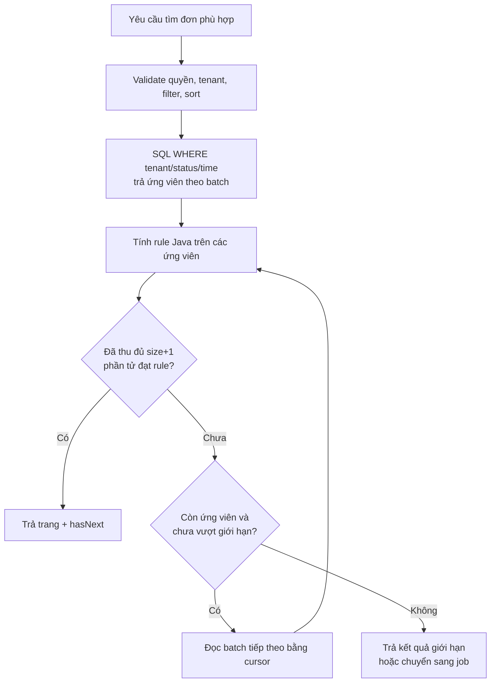
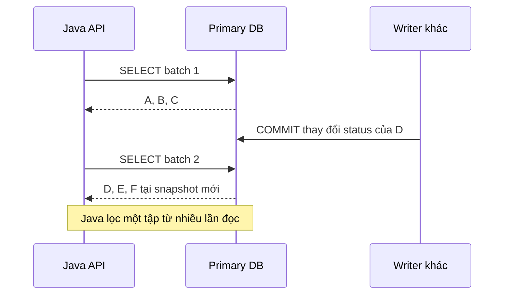

# Phân biệt lọc tại kho dữ liệu với lọc sau khi tải về

## 1. Cùng một điều kiện, hai vị trí lọc rất khác nhau

Trong ứng dụng Java, ta thường muốn hiển thị danh sách đơn hàng của một khách, chỉ lấy các đơn đã thanh toán trong 30 ngày gần nhất. Có hai cách triển khai trông có vẻ tương đương:

**Cách A — lọc tại kho dữ liệu** (*server-side filtering, predicate pushdown*): gửi điều kiện xuống database để chỉ đọc những hàng phù hợp.

```sql
SELECT id, status, created_at, total_minor
FROM orders
WHERE tenant_id = :tenant_id
  AND customer_id = :customer_id
  AND status = 'PAID'
  AND created_at >= :from_time
ORDER BY created_at DESC, id DESC
LIMIT 20;
```

**Cách B — tải về rồi lọc ở Java** (*client-side/in-memory filtering*):

```java
List<Order> allOrders = repository.findAll();

List<Order> result = allOrders.stream()
    .filter(o -> o.tenantId().equals(trustedTenantId))
    .filter(o -> o.customerId().equals(customerId))
    .filter(o -> o.status() == OrderStatus.PAID)
    .filter(o -> !o.createdAt().isBefore(fromTime))
    .sorted(Comparator
        .comparing(Order::createdAt)
        .thenComparing(Order::id)
        .reversed())
    .limit(20)
    .toList();
```

Đoạn Java giả định các record, enum và import đã tồn tại; nó minh họa việc **lọc trên tập đã tải** chứ không phải thiết kế repository được khuyến nghị.

Hai cách khác nhau về:

- **Lượng dữ liệu đọc và truyền qua mạng:** Query A có thể chỉ trả những hàng cần hiển thị, trong khi B đưa nhiều hàng không liên quan sang JVM.
- **Bộ nhớ, CPU và GC:** B phải giữ, duyệt và có thể sắp xếp nhiều object trong Java.
- **Chỉ mục và kế hoạch truy vấn:** A cho DBMS cơ hội dùng index, partition pruning, query optimizer và phép toán ngay tại nguồn.
- **Bảo mật và tenant isolation:** A có thể áp phạm vi dữ liệu ngay ở truy vấn; B có nguy cơ đưa bản ghi ngoài quyền truy cập vào application trước khi loại bỏ.
- **Phân trang, đếm tổng và tính đúng đắn:** Nếu Java lọc **sau khi database đã áp `LIMIT/OFFSET`**, kết quả có thể thiếu hoặc bỏ sót hàng dù database còn dữ liệu phù hợp.
- **Thời điểm quan sát:** Lọc trong SQL thường diễn ra trên snapshot của một statement; tải nhiều đợt rồi lọc ở Java có thể trộn các thời điểm đọc.
- **Khả năng tận dụng dữ liệu gốc:** Kho dữ liệu đôi khi có toán tử, index hoặc bộ máy phân tích dữ liệu phù hợp hơn việc dựng toàn bộ object.

**Nguyên tắc:** Đưa các điều kiện có thể biểu diễn đúng, ổn định và an toàn xuống gần nguồn dữ liệu **trước khi giới hạn số hàng hoặc phân trang**. Chỉ lọc sau khi tải khi có lý do rõ ràng, trong một tập đã được giới hạn thích hợp, và không làm sai hợp đồng nghiệp vụ hoặc phân quyền.

Bài này nằm trong chương **Truy vấn và phân trang** thuộc mô-đun **DATA_PERSISTENCE_FUNDAMENTALS**. Ngoài cú pháp Java/SQL, việc chọn vị trí lọc liên quan đến lược đồ, index, transaction, isolation, kiểm soát đồng thời, bảo mật, sao lưu và hiệu năng của một ứng dụng persistence.

## 2. Định nghĩa chính xác hai loại lọc

### 2.1. Lọc tại kho dữ liệu

Lọc tại kho dữ liệu nghĩa là điều kiện được **gửi cho hệ thống lưu trữ/truy vấn** để nó lựa chọn tập kết quả:

```sql
SELECT id, sku, quantity
FROM order_lines
WHERE order_id = :order_id
  AND quantity > 0;
```

Database quyết định cách thực thi vật lý: index scan, sequential scan, bitmap scan, filter sau join hoặc kế hoạch khác. Việc viết `WHERE` không bảo đảm engine **luôn** áp filter đầu tiên hoặc chỉ chạm đến đúng số hàng trả về; optimizer có thể sắp xếp lại thao tác nếu giữ ngữ nghĩa SQL.

Các dạng lọc tại nguồn:

- `WHERE` với cột của một bảng.
- `JOIN`/`EXISTS`/semi-join khi điều kiện phụ thuộc quan hệ.
- `HAVING` với điều kiện trên nhóm đã tổng hợp.
- Partition pruning hoặc filter theo range key.
- Document query, key-value lookup theo khóa, search filter, graph traversal predicate.
- Predicate pushdown xuống file format hoặc storage engine có hỗ trợ (ví dụ một số query engine với Parquet).

Ý tưởng chung là **tránh chuyển/giải mã mọi dữ liệu rồi mới quyết định giữ lại ở tầng Java**.

### 2.2. Lọc sau khi tải về

Lọc ở Java diễn ra sau khi dữ liệu đã vượt ranh giới repository/storage:

```java
List<OrderSummary> fetched = repository.loadRecentOrders(100);

List<OrderSummary> paid = fetched.stream()
    .filter(o -> o.status() == OrderStatus.PAID)
    .toList();
```

Ở đây, `filter()` của Stream chỉ xử lý những phần tử nằm trong `fetched`. Nó **không gửi predicate xuống DB** nếu `fetched` thực sự là một `List` đã được materialize.

Có một số abstraction sử dụng API chuỗi phương thức giống Java Stream nhưng dịch thành truy vấn server-side. Phải kiểm tra API cụ thể. Với `List.stream()` thông thường, `filter` chạy trong JVM.

### 2.3. Lọc, chiếu cột, sắp xếp và phân trang là những phép toán riêng

Một query thường có những bước logic:

```text
Nguồn dữ liệu
    -> LỌC (WHERE)
    -> Quan hệ/nhóm (JOIN, GROUP BY khi cần)
    -> LỌC nhóm (HAVING khi cần)
    -> Chọn cột/biểu thức (SELECT)
    -> SẮP XẾP (ORDER BY)
    -> LẤY TRANG (LIMIT/OFFSET hoặc cursor)
    -> Truyền dữ liệu về Java
    -> Mapping DTO và trình bày
```

Đây là mô tả để học cách suy luận, **không phải thứ tự vật lý cố định** của DBMS. Query optimizer có thể hoán đổi/đẩy nhiều phép toán miễn kết quả ngữ nghĩa được giữ đúng.

Điều quan trọng là: **lọc trước hay sau phân trang có thể thay đổi kết quả**, không chỉ thay đổi tốc độ.

## 3. So sánh theo các tiêu chí cần cho persistence

| Tiêu chí | Lọc tại kho dữ liệu | Lọc sau khi tải về |
|---|---|---|
| Nơi thực thi | Database/query engine | JVM/ứng dụng |
| Truyền dữ liệu | Thường chỉ chuyển kết quả cần thiết | Chuyển cả các hàng bị loại ở Java |
| CPU và bộ nhớ JVM | Thường ít object hơn | Có thể tăng mapping, allocation và GC |
| Chỉ mục | Engine có thể dùng index/filter pushdown | Java không dùng trực tiếp index DB để loại hàng đã tải |
| Transaction/snapshot | Một statement có ngữ nghĩa đọc theo isolation | Có thể là dữ liệu từ nhiều statement hoặc cache khác thời điểm |
| Pagination | Có thể lọc trước `LIMIT/OFFSET` | Lọc sau `LIMIT` dễ làm trang thiếu/hasNext sai |
| Count | Có thể `COUNT(*)` cùng predicate | Count ở Java chỉ đếm **những hàng đã tải**, không tự là tổng nguồn |
| Quyền/tenant | Có thể chặn dữ liệu không được đọc ngay từ query/RLS | Dữ liệu không được phép có thể đã vào bộ nhớ ứng dụng |
| Business predicate rất phức tạp | Khó chuyển chính xác khi phụ thuộc service bên ngoài | Java có thể diễn đạt tự nhiên hơn |
| Cấu trúc dữ liệu nhỏ | Có thể vẫn dùng DB query | In-memory filtering thường hợp lý nếu tập đã nhỏ và đủ quyền |
| Khả năng theo dõi | `EXPLAIN`, query metrics, index statistics | Profiling JVM, allocation, application metrics |
| Rủi ro chính | Query/filter sai, index kém, DB quá tải | Overfetch, sai phân trang, N+1, thiếu dữ liệu và lộ thông tin |

**Không thể kết luận “luôn lọc tại database”**. Một rule nghiệp vụ có thể cần mô hình/thuật toán không hỗ trợ ở DB hoặc phụ thuộc API ngoài. Nhưng quyết định lọc sau tải phải có **giới hạn tập dữ liệu**, chiến lược phân trang chính xác và phân loại điều kiện nào có thể/không thể đẩy xuống.

## 4. Ví dụ cụ thể: lọc sau LIMIT làm sai nội dung trang

Giả sử đơn hàng đã sắp mới nhất trước:

| Thứ tự | Mã đơn | Trạng thái |
|---:|---|---|
| 1 | A | NEW |
| 2 | B | PAID |
| 3 | C | CANCELLED |
| 4 | D | PAID |
| 5 | E | PAID |
| 6 | F | NEW |
| 7 | G | PAID |

API cần **mỗi trang hai đơn `PAID`**.

### 4.1. Cách sai: lấy 2 đơn bất kể trạng thái, rồi Java lọc

```sql
SELECT id, status
FROM orders
WHERE tenant_id = :tenant_id
ORDER BY created_at DESC, id DESC
LIMIT 2 OFFSET 0;
```

Database trả `[A, B]`. Java lọc `status == PAID` được `[B]`.

Trang tiếp theo dùng `OFFSET 2` trả `[C, D]`, Java lọc được `[D]`. UI thấy trang 1 chỉ có một đơn và trang 2 chỉ có một đơn, dù các đơn `PAID` vẫn còn.

Nếu service suy rằng “trang ngắn hơn pageSize nghĩa là trang cuối” thì nó còn **dừng sớm**, bỏ D, E, G.

### 4.2. Cách đúng: đưa trạng thái vào WHERE trước LIMIT

```sql
SELECT id, status
FROM orders
WHERE tenant_id = :tenant_id
  AND status = 'PAID'
ORDER BY created_at DESC, id DESC
LIMIT 2 OFFSET 0;
```

Tập logic trước khi phân trang là `[B, D, E, G]`. Trang đầu là `[B, D]`; trang tiếp theo là `[E, G]`.

```text
SAI (LIMIT trước, lọc Java sau):
  Tất cả:       A B C D E F G
  LIMIT 2:      A B
  Java PAID:      B
  => Trang 1 thiếu dù còn PAID.

ĐÚNG (lọc nguồn trước LIMIT):
  Tất cả:       A B C D E F G
  WHERE PAID:     B D E   G
  LIMIT 2:        B D
  => Trang 1 đủ 2 hàng.
```

### 4.3. `hasNext` cũng phải xét trên tập đã lọc

Một chiến lược thường gặp lấy `pageSize + 1` hàng. Nhưng nếu ba hàng dư được chọn **trước khi lọc Java**, nó không chứng minh phía sau còn một hàng `PAID`.

Ví dụ `LIMIT 3` trả `[A, B, C]`, chỉ B là `PAID`. Không thể kết luận `hasNext=false` cho danh sách `PAID` chỉ vì sau lọc hiện được một phần tử; D, E và G vẫn đủ điều kiện ở phía sau.

Muốn tính `hasNext` đúng cho danh sách PAID, hãy áp predicate vào query, rồi lấy `pageSize + 1` hàng **PAID**.

**Nguyên tắc:** Đơn vị phân trang, predicate lọc, sort và điều kiện quyền phải nhất quán giữa việc lấy `items`, tính `hasNext` và tính `totalElements`.

## 5. Lọc sau khi tải toàn bộ rồi mới LIMIT có đúng không?

Một trường hợp khác là Java tải **toàn bộ** dữ liệu thuộc phạm vi rồi lọc/sort/limit:

```java
List<Order> all = repository.findAllByTenant(trustedTenantId);

List<Order> page = all.stream()
    .filter(o -> o.status() == OrderStatus.PAID)
    .sorted(ORDER_DESC)
    .skip(offset)
    .limit(pageSize)
    .toList();
```

Nếu `all` đúng là **toàn bộ một tập ổn định**, có đủ dữ liệu và các phép so sánh đồng nghĩa với query mong muốn, kết quả có thể tương đương về mặt nội dung với lọc/sort/paginate ở SQL cho **một mốc dữ liệu**.

Nhưng giá phải trả:

- Tải hàng nghìn hoặc hàng triệu row qua network.
- Dựng toàn bộ object Java, tiêu thụ heap và GC.
- Có thể tải quan hệ lazy gây thêm SQL/N+1.
- Giữ connection và tài nguyên lâu trong khi tải tập lớn.
- Sort/tính toán trong JVM làm tăng CPU và bộ nhớ.
- Khó giới hạn latency p95/p99 khi một tenant lớn bất thường.
- Nếu đọc thành nhiều lượt, dữ liệu có thể thay đổi giữa các lượt, làm “toàn bộ tập” không còn có cùng snapshot.

**Có thể đúng về kết quả nhưng rất kém về hiệu năng/vận hành**. Và nếu repository thực ra chỉ tải trang đầu, kết quả **không còn tương đương về mặt nội dung**.

### 5.1. Bảng so sánh ba cách

| Chiến lược | Đúng tập lọc cho một trang? | Khả năng mở rộng |
|---|---|---|
| SQL `WHERE` + `ORDER BY` + `LIMIT` | Đúng theo snapshot/semantics của statement | Thường tốt nếu index/query phù hợp |
| SQL `LIMIT` rồi Java `filter` | **Không bảo đảm**, vì filter chạy sau cắt trang | Có thể tải ít nhưng trả kết quả sai |
| Tải hết tenant → Java lọc/sort/limit | Có thể đúng nếu toàn bộ tập được đọc nhất quán và semantics trùng | Dễ tốn RAM, network, CPU và connection |

Nếu không thể đẩy toàn bộ filter, cần một chiến lược **hybrid** có bảo đảm rõ, sẽ được trình bày ở phần sau.

## 6. Lọc tại database và chỉ mục

Ví dụ với PostgreSQL:

```sql
CREATE TABLE orders (
    id UUID PRIMARY KEY,
    tenant_id UUID NOT NULL,
    customer_id UUID NOT NULL,
    status TEXT NOT NULL CHECK (
        status IN ('NEW', 'PAID', 'SHIPPED', 'CANCELLED')
    ),
    created_at TIMESTAMPTZ NOT NULL DEFAULT now(),
    updated_at TIMESTAMPTZ NOT NULL DEFAULT now(),
    total_minor BIGINT NOT NULL CHECK (total_minor >= 0),
    version BIGINT NOT NULL DEFAULT 0 CHECK (version >= 0)
);
```

Query phổ biến:

```sql
SELECT id, status, created_at, total_minor
FROM orders
WHERE tenant_id = :tenant_id
  AND customer_id = :customer_id
  AND status = 'PAID'
ORDER BY created_at DESC, id DESC
LIMIT 21;
```

Một index **có thể cân nhắc**:

```sql
CREATE INDEX ix_orders_tenant_customer_status_created
ON orders (
    tenant_id, customer_id, status,
    created_at DESC, id DESC
);
```

Điều kiện equality trên `tenant_id`, `customer_id` và `status` cùng thứ tự sort giúp optimizer có lựa chọn đường truy cập phù hợp. Điều này **không bảo đảm DB luôn chọn index**, hoặc đọc đúng 21 hàng vật lý: thống kê, phân phối dữ liệu, visibility và chi phí plan vẫn quyết định.

### 6.1. Selectivity ảnh hưởng lợi ích của index

**Selectivity** mô tả mức độ điều kiện lọc thu hẹp tập dữ liệu. Ví dụ:

- `tenant_id = ?` trong kho đa tenant có thể loại phần lớn bảng.
- `customer_id = ?` thường thu hẹp tập đơn mạnh.
- `status = 'PAID'` nếu 90% đơn đều PAID có thể không chọn lọc.
- Filter theo khoảng thời gian ngắn có thể thu hẹp nhiều hàng.

Một index phù hợp với các query quan trọng có thể giảm scan, sort và network, nhưng mỗi index làm tăng chi phí `INSERT`/`UPDATE` và dung lượng. Không tạo index cho mọi kết hợp filter chỉ vì API có nhiều tùy chọn tìm kiếm.

### 6.2. Predicate có dùng được index không?

Một điều kiện trên cột thẳng có thể dễ dùng B-tree hơn:

```sql
WHERE created_at >= :from_instant
  AND created_at <  :to_instant
```

Trong khi biểu thức trên cột:

```sql
WHERE created_at::date = :some_date
```

có thể khiến B-tree thông thường trên `created_at` kém hữu ích cho đường range scan, trừ khi có index biểu thức hoặc engine tối ưu đặc biệt.

Khi lọc theo **ngày địa phương**, hãy chuyển khoảng ngày theo timezone nghiệp vụ thành hai mốc instant/timestamp phù hợp. Không giả định một ngày `DATE` tương đương với một ngày UTC cho mọi người dùng, nhất là quanh thay đổi DST ở các múi giờ có áp dụng.

### 6.3. `LIKE` và tìm kiếm chuỗi

```sql
WHERE product_name ILIKE '%tai nghe%'
```

Có thể phù hợp về chức năng nhưng không chắc sử dụng B-tree thông thường hiệu quả khi có wildcard đầu chuỗi. Với truy vấn thường xuyên, cân nhắc full-text search, trigram index hoặc search engine chuyên dụng nếu engine hỗ trợ và workload chứng minh cần thiết.

Việc đổi sang Java:

```java
product.name().toLowerCase().contains(searchText)
```

không tự làm tìm kiếm chính xác/ngữ nghĩa tốt hơn; nó chỉ di chuyển chi phí lọc và có thể thay đổi cách so sánh ký tự.

## 7. Không chỉ WHERE: lọc theo quan hệ với JOIN và EXISTS

Nhiều nghiệp vụ cần lọc theo điều kiện ở bản ghi con. Ví dụ “đơn có chứa SKU X”.

**Cách sai/kém:** Tải mọi đơn cùng mọi dòng hàng, sau đó:

```java
List<Order> matching = allOrders.stream()
    .filter(o -> o.lines().stream()
        .anyMatch(l -> l.sku().equals(sku)))
    .toList();
```

Nếu `lines()` là collection lazy, mỗi lần truy cập có thể tạo thêm SQL: **N+1 query**. Nếu tất cả đã eager-load, network và bộ nhớ có thể rất lớn.

Dùng `EXISTS` tại database:

```sql
SELECT o.id, o.created_at, o.status
FROM orders o
WHERE o.tenant_id = :tenant_id
  AND EXISTS (
      SELECT 1
      FROM order_lines l
      WHERE l.order_id = o.id
        AND l.sku = :sku
  )
ORDER BY o.created_at DESC, o.id DESC
LIMIT 20;
```

Index hỗ trợ có thể gồm `order_lines(order_id, sku)` hoặc `order_lines(sku, order_id)`, tùy hướng truy cập/độ chọn lọc thực; đo bằng `EXPLAIN`.

### 7.1. Vì sao dùng EXISTS khi chỉ muốn biết có dòng thỏa?

`EXISTS` xác định **đơn có ít nhất một dòng phù hợp** mà không bắt buộc nhân kết quả cha thành nhiều hàng khi có nhiều dòng matching.

Nếu dùng `JOIN`:

```sql
SELECT o.id, o.created_at
FROM orders o
JOIN order_lines l ON l.order_id = o.id
WHERE o.tenant_id = :tenant_id
  AND l.sku = :sku;
```

một đơn có nhiều dòng cùng SKU có thể xuất hiện nhiều lần. Điều này ảnh hưởng tới `LIMIT`, `OFFSET` và `COUNT(*)` nếu đơn vị phân trang là **đơn hàng**, không phải **dòng hàng**.

Không mặc định dùng `DISTINCT` để chữa mọi query nhân hàng mà chưa xác định nghiệp vụ và chi phí. Khi chỉ cần kiểm tra sự tồn tại, `EXISTS` thường diễn đạt ý định rõ ràng.

### 7.2. Lọc theo tổng số lượng: HAVING

Nếu cần “đơn có tổng số lượng sản phẩm lớn hơn 10”, có thể dùng phép tổng hợp tại database:

```sql
SELECT o.id,
       SUM(l.quantity) AS total_quantity
FROM orders o
JOIN order_lines l ON l.order_id = o.id
WHERE o.tenant_id = :tenant_id
GROUP BY o.id
HAVING SUM(l.quantity) > 10
ORDER BY o.id
LIMIT 20;
```

`WHERE` lọc hàng trước nhóm, `HAVING` lọc **nhóm sau tổng hợp**. Không thể thay một cách tùy tiện `HAVING SUM(...) > 10` bằng `WHERE quantity > 10`: đó là điều kiện khác.

Nếu ứng dụng chỉ cần kiểm tra tổng ở một đơn đã tải đầy đủ, tính trong Java có thể hợp lý; nhưng khi lọc **toàn bộ tập đơn theo tổng**, đưa tổng hợp xuống DB giúp tránh tải mọi dòng hàng.

## 8. Lọc nhiều tenant và bảo mật: vấn đề không chỉ là hiệu năng

Một lỗi nguy hiểm:

```java
List<OrderEntity> all = orderRepository.findAll();

return all.stream()
    .filter(o -> o.getTenantId().equals(authenticatedTenantId))
    .toList();
```

Dù response chỉ trả dữ liệu của tenant đúng, các đơn tenant khác đã **đi vào tiến trình ứng dụng**. Chúng có thể bị:

- Đọc nhầm bởi log, tracer hoặc exception report.
- Duyệt/serialize trước khi filter do thay đổi code.
- Lộ qua cache/mapping DTO thiếu điều kiện.
- Giữ trong heap dump hoặc profiler không được bảo vệ đúng.
- Làm tăng độ trễ và tạo nguy cơ vượt bộ nhớ khi hệ thống lớn.

Với multi-tenant, điều kiện phạm vi **phải được thực thi ở ranh giới truy cập dữ liệu đáng tin cậy**. SQL nên chứa `tenant_id = ?` từ ngữ cảnh xác thực, hoặc database áp RLS/chính sách kiểm soát quyền phù hợp; kiểm tra ở service có thể là lớp bổ sung, không phải cớ để tải mọi tenant.

```sql
SELECT id, customer_id, created_at, status
FROM orders
WHERE tenant_id = :trusted_tenant_id
  AND status = :status;
```

**Quan trọng:** `tenant_id` lấy từ request do client tự gửi **không tự đáng tin**. Service phải xác minh người gọi có quyền truy cập tenant đó. Với hàng có quyền theo user/resource chứ không chỉ tenant, cần thêm điều kiện tồn tại quyền hoặc chính sách RLS phù hợp.

### 8.1. Row-level security trong PostgreSQL

PostgreSQL hỗ trợ **Row-Level Security (RLS)** để DB cưỡng chế điều kiện truy cập hàng theo policy. RLS có thể là một lớp bảo vệ quan trọng trong hệ nhiều tenant, nhưng muốn an toàn cần:

- Bật và khai báo policy đúng bảng/role.
- Không dùng kết nối ứng dụng có quyền bypass RLS trái mục tiêu.
- Thiết lập ngữ cảnh tenant/user theo transaction và reset an toàn khi connection được trả vào pool.
- Kiểm tra quyền cả khi đọc, ghi và trên các bảng phụ.
- Kiểm thử cross-tenant, role và các đường truy vấn không đi qua repository chuẩn.

Việc thêm `WHERE tenant_id = ?` trong SQL không thay thế toàn bộ authorization; RLS cũng không tự hiểu mọi quy tắc nghiệp vụ, và phải được cấu hình/kiểm chứng đúng.

### 8.2. Đếm và hasNext có thể lộ thông tin

Nếu query lấy `items` đã lọc quyền, nhưng query `COUNT(*)` hoặc `LIMIT size+1` tính trên tập rộng hơn, response có thể lộ số lượng tài nguyên ngoài quyền người dùng.

Vì vậy **count, items và hasNext** phải có chung định nghĩa tập dữ liệu có thể xem, ngay cả khi chúng là các câu SQL khác nhau.

## 9. Java/JDBC: ví dụ repository đẩy filter xuống SQL

Tạo một bảng đơn hàng như trên, có `tenant_id`, `customer_id`, `status` và `created_at`. API nhận các tham số lọc đã validate và ngữ cảnh tenant đã xác thực.

### 9.1. DTO và yêu cầu truy vấn

```java
import java.time.Instant;
import java.util.List;
import java.util.UUID;

record OrderSummary(
    UUID id,
    String status,
    Instant createdAt,
    long totalMinor
) {}

record OrderFilter(
    UUID customerId,
    String status,
    Instant fromInclusive
) {}

record OrderSlice(
    List<OrderSummary> items,
    boolean hasNext
) {}
```

Ở đây `customerId` và `fromInclusive` có thể là tùy chọn; `status` được giới hạn bởi server theo danh sách trạng thái hợp lệ. `OrderSlice` chỉ trả một trang và `hasNext`, không hứa tổng số hàng.

### 9.2. SQL với điều kiện lọc ở nguồn

Ví dụ này chọn cách dùng các **predicate tùy chọn** thông qua điều kiện `? IS NULL OR ...` để giữ minh họa gọn. Với workload lớn, cách này không luôn cho plan tốt nhất; query builder tạo điều kiện thật cho các filter hiện diện có thể tối ưu hơn.

```sql
SELECT id, status, created_at, total_minor
FROM orders
WHERE tenant_id = ?
  AND (?::uuid IS NULL OR customer_id = ?::uuid)
  AND (?::text IS NULL OR status = ?::text)
  AND (?::timestamptz IS NULL OR created_at >= ?::timestamptz)
ORDER BY created_at DESC, id DESC
LIMIT ?;
```

Sử dụng hai bind cho mỗi filter tùy chọn khiến code dễ bị sai thứ tự tham số; trong production nên dùng query builder hoặc thư viện hỗ trợ named parameters và benchmark plan.

### 9.3. Phiên bản JDBC với filter bắt buộc, dễ kiểm chứng

Với một endpoint cụ thể liệt kê đơn `PAID` của một khách từ một thời điểm:

```java
import javax.sql.DataSource;
import java.sql.*;
import java.time.Instant;
import java.time.OffsetDateTime;
import java.time.ZoneOffset;
import java.util.ArrayList;
import java.util.List;
import java.util.UUID;

public final class PaidOrderRepository {
    private final DataSource dataSource;

    public PaidOrderRepository(DataSource dataSource) {
        this.dataSource = dataSource;
    }

    public OrderSlice findPaidOrders(
            UUID trustedTenantId,
            UUID customerId,
            Instant fromInclusive,
            int pageSize) throws SQLException {

        if (trustedTenantId == null || customerId == null
                || fromInclusive == null
                || pageSize < 1 || pageSize > 100) {
            throw new IllegalArgumentException("Invalid filter");
        }

        String sql = """
            SELECT id, status, created_at, total_minor
            FROM orders
            WHERE tenant_id = ?
              AND customer_id = ?
              AND status = 'PAID'
              AND created_at >= ?
            ORDER BY created_at DESC, id DESC
            LIMIT ?
            """;

        List<OrderSummary> fetched = new ArrayList<>();

        try (Connection c = dataSource.getConnection();
             PreparedStatement ps = c.prepareStatement(sql)) {

            ps.setObject(1, trustedTenantId);
            ps.setObject(2, customerId);
            ps.setObject(
                3, OffsetDateTime.ofInstant(
                    fromInclusive, ZoneOffset.UTC));
            ps.setInt(4, pageSize + 1);

            try (ResultSet rs = ps.executeQuery()) {
                while (rs.next()) {
                    fetched.add(new OrderSummary(
                        (UUID) rs.getObject("id"),
                        rs.getString("status"),
                        rs.getObject(
                            "created_at", OffsetDateTime.class).toInstant(),
                        rs.getLong("total_minor")
                    ));
                }
            }
        }

        boolean hasNext = fetched.size() > pageSize;
        if (hasNext) {
            fetched.remove(fetched.size() - 1);
        }

        return new OrderSlice(List.copyOf(fetched), hasNext);
    }
}
```

Ví dụ dùng JDBC với PostgreSQL, Java records/text blocks và khả năng mapping `TIMESTAMPTZ` sang `OffsetDateTime`. Nó chỉ minh họa **trang đầu**, vì chưa nhận offset/cursor để truy vấn tiếp; triển khai thực tế phải bổ sung chiến lược pagination.

Điểm cần quan sát:

1. Predicate về tenant, customer, trạng thái và thời gian nằm trong SQL.
2. Không truy vấn `SELECT * FROM orders`, chỉ lấy cột cần hiển thị.
3. Chỉ nhận tối đa `pageSize + 1` hàng **đã thỏa điều kiện**.
4. Không dựng object cho hàng bị loại bởi filter ở DB.
5. `hasNext` được tính trên tập kết quả đúng, không trên hàng chưa lọc.
6. Dùng prepared statement, không nối giá trị người dùng vào SQL.
7. Không dựa vào `hasNext` để khẳng định dữ liệu sẽ không đổi trước request sau.

### 9.4. Vấn đề tên cột và sort động

Placeholder JDBC `?` dùng để bind **giá trị**, không dùng để thay một tên cột, tên bảng hoặc biểu thức `ORDER BY` tùy ý. Nếu API cho chọn sort, hãy dùng allowlist:

```java
String orderBy = switch (sortKey) {
    case "createdAt" -> "created_at DESC, id DESC";
    case "total"     -> "total_minor DESC, id DESC";
    default -> throw new IllegalArgumentException("Invalid sort key");
};
```

Chỉ ghép vào SQL **chuỗi đã định nghĩa sẵn**, không ghép trực tiếp dữ liệu chưa kiểm tra từ client. Đồng thời cần index phù hợp với các kiểu sort thực sự sử dụng.

## 10. Spring Data JPA: lọc bằng repository thay vì `findAll().stream()`

Một antipattern:

```java
List<OrderEntity> all = repository.findAll();

List<OrderEntity> paid = all.stream()
    .filter(o -> o.getTenantId().equals(trustedTenantId))
    .filter(o -> o.getStatus() == OrderStatus.PAID)
    .toList();
```

Repository đã tải mọi entity trước khi Java lọc, gây chi phí và rủi ro quyền như đã phân tích.

Thay bằng phương thức repository:

```java
import java.util.UUID;
import org.springframework.data.domain.Pageable;
import org.springframework.data.domain.Slice;
import org.springframework.data.jpa.repository.JpaRepository;

interface OrderRepository extends JpaRepository<OrderEntity, UUID> {
    Slice<OrderEntity> findByTenantIdAndStatus(
        UUID tenantId,
        OrderStatus status,
        Pageable pageable
    );
}
```

Service tạo `Pageable` có sort ổn định:

```java
import org.springframework.data.domain.PageRequest;
import org.springframework.data.domain.Sort;

PageRequest request = PageRequest.of(
    zeroBasedPage,
    pageSize,
    Sort.by(
        Sort.Order.desc("createdAt"),
        Sort.Order.desc("id"))
);

Slice<OrderEntity> slice =
    repository.findByTenantIdAndStatus(
        trustedTenantId, OrderStatus.PAID, request);
```

Ở đây framework chuyển điều kiện sang truy vấn nguồn theo mapping/query method thay vì tải tất cả entity rồi gọi `Stream.filter`.

**Lưu ý:** `Slice` giúp API có `hasNext` mà không đòi `totalElements`, nhưng với `PageRequest` truyền vào, nó **vẫn có thể dùng OFFSET**. Đổi kiểu trả về `Page` sang `Slice` không tự biến pagination thành keyset.

### 10.1. JPQL cho điều kiện phức tạp

```java
@Query("""
    SELECT o
    FROM OrderEntity o
    WHERE o.tenantId = :tenantId
      AND o.status = :status
      AND o.createdAt >= :fromInclusive
    """)
Slice<OrderEntity> findRecentByStatus(
    @Param("tenantId") UUID tenantId,
    @Param("status") OrderStatus status,
    @Param("fromInclusive") Instant fromInclusive,
    Pageable pageable
);
```

Đoạn khai báo giả định các import, entity và mapping cần thiết đã tồn tại. Câu JPQL mô tả **filter ở data source**, không phải `Java Stream.filter` trên entity đã tải.

### 10.2. Điều kiện tùy chọn: Specifications, Criteria, Querydsl

Khi có nhiều filter tùy chọn, có thể dùng JPA Criteria, Spring Data Specifications hoặc công cụ query builder để tạo `WHERE` từ những điều kiện thực sự hiện diện.

Một `Specification<OrderEntity>` minh họa:

```java
import org.springframework.data.jpa.domain.Specification;

Specification<OrderEntity> inTenant(UUID tenantId) =
    (root, query, cb) ->
        cb.equal(root.get("tenantId"), tenantId);

Specification<OrderEntity> isPaid() =
    (root, query, cb) ->
        cb.equal(root.get("status"), OrderStatus.PAID);

Specification<OrderEntity> paidInTenant =
    inTenant(trustedTenantId).and(isPaid());
```

Repository cần hỗ trợ `JpaSpecificationExecutor` hoặc API tương đương để thực thi specification. Dù dùng builder, **kiểm tra quyền vẫn là bắt buộc** và các biểu thức lọc phải được kiểm chứng.

### 10.3. Tránh N+1 khi lọc theo collection

Dùng `orders.stream().filter(o -> o.getLines()...)` trên entity lazy có thể làm mỗi đơn phát thêm SQL. Nếu điều kiện là “có dòng hàng SKU X”, hãy dùng `EXISTS` trong JPQL/repository.

Nếu cần hiển thị nhiều dòng hàng của **những đơn đã được phân trang**, có thể làm hai bước: truy vấn trang ID cha, rồi truy vấn chi tiết theo các ID đó và sắp xếp lại theo thứ tự ban đầu. Tránh `JOIN FETCH` collection một–nhiều với pagination không được kiểm soát: có thể nhân hàng hoặc khiến provider phân trang trong bộ nhớ.

## 11. Lọc ở Java có thể hợp lý khi nào?

Không phải mọi `Stream.filter` đều là antipattern. Có những trường hợp đúng và cần thiết.

### 11.1. Tập dữ liệu đã nhỏ và có giới hạn rõ

Ví dụ database đã lọc an toàn một giỏ hàng duy nhất theo `cart_id` và quyền, giới hạn tối đa 100 mục. Service có thể lọc các mục theo tiêu chí hiển thị:

```java
List<CartLine> visibleLines = cart.lines().stream()
    .filter(CartLine::isDisplayable)
    .toList();
```

Nếu mỗi cart có tối đa vài chục item và tất cả item đều thuộc phạm vi truy cập hợp lệ, chi phí nhỏ và rule trình bày thay đổi thường xuyên, lọc trong Java có thể hợp lý.

**Điều kiện:** Phần tử bị loại phải được phép tải vào ứng dụng; tập đã tải phải đủ cho kết quả mong muốn và bounded thật sự.

### 11.2. Rule phụ thuộc tính toán chuyên biệt

Có các phép tính phức tạp mà database không thực hiện thuận lợi, chẳng hạn phân loại theo một thuật toán Java đã được kiểm chứng, sử dụng thư viện riêng hoặc mô hình không dễ diễn đạt bằng SQL.

Khi đó:

1. Đưa **các điều kiện thô, chọn lọc và bắt buộc về quyền** xuống nguồn.
2. Chỉ đọc các cột cần cho phép tính.
3. Áp dụng rule Java trên tập ứng viên đã giới hạn.
4. Kiểm soát số lượng ứng viên tối đa, timeout và tiêu thụ bộ nhớ.
5. Làm rõ ý nghĩa `pageSize` và `hasNext` sau lọc; không giả định một đợt fetch có đủ số item cần hiển thị.

Nếu cần phân trang **chính xác toàn bộ tập theo rule Java**, việc lọc ở Java có thể đòi scan nhiều batch hoặc tạo một read model có trường eligibility đã tính sẵn.

### 11.3. Rule phụ thuộc dịch vụ bên ngoài

Ví dụ xác định một người dùng có được hưởng ưu đãi hay không dựa trên một hệ thống chính sách độc lập. Không nên gọi dịch vụ bên ngoài từ một SQL query hoặc giữ transaction DB mở trong lúc gọi network.

Có thể:

- Đưa eligibility vào read model/cache có vòng đời và độ mới rõ.
- Dùng một bước post-filter có timeout và số ứng viên giới hạn.
- Gọi dịch vụ kiểm tra khi chọn/đặt hàng thay vì chỉ dựa vào dữ liệu hiển thị.
- Nếu API cam kết phân trang chính xác theo eligibility, thiết kế một nguồn dữ liệu có thể filter chính xác tại mốc và quyền tương ứng.

**Cẩn thận:** Post-filter qua API ngoài có thể trả ít hơn pageSize dù còn bản ghi hợp lệ phía sau. Không được báo `hasNext=false` chỉ vì một batch ứng viên đầu không đủ item.

### 11.4. Rule giao diện sau khi đã phân trang đúng

Một màn hình đã nhận trang 20 đơn **được phép xem**, sau đó muốn chỉ tô sáng những đơn có total lớn hơn một ngưỡng, có thể dùng Java/JavaScript để **trang trí** kết quả. Nếu lọc làm biến mất item, hãy xác định rõ UI đang “ẩn trong trang đã tải” hay “phân trang toàn bộ tập đã lọc”; đây là hai hợp đồng khác nhau.

## 12. Kiến trúc hybrid: đẩy predicate khả thi, lọc phần còn lại

Khi một phần điều kiện có thể thực thi ở database và phần khác phải tính trong Java, đừng bắt đầu bằng `findAll()`.

Giả sử yêu cầu tìm những đơn:

- Thuộc tenant hiện tại.
- Trong 30 ngày gần nhất.
- Đã `PAID`.
- Có điểm `riskScore` được tính bởi một service Java phức tạp.

Ba điều kiện đầu có thể được push down; điều kiện cuối cần xử lý riêng.



### 12.1. Không được đánh đồng “chạm giới hạn scan” với “hết dữ liệu”

Giả sử quota cho mỗi request chỉ được đánh giá 500 ứng viên. Nếu sau 500 ứng viên mới có 15 đơn đạt rule, trong khi pageSize là 20, service **chưa có căn cứ** để trả `hasNext=false`.

Cần một hợp đồng riêng, ví dụ:

- Trả “partial result” và token tiếp tục quét.
- Tăng công việc lên mức được kiểm soát nếu SLA cho phép.
- Đưa sang job bất đồng bộ để materialize tập đủ điều kiện.
- Từ chối yêu cầu lọc quá đắt với thông báo/giới hạn rõ.
- Cập nhật read model định kỳ để rule trở thành một filter có thể query tại nguồn.

Không âm thầm biến “vượt quota” thành “không còn bản ghi”.

### 12.2. Cursor phải theo tập ứng viên đã duyệt

Nếu lọc một đợt ứng viên rồi tải đợt kế tiếp, cursor nên đánh dấu **ứng viên cuối đã xét**. Tuy nhiên, khi đã thu đủ `size + 1` **bản ghi đạt filter Java**, phải đặc biệt cẩn thận không tiêu thụ luôn phần tử hợp lệ dư mà không có cách tiếp tục cho trang sau.

Một thiết kế an toàn cần xác định:

- Cursor mới được chốt ở đâu.
- Có giữ hoặc tái đọc phần tử hợp lệ dư không.
- Rule Java có deterministic và ổn định trong cửa sổ phân trang không.
- Thứ tự ứng viên có toàn phần và khóa có bất biến không.
- Có thể truy vấn tiếp theo cursor mà không bỏ sót bản ghi đạt rule không.
- Nếu rule phụ thuộc API ngoài, kết quả có thể thay đổi giữa các request không.

**Tránh mã “while items < size thì fetch batch, cuối cùng hasNext = fetched.size() == batchSize”**: nó không chứng minh còn ít nhất một bản ghi *đạt filter sau Java*.

## 13. Lọc tại nguồn, phân trang offset và keyset

### 13.1. Offset

```sql
SELECT id, created_at, total_minor
FROM orders
WHERE tenant_id = :tenant_id
  AND status = 'PAID'
ORDER BY created_at DESC, id DESC
LIMIT :size_plus_one OFFSET :offset;
```

Điều kiện lọc nằm **trước** window theo ngữ nghĩa truy vấn. Đây là yêu cầu tối thiểu để page size và `hasNext` đúng theo tập PAID tại mốc đọc.

Nhưng offset vẫn có hai giới hạn:

1. **Deep offset** có thể tốn chi phí duyệt/bỏ qua nhiều hàng.
2. **Dữ liệu thay đổi** giữa các request có thể làm dịch vị trí và gây lặp/bỏ sót, ngay cả khi query đã lọc đúng tại nguồn.

### 13.2. Keyset/cursor

Với sort giảm dần theo `created_at, id` (đều không null, cặp là duy nhất), query tiếp tục sau item cuối đã xem:

```sql
SELECT id, created_at, total_minor
FROM orders
WHERE tenant_id = :tenant_id
  AND status = 'PAID'
  AND (created_at, id) < (:last_created_at, :last_id)
ORDER BY created_at DESC, id DESC
LIMIT :size_plus_one;
```

Phương án này tránh bỏ qua N hàng phía trước cursor và giảm nhiều lỗi do insert ở đầu danh sách.

**Keyset không tự tạo snapshot tuyệt đối**: nếu hàng thay đổi status, created_at hoặc dữ liệu đến trễ xuất hiện phía sau cursor, tập đang duyệt vẫn có thể thay đổi. Điều kiện lọc phải được giữ ổn định giữa các request và token cần được kiểm tra tenant, filter, sort, hạn dùng và tính toàn vẹn.

### 13.3. Cẩn thận với `WHERE` và thứ tự SQL

Đôi khi developer đưa filter vào một subquery đặt **sau** khi đã giới hạn:

```sql
SELECT *
FROM (
    SELECT id, status, created_at
    FROM orders
    WHERE tenant_id = :tenant_id
    ORDER BY created_at DESC, id DESC
    LIMIT 20
) AS first_page
WHERE status = 'PAID';
```

Đây là trường hợp **lọc sau LIMIT ngay trong SQL**, nên vẫn có thể tạo trang thiếu như lọc Java. Việc điều kiện xuất hiện trong SQL không tự bảo đảm đúng: phải xem **ngữ nghĩa phép toán** và vị trí `LIMIT`.

Cách đúng:

```sql
SELECT id, status, created_at
FROM orders
WHERE tenant_id = :tenant_id
  AND status = 'PAID'
ORDER BY created_at DESC, id DESC
LIMIT 20;
```

## 14. Lọc và COUNT: đếm tập nào?

Nếu giao diện cần `totalElements` của các đơn PAID, query count phải có cùng điều kiện:

```sql
SELECT count(*)
FROM orders
WHERE tenant_id = :tenant_id
  AND status = 'PAID';
```

Nếu query list lọc PAID nhưng count toàn bộ đơn của tenant:

```sql
SELECT count(*)
FROM orders
WHERE tenant_id = :tenant_id;
```

thì total nói về **một tập khác**. API có thể hiển thị “2.000 đơn” trong khi danh sách chỉ gồm 120 đơn PAID.

Nếu lọc Java sau khi đã tải **20 đơn bất kỳ**, `paid.size()` chỉ là số đơn PAID trong **20 ứng viên đã tải**, không phải tổng PAID của toàn bộ tenant.

### 14.1. COUNT sau JOIN cũng cần đúng đơn vị

```sql
SELECT count(*)
FROM orders o
JOIN order_lines l ON l.order_id = o.id
WHERE o.tenant_id = :tenant_id
  AND l.sku = :sku;
```

Có thể đếm nhiều hàng cho cùng một đơn nếu đơn có nhiều dòng SKU đó. Nếu phân trang theo **đơn**, dùng `EXISTS` hoặc `COUNT(DISTINCT o.id)` theo mục đích, chứ không cộng hàng JOIN rồi gọi là “tổng số đơn”.

### 14.2. HasNext và count không phải cùng bài toán

Với nút “Xem thêm”, một query `LIMIT size+1` sau **toàn bộ filter tại nguồn** thường đủ. Nếu UI cần “Trang 3/80”, phải tính total theo hợp đồng — có thể dùng count chính xác, estimate có nhãn hoặc snapshot tùy yêu cầu.

Bỏ `COUNT(*)` giúp giảm công việc trong nhiều trường hợp, nhưng không thay thế việc filter đúng trước phân trang.

## 15. NULL, so sánh chuỗi và kiểu dữ liệu: hai tầng có thể cho kết quả khác nhau

Không phải mọi predicate Java đều tương đương trực tiếp với predicate SQL.

### 15.1. NULL trong SQL

SQL dùng logic **ba giá trị**: TRUE, FALSE và UNKNOWN. Trong `WHERE`, chỉ những hàng có biểu thức là TRUE được chọn.

```sql
WHERE deleted_at = NULL
```

không phải cách kiểm tra null; phải dùng:

```sql
WHERE deleted_at IS NULL
```

Với Java:

```java
order.deletedAt() == null
```

là một điều kiện boolean khác với cách viết `column = NULL` trong SQL. Khi chuyển predicate qua các tầng, cần làm rõ ý nghĩa của **vắng mặt**, **null** và **giá trị mặc định**.

### 15.2. Enum, chữ hoa/thường, dấu và collation

```java
name.toLowerCase(Locale.ROOT).contains("tai nghe")
```

và:

```sql
WHERE name ILIKE '%tai nghe%'
```

có thể cho tập kết quả khác nhau do Unicode case folding, collation, xử lý dấu và cách matching của DBMS. Không tuyên bố hai biểu thức tương đương nếu chưa có test trên dữ liệu/locale thật.

### 15.3. Decimal và tiền

Trong Java, `BigDecimal.equals()` xét cả scale, trong khi `compareTo()` so sánh giá trị số:

```java
new BigDecimal("19.0").equals(
    new BigDecimal("19.00"))       // false

new BigDecimal("19.0").compareTo(
    new BigDecimal("19.00")) == 0   // true
```

Với SQL `NUMERIC`, phép so sánh số có ngữ nghĩa của kiểu số ở database. Nếu chuyển bộ lọc giá/tiền qua Java mà vô tình dùng `equals()` thay `compareTo()`, kết quả có thể sai ngay cả khi tất cả hàng đã được tải.

Hợp đồng cần chỉ rõ tiền tệ, scale, làm tròn, giới hạn và phép so sánh.

### 15.4. Thời gian và timezone

Java `Instant` là thời điểm tuyệt đối; PostgreSQL `TIMESTAMPTZ` biểu diễn một instant theo cơ chế timestamp có timezone. Nhưng dữ liệu như “ngày sinh” hoặc “ngày giao hàng theo lịch địa phương” nên được xử lý theo quy tắc **ngày lịch** và timezone nghiệp vụ.

Nếu API lọc “đơn trong ngày 10/04 theo giờ địa phương”, ứng dụng cần chuyển ngày thành khoảng:

```sql
WHERE created_at >= :start_instant
  AND created_at <  :end_instant
```

Hai mốc phải được tính theo timezone hợp đồng, không mặc định cắt giờ UTC hoặc cộng đúng 24 giờ cho mọi ngày ở khu vực có daylight saving time.

## 16. Lọc khi dữ liệu thay đổi: snapshot và transaction

Một câu `SELECT ... WHERE ... ORDER BY ... LIMIT ...` trong PostgreSQL ở `READ COMMITTED` thường đọc một snapshot của dữ liệu đã commit tại lúc statement bắt đầu.

Nếu một repository tải hàng loạt dữ liệu trong nhiều câu SQL rồi lọc ở Java, mỗi câu lệnh ở `READ COMMITTED` có thể thấy một snapshot khác. Tập ứng viên materialize có thể là **tổ hợp của nhiều mốc đọc**.



Nếu nghiệp vụ cần một **tập cố định tại thời điểm T0** (ví dụ export kiểm toán), một query hoặc phép lọc sau load tùy tiện không đủ. Cần thiết kế:

- Snapshot `REPEATABLE READ` trong một transaction server-side được kiểm soát, khi phù hợp.
- Export job/materialized ID và, nếu cần, snapshot nội dung tại mốc đã chốt.
- Cơ chế version/cursor theo hợp đồng dữ liệu.
- Đối soát count, lỗi, trùng lặp và retention cho artifact xuất.

**Không giữ một transaction mở trong suốt phiên người dùng phân trang nhiều phút** chỉ để Java có một danh sách ổn định. Transaction dài tiêu tốn connection và có thể tăng áp lực MVCC/vacuum.

### 16.1. Lọc ở DB vẫn không bảo đảm nhiều trang có cùng snapshot

Ngay cả khi mỗi trang đều dùng `WHERE status='PAID'`, hai request khác nhau có thể đọc các snapshot khác nhau. Nếu một đơn mới xuất hiện ở đầu hoặc một đơn bị xóa/rời filter, offset có thể trùng/bỏ sót.

Do đó có hai yêu cầu tách biệt:

1. **Đúng phép lọc của từng truy vấn:** WHERE được áp trước LIMIT.
2. **Đúng trải nghiệm duyệt qua nhiều truy vấn:** thứ tự toàn phần, cursor hoặc snapshot theo mức cam kết.

Đẩy filter xuống DB giải quyết (1) và hỗ trợ hiệu năng; nó không tự giải quyết hoàn toàn (2).

## 17. Lọc tại nguồn cũng có những chi phí và giới hạn

Tối ưu không phải luôn là “biến mọi rule thành SQL”.

### 17.1. Điều kiện khó tối ưu

Ví dụ:

```sql
WHERE very_expensive_function(payload) = true
```

Nếu function tốn CPU, không index được và phải chạy trên hàng triệu row, DB có thể trở thành điểm nghẽn. Đẩy một phép tính vào database có thể giảm băng thông nhưng chuyển chi phí lớn sang một tài nguyên rất quan trọng và khó scale theo chiều ngang.

Có thể cân nhắc:

- Tạo **computed/materialized field** theo quy tắc dữ liệu có version.
- Xây read model riêng để phục vụ truy vấn.
- Chia công việc theo batch.
- Dùng search/analytics engine nếu bản chất workload phù hợp.
- Dùng Java xử lý tập ứng viên nhỏ, được lọc sơ bộ an toàn.

### 17.2. Predicate không sargable

Một biểu thức có thể làm index thông thường khó phát huy tác dụng. Trước khi thêm index biểu thức hoặc rewrite query, hãy xác định **ngữ nghĩa tương đương** và đo bằng query plan.

Không nên thay `LOWER(name)` bằng so sánh khác rồi vô tình đổi quy tắc phân biệt chữ; cần kiểm tra collation và yêu cầu tìm kiếm.

### 17.3. Lọc và aggregation quy mô lớn

Một query tổng hợp đòi đọc nhiều row hoặc JOIN phức tạp ngay cả khi chỉ trả vài nhóm. Lọc ở database vẫn có thể là đúng về mặt kiến trúc, nhưng workload phân tích có thể cần replica, materialized view, kho columnar hoặc hệ phân tích riêng để không cạnh tranh với transaction OLTP.

### 17.4. Remote storage không hỗ trợ predicate mong muốn

Một key-value store chủ yếu lookup theo key có thể không lọc hiệu quả theo các trường nằm trong blob value. Nếu ứng dụng liên tục phải tải rất nhiều key rồi lọc Java, đây có thể là dấu hiệu **mô hình lưu trữ và access pattern không khớp**.

Giải pháp có thể là secondary index, read model, thay đổi key, hoặc chọn database khác. Đừng cố chữa mọi truy vấn bằng cách tải toàn bộ key–value về JVM.

## 18. Predicate pushdown trong những hệ lưu trữ khác

“Lọc tại nguồn” không chỉ dành cho SQL:

| Nguồn dữ liệu | Cơ chế lọc có thể có | Điều cần kiểm tra |
|---|---|---|
| Relational database | `WHERE`, `EXISTS`, index, partition pruning | Query plan, constraint, isolation, index |
| Document store | Query filter theo field, index trên field lồng nhau | Embedded/reference, query semantics, transaction scope |
| Search engine | Term/range/filter query, inverted index | Refresh lag, quyền, relevance và total hits |
| Wide-column store | Partition/clustering key, query-first schema | Hot partition, filter ngoài key, chi phí scan |
| Graph store | Node/edge property filter, traversal constraints | Traversal depth, supernode, transaction semantics |
| Columnar/Parquet query engine | Column pruning, predicate pushdown, row-group metadata | Cột/row group nào bỏ qua được, kiểu filter được hỗ trợ |
| Object storage dạng blob | Lookup object key, metadata/index phụ nếu có | Không tự query được mọi field trong bytes |

Ví dụ một hệ xử lý file Parquet có thể tránh đọc những row group không thể thỏa range predicate dựa trên thống kê đã lưu. Nhưng nếu metadata không hữu ích hoặc format/connector không hỗ trợ pushdown, engine vẫn phải đọc nhiều dữ liệu. Khả năng tối ưu phụ thuộc công cụ, định dạng và predicate.

**Không suy từ tên database/format rằng mọi filter đều được thực thi tại nguồn với chi phí thấp.** Luôn đo.

## 19. Projection: giảm dữ liệu được tải ngay cả khi filter đã đúng

Lọc tại database là bước quan trọng, nhưng nếu Java chỉ cần `id` và `status` mà query vẫn:

```sql
SELECT *
FROM orders
WHERE tenant_id = :tenant_id
  AND status = 'PAID'
LIMIT 20;
```

thì driver có thể tải các cột không cần thiết, bao gồm dữ liệu lớn hoặc nhạy cảm. Nên chỉ chọn các cột cần thiết:

```sql
SELECT id, status, created_at
FROM orders
WHERE tenant_id = :tenant_id
  AND status = 'PAID'
ORDER BY created_at DESC, id DESC
LIMIT 20;
```

**Projection** (*chọn cột*) và **predicate** (*chọn hàng*) là hai tối ưu độc lập:

- Predicate giúp giảm **số hàng**.
- Projection giúp giảm **số cột/dữ liệu trên mỗi hàng**.
- LIMIT/Keyset giúp giới hạn **số hàng của trang**.

Trong Spring Data, interface-based hoặc DTO projection có thể tránh materialize cả entity nếu query/mapping hỗ trợ. Cần cẩn thận với lazy relations và converter làm phát sinh thêm query.

## 20. JDBC streaming và giới hạn bộ nhớ

Có người cho rằng “không tải hết List, chỉ stream `ResultSet` là được”. Streaming có thể giúp giảm **bộ nhớ JVM**, nhưng không tự sửa mọi vấn đề:

- Database vẫn phải thực thi query, lọc/sort theo plan.
- Nếu query không có `WHERE` và vẫn duyệt mọi hàng, network có thể truyền rất nhiều dữ liệu.
- ResultSet/cursor còn mở có thể giữ connection/transaction lâu.
- Với PostgreSQL JDBC, fetch size, transaction mode và cấu hình driver ảnh hưởng khả năng cursor-based fetching; không mặc định `setFetchSize(n)` luôn thay đổi mọi hành vi truyền dữ liệu.
- Nếu cần total của toàn bộ tập theo filter Java, vẫn phải đọc/đánh giá hết tập hoặc có nguồn dữ liệu dẫn xuất hỗ trợ.

Có thể dùng streaming cho **batch xử lý được kiểm soát**, nhưng phải có timeout, giới hạn, quản lý connection, backpressure và quy tắc commit/retry.

### 20.1. Filter Java sau fetch từng batch

Nếu xử lý một stream candidate lớn, đừng đặt tất cả vào `List` rồi sort. Có thể xử lý tuần tự theo batch và ghi kết quả. Nhưng nếu tác vụ có side effect, cần idempotency và checkpoint; nếu chính job xóa/đổi trạng thái các hàng đang duyệt, `OFFSET page++` có thể **bỏ sót hàng**.

Một chiến lược thường dùng cho job destructive là liên tục lấy batch đầu đủ điều kiện hoặc dùng keyset/`SKIP LOCKED` với ranh giới và khóa rõ.

## 21. Đo chi phí: DB, network, Java và latency

Một benchmark hữu ích nên tách những khoản sau:

| Thành phần | Lọc tại nguồn | Lọc sau tải |
|---|---|---|
| Số hàng được DB xem xét | Tùy index/plan/filter | Tùy query ban đầu; có thể phải đọc rất nhiều |
| Số hàng truyền qua mạng | Thường gần số cần trả | Có thể cao hơn nhiều |
| Object Java được tạo | Ít hơn nếu dùng projection tốt | Nhiều hơn, kể cả hàng bị loại |
| Java heap/GC | Thường thấp hơn | Có thể tăng mạnh |
| CPU DB | Có chi phí đánh giá predicate | Có thể giảm một số phép tính DB, nhưng tăng IO và network |
| Latency p95/p99 | Tốt khi index/plan phù hợp | Dễ nhạy với tenant lớn và dữ liệu trả về nhiều |
| Kích thước response | Bằng số kết quả thực trả | Có thể giống sau lọc, dù chi phí phía sau lớn hơn |
| Tính đúng của pagination | Dễ đảm bảo cho một statement | Sai nếu lọc sau LIMIT mà không xử lý thêm |

### 21.1. Ví dụ lượng dữ liệu truyền

Giả sử tenant có **500.000 đơn**, mỗi hàng cần tải/mapping khoảng **400 byte** (con số minh họa, chưa gồm protocol/object overhead). Nếu chỉ **1%** đơn đạt filter, việc tải toàn bộ tenant có thể truyền khoảng **200 MB** dữ liệu thô trước khi Java chọn **5.000** đơn.

Nếu truy vấn chỉ cần một trang 20 đơn, `WHERE + LIMIT` có thể giảm dữ liệu **trả về** rất nhiều. Tuy nhiên DB vẫn có thể phải đọc nhiều row nội bộ nếu thiếu index hoặc có sort/filter phức tạp.

**Đừng lấy phép nhân minh họa này làm benchmark thực tế.** Phải đo bytes truyền, số hàng đọc, object allocation, CPU, IO và p95/p99 trên workload thật.

### 21.2. PostgreSQL EXPLAIN

```sql
EXPLAIN (ANALYZE, BUFFERS)
SELECT id, status, created_at
FROM orders
WHERE tenant_id = '00000000-0000-0000-0000-000000000001'::uuid
  AND customer_id = '00000000-0000-0000-0000-000000000002'::uuid
  AND status = 'PAID'
ORDER BY created_at DESC, id DESC
LIMIT 20;
```

Kiểm tra:

- Plan dùng index scan, bitmap scan hay sequential scan?
- Có Sort không? Bao nhiêu rows được xét và bị loại?
- Buffer hits/reads, heap fetches, execution time?
- Giới hạn `LIMIT` có được áp trên đúng tập dữ liệu?
- Kết quả thay đổi thế nào khi filter chọn lọc hoặc không chọn lọc?
- Query có chậm khi concurrency và lượng ghi lớn không?

`EXPLAIN ANALYZE` thực thi câu SELECT và tạo tải; không chạy bừa trong production. Đồng thời profile Java để biết thời gian mapping, số object được tạo, GC và thời gian gọi remote.

## 22. Quy tắc khi tính độ mới và bản sao dữ liệu

Một read model trong search index có thể đã **lọc trước** theo trạng thái nhưng vẫn **chậm cập nhật** so với nguồn chính. Ví dụ một đơn đã bị hủy ở database nhưng index tìm kiếm chưa nhận sự kiện, nên query filter `status=PAID` trên index vẫn thấy đơn.

Khi đó:

- Predicate tại search engine là **lọc tại nguồn search**, nhưng nguồn này có thể là bản sao dữ liệu dẫn xuất.
- Những quyết định quan trọng như thu tiền, giữ tồn kho hoặc cấp quyền phải kiểm tra lại ở nguồn có thẩm quyền.
- Cần có outbox/CDC, retry và cơ chế rebuild index.
- Có metric về replication lag, event backlog và độ mới dữ liệu.
- Phải đảm bảo lọc quyền tại lớp thích hợp; không dựa vào index chậm hoặc post-filter muộn để bảo vệ thông tin nhạy cảm.

**Lọc tại nguồn không tự đồng nghĩa dữ liệu là mới nhất.** Cần biết nguồn nào, snapshot nào và tính nhất quán nào được cam kết.

## 23. Kiểm thử để phát hiện sai khác giữa hai kiểu lọc

Một bài test chỉ so sánh `WHERE` và `stream.filter()` trên 10 hàng bất biến chưa đủ. Cần test theo **tập dữ liệu có filter, phân trang, quyền và cập nhật đồng thời**.

| Trường hợp | Dữ liệu/kịch bản | Điều cần chứng minh |
|---|---|---|
| Lọc trước LIMIT | NEW, PAID xen kẽ; page size nhỏ | SQL trả đủ các PAID của trang đúng |
| Lọc Java sau LIMIT | Cùng dữ liệu | Nhận diện được trang thiếu/hasNext sai |
| Timestamp trùng | Nhiều hàng cùng `created_at` | Sort có tie-breaker unique |
| Lọc theo tenant | Hai tenant có cùng status | Không tải/không trả dữ liệu ngoài tenant |
| Filter kết hợp | tenant + customer + status + date | Count, items và hasNext dùng cùng điều kiện |
| NULL | Một số hàng thiếu field | Query và Java có ngữ nghĩa mong muốn |
| Unicode/collation | Chữ hoa, dấu, ký tự đặc biệt | So sánh SQL và Java được kiểm chứng |
| Decimal | `19.0` và `19.00` | Không dùng `BigDecimal.equals()` sai ý định |
| Lọc relation | Đơn có nhiều dòng cùng SKU | Không nhân đơn / count sai |
| N+1 | Hàng trăm đơn có lines lazy | Query count/SQL statements không tăng vô hạn |
| Insert/delete giữa trang | Thay đổi trước offset | Biết giới hạn drift và chiến lược cursor |
| Rule Java đắt | Quota scan đạt trước khi đủ item | Không báo nhầm `hasNext=false` |
| DB index không phù hợp | Filter rất ít chọn lọc hoặc LIKE wildcard | Có kế hoạch đo/điều chỉnh |
| Dữ liệu từ replica | Lag và hai mốc đọc khác nhau | Không hứa kết quả mới nhất khi nguồn không đảm bảo |
| Export cần snapshot | Dữ liệu cập nhật trong lúc xuất | Tập và nội dung chốt đúng policy |

### 23.1. Test minh họa lỗi lọc sau LIMIT

```java
@Test
void filteringAfterLimitCanProduceShortPage() {
    // Fixture theo thứ tự mới nhất:
    // A=NEW, B=PAID, C=NEW, D=PAID, E=PAID
    List<OrderSummary> firstTwo = fixtures.loadAnyStatus(2, 0);

    List<OrderSummary> wrong = firstTwo.stream()
        .filter(o -> "PAID".equals(o.status()))
        .toList();

    assertEquals(1, wrong.size());

    // Repository đúng lọc PAID trước khi LIMIT 2.
    List<OrderSummary> correct = fixtures.loadPaid(2, 0);
    assertEquals(2, correct.size());
    assertEquals(
        List.of(fixtures.idOf("B"), fixtures.idOf("D")),
        correct.stream().map(OrderSummary::id).toList()
    );
}
```

Mẫu JUnit này giả định fixture đã được triển khai với database thật, cùng điều kiện sort. Nó không chỉ dùng mock `List` để thay thế test query plan và isolation.

### 23.2. Test hiệu năng

Một integration/performance test nên chạy với dữ liệu đủ lớn, có nhiều tenant và phân phối trạng thái không đồng đều.

So sánh:

1. `SELECT ... WHERE ... ORDER BY ... LIMIT 20` với index phù hợp.
2. Tải toàn bộ tenant rồi Java filter/sort/limit.
3. `LIMIT 20` rồi Java filter (để chứng minh **không tương đương về kết quả**).
4. Lọc quan hệ bằng SQL `EXISTS` so với lazy collection ở Java.
5. Các trường hợp count và `hasNext` khác nhau khi filter.
6. Tải từ read replica với lag, nếu hệ thống thực dùng replica.

Đo **kết quả đúng** và tài nguyên: số SQL, số hàng DB xét, bytes qua mạng, memory allocation, GC, p95/p99, query timeout và tỷ lệ lỗi. Một cách lọc nhanh nhưng trả thiếu hàng không phải một tối ưu hợp lệ.

## 24. Những ngộ nhận cần tránh

**“Java Stream nhanh nên tải hết rồi lọc cũng được.”** Stream giúp viết code dễ đọc nhưng không xóa chi phí truyền dữ liệu, dựng object và giữ bộ nhớ.

**“Có LIMIT 20 trước rồi filter PAID là có tối đa 20 PAID.”** Đúng chữ “tối đa”, nhưng không đảm bảo 20 khi đủ hàng PAID trong nguồn; còn có thể phá `hasNext` và pagination.

**“Đã có WHERE nghĩa là DB chỉ đọc đúng những row trả về.”** Không. Optimizer có thể cần scan, join, sort hoặc dùng index để xác định tập kết quả.

**“Đẩy filter xuống DB lúc nào cũng nhanh hơn.”** Không tuyệt đối. Phép tính đắt, index sai, low-selectivity filter hoặc engine không hỗ trợ pushdown có thể khiến DB xử lý nặng.

**“Lọc tenant sau khi tải và trước response là đủ an toàn.”** Không. Dữ liệu ngoài quyền có thể đã đi vào ứng dụng, log, cache và xử lý nội bộ.

**“`findAll().stream().filter(...)` tự biến thành SQL WHERE.”** Không với `List.stream()` thông thường; nhiều abstraction có API gần giống nhưng semantics khác.

**“SQL WHERE và Java predicate luôn cho cùng kết quả.”** Không nếu khác null, timezone, collation, scale số hoặc ngữ nghĩa rule.

**“Đẩy filter xuống SQL sửa mọi lỗi phân trang khi dữ liệu thay đổi.”** Nó làm đúng filter trước LIMIT cho từng statement, nhưng offset vẫn có thể drift giữa các request.

**“Có `COUNT(*)` sau khi tải 20 hàng sẽ biết tổng dữ liệu.”** Đếm trên 20 object chỉ biết số thỏa trong **20 object**, không phải toàn nguồn.

**“Có thể lấy thật nhiều ứng viên rồi hy vọng đủ.”** Với rule post-filter, chỉ lấy một số ứng viên hữu hạn không chứng minh đã tới cuối tập phù hợp.

**“Query filter ở search index bảo đảm quyết định nghiệp vụ đúng.”** Index có thể stale; các thao tác tài chính/quyền phải kiểm tra ở nguồn có thẩm quyền.

**“Projection là tối ưu nhỏ, cứ SELECT * cho tiện.”** Với hàng chứa JSON/blob/PII, chỉ lấy cột cần dùng có thể giảm đáng kể tải và nguy cơ lộ dữ liệu.

## 25. Bài tập thực hành

### Bài tập A — Hai thứ tự lọc và phân trang

Một tập đơn theo thứ tự là `A(NEW), B(PAID), C(NEW), D(PAID), E(PAID), F(CANCELLED), G(PAID)`, page size bằng 2.

1. Nếu SQL `LIMIT 2 OFFSET 0` trên toàn bộ đơn, rồi Java lọc PAID, trang 1 trả gì?
2. Nếu `WHERE status='PAID'` được áp trước LIMIT, trang 1 và trang 2 trả gì?
3. Vì sao `hasNext = filtered.size() == pageSize` không đúng?
4. Viết truy vấn `LIMIT size+1` cho tập PAID.

### Bài tập B — Lọc ngày và index

Một bảng `orders(created_at TIMESTAMPTZ)` có index trên `created_at`. API cần lọc đơn trong một ngày địa phương.

1. Vì sao `created_at::date = :day` có thể không tận dụng index thông thường hiệu quả?
2. Hãy chuyển ngày địa phương thành khoảng `[start, end)` theo timezone nghiệp vụ.
3. Viết query dùng điều kiện range và index phù hợp.
4. Giải thích rủi ro khi tự cộng 24 giờ cho ngày có DST.

### Bài tập C — Lọc quan hệ và N+1

Cần liệt kê 20 đơn mới nhất có SKU `BOOK-01`.

1. Vì sao tải 20 đơn trước rồi lọc lines có thể trả thiếu?
2. Vì sao gọi `o.getLines()` trên 20 entity lazy có thể tạo N+1 SQL?
3. Viết `EXISTS` theo `order_lines` và index phù hợp.
4. Nếu dùng JOIN, làm sao tránh nhân hàng và đếm sai đơn?

### Bài tập D — Lọc bảo mật đa tenant

Một API đang dùng `repository.findAll()` rồi Stream lọc `tenantId`.

1. Phân tích nguy cơ dữ liệu đã vào JVM trước khi lọc.
2. Thiết kế repository buộc điều kiện tenant/authorization ở nguồn.
3. Nêu lúc nào nên cân nhắc RLS.
4. Kiểm thử để bảo đảm `items`, `count` và `hasNext` không tiết lộ dữ liệu ngoài quyền.

### Bài tập E — Rule nghiệp vụ chỉ có trong Java

Một bộ đánh giá rủi ro cần chạy thuật toán Java trên từng đơn. Trong 1.000 ứng viên có 5% đơn đạt điều kiện, API muốn trả 20 đơn/trang.

1. Những filter nào nên push down trước?
2. Vì sao đọc 21 ứng viên rồi Java filter chưa đủ để tính `hasNext`?
3. Thiết kế cursor quét ứng viên có quota/timeout.
4. Khi quota hết trước khi đủ 21 đơn đạt rule, API nên thể hiện kết quả thế nào?
5. Khi nào cần read model có field eligibility được tính sẵn?

### Bài tập F — Kết quả SQL và Java khác nhau

Cần lọc giá lớn hơn hoặc bằng `19.00` và trường `deleted_at IS NULL`.

1. Khác nhau giữa `BigDecimal.equals()` và `compareTo()`?
2. Vì sao SQL `column = NULL` không lọc đúng null?
3. Viết câu WHERE và Java predicate tương ứng.
4. Test các giá trị `19.0`, `19.00`, `18.99` và null.

### Bài tập G — So sánh benchmark

Một tenant có 300.000 đơn, 2% `PAID`. API chỉ hiển thị 25 đơn mới nhất.

1. So sánh tải tất cả rồi Java filter với SQL `WHERE + LIMIT`.
2. Chỉ số nào cần đo ở DB, network và JVM?
3. Trong điều kiện nào DB vẫn phải đọc/sort nhiều hàng dù LIMIT 25?
4. Composite index nào có thể phù hợp nếu query còn lọc tenant?
5. Vì sao test có ít bản ghi dễ dẫn đến kết luận sai?

### Bài tập H — Filter từ read replica

Query đã lọc `status=PAID` ở read replica nhưng trạng thái đơn vừa được primary cập nhật thành `CANCELLED`.

1. Vì sao kết quả replica vẫn có thể trả PAID?
2. Lọc Java thêm một lần có sửa được trạng thái stale đó không?
3. Nguồn nào phải được dùng khi quyết định thanh toán/giao hàng?
4. Metric nào giúp theo dõi độ mới và backlog đồng bộ?

### Bài tập I — Job xóa dữ liệu bằng offset

Một job chọn 100 dòng `EXPIRED` bằng `LIMIT 100 OFFSET page*100`, xóa các dòng vừa chọn, rồi tăng `page`.

1. Minh họa cách hàng còn lại bị dịch vị trí sau xóa.
2. Vì sao một số hàng bị bỏ qua dù `WHERE state='EXPIRED'` đúng?
3. Đề xuất xử lý batch đầu lặp lại hoặc keyset/`SKIP LOCKED`.
4. Cần những ràng buộc gì về idempotency, transaction, retry và đối soát?

## 26. Checklist thiết kế lọc trong Java persistence

1. **Đơn vị kết quả:** Đang lọc đơn, dòng hàng, document, sự kiện hay nhóm?
2. **Nguồn có thẩm quyền:** Dữ liệu ở primary, replica, cache, search index hay read model?
3. **Phạm vi quyền:** Tenant/user/role có được áp **trước khi tải dữ liệu nhạy cảm** không?
4. **Predicate:** Những điều kiện nào có thể biểu diễn đúng bằng SQL/query engine?
5. **Ngữ nghĩa:** Null, enum, tiền, timezone, Unicode/collation có thống nhất giữa Java và nguồn không?
6. **Quan hệ:** Có dùng `EXISTS`/JOIN phù hợp thay vì tải collection và lọc trong Java không?
7. **Chỉ mục:** Filter và sort có index phù hợp, đã đo selectivity/`EXPLAIN` chưa?
8. **Projection:** Có chỉ lấy các cột dữ liệu thực sự cần thiết không?
9. **Thứ tự:** Có `ORDER BY` toàn phần với tie-breaker duy nhất không?
10. **Pagination:** Filter có diễn ra **trước `LIMIT/OFFSET`** trong ngữ nghĩa query không?
11. **HasNext/count:** Có tính trên chính tập dữ liệu được lọc, cùng quyền và cùng đơn vị phân trang không?
12. **Offset/keyset:** Có giải thích giới hạn khi dữ liệu thay đổi giữa các trang không?
13. **Post-filter:** Nếu phải lọc Java, tập ứng viên có giới hạn, quota và quy tắc xử lý khi chưa xét hết không?
14. **Concurrency:** Nhiều đợt đọc có cần cùng snapshot/transaction theo mục tiêu nghiệp vụ không?
15. **Dữ liệu dẫn xuất:** Replica/search có thể stale; thao tác quan trọng có kiểm tra nguồn có thẩm quyền không?
16. **Hiệu năng:** Đã đo DB CPU/IO, network bytes, object allocation, GC và p95/p99 chưa?
17. **An toàn:** Có prepared statements, allowlist sort, quyền đọc và chống lộ dữ liệu trong log không?
18. **Kiểm thử:** Có test filter xen kẽ với LIMIT, count, nullable, Unicode, cross-tenant, N+1, concurrent changes và large dataset không?

**Kết luận:** Lọc ở kho dữ liệu giúp thu hẹp tập dữ liệu **trước khi truyền qua mạng, dựng object Java và phân trang**, đồng thời tạo cơ hội cho index/optimizer và giảm rủi ro tải nhầm dữ liệu ngoài quyền. Lọc trong Java vẫn hữu ích với tập nhỏ, đã được giới hạn và kiểm tra quyền, hoặc với rule không thể đẩy xuống nguồn. Nhưng **lọc sau khi database đã áp `LIMIT/OFFSET` không tương đương lọc trước phân trang**. Hãy xác định tập kết quả và hợp đồng API trước, đưa các predicate đúng và an toàn xuống nguồn, rồi chọn phần xử lý còn lại ở Java bằng chiến lược có giới hạn, kiểm thử và giám sát rõ ràng.
