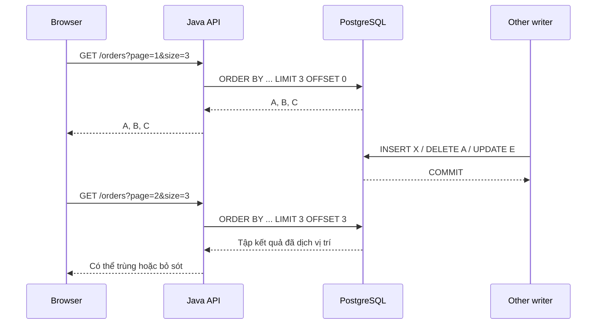
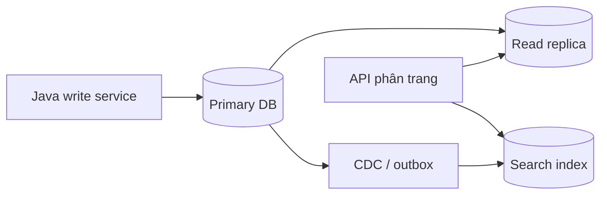
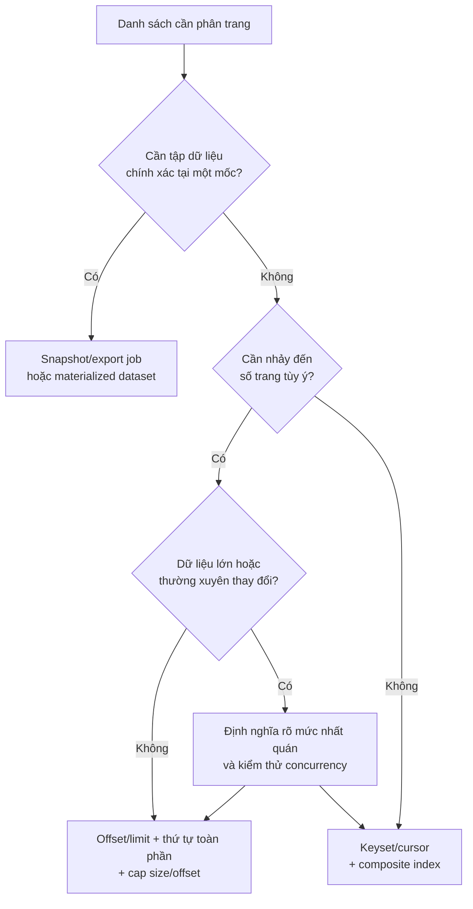

# Phân trang bằng offset và giới hạn khi dữ liệu thay đổi

## 1. Vấn đề: trang 1 đúng nhưng trang 2 vẫn có thể sai

Một API Java hiển thị danh sách đơn hàng thường trả tối đa 20 bản ghi mỗi lần. Người dùng nhấn “Trang sau”, ứng dụng thay đổi tham số `page` rồi thực thi một câu SQL với `LIMIT` và `OFFSET`. Cách làm này dễ hiểu, hỗ trợ nhảy đến số trang và thường đủ tốt cho danh sách nhỏ, ít thay đổi.

Tuy nhiên, trong thời gian người dùng xem trang đầu tiên, hệ thống vẫn có thể:

- Tạo một đơn hàng mới.
- Xóa hoặc ẩn một đơn cũ.
- Chuyển trạng thái từ `NEW` sang `PAID` khiến đơn đi vào hoặc rời bộ lọc.
- Sửa trường dùng để sắp xếp, như `updated_at`.
- Đồng bộ dữ liệu chậm đến read replica hoặc hệ thống tìm kiếm.

Khi đó, **`OFFSET` đo vị trí trong *kết quả hiện tại của từng truy vấn*, không ghi nhớ danh sách mà người dùng từng thấy**. Trang sau có thể lặp bản ghi của trang trước, bỏ sót một bản ghi, hoặc cho tổng số trang khác đi.

Ví dụ, mỗi trang có ba đơn hàng, danh sách được sắp theo mới nhất trước:

```text
Lúc T1:  [A, B, C, D, E, F]
Trang 1: LIMIT 3 OFFSET 0  -> [A, B, C]

Có đơn mới X xuất hiện ở đầu danh sách.

Lúc T2:  [X, A, B, C, D, E, F]
Trang 2: LIMIT 3 OFFSET 3  -> [C, D, E]
```

Bản ghi **C xuất hiện hai lần**. SQL không có lỗi cú pháp; `LIMIT 3 OFFSET 3` vẫn làm đúng nhiệm vụ tại thời điểm T2, nhưng kỳ vọng “tiếp tục chính xác từ trang 1” đã bị phá vỡ.

Bài học này tập trung vào cách phân trang bằng **offset/limit** trong persistence, giới hạn của nó khi dữ liệu thay đổi, ảnh hưởng đến tính đúng đắn và hiệu năng, cách hiện thực trong Java/PostgreSQL, và khi nào phải chuyển sang **keyset/cursor pagination** hoặc một tập dữ liệu nhất quán có kiểm soát.

> **Nguyên tắc ghi nhớ:** `ORDER BY` quyết định thứ tự của *mỗi kết quả truy vấn*; `LIMIT/OFFSET` cắt một lát tại vị trí hiện tại; không có cơ chế nào trong ba phần đó tự đóng băng dữ liệu xuyên qua nhiều HTTP request.

## 2. Định nghĩa `LIMIT`, `OFFSET` và số trang

Trong PostgreSQL:

```sql
SELECT id, created_at, status
FROM orders
WHERE tenant_id = :tenant_id
ORDER BY created_at DESC, id DESC
LIMIT :page_size
OFFSET :offset;
```

- `LIMIT`: Giới hạn **số hàng tối đa** được trả về.
- `OFFSET`: Bỏ qua số hàng đứng đầu kết quả đã sắp theo điều kiện truy vấn.
- `ORDER BY`: Xác định thứ tự để “bỏ qua N hàng” có ý nghĩa.
- `WHERE`: Định nghĩa tập hàng đủ điều kiện; mọi trang phải dùng **cùng bộ lọc** nếu muốn tiếp tục cùng danh sách.

Với số trang bắt đầu từ **1**, công thức thường gặp là:

```text
offset = (pageNumber - 1) * pageSize

pageNumber = 1, pageSize = 20  => OFFSET 0,  LIMIT 20
pageNumber = 2, pageSize = 20  => OFFSET 20, LIMIT 20
pageNumber = 3, pageSize = 20  => OFFSET 40, LIMIT 20
```

Các framework như Spring Data thường đánh số trang nội bộ từ **0**, vì vậy cần quy định chuyển đổi ở ranh giới API.

**Không được tính offset bằng công thức trên nếu chưa validate `pageNumber` và `pageSize`.** Một page âm, page size bằng 0, limit quá lớn hoặc số trang vô hạn có thể gây lỗi, tiêu thụ tài nguyên hay làm tràn kiểu số nếu tính bằng `int` không kiểm soát.

### 2.1. `OFFSET` không phải số ID hay mốc thời gian

`OFFSET 1000` nghĩa là bỏ qua 1.000 **hàng trong tập kết quả của câu truy vấn hiện tại**. Nó không có nghĩa:

- Bỏ qua 1.000 mã đơn nhỏ nhất.
- Bắt đầu sau ID bằng 1000.
- Lấy dữ liệu “cũ hơn” một timestamp nhất định.
- Tiếp tục sau bản ghi cuối trang trước theo danh tính.

Vì vậy, thay đổi ở đầu danh sách sẽ dịch chuyển vị trí những hàng phía sau, ngay cả khi bản thân các hàng đó không đổi.

## 3. Điều kiện tối thiểu: thứ tự xác định và ổn định

Nếu viết:

```sql
SELECT id, created_at
FROM orders
WHERE tenant_id = :tenant_id
LIMIT 20 OFFSET 20;
```

thì **không có thứ tự được bảo đảm**. Database được tự do chọn kế hoạch thực thi, index scan, heap scan hoặc parallel scan; thứ tự trả về có thể thay đổi giữa các lần truy vấn.

Thêm `ORDER BY created_at DESC` là một cải thiện nhưng **chưa đủ** khi nhiều bản ghi có cùng thời điểm tạo:

```text
created_at = 10:00:00.000  -> A, B, C cùng timestamp
```

Khi chỉ sắp theo `created_at`, thứ tự giữa A, B và C không được xác định bởi SQL. Nếu nhóm bằng nhau nằm ở ranh giới trang, một lần chạy có thể trả A ở trang 1, lần khác lại trả A ở trang 2.

### 3.1. Dùng khóa phụ có tính duy nhất

```sql
ORDER BY created_at DESC, id DESC
```

Khi `id` là khóa duy nhất và `created_at` có giá trị hợp lệ, cặp `(created_at, id)` tạo **thứ tự toàn phần** cho tập kết quả.

| Cách sắp xếp | Có thứ tự xác định không? | Có chống được dữ liệu thay đổi giữa hai trang không? |
|---|---|---|
| Không có `ORDER BY` | Không | Không |
| `ORDER BY created_at DESC`, có timestamp trùng | Không hoàn toàn | Không |
| `ORDER BY created_at DESC, id DESC`, ID duy nhất | Có, với một trạng thái dữ liệu nhất định | **Không** |
| `ORDER BY updated_at DESC, id DESC` | Có tại từng thời điểm | **Không**; bản ghi còn có thể di chuyển vì `updated_at` đổi |

Một thứ tự xác định giải quyết bài toán “kết quả dao động dù tập dữ liệu không đổi”. Nó **không** loại bỏ hiện tượng dịch vị trí do thêm/xóa/chỉnh bản ghi giữa các lần gọi.

### 3.2. Null, collation và kiểu sắp xếp

Nếu cột dùng để sort cho phép `NULL`, phải định nghĩa `NULLS FIRST` hoặc `NULLS LAST` theo yêu cầu, và thiết kế cursor tương ứng nếu dùng keyset.

Nếu sort theo text, collation, phân biệt dấu/chữ hoa và quy tắc so sánh có thể ảnh hưởng kết quả. Với ngày giờ, nên lưu và so sánh thời điểm theo kiểu phù hợp, ví dụ `TIMESTAMPTZ`, không sort chuỗi ngày viết theo nhiều định dạng.

Khi API cho phép `sort=...`, **chỉ cho chọn từ allowlist các trường đã được thiết kế**, không ghép trực tiếp tên cột hoặc biểu thức `ORDER BY` do người dùng tự cung cấp vào SQL.

## 4. Minh họa lỗi khi dữ liệu thay đổi

Để thấy rõ, giả định danh sách ban đầu được sắp mới nhất trước và `pageSize = 3`.

### 4.1. INSERT ở đầu: lặp bản ghi

```text
T1: [A, B, C, D, E, F]
    Trang 1 OFFSET 0  -> [A, B, C]

T2: thêm X vào đầu
    [X, A, B, C, D, E, F]
    Trang 2 OFFSET 3  -> [C, D, E]
```

**C bị lặp** vì sau khi thêm X, C từ vị trí thứ ba chuyển sang vị trí thứ tư. Khi bắt đầu trang 2 tại offset 3, C nằm đúng đầu trang.

### 4.2. DELETE trước ranh giới: bỏ sót bản ghi

```text
T1: [A, B, C, D, E, F]
    Trang 1 OFFSET 0  -> [A, B, C]

T2: xóa A
    [B, C, D, E, F]
    Trang 2 OFFSET 3  -> [E, F]
```

**D bị bỏ sót**: tại T1, D là mục tiếp theo sau C; khi A bị xóa, D dịch từ vị trí thứ tư lên thứ ba, nên `OFFSET 3` bỏ qua D.

Việc dữ liệu chỉ còn 5 hàng khiến trang 2 có 2 kết quả không đồng nghĩa người dùng đã nhìn thấy đầy đủ 5 hàng. Người dùng đã thấy A, B, C, E, F nhưng **chưa hề thấy D**.

### 4.3. UPDATE trường sắp xếp: một hàng tự di chuyển

Giả sử sort theo `updated_at DESC`. Bản ghi E được sửa sau khi trang 1 đã tải, khiến E nhảy lên đầu:

```text
T1: [A, B, C, D, E, F]
    Trang 1 -> [A, B, C]

T2: cập nhật E, E nhảy lên đầu
    [E, A, B, C, D, F]
    Trang 2 OFFSET 3 -> [C, D, F]
```

C có thể lặp. E tuy chưa được nhìn thấy trong trang 1 nhưng giờ nằm *trước* vùng offset của trang 2 nên không xuất hiện ở lượt duyệt này.

Việc thay đổi **giá trị filter** cũng có thể tạo hiệu ứng tương tự. Nếu người dùng đang xem đơn `status = 'NEW'`, một đơn chuyển sang `PAID` có thể biến mất khỏi tập kết quả và làm mọi vị trí sau đó dịch lên.

### 4.4. Những biến động có thể xảy ra cùng lúc



Các thao tác ghi vẫn có thể **đúng, nguyên tử và đã commit**. Hiện tượng drift của phân trang là hệ quả của việc ghép nhiều truy vấn độc lập trên các trạng thái dữ liệu khác nhau, không phải bằng chứng database vi phạm ACID.

## 5. “Đúng” nghĩa là gì đối với một danh sách thay đổi liên tục?

Trước khi quyết định giải pháp, cần hỏi người dùng và nghiệp vụ kỳ vọng điều gì.

| Nhu cầu | Cam kết phù hợp | Offset/limit có đủ không? |
|---|---|---|
| Danh sách quản trị cho phép nhảy trang, chấp nhận dữ liệu biến động | “Hiển thị lát cắt mới nhất tại thời điểm từng lần truy vấn” | Có thể đủ, nếu truyền đạt rõ và sort xác định |
| Feed “Xem thêm” liên tục | “Tiếp tục sau bản ghi đã xem” | Thường nên cân nhắc cursor/keyset |
| Xuất báo cáo tài chính | “Không trùng, không thiếu, có thể đối soát với một mốc dữ liệu” | Thường không đủ khi mỗi trang là truy vấn mới |
| Duyệt để cập nhật tất cả hàng | “Mỗi hàng trong tập mục tiêu được xử lý đúng theo chính sách” | Offset thường dễ bỏ sót khi chính job sửa/xóa tập đang duyệt |
| Bảng dữ liệu nhỏ, ít thay đổi | Ưu tiên dễ triển khai và nhảy trang | Offset có thể là lựa chọn hợp lý |
| Tìm kiếm sản phẩm có index cập nhật trễ | Độ mới được công bố theo engine/index | Cần xét thêm replica lag và semantics search |

Một danh sách “sống” thay đổi theo thời gian **không thể vừa luôn phản ánh mọi cập nhật mới nhất, vừa bảo đảm duyệt chính xác một tập cố định** mà không định nghĩa thêm mốc chụp, thứ tự và phạm vi dữ liệu.

### 5.1. Phân biệt tính đúng đắn nghiệp vụ và trải nghiệm duyệt

Nếu người dùng thấy một đơn hai lần trong một danh sách quản trị, đó có thể là bất tiện giao diện. Nhưng nếu một job tự động **tính tiền**, **gửi email** hay **xóa dữ liệu** hai lần dựa trên từng trang offset, lỗi tương tự có thể trở thành sự cố nghiệp vụ nghiêm trọng.

Với thao tác có side effect, cần thiết kế **idempotency, ranh giới transaction, khóa và đối soát**, không chỉ sửa pagination UI.

## 6. Ví dụ database PostgreSQL và truy vấn offset

Giả sử bảng đơn hàng:

```sql
CREATE TABLE orders (
    id UUID PRIMARY KEY,
    tenant_id UUID NOT NULL,
    status TEXT NOT NULL CHECK (
        status IN ('NEW', 'PAID', 'SHIPPED', 'CANCELLED')
    ),
    created_at TIMESTAMPTZ NOT NULL DEFAULT now(),
    updated_at TIMESTAMPTZ NOT NULL DEFAULT now(),
    total_minor BIGINT NOT NULL CHECK (total_minor >= 0),
    version BIGINT NOT NULL DEFAULT 0 CHECK (version >= 0)
);
```

Ta muốn liệt kê đơn `PAID` của một tenant, theo thời điểm tạo mới nhất và `id` giảm dần:

```sql
SELECT id, status, created_at, total_minor
FROM orders
WHERE tenant_id = :tenant_id
  AND status = 'PAID'
ORDER BY created_at DESC, id DESC
LIMIT :size
OFFSET :offset;
```

Chỉ mục có thể hỗ trợ mẫu truy vấn này:

```sql
CREATE INDEX ix_orders_tenant_status_created_id
ON orders (tenant_id, status, created_at DESC, id DESC);
```

Đây là **một lựa chọn chỉ mục minh họa**. Nếu các query phổ biến không lọc `status`, hoặc có nhiều kiểu sort khác nhau, cần phân tích workload và kế hoạch truy vấn cụ thể để chọn index phù hợp.

Cấu trúc index này cũng có chi phí: khi `status` được sửa, hoặc có đơn mới, database phải duy trì chỉ mục; mỗi index bổ sung làm tăng IO và có thể ảnh hưởng thời gian ghi.

### 6.1. `LIMIT/OFFSET` không lọc quyền truy cập

Câu `WHERE tenant_id = ?` phải được gắn bằng **tenant từ ngữ cảnh đã xác thực**, không lấy tự do từ input client. Với hệ thống phức tạp, có thể dùng thêm row-level security và cơ chế phân quyền ở database.

Một query có `LIMIT 20` nhưng thiếu tenant filter vẫn có thể trả 20 bản ghi của người dùng khác. Giới hạn số hàng **không thay thế kiểm tra quyền**.

### 6.2. Dùng `EXPLAIN` để hiểu query thật

```sql
EXPLAIN (ANALYZE, BUFFERS)
SELECT id, status, created_at, total_minor
FROM orders
WHERE tenant_id = '00000000-0000-0000-0000-000000000001'::uuid
  AND status = 'PAID'
ORDER BY created_at DESC, id DESC
LIMIT 20 OFFSET 10000;
```

`EXPLAIN ANALYZE` thực thi câu `SELECT` để đo và có thể tạo tải trên database; nên dùng môi trường hoặc mức tải phù hợp, tránh chạy tùy tiện trong production giờ cao điểm. Ví dụ ID trên chỉ để mô tả cú pháp.

Quan sát các thông tin:

- Query có dùng index tương ứng không?
- Có phải sort một tập lớn không?
- Có bao nhiêu hàng bị đọc trước khi trả 20 hàng cuối?
- Thời gian thực thi, buffer hits/reads và tải IO thay đổi thế nào khi OFFSET tăng?
- Điều kiện filter có được áp dụng sớm và chọn lọc không?

## 7. Chi phí của OFFSET sâu

Với `LIMIT 20 OFFSET 100000`, database thường phải duyệt/đánh giá đủ một phần lớn kết quả trước khi bỏ qua 100.000 hàng và trả 20 hàng. Index giúp xác định thứ tự nhưng **không biến việc bỏ qua N hàng thành phép nhảy trực tiếp đến vị trí N miễn phí** trong một tập SQL tổng quát.

Độ phức tạp thực tế phụ thuộc engine và plan, nhưng chi phí thường tăng theo `offset + limit`, nhất là khi cần sắp xếp, lọc phức tạp hoặc truy vấn từ storage chậm.

| Trang (size 20) | Offset | Số hàng đứng trước cửa sổ cần bỏ qua |
|---:|---:|---:|
| 1 | 0 | 0 |
| 10 | 180 | 180 |
| 100 | 1.980 | 1.980 |
| 1.000 | 19.980 | 19.980 |
| 10.000 | 199.980 | 199.980 |

Số hàng phải xử lý nội bộ có thể lớn hơn nhiều do filter, join hoặc execution plan. Bảng này chỉ minh họa **khoảng cách offset**, không dự báo thời gian hay số page reads cụ thể.

### 7.1. OFFSET lớn là vấn đề độc lập với dữ liệu thay đổi

Ngay cả nếu dữ liệu hoàn toàn bất biến, `OFFSET 200000` vẫn có thể tốn tài nguyên. Ngược lại, `OFFSET 20` vẫn có thể trả trùng/bỏ sót khi có insert/delete cạnh đầu danh sách.

Vì vậy có **hai lý do khác nhau** để cân nhắc chuyển sang cursor/keyset:

1. Giảm chi phí truy vấn sâu.
2. Giảm lỗi dịch vị trí do các thay đổi nằm **trước con trỏ**.

Keyset vẫn có giới hạn riêng khi trường sort/filter thay đổi; không nên hứa rằng nó là snapshot tuyệt đối.

### 7.2. Trang cuối có thể ngắn dù không có lỗi

Với `LIMIT 20 OFFSET 100` mà kết quả còn 107 hàng, trang trả 7 hàng là bình thường. Nhưng trong một danh sách thay đổi liên tục, trang ngắn cũng có thể do dữ liệu vừa bị xóa hoặc rời filter. Ứng dụng không nên tự suy ra toàn bộ các hàng đã được duyệt chính xác từ điều kiện “trang cuối ngắn hơn page size”.

## 8. Java/JDBC: hiện thực offset có giới hạn an toàn

Ví dụ Java dùng JDBC để đọc một trang đơn đã thanh toán theo tenant. Cần các quyết định:

- API đánh số trang từ 1; repository đổi thành offset từ 0.
- `size` phải ở khoảng hợp lệ, ví dụ 1–100 (ngưỡng này chỉ là ví dụ cấu hình).
- Không sử dụng `int` mà chưa xét tràn số khi tính offset.
- Bộ lọc tenant đến từ context đã xác thực.
- `ORDER BY created_at DESC, id DESC` tạo thứ tự xác định.
- Lấy **`size + 1`** hàng để biết có trang tiếp theo mà không bắt buộc chạy `COUNT(*)`.
- Không cố tạo transaction kéo dài từ lần tải trang 1 đến khi người dùng nhấn trang 2.

### 8.1. DTO kết quả

```java
import java.time.Instant;
import java.util.List;
import java.util.UUID;

record OrderRow(
    UUID id,
    String status,
    Instant createdAt,
    long totalMinor
) {}

record OffsetPage<T>(
    int pageNumber,
    int pageSize,
    List<T> items,
    boolean hasNext
) {}
```

`hasNext` cho biết tại thời điểm thực thi có nhiều hơn `pageSize` bản ghi **sau vị trí offset đã truy vấn**. Nó không bảo đảm trang tiếp theo vẫn sẽ tồn tại y hệt khi client gửi request tiếp theo.

### 8.2. Repository JDBC

```java
import javax.sql.DataSource;
import java.sql.*;
import java.time.OffsetDateTime;
import java.util.ArrayList;
import java.util.List;
import java.util.UUID;

public final class OrderPageRepository {
    private final DataSource dataSource;

    public OrderPageRepository(DataSource dataSource) {
        this.dataSource = dataSource;
    }

    public OffsetPage<OrderRow> listPaidOrders(
            UUID trustedTenantId, int pageNumber, int pageSize)
            throws SQLException {

        if (trustedTenantId == null) {
            throw new IllegalArgumentException("Tenant is required");
        }
        if (pageNumber < 1 || pageSize < 1 || pageSize > 100) {
            throw new IllegalArgumentException("Invalid pagination");
        }

        long offset = Math.multiplyExact(
            (long) pageNumber - 1L, (long) pageSize);
        int fetchSize = pageSize + 1;

        String sql = """
            SELECT id, status, created_at, total_minor
            FROM orders
            WHERE tenant_id = ? AND status = 'PAID'
            ORDER BY created_at DESC, id DESC
            LIMIT ? OFFSET ?
            """;

        List<OrderRow> rows = new ArrayList<>();

        try (Connection c = dataSource.getConnection();
             PreparedStatement ps = c.prepareStatement(sql)) {

            ps.setObject(1, trustedTenantId);
            ps.setInt(2, fetchSize);
            ps.setLong(3, offset);

            try (ResultSet rs = ps.executeQuery()) {
                while (rs.next()) {
                    rows.add(new OrderRow(
                        (UUID) rs.getObject("id"),
                        rs.getString("status"),
                        rs.getObject(
                            "created_at", OffsetDateTime.class).toInstant(),
                        rs.getLong("total_minor")
                    ));
                }
            }
        }

        boolean hasNext = rows.size() > pageSize;
        if (hasNext) {
            rows.remove(rows.size() - 1);
        }

        return new OffsetPage<>(
            pageNumber, pageSize, List.copyOf(rows), hasNext);
    }
}
```

Ví dụ giả định Java hỗ trợ record/text block, PostgreSQL JDBC hỗ trợ mapping `TIMESTAMPTZ` sang `OffsetDateTime`, và không có chính sách tenant phức tạp khác. Đoạn code minh họa phần persistence; controller cần chuẩn hóa HTTP error, phân quyền, timeout, rate limit và cấu hình giới hạn.

**Vì sao không trả ngay 100.000 hàng theo `size` từ client?** Vì không giới hạn page size dễ tạo truy vấn tốn bộ nhớ, băng thông và thời gian trả về, trở thành nguy cơ từ chối dịch vụ. Giới hạn phải đặt ở server.

**Vì sao dùng `long offset`?** Ngay cả khi `pageNumber` và `pageSize` là `int`, phép nhân trong `int` có thể tràn khi page rất lớn. Với ứng dụng thật vẫn cần giới hạn **offset tối đa** để tránh deep pagination tốn tài nguyên, dù tính toán không tràn.

### 8.3. API và hợp đồng response

Ví dụ:

```http
GET /api/orders?status=PAID&page=2&size=20
```

Phản hồi có thể gồm:

```json
{
  "page": 2,
  "size": 20,
  "hasNext": true,
  "items": [
    {
      "id": "5e729fab-6af1-447a-921c-8ca6e4bde312",
      "status": "PAID",
      "createdAt": "2026-04-10T09:30:00Z",
      "totalMinor": 1990
    }
  ]
}
```

JSON chỉ minh họa hình dạng; trong dữ liệu thật, nếu `size=20` và `hasNext=true` thì thông thường `items` có đủ 20 phần tử. Giá trị trong ví dụ rút gọn để dễ đọc.

Một API dùng offset nên mô tả rõ:

- `page` bắt đầu từ 1 hay 0.
- Các cột sort có cố định hay được client chọn.
- Các filter có được giữ nguyên khi đổi trang hay không.
- `hasNext`/`total` có thể thay đổi khi dữ liệu thay đổi.
- Số trang sâu tối đa hoặc chiến lược chuyển sang cursor/export.
- Các bản ghi trên nhiều lần gọi **không phải snapshot nhất quán** trừ khi hệ thống cung cấp cơ chế chuyên biệt.

## 9. Spring Data: Page, Slice và thứ tự ổn định

Với Spring Data JPA, có thể định nghĩa một repository trả `Slice`:

```java
import java.util.UUID;
import org.springframework.data.domain.Pageable;
import org.springframework.data.domain.Slice;
import org.springframework.data.jpa.repository.JpaRepository;

interface OrderRepository extends JpaRepository<OrderEntity, UUID> {
    Slice<OrderEntity> findByTenantIdAndStatus(
        UUID tenantId, OrderStatus status, Pageable pageable);
}
```

Service gọi với sort bao gồm khóa duy nhất:

```java
import org.springframework.data.domain.PageRequest;
import org.springframework.data.domain.Sort;

int zeroBasedPage = requestedPage - 1; // validate requestedPage >= 1
Sort order = Sort.by(
        Sort.Order.desc("createdAt"),
        Sort.Order.desc("id"));
PageRequest pageable = PageRequest.of(
    zeroBasedPage, requestedSize, order);

Slice<OrderEntity> slice = repository.findByTenantIdAndStatus(
    trustedTenantId, OrderStatus.PAID, pageable);
```

`PageRequest` sử dụng số trang **zero-based** và `offset` có thể tăng sâu. Nếu truy vấn được hỗ trợ bởi index phù hợp, phần đầu trang sẽ hiệu quả; nhưng bản chất deep offset và drift vẫn tồn tại.

**`Page<T>` và `Slice<T>` khác nhau:**

| Loại | Thông tin thường có | Chi phí cần chú ý |
|---|---|---|
| `Page<T>` | Danh sách phần tử, tổng số hàng, tổng số trang, current page | Thường có thể cần count query; tùy tối ưu và cách triển khai |
| `Slice<T>` | Danh sách phần tử, chỉ báo có trang tiếp hay không | Có thể lấy thêm một hàng để xác định `hasNext`, thường tránh nhu cầu total count |
| Cursor/custom keyset result | Danh sách + next/previous cursor | Cần query/serialization theo composite sort key và thiết kế token |

Không phải `Slice` tự giải quyết vấn đề dữ liệu thay đổi: nó vẫn có thể dùng offset theo `Pageable` truyền vào. Nếu phải tránh trang sâu hoặc dịch vị trí, cần **một truy vấn keyset thật**, không chỉ đổi kiểu return.

### 9.1. N+1 query khi hiển thị kết quả

Phân trang 20 `OrderEntity` rồi truy cập `order.getLines()` trong vòng lặp có thể phát sinh N+1 query nếu mapping lazy. Tùy query và fetch strategy, dùng projection hoặc truy vấn riêng lấy lines cho **các order ID trong trang** có thể ổn định hơn.

Cần đặc biệt thận trọng với fetch join vào collection một–nhiều khi áp phân trang: join có thể nhân hàng, làm limit áp trên hàng join thay vì trên thực thể cha hoặc khiến ORM xử lý pagination trong bộ nhớ tùy provider/cấu hình.

Một chiến lược thông dụng:

1. Truy vấn trang **ID đơn hàng** theo `ORDER BY` ổn định.
2. Đọc chi tiết/lines theo các ID đã chọn ở truy vấn thứ hai.
3. Ghép kết quả theo **thứ tự ID của trang gốc**, không giả định `WHERE id IN (...)` tự giữ thứ tự.
4. Nếu cần snapshot nhất quán giữa hai câu query, cân nhắc transaction/isolation phù hợp.

Đây là bài toán bổ sung ngoài offset drift, nhưng nếu không xử lý, một API chỉ trả 20 đơn có thể phát sinh hàng chục SQL.

## 10. COUNT(*) và tổng số trang khi tập dữ liệu thay đổi

Giao diện dạng “Trang 2/150” thường cần tổng số hàng:

```sql
SELECT count(*)
FROM orders
WHERE tenant_id = :tenant_id AND status = 'PAID';
```

Nếu có `totalCount` và `size` dương:

```text
totalPages = ceil(totalCount / size)
```

Tuy nhiên, `COUNT(*)` và truy vấn lấy `items` có thể quan sát **hai snapshot khác nhau** dưới `READ COMMITTED` khi có transaction khác commit ở giữa. Khi đó:

- `totalCount` nói có 101 hàng nhưng trang cuối có ít hơn kỳ vọng.
- UI hiển thị 6 trang, nhưng sau khi xóa một số hàng thì trang 6 trống.
- Một bản ghi mới có thể làm tổng trang tăng dù client đang duyệt.

**Tổng đếm là thông tin ở một thời điểm, không phải hợp đồng về tập hàng cố định cho các trang tương lai.**

### 10.1. Có cần count chính xác mọi lần?

| Cách làm | Ưu điểm | Nhược điểm |
|---|---|---|
| `COUNT(*)` theo filter | Có tổng số hàng theo một mốc đọc | Có thể tốn chi phí trên tập lớn; có thể lệch với list ở snapshot khác |
| `LIMIT size + 1` | Không cần total; xác định được `hasNext` của truy vấn hiện tại | Không hỗ trợ nhảy đến “trang cuối” hay hiển thị total |
| Tổng gần đúng/cache | Nhanh, ít tải | Cần ghi rõ tính gần đúng, stale và phạm vi |
| Snapshot/materialized list | Tổng và phân trang nhất quán theo một dataset | Cần lưu tập mục tiêu, quota, quyền, TTL và lifecycle |

Một bảng quản trị nhỏ có thể cần count chính xác; feed hoặc vô hạn cuộn thường không cần. Đừng chạy count lớn cho mọi request chỉ vì một UI component mặc định có ô “total pages”.

### 10.2. Đếm và lấy danh sách trong cùng transaction

Trong PostgreSQL, thực hiện `COUNT(*)` và `SELECT page` trong một transaction `REPEATABLE READ` có thể làm hai câu query đọc cùng snapshot phù hợp, **trong phạm vi transaction đó**. Điều này hữu ích nếu muốn total và items nhất quán trong **một HTTP response**.

Nó **không** làm trang 2 trong HTTP request sau đọc cùng snapshot nếu request sau tạo transaction mới. Giữ một transaction mở giữa nhiều lần người dùng nhấn nút không phải giải pháp thông thường: nó tốn connection, giữ snapshot cũ và có thể cản việc dọn phiên bản dữ liệu cũ.

## 11. Isolation, MVCC và hiểu đúng tính nhất quán

### 11.1. `READ COMMITTED` trong PostgreSQL

Ở isolation `READ COMMITTED`, mỗi câu lệnh `SELECT` thường lấy snapshot của dữ liệu đã commit tại thời điểm câu lệnh đó bắt đầu. Hai câu `SELECT` liên tiếp có thể thấy các commit khác nhau, **ngay cả khi được thực thi trong cùng một transaction READ COMMITTED**.

```text
T1: SELECT trang 1      -> snapshot S1
Writer khác: COMMIT INSERT X
T1: SELECT trang 2      -> snapshot S2
```

Nếu chạy hai query theo offset, có thể gặp drift. Việc thêm `BEGIN/COMMIT` mà giữ mức `READ COMMITTED` không tự cho cả hai query một snapshot cố định.

### 11.2. `REPEATABLE READ` trong một transaction

Ở PostgreSQL `REPEATABLE READ`, các câu query trong cùng transaction đọc một snapshot nhất quán cho các dữ liệu mà transaction quan sát theo cơ chế của DBMS, trong khi vẫn có thể thấy những thay đổi do chính transaction thực hiện theo ngữ nghĩa phù hợp.

Nếu toàn bộ quá trình duyệt các trang được thực hiện **trong một transaction mở**, kết quả của từng query có thể không bị thay đổi bởi những transaction commit sau mốc snapshot; nhưng giữ transaction lâu qua nhiều HTTP request thường không phù hợp vận hành.

**Không nên đề xuất “mở một transaction từ trang 1 đến trang 100 rồi chờ người dùng”** vì:

- Chiếm connection trong pool lâu.
- Giữ snapshot cũ, có thể làm tăng áp lực MVCC/vacuum.
- Transaction có thể bị timeout, client ngắt kết nối hoặc chuyển vùng.
- Khó cân bằng tải qua nhiều instance và phục hồi nếu server restart.
- Không đáp ứng kỳ vọng “dữ liệu luôn mới nhất” của danh sách sống.

Nếu cần duyệt một tập dữ liệu cố định, nên thiết kế snapshot/export hoặc cursor được hỗ trợ rõ ràng, thay vì giả định isolation một mình xử lý được phiên trình duyệt kéo dài.

### 11.3. Đọc từ replica có độ trễ

Một API đọc trang 1 từ replica R1, trang 2 từ replica R2 có mức replication lag khác nhau có thể nhìn thấy tập dữ liệu khác nhau ngay cả khi không có ghi mới *giữa hai HTTP request* ở primary.

Nếu ứng dụng hứa read-your-writes hoặc dữ liệu rất nhạy cảm, cần lựa chọn source/replica và consistency phù hợp. Keyset cũng không tự giải quyết mọi vấn đề về replica lag hoặc event ordering.

### 11.4. Consistency của phân trang khác transaction integrity

Một transaction tạo đơn đúng có thể commit hoàn toàn; API phân trang vẫn có thể bỏ sót đơn do các thay đổi thứ tự giữa các lần đọc. Ngược lại, một snapshot trang ổn định không chứng minh thao tác ghi đơn có bảo vệ tồn kho.

Cần tách hai mục tiêu:

- **Đúng đắn ghi:** ACID transaction, constraint, isolation, idempotency.
- **Đúng đắn duyệt:** Bộ lọc và thứ tự toàn phần, mốc dữ liệu, cách tiếp tục sau hàng cuối, khả năng xử lý thay đổi.

## 12. Keyset/cursor pagination: tiếp tục theo khóa thay vì vị trí

Với danh sách sắp theo `created_at DESC, id DESC`, cách phân trang thay thế là **keyset pagination**. Thay vì đếm bỏ qua N hàng, client gửi cặp khóa của hàng cuối đã nhận.

Trang đầu:

```sql
SELECT id, status, created_at, total_minor
FROM orders
WHERE tenant_id = :tenant_id
  AND status = 'PAID'
ORDER BY created_at DESC, id DESC
LIMIT :size_plus_one;
```

Giả sử hàng cuối trang là:

```text
created_at = 2026-04-10T09:30:00Z
id = 5e729fab-6af1-447a-921c-8ca6e4bde312
```

Trang tiếp theo:

```sql
SELECT id, status, created_at, total_minor
FROM orders
WHERE tenant_id = :tenant_id
  AND status = 'PAID'
  AND (created_at, id) < (:last_created_at, :last_id)
ORDER BY created_at DESC, id DESC
LIMIT :size_plus_one;
```

Trong PostgreSQL, phép so sánh tuple `(created_at, id) < (...)` hoạt động theo thứ tự từ trái qua phải, phù hợp khi **cả hai khóa sort cùng giảm dần**, đều không null và cặp là duy nhất.

Với sort khác chiều, giá trị null hoặc collation phức tạp, phải xây predicate lexicographic phù hợp; không copy nguyên một toán tử `<` cho mọi sort.

### 12.1. Minh họa insert trước cursor

```text
Trang 1 ở T1: [A, B, C]
Cursor:       khóa của C

T2 có thêm X mới hơn A:
[X, A, B, C, D, E, F]

Trang 2 keyset: chỉ tìm khóa nằm SAU C
               -> [D, E, F]
```

X không làm vị trí bắt đầu của trang kế tiếp dịch chuyển, nên C không bị lặp do insert phía trước cursor. Đây là khác biệt quan trọng so với `OFFSET 3`.

### 12.2. Minh họa delete trước cursor

```text
Trang 1 ở T1: [A, B, C]
T2 xóa A:
[B, C, D, E, F]

Trang 2 keyset sau C -> [D, E, F]
```

D vẫn xuất hiện, vì truy vấn không bỏ qua “ba hàng đầu tiên của tập mới”; nó tiếp tục sau **khóa của C**.

### 12.3. Nhưng keyset không phải snapshot bất biến

Keyset tránh nhiều lỗi do dịch **vị trí trước cursor**, nhưng:

- Nếu trường sort của một hàng thay đổi, hàng đó có thể di chuyển sang phía đã duyệt hoặc chưa duyệt.
- Nếu một hàng rời bộ lọc `status = 'PAID'`, nó sẽ không còn xuất hiện ở trang sau.
- Một hàng mới có timestamp **cũ hơn cursor** (dữ liệu đến trễ, backfill) có thể xuất hiện trong các trang tiếp theo.
- Nếu khóa sort không duy nhất hoặc không ổn định, có thể vẫn trùng/bỏ sót.
- Replica lag và index cập nhật bất đồng bộ cũng có thể làm kết quả thay đổi.

Với một tập có các khóa sort **bất biến**, keyset cho hành vi duyệt tiếp nối rất tốt. Với yêu cầu “đúng toàn bộ tập tại thời điểm T0”, cần mốc/snapshot hoặc tập ID đã cố định.

## 13. Thiết kế cursor: không chỉ base64 của offset

Một cursor thường mang những thành phần như:

```json
{
  "v": 1,
  "lastCreatedAt": "2026-04-10T09:30:00Z",
  "lastId": "5e729fab-6af1-447a-921c-8ca6e4bde312",
  "sort": "createdAt_desc_id_desc",
  "filterFingerprint": "hash-of-validated-query",
  "expiresAt": "2026-04-10T10:30:00Z"
}
```

Đây là **payload minh họa**, chưa phải token hoàn chỉnh. Trong production nên:

- Tạo cursor ở server sau khi validate filter/sort.
- Gắn phạm vi tenant/user hoặc điều kiện truy cập với token và **kiểm tra lại quyền** ở mỗi request.
- Ký/HMAC hoặc dùng token ngẫu nhiên tra cứu server-side để ngăn client tự sửa cursor.
- Đặt version và thời hạn sống để dễ thay đổi định dạng, tránh dùng token không giới hạn.
- Giới hạn độ dài, decode an toàn và trả lỗi rõ khi token sai/hết hạn.
- Không đặt bí mật hoặc dữ liệu nhạy cảm vào payload chỉ được **base64**, vì base64 **không phải mã hóa**.
- Không dùng cursor làm bằng chứng phân quyền hoặc bỏ qua filter tenant trong SQL.

### 13.1. Filter phải không đổi khi tiếp tục

Cursor được tạo cho `status=PAID`, sort `createdAt DESC` không nên được dùng lại khi client đổi thành `status=NEW` hoặc sort theo `updatedAt`. Hệ thống phải từ chối cursor không tương ứng hoặc bắt đầu lại từ trang đầu.

Nếu muốn cho phép đổi filter, giải pháp rõ nhất thường là **đặt lại cursor**, không âm thầm áp cursor cũ vào tập mới.

### 13.2. Trang trước với keyset

Nếu sắp theo `created_at DESC, id DESC`, muốn tìm các hàng **trước** hàng đầu của trang hiện tại, có thể truy vấn theo điều kiện:

```sql
SELECT id, status, created_at
FROM orders
WHERE tenant_id = :tenant_id
  AND status = 'PAID'
  AND (created_at, id) > (:first_created_at, :first_id)
ORDER BY created_at ASC, id ASC
LIMIT :size;
```

Sau đó **đảo thứ tự kết quả** trước khi hiển thị theo hướng DESC. Tính năng quay lại và nhảy tới trang bất kỳ trong keyset cần thiết kế UI/token riêng; không tự nhiên như offset bằng số trang.

## 14. Java/JDBC: phác thảo truy vấn keyset

Một repository có thể nhận cursor đã được server kiểm tra:

```java
record OrderCursor(
    java.time.Instant lastCreatedAt,
    java.util.UUID lastId
) {}

record CursorSlice<T>(
    java.util.List<T> items,
    OrderCursor nextCursor,
    boolean hasNext
) {}
```

SQL tùy trạng thái có cursor:

```sql
SELECT id, status, created_at, total_minor
FROM orders
WHERE tenant_id = ?
  AND status = 'PAID'
  AND (created_at, id) < (?, ?)
ORDER BY created_at DESC, id DESC
LIMIT ?;
```

Ví dụ binder Java:

```java
import java.sql.*;
import java.time.OffsetDateTime;
import java.time.ZoneOffset;
import java.util.UUID;

// orderCursor đã được verify và bind với filter/tenant từ API.
try (PreparedStatement ps = connection.prepareStatement(sql)) {
    ps.setObject(1, trustedTenantId);
    ps.setObject(
        2, OffsetDateTime.ofInstant(
            orderCursor.lastCreatedAt(), ZoneOffset.UTC));
    ps.setObject(3, orderCursor.lastId());
    ps.setInt(4, pageSize + 1);

    try (ResultSet rs = ps.executeQuery()) {
        while (rs.next()) {
            // Map các hàng và lấy cặp created_at, id của hàng cuối
            // thực sự được trả cho client, không lấy hàng dư thứ N+1.
        }
    }
}
```

Đây là đoạn minh họa cách bind tuple cho PostgreSQL, không phải class hoàn chỉnh. Cần xử lý trang đầu không có cursor bằng câu SQL **không có predicate after-cursor**, hoặc xây query có nhánh riêng được kiểm chứng. Tránh truyền `NULL` vào phép so sánh tuple rồi kỳ vọng nó tự bỏ qua filter.

Để trả `nextCursor` đúng, hãy lấy tối đa `pageSize + 1` hàng; nếu có hàng dư thì chỉ trả `pageSize` hàng và mã hóa **khóa của hàng cuối được trả**. Không đặt cursor ở hàng dư vì sẽ làm bỏ qua hàng đó trong trang tiếp.

## 15. Khi cần tập dữ liệu nhất quán thật sự

Có những tác vụ mà ngay cả keyset cũng chưa đủ:

- Xuất bảng kê để đối soát tài chính tại một thời điểm.
- Phát hành chứng từ cho một danh sách chốt sổ.
- Job xử lý từng bản ghi của một tập được xác định theo điều kiện lúc bắt đầu.
- Lập danh sách kiểm toán “chính xác những đơn đang PAID vào cuối ngày”.
- Duyệt nhiều lần mà phải tái tạo kết quả giống nhau.

### 15.1. Giữ snapshot trong một transaction ngắn

Đối với một công việc server-side **ngắn**, có thể dùng một transaction `REPEATABLE READ` và server-side cursor hoặc nhiều truy vấn trong cùng transaction để đọc một snapshot. Cần xem xét timeout, pool, mức độ nhớ và tác động MVCC.

Đây là giải pháp cho batch server-side có thời gian được kiểm soát, **không phải** cho trang web mở hàng chục phút chờ người dùng bấm tiếp.

### 15.2. Materialize tập ID

Một phương án là tạo một **export job**:

1. Ghi nhận filter, tenant, người yêu cầu và mốc dữ liệu theo chính sách.
2. Trong một transaction/snapshot phù hợp, xác định danh sách ID và **thứ tự** cần xuất.
3. Ghi tập ID/ordinal vào bảng job hoặc tệp tạm được bảo vệ, cùng version của job.
4. Phân trang theo `job_id` và thứ tự đã materialize, không theo offset trên bảng nghiệp vụ đang thay đổi.
5. Khi lấy chi tiết, định nghĩa rõ có cần **snapshot toàn bộ nội dung** hay chỉ ổn định danh sách ID. Nếu cần chính xác giá trị tại T0, phải lưu cả nội dung/version tương ứng hoặc dùng snapshot dữ liệu phù hợp.
6. Đặt TTL, phân quyền, encryption, quota và chính sách dọn dữ liệu cho artifact của job.

Một danh sách ID ổn định giải quyết việc **không bị dịch danh sách do insert/delete**, nhưng bản ghi tương ứng vẫn có thể bị xóa hoặc thay đổi nội dung sau thời điểm tạo job. Nếu yêu cầu báo cáo đúng tại T0, chỉ lưu ID là chưa đủ.

### 15.3. High-water mark và giới hạn của nó

Với dữ liệu append-only và thứ tự bất biến, có thể ghi nhận mốc tối đa như `max(sequence_id)` hoặc timestamp tại thời điểm bắt đầu rồi chỉ đọc dữ liệu nằm trong giới hạn đó.

Ví dụ:

```sql
SELECT id, sequence_id, payload
FROM append_only_events
WHERE tenant_id = :tenant_id
  AND sequence_id <= :high_water_sequence
  AND sequence_id < :last_sequence
ORDER BY sequence_id DESC
LIMIT :size;
```

Ví dụ giả định `sequence_id` có tính ổn định và quy tắc cấp số phù hợp; với trang đầu không có `last_sequence` phải dùng nhánh truy vấn khác.

**High-water mark không tự tạo snapshot đúng cho mọi hệ thống**. Các ID/sequence có thể được cấp trước khi transaction commit, giao dịch đến muộn có thể xuất hiện sau mốc đọc, dữ liệu có thể bị xóa/sửa và quy tắc filter có thể thay đổi. Muốn bảo đảm đúng “tập đã commit tại T0” cần kiểm chứng mô hình cấp ID/commit và cách chụp dữ liệu thực sự.

## 16. Offset và tác vụ bulk: lỗi khi vừa phân trang vừa thay đổi tập kết quả

Một antipattern rất nguy hiểm:

```java
for (int page = 0; ; page++) {
    List<Session> sessions = repository.findExpired(page, 100);
    if (sessions.isEmpty()) break;
    sessions.forEach(repository::delete);
}
```

Giả sử ban đầu có 300 session hết hạn:

```text
Trang 0: OFFSET 0 LIMIT 100  -> lấy 100 hàng đầu
Xóa 100 hàng đó.

Tập còn 200 hàng, những hàng cũ thứ 101..300 dịch lên.
Trang 1: OFFSET 100 LIMIT 100 -> lấy hàng cũ thứ 201..300

Hàng cũ thứ 101..200 bị BỎ QUA.
```

**Chính job của bạn đã thay đổi tập kết quả, khiến offset tiếp theo sai.** Đừng dùng offset tăng dần để xóa hoặc chuyển trạng thái những hàng rời filter sau khi xử lý.

### 16.1. Xử lý lặp từ đầu theo batch

Một lựa chọn là luôn lấy **đợt đầu** của các bản ghi còn đủ điều kiện, rồi xóa/chuyển trạng thái trong transaction:

```sql
WITH batch AS (
    SELECT id
    FROM sessions
    WHERE state = 'EXPIRED'
    ORDER BY expires_at, id
    LIMIT 100
    FOR UPDATE SKIP LOCKED
)
DELETE FROM sessions AS s
USING batch AS b
WHERE s.id = b.id
RETURNING s.id;
```

Lặp lại đến khi không còn hàng đủ điều kiện, với timeout, retry và giới hạn tải. Vì các hàng đã xóa rời khỏi tập, **không tăng OFFSET** giữa các batch.

Khi nhiều worker cùng chạy, `FOR UPDATE SKIP LOCKED` giúp tránh tranh chấp trên những hàng đang bị khóa, nhưng không bảo đảm thứ tự tuyệt đối hoặc không có starvation; cần theo dõi backlog và xử lý những hàng bị bỏ qua lâu.

### 16.2. Xử lý theo keyset cho scan ổn định

Nếu chỉ đọc và xử lý các bản ghi theo một khóa bất biến, có thể dùng keyset. Nhưng nếu chính thao tác xử lý đổi cột sort/filter, hãy kiểm chứng invariant cụ thể: một hàng đổi vị trí có thể đi qua cursor. Với xử lý destructive/financial, cần **command idempotency** và cơ chế đánh dấu trạng thái xử lý tại nguồn.

## 17. Phân trang trên JOIN và aggregate

### 17.1. JOIN collection làm nhân hàng

Giả sử mỗi đơn có nhiều dòng hàng:

```sql
SELECT o.id, l.sku
FROM orders o
JOIN order_lines l ON l.order_id = o.id
WHERE o.tenant_id = :tenant_id
ORDER BY o.created_at DESC, o.id DESC
LIMIT 20 OFFSET 0;
```

`LIMIT 20` ở đây giới hạn **20 hàng kết quả JOIN**, **không phải 20 đơn hàng khác nhau**. Một đơn có 15 dòng có thể chiếm phần lớn trang.

Giải pháp thường dùng là **phân trang ở bảng cha trước**, rồi lấy chi tiết:

```sql
WITH page_ids AS (
    SELECT id, created_at
    FROM orders
    WHERE tenant_id = :tenant_id
    ORDER BY created_at DESC, id DESC
    LIMIT :size OFFSET :offset
)
SELECT p.id, p.created_at, l.sku, l.quantity
FROM page_ids AS p
LEFT JOIN order_lines AS l ON l.order_id = p.id
ORDER BY p.created_at DESC, p.id DESC, l.line_no;
```

Câu query này giới hạn số **đơn cha** trước khi join. Sau join, số hàng kết quả có thể lớn hơn `size` vì mỗi đơn có nhiều dòng. Nếu việc đọc chi tiết có yêu cầu snapshot nhất quán giữa các bước, cần đặt ranh giới transaction phù hợp.

### 17.2. `DISTINCT` không tự sửa sai mọi pagination

Thêm `DISTINCT` vào một truy vấn JOIN không tự tạo thứ tự toàn phần hoặc giải quyết drift. Đôi khi nó che một mô hình truy vấn đang nhân hàng và làm query đắt hơn.

Hãy xác định đơn vị phân trang thực sự: **đơn hàng, dòng hàng, khách hàng hay một nhóm tổng hợp**. Chỉ sau đó mới chọn query và khóa sắp xếp.

### 17.3. Dữ liệu tổng hợp

Với `GROUP BY`, mỗi hàng kết quả có thể là một nhóm chứ không phải một bản ghi nguồn. Nếu nhóm được tạo/xóa khi dữ liệu thay đổi, offset vẫn có thể dịch. Muốn phân trang nhóm ổn định, phải xác định khóa nhóm và tính nhất quán của số liệu ở mốc đọc.

## 18. Sort/filter động và độ an toàn của truy vấn

Một API cho phép:

```http
GET /orders?page=3&size=25&sort=createdAt,desc&status=PAID
```

Phải kiểm soát:

- **Allowlist sort fields:** Ví dụ `createdAt`, `totalMinor`; không nhận biểu thức SQL tùy ý.
- **Thứ tự phụ duy nhất:** Thêm `id` ở cuối nếu trường chính không unique.
- **Nhất quán sort khi đổi trang:** Nếu người dùng đổi sort, reset về trang 1 hoặc cursor mới.
- **Filter và quyền:** Tenant, row visibility, trạng thái phải áp nhất quán.
- **Múi giờ:** Filter theo ngày có cần chuyển sang khoảng instant theo timezone nghiệp vụ không?
- **Giá trị null:** Cách sort null phải rõ và nhất quán với cursor.
- **Trường có thể thay đổi:** Sort theo `updatedAt` có rủi ro drift lớn hơn sort theo `createdAt` bất biến.
- **Index:** Không thể có index tối ưu cho mọi tổ hợp sort/filter; cần dựa vào truy vấn thực tế và mức sử dụng.

Trong Spring, `Sort.by(...)` với tên thuộc tính đã được kiểm tra từ allowlist an toàn hơn việc ghép raw input vào chuỗi SQL. Nhưng vẫn phải giới hạn tổ hợp truy vấn và đảm bảo quyền.

## 19. Phân trang trong hệ thống phân tán và công cụ tìm kiếm

Khi dữ liệu được sao chép:



Hai trang có thể được phục vụ từ những hệ thống nhìn thấy các commit ở **các mốc khác nhau**. Bên cạnh insert/delete, còn có:

- Replica lag và việc cân bằng tải sang replica khác.
- Search refresh chưa kịp cập nhật tài liệu mới.
- Search relevance score thay đổi khi chỉ mục thay đổi.
- Reindex hoặc schema migration khiến thứ tự/tập dữ liệu khác đi.
- TTL/retention làm một số bản ghi biến mất khỏi nguồn và bản sao theo thời gian.

Với tìm kiếm sâu, nhiều search engine có cơ chế kiểu **search-after** và **point-in-time**/snapshot hoặc scroll có vòng đời giới hạn. API, khả năng bảo đảm và chi phí tùy sản phẩm; phải kiểm tra chính xác phiên bản engine. Không dùng offset sâu vô hạn rồi giả định có độ ổn định giống snapshot.

### 19.1. Đừng lấy search index làm nguồn giao dịch

Ví dụ giao diện tìm thấy một sản phẩm còn hàng, nhưng lúc đặt mua tồn kho đã hết. Chỉ mục tìm kiếm có thể chậm hơn nguồn chính; việc kiểm tra tồn kho và cập nhật phải được bảo vệ trong database nguồn hoặc hệ thống quản lý tồn kho có thẩm quyền.

Pagination ở search giải quyết **trải nghiệm duyệt**, không thay thế transaction và điều kiện cập nhật có kiểm soát.

## 20. Quy trình chọn chiến lược phân trang

Dùng câu hỏi sau như một cây quyết định thực tế:



Sơ đồ không nói offset “sai” hoặc keyset “luôn đúng”. Với nhảy tới trang 500 trong một tập dữ liệu thường thay đổi, không có cách đơn giản để đồng thời bảo đảm:

- Lấy chính xác vị trí trang 500 của một snapshot cố định,
- Luôn nhìn thấy dữ liệu mới nhất,
- Và truy vấn chi phí thấp mà không có trạng thái bổ sung.

Khi yêu cầu mâu thuẫn, phải chọn ưu tiên, tạo snapshot hoặc giới hạn tính năng.

### 20.1. Bảng lựa chọn nhanh

| Yêu cầu | Đề xuất ban đầu | Điều kiện đi kèm |
|---|---|---|
| Danh sách nhỏ, nhảy trang là chính | Offset/limit | ORDER BY toàn phần, limit/offset cap, chấp nhận drift |
| Feed cuộn vô hạn theo thời gian | Keyset/cursor | Khóa sort ổn định, index phù hợp, token bảo vệ |
| List đổi status liên tục | Cursor có giới hạn hoặc chế độ refresh | Không hứa snapshot; chỉ rõ hành vi khi hàng rời filter |
| Báo cáo cần danh sách cố định | Export/snapshot materialized | Lưu mốc dữ liệu, quyền và vòng đời tệp |
| Job purge/scan dữ liệu lớn | Batch từ đầu hoặc keyset theo khóa ổn định | Transaction/idempotency, không tăng offset sau khi xóa |
| Dữ liệu qua search engine | Search-after/PIT tương ứng khi engine hỗ trợ | Refresh, token và snapshot lifecycle |

## 21. Đo lường hiệu năng và chất lượng

Một số chỉ số đáng theo dõi:

| Metric | Điều phản ánh |
|---|---|
| `pagination_request_count` theo chế độ | Bao nhiêu request offset, cursor, export |
| `pagination_offset_bucket` | Phân phối độ sâu của offset; cảnh báo offset quá lớn |
| `query_latency_p95/p99` | Độ trễ truy vấn phân trang dưới tải thật |
| `page_size_distribution` | Client có dùng limit quá lớn không |
| `rows_examined_vs_returned` | Query phải xử lý bao nhiêu hàng để trả N kết quả |
| `count_query_latency` | Chi phí tính total và số trang |
| `cursor_validation_failures` | Token sai, hết hạn, khác filter hoặc không được quyền |
| `pagination_duplicate_observed` trong kiểm thử/telemetry an toàn | Tín hiệu trải nghiệm trùng hàng |
| `replica_lag_seconds` | Mức chậm của nguồn đọc so với primary |
| `export_backlog` và thời gian dựng snapshot | Khả năng đáp ứng báo cáo nhất quán |

Tránh dùng ID đơn hàng, email hoặc cursor raw làm nhãn metric. Log nên ghi correlation ID, nhóm truy vấn, page size, bucket độ sâu và thời gian, không lưu payload nhạy cảm không cần thiết.

### 21.1. Benchmark đúng workload

Tối thiểu so sánh các mốc offset 0, 100, 10.000 và 100.000 trên **dữ liệu đủ lớn**, cùng bộ lọc và index. Đo khi cache lạnh/ấm, concurrency phù hợp và tỷ lệ ghi thực tế.

Khi thử keyset, dùng cursor ở vị trí sâu tương ứng, không chỉ đo “trang 1 keyset” rồi so với “trang 10.000 offset”. Kết quả phải có p95/p99, số hàng trả về, IO và CPU, đồng thời kiểm chứng **tính đúng đắn dưới thay đổi dữ liệu**.

## 22. Kiểm thử pagination khi có concurrent writes

Một bộ kiểm thử không nên chỉ xác nhận trang 1 chứa đúng 20 hàng trên database bất biến. Hãy tạo các tình huống có thể làm drift.

| Kịch bản | Thao tác | Điều cần xác minh |
|---|---|---|
| Không có ORDER BY | Hai truy vấn cùng filter | Không dựa vào thứ tự ngẫu nhiên |
| Timestamp trùng | Nhiều bản ghi cùng `created_at` | Sort theo `created_at, id` nhất quán |
| INSERT trước offset | Lấy trang 1, thêm bản ghi mới hơn, lấy trang 2 | Offset có thể trùng; keyset không trùng vì insert phía trước cursor |
| DELETE trước offset | Lấy trang 1, xóa bản ghi đã xem, lấy trang 2 | Offset có thể bỏ sót hàng kế tiếp |
| UPDATE trường sort | Đổi `updated_at` của hàng chưa xem | Cả offset và keyset có thể bị ảnh hưởng tùy vị trí mới |
| Đổi filter | Trang 1 `PAID`, trang 2 `NEW` | Phải reset phân trang, không dùng cursor cũ |
| Đổi tenant | Client sửa tham số hoặc cursor | Không xem được tài nguyên tenant khác |
| Size lớn bất thường | `size=1000000` | Server từ chối/giới hạn theo policy |
| Page âm hoặc offset lớn | `page=-1` hoặc page cực lớn | Validate, tránh overflow/scan không kiểm soát |
| Count và list dưới concurrent writes | Commit giữa hai SELECT | Không hứa total/items cùng snapshot dưới READ COMMITTED |
| JOIN một–nhiều | Một đơn có nhiều lines | Giới hạn số đơn, không nhầm số hàng join |
| Replica lag | Chuyển nguồn đọc giữa các trang | Quan sát và xử lý độ mới theo hợp đồng |
| Job tự xóa sau mỗi trang | Xóa 100 bản ghi rồi OFFSET 100 | Không bỏ sót bằng cách luôn xử lý batch đầu |
| Restore/snapshot | Đọc lại dữ liệu tại một mốc | Xác minh số lượng, nội dung và version theo yêu cầu |

### 22.1. Một test JDBC/SQL mô phỏng INSERT giữa hai trang

Giả định fixture tạo sáu bản ghi với thứ tự `A,B,C,D,E,F` và page size 3:

```java
@Test
void offsetCanRepeatAfterNewRecordInsertedAtFront() {
    List<String> page1 = fixtures.queryOrderLabels(3, 0);
    assertEquals(List.of("A", "B", "C"), page1);

    fixtures.insertNewest("X");

    List<String> page2 = fixtures.queryOrderLabels(3, 3);
    assertEquals(List.of("C", "D", "E"), page2);
    assertTrue(page1.contains(page2.get(0)));
}
```

Đây là **mẫu test ý tưởng**: `fixtures` phải được triển khai với SQL thật, transaction độc lập và timestamp/ID được sắp xác định. Nó không phải test khẳng định offset phải trả đúng các nhãn đó ở mọi bộ dữ liệu; mục tiêu là tạo lịch ghi có kiểm soát để tái hiện hiện tượng.

### 22.2. Test so sánh keyset

```java
@Test
void keysetContinuesAfterLastSeenKeyWhenNewerRecordInserted() {
    var first = fixtures.queryFirstKeysetPage(3);
    assertEquals(List.of("A", "B", "C"), first.labels());

    fixtures.insertNewest("X");

    var second = fixtures.queryNextKeysetPage(3, first.nextCursor());
    assertEquals(List.of("D", "E", "F"), second.labels());
}
```

Test phải xác nhận filter, sort, cursor key và snapshot assumptions của fixture. Cần thêm test **UPDATE trường sort/filter**, vì keyset không được hứa loại trừ mọi trùng/bỏ sót khi dữ liệu thay đổi tùy ý.

### 22.3. Test snapshot ở mốc đọc

Với yêu cầu báo cáo cố định:

1. Tạo dữ liệu ban đầu.
2. Tạo snapshot/export job với mốc đã định.
3. Commit thêm/xóa/sửa một số bản ghi ở transaction khác.
4. Phân trang qua tập đã materialize.
5. Xác minh **tập ID và nội dung** tương ứng với chính sách snapshot.
6. Xác minh kết thúc job sẽ dọn dữ liệu tạm theo retention và không làm lộ thông tin.

Nếu chỉ materialize ID, test cần nêu rõ nội dung chi tiết có thể đổi; không đánh đồng “tập ID ổn định” với “snapshot giá trị ổn định”.

## 23. Những lỗi thiết kế thường gặp

**“Đã có LIMIT nên query lúc nào cũng nhanh.”** `OFFSET` sâu có thể buộc database xử lý rất nhiều hàng trước khi trả ít hàng.

**“ORDER BY created_at đủ để phân trang ổn định.”** Nếu timestamp trùng, cần tie-breaker unique như `id`; ngay cả thế, concurrent writes vẫn gây drift với offset.

**“Hai trang chạy trong cùng database thì luôn thấy cùng dữ liệu.”** Mỗi HTTP request thường có transaction/snapshot riêng; replica và isolation còn ảnh hưởng độ mới.

**“READ COMMITTED cùng transaction sẽ đọc một snapshot cố định.”** Ở PostgreSQL, các statement trong READ COMMITTED có thể dùng snapshot khác nhau.

**“REPEATABLE READ là giải pháp cho phân trang web kéo dài hàng chục phút.”** Giữ transaction mở lâu có rủi ro vận hành đáng kể; cần thiết kế snapshot/cursor/export phù hợp.

**“Keyset bảo đảm không trùng, không thiếu dù dữ liệu đổi thế nào.”** Nó chỉ giảm drift do dịch vị trí trước cursor; cập nhật trường sort/filter và dữ liệu đến trễ vẫn gây bất thường.

**“COUNT(*) trả tổng, vậy số trang là cố định.”** Total có thể đổi; count/list khác snapshot và các request sau có thể nhìn thấy tập khác.

**“Chỉ đổi `Page` sang `Slice` là đã dùng keyset.”** `Slice` thường vẫn có thể dựa trên offset từ `Pageable`; cần viết query cursor/keyset thật.

**“Có `LIMIT 20` trên JOIN nghĩa là trả 20 đơn.”** LIMIT áp trên hàng JOIN; cần giới hạn bảng cha trước khi lấy collection.

**“Job xóa hết hạn dùng page++ là đúng.”** Xóa hàng ở trang trước làm hàng còn lại dịch lên; page++ với OFFSET có thể bỏ qua dữ liệu.

**“Cursor base64 không thể bị chỉnh sửa.”** Base64 là encoding, không phải chữ ký hay mã hóa; phải bảo vệ token và kiểm tra quyền lại.

**“Bản sao search/replica có thể phân trang như nguồn chính mà không có độ trễ.”** Cần xét lag, refresh và cơ chế nhất quán theo engine.

## 24. Bài tập thực hành

### Bài tập A — Lặp bản ghi do INSERT

Danh sách ban đầu `[A,B,C,D,E,F,G]`, page size 3.

1. Trang 1 theo offset trả những gì?
2. Nếu thêm X ở đầu trước khi lấy trang 2, trang 2 sẽ trả những gì?
3. Có bản ghi nào lặp?
4. Nếu dùng cursor bằng cặp khóa của C, trang sau nên chọn điều kiện gì?

### Bài tập B — Bỏ sót do DELETE

Danh sách `[A,B,C,D,E,F]`, trang 1 đã trả `[A,B,C]`. Sau đó xóa B.

1. Viết danh sách mới.
2. `LIMIT 3 OFFSET 3` trả gì?
3. Hàng nào người dùng chưa được xem nhưng đã bị bỏ qua?
4. Một cursor “sau C” có giúp gì trong tình huống này?

### Bài tập C — Sort theo `updated_at`

Một API có sort `updated_at DESC, id DESC`. Sau khi trang 1 được tải, một bản ghi ở trang 4 được cập nhật và nhảy lên đầu danh sách.

Hãy phân tích sự khác nhau giữa offset và keyset. Nêu lý do **cả hai** chưa chắc bảo đảm người dùng thấy mọi bản ghi đúng một lần nếu trường sort có thể thay đổi.

### Bài tập D — Truy vấn danh sách nhiều tenant

Viết PostgreSQL query phân trang đơn `PAID` cho một tenant với `ORDER BY created_at DESC, id DESC`, limit 25 và offset tính từ pageNumber = 4. Đề xuất index phù hợp và nêu cách kiểm soát quyền tenant cùng page size.

### Bài tập E — Xuất báo cáo cuối tháng

Báo cáo phải liệt kê chính xác những đơn đủ điều kiện tại mốc chốt sổ. Dữ liệu vẫn có thể thay đổi trong quá trình tải 100 trang.

Hãy giải thích vì sao offset hoặc keyset đơn lẻ chưa đủ và thiết kế export job chốt tập ID/nội dung, transaction/mốc snapshot, đối soát, phân quyền và dọn dữ liệu tạm.

### Bài tập F — Job dọn phiên hết hạn

Có 1.000 session `EXPIRED`. Job lấy `LIMIT 100 OFFSET page*100` rồi xóa các hàng vừa đọc.

Hãy minh họa tại sao nó có thể bỏ qua hàng, viết chiến lược xóa theo batch không tăng offset và nêu cách xử lý nhiều worker, lock contention, retry.

### Bài tập G — Spring Data và N+1

Repository trả `Page<OrderEntity>` với size 20, sau đó service truy cập collection `lines` của mỗi đơn. Hãy phân tích:

1. Khi nào tạo 1 + N query?
2. Vì sao `JOIN FETCH` collection với pagination có thể nguy hiểm?
3. Cách phân trang ID cha rồi lấy lines theo ID?
4. Count query ảnh hưởng thế nào đến độ trễ?

### Bài tập H — Biên offset và hiệu năng

Một API cho phép `page=2_000_000`, `size=100`.

1. Tính offset theo công thức.
2. Vì sao `int` có thể không phù hợp trong tổng quát?
3. Những giới hạn nào nên được server áp dụng dù dùng `long`?
4. Khi nào đề nghị chuyển sang cursor hoặc export?

### Gợi ý suy luận

Đối với mỗi bài tập, hãy đi theo chuỗi:

1. **Đơn vị phân trang là gì?** Đơn, dòng hàng, nhóm hay sự kiện?
2. **Tập dữ liệu có thể thay đổi không?** INSERT, DELETE, soft delete, UPDATE filter/sort, replication lag?
3. **Thứ tự có toàn phần không?** Có tie-breaker unique và xử lý null?
4. **Cam kết về trải nghiệm/đúng đắn?** Danh sách sống, duyệt tiếp, hay snapshot chính xác?
5. **Chọn kỹ thuật nào?** Offset có giới hạn, keyset/cursor hoặc tập ID/nội dung cố định.
6. **Tính đúng đắn và bảo mật ở đâu?** Tenant, quyền, transaction, isolation, retry, idempotency.
7. **Đo và test thế nào?** p95/p99, deep offset, concurrent writers, snapshot/restore.

## 25. Checklist trước khi đưa pagination vào production

1. Đã xác định thứ tự sắp xếp **toàn phần**, gồm khóa phụ unique như `id`, chưa?
2. Bộ lọc và tenant có được áp nhất quán ở mọi trang, với tenant lấy từ ngữ cảnh tin cậy không?
3. Page number/size có validate, giới hạn, tránh overflow và deep offset không?
4. API có mô tả rõ `hasNext` và `totalCount` chỉ phản ánh dữ liệu tại mốc truy vấn không?
5. Đã thử concurrent `INSERT` trước trang, `DELETE` trước trang và `UPDATE` trường sort/filter chưa?
6. Nếu dùng `COUNT(*)`, có cân nhắc chi phí và snapshot khác với query list không?
7. Có kiểm tra index theo filter/sort bằng `EXPLAIN` và benchmark dưới tải thực tế không?
8. Pagination qua `JOIN` có giữ đúng **đơn vị cha** chứ không nhầm hàng join không?
9. Với Spring Data, đã hiểu `Page`, `Slice` và keyset thật khác nhau ra sao chưa?
10. Khi dùng cursor, có bảo vệ token, filter, tenant, sort, version, expiry và xử lý invalid cursor chưa?
11. Có nhận thức rõ keyset không tự tạo snapshot khi sort/filter thay đổi không?
12. Nếu cần báo cáo nhất quán, đã có mốc snapshot/materialized dataset và quy trình cleanup chưa?
13. Job bulk có tránh tăng offset sau khi chính job xóa/chuyển trạng thái tập đang duyệt không?
14. Replica/search index có hợp đồng về lag, độ mới và phân trang theo engine không?
15. Đã đo latency đuôi, offset sâu, số hàng/IO bị đọc, count query và tải concurrent chưa?
16. Có test khôi phục/export, quyền truy cập và retention đối với dữ liệu tạm của snapshot không?

**Kết luận:** `LIMIT/OFFSET` là công cụ đơn giản và hữu ích khi cần nhảy trang trên tập dữ liệu nhỏ hoặc chấp nhận danh sách biến động. Nhưng offset mô tả **vị trí trong kết quả hiện tại**, nên thay đổi giữa các request có thể gây lặp hoặc bỏ sót. Hãy luôn dùng thứ tự toàn phần, giới hạn truy vấn và kiểm tra mức nhất quán được hứa. Khi cần duyệt tiếp hiệu quả, cân nhắc keyset/cursor; khi cần chính xác một tập dữ liệu tại mốc đã chốt, hãy xây dựng snapshot hoặc export workflow có kiểm chứng. Thiết kế pagination đúng là một phần của thiết kế persistence đúng đắn, chứ không chỉ phép nhân số trang với kích thước trang.
