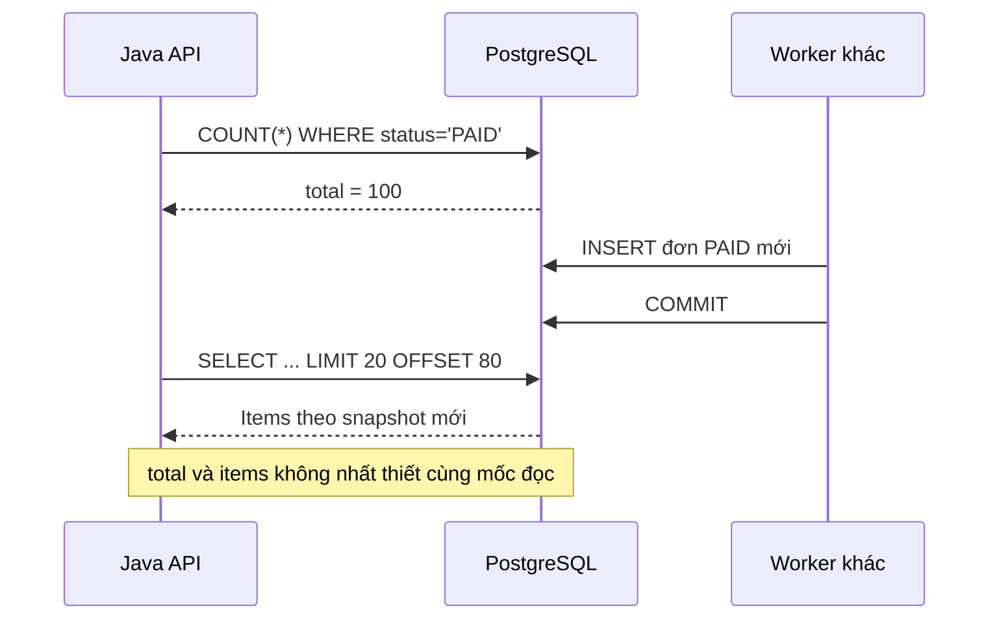
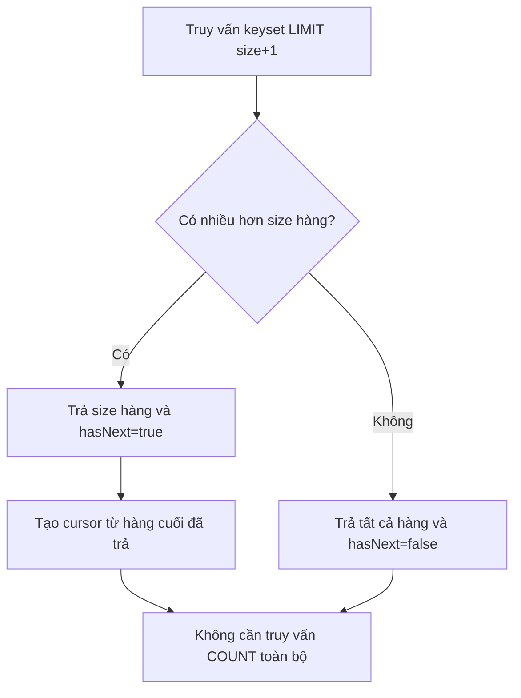
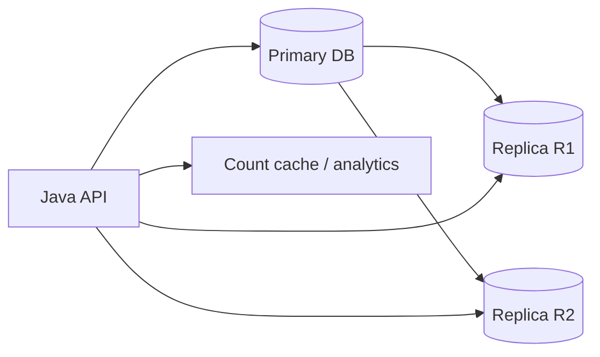

# Đánh đổi giữa đếm tổng số bản ghi và chỉ kiểm tra trang tiếp theo

## 1. Hai câu hỏi khác nhau trong cùng một API phân trang

Khi xây dựng danh sách đơn hàng, khách hàng hoặc lịch sử giao dịch trong ứng dụng Java, chúng ta thường muốn hiển thị một số bản ghi giới hạn trên màn hình. Ngoài danh sách bản ghi, API có thể phải trả thêm thông tin về phân trang.

Có hai câu hỏi rất khác nhau:

1. **Có bao nhiêu bản ghi thỏa bộ lọc?** Ví dụ: “Có 18.426 đơn `PAID`”.
2. **Ngay sau trang hiện tại còn bản ghi để xem không?** Ví dụ: “Có thể nhấn *Xem thêm*”.

Câu hỏi đầu là **đếm tổng số bản ghi** (*total count*). Câu hỏi thứ hai là **kiểm tra trang tiếp theo** (*has next page*). Cả hai đều có thể được hiện thực bằng SQL, nhưng khác nhau về lượng dữ liệu phải xem xét, thông tin cung cấp và mức độ ổn định khi dữ liệu thay đổi.

Ví dụ, một API trả 20 đơn của một khách. Giao diện kiểu bảng có ô **“Trang 3/127”** cần tổng số trang; một giao diện cuộn vô hạn có nút **“Xem thêm”** thường chỉ cần biết sau 20 đơn hiện tại còn đơn thứ 21 hay không.

Câu SQL dùng để đếm tất cả:

```sql
SELECT count(*)
FROM orders
WHERE tenant_id = :tenant_id
  AND status = 'PAID';
```

Còn để biết có trang tiếp theo với kích thước 20, có thể lấy **21 hàng**:

```sql
SELECT id, created_at, status
FROM orders
WHERE tenant_id = :tenant_id
  AND status = 'PAID'
ORDER BY created_at DESC, id DESC
LIMIT 21 OFFSET :offset;
```

Nếu lấy được 21 hàng, API chỉ trả 20 hàng đầu và đặt `hasNext = true`. Nếu lấy được từ 0 đến 20 hàng, `hasNext = false` tại **mốc truy vấn đó**.

Chúng ta chưa cần biết tổng là 21, 200 hay 2 triệu. Nhưng ngược lại, chỉ với `hasNext`, chúng ta **không biết chính xác tổng bản ghi** hoặc trang cuối là số bao nhiêu.

> **Tư duy chính:** Chọn cách truy vấn từ **hợp đồng trải nghiệm và nghiệp vụ**. Không chạy `COUNT(*)` chỉ vì thư viện phân trang có trường `totalElements`, và cũng không thay tổng đếm bằng `hasNext` khi một báo cáo thực sự cần con số chính xác.

Bài học này thuộc chương **Truy vấn và phân trang** trong mô-đun **DATA_PERSISTENCE_FUNDAMENTALS**. Việc chọn chiến lược còn liên quan đến schema, chỉ mục, transaction, isolation, khả năng đọc từ replica, bảo mật dữ liệu theo tenant và tối ưu hiệu năng trong Java.

## 2. Thuật ngữ và hợp đồng đầu ra

| Thuật ngữ | Ý nghĩa | Thông tin có được |
|---|---|---|
| **Page size** | Số phần tử tối đa trả cho client | Giới hạn kích thước trang |
| **Offset** | Số hàng bỏ qua theo kết quả hiện tại | Vị trí bắt đầu trong kết quả truy vấn |
| **Page number** | Chỉ số trang do API quy ước (0-based hoặc 1-based) | Vị trí trang tương đối |
| **Total count** | Số hàng/đối tượng thỏa điều kiện đếm | Quy mô tập kết quả ở mốc đếm |
| **Total pages** | Số trang tính từ total count và page size | Có thể hỗ trợ nhảy đến trang cuối |
| **Has next** | Có ít nhất một phần tử sau các phần tử đang trả ở lần đọc này | Quyết định hiển thị “Xem thêm” |
| **Cursor** | Dấu mốc tiếp tục truy vấn sau một khóa đã đọc | Tiếp tục duyệt mà không cần vị trí offset sâu |
| **Snapshot** | Một trạng thái dữ liệu nhất quán theo cơ chế đọc đã chọn | Có thể bảo đảm tính nhất quán trong phạm vi xác định |

Ví dụ response có tổng số:

```json
{
  "page": 3,
  "size": 20,
  "totalElements": 2529,
  "totalPages": 127,
  "items": []
}
```

Đây là **hình dạng minh họa**; mảng `items` được rút gọn. Với dữ liệu không đổi và `page` bắt đầu từ 1, trang 3 sẽ có tối đa 20 phần tử thực.

Response chỉ có `hasNext`:

```json
{
  "page": 3,
  "size": 20,
  "hasNext": true,
  "items": []
}
```

Cách thứ hai cố ý **không cam kết tổng số**. Các trường `totalElements` hoặc `totalPages` không nên được điền bằng một giá trị đoán nếu API chưa định nghĩa rõ chúng là ước lượng.

### 2.1. Thông tin nào được yêu cầu thật sự?

Hãy hỏi:

- UI có cần hiển thị “Tìm thấy 2.529 kết quả” không?
- Có cần nhảy trực tiếp đến trang số 120 không?
- Đây là bảng quản trị có bộ lọc phức tạp, feed cuộn liên tục hay luồng xuất báo cáo?
- Người dùng có chấp nhận tổng gần đúng hoặc tổng được tính chậm không?
- Có yêu cầu đối soát hoặc quyết định nghiệp vụ dựa trên **một số đếm chính xác tại mốc xác định** không?
- Dữ liệu thay đổi thường xuyên trong khi người dùng đang xem không?

Nếu giao diện chỉ có nút “Xem thêm”, `totalElements` có thể là một thông tin **tốn kém nhưng không được dùng**. Nếu màn hình kiểm toán phải nêu chính xác số giao dịch trong một kỳ đã chốt, chỉ trả `hasNext` là **thiếu yêu cầu nghiệp vụ**.

## 3. Bảng so sánh COUNT và hasNext

| Tiêu chí | Đếm tổng bằng `COUNT(*)` | Chỉ kiểm tra trang tiếp theo |
|---|---|---|
| Câu hỏi trả lời | Có tất cả bao nhiêu hàng thỏa bộ lọc? | Sau trang đang trả còn ít nhất một hàng không? |
| Thông tin API | `totalElements`, `totalPages` và có thể suy `hasNext` theo mốc đếm | `items`, `hasNext`, có thể thêm cursor |
| Công việc database | Phải tính tổng các hàng thỏa điều kiện theo semantics truy vấn | Có thể dừng sau khi tìm đủ `size + 1` hàng **trong đường truy cập phù hợp** |
| Khi số hàng tăng mạnh | Count có thể đắt, dù chỉ trả một số | Thường giới hạn số hàng trả, nhưng deep offset/sort/filter vẫn có thể đắt |
| Khi dữ liệu thay đổi | Total có thể khác giữa các request | `hasNext` cũng có thể khác khi client tải trang kế tiếp |
| Giao diện phù hợp | Danh sách cần tổng, nhảy trang, một số báo cáo | Infinite scroll, “Load more”, bảng không cần tổng |
| Giới hạn chính | Chi phí thêm query/tính count; total có thể lệch với items | Không có tổng hoặc trang cuối; không tự giải quyết drift |
| Cân nhắc bảo mật | Số đếm có thể làm lộ quy mô dữ liệu không được phép xem | Các hàng và thông tin có tiếp hay không vẫn phải theo quyền |

**Kết luận của bảng:** Không phải “COUNT chậm, hasNext nhanh” trong mọi hoàn cảnh. Cần xét **kế hoạch truy vấn, chỉ mục, bộ lọc, phân phối dữ liệu, isolation và khả năng của DBMS**. Nhưng nếu UI không cần tổng số, loại bỏ một phép đếm độc lập thường giúp giảm công việc không cần thiết.

## 4. Cách tính totalElements và totalPages

Một truy vấn count trong PostgreSQL:

```sql
SELECT count(*) AS total_elements
FROM orders
WHERE tenant_id = :tenant_id
  AND status = :status;
```

Khi `pageSize > 0`:

```text
totalPages = ceil(totalElements / pageSize)

Ví dụ:
totalElements = 101, pageSize = 20
totalPages    = 6

totalElements = 100, pageSize = 20
totalPages    = 5

totalElements = 0, pageSize = 20
totalPages    = 0  (theo hợp đồng API được chọn)
```

Một số UI/framework có quy ước khác ở trường hợp **tập rỗng**. Hãy thống nhất API có báo `totalPages = 0`, “trang 1 rỗng” hay một kiểu khác; đừng để frontend tự suy từ hai quy tắc mâu thuẫn.

### 4.1. Tránh làm tròn sai và tràn số

Không nên tính:

```java
int pages = (int) Math.ceil(totalElements / pageSize);
```

Nếu cả hai toán hạng là số nguyên, phép chia được thực hiện **trước** `Math.ceil` và phần lẻ đã bị mất.

Có thể dùng phép tính nguyên với `long`:

```java
static long totalPages(long totalElements, int pageSize) {
    if (totalElements < 0 || pageSize <= 0) {
        throw new IllegalArgumentException("Invalid pagination values");
    }
    if (totalElements == 0) {
        return 0L;
    }
    return 1L + (totalElements - 1L) / pageSize;
}
```

Công thức tránh phép cộng `totalElements + pageSize - 1` có thể tràn khi tổng cực lớn. Vẫn cần giới hạn `pageSize`, số trang và khả năng chuyển sang kiểu dữ liệu của framework.

### 4.2. COUNT là số của tập được chọn, không mặc định là số hàng toàn bảng

```sql
SELECT count(*)
FROM orders
WHERE tenant_id = :tenant_id
  AND status = 'PAID';
```

Kết quả này **khác**:

```sql
SELECT count(*) FROM orders;
```

Nếu API hiển thị đơn theo tenant, chỉ tính count theo tenant và quyền nhìn thấy. Một tổng số toàn bảng, dù không trả chi tiết, vẫn có thể tiết lộ thông tin ngoài phạm vi được phép.

## 5. `COUNT(*)`, `COUNT(column)` và `COUNT(DISTINCT ...)`

Ngay cả trước khi xét hiệu năng, phải xác định **đang đếm cái gì**.

| Biểu thức | Ý nghĩa trong SQL | Rủi ro hiểu sai |
|---|---|---|
| `COUNT(*)` | Đếm số hàng kết quả thỏa điều kiện | Không phải tổng số đối tượng cha nếu JOIN làm nhân hàng |
| `COUNT(column)` | Đếm số giá trị `column` không `NULL` | Có thể nhỏ hơn `COUNT(*)` |
| `COUNT(DISTINCT column)` | Đếm số giá trị khác nhau, không NULL | Có thể tốn chi phí distinct/hash/sort |
| `COUNT(DISTINCT parent.id)` sau JOIN | Đếm số cha khác nhau có trong tập join | Phải khớp semantics filter và đơn vị phân trang |
| `EXISTS (...)` | Chỉ xác nhận có ít nhất một hàng thỏa điều kiện | Không cho biết tổng count |

Ví dụ:

```sql
SELECT count(*), count(discount_code)
FROM orders
WHERE tenant_id = :tenant_id;
```

Nếu 100 đơn có 20 đơn không có `discount_code`, biểu thức thứ nhất đếm **100**, biểu thức thứ hai chỉ đếm **80**.

### 5.1. JOIN một–nhiều có thể đếm nhầm

Giả sử `orders` có một đơn A với ba dòng hàng và một đơn B với hai dòng:

```sql
SELECT count(*)
FROM orders o
JOIN order_lines l ON l.order_id = o.id
WHERE o.tenant_id = :tenant_id;
```

Kết quả đếm **5 hàng JOIN**, không phải 2 đơn. Nếu giao diện phân trang theo **đơn hàng**, total mong muốn thường là **2**.

Có thể đếm đơn khác nhau:

```sql
SELECT count(DISTINCT o.id)
FROM orders o
JOIN order_lines l ON l.order_id = o.id
WHERE o.tenant_id = :tenant_id;
```

Nhưng nếu join chỉ nhằm lọc các đơn có SKU nhất định, một truy vấn dùng `EXISTS` có thể trực tiếp thể hiện đơn vị cần đếm:

```sql
SELECT count(*)
FROM orders o
WHERE o.tenant_id = :tenant_id
  AND EXISTS (
      SELECT 1
      FROM order_lines l
      WHERE l.order_id = o.id
        AND l.sku = :sku
  );
```

Cách này tránh tạo nhiều hàng cho cùng một đơn ở tập đếm logic. Hiệu năng cuối cùng vẫn phải xem optimizer, dữ liệu, index và `EXPLAIN`.

### 5.2. LEFT JOIN và hàng con vắng mặt

```sql
SELECT count(*)
FROM orders o
LEFT JOIN order_lines l ON l.order_id = o.id
WHERE o.tenant_id = :tenant_id;
```

Một đơn không có dòng hàng vẫn đóng góp **một hàng sau LEFT JOIN** với các cột bên phải là NULL. Nếu một đơn có năm dòng, nó có thể đóng góp năm hàng. Vì vậy, tổng này **không phải count đơn**, và cũng **không phải count dòng hàng thực**. Cần chọn đúng biểu thức hoặc viết lại query.

## 6. Truy vấn hasNext bằng `LIMIT size + 1`

Giả sử trang có kích thước `size = 20`. Thay vì chạy hai câu `SELECT items` và `SELECT count(*)`, repository có thể chạy một câu:

```sql
SELECT id, status, created_at, total_minor
FROM orders
WHERE tenant_id = :tenant_id
  AND status = 'PAID'
ORDER BY created_at DESC, id DESC
LIMIT 21 OFFSET :offset;
```

Xử lý:

1. Đọc tối đa **21** hàng.
2. Nếu có **21**, trả **20** hàng đầu và đặt `hasNext = true`.
3. Nếu có **0–20**, trả tất cả và đặt `hasNext = false`.
4. Không trả hàng thứ 21 trong trang hiện tại; nó là **bằng chứng có hàng phía sau** và có thể thuộc trang tiếp theo.

```text
pageSize = 3

Trường hợp A: query trả [A, B, C, D]
API trả        [A, B, C]
hasNext        true
D vẫn dành cho trang sau.

Trường hợp B: query trả [A, B]
API trả        [A, B]
hasNext        false

Trường hợp C: query trả []
API trả        []
hasNext        false
```

**Đừng đặt `hasNext = (items.size() == pageSize)`.** Một trang có đúng 20 phần tử có thể là trang cuối; muốn biết có hàng thứ 21 hay không, phải kiểm tra thêm hoặc dùng tín hiệu có căn cứ khác.

### 6.1. HasNext không phải phép tiên đoán tương lai

Giả sử query hiện tại thấy 21 hàng, đặt `hasNext=true`. Trước khi người dùng bấm tiếp, một số hàng bị xóa hoặc rời filter; request tiếp theo có thể trả trang rỗng.

Ngược lại, khi `hasNext=false`, một writer mới có thể thêm hàng sau mốc đọc hoặc thay đổi thứ tự. Vì vậy nên mô tả:

> `hasNext` cho biết **ở lần đọc này** có ít nhất một hàng tiếp tục sau trang, không phải lời hứa rằng trang sau sẽ giữ nguyên cho đến khi client gọi.

### 6.2. `LIMIT size + 1` cũng có chi phí

Không nên cho rằng database chỉ đọc đúng `size + 1` row vật lý rồi dừng:

- Bộ lọc có thể loại bỏ rất nhiều hàng trước khi tìm đủ 21 kết quả.
- `ORDER BY` có thể cần sort một tập lớn nếu thiếu index phù hợp.
- `OFFSET` sâu vẫn cần bỏ qua nhiều hàng trước khi trả trang.
- JOIN/aggregation có thể cần xử lý nhiều dữ liệu để tạo các phần tử của trang.
- Query chạy trên replica, search index hoặc storage chậm còn có đặc điểm riêng.

Điểm tiết kiệm chủ yếu là **không thực hiện truy vấn count toàn bộ tập** khi UI không dùng tổng. Chi phí của chính truy vấn trang vẫn phải tối ưu.

## 7. Muốn hasNext đúng, phải phân trang đúng đơn vị và thứ tự

`LIMIT 21` trên một truy vấn JOIN không mặc nhiên có nghĩa 21 **đơn hàng**.

Ví dụ một đơn có mười dòng, truy vấn:

```sql
SELECT o.id, l.sku
FROM orders o
JOIN order_lines l ON l.order_id = o.id
WHERE o.tenant_id = :tenant_id
ORDER BY o.created_at DESC, o.id DESC
LIMIT 21;
```

giới hạn 21 **hàng JOIN**. `hasNext=true` theo hàng JOIN có thể xuất hiện dù số đơn hiển thị ít hơn 20; một đơn còn có thể bị cắt giữa hai trang.

Nếu đơn vị phân trang là đơn, trước tiên hãy chọn **ID đơn**:

```sql
WITH page_ids AS (
    SELECT o.id, o.created_at
    FROM orders o
    WHERE o.tenant_id = :tenant_id
      AND o.status = 'PAID'
    ORDER BY o.created_at DESC, o.id DESC
    LIMIT :size_plus_one
)
SELECT p.id, p.created_at, l.sku, l.quantity
FROM page_ids p
LEFT JOIN order_lines l ON l.order_id = p.id
ORDER BY p.created_at DESC, p.id DESC, l.line_no;
```

Để tính `hasNext` chính xác, repository phải xác định **số ID đơn trong `page_ids`**, không đếm số hàng sau JOIN. Có thể chọn ID ở truy vấn thứ nhất rồi tải chi tiết của các ID được hiển thị ở truy vấn tiếp theo.

### 7.1. Thứ tự toàn phần

Khi hai đơn có cùng `created_at`, chỉ `ORDER BY created_at DESC` chưa bảo đảm thứ tự giữa chúng. Thêm khóa duy nhất như:

```sql
ORDER BY created_at DESC, id DESC
```

giúp thứ tự xác định tại một mốc đọc.

**Thứ tự xác định không đóng băng tập dữ liệu giữa hai request.** `INSERT`, `DELETE` và cập nhật field sort/filter vẫn có thể khiến vị trí offset thay đổi.

### 7.2. HasNext và filter phải sử dụng cùng truy vấn logic

Nếu query lấy items lọc `status = 'PAID'` nhưng query count không lọc trạng thái, total và hasNext theo total sẽ sai. Với `LIMIT size+1`, điều kiện filter ở cùng câu query nên thường giảm loại lỗi này.

Cần đảm bảo mọi trang tiếp theo giữ **tenant, filter, sort** theo hợp đồng. Khi người dùng đổi filter, nên trở về trang đầu hoặc tạo cursor mới.

## 8. Chi phí của COUNT trong PostgreSQL

`SELECT count(*) FROM orders` trông đơn giản nhưng không phải lúc nào cũng là một thao tác O(1) lấy số từ metadata.

PostgreSQL sử dụng MVCC. Mỗi transaction có thể nhìn thấy **một tập phiên bản hàng khác nhau**, nên số hàng hiện diện theo snapshot của nó có thể khác snapshot của transaction khác. Một con số duy nhất trong metadata không đủ để trả **exact count** cho mọi snapshot, đặc biệt khi có nhiều transaction đang ghi.

Để tính đúng số hàng nhìn thấy, database phải thực hiện công việc tương ứng với tập dữ liệu theo kế hoạch thực thi. Nó có thể chọn:

- Sequential scan trên bảng.
- Index scan, bitmap scan hoặc các kế hoạch truy vấn khác.
- Index-only scan nếu điều kiện index và thông tin visibility phù hợp.
- Truy vấn phức tạp hơn khi count đi cùng JOIN, filter, `DISTINCT` hoặc aggregation.

**Index-only scan không đồng nghĩa luôn không phải kiểm tra heap.** Với PostgreSQL, visibility map, vacuum và tính mới của dữ liệu có thể ảnh hưởng khả năng tránh heap fetch.

### 8.1. Đếm toàn bảng và đếm có điều kiện

```sql
SELECT count(*) FROM orders;
```

Có thể yêu cầu xem xét một lượng dữ liệu rất lớn. Nhưng với filter chọn lọc:

```sql
SELECT count(*)
FROM orders
WHERE tenant_id = :tenant_id
  AND status = 'PAID';
```

một index phù hợp có thể thu hẹp lượng dữ liệu phải xem xét. Không nên kết luận tất cả câu `COUNT(*)` đều chậm hoặc đều nhanh; phải dựa vào dữ liệu và query plan.

### 8.2. Index phục vụ cả list và count?

Một index phục vụ query danh sách:

```sql
CREATE INDEX ix_orders_tenant_status_created_id
ON orders (tenant_id, status, created_at DESC, id DESC);
```

có thể hữu ích cho:

```sql
SELECT id, status, created_at
FROM orders
WHERE tenant_id = :tenant_id
  AND status = 'PAID'
ORDER BY created_at DESC, id DESC
LIMIT 21;
```

và có thể hỗ trợ filter của count:

```sql
SELECT count(*)
FROM orders
WHERE tenant_id = :tenant_id
  AND status = 'PAID';
```

Nhưng mục tiêu của hai query khác nhau. Query trang thường muốn **đọc nhanh một phần đầu đã sắp**; query count phải **xét toàn bộ tập thỏa điều kiện**. Một index tốt cho query trang không biến count thành phép lấy metadata có thời gian hằng số.

### 8.3. Dùng EXPLAIN đúng cách

```sql
EXPLAIN (ANALYZE, BUFFERS)
SELECT count(*)
FROM orders
WHERE tenant_id = '00000000-0000-0000-0000-000000000001'::uuid
  AND status = 'PAID';
```

Đồng thời đo:

```sql
EXPLAIN (ANALYZE, BUFFERS)
SELECT id, created_at, status
FROM orders
WHERE tenant_id = '00000000-0000-0000-0000-000000000001'::uuid
  AND status = 'PAID'
ORDER BY created_at DESC, id DESC
LIMIT 21;
```

`EXPLAIN ANALYZE` **thực sự chạy truy vấn**. Dùng môi trường và thời điểm phù hợp, tránh phát sinh tải không cần thiết trên production.

Quan sát:

- Execution time và mức biến động qua các lần chạy.
- Tổng số row được đọc/loại qua filter.
- Buffer hits, reads và các heap fetch nếu có.
- Có sort hoặc scan sâu không?
- Query count hay query list chiếm CPU/IO đáng kể?
- P95/P99 của endpoint khi nhiều request chạy cùng lúc.

**Chọn chiến lược bằng workload thật**, không chỉ vì `COUNT(*)` nhìn ngắn hơn `SELECT`.

## 9. Deep offset: hasNext không tự cứu truy vấn trang sâu

Giả sử `size=20`, user nhảy đến trang 10.001 theo quy ước 1-based:

```text
offset = (10001 - 1) * 20 = 200000
```

Dù query chỉ lấy 21 hàng, cơ sở dữ liệu thường vẫn phải xử lý vị trí tương ứng trước khi bỏ qua 200.000 hàng theo thứ tự đã chọn.

```sql
SELECT id, created_at
FROM orders
WHERE tenant_id = :tenant_id
ORDER BY created_at DESC, id DESC
LIMIT 21 OFFSET 200000;
```

Việc bỏ count giúp tránh thêm một query tổng, nhưng **không xóa chi phí deep offset**. Nếu người dùng thường duyệt tuần tự, keyset/cursor pagination có thể phù hợp hơn.

### 9.1. Bảng minh họa chi phí vị trí

| Trang, size 20 | Offset | Số hàng đứng trước trang |
|---:|---:|---:|
| 1 | 0 | 0 |
| 10 | 180 | 180 |
| 100 | 1.980 | 1.980 |
| 1.000 | 19.980 | 19.980 |
| 10.001 | 200.000 | 200.000 |

Bảng chỉ minh họa số hàng cần bỏ qua theo logic, không dự báo chính xác IO hoặc thời gian: điều này phụ thuộc engine, plan, index, filter và mức độ cạnh tranh.

### 9.2. Khi nào chấp nhận offset?

Offset có giá trị vì:

- Hỗ trợ nhảy tới một số trang cụ thể.
- Dễ diễn đạt trong URL và giao diện bảng.
- Phù hợp danh sách có giới hạn và ít thay đổi.
- Có thể hiệu quả khi page nhỏ, offset nông và index phù hợp.

Cần giới hạn `size` và có thể giới hạn offset hoặc số trang tối đa. Một API chỉ trả `hasNext` vẫn không nên cho phép offset hàng triệu mà không có chính sách tài nguyên.

## 10. Java/JDBC: một repository trả Slice không cần COUNT

Ví dụ PostgreSQL có bảng:

```sql
CREATE TABLE orders (
    id UUID PRIMARY KEY,
    tenant_id UUID NOT NULL,
    status TEXT NOT NULL,
    created_at TIMESTAMPTZ NOT NULL DEFAULT now(),
    total_minor BIGINT NOT NULL CHECK (total_minor >= 0)
);

CREATE INDEX ix_orders_tenant_status_created_id
ON orders (tenant_id, status, created_at DESC, id DESC);
```

Để trả danh sách đơn `PAID`, ta dùng `LIMIT size + 1` và một response chỉ có `hasNext`.

### 10.1. Định nghĩa dữ liệu kết quả

```java
import java.time.Instant;
import java.util.List;
import java.util.UUID;

record OrderSummary(
    UUID id,
    String status,
    Instant createdAt,
    long totalMinor
) {}

record OffsetSlice<T>(
    int pageNumber,
    int pageSize,
    List<T> items,
    boolean hasNext
) {}
```

Ví dụ quy ước `pageNumber` bắt đầu từ **1** ở API. `OffsetSlice` không có `totalElements` vì API này **không tính tổng**.

### 10.2. Thực hiện truy vấn

```java
import javax.sql.DataSource;
import java.sql.*;
import java.time.OffsetDateTime;
import java.util.ArrayList;
import java.util.List;
import java.util.UUID;

public final class OrderSliceRepository {
    private final DataSource dataSource;

    public OrderSliceRepository(DataSource dataSource) {
        this.dataSource = dataSource;
    }

    public OffsetSlice<OrderSummary> findPaidOrders(
            UUID trustedTenantId, int pageNumber, int pageSize)
            throws SQLException {

        if (trustedTenantId == null) {
            throw new IllegalArgumentException("Tenant is required");
        }
        if (pageNumber < 1 || pageSize < 1 || pageSize > 100) {
            throw new IllegalArgumentException("Invalid page values");
        }

        long offset = Math.multiplyExact(
            (long) pageNumber - 1L, (long) pageSize);

        // Chính sách tài nguyên minh họa; điều chỉnh theo workload thực.
        if (offset > 10_000L) {
            throw new IllegalArgumentException(
                "Deep offset is not supported; use a cursor");
        }

        int fetchLimit = Math.addExact(pageSize, 1);

        String sql = """
            SELECT id, status, created_at, total_minor
            FROM orders
            WHERE tenant_id = ? AND status = 'PAID'
            ORDER BY created_at DESC, id DESC
            LIMIT ? OFFSET ?
            """;

        List<OrderSummary> fetched = new ArrayList<>();

        try (Connection c = dataSource.getConnection();
             PreparedStatement ps = c.prepareStatement(sql)) {

            ps.setObject(1, trustedTenantId);
            ps.setInt(2, fetchLimit);
            ps.setLong(3, offset);

            try (ResultSet rs = ps.executeQuery()) {
                while (rs.next()) {
                    fetched.add(new OrderSummary(
                        (UUID) rs.getObject("id"),
                        rs.getString("status"),
                        rs.getObject(
                            "created_at", OffsetDateTime.class).toInstant(),
                        rs.getLong("total_minor")
                    ));
                }
            }
        }

        boolean hasNext = fetched.size() > pageSize;
        if (hasNext) {
            fetched.remove(fetched.size() - 1);
        }

        return new OffsetSlice<>(
            pageNumber, pageSize, List.copyOf(fetched), hasNext);
    }
}
```

Ở ví dụ này:

- Repository chỉ gọi **một query lấy dữ liệu**; không chạy `COUNT(*)`.
- `trustedTenantId` phải đến từ xác thực/authorization, không tin input tenant tự khai của client.
- SQL sử dụng parameter binding và sort với khóa duy nhất.
- `pageSize` được giới hạn để tránh tải quá nhiều.
- `long offset` và `Math.multiplyExact` tránh kiểu phép nhân `int` thiếu kiểm soát.
- Một ngưỡng offset minh họa giúp không có request phân trang quá sâu.
- Nếu lấy `pageSize + 1` hàng, phần tử cuối chỉ là tín hiệu `hasNext` và **không được trả trong `items`**.

**Giới hạn:** `hasNext` mô tả dữ liệu ở thời điểm truy vấn, không đảm bảo trang sau còn như cũ. Thao tác đọc có thể chịu ảnh hưởng replica lag, quyền theo tenant, chính sách soft delete và isolation theo cấu hình.

### 10.3. Trường hợp trả ít hơn pageSize

Nếu truy vấn trả 12 hàng khi `pageSize = 20`, `hasNext=false`. Nhưng nếu dữ liệu thay đổi liên tục, không thể từ đó kết luận “đây là 12 hàng cuối của một snapshot tồn tại suốt phiên người dùng”. API phải đặt kỳ vọng rõ.

## 11. Java/JDBC: khi thực sự phải trả totalCount

Một dạng response khác:

```java
record CountedPage<T>(
    int pageNumber,
    int pageSize,
    long totalElements,
    long totalPages,
    List<T> items
) {}
```

Một repository có thể chạy:

```sql
SELECT count(*)
FROM orders
WHERE tenant_id = :tenant_id
  AND status = 'PAID';
```

và:

```sql
SELECT id, status, created_at, total_minor
FROM orders
WHERE tenant_id = :tenant_id
  AND status = 'PAID'
ORDER BY created_at DESC, id DESC
LIMIT :size OFFSET :offset;
```

Điều kiện filter/tenant phải giống nhau về **tập dữ liệu nghiệp vụ**, dù query list chọn ít cột hơn. Nếu có các quy tắc hiển thị hoặc soft delete, cả count và list phải áp đúng.

### 11.1. Mẫu JDBC count

```java
long countPaidOrders(
        Connection connection, UUID trustedTenantId)
        throws SQLException {

    String sql = """
        SELECT count(*)
        FROM orders
        WHERE tenant_id = ?
          AND status = 'PAID'
        """;

    try (PreparedStatement ps = connection.prepareStatement(sql)) {
        ps.setObject(1, trustedTenantId);

        try (ResultSet rs = ps.executeQuery()) {
            if (!rs.next()) {
                throw new SQLException("COUNT returned no row");
            }
            return rs.getLong(1);
        }
    }
}
```

Đây là một hàm minh họa dùng connection do caller quản lý. Phần lấy danh sách có thể dùng cùng connection, nhưng **cùng connection không tự đồng nghĩa cùng snapshot** khi isolation là `READ COMMITTED`.

### 11.2. Có cần một transaction cho count và list?

Nếu API cam kết **total và items phản ánh cùng một snapshot**, trên PostgreSQL có thể đặt hai câu `SELECT` trong **một transaction `REPEATABLE READ`**.

```java
try (Connection c = dataSource.getConnection()) {
    c.setTransactionIsolation(
        Connection.TRANSACTION_REPEATABLE_READ);
    c.setReadOnly(true);
    c.setAutoCommit(false);

    try {
        long total = countPaidOrders(c, trustedTenantId);
        List<OrderSummary> items =
            loadPaidPage(c, trustedTenantId, pageSize, offset);

        c.commit();
        // Dùng total và items để dựng CountedPage.
    } catch (SQLException | RuntimeException error) {
        try {
            c.rollback();
        } catch (SQLException rollbackError) {
            error.addSuppressed(rollbackError);
        }
        throw error;
    }
}
```

Đây là phác thảo: `loadPaidPage` phải được triển khai và dùng **đúng connection**; các câu lệnh thiết lập isolation/read-only được gọi trước khi transaction thực thi truy vấn. Phải kiểm tra cấu hình pool/driver và cách reset connection khi trả về pool.

Ở PostgreSQL `REPEATABLE READ`, nhiều câu đọc trong **cùng transaction** dùng snapshot nhất quán theo ngữ nghĩa của DBMS. Điều này giúp total và items trong **một HTTP response** có cùng mốc đọc. Nó **không** giữ cùng snapshot cho trang 2 trong một HTTP request sau nếu request đó chạy transaction mới.

**Không dùng transaction đọc dài nhiều phút chỉ để giữ tổng số trang luôn cố định trong UI.** Transaction dài làm tăng sử dụng connection và giữ snapshot MVCC, có thể ảnh hưởng vacuum/retention phiên bản hàng cũ.

### 11.3. `READ COMMITTED` có thể khiến total và items không khớp

Trên PostgreSQL, `READ COMMITTED` thường cho **mỗi statement SELECT một snapshot của dữ liệu đã commit** tại lúc bắt đầu statement.



Không có gì buộc câu count và câu lấy danh sách nhìn thấy cùng trạng thái nếu có commit ở giữa. Dữ liệu ở mỗi statement vẫn có thể nhất quán theo isolation của nó.

**Tính nhất quán của một response** và **tính nhất quán xuyên nhiều trang qua nhiều request** là hai yêu cầu khác nhau. Tránh dùng một cam kết để ngầm suy ra cam kết còn lại.

## 12. Spring Data: phân biệt `Page<T>` và `Slice<T>`

Trong Spring Data, hai kiểu này phản ánh hai nhu cầu API khác nhau:

| Kiểu kết quả | Thông tin trả về | Hành vi truy vấn thường gặp |
|---|---|---|
| `Page<T>` | Items, total elements, total pages, page metadata | Có thể cần query count; framework đôi khi tối ưu bỏ count khi suy ra được |
| `Slice<T>` | Items, page metadata, `hasNext` | Thường lấy thêm một phần tử để biết có trang sau; không cần total |
| `Window<T>` với scrolling | Items và vị trí tiếp tục theo cơ chế scrolling tương ứng | Có thể dùng offset hoặc keyset tùy API và kiểu scroll |
| DTO cursor tùy chỉnh | Items, next cursor, hasNext | Cần query keyset, token và validation do ứng dụng thiết kế |

Không nên khẳng định **mọi** lời gọi `Page<T>` đều chắc chắn chạy đúng hai SQL. Spring Data có thể áp dụng tối ưu hoặc có cách count riêng tùy repository/query/version. Điều quan trọng là **`Page` có hợp đồng chứa tổng**, nên framework phải có cách lấy/suy ra tổng khi cần.

### 12.1. Repository trả `Page`

```java
import java.util.UUID;
import org.springframework.data.domain.Page;
import org.springframework.data.domain.Pageable;
import org.springframework.data.jpa.repository.JpaRepository;

interface OrderRepository extends JpaRepository<OrderEntity, UUID> {
    Page<OrderEntity> findByTenantIdAndStatus(
        UUID tenantId, OrderStatus status, Pageable pageable);
}
```

Service:

```java
Pageable pageable = PageRequest.of(
    zeroBasedPage,
    requestedSize,
    Sort.by(
        Sort.Order.desc("createdAt"),
        Sort.Order.desc("id"))
);

Page<OrderEntity> page = repository.findByTenantIdAndStatus(
    trustedTenantId, OrderStatus.PAID, pageable);

long totalElements = page.getTotalElements();
int totalPages = page.getTotalPages();
boolean hasNext = page.hasNext();
```

Nếu user thật sự cần total, đây là hợp đồng tiện lợi. Nhưng với truy vấn count đắt, cần đánh giá chi phí trước khi chọn `Page` làm mặc định cho mọi API.

### 12.2. Repository trả `Slice`

```java
import java.util.UUID;
import org.springframework.data.domain.Slice;
import org.springframework.data.domain.Pageable;
import org.springframework.data.jpa.repository.JpaRepository;

interface OrderSliceRepository
        extends JpaRepository<OrderEntity, UUID> {

    Slice<OrderEntity> findByTenantIdAndStatus(
        UUID tenantId, OrderStatus status, Pageable pageable);
}
```

Sử dụng:

```java
Slice<OrderEntity> slice = repository.findByTenantIdAndStatus(
    trustedTenantId, OrderStatus.PAID, pageable);

List<OrderEntity> items = slice.getContent();
boolean hasNext = slice.hasNext();
```

`Slice` là lựa chọn tự nhiên khi chỉ cần `hasNext` và page metadata mà không cần count tổng.

**Không nhầm `Slice` với keyset.** Nếu truyền một `PageRequest` dựa trên offset, query lấy `Slice` vẫn có thể dùng `OFFSET` và chịu chi phí/độ lệch của phân trang theo vị trí.

### 12.3. Query tùy biến có JOIN

Nếu một Spring Data repository dùng `@Query` với JOIN hoặc filter phức tạp, count query được suy ra tự động có thể:

- Tốn nhiều công việc hơn dự kiến.
- Đếm nhầm đơn vị khi JOIN nhân hàng nếu không được xây dựng đúng.
- Phát sinh lỗi cú pháp với những query phức tạp hoặc không được framework suy ra đúng.

Khi đó, định nghĩa `countQuery` phù hợp và đo query plan của nó. Ví dụ với JPQL, danh sách `OrderEntity` có dòng hàng chứa một SKU:

```java
@Query(
    value = """
        select o
        from OrderEntity o
        where o.tenantId = :tenantId
          and exists (
              select 1
              from OrderLineEntity l
              where l.order = o and l.sku = :sku
          )
        """,
    countQuery = """
        select count(o)
        from OrderEntity o
        where o.tenantId = :tenantId
          and exists (
              select 1
              from OrderLineEntity l
              where l.order = o and l.sku = :sku
          )
        """
)
Page<OrderEntity> findBySkuAndTenant(
    @Param("tenantId") UUID tenantId,
    @Param("sku") String sku,
    Pageable pageable
);
```

Đây là ví dụ rút gọn giả định mapping entity đã tồn tại. Cần áp dụng sort/tenant từ input đã được kiểm tra và xem xét index tương ứng. Query count phải diễn tả **cùng tập đơn** như query lấy items, không chỉ cùng bảng xuất phát.

### 12.4. JPA fetch join và pagination

Nếu fetch join collection một–nhiều rồi phân trang, các hàng join có thể làm sai số **đối tượng cha** trong một trang hoặc khiến ORM phân trang trong bộ nhớ tùy cách triển khai.

Cách phổ biến:

1. Phân trang **ID cha** bằng filter/sort.
2. Tải chi tiết/collection cho những ID cần hiển thị.
3. Ghép lại theo thứ tự trang đã chọn.
4. Nếu cần count, đếm theo **số cha**, không theo số hàng JOIN.
5. Nếu cần cùng snapshot giữa hai query, xác định isolation/transaction phù hợp.

`Page` hay `Slice` không tự sửa thiết kế truy vấn nhân hàng.

## 13. `COUNT(*) OVER()`: một SQL có thể lấy cả total và items?

PostgreSQL hỗ trợ window functions. Có thể viết:

```sql
SELECT id,
       status,
       created_at,
       count(*) OVER () AS total_elements
FROM orders
WHERE tenant_id = :tenant_id
  AND status = 'PAID'
ORDER BY created_at DESC, id DESC
LIMIT :size OFFSET :offset;
```

Như vậy mỗi hàng trả về kèm tổng số hàng sau filter. Vì nằm trong cùng một statement, total và items được tính theo mốc snapshot của statement trong PostgreSQL.

**Nhưng có những đánh đổi:**

- Window count có thể phải xử lý toàn bộ tập hàng thỏa điều kiện trước khi trả tổng, làm mất lợi thế “chỉ đọc một số ít hàng đầu”.
- Có thể lặp cùng một `total_elements` trên mỗi hàng của trang.
- Nếu `OFFSET` vượt cuối danh sách và query trả **0 hàng**, không có hàng nào để mang giá trị total.
- Query phức tạp với JOIN/aggregation còn cần xác định đơn vị đếm đúng.
- Một statement không đồng nghĩa rẻ hơn hai statement; phải xem kế hoạch và latency thực.

Vì vậy, không thay mọi cặp `count + list` bằng `count(*) OVER()` mà không đo tải. Phương án này có thể hữu ích khi muốn cùng snapshot và chấp nhận/đã đo được chi phí, nhưng **không phải công thức tối ưu mặc định**.

## 14. Đếm chính xác, gần đúng và đếm được lưu sẵn

Ngoài hai lựa chọn chính, đôi khi còn có nhu cầu **con số gần đúng** hoặc **total được tính ở nơi khác**.

### 14.1. Total gần đúng từ thống kê

Một số nguồn có thể đưa ra ước lượng:

- Thống kê hàng của database.
- Kết quả estimate từ query planner.
- Số đếm cache theo kỳ.
- Hệ search có chế độ đếm hoặc ngưỡng đếm riêng.

Ví dụ trên PostgreSQL, `pg_class.reltuples` là một ước lượng số hàng của bảng dựa trên thống kê, **không phải exact count tại snapshot hiện tại**, và đặc biệt không thể trực tiếp đại diện cho một bộ lọc tenant/trạng thái tùy ý.

Không đổi tên trường `estimatedTotal` thành `totalElements` nếu UI/nghiệp vụ sẽ hiểu đó là số chính xác.

### 14.2. Counter được duy trì sẵn

Một hệ thống nhiều truy vấn count có thể tạo bảng tổng hợp:

```sql
CREATE TABLE order_status_counts (
    tenant_id UUID NOT NULL,
    status TEXT NOT NULL,
    total BIGINT NOT NULL CHECK (total >= 0),
    PRIMARY KEY (tenant_id, status)
);
```

Khi tạo đơn `PAID` hoặc chuyển trạng thái, hệ thống có thể cập nhật counter.

Nhưng phải quyết định:

- Counter được cập nhật **trong cùng DB transaction** với thay đổi nguồn hay bất đồng bộ?
- Nếu một thao tác `PAID → CANCELLED`, đã giảm một nhóm và tăng nhóm khác đúng một lần chưa?
- Khi một event bị gửi lặp hoặc đến lệch thứ tự, counter có bị cộng nhiều lần không?
- Có đường backfill/đối soát từ nguồn và phát hiện lệch số không?
- Một counter trên một hàng tenant lớn có tạo **hot row/lock contention** không?
- Nếu cache counter, có chấp nhận độ trễ và TTL không?

**Counter duy trì sẵn không miễn phí.** Nó chuyển chi phí từ thời điểm đọc sang thời điểm ghi và vận hành nhất quán. Nếu count là điều kiện quyết định tiền/quyền, cần thiết kế transaction và invariant tương ứng thay vì tin một metric cache gần đúng.

### 14.3. Đếm theo lịch hoặc on-demand

Có thể trả items/hasNext ngay, rồi tính tổng ở một request riêng hoặc job bất đồng bộ:

```json
{
  "items": [],
  "hasNext": true,
  "total": {
    "kind": "PENDING"
  }
}
```

Sau khi job hoàn thành:

```json
{
  "total": {
    "kind": "ESTIMATE",
    "value": 18000,
    "asOf": "2026-04-10T09:00:00Z"
  }
}
```

API trên là ví dụ ý tưởng; phải định nghĩa rõ `PENDING`, `ESTIMATE`, `EXACT`, mốc `asOf`, quyền và TTL. Không được giả vờ một total tính hôm qua là total của danh sách đang thay đổi hôm nay.

## 15. Vấn đề dữ liệu thay đổi giữa các trang

Dù chọn count hay hasNext, **OFFSET qua nhiều HTTP request** vẫn có thể trùng hoặc bỏ sót bản ghi khi tập dữ liệu thay đổi.

Giả sử page size bằng 3:

```text
Thời điểm T1:
[A, B, C, D, E, F]
Trang 1 -> [A, B, C]
hasNext -> true

Thời điểm T2: INSERT X ở đầu
[X, A, B, C, D, E, F]

Trang 2 (OFFSET 3):
[C, D, E]
```

C xuất hiện hai lần. Việc tính `COUNT(*)` hoặc bỏ count **không làm thay đổi lỗi này**.

Khi xóa A giữa hai lần gọi:

```text
T1: [A, B, C, D, E, F]
Trang 1 -> [A, B, C]

T2: [B, C, D, E, F]
Trang 2 (OFFSET 3) -> [E, F]

D bị bỏ sót.
```

### 15.1. Total và hasNext đều chỉ phản ánh mốc đọc

Trong một ứng dụng dữ liệu sống:

- `totalElements = 100` có thể đúng tại T1 và thành 99 tại T2.
- `hasNext = true` có thể đúng tại T1 nhưng trang kế tiếp rỗng tại T2.
- `hasNext = false` có thể đúng tại T1 nhưng có dữ liệu mới ngay sau đó.
- Cả hai đều có thể nhìn thấy tập dữ liệu khác nhau nếu query chạy trên replica khác nhau.

Vì vậy hợp đồng phải nêu rõ **có cần một snapshot hay không**. Thay đổi chiến lược count không tự nâng mức isolation.

## 16. Keyset pagination kết hợp hasNext

Với feed hoặc lịch sử đơn hàng, nhu cầu thường là “đọc tiếp sau bản ghi cuối đã thấy”, không phải “nhảy đến trang số 500”. Keyset pagination có thể dùng **cặp khóa sắp xếp** thay cho offset.

Trang đầu:

```sql
SELECT id, status, created_at
FROM orders
WHERE tenant_id = :tenant_id
  AND status = 'PAID'
ORDER BY created_at DESC, id DESC
LIMIT :size_plus_one;
```

Giả sử hàng cuối được trả cho client là `(created_at=T, id=I)`. Trang tiếp theo:

```sql
SELECT id, status, created_at
FROM orders
WHERE tenant_id = :tenant_id
  AND status = 'PAID'
  AND (created_at, id) < (:last_created_at, :last_id)
ORDER BY created_at DESC, id DESC
LIMIT :size_plus_one;
```

Với PostgreSQL, hai trường sort cùng **giảm dần**, không NULL và cặp khóa duy nhất, điều kiện tuple trên diễn tả các hàng đứng **sau** khóa cuối đã thấy.

Quy trình:

1. Đọc `size + 1` hàng.
2. Chỉ trả `size` hàng.
3. `hasNext = true` nếu có hàng dư.
4. Tạo `nextCursor` từ **hàng cuối cùng đã trả**, không phải hàng dư.
5. Khi client gửi cursor, validate token, tenant, filter và sort trước khi thực hiện query tiếp.



### 16.1. Lợi ích

- Không cần chạy `COUNT(*)` cho nút “Xem thêm”.
- Không phải bỏ qua N hàng theo `OFFSET` sâu.
- Khi có bản ghi mới nằm **trước** cursor, trang tiếp theo vẫn bắt đầu sau khóa đã thấy.
- Hợp với feed, timeline và danh sách sắp theo khóa ổn định.

### 16.2. Những giới hạn phải nói rõ

Keyset **không** tạo snapshot bất biến:

- Nếu một hàng thay đổi trường sort và di chuyển qua cursor, nó có thể bị bỏ sót hoặc lặp.
- Nếu một hàng rời bộ lọc, nó biến mất khỏi tập đang duyệt.
- Dữ liệu ghi muộn nhưng có khóa sort nằm **sau cursor** vẫn có thể xuất hiện.
- Nếu các trường có NULL, sort khác chiều hoặc collation phức tạp, predicate tuple mẫu có thể sai.
- Không hỗ trợ nhảy tùy ý đến trang N bằng một phép nhân như offset.

Một thứ tự **tổng quát, duy nhất và càng bất biến càng tốt** giúp keyset hoạt động dự đoán được. Nếu cần chính xác toàn bộ tập tại mốc chốt, phải thiết kế snapshot/export riêng.

## 17. Cursor cũng là một phần hợp đồng bảo mật

Một cursor có thể mang:

```json
{
  "version": 1,
  "lastCreatedAt": "2026-04-10T09:30:00Z",
  "lastId": "2c3d1c61-00c1-43c8-8c31-a248efc66518",
  "sort": "createdAt_desc_id_desc",
  "filterFingerprint": "hash-of-validated-filter",
  "expiresAt": "2026-04-10T10:30:00Z"
}
```

Đây là payload minh họa, **chưa phải token an toàn**. Khi triển khai:

- Không tin cursor do client tự thay đổi.
- Dùng HMAC/chữ ký hoặc opaque token tra cứu server-side để bảo vệ tính toàn vẹn.
- Bind cursor với phạm vi tenant, filter, sort và version hợp đồng.
- Kiểm tra authorization lại ở mỗi request; token không thay thế quyền.
- Đặt TTL, giới hạn kích thước, xử lý token sai/hết hạn.
- Không đưa bí mật vào token chỉ mã hóa `base64`: base64 không phải encryption.
- Nếu dùng token chứa dữ liệu nhạy cảm, cần cân nhắc mã hóa thực sự hoặc opaque state.

**HasNext không có nghĩa API được phép lộ sự tồn tại của bản ghi không thuộc quyền người gọi.** Một `LIMIT size+1` để kiểm tra trang sau phải dùng chính xác cùng filter phân quyền như query lấy items.

## 18. Khi cần đếm chính xác theo một mốc đã chốt

Một số quy trình không chỉ muốn UI biết tổng:

- Báo cáo đối soát số giao dịch trong một kỳ.
- Xác nhận tổng số bản ghi được nhập/xuất.
- Tính điều kiện “đã xử lý tất cả hồ sơ thuộc lô này”.
- Lập dữ liệu phục vụ kiểm toán.
- Xuất danh sách có cam kết không bỏ sót/trùng theo mốc đã chọn.

Trong những trường hợp này, không thể thay `COUNT(*)` bằng `hasNext` và kết luận đã đáp ứng nghiệp vụ.

### 18.1. Snapshot cho tác vụ ngắn

Nếu một batch server-side có thể chạy trong transaction ngắn, PostgreSQL `REPEATABLE READ` hoặc một cơ chế snapshot phù hợp giúp count và tập dữ liệu được đọc theo cùng một mốc.

Nhưng transaction dài có thể gây áp lực connection/MVCC/vacuum và tăng thời gian xử lý lỗi. Không nên giữ transaction mở trong suốt phiên người dùng bấm nhiều trang trên web.

### 18.2. Materialize danh sách cần xử lý

Một phương án cho export lớn:

1. Ghi `job_id`, filter, tenant, người tạo, mốc dữ liệu và quyền sử dụng.
2. Tạo danh sách **ID và thứ tự** theo một snapshot/chiến lược nhất quán.
3. Nếu cần chính xác **giá trị tại mốc T0**, lưu snapshot nội dung hoặc cơ chế đọc phiên bản tương ứng, không chỉ ID.
4. Ghi `expectedCount` từ tập job đã cố định, không từ count động của bảng nguồn ở các thời điểm khác nhau.
5. Xuất hoặc xử lý theo `job_id`, có idempotency và dấu mốc tiến độ.
6. Đối soát `processedCount` và `expectedCount`, phân loại lỗi/skipped.
7. Áp quyền, mã hóa và retention cho chính dữ liệu job/export.

**Đếm chính xác một tập chưa cố định không tự bảo đảm từng bản ghi được xử lý đúng một lần.** Vẫn phải thiết kế transaction, khóa, idempotency và đối soát.

### 18.3. Một snapshot không phải lúc nào cũng là “dữ liệu hiện tại”

Nếu người dùng chốt báo cáo tại T0, dữ liệu phát sinh T1 không nên tự chui vào báo cáo. Ngược lại, trang danh sách vận hành có thể muốn thấy dữ liệu mới nhất. Đó là **hai sản phẩm/hợp đồng khác nhau**, nên không ép mọi trang web dùng snapshot xuất báo cáo.

## 19. Đếm tổng với hệ thống phân tán và replica

Khi truy vấn list và count đi qua các nguồn khác nhau:



Các nguồn có thể quan sát các commit khác nhau vì:

- Replica bất đồng bộ chưa nhận thay đổi mới.
- Count cache được tính theo lịch và chưa làm mới.
- Phân phối request đưa list tới R1 nhưng count tới R2.
- Search index chưa refresh một số tài liệu.
- TTL/soft delete/retention được áp dụng ở các nguồn theo thời điểm khác nhau.

Một response có thể hiển thị `totalElements = 100` từ cache 10 phút trước và list gồm 20 hàng mới nhất từ primary. Điều này có thể **chấp nhận được nếu được ghi rõ là gần đúng/có độ trễ**, nhưng không nên được mô tả là exact count tại snapshot của list.

Khi dữ liệu quan trọng cần read-your-writes hoặc báo cáo tài chính, chọn nguồn và mức consistency phù hợp thay vì dùng total cache không kiểm chứng.

## 20. Quyền riêng tư và giới hạn thông tin của count

Số tổng đôi khi tiết lộ thông tin ngay cả khi API không trả chi tiết:

- Có bao nhiêu hồ sơ của một khách/nhóm.
- Có bao nhiêu đơn đang bị điều tra, tạm khóa hoặc chờ duyệt.
- Một người dùng có tồn tại trong tập lọc nhạy cảm hay không.
- Quy mô hoạt động của tenant khác.
- Số lượng tài khoản trong một phân khúc cần bảo vệ.

**Đếm tổng cũng là một thao tác đọc dữ liệu.** Nó phải áp dụng cùng quy tắc quyền và tenant như truy vấn lấy items. Với nhóm nhỏ nhạy cảm, có thể cần giới hạn hoặc không công bố tổng tùy chính sách.

Thay count bằng `hasNext` có thể giảm lượng thông tin công bố nhưng **không miễn trừ kiểm tra quyền**. Một boolean “còn dữ liệu không” vẫn có thể là tín hiệu về sự tồn tại của dữ liệu.

Nếu API không cho người gọi đọc tài nguyên X, không được vô tình cho count hoặc hasNext tính cả X bằng một query filter rộng hơn.

## 21. Cache tổng số và nguy cơ stale/không nhất quán

Một cách tối ưu thường gặp là cache count:

```text
Key: count:orders:tenant-42:status-PAID
Value: 18426
TTL: 60 seconds
```

Cách này có thể giảm tải khi cùng bộ lọc được yêu cầu nhiều lần, nhưng cần xét:

- Key có mã hóa đủ **tenant/filter/scope/quyền** không?
- Nếu quyền người dùng khác nhau, có thể dùng chung một count cache không?
- Invalidation xảy ra khi insert/delete/update status?
- Nếu một thay đổi từ `PAID → CANCELLED`, count nào cần giảm/tăng?
- TTL 60 giây có chấp nhận được về nghiệp vụ không?
- Khi cache miss đồng loạt, database có chịu được count query hàng loạt không?
- Có chống stampede, timeout và fallback không?

Không cache mọi tổ hợp filter động tùy ý nếu cardinality quá lớn hoặc cache trở thành nơi lưu thông tin nhạy cảm quá lâu. Với những trường hợp cần exact tại T0, một cache với TTL không thể tự bảo đảm độ chính xác.

### 21.1. Tùy biến giao diện

Có thể hiển thị:

- “Đang có **nhiều hơn 1.000** kết quả”.
- “**Khoảng 18 nghìn** đơn”, kèm nhãn “ước lượng”.
- “**Không hiển thị tổng**; cuộn để xem thêm”.
- “**Đã chốt 18.426** đơn tại 09:00” cho một báo cáo snapshot.

Các nhãn trên là **hợp đồng sản phẩm**, không phải chỉ thay đổi kỹ thuật API. Đội nghiệp vụ phải đồng ý khi chuyển từ tổng chính xác sang số gần đúng hoặc không trả tổng.

## 22. Đo lường đúng chi phí giữa hai chiến lược

Thay vì tranh luận “Page hay Slice tốt hơn”, đo thực tế:

| Metric | Dùng để hiểu điều gì? |
|---|---|
| `count_query_latency_p95/p99` | Phép đếm đang tốn bao nhiêu thời gian dưới tải |
| `list_query_latency_p95/p99` | Truy vấn lấy trang đang chậm ở đâu |
| `count_queries_per_request` | API có chạy count dù không cần hay không |
| `rows_examined_vs_returned` | DB phải xử lý bao nhiêu hàng để trả một trang |
| `buffer_reads`, CPU, IO | Count/list ảnh hưởng tài nguyên như thế nào |
| `offset_depth_distribution` | Người dùng có thường mở trang rất sâu không |
| `page_size_distribution` | Có request lấy quá nhiều kết quả không |
| `cache_hit_ratio` cho total | Cache count có thật sự giúp giảm tải không |
| `replica_lag` | Count và items có thể lệch do nguồn đọc không |
| `has_next_disagreement` trong test/drift telemetry | UI có phát hiện danh sách thay đổi giữa các request không |
| `export_reconciliation_failures` | Tác vụ cần count chính xác có đối soát đúng không |

Đo ít nhất các trường hợp:

1. Page đầu với filter chọn lọc.
2. Page đầu với filter khớp hàng triệu dòng.
3. Page sâu dùng offset.
4. Query có JOIN/EXISTS.
5. Tỷ lệ ghi đồng thời như production.
6. Cache lạnh/ấm và replica có lag.
7. Nhiều tenant có quy mô dữ liệu khác nhau.

**Benchmark phải so cùng workload và mức bảo đảm.** Một query chỉ trả hasNext nhanh hơn query exact count không có nghĩa chúng tương đương về chức năng.

## 23. Hiệu năng với filter phức tạp và tìm kiếm

Trong một API tìm kiếm, filter có thể gồm nhiều điều kiện:

```sql
SELECT id, created_at
FROM orders
WHERE tenant_id = :tenant_id
  AND status = :status
  AND total_minor >= :min_total
  AND created_at >= :from_time
ORDER BY created_at DESC, id DESC
LIMIT 21;
```

Count tương ứng:

```sql
SELECT count(*)
FROM orders
WHERE tenant_id = :tenant_id
  AND status = :status
  AND total_minor >= :min_total
  AND created_at >= :from_time;
```

Hai query cùng filter, nhưng query count phải tính tổng **mọi hàng thỏa**, còn query list có thể dừng sớm khi tìm đủ 21 phần tử theo đường truy cập phù hợp. Với một filter đòi hỏi quét nhiều dữ liệu trước khi tìm ra hàng, ngay cả `LIMIT 21` có thể đắt.

Với search engine, độ chính xác và chi phí total hits có thể có quy ước/giới hạn riêng. Phải hiểu hợp đồng của engine cụ thể: count có thể là exact, lower bound hoặc estimate tùy tham số. Khi ánh xạ sang API Java, **đừng đặt cùng một tên `totalElements` mà bỏ thông tin độ chính xác**.

### 23.1. Pagination làm phát sinh query đắt do sort

Ngay cả không chạy `COUNT(*)`, nếu `ORDER BY` không có index phù hợp, database có thể phải sắp một lượng lớn kết quả mới chọn top 21. Một plan có `Sort` hoặc `Top-N heapsort` vẫn có thể đọc nhiều hàng nguồn.

Vì vậy, **bỏ count là một đòn bẩy**, không phải thay thế cho thiết kế index, schema và điều kiện truy vấn.

## 24. Đếm trước khi thực hiện thao tác ghi là một bài toán khác

Một lập trình viên có thể viết:

```text
SELECT COUNT(*) FROM sessions WHERE state='EXPIRED';
Sau đó: DELETE FROM sessions WHERE state='EXPIRED';
```

và tin rằng số hàng xóa sẽ **bằng** count vừa lấy.

Điều đó không được bảo đảm nếu có concurrent writers hoặc nếu transaction/isolation không giữ đúng tập dữ liệu mục tiêu. Trong PostgreSQL `READ COMMITTED`, mỗi statement có thể nhìn trạng thái đã commit khác nhau.

Đặc biệt với job xóa:

```java
for (int page = 0; ; page++) {
    List<Session> batch = repository.findExpired(page, 100);
    if (batch.isEmpty()) break;
    batch.forEach(repository::delete);
}
```

Sau khi xóa 100 session ở trang đầu, những session còn lại dịch lên; `OFFSET 100` ở vòng sau có thể **bỏ qua** một nhóm hàng.

Cách an toàn hơn thường là **lấy lặp batch đầu tiên** của dữ liệu còn đủ điều kiện, có khóa/idempotency và transaction:

```sql
WITH candidates AS (
    SELECT id
    FROM sessions
    WHERE state = 'EXPIRED'
    ORDER BY expires_at, id
    LIMIT 100
    FOR UPDATE SKIP LOCKED
)
DELETE FROM sessions s
USING candidates c
WHERE s.id = c.id
RETURNING s.id;
```

Với job destructive, **row count của thao tác DELETE thực tế**, các lỗi và số hàng còn tồn là dữ liệu cần đối soát; count trước đó chỉ là một mốc tham khảo. Hãy phân biệt:

- **COUNT để hiển thị UI**.
- **COUNT để dự báo khối lượng công việc**.
- **COUNT để xác minh hoàn tất một tập mục tiêu đã chốt**.

Ba mục đích có yêu cầu chính xác, transaction và lưu bằng chứng khác nhau.

## 25. Những lỗi thiết kế thường gặp

**“Mỗi API list đều phải trả totalElements.”** Không. Nếu UI chỉ cần “Xem thêm”, count có thể không cung cấp giá trị tương xứng với chi phí.

**“Không trả total thì không cần index.”** Sai. `LIMIT size+1` vẫn phải lọc/sắp; thiếu index có thể tốn kém.

**“LIMIT 21 bảo đảm database chỉ xem 21 row vật lý.”** Sai. Filter, sort, join, aggregation và offset vẫn có thể yêu cầu xem nhiều row.

**“hasNext=true cam kết lần sau chắc chắn có dữ liệu.”** Sai. Dữ liệu có thể thay đổi trước request sau.

**“hasNext=false nghĩa là không còn hàng nào trong tương lai.”** Sai. Kết quả chỉ theo mốc đọc hiện tại.

**“Page luôn chạy đúng hai SQL, Slice luôn chạy đúng một SQL.”** Không nên mặc định; phụ thuộc query, framework, lazy-loading và tối ưu.

**“Đếm sau JOIN là đếm số đối tượng cha.”** Sai nếu JOIN làm nhân hàng; phải xác định đơn vị phân trang và count phù hợp.

**“COUNT(*) đọc số hàng trong metadata O(1) ở PostgreSQL.”** Sai với exact count theo MVCC snapshot.

**“COUNT(*) OVER() luôn nhanh vì chỉ một query.”** Sai. Window count có thể buộc xử lý toàn bộ tập và còn không trả total nếu trang rỗng.

**“Cùng connection là cùng snapshot.”** Không nhất thiết; PostgreSQL `READ COMMITTED` có thể tạo snapshot mới cho mỗi statement.

**“Đếm đúng ở trang 1 làm trang 2 không bị trùng/bỏ sót.”** Sai. Offset vẫn dịch khi insert/delete/update.

**“Total cache gần đúng có thể dùng để đối soát tài chính.”** Không nếu nghiệp vụ đòi một con số exact tại mốc được chốt.

**“Không trả total thì không có rủi ro lộ dữ liệu.”** Sai. Items và hasNext vẫn phải bảo vệ tenant/quyền.

**“Keyset loại bỏ mọi vấn đề khi dữ liệu thay đổi.”** Sai. Khóa sort/filter có thể đổi; keyset không phải snapshot bất biến.

## 26. Bài tập thực hành

### Bài tập A — Chọn hợp đồng API

Một feed hoạt động hiển thị 15 sự kiện và nút “Xem thêm”. Không có chức năng nhảy đến trang N.

1. Có cần `COUNT(*)` ở mọi request không?
2. Viết truy vấn lấy 16 hàng, và mô tả cách tính `hasNext`.
3. Nếu tập dữ liệu tăng nhanh, offset và keyset khác nhau thế nào?
4. Cần trả lời người dùng ra sao nếu trang sau rỗng dù trang trước báo `hasNext=true`?

### Bài tập B — Bảng quản trị cần trang cuối

Màn hình quản trị hiển thị “Trang 4/72”, cho phép nhảy đến trang 72.

1. Tại sao chỉ `hasNext` chưa đủ?
2. Cách tính `totalPages` với `totalElements=1423, pageSize=20`?
3. Nếu count và list chạy trong hai snapshot khác nhau, UI có thể bất nhất thế nào?
4. Nên cân nhắc count chính xác, count cache hay giới hạn tính năng theo yêu cầu nào?

### Bài tập C — JOIN làm phồng total

Có 2 đơn: A có 3 dòng, B có 4 dòng. Query `JOIN order_lines` rồi `COUNT(*)`.

1. Total bằng bao nhiêu nếu đếm hàng JOIN?
2. Total đúng cho giao diện phân trang theo đơn là bao nhiêu?
3. Viết `COUNT(DISTINCT o.id)` hoặc dùng `EXISTS` khi cần lọc theo SKU.
4. Tại sao `LIMIT 21` sau JOIN chưa chắc có 21 đơn?

### Bài tập D — So sánh query plan

Với 2 triệu đơn của nhiều tenant, một tenant có 500.000 đơn `PAID`.

1. Viết count query theo tenant và status.
2. Viết query trang đầu với `LIMIT 21` và sort `created_at DESC, id DESC`.
3. Đề xuất composite index và giải thích tại sao query list có thể dừng sớm hơn count.
4. Kiểm tra những gì trong `EXPLAIN (ANALYZE, BUFFERS)`?

### Bài tập E — Consistency của một response

API gọi `COUNT(*)` thấy 100, transaction khác thêm đơn `PAID` rồi API lấy trang bằng `LIMIT/OFFSET`.

1. PostgreSQL `READ COMMITTED` có thể để hai query thấy snapshot khác nhau không?
2. Trong một request, `REPEATABLE READ` giúp gì?
3. Nó có giữ ổn định trang 2 trong request sau không?
4. Vì sao không giữ một transaction DB mở suốt 30 phút trong browser?

### Bài tập F — Counter duy trì sẵn

Đội phát triển muốn lưu `order_status_counts` theo tenant để trả total nhanh.

1. Những thao tác `INSERT`, `DELETE` và chuyển trạng thái nào phải sửa counter?
2. Có thể xảy ra lệch counter khi xử lý event lặp không?
3. Counter transactional khác counter bất đồng bộ ở điểm gì?
4. Làm sao đối soát và tránh hot row cho tenant lớn?

### Bài tập G — API tìm kiếm có total ước lượng

Search service trả “khoảng 10.000 kết quả”, nhưng báo cáo kiểm toán yêu cầu con số chính xác.

1. Có nên dùng con số ước lượng để điền `totalElements` không?
2. Thiết kế metadata thể hiện `EXACT`, `ESTIMATE`, mốc `asOf` thế nào?
3. Khi cần exact, nguồn và snapshot nào đáng tin cậy?
4. Làm sao tránh làm lộ số lượng thuộc tenant khác?

### Bài tập H — Keyset + hasNext

Một timeline sắp theo `(created_at DESC, id DESC)`, size 10.

1. Trang đầu lấy bao nhiêu hàng?
2. Cặp khóa nào trở thành cursor?
3. Viết predicate tuple cho trang kế tiếp trong PostgreSQL.
4. Nếu một hàng cũ được đổi `created_at`, keyset có còn bảo đảm không bỏ sót không?
5. Cần những thành phần bảo vệ nào cho cursor token?

### Bài tập I — Export cần xác minh số hàng

Một export cần chính xác 500.000 đơn có trạng thái thỏa điều kiện tại mốc chốt sổ, trong khi hệ thống vẫn có giao dịch mới.

1. Vì sao `COUNT(*)` chạy trước rồi phân trang offset động có thể cho tổng và tập không khớp?
2. Thiết kế snapshot/materialized job như thế nào?
3. Nếu chỉ lưu danh sách ID, nội dung chi tiết có thể bị thay đổi không?
4. Làm sao đối soát `expectedCount`, `processedCount` và lỗi xử lý?
5. Retention và quyền truy cập export phải được quản lý ra sao?

## 27. Hướng dẫn trả lời câu hỏi kiến trúc

Với một API mới, đi qua các quyết định theo thứ tự:

1. **Mục tiêu:** Hiển thị tổng, nhảy trang hay chỉ duyệt tiếp?
2. **Đơn vị:** Đang phân trang theo đơn, dòng hàng, khách, event hay nhóm tổng hợp?
3. **Truy vấn:** Filter, tenant, sort, tie-breaker và index có rõ ràng không?
4. **Thông tin trả về:** Cần `totalElements`/`totalPages`, hay `items`/`hasNext`/cursor?
5. **Chi phí:** Count có phải quét tập lớn, JOIN hoặc DISTINCT không? Query list có deep offset không?
6. **Độ mới:** Total và items có phải cùng snapshot? Request sau có được thấy dữ liệu mới không?
7. **Tính đúng đắn:** Nếu là export/batch, tập mục tiêu có cần chốt mốc và xử lý idempotent không?
8. **Bảo mật:** Count, items, cursor và cache có dùng đúng quyền/tenant không?
9. **Vận hành:** Có timeout, giới hạn size/offset, metric, retry và benchmark không?
10. **Kiểm thử:** Đã mô phỏng insert/delete/update giữa các request và count/list lệch snapshot chưa?

## 28. Checklist trước khi đưa vào production

1. Có xác nhận UI **thật sự cần total count** hay chỉ cần nút “Xem thêm” không?
2. Nếu trả total, tên trường có phân biệt `EXACT` với `ESTIMATE` và mốc thời gian khi cần không?
3. `COUNT(*)` có đúng filter, tenant, soft delete và quyền như truy vấn items không?
4. Với JOIN, count có đếm đúng **đơn vị phân trang** chứ không đếm hàng join không?
5. Query list có `ORDER BY` toàn phần với tie-breaker unique không?
6. Khi chỉ cần `hasNext`, có lấy `size + 1` và không trả phần tử dư không?
7. Đã giới hạn page size, offset và kiểm tra overflow trong Java chưa?
8. Khi dùng Spring, đã chọn `Page` hoặc `Slice` theo hợp đồng và quan sát số SQL thực tế chưa?
9. Có đánh giá sự khác biệt giữa `Slice` offset và keyset/cursor thật không?
10. Count và list có cần cùng snapshot trong một HTTP response không? Isolation đã phù hợp chưa?
11. Có tránh giữ transaction mở qua nhiều lần người dùng nhấn trang không?
12. Nếu dùng `COUNT(*) OVER()`, đã đo chi phí xử lý toàn tập và xử lý trường hợp trang rỗng chưa?
13. Nếu cache/duy trì counter, đã xử lý invalidation, concurrency, replay và đối soát chưa?
14. Có bảo vệ count/hasNext trước nguy cơ lộ dữ liệu ngoài tenant hoặc quyền không?
15. Đã thử dữ liệu thay đổi giữa trang 1 và trang 2 và hiểu rõ giới hạn của offset/keyset chưa?
16. Với báo cáo chính xác, đã cố định tập dữ liệu, nội dung snapshot và quy trình đối soát chưa?
17. Có đo p95/p99, CPU/IO, index scan, deep offset và tỷ lệ query count không?
18. Có test count 0, count đúng bội size, trang cuối đầy, trang cuối thiếu và trang vượt cuối không?

**Kết luận:** `COUNT(*)` và `hasNext` không phải hai cách viết SQL tương đương; chúng trả lời **hai câu hỏi sản phẩm khác nhau**. Đếm tổng cung cấp thông tin chính xác theo mốc/truy vấn được chọn nhưng có thể tốn chi phí đáng kể. Kiểm tra trang tiếp theo bằng `LIMIT size + 1` thường đủ cho luồng duyệt tiếp, giảm nhu cầu đếm toàn tập, nhưng không cung cấp tổng số trang và không làm dữ liệu bất biến. Hãy chọn chiến lược từ yêu cầu nghiệp vụ, kết hợp thứ tự xác định, index, phân quyền, isolation, xử lý dữ liệu thay đổi và kiểm thử trên workload thật để thiết kế persistence Java vừa đúng đắn vừa hiệu quả.
