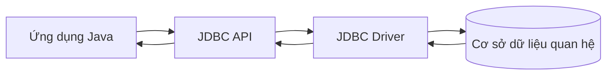

# JDBC là gì và giải quyết vấn đề truy cập dữ liệu nào?

## 1. Bài toán: chương trình Java cần làm việc với dữ liệu lưu lâu dài

Hãy hình dung một ứng dụng bán hàng viết bằng Java. Khi khách hàng mở trang sản phẩm, ứng dụng phải lấy tên, giá và số lượng tồn kho từ cơ sở dữ liệu. Khi khách đặt hàng, ứng dụng phải ghi đơn hàng và giảm tồn kho. Dữ liệu cần tồn tại sau khi tiến trình Java kết thúc, đồng thời nhiều người dùng có thể truy cập và cập nhật nó.

Nếu chỉ lưu sản phẩm trong biến, `List` hoặc `Map` của chương trình, dữ liệu sẽ mất khi ứng dụng dừng và rất khó phối hợp nhiều tiến trình. Cơ sở dữ liệu quan hệ như PostgreSQL, MySQL hoặc Oracle Database giải quyết phần lưu trữ, truy vấn, ràng buộc và giao dịch. Nhưng Java vẫn cần một cách chuẩn để **gửi câu lệnh đến cơ sở dữ liệu và nhận kết quả**.

**JDBC (Java Database Connectivity)** là API chuẩn của Java dành cho công việc đó. JDBC cho phép chương trình Java kết nối đến hệ quản trị cơ sở dữ liệu, gửi các câu lệnh SQL, đọc kết quả, cập nhật dữ liệu và điều khiển giao dịch thông qua các kiểu và phương thức Java thống nhất.

Ví dụ, ứng dụng có thể dùng JDBC để:

- Đọc chi tiết sản phẩm từ bảng `products` bằng `SELECT`.
- Thêm khách hàng hoặc đơn hàng bằng `INSERT`.
- Thay đổi số lượng tồn kho bằng `UPDATE`.
- Xóa bản ghi khi nghiệp vụ cho phép bằng `DELETE`.
- Đảm bảo nhiều cập nhật liên quan thành công hoặc thất bại cùng nhau bằng **transaction**.

JDBC là **lớp giao tiếp** giữa ứng dụng và cơ sở dữ liệu, không phải cơ sở dữ liệu, hệ quản trị cơ sở dữ liệu hay ngôn ngữ SQL. JDBC cũng không tự thiết kế bảng hoặc tự chuyển mọi đối tượng Java thành bản ghi; lập trình viên vẫn phải xác định truy vấn và cách ánh xạ dữ liệu khi sử dụng JDBC trực tiếp.

## 2. JDBC nằm ở đâu trong kiến trúc ứng dụng?



Các thành phần trong luồng này có nhiệm vụ riêng:

| Thành phần | Vai trò |
| --- | --- |
| **Ứng dụng Java** | Quyết định cần đọc hoặc thay đổi dữ liệu nào theo yêu cầu nghiệp vụ. |
| **JDBC API** | Cung cấp các interface và class như `Connection`, `PreparedStatement`, `ResultSet` để Java làm việc theo một cách thống nhất. |
| **JDBC driver** | Triển khai giao tiếp cụ thể với một hệ quản trị cơ sở dữ liệu, bao gồm giao thức kết nối và cách trao đổi dữ liệu. |
| **Hệ quản trị cơ sở dữ liệu** | Xác thực, thực thi SQL, lưu trữ dữ liệu, quản lý khóa, ràng buộc và transaction. |

Phần API JDBC chủ yếu nằm trong các package `java.sql` và `javax.sql`. Các kiểu API có sẵn trong Java; tuy nhiên, để kết nối đến PostgreSQL hay MySQL, ứng dụng thường cần **thư viện JDBC driver phù hợp** trên classpath hoặc module path. Từ JDBC 4, driver hỗ trợ cơ chế tự đăng ký khi thư viện được nạp đúng cách, nên thông thường không cần gọi `Class.forName(...)` thủ công.

Chẳng hạn, một URL JDBC cho PostgreSQL có dạng:

```text
jdbc:postgresql://localhost:5432/shop_db
```

URL này mô tả driver/protocol, máy chủ, cổng và cơ sở dữ liệu đích. Nó không có nghĩa rằng Java tự tạo hoặc tự khởi động PostgreSQL. Hệ quản trị cơ sở dữ liệu phải chạy, cơ sở dữ liệu phải tồn tại, mạng phải kết nối được và tài khoản phải có quyền thích hợp.

### JDBC chuẩn hóa phần nào, và phần nào vẫn phụ thuộc hệ quản trị?

Một chương trình có thể gọi `Connection.prepareStatement(...)`, `PreparedStatement.executeQuery()` và `ResultSet.next()` với nhiều loại cơ sở dữ liệu. Điều này giúp tách API Java khỏi giao thức riêng của từng nhà cung cấp. Tuy nhiên, **cú pháp SQL, kiểu dữ liệu, tính năng transaction và thông báo lỗi vẫn có thể khác nhau** giữa PostgreSQL, MySQL, Oracle hoặc SQL Server. Đổi driver không bảo đảm mọi câu SQL sẽ chạy nguyên vẹn trên hệ quản trị khác.

## 3. Các đối tượng JDBC quan trọng

| Đối tượng | Chức năng chính | Điều cần nhớ |
| --- | --- | --- |
| `DriverManager` | Tìm driver phù hợp và mở kết nối từ JDBC URL. | Tiện cho ví dụ, công cụ đơn giản; không tự cung cấp connection pool. |
| `DataSource` | Cung cấp `Connection` qua một nguồn kết nối được cấu hình. | Thường được ưu tiên trong ứng dụng máy chủ; có thể kết hợp connection pool. |
| `Connection` | Đại diện cho một phiên kết nối JDBC; tạo statement và quản lý transaction. | Cần đóng khi dùng xong hoặc trả lại pool theo hợp đồng. |
| `Statement` | Thực thi SQL dạng chuỗi. | Không dùng cách nối trực tiếp đầu vào người dùng vào SQL. |
| `PreparedStatement` | Đại diện cho SQL có tham số `?`; hỗ trợ gán giá trị an toàn. | Lựa chọn thông dụng khi câu lệnh có dữ liệu động. |
| `ResultSet` | Duyệt các hàng do truy vấn trả về. | Con trỏ ban đầu nằm trước hàng đầu tiên; gọi `next()` trước khi đọc. |
| `SQLException` | Biểu diễn lỗi truy cập dữ liệu bằng JDBC. | Có thể xem `SQLState`, mã lỗi nhà cung cấp và chuỗi nguyên nhân. |

Quy trình đọc dữ liệu điển hình gồm: **lấy kết nối → chuẩn bị SQL → gắn tham số → thực thi → duyệt kết quả → đóng tài nguyên**. Với thao tác ghi nhiều bước, bổ sung việc bắt đầu transaction, `commit` khi thành công hoặc `rollback` khi thất bại.

## 4. Ví dụ: truy vấn sản phẩm bằng JDBC

Giả sử cơ sở dữ liệu quan hệ có bảng sau (SQL minh họa):

```sql
CREATE TABLE products (
    id BIGINT PRIMARY KEY,
    name VARCHAR(200) NOT NULL,
    price DECIMAL(12, 2) NOT NULL,
    stock INTEGER NOT NULL
);

INSERT INTO products (id, name, price, stock)
VALUES (1, 'Ban phim co', 1250000.00, 15);
```

Ứng dụng cần tìm sản phẩm theo `id`. Trước khi chạy mã Java, cần cài driver PostgreSQL tương ứng trong dependency của dự án và cung cấp ba biến môi trường `DB_URL`, `DB_USER`, `DB_PASSWORD`. Ví dụ `DB_URL=jdbc:postgresql://localhost:5432/shop_db`; không đặt mật khẩu thật trực tiếp vào mã nguồn.

```java
import java.math.BigDecimal;
import java.sql.Connection;
import java.sql.DriverManager;
import java.sql.PreparedStatement;
import java.sql.ResultSet;
import java.sql.SQLException;

public class FindProductExample {
    public static void main(String[] args) throws SQLException {
        String url = requiredEnv("DB_URL");
        String user = requiredEnv("DB_USER");
        String password = requiredEnv("DB_PASSWORD");
        long productId = 1L;

        String sql = "SELECT id, name, price, stock FROM products WHERE id = ?";

        try (Connection connection = DriverManager.getConnection(url, user, password);
             PreparedStatement statement = connection.prepareStatement(sql)) {

            statement.setLong(1, productId);

            try (ResultSet result = statement.executeQuery()) {
                if (result.next()) {
                    long id = result.getLong("id");
                    String name = result.getString("name");
                    BigDecimal price = result.getBigDecimal("price");
                    int stock = result.getInt("stock");

                    System.out.printf(
                        "id=%d, name=%s, price=%s, stock=%d%n",
                        id, name, price, stock
                    );
                } else {
                    System.out.println("Khong tim thay san pham");
                }
            }
        }
    }

    private static String requiredEnv(String name) {
        String value = System.getenv(name);
        if (value == null || value.isBlank()) {
            throw new IllegalStateException("Thieu bien moi truong: " + name);
        }
        return value;
    }
}
```

Khi truy vấn trả về hàng đã chèn, kết quả tương ứng là:

```text
id=1, name=Ban phim co, price=1250000.00, stock=15
```

Những điểm quan trọng trong ví dụ:

1. `DriverManager.getConnection(...)` nhờ JDBC driver mở kết nối đến máy chủ cơ sở dữ liệu. Nếu sai URL, thông tin đăng nhập hoặc thiếu driver, chương trình sẽ không kết nối được.
2. SQL chứa dấu `?` làm **placeholder cho một giá trị**. `statement.setLong(1, productId)` gắn tham số thứ nhất; chỉ số tham số trong JDBC bắt đầu từ **1**, không phải 0.
3. `executeQuery()` dùng cho câu lệnh trả về `ResultSet` như `SELECT`. `result.next()` di chuyển đến hàng tiếp theo và trả về `false` khi không còn hàng.
4. `getLong`, `getString`, `getBigDecimal` và `getInt` chuyển dữ liệu từ cột SQL sang giá trị Java. `BigDecimal` phù hợp hơn `double` cho dữ liệu tiền tệ cần giữ độ chính xác thập phân.
5. **Try-with-resources** tự đóng `ResultSet`, `PreparedStatement` và `Connection`, kể cả khi phát sinh lỗi. Nếu dùng connection pool, thao tác `close()` thường có nghĩa là trả kết nối về pool theo triển khai của `DataSource`.

Trong ví dụ, các cột `id`, `name`, `price`, `stock` đều `NOT NULL`. Với cột cho phép `NULL`, cần xử lý tương ứng: `getString(...)` có thể trả về `null`, còn các getter nguyên thủy như `getInt(...)` trả về `0` khi SQL `NULL` và phải kiểm tra thêm `result.wasNull()` nếu cần phân biệt.

## 5. Vì sao cần `PreparedStatement`?

Giả sử ứng dụng tìm tài khoản theo tên đăng nhập. Cách nối chuỗi SQL từ đầu vào là nguy hiểm:

```java
// Không nên làm khi username đến từ người dùng.
String sql = "SELECT id FROM users WHERE username = '" + username + "'";
```

Đầu vào chứa ký tự đặc biệt có thể làm thay đổi cấu trúc câu SQL, dẫn tới **SQL injection**. Thay vào đó, đặt tham số và để driver gửi giá trị theo cơ chế của câu lệnh chuẩn bị:

```java
String sql = "SELECT id FROM users WHERE username = ?";
try (PreparedStatement statement = connection.prepareStatement(sql)) {
    statement.setString(1, username);
    try (ResultSet result = statement.executeQuery()) {
        // Duyệt kết quả theo yêu cầu nghiệp vụ.
    }
}
```

`PreparedStatement` tách dữ liệu tham số khỏi cú pháp SQL, giúp tránh việc dữ liệu đầu vào bị diễn giải thành lệnh SQL ở vị trí được tham số hóa. Nó cũng thuận tiện cho việc tái sử dụng câu lệnh. **Placeholder `?` dành cho giá trị**, không thể dùng để thay tên bảng, tên cột hoặc từ khóa SQL. Với tên cột cần chọn động, ứng dụng phải kiểm tra theo một danh sách cho phép đã định nghĩa trước.

## 6. Đọc dữ liệu và ghi dữ liệu khác nhau như thế nào?

Đối với JDBC thông thường:

| Nhu cầu | Phương thức phù hợp | Kết quả |
| --- | --- | --- |
| Truy vấn các hàng bằng `SELECT` | `executeQuery()` | `ResultSet` để duyệt dữ liệu. |
| Thực hiện `INSERT`, `UPDATE`, `DELETE` | `executeUpdate()` | Số hàng bị ảnh hưởng; với DDL, kết quả có thể là `0`. |
| Thực thi SQL khi chưa biết trước dạng kết quả | `execute()` | `boolean` cho biết kết quả đầu tiên có phải `ResultSet` hay không; có thể lấy các kết quả tiếp theo. |

Ví dụ giảm tồn kho của một sản phẩm:

```java
String sql = "UPDATE products SET stock = stock - ? "
           + "WHERE id = ? AND stock >= ?";

try (PreparedStatement statement = connection.prepareStatement(sql)) {
    int quantity = 2;
    long productId = 1L;

    statement.setInt(1, quantity);
    statement.setLong(2, productId);
    statement.setInt(3, quantity);

    int updatedRows = statement.executeUpdate();
    if (updatedRows != 1) {
        throw new SQLException("Khong tim thay san pham hoac khong du ton kho");
    }
}
```

Điều kiện `stock >= ?` cho phép cơ sở dữ liệu kiểm tra số lượng tồn kho **ngay trong phép cập nhật**, hữu ích hơn việc đọc tồn kho rồi vô điều kiện ghi lại một giá trị mới. Với nghiệp vụ có nhiều thao tác phụ thuộc nhau, vẫn cần transaction và cách xử lý đồng thời phù hợp.

## 7. Transaction: khi một nghiệp vụ gồm nhiều câu SQL

Hãy xét thao tác chuyển 3 đơn vị hàng từ kho A sang kho B. Nghiệp vụ có hai bước: giảm kho A và tăng kho B. Nếu giảm thành công nhưng tăng thất bại, tổng tồn kho bị sai. JDBC cho phép quản lý **transaction** trên `Connection`:

- Mặc định, nhiều kết nối JDBC bật `autoCommit`: mỗi câu SQL được commit khi hoàn tất theo quy tắc JDBC/driver.
- `connection.setAutoCommit(false)` cho phép nhóm nhiều câu lệnh vào một transaction do ứng dụng điều khiển.
- `commit()` xác nhận các thay đổi trong transaction.
- `rollback()` hủy các thay đổi chưa commit khi có lỗi.

Ví dụ phương thức dưới đây **sở hữu một kết nối riêng**, đóng nó sau khi hoàn thành và luôn cố gắng rollback khi transaction thất bại:

```java
import java.sql.Connection;
import java.sql.DriverManager;
import java.sql.PreparedStatement;
import java.sql.SQLException;

public class StockTransferExample {
    public static void transfer(String url, String user, String password,
                                long fromId, long toId, int quantity)
            throws SQLException {
        if (quantity <= 0 || fromId == toId) {
            throw new IllegalArgumentException("Du lieu chuyen kho khong hop le");
        }

        String subtractSql = "UPDATE products SET stock = stock - ? "
                           + "WHERE id = ? AND stock >= ?";
        String addSql = "UPDATE products SET stock = stock + ? WHERE id = ?";

        try (Connection connection = DriverManager.getConnection(url, user, password)) {
            connection.setAutoCommit(false);
            try (PreparedStatement subtract = connection.prepareStatement(subtractSql);
                 PreparedStatement add = connection.prepareStatement(addSql)) {

                subtract.setInt(1, quantity);
                subtract.setLong(2, fromId);
                subtract.setInt(3, quantity);
                if (subtract.executeUpdate() != 1) {
                    throw new SQLException("Kho nguon khong ton tai hoac thieu hang");
                }

                add.setInt(1, quantity);
                add.setLong(2, toId);
                if (add.executeUpdate() != 1) {
                    throw new SQLException("Kho dich khong ton tai");
                }

                connection.commit();
            } catch (SQLException | RuntimeException error) {
                try {
                    connection.rollback();
                } catch (SQLException rollbackError) {
                    error.addSuppressed(rollbackError);
                }
                throw error;
            }
        }
    }
}
```

Trong ví dụ này, nếu kho B không tồn tại thì câu lệnh thứ hai tác động 0 hàng, phương thức ném lỗi và rollback cả việc đã giảm ở kho A. Nếu cả hai cập nhật thành công, `commit()` xác nhận chúng cùng nhau. Đây là lợi ích của tính **atomicity** trong transaction của cơ sở dữ liệu quan hệ.

Transaction còn liên quan đến **isolation**, tức cách các giao dịch đồng thời nhìn thấy thay đổi của nhau. JDBC có các mức như `TRANSACTION_READ_COMMITTED`, `TRANSACTION_REPEATABLE_READ`, `TRANSACTION_SERIALIZABLE`, nhưng mức được hỗ trợ và cách thực thi phụ thuộc hệ quản trị. Với yêu cầu đồng thời phức tạp, phải phân tích thêm khóa, ràng buộc, mức isolation và retry khi có xung đột. `commit/rollback` đơn thuần không giải quyết mọi lỗi cạnh tranh dữ liệu.

## 8. JDBC giải quyết được gì, và những việc ứng dụng vẫn phải làm?

| Vấn đề | JDBC hỗ trợ | Phần ứng dụng hoặc hệ quản trị phải chịu trách nhiệm |
| --- | --- | --- |
| Kết nối | API chuẩn để mở/đóng kết nối. | Driver phù hợp, cấu hình URL, mạng, tài khoản và quyền truy cập. |
| Gửi truy vấn | Thực thi SQL và nhận kết quả qua đối tượng Java. | Viết câu SQL đúng với schema và SQL dialect đang dùng. |
| Tránh SQL injection | Bind giá trị với `PreparedStatement`. | Không nối đầu vào vào cấu trúc SQL; kiểm soát tên bảng/cột động. |
| Ánh xạ dữ liệu | Các getter của `ResultSet` đọc giá trị SQL sang kiểu Java. | Chọn cột, xử lý `NULL`, tạo đối tượng domain/DTO và kiểm tra dữ liệu. |
| Giao dịch | `setAutoCommit`, `commit`, `rollback`, cấu hình isolation. | Xác định ranh giới nghiệp vụ, xử lý đồng thời và lỗi. |
| Hiệu năng | Prepared statement, batch API và metadata. | Thiết kế chỉ mục, SQL, connection pool, số lượng truy vấn và đo hiệu năng. |

Một số thực hành quan trọng khi triển khai thật:

- **Dùng `DataSource` và connection pool** trong ứng dụng nhiều request để tránh chi phí liên tục mở kết nối vật lý. Pool là khả năng của triển khai `DataSource` hoặc thư viện bổ sung, không phải `DriverManager` tự cung cấp.
- **Giới hạn tài nguyên**: đóng `ResultSet`, `Statement` và `Connection`; đặt timeout phù hợp, không giữ transaction mở trong lúc chờ người dùng hoặc gọi dịch vụ chậm không cần thiết.
- **Đừng dùng `SELECT *` vô tội vạ**: chỉ chọn cột cần dùng; dùng phân trang với dữ liệu lớn, batch khi ghi nhiều hàng và theo dõi số lượng query để tránh truy vấn lặp.
- **Xử lý lỗi có ngữ cảnh**: `SQLException` có `getSQLState()`, `getErrorCode()` và `getNextException()`. Ghi log thông tin kỹ thuật phù hợp nhưng tránh tiết lộ mật khẩu, chuỗi kết nối nhạy cảm hoặc dữ liệu người dùng.
- **Tôn trọng ràng buộc ở database**: khóa chính, khóa ngoại, `UNIQUE`, `NOT NULL` và các kiểm tra khác bảo vệ dữ liệu khi có nhiều nguồn cập nhật.

## 9. Phân biệt JDBC với JPA, ORM và framework truy cập dữ liệu

JDBC là mức API trực tiếp: lập trình viên viết SQL, thiết lập tham số, xử lý `ResultSet` và điều khiển tài nguyên. **JPA** là đặc tả ánh xạ và quản lý thực thể (persistence), thường sử dụng một triển khai ORM như Hibernate. Framework như Spring JDBC (`JdbcTemplate`) có thể giảm mã lặp khi dùng SQL và JDBC; Spring Data JPA hỗ trợ truy cập dữ liệu qua mô hình repository và JPA.

| Cách tiếp cận | Làm việc chủ yếu với | Điểm mạnh | Đổi lại |
| --- | --- | --- | --- |
| JDBC trực tiếp | `Connection`, SQL, `PreparedStatement`, `ResultSet` | Thấy rõ từng câu SQL và vòng đời tài nguyên. | Cần viết nhiều mã xử lý kết nối, kết quả và lỗi. |
| Spring JDBC | SQL và callback/mapper do framework hỗ trợ | Ít mã lặp, vẫn kiểm soát SQL. | Cần làm quen API và cách cấu hình framework. |
| JPA/ORM | Entity, quan hệ và persistence context | Thuận tiện với mô hình domain và quản lý vòng đời entity. | Cần hiểu SQL sinh ra, mapping, tải quan hệ và transaction để tránh lỗi hiệu năng. |

Chúng không phải những cơ chế loại trừ tuyệt đối: nhiều framework sử dụng JDBC ở tầng truy cập database. Học JDBC giúp hiểu vì sao có kết nối, câu truy vấn, transaction và những lỗi mà tầng framework có thể che bớt.

## 10. Tự kiểm tra kiến thức

1. **JDBC khác cơ sở dữ liệu ở đâu?** JDBC cung cấp API từ Java đến database; database mới là nơi lưu trữ và thực thi truy vấn.
2. **Vì sao cần driver?** Driver triển khai cách trao đổi thực tế với hệ quản trị cụ thể, trong khi JDBC định nghĩa API chung.
3. **Khi nào dùng `executeQuery()` và `executeUpdate()`?** Dùng `executeQuery()` để nhận `ResultSet` từ truy vấn; dùng `executeUpdate()` cho câu lệnh thay đổi dữ liệu và nhận số hàng bị ảnh hưởng.
4. **Vì sao đặt `?` thay vì nối chuỗi từ người dùng?** Tham số giúp giữ giá trị đầu vào tách khỏi cú pháp SQL, giảm nguy cơ SQL injection.
5. **Vì sao chuyển hàng giữa hai kho cần transaction?** Hai cập nhật phải cùng commit hoặc cùng rollback để tránh tồn kho không nhất quán.

**Bài tập nhỏ:** Với bảng `products`, hãy viết một hàm JDBC tìm các sản phẩm có `price <= ?` và `stock > 0`, sắp xếp theo giá tăng dần. Sử dụng `PreparedStatement`, tham số `BigDecimal`, `ResultSet` để ánh xạ từng hàng, và try-with-resources để đóng tài nguyên. Sau đó giải thích điều gì xảy ra khi truy vấn không trả về hàng nào và cách bạn kiểm tra lỗi kết nối.

Ở mức nền tảng, điều quan trọng nhất là nắm được đường đi của một thao tác dữ liệu: **Java gọi JDBC API → driver trao đổi với hệ quản trị → SQL được thực thi → kết quả quay về Java**. Từ đó, các kỹ thuật truy vấn an toàn, quản lý transaction, connection pool và framework persistence đều có điểm tựa rõ ràng.
