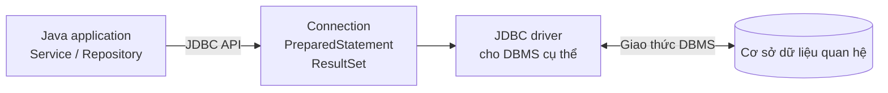

# Vai trò của JDBC giữa mã Java và cơ sở dữ liệu quan hệ

Một ứng dụng Java thường cần lưu và truy vấn dữ liệu bền vững: hồ sơ khách hàng, đơn hàng, hóa đơn hoặc kết quả giao dịch. Dữ liệu ấy có thể nằm trong PostgreSQL, MySQL, Oracle Database, SQL Server hoặc một hệ quản trị cơ sở dữ liệu quan hệ khác. Trong khi Java làm việc với đối tượng và kiểu dữ liệu của ngôn ngữ, hệ quản trị cơ sở dữ liệu (DBMS) làm việc với bảng, hàng, cột, ràng buộc, giao dịch và câu lệnh SQL.

**JDBC (Java Database Connectivity)** là API chuẩn của nền tảng Java để chương trình giao tiếp với cơ sở dữ liệu quan hệ. JDBC cung cấp các giao diện và lớp trong `java.sql` cùng `javax.sql`, giúp ứng dụng mở kết nối, gửi câu lệnh SQL, truyền tham số, nhận kết quả, kiểm soát giao dịch và xử lý lỗi. **JDBC driver** do nhà cung cấp hoặc bên thứ ba triển khai đảm nhiệm việc trao đổi thực tế với từng DBMS.

Vì vậy, JDBC đóng vai trò **cầu nối có hợp đồng API thống nhất** giữa mã Java và nhiều hệ cơ sở dữ liệu. Nó không thay thế SQL, không tự tạo mô hình dữ liệu, cũng không xóa bỏ toàn bộ khác biệt giữa các DBMS.

## 1. Vì sao mã Java cần JDBC?

Giả sử có một ứng dụng quản lý bán hàng. Khi người dùng xem đơn hàng, chương trình cần đọc một hoặc nhiều hàng từ bảng `orders`. Khi người dùng xác nhận thanh toán, chương trình cần ghi các thay đổi và bảo đảm chúng nằm trong cùng một giao dịch.

Mã Java không thể chỉ gọi các phương thức thông thường trên bộ nhớ rồi mặc nhiên dữ liệu xuất hiện trong cơ sở dữ liệu. DBMS là một hệ thống độc lập: nó có giao thức kết nối, cách xác thực, cú pháp SQL, kiểu dữ liệu và quy tắc giao dịch riêng. Nếu mã ứng dụng phải trực tiếp xử lý mọi giao thức DBMS, việc thay đổi cơ sở dữ liệu hoặc thư viện truy cập sẽ rất phức tạp.

JDBC giải quyết phần **giao tiếp có cấu trúc** này bằng cách định nghĩa những thao tác quen thuộc:

1. Yêu cầu một kết nối tới DBMS.
2. Chuẩn bị và thực thi câu lệnh SQL cùng tham số.
3. Duyệt kết quả truy vấn hoặc đọc số hàng bị ảnh hưởng.
4. Xác nhận/hủy bỏ giao dịch nếu cần.
5. Đóng tài nguyên và xử lý ngoại lệ do thao tác dữ liệu phát sinh.

Các thao tác ấy được viết theo cùng bộ API JDBC, còn driver thực thi cách trao đổi với DBMS đã chọn.

## 2. JDBC nằm ở đâu trong kiến trúc ứng dụng?



Ví dụ khi ứng dụng thực hiện một truy vấn:

- **Ứng dụng Java** quyết định cần tìm dữ liệu gì và truyền tham số nào.
- **JDBC API** cung cấp `Connection`, `PreparedStatement` và `ResultSet` để mô tả thao tác một cách thống nhất.
- **JDBC driver** biến lời gọi API thành các thông điệp phù hợp với DBMS, đồng thời giải mã dữ liệu phản hồi.
- **DBMS** phân tích SQL, tối ưu và thực thi truy vấn, áp dụng quyền truy cập, khóa, ràng buộc và giao dịch, sau đó trả kết quả hoặc thông báo lỗi.

Đường đi của dữ liệu là **hai chiều**: tham số Java được chuyển thành giá trị SQL khi gửi đi, kết quả SQL được chuyển thành giá trị Java khi đọc về. JDBC có thể truy cập DBMS qua mạng; một số driver/cấu hình cũng hỗ trợ cơ sở dữ liệu nhúng trong cùng tiến trình.

### JDBC API khác JDBC driver như thế nào?

| Thành phần | Ai cung cấp? | Vai trò |
|---|---|---|
| **JDBC API** | Nền tảng Java | Định nghĩa các giao diện, kiểu dữ liệu và phương thức chuẩn, như `Connection`, `PreparedStatement`, `ResultSet`, `SQLException`. |
| **JDBC driver** | Nhà cung cấp DBMS hoặc bên thứ ba | Triển khai các giao diện JDBC, xử lý giao thức, xác thực, chuyển kiểu và các đặc điểm riêng của DBMS. |
| **DBMS** | Hệ thống cơ sở dữ liệu | Lưu trữ và truy vấn dữ liệu, thực hiện SQL, giao dịch, bảo mật và các ràng buộc toàn vẹn. |
| **Mã truy cập dữ liệu** | Nhóm phát triển ứng dụng | Chọn câu SQL, truyền tham số, ánh xạ kết quả thành đối tượng nghiệp vụ, điều phối giao dịch. |

Ví dụ, `Connection` là giao diện trong API JDBC; đối tượng `Connection` mà chương trình nhận được lúc chạy là một triển khai do driver hoặc lớp bọc của connection pool cung cấp. Tương tự, `ResultSet` là hợp đồng đọc hàng kết quả, chứ bản thân API không phải nơi lưu các hàng trong bảng.

**Chú ý:** Có JDBC API trong JDK chưa có nghĩa là ứng dụng đã có driver cho PostgreSQL, MySQL hay DBMS mong muốn. Với các DBMS này, phải khai báo dependency driver tương ứng và cấu hình kết nối chính xác. Các driver JDBC hiện đại thường tự đăng ký thông qua cơ chế dịch vụ của Java khi có mặt trên classpath; nhiều ứng dụng không cần gọi `Class.forName(...)` thủ công.

## 3. Các thành phần JDBC thường gặp

| API | Công việc chính | Tình huống sử dụng |
|---|---|---|
| `DriverManager` | Tìm driver phù hợp và tạo kết nối từ JDBC URL | Ví dụ đơn giản, tiện ích nhỏ hoặc kết nối trực tiếp. |
| `DataSource` (`javax.sql`) | Cung cấp kết nối từ cấu hình hoặc connection pool | Ứng dụng máy chủ cần quản lý cấu hình và tái sử dụng kết nối. |
| `Connection` | Đại diện một phiên kết nối logic; tạo lệnh SQL, điều khiển giao dịch | `prepareStatement(...)`, `setAutoCommit(...)`, `commit()`, `rollback()`. |
| `Statement` | Thực thi câu SQL xây dựng trực tiếp | SQL tĩnh không có tham số dữ liệu. |
| `PreparedStatement` | Thực thi SQL có chỗ giữ chỗ `?` để gán tham số có kiểu | Truy vấn theo ID, cập nhật giá, ghi dữ liệu người dùng. |
| `CallableStatement` | Gọi thủ tục/hàm cơ sở dữ liệu có hỗ trợ | Gọi stored procedure cùng tham số vào/ra. |
| `ResultSet` | Đọc lần lượt các hàng trong kết quả truy vấn | `next()`, `getLong(...)`, `getString(...)`. |
| `ResultSetMetaData` / `DatabaseMetaData` | Xem thông tin kiểu cột, khả năng DBMS và cấu trúc dữ liệu | Khám phá schema, công cụ hoặc kiểm tra tính tương thích. |
| `SQLException` | Thông báo lỗi thao tác JDBC/SQL | Lỗi kết nối, truy vấn, ràng buộc, quyền hoặc giao dịch. |

`Connection`, `Statement`/`PreparedStatement` và `ResultSet` là các **tài nguyên cần đóng**. Thực tế nên dùng `try-with-resources` để chúng được đóng kể cả khi xảy ra ngoại lệ. Nếu dùng connection pool, thao tác `close()` trên connection thường trả kết nối về pool theo hợp đồng của pool, thay vì luôn đóng kết nối vật lý ngay lập tức.

## 4. Minh họa hành trình từ Java đến SQL và ngược lại

Giả sử cơ sở dữ liệu đã có bảng:

```sql
CREATE TABLE customers (
    id BIGINT PRIMARY KEY,
    full_name VARCHAR(120) NOT NULL
);
```

Ứng dụng muốn tìm tên khách hàng theo mã định danh. Một lớp truy cập dữ liệu có thể dùng `DataSource` đã được cấu hình sẵn:

```java
import java.sql.Connection;
import java.sql.PreparedStatement;
import java.sql.ResultSet;
import java.sql.SQLException;
import javax.sql.DataSource;

public class CustomerRepository {
    private final DataSource dataSource;

    public CustomerRepository(DataSource dataSource) {
        this.dataSource = dataSource;
    }

    public String findNameById(long customerId) throws SQLException {
        String sql = "SELECT full_name FROM customers WHERE id = ?";

        try (Connection connection = dataSource.getConnection();
             PreparedStatement statement = connection.prepareStatement(sql)) {

            statement.setLong(1, customerId);

            try (ResultSet rows = statement.executeQuery()) {
                if (rows.next()) {
                    return rows.getString("full_name");
                }
                return null; // Không tìm thấy khách hàng
            }
        }
    }
}
```

Ví dụ giả định `DataSource` đã được tạo từ driver/cấu hình DBMS phù hợp. Phương thức trả `null` để minh họa trường hợp không tìm thấy; trong ứng dụng lớn có thể dùng một kiểu kết quả rõ nghĩa hơn như `Optional<String>`.

### Điều gì thực sự xảy ra khi gọi phương thức?

1. `dataSource.getConnection()` cấp một `Connection` để làm việc với DBMS. Nếu không kết nối/xác thực được, thao tác có thể ném `SQLException`.
2. `connection.prepareStatement(sql)` tạo `PreparedStatement` cho câu SQL có dấu `?`.
3. `statement.setLong(1, customerId)` gán tham số thứ nhất (chỉ số tham số JDBC bắt đầu từ **1**); ứng dụng không tự ghép ID vào chuỗi SQL.
4. `executeQuery()` gửi yêu cầu qua driver và nhận `ResultSet`. Lệnh SQL được DBMS xử lý theo quyền, quy tắc và dữ liệu hiện hành.
5. `rows.next()` chuyển con trỏ đến hàng tiếp theo; `getString("full_name")` đọc giá trị cột của hàng đó. Khi không còn hàng, `next()` trả `false`.
6. Thoát khỏi các khối `try-with-resources` sẽ đóng `ResultSet`, `PreparedStatement` và `Connection` theo thứ tự ngược khi cấp phát.

Đây chính là vai trò của JDBC: ứng dụng diễn đạt *cần thực hiện thao tác dữ liệu nào*, driver giao tiếp với DBMS, rồi ứng dụng nhận kết quả dưới dạng kiểu Java phù hợp.

### Nếu cần ghi dữ liệu thì sao?

Với `INSERT`, `UPDATE`, `DELETE`, thông thường dùng `executeUpdate()` để nhận số hàng bị ảnh hưởng:

```java
String sql = "UPDATE customers SET full_name = ? WHERE id = ?";

try (Connection connection = dataSource.getConnection();
     PreparedStatement statement = connection.prepareStatement(sql)) {

    statement.setString(1, "Nguyễn Minh An");
    statement.setLong(2, 1001L);

    int updatedRows = statement.executeUpdate();
    System.out.println("Số hàng được cập nhật: " + updatedRows);
}
```

`executeQuery()` dành cho câu lệnh trả về tập kết quả, còn `executeUpdate()` dùng cho thao tác cập nhật hoặc câu SQL không trả `ResultSet` theo hợp đồng JDBC. Với thao tác tạo hàng mới, JDBC còn cung cấp cơ chế lấy khóa sinh tự động khi driver/DBMS hỗ trợ.

## 5. Hai cách phổ biến để lấy kết nối

### `DriverManager`: cách khởi đầu dễ hiểu

```java
import java.sql.Connection;
import java.sql.DriverManager;
import java.sql.SQLException;

String url = "jdbc:postgresql://localhost:5432/shop";
String username = "app_user";
String password = /* lấy từ cấu hình an toàn */ "...";

try (Connection connection =
         DriverManager.getConnection(url, username, password)) {
    System.out.println("Đã có kết nối JDBC");
}
```

Đoạn mã dùng **URL minh họa của PostgreSQL**, cần PostgreSQL JDBC driver tương ứng trên classpath và máy chủ/database đã tồn tại. Mỗi DBMS thường có dạng JDBC URL khác nhau, ví dụ tiền tố `jdbc:mysql:`, `jdbc:sqlserver:` hoặc `jdbc:oracle:`. Tên máy chủ, cổng, database và các tùy chọn kết nối cũng tùy theo driver.

Trong ứng dụng thực tế, tránh lưu mật khẩu trực tiếp trong mã nguồn; nạp thông tin xác thực từ hệ thống cấu hình hoặc bộ quản lý bí mật được bảo vệ. Mã trên chỉ minh họa API tạo kết nối và không thể chạy nếu chưa cung cấp driver, server, cấu hình và thông tin đăng nhập hợp lệ.

### `DataSource`: phù hợp để cấu hình và quản lý kết nối

`DataSource` mô tả một nguồn cung cấp `Connection`. Nguồn đó có thể do driver, application server hoặc connection pool triển khai. Ứng dụng chỉ cần nhận `DataSource`, không bắt buộc gắn logic nghiệp vụ với một JDBC URL cụ thể:

```java
// dataSource được cấu hình ở tầng khởi tạo ứng dụng.
try (Connection connection = dataSource.getConnection()) {
    // Thực thi SQL qua JDBC.
}
```

Với **connection pooling**, nhiều yêu cầu có thể tái sử dụng một số kết nối vật lý đã được thiết lập, giảm chi phí mở kết nối lặp đi lặp lại. Bản thân giao diện `DataSource` không bảo đảm có pool; chỉ một implementation được cấu hình cho pooling mới cung cấp hành vi đó.

| Tiêu chí | `DriverManager` | `DataSource` |
|---|---|---|
| Thiết lập đơn giản | Phù hợp ví dụ và công cụ nhỏ | Cần có đối tượng được cấu hình từ trước |
| Tách cấu hình khỏi mã truy cập dữ liệu | Thường phải tự tổ chức | Dễ tiêm dependency vào repository/service |
| Hỗ trợ pool | Không cung cấp pool trực tiếp | Có thể được triển khai bởi connection pool |
| Môi trường máy chủ | Dùng được nhưng cần tự quản lý nhiều khía cạnh | Thường được ưu tiên ở tầng ứng dụng |

## 6. JDBC giúp thống nhất những gì, và giới hạn ở đâu?

**JDBC chuẩn hóa cách gọi API**, nên một đoạn code đơn giản dùng `Connection`, `PreparedStatement` và `ResultSet` có thể được tái sử dụng cho nhiều DBMS nếu thay driver/cấu hình phù hợp và SQL/kiểu dữ liệu tương thích. Tuy nhiên, tính di động không phải là tuyệt đối.

| JDBC hỗ trợ tương đối thống nhất | Những khác biệt ứng dụng vẫn phải xử lý |
|---|---|
| Mở/đóng kết nối và các tài nguyên JDBC | Dạng JDBC URL, khả năng driver, cấu hình mạng và xác thực |
| Truyền tham số qua `PreparedStatement` | Cú pháp SQL riêng, kiểu JSON/UUID/ARRAY, cách truyền kiểu đặc biệt |
| Duyệt hàng/cột trong `ResultSet` | Các kiểu cột thực tế, độ chính xác, múi giờ, cách biểu diễn giá trị |
| `commit()`, `rollback()`, `setAutoCommit(...)` | Isolation level, khả năng khóa, hành vi DDL trong giao dịch, tính năng DBMS |
| Nhận lỗi qua `SQLException` | Mã lỗi nhà cung cấp, tình huống retry và phân loại lỗi theo driver |

Ví dụ, cơ chế phân trang, chèn dữ liệu và lấy giá trị khóa sinh mới có thể khác nhau giữa PostgreSQL, MySQL và SQL Server. `PreparedStatement` không tự dịch mọi câu SQL đặc thù sang cú pháp của DBMS khác. Để thay DBMS thành công, ứng dụng còn phải kiểm tra schema, câu SQL, giao dịch và tính tương thích của driver.

### JDBC khác ORM/JPA ở cấp độ nào?

- **JDBC:** cung cấp API truy cập SQL cấp tương đối thấp. Lập trình viên thường tự viết SQL và ánh xạ các hàng dữ liệu thành đối tượng Java.
- **JPA:** quy định mô hình ánh xạ thực thể và quản lý persistence ở cấp độ cao hơn. Nó là đặc tả, cần một implementation để hoạt động.
- **ORM framework**, chẳng hạn Hibernate, thường dùng JDBC ở tầng bên dưới khi giao tiếp với cơ sở dữ liệu quan hệ; chúng có thể tạo SQL và quản lý ánh xạ object–relational giúp ứng dụng.

JDBC phù hợp khi cần kiểm soát câu SQL chi tiết, truy cập trực tiếp hoặc hiểu nguyên lý kết nối Java–database. ORM/JPA thuận tiện cho các miền nghiệp vụ lớn nhưng vẫn chịu các giới hạn về tính năng DBMS, giao dịch và hiệu năng cơ sở dữ liệu.

## 7. Bốn trách nhiệm quan trọng khi dùng JDBC

### 7.1. Tham số hóa câu SQL để bảo vệ dữ liệu đầu vào

Tránh dựng câu SQL bằng cách nối trực tiếp dữ liệu do người dùng nhập:

```java
// Cách rủi ro: dữ liệu đầu vào trở thành một phần cú pháp SQL.
String sql = "SELECT * FROM customers WHERE full_name = '" + name + "'";
```

Thay vào đó, hãy gán giá trị qua `PreparedStatement`:

```java
PreparedStatement ps = connection.prepareStatement(
    "SELECT * FROM customers WHERE full_name = ?"
);
ps.setString(1, name);
```

Tham số giữ cho **giá trị dữ liệu** được xử lý tách khỏi **cú pháp câu SQL**, giúp ngăn SQL injection qua vị trí hỗ trợ tham số. Placeholder `?` không thay thế trực tiếp cho tên bảng, tên cột hoặc từ khóa SQL; nếu cần SQL động ở các vị trí đó, phải lựa chọn từ danh sách định danh đã được cho phép. Vẫn cần kiểm tra đầu vào và phân quyền truy cập dữ liệu hợp lý.

### 7.2. Quản lý giao dịch để duy trì tính nhất quán

Ví dụ, chuyển tiền cần cả thao tác trừ và cộng tiền được xác nhận như một đơn vị. Nếu chỉ thực hiện được một nửa, dữ liệu sẽ không nhất quán. Trên cùng một `Connection`, JDBC cung cấp:

- `setAutoCommit(false)` để ứng dụng tự xác định điểm kết thúc giao dịch thay vì tự động commit sau mỗi statement theo chế độ mặc định thường gặp.
- `commit()` để yêu cầu DBMS xác nhận các thay đổi của giao dịch.
- `rollback()` để yêu cầu DBMS hủy các thay đổi chưa được xác nhận khi có lỗi.

Việc thực sự bảo đảm atomicity, isolation, locking và durability là trách nhiệm của DBMS cùng cấu hình giao dịch. Ứng dụng phải xử lý ngoại lệ, giữ những thao tác liên quan trên đúng connection/transaction và quyết định khi nào cần retry. Driver không thể tự suy ra ranh giới giao dịch nghiệp vụ.

### 7.3. Chuyển đổi kiểu dữ liệu và xử lý `NULL`

Giá trị Java như `String`, `long`, `BigDecimal`, `LocalDate` không hoàn toàn đồng nhất với kiểu SQL `VARCHAR`, `BIGINT`, `DECIMAL`, `DATE` hoặc các kiểu riêng của DBMS. Chọn phương thức `setXxx()`/`getXxx()` hoặc `setObject()`/`getObject()` phù hợp với cột và khả năng driver. Đặc biệt, dùng `BigDecimal` thay cho số thực xấp xỉ khi lưu tiền.

SQL `NULL` còn cần chú ý: nếu dùng `ResultSet#getInt()` trên cột số nguyên có giá trị `NULL`, phương thức trả `0`; phải gọi `wasNull()` ngay sau đó để phân biệt với giá trị 0 thực. Với kiểu tham chiếu như `String` hoặc `BigDecimal`, phương thức đọc tương ứng có thể trả Java `null`. Kiểu Java nguyên thủy như `int` và `long` không chứa `null`.

### 7.4. Quản lý tài nguyên và lỗi

Một kết nối đang mở chiếm tài nguyên ở phía Java, driver, pool và DBMS; các statement/result set cũng có thể chiếm bộ nhớ hoặc tài nguyên phía server. Dùng `try-with-resources` để tránh rò rỉ tài nguyên, giới hạn thời gian truy vấn/kết nối phù hợp và không mở một connection cho từng hàng khi có thể xử lý theo lô.

`SQLException` cung cấp thông điệp lỗi, **SQLState** qua `getSQLState()`, mã lỗi nhà cung cấp qua `getErrorCode()` và chuỗi lỗi liên quan qua `getNextException()`. Thực tế cần ghi log đủ ngữ cảnh kỹ thuật mà không làm lộ thông tin đăng nhập hoặc dữ liệu nhạy cảm. Không nên mặc định thử lại mọi lỗi SQL: lỗi vi phạm khóa chính, truy cập không được phép và lỗi kết nối có cách xử lý khác nhau.

## 8. Những hiểu nhầm dễ gặp

| Nhận định | Điều chỉnh đúng |
|---|---|
| “Có JDBC là không cần viết SQL.” | Với JDBC trực tiếp, ứng dụng vẫn viết hoặc tạo SQL; JDBC chịu trách nhiệm gửi lệnh và nhận kết quả. |
| “JDK có JDBC thì kết nối được ngay mọi DBMS.” | Cần driver tương ứng, cấu hình URL, máy chủ và quyền truy cập hợp lệ. |
| “Đổi JDBC URL là chuyển được toàn bộ ứng dụng sang DBMS khác.” | Còn phải kiểm tra schema, SQL dialect, kiểu dữ liệu, isolation và chức năng riêng. |
| “`DataSource` luôn có pool.” | `DataSource` chỉ định nghĩa nguồn kết nối; pooling phụ thuộc implementation và cấu hình. |
| “`ResultSet` luôn chứa sẵn tất cả hàng trong RAM.” | Cách fetch, buffering và streaming phụ thuộc driver, câu truy vấn và cấu hình. |
| “Đóng `Connection` là xóa dữ liệu vừa ghi.” | `close()` giải phóng/trả tài nguyên kết nối; dữ liệu đã commit vẫn được DBMS lưu theo cơ chế giao dịch. |
| “JDBC tự quyết định thiết kế bảng và nghiệp vụ.” | JDBC cung cấp công cụ truy cập; ứng dụng và DBMS quyết định schema, SQL, ràng buộc và logic giao dịch. |

## 9. Tình huống vận dụng

**Tình huống 1 — thay hệ quản trị:** Dự án đang dùng PostgreSQL và muốn chuyển sang MySQL. Cần thay đổi gì? Trước hết cần driver và JDBC URL tương ứng; sau đó phải rà soát DDL, câu SQL đặc thù, kiểu dữ liệu, cách lấy khóa tự sinh và giao dịch. Những phần code chỉ phụ thuộc API chuẩn JDBC thường có thể giữ nguyên.

**Tình huống 2 — nhiều người cùng dùng ứng dụng:** Một máy chủ web nhận hàng trăm yêu cầu truy vấn mỗi giây. Có nên mở kết nối vật lý mới từ `DriverManager` cho mọi yêu cầu? Có thể hoạt động nhưng tốn chi phí kết nối và khó kiểm soát tải. Sử dụng `DataSource` được hỗ trợ bởi connection pool, với giới hạn pool và thời gian chờ thích hợp, thường hiệu quả hơn.

**Tình huống 3 — dữ liệu nhập từ form:** Người dùng nhập tên khách hàng có dấu nháy đơn. Ghép chuỗi vào SQL có thể làm sai cú pháp và tạo nguy cơ injection. `PreparedStatement` cùng `setString()` gửi tên đó như một tham số dữ liệu.

**Tình huống 4 — giao dịch gồm nhiều bước:** Hệ thống cập nhật tồn kho và tạo đơn hàng. Cần làm gì nếu tạo đơn hàng thất bại sau khi giảm tồn kho? Nếu cả hai thao tác thuộc cùng một giao dịch và được thực hiện trên cùng connection, ứng dụng có thể yêu cầu `rollback()` thay vì `commit()`; hành vi cụ thể còn phụ thuộc DBMS và cách quản lý transaction.

**Tình huống 5 — truy vấn trả về không có hàng:** `executeQuery()` có phải luôn trả `null` khi không tìm thấy dữ liệu? Không. Nó trả `ResultSet` cho câu truy vấn thành công; `rows.next()` trả `false` nếu không có hàng để đọc.

## Ghi nhớ

JDBC là **lớp API kết nối mã Java với cơ sở dữ liệu quan hệ**. Driver là thành phần triển khai giao tiếp cụ thể; DBMS là nơi thực thi SQL và quản lý dữ liệu. Khi hiểu rõ ranh giới ba bên, người học sẽ biết đặt SQL ở đâu, truyền tham số an toàn thế nào, đọc kết quả ra sao và vì sao vẫn cần quản lý giao dịch, kiểu dữ liệu, lỗi cùng tài nguyên kết nối. Đó là nền tảng để tiếp tục học `PreparedStatement`, `ResultSet`, transaction và các tầng truy cập dữ liệu cao hơn trong hệ sinh thái Java.
