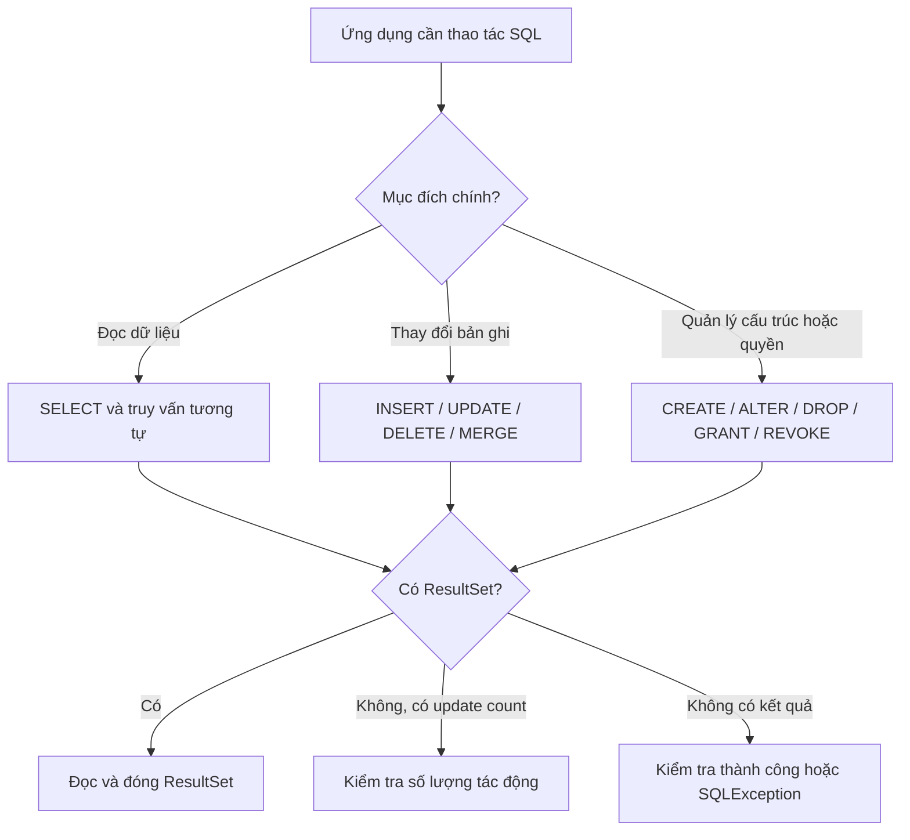

# Phân biệt truy vấn, cập nhật và thao tác quản trị dữ liệu trong JDBC

Khi bắt đầu lập trình **JDBC (Java Database Connectivity)** để truy cập cơ sở dữ liệu quan hệ từ Java, người học thường thấy nhiều câu lệnh SQL đều được gửi qua `Statement` hoặc `PreparedStatement`. Tuy nhiên, không phải câu SQL nào cũng có cùng mục đích hoặc cùng kiểu kết quả.

- **Truy vấn** thường lấy dữ liệu để chương trình đọc và xử lý.
- **Cập nhật dữ liệu** thêm, sửa hoặc xóa bản ghi đã lưu.
- **Quản trị cấu trúc, quyền và phiên giao dịch** thay đổi cách cơ sở dữ liệu được tổ chức, truy cập hoặc vận hành.

Phân biệt các nhóm này giúp chọn đúng phương thức JDBC, xử lý đúng kết quả trả về, quản lý transaction, cấp quyền phù hợp và tránh thực thi nhầm một thao tác ảnh hưởng dữ liệu.

## 1. Ba câu hỏi cần trả lời trước khi gửi SQL

Trước khi viết mã JDBC, hãy tự hỏi:

1. **Mục đích của SQL là gì?** Đọc dữ liệu, thay đổi các hàng, hay thay đổi cấu trúc/quyền?
2. **Kết quả mà driver trả về là gì?** Một tập hàng (`ResultSet`), một số lượng hàng bị tác động (update count), hay không có kết quả?
3. **Có tác động lâu dài hoặc cần transaction không?** Câu lệnh có làm thay đổi dữ liệu, tạo/xóa đối tượng, khóa tài nguyên hoặc yêu cầu commit/rollback?

Hai câu hỏi đầu liên quan chặt chẽ nhưng **không đồng nhất**. Ví dụ, câu `UPDATE ... RETURNING` trên một số cơ sở dữ liệu vừa sửa dữ liệu vừa trả về các hàng. Vì vậy, không thể chọn phương thức JDBC chỉ dựa vào việc câu SQL có chữ `UPDATE` hay `SELECT`.

### Sơ đồ định hướng



Sơ đồ mô tả **kiểu kết quả JDBC**, không khẳng định rằng mọi câu SQL thuộc một nhóm luôn đi vào cùng một nhánh.

## 2. Nhận biết các nhóm lệnh SQL

Có nhiều cách phân loại SQL trong giáo trình. Phổ biến nhất là:

| Nhóm | Mục đích | Câu lệnh điển hình | Ví dụ |
| --- | --- | --- | --- |
| **Truy vấn (DQL)** | Đọc hoặc tìm kiếm dữ liệu. | `SELECT` | `SELECT id, name FROM products` |
| **Thay đổi dữ liệu (DML)** | Thêm, cập nhật, xóa hàng. | `INSERT`, `UPDATE`, `DELETE`, `MERGE` | `UPDATE products SET stock = 8 WHERE id = 10` |
| **Định nghĩa dữ liệu (DDL)** | Tạo, sửa, xóa cấu trúc đối tượng. | `CREATE`, `ALTER`, `DROP`, `TRUNCATE` | `CREATE TABLE products (...)` |
| **Điều khiển quyền (DCL)** | Cấp, thu hồi quyền truy cập. | `GRANT`, `REVOKE` | `GRANT SELECT ON products TO report_user` |
| **Điều khiển giao dịch (TCL)** | Xác nhận, hủy, điều phối transaction. | `COMMIT`, `ROLLBACK`, `SAVEPOINT` | `ROLLBACK` |

Chữ **DQL, DML, DDL, DCL, TCL** là các tên phân loại mang tính giảng dạy. Một số tài liệu tính `SELECT` là một phần DML; một số hệ quản trị cung cấp thêm nhóm lệnh hoặc cú pháp riêng. Khi viết JDBC, điều quyết định vẫn là **chức năng của câu SQL và hợp đồng kết quả của JDBC driver**.

Trong bài này, “thao tác quản trị dữ liệu” chủ yếu bao gồm DDL, DCL và các thao tác điều khiển giao dịch. Quản trị cơ sở dữ liệu thực tế còn có sao lưu, phân tích thống kê, bảo trì, quản lý người dùng hoặc replication; nhiều thao tác đó cần công cụ riêng hoặc cú pháp phụ thuộc hệ quản trị.

## 3. Truy vấn: đọc dữ liệu và xử lý `ResultSet`

Truy vấn phổ biến nhất là `SELECT`:

```sql
SELECT id, name, price, stock
FROM products
WHERE stock > 0
ORDER BY name;
```

Kết quả thường là một bảng logic gồm cột và hàng. JDBC biểu diễn tập hàng này bằng `java.sql.ResultSet`.

### Dùng `executeQuery()` cho câu lệnh trả về một `ResultSet`

```java
import java.sql.Connection;
import java.sql.PreparedStatement;
import java.sql.ResultSet;
import java.sql.SQLException;

public final class ProductQueries {
    public static void printAvailableProducts(Connection connection)
            throws SQLException {
        String sql = """
                SELECT id, name, price, stock
                FROM products
                WHERE stock > ?
                ORDER BY name
                """;

        try (PreparedStatement statement = connection.prepareStatement(sql)) {
            statement.setInt(1, 0);

            try (ResultSet rows = statement.executeQuery()) {
                while (rows.next()) {
                    long id = rows.getLong("id");
                    String name = rows.getString("name");
                    java.math.BigDecimal price = rows.getBigDecimal("price");
                    int stock = rows.getInt("stock");

                    System.out.printf(
                            "id=%d, name=%s, price=%s, stock=%d%n",
                            id, name, price, stock
                    );
                }
            }
        }
    }
}
```

Đoạn ví dụ dùng **Java 15 trở lên** vì cú pháp text block (`"""`); với Java cũ hơn, có thể ghép chuỗi SQL bình thường. Bảng `products` và các cột phải tồn tại, driver kết nối phải hỗ trợ các kiểu SQL được sử dụng.

Cách đọc `ResultSet`:

1. Gọi `statement.executeQuery()` để gửi SQL và nhận `ResultSet`.
2. Gọi `rows.next()` để di chuyển đến hàng tiếp theo; trả về `false` khi hết hàng.
3. Dùng `getLong()`, `getString()`, `getBigDecimal()` hoặc phương thức phù hợp để lấy giá trị từng cột.
4. Đóng `ResultSet`, `PreparedStatement` và `Connection` đúng vòng đời bằng `try-with-resources`.

**Kết quả rỗng vẫn là truy vấn thành công.** Nếu không có sản phẩm nào còn hàng, vòng `while (rows.next())` không chạy. Không nên nhầm tình huống trả về 0 hàng với lỗi SQL.

### Truy vấn không nhất thiết là vô hại

`SELECT` thường không sửa hàng, nhưng có ngoại lệ phụ thuộc database:

- `SELECT ... FOR UPDATE` có thể khóa các hàng được đọc trong phạm vi transaction.
- Một hàm được gọi trong `SELECT` có thể có tác dụng phụ nếu hệ quản trị cho phép.
- `SELECT` tiêu tốn CPU, I/O, bộ nhớ và có thể tạo tải đáng kể dù không thay đổi dữ liệu.

Hãy đánh giá cả **quyền truy cập, transaction và tài nguyên** khi thiết kế truy vấn.

## 4. Cập nhật dữ liệu: thêm, sửa, xóa hàng

Đối với nhiều lệnh DML thông thường, chương trình cần biết có bao nhiêu hàng bị tác động:

```sql
-- Thêm một sản phẩm
INSERT INTO products (id, name, price, stock)
VALUES (101, 'Bàn phím', 450000, 15);

-- Cập nhật lượng tồn kho
UPDATE products
SET stock = 12
WHERE id = 101;

-- Xóa một sản phẩm
DELETE FROM products
WHERE id = 101;
```

Ba lệnh này thay đổi trạng thái lưu trữ. Trong JDBC, chúng thường được gửi bằng `executeUpdate()`.

### Dùng `executeUpdate()` và kiểm tra update count

```java
import java.sql.Connection;
import java.sql.PreparedStatement;
import java.sql.SQLException;

public final class InventoryUpdates {
    public static boolean sellOneUnit(Connection connection, long productId)
            throws SQLException {
        String sql = """
                UPDATE products
                SET stock = stock - 1
                WHERE id = ? AND stock > 0
                """;

        try (PreparedStatement statement = connection.prepareStatement(sql)) {
            statement.setLong(1, productId);
            int affectedRows = statement.executeUpdate();

            if (affectedRows > 1) {
                throw new SQLException(
                        "Có nhiều hàng được cập nhật hơn dự kiến: " + affectedRows
                );
            }

            return affectedRows == 1;
        }
    }
}
```

Điều kiện `stock > 0` cho phép database cập nhật tồn kho trong một câu lệnh nguyên tử ở cấp câu lệnh SQL; ứng dụng không cần đọc số lượng trước rồi mới trừ bằng hai thao tác tách biệt. Kết quả:

- `1`: một hàng phù hợp đã được cập nhật.
- `0`: không có hàng phù hợp với cả `id` và `stock > 0`.
- `> 1`: với thiết kế `id` là khóa duy nhất, đây là dấu hiệu có vấn đề cần điều tra.

`executeUpdate()` trả về **`int`**, thường là số hàng bị tác động bởi lệnh DML; đối với SQL không trả về tập hàng, chẳng hạn một số lệnh DDL, JDBC quy định có thể trả về `0`. Với update count, chi tiết “hàng khớp điều kiện” hay “hàng thực sự đổi giá trị” cũng có thể phụ thuộc database/driver, nên kiểm tra tài liệu hệ quản trị khi cần diễn giải tuyệt đối.

Nếu ứng dụng có khả năng tác động trên 2.147.483.647 hàng, `executeLargeUpdate()` trả về `long` (JDBC 4.2 trở lên), tránh giới hạn của `int`. Trong tác vụ thông thường, `executeUpdate()` là đủ.

### Ví dụ `INSERT` và lấy khóa được sinh

Nhiều bảng có cột khóa chính được tạo tự động bởi cơ sở dữ liệu. JDBC cho phép yêu cầu driver cung cấp khóa:

```java
import java.sql.Connection;
import java.sql.PreparedStatement;
import java.sql.ResultSet;
import java.sql.SQLException;
import java.sql.Statement;

public final class ProductInserts {
    public static Long addProduct(Connection connection, String name)
            throws SQLException {
        String sql = "INSERT INTO products (name, price, stock) VALUES (?, ?, ?)";

        try (PreparedStatement statement = connection.prepareStatement(
                sql, Statement.RETURN_GENERATED_KEYS)) {
            statement.setString(1, name);
            statement.setBigDecimal(2, new java.math.BigDecimal("199000"));
            statement.setInt(3, 5);

            int affected = statement.executeUpdate();
            if (affected != 1) {
                throw new SQLException("INSERT không tạo đúng một hàng");
            }

            try (ResultSet keys = statement.getGeneratedKeys()) {
                return keys.next() ? keys.getLong(1) : null;
            }
        }
    }
}
```

Ví dụ này giả định bảng `products` có cột `id` tự sinh và driver hỗ trợ lấy khóa. `getGeneratedKeys()` có thể trả về tập hàng không chứa khóa hoặc không được hỗ trợ tùy driver/câu SQL; ứng dụng cần quy ước xử lý rõ ràng thay vì luôn giả định có khóa.

### `UPDATE`/`DELETE` cần `WHERE` khi chỉ tác động một phần dữ liệu

So sánh:

```sql
UPDATE products SET stock = 0 WHERE id = 101;

-- Lệnh này sẽ tác động đến mọi hàng nếu không có điều kiện hạn chế:
UPDATE products SET stock = 0;
```

Vì lệnh DML có khả năng thay đổi nhiều hàng, hãy xác định điều kiện `WHERE` và số hàng kỳ vọng. Với câu lệnh cập nhật quan trọng, cần transaction và quy trình kiểm tra phù hợp.

## 5. Thao tác định nghĩa dữ liệu (DDL)

DDL làm thay đổi **schema** hoặc các đối tượng của cơ sở dữ liệu: bảng, cột, chỉ mục, ràng buộc, view và những đối tượng khác tùy hệ quản trị.

```sql
CREATE TABLE products (
    id BIGINT PRIMARY KEY,
    name VARCHAR(200) NOT NULL,
    price DECIMAL(12, 2) NOT NULL,
    stock INTEGER NOT NULL
);

ALTER TABLE products
ADD COLUMN sku VARCHAR(50);

DROP TABLE products;
```

`CREATE TABLE` tạo bảng mới; `ALTER TABLE` sửa cấu trúc; `DROP TABLE` xóa đối tượng và có thể làm mất dữ liệu liên quan. Ví dụ trên chỉ minh họa cú pháp, **không được chạy tuần tự lên một database đang chứa dữ liệu cần giữ**, vì lệnh cuối xóa bảng.

### Gọi DDL bằng JDBC

Các lệnh DDL không trả về hàng có thể thực thi qua `Statement.executeUpdate(...)`:

```java
import java.sql.Connection;
import java.sql.SQLException;
import java.sql.Statement;

public final class SchemaChanges {
    public static void createAuditTable(Connection connection)
            throws SQLException {
        String ddl = """
                CREATE TABLE audit_events (
                    id BIGINT PRIMARY KEY,
                    message VARCHAR(500) NOT NULL
                )
                """;

        try (Statement statement = connection.createStatement()) {
            statement.executeUpdate(ddl);
        }
    }
}
```

Trước khi thực hiện, tài khoản cần có quyền tương ứng và bảng `audit_events` chưa tồn tại. Đối với DDL không trả về số hàng bị ảnh hưởng, `executeUpdate()` thường trả `0`; **`0` không phải là “tạo 0 bảng” hoặc bằng chứng thao tác thất bại**. Nếu việc thực thi thất bại, JDBC thường ném `SQLException`.

DDL phụ thuộc sâu vào hệ quản trị:

- `CREATE INDEX`, `TRUNCATE`, `ALTER COLUMN` và các kiểu dữ liệu có thể khác nhau.
- Một số database cho phép rollback nhiều thao tác DDL; một số lệnh hoặc hệ quản trị lại **implicit commit** hay không hỗ trợ transaction tương tự DML.
- Lệnh thay đổi schema có thể chiếm khóa, làm chậm truy vấn đang chạy hoặc làm thay đổi cách ứng dụng hoạt động.

Vì vậy, thay đổi schema trong ứng dụng thực tế thường được thực hiện qua quy trình **database migration** có phiên bản, kiểm soát và đánh giá tác động, thay vì tự chạy `DROP`/`ALTER` trong đường đi của một request.

## 6. Quản lý quyền truy cập và điều khiển giao dịch

### 6.1. DCL: cấp và thu hồi quyền

Ví dụ phổ biến:

```sql
GRANT SELECT ON products TO report_user;
REVOKE SELECT ON products FROM report_user;
```

Câu lệnh này thay đổi **ai được phép thực hiện thao tác nào** với đối tượng database. Tên role, cú pháp `GRANT`/`REVOKE`, quyền được hỗ trợ và các điều kiện áp dụng khác nhau giữa các hệ quản trị. Tài khoản chỉ có quyền đọc thông thường sẽ không thể tùy ý cấp quyền cho người khác.

Nguyên tắc nên dùng là **least privilege**: tài khoản chỉ đọc chỉ cần `SELECT`; tài khoản nghiệp vụ có thể cần `INSERT`/`UPDATE`/`DELETE`; tài khoản migration mới cần quyền sửa schema. Không sử dụng tài khoản quản trị toàn quyền cho mọi lời gọi JDBC nếu không cần.

### 6.2. TCL: transaction điều phối nhiều lệnh dữ liệu

Ví dụ chuyển hàng từ kho A sang kho B cần cập nhật đồng thời hai số lượng tồn kho. Nếu chỉ một lệnh thành công, dữ liệu có thể sai. Trong JDBC, transaction thường được quản lý bằng **phương thức của `Connection`** thay vì gửi chuỗi SQL `COMMIT`/`ROLLBACK` trực tiếp.

```java
import java.sql.Connection;
import java.sql.DriverManager;
import java.sql.PreparedStatement;
import java.sql.SQLException;

public final class TransferStock {
    public static void transfer(
            String url, String user, String password,
            long fromProductId, long toProductId, int quantity)
            throws SQLException {

        if (quantity <= 0 || fromProductId == toProductId) {
            throw new IllegalArgumentException("Giao dịch chuyển không hợp lệ");
        }

        try (Connection connection =
                     DriverManager.getConnection(url, user, password)) {

            connection.setAutoCommit(false);

            try {
                int sourceRows;
                try (PreparedStatement source = connection.prepareStatement(
                        "UPDATE products SET stock = stock - ? " +
                        "WHERE id = ? AND stock >= ?")) {
                    source.setInt(1, quantity);
                    source.setLong(2, fromProductId);
                    source.setInt(3, quantity);
                    sourceRows = source.executeUpdate();
                }

                if (sourceRows != 1) {
                    throw new SQLException("Không đủ hàng ở nguồn hoặc không tìm thấy");
                }

                int destinationRows;
                try (PreparedStatement destination = connection.prepareStatement(
                        "UPDATE products SET stock = stock + ? WHERE id = ?")) {
                    destination.setInt(1, quantity);
                    destination.setLong(2, toProductId);
                    destinationRows = destination.executeUpdate();
                }

                if (destinationRows != 1) {
                    throw new SQLException("Không tìm thấy điểm nhận");
                }

                connection.commit();
            } catch (SQLException error) {
                try {
                    connection.rollback();
                } catch (SQLException rollbackError) {
                    error.addSuppressed(rollbackError);
                }
                throw error;
            }
        }
    }
}
```

Ví dụ giả định `products.id` là khóa duy nhất, các cột và bảng tồn tại, database hỗ trợ transaction; cần cấu hình transaction isolation phù hợp với bài toán thực tế. Hai câu `UPDATE` dùng chung một `Connection` và chỉ được `commit()` nếu cả hai thành công; khi gặp `SQLException`, chương trình thử `rollback()` để hủy những cập nhật chưa commit.

Với transaction JDBC:

- Mặc định, kết nối JDBC mới thường ở chế độ `autoCommit = true`: mỗi câu lệnh được commit tự động theo quy tắc JDBC.
- `setAutoCommit(false)` cho phép ứng dụng chủ động nhóm nhiều lệnh vào một transaction.
- `commit()` xác nhận thay đổi; `rollback()` hủy thay đổi chưa commit trong transaction.
- `setSavepoint()` cùng `rollback(savepoint)` có thể hỗ trợ rollback một phần nếu database và driver cho phép.
- Không giả định rằng đóng connection khi transaction chưa kết thúc sẽ luôn rollback theo cách mong muốn; xử lý commit/rollback rõ ràng.
- Khi dùng connection pool, phải kiểm soát trạng thái transaction của connection trước khi trả về pool; thư viện pool thường có logic reset trạng thái, nhưng ứng dụng vẫn chịu trách nhiệm kết thúc transaction hợp lệ.

Với DDL hoặc lệnh quản trị riêng, phải kiểm tra tài liệu database về tính transactional; không áp dụng máy móc quy tắc của DML.

## 7. Chọn phương thức thực thi SQL trong JDBC

Đây là bảng đối chiếu quan trọng:

| API JDBC | Kiểu kết quả hợp đồng | Thường dùng cho |
| --- | --- | --- |
| `executeQuery()` | Một `ResultSet`. | `SELECT` hoặc câu SQL được driver hỗ trợ trả về một tập hàng. |
| `executeUpdate()` | `int` update count hoặc `0` nếu câu lệnh không trả về update count. | `INSERT`, `UPDATE`, `DELETE` thông thường; nhiều lệnh DDL. |
| `executeLargeUpdate()` | `long` update count. | Câu lệnh cập nhật có thể ảnh hưởng lượng hàng vượt giới hạn `int`. |
| `execute()` | `boolean` cho biết **kết quả đầu tiên** là `ResultSet` hay không. | SQL không biết trước kiểu kết quả; stored procedure hoặc câu lệnh có nhiều loại kết quả. |
| `executeBatch()` | Mảng `int[]` chứa update count/trạng thái theo từng lệnh. | Nhiều thao tác ghi được gom batch; không dùng để lấy từng `ResultSet` theo cách truy vấn thường. |

### Điều `execute()` trả về dễ gây nhầm

`execute()` **không trả về “true nếu SQL thành công”**:

- `true` nghĩa là **kết quả đầu tiên** là `ResultSet`.
- `false` nghĩa là kết quả đầu tiên là **update count hoặc không có kết quả**.
- SQL lỗi thường được báo qua `SQLException`.

Ví dụ khi chưa biết câu SQL được driver trả về theo dạng nào:

```java
import java.sql.Connection;
import java.sql.ResultSet;
import java.sql.SQLException;
import java.sql.Statement;

public final class GenericExecution {
    public static void executeAndInspect(Connection connection, String sql)
            throws SQLException {

        try (Statement statement = connection.createStatement()) {
            boolean hasResultSet = statement.execute(sql);

            while (true) {
                if (hasResultSet) {
                    try (ResultSet result = statement.getResultSet()) {
                        while (result.next()) {
                            // Xử lý từng hàng theo metadata/khuôn dạng mong đợi.
                        }
                    }
                } else {
                    int updateCount = statement.getUpdateCount();
                    if (updateCount == -1) {
                        break; // Không còn kết quả nào.
                    }

                    System.out.println("Update count: " + updateCount);
                }

                hasResultSet = statement.getMoreResults();
            }
        }
    }
}
```

Lưu ý: phương thức minh họa nhận `sql` từ mã gọi. **Không truyền SQL thô ghép từ đầu vào không tin cậy** vào `Statement`. Đối với giá trị nhập từ người dùng, ưu tiên `PreparedStatement` với placeholder `?`. Việc xử lý nhiều kết quả cũng phải tuân theo khả năng driver và hợp đồng của câu lệnh/procedure.

### Khi cú pháp SQL vừa sửa dữ liệu vừa trả về hàng

Một số database có cú pháp như PostgreSQL:

```sql
UPDATE products
SET stock = stock - 1
WHERE id = 101 AND stock > 0
RETURNING id, stock;
```

Đây là **DML thay đổi dữ liệu** nhưng có **kết quả dạng hàng**. Theo kiểu kết quả mà driver hỗ trợ, có thể cần `executeQuery()` hoặc `execute()` để đọc `ResultSet`, thay vì gọi `executeUpdate()` như lệnh `UPDATE` thông thường. Cú pháp `RETURNING` và cách driver xử lý không đồng nhất giữa các hệ cơ sở dữ liệu.

Tương tự, stored procedure có thể trả về nhiều result set, update count hoặc tham số output. Với trường hợp đó, `CallableStatement`, `execute()` và API duyệt nhiều kết quả thường phù hợp hơn.

**Nguyên tắc chọn API:** xem câu SQL thực sự trả về **hàng**, **số lượng tác động**, hay **nhiều loại kết quả**, chứ không chỉ nhìn từ khóa đầu tiên.

## 8. Ví dụ hoàn chỉnh từ kết nối đến truy vấn và cập nhật

Giả sử ứng dụng sử dụng một database có bảng:

```sql
CREATE TABLE products (
    id BIGINT PRIMARY KEY,
    name VARCHAR(200) NOT NULL,
    price DECIMAL(12, 2) NOT NULL,
    stock INTEGER NOT NULL
);
```

Chuẩn bị JDBC driver ở runtime classpath và các biến môi trường:

```text
JDBC_URL=jdbc:postgresql://localhost:5432/appdb
DB_USER=app_user
DB_PASSWORD=<mật khẩu được cấp qua cấu hình môi trường>
```

Ví dụ chương trình Java 11+ sử dụng `PreparedStatement` để phân biệt thao tác đọc và thao tác ghi:

```java
import java.sql.Connection;
import java.sql.DriverManager;
import java.sql.PreparedStatement;
import java.sql.ResultSet;
import java.sql.SQLException;

public final class JdbcReadWriteDemo {

    public static void main(String[] args) {
        String url = System.getenv("JDBC_URL");
        String user = System.getenv("DB_USER");
        String password = System.getenv("DB_PASSWORD");

        if (isBlank(url) || isBlank(user) || password == null) {
            System.err.println("Thiếu JDBC_URL, DB_USER hoặc DB_PASSWORD");
            return;
        }

        try (Connection connection =
                     DriverManager.getConnection(url, user, password)) {

            showProduct(connection, 101L);
            boolean sold = sellOne(connection, 101L);
            System.out.println("Bán một đơn vị thành công: " + sold);
            showProduct(connection, 101L);

        } catch (SQLException error) {
            System.err.printf(
                    "JDBC lỗi: SQLState=%s, vendorCode=%d%n",
                    error.getSQLState(), error.getErrorCode()
            );
        }
    }

    private static void showProduct(Connection connection, long id)
            throws SQLException {

        String sql = "SELECT name, stock FROM products WHERE id = ?";

        try (PreparedStatement statement = connection.prepareStatement(sql)) {
            statement.setLong(1, id);

            try (ResultSet rows = statement.executeQuery()) {
                if (rows.next()) {
                    System.out.printf(
                            "%s còn %d sản phẩm%n",
                            rows.getString("name"), rows.getInt("stock")
                    );
                } else {
                    System.out.println("Không có sản phẩm với id=" + id);
                }
            }
        }
    }

    private static boolean sellOne(Connection connection, long id)
            throws SQLException {

        String sql = "UPDATE products SET stock = stock - 1 "
                   + "WHERE id = ? AND stock > 0";

        try (PreparedStatement statement = connection.prepareStatement(sql)) {
            statement.setLong(1, id);
            int affectedRows = statement.executeUpdate();
            return affectedRows == 1;
        }
    }

    private static boolean isBlank(String text) {
        return text == null || text.trim().isEmpty();
    }
}
```

Chương trình thực hiện:

1. Mở một `Connection` đến database qua `DriverManager`.
2. Chạy `SELECT` bằng `executeQuery()` và đọc từng hàng từ `ResultSet`.
3. Chạy `UPDATE` bằng `executeUpdate()` rồi diễn giải số hàng bị ảnh hưởng.
4. Chạy lại `SELECT` để quan sát trạng thái mới.
5. Tự động đóng các tài nguyên JDBC với `try-with-resources`.

Ví dụ giả định đã có bản ghi `id = 101` với `stock > 0`. Đường đi của chương trình không tự tạo dữ liệu mẫu, không đòi quyền thay đổi schema và **sẽ thực sự sửa dữ liệu tồn kho** nếu điều kiện đúng. Hãy thử trên database dành riêng cho học tập.

Với `autoCommit` mặc định, câu `UPDATE` thường được commit tự động. Nếu cần phối hợp nhiều thao tác ghi không được phép tách rời, phải chuyển sang transaction quản lý thủ công như phần trước. Hai lần `SELECT` ở đây chỉ minh họa cách dùng JDBC, không tự bảo đảm kết quả không đổi trước các thao tác đồng thời từ kết nối khác.

## 9. Bảo mật, quyền hạn và lỗi thường gặp

### Tránh SQL injection

Đây là cách nguy hiểm khi ghép dữ liệu người dùng trực tiếp vào SQL:

```java
// Không sử dụng với đầu vào không tin cậy:
String sql = "SELECT * FROM products WHERE name = '" + userInput + "'";
```

Kẻ tấn công có thể chèn cú pháp SQL khiến điều kiện truy vấn sai lệch hoặc gây hành vi ngoài dự kiến. Thay vào đó:

```java
String sql = "SELECT id, name FROM products WHERE name = ?";

try (PreparedStatement statement = connection.prepareStatement(sql)) {
    statement.setString(1, userInput);

    try (ResultSet rows = statement.executeQuery()) {
        while (rows.next()) {
            System.out.println(rows.getLong("id") + ": "
                    + rows.getString("name"));
        }
    }
}
```

Placeholder `?` dành cho **giá trị dữ liệu** (literal/parameter), không thể dùng tùy ý để thay thế tên bảng, tên cột, từ khóa SQL hay câu DDL hoàn chỉnh. Tên đối tượng động cần được lấy từ danh sách cho phép rõ ràng và ghép đúng quy tắc identifier của hệ quản trị; không đưa chuỗi tùy ý của người dùng vào tên bảng hoặc cột.

### Tài khoản JDBC cần được phân quyền đúng

| Loại tác vụ | Ví dụ quyền cần có | Lưu ý |
| --- | --- | --- |
| Báo cáo chỉ đọc | `SELECT` trên bảng/view thích hợp. | Không cấp quyền sửa bảng nếu không cần. |
| Nghiệp vụ ghi | `INSERT`, `UPDATE` hoặc `DELETE` ở phạm vi cần thiết. | Hạn chế cả đối tượng và thao tác. |
| Migration | Quyền `CREATE`/`ALTER`/`DROP` thích hợp. | Tách khỏi tài khoản runtime thông thường khi có thể. |
| Quản trị quyền | Quyền cấp/thu hồi role/privilege theo hệ DB. | Kiểm soát chặt, cần audit khi phù hợp. |

### Lỗi JDBC có thể xuất hiện ở mọi nhóm thao tác

- **Truy vấn:** bảng/cột không tồn tại, không có quyền `SELECT`, SQL sai cú pháp, timeout, lỗi chuyển kiểu dữ liệu.
- **Cập nhật:** vi phạm khóa chính/khóa ngoại, vi phạm `NOT NULL`/`CHECK`, không có quyền ghi, deadlock hoặc lỗi transaction.
- **DDL:** đối tượng đã tồn tại, phụ thuộc đối tượng, thiếu quyền quản trị hoặc cú pháp không được database hỗ trợ.
- **DCL:** thiếu quyền cấp quyền hoặc role/người dùng không tồn tại.
- **TCL:** thao tác trên transaction không hợp lệ, transaction đã bị đánh dấu thất bại hoặc kết nối bị đứt.

Cả `executeQuery()` và `executeUpdate()` đều có thể ném `SQLException`. Nên xem `error.getSQLState()`, `error.getErrorCode()` và tài liệu database khi cần chẩn đoán; không tự mặc định mọi mã lỗi đều giống nhau giữa PostgreSQL, MySQL, Oracle, SQL Server và các driver khác.

## 10. Bảng ghi nhớ chọn cách xử lý

| Yêu cầu nghiệp vụ | Ví dụ SQL | Kết quả thường mong đợi | Cách gọi JDBC điển hình |
| --- | --- | --- | --- |
| Tìm sản phẩm theo ID | `SELECT ... WHERE id = ?` | 0 hoặc 1 hàng. | `executeQuery()`, đọc `ResultSet`. |
| Lấy danh sách sản phẩm | `SELECT ... ORDER BY ...` | 0 đến nhiều hàng. | `executeQuery()`, lặp `ResultSet.next()`. |
| Thêm sản phẩm | `INSERT INTO ... VALUES (?, ...)` | Số hàng được thêm, có thể kèm khóa sinh. | `executeUpdate()` và tùy chọn `getGeneratedKeys()`. |
| Trừ số lượng tồn | `UPDATE ... WHERE ...` | Update count. | `executeUpdate()`, kiểm tra số hàng. |
| Xóa bản ghi | `DELETE ... WHERE ...` | Update count. | `executeUpdate()`. |
| Tạo bảng | `CREATE TABLE ...` | Không có tập hàng thông thường. | `executeUpdate()` hoặc `execute()` tùy driver. |
| Cấp quyền | `GRANT ...` | Thường không trả về tập hàng. | Theo tài liệu driver; `execute()` phù hợp khi chưa chắc loại kết quả. |
| Hoàn tất transaction | `COMMIT`/`ROLLBACK` | Xác nhận/hủy thay đổi. | `Connection.commit()`/`rollback()`. |
| Cập nhật và trả về hàng | `UPDATE ... RETURNING ...` | Tập hàng do driver hỗ trợ. | `executeQuery()` hoặc `execute()` tùy driver. |
| Thủ tục trả nhiều kết quả | `CALL ...` hoặc cú pháp riêng. | Nhiều update count/result set/output. | `CallableStatement.execute()` và xử lý các kết quả. |

Khi một API không phù hợp với kiểu kết quả do lệnh SQL trả về, JDBC driver có thể ném `SQLException`. Không có quy tắc “mọi `SELECT` đều luôn an toàn” hoặc “mọi `UPDATE` đều chỉ trả về số hàng” áp dụng cho mọi hệ quản trị.

## 11. Bài tập thực hành

1. **Phân loại lệnh:** cho các câu `SELECT * FROM products`, `DELETE FROM products WHERE id = 5`, `ALTER TABLE products ADD COLUMN sku VARCHAR(50)`, `GRANT SELECT ON products TO report_user` và `ROLLBACK`. Hãy chỉ ra mục đích của mỗi câu theo DQL/DML/DDL/DCL/TCL.
2. **Đoán kết quả:** `SELECT` không có hàng khớp điều kiện sẽ khiến `ResultSet.next()` trả về gì? `UPDATE products SET stock = 5 WHERE id = -1` có thể trả update count bao nhiêu?
3. **Chọn JDBC API:** viết phương thức đọc `name` theo `id` bằng `executeQuery()` và phương thức đổi `price` theo `id` bằng `executeUpdate()`. Sử dụng `PreparedStatement` cho toàn bộ tham số.
4. **Thử transaction:** dùng hai câu `UPDATE` trên cùng `Connection` với `autoCommit(false)`. Cố tình làm câu thứ hai lỗi, gọi `rollback()` và kiểm tra dữ liệu vẫn giữ nguyên.
5. **Kiểm tra rủi ro DDL:** giải thích vì sao `DROP TABLE products` không nên chạy trong API xử lý đơn hàng, và ai nên có quyền thực hiện thay đổi schema.
6. **Đọc kết quả lạ:** phân tích vì sao `execute()` trả `false` chưa đủ để khẳng định SQL thất bại. Hãy kiểm tra `getUpdateCount()` và `getMoreResults()` trong trường hợp cần xử lý nhiều kết quả.

### Câu hỏi tự kiểm tra

**`executeQuery()` và `executeUpdate()` khác nhau thế nào?** Phương thức đầu mong đợi một `ResultSet`, phương thức sau mong đợi update count hoặc không có tập hàng. **`execute()` trả `true` có nghĩa SQL thành công không?** Không; nó có nghĩa kết quả đầu tiên là `ResultSet`. **Câu `SELECT` có luôn không ảnh hưởng hệ thống không?** Không; nó có thể tiêu tốn tài nguyên, lấy lock hoặc gọi hàm có tác dụng phụ tùy cơ sở dữ liệu.

## Ghi nhớ

- Phân loại SQL theo **mục đích**: đọc dữ liệu (truy vấn), sửa hàng (DML), quản lý cấu trúc (DDL), quyền (DCL) và transaction (TCL).
- Phân loại **kiểu kết quả JDBC** riêng: `ResultSet`, update count hoặc không có kết quả; một số lệnh có thể tạo nhiều loại kết quả.
- `executeQuery()` thường dùng khi lệnh trả về hàng; `executeUpdate()` thường dùng cho DML và một số DDL; `execute()` dùng khi cần xử lý các kiểu kết quả linh hoạt.
- Dùng `PreparedStatement` và tham số `?` cho giá trị từ bên ngoài; kiểm tra update count, đóng tài nguyên và xử lý `SQLException` đúng cách.
- Thao tác ghi cần cân nhắc transaction; thay đổi schema và phân quyền cần tài khoản phù hợp, kiểm soát tác động và hiểu quy tắc riêng của database.
