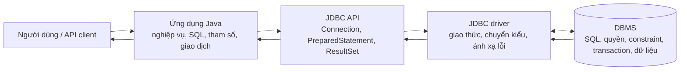

# Ranh giới trách nhiệm của ứng dụng, driver và cơ sở dữ liệu trong JDBC

## 1. Bức tranh tổng thể: Ai làm việc gì?

**JDBC (Java Database Connectivity)** là API chuẩn của Java để ứng dụng làm việc với cơ sở dữ liệu quan hệ. JDBC định nghĩa các giao diện như `Connection`, `Statement`, `PreparedStatement`, `ResultSet` và `SQLException`; còn **JDBC driver** là thành phần cụ thể giúp ứng dụng nói chuyện với hệ quản trị cơ sở dữ liệu (**DBMS**, ví dụ PostgreSQL, MySQL, Oracle Database hoặc SQL Server).

Khi xây dựng tính năng như “đặt hàng”, “chuyển tiền” hay “xem lịch sử giao dịch”, có ba chủ thể chính:

- **Ứng dụng Java** quyết định *nghiệp vụ cần làm gì*: nhận yêu cầu, kiểm tra dữ liệu đầu vào, đặt chính sách phân quyền ở tầng ứng dụng, chọn SQL và tham số, quyết định khi nào bắt đầu/kết thúc giao dịch, xử lý kết quả và lỗi.
- **JDBC driver** quyết định *chuyển lời gọi JDBC thành giao tiếp với DBMS ra sao*: quản lý giao thức kết nối, gửi lệnh và tham số, chuyển đổi kiểu dữ liệu, chuyển kết quả thành đối tượng JDBC, công bố khả năng hỗ trợ và thông báo lỗi qua các kiểu Java.
- **Cơ sở dữ liệu/DBMS** quyết định *dữ liệu thực sự được lưu, đọc và bảo vệ ra sao*: phân tích và thực thi SQL, tối ưu kế hoạch truy vấn, kiểm tra khóa/constraint/quyền, điều phối giao dịch và khóa, ghi dữ liệu bền vững theo cơ chế hệ thống.



Sơ đồ là **mô hình trách nhiệm**, không có nghĩa JDBC API luôn là một tiến trình hoặc máy chủ riêng. API là hợp đồng trong Java; driver thường là thư viện chạy trong cùng tiến trình ứng dụng. DBMS thường chạy trên máy chủ hoặc dịch vụ riêng, nhưng cũng có hệ cơ sở dữ liệu nhúng.

Điểm quan trọng: **chuẩn JDBC không đồng nghĩa tất cả cơ sở dữ liệu hành xử giống nhau**. JDBC chuẩn hóa cách *gọi*, còn cú pháp SQL, mức hỗ trợ tính năng, chi tiết giao dịch và hiệu năng vẫn phụ thuộc DBMS, driver và cấu hình.

## 2. Bảng phân định trách nhiệm theo công việc

| Công việc | Ứng dụng Java | JDBC driver | DBMS |
| --- | --- | --- | --- |
| Quyết định dữ liệu cần đọc/ghi | Xây yêu cầu nghiệp vụ, chọn SQL và giá trị | Nhận câu SQL và tham số từ JDBC | Thực thi câu SQL hợp lệ |
| Mở kết nối | Cấp địa chỉ, thông tin đăng nhập, cấu hình; gọi API | Thiết lập giao thức và phiên làm việc | Xác thực, tạo phiên, kiểm tra quyền kết nối |
| Gắn tham số `?` | Chọn vị trí, kiểu dữ liệu và giá trị qua `setXxx` | Mã hóa/truyền giá trị phù hợp giao thức, có thể chuẩn bị lệnh | Diễn giải và thực thi truy vấn với giá trị đã gắn |
| Kiểu dữ liệu | Chọn `BigDecimal`, `LocalDate`, `String`... | Ánh xạ giữa kiểu Java/JDBC và kiểu dữ liệu DBMS | Lưu, kiểm tra, tính toán theo kiểu của DBMS |
| Ràng buộc dữ liệu | Kiểm tra quy tắc nghiệp vụ và phản hồi thân thiện | Truyền yêu cầu, ánh xạ lỗi | Cưỡng chế `PRIMARY KEY`, `UNIQUE`, `FOREIGN KEY`, `CHECK` khi được định nghĩa |
| Phân quyền | Xác định người dùng nào được thao tác gì | Kết nối bằng danh tính được cấp, hỗ trợ cơ chế bảo mật | Kiểm soát quyền của tài khoản/role cơ sở dữ liệu |
| Giao dịch | Chọn phạm vi, `commit`/`rollback`, xử lý lỗi | Chuyển các lời gọi quản lý giao dịch | Đảm bảo các tính chất giao dịch theo mức cô lập và khả năng của hệ thống |
| Tối ưu truy vấn | Chọn truy vấn, chỉ mục/schema phù hợp cùng nhóm DBA; đo thời gian | Tối ưu trao đổi, buffering và khả năng của driver | Lập kế hoạch và thực thi truy vấn với dữ liệu/chỉ mục thực tế |
| Xử lý kết quả | Đọc `ResultSet`, ánh xạ thành đối tượng nghiệp vụ | Cung cấp con trỏ, chuyển dữ liệu và báo lỗi | Tạo các hàng/cột kết quả |
| Khôi phục sau lỗi | Quyết định retry, idempotency, báo lỗi nghiệp vụ | Cung cấp `SQLException`, SQLState và thông tin driver | Phát hiện vi phạm constraint, deadlock, lỗi lưu trữ, v.v. |

Một nhiệm vụ có thể có nhiều lớp cùng tham gia. Chẳng hạn, **bảo mật** không chỉ thuộc một phía: ứng dụng phải phân quyền nghiệp vụ, driver truyền dữ liệu an toàn khi được cấu hình thích hợp, và DBMS phải kiểm tra quyền của tài khoản.

## 3. JDBC API và JDBC driver: phân biệt hợp đồng với triển khai

JDBC cung cấp một giao diện lập trình tương đối thống nhất:

```java
import java.sql.Connection;
import java.sql.PreparedStatement;
import java.sql.ResultSet;
import java.sql.SQLException;
import javax.sql.DataSource;

public class ProductRepository {
    private final DataSource dataSource;

    public ProductRepository(DataSource dataSource) {
        this.dataSource = dataSource;
    }

    public String findName(long productId) throws SQLException {
        String sql = "SELECT product_name FROM products WHERE id = ?";

        try (Connection connection = dataSource.getConnection();
             PreparedStatement statement = connection.prepareStatement(sql)) {
            statement.setLong(1, productId);

            try (ResultSet results = statement.executeQuery()) {
                return results.next() ? results.getString("product_name") : null;
            }
        }
    }
}
```

Trong ví dụ, ứng dụng:

1. Nhận `productId` cần tìm và chọn câu SQL phù hợp.
2. Lấy `Connection` từ `DataSource` đã được cấu hình trước.
3. Tạo `PreparedStatement`, đặt tham số bằng `setLong(1, productId)`.
4. Đọc `ResultSet`, chuyển kết quả thành giá trị trả về.
5. Đóng tài nguyên bằng `try-with-resources`.

Driver triển khai các thao tác giao tiếp cần thiết để những lời gọi này hoạt động; ứng dụng không tự xây gói tin của giao thức DBMS. DBMS nhận yêu cầu và thực thi SQL dựa trên dữ liệu hiện có và quyền của phiên làm việc.

**Lưu ý về `PreparedStatement`:** API gắn tham số là hợp đồng JDBC, nhưng việc driver chuẩn bị lệnh ở máy chủ, mô phỏng một phần ở client, cache câu lệnh hay chọn phương thức truyền giá trị là chi tiết phụ thuộc driver. Không nên mặc định mọi driver thực thi cùng một chiến lược chỉ vì chương trình dùng chung API.

### 3.1. `DataSource` và connection pool thuộc lớp nào?

`javax.sql.DataSource` là giao diện để **cung cấp `Connection`**. Một `DataSource` có thể trực tiếp mở kết nối mới hoặc được triển khai bởi **connection pool** quản lý và tái sử dụng các kết nối vật lý. Connection pool là thành phần hạ tầng của ứng dụng, framework hoặc thư viện, không phải chức năng tối ưu truy vấn của DBMS và không nhất thiết là một phần của driver.

Với pool, `connection.close()` thường **trả kết nối về pool** thay vì đóng ngay kết nối vật lý. Cách hoạt động chính xác phụ thuộc triển khai pool; ứng dụng vẫn phải gọi `close()` đúng hạn và không giữ `Connection` qua nhiều request không cần thiết.

## 4. Ranh giới SQL: Ứng dụng mô tả mục tiêu, DBMS thực thi

SQL là ngôn ngữ yêu cầu dữ liệu và thao tác trên dữ liệu. Ứng dụng quyết định **điều kiện lọc, cột cần lấy, thứ tự, số hàng và tham số**; DBMS quyết định cách thực hiện bằng kế hoạch truy vấn dựa trên thống kê, chỉ mục, bộ nhớ và trạng thái hệ thống.

Ví dụ:

```sql
SELECT id, total_amount
FROM orders
WHERE customer_id = ?
ORDER BY created_at DESC, id DESC
LIMIT 20;
```

- **Ứng dụng** xác định người dùng chỉ được xem đơn hàng của mình, chuyển ID đã được xác thực thành tham số `customer_id`, và muốn tối đa 20 hàng mới nhất.
- **Driver** chuyển truy vấn cùng tham số qua cơ chế kết nối JDBC.
- **DBMS** xác thực quyền của tài khoản kết nối, kiểm tra SQL, quyết định có dùng chỉ mục hay sắp xếp và trả về kết quả.

SQL ở ví dụ dùng cú pháp `LIMIT` thường gặp ở một số DBMS; hệ quản trị khác có thể dùng `FETCH FIRST` hoặc `OFFSET ... FETCH`. **Driver JDBC không có nghĩa vụ tự dịch toàn bộ phương ngữ SQL này**. Tầng ứng dụng hoặc thư viện truy cập dữ liệu phải chọn câu SQL phù hợp DBMS đang triển khai.

Đối với **SQL injection**, ứng dụng có trách nhiệm tách giá trị đầu vào khỏi cấu trúc SQL bằng tham số `?`:

```java
// Đúng: giá trị đến từ bên ngoài được gắn thành tham số.
String sql = "SELECT id FROM accounts WHERE username = ?";
try (PreparedStatement statement = connection.prepareStatement(sql)) {
    statement.setString(1, username);
    try (ResultSet results = statement.executeQuery()) {
        // Xử lý kết quả.
    }
}
```

Không tạo SQL bằng cách nối trực tiếp `username` hoặc chuỗi tùy ý của người dùng. Tham số `?` dành cho **giá trị**, không thay thế được tên bảng, tên cột hoặc từ khóa SQL; khi cấu trúc cần thay đổi, ứng dụng phải chọn từ một danh sách phương án hợp lệ đã định nghĩa sẵn.

## 5. Ranh giới kiểm tra dữ liệu: Quy tắc nghiệp vụ và constraint

Giả sử một đơn hàng có tổng tiền, mã khách hàng và mã đơn hàng duy nhất.

**Ứng dụng chịu trách nhiệm** xác minh yêu cầu có phù hợp nghiệp vụ: khách hàng còn hoạt động, số lượng hàng trong giới hạn, người gửi request có quyền tạo đơn hàng và thông báo lỗi rõ ràng. Những kiểm tra này thường phụ thuộc ngữ cảnh người dùng và quy trình kinh doanh mà DBMS không tự biết.

**DBMS chịu trách nhiệm** bảo vệ tính toàn vẹn cuối cùng thông qua schema và các constraint thực sự được định nghĩa, chẳng hạn:

```sql
-- Ví dụ DDL minh họa; chi tiết kiểu dữ liệu/cú pháp tùy DBMS.
CREATE TABLE orders (
    id BIGINT PRIMARY KEY,
    customer_id BIGINT NOT NULL,
    total_amount DECIMAL(18, 2) NOT NULL,
    request_key VARCHAR(100) UNIQUE,
    CONSTRAINT positive_total CHECK (total_amount >= 0),
    CONSTRAINT customer_reference
        FOREIGN KEY (customer_id) REFERENCES customers(id)
);
```

Các kiểm tra tại ứng dụng có thể cải thiện trải nghiệm, nhưng chúng không thay thế ràng buộc tại DBMS khi có nhiều tiến trình, nhiều dịch vụ hoặc người dùng cùng thao tác. Ví dụ: hai request kiểm tra “mã đơn hàng chưa tồn tại” gần như đồng thời vẫn có thể cùng vượt qua bước kiểm tra ở Java; constraint `UNIQUE` mới là lớp ngăn trùng ở dữ liệu đã lưu.

Tương tự, DBMS chỉ cưỡng chế các constraint **thực sự có trong schema**. Nếu không định nghĩa `UNIQUE`, DBMS không tự suy đoán rằng mã nghiệp vụ phải duy nhất. Với hệ quản trị khác nhau, hỗ trợ và hành vi constraint có thể khác; cần kiểm tra ở môi trường đích.

**Driver ở giữa** không tự quyết định chính sách “đơn hàng hợp lệ” cho ứng dụng. Khi DBMS từ chối dữ liệu, driver báo lại `SQLException` hoặc các lớp con phù hợp để ứng dụng phân loại và phản hồi.

## 6. Ranh giới giao dịch: Ứng dụng xác định phạm vi, DBMS đảm bảo cơ chế

Một yêu cầu nghiệp vụ có thể cần cập nhật **nhiều hàng hoặc nhiều bảng cùng nhau**. Ứng dụng xác định thao tác nào phải thuộc cùng giao dịch; driver chuyển lệnh điều khiển giao dịch; DBMS thực thi commit/rollback và mức cô lập theo khả năng hỗ trợ.

Theo mặc định của JDBC, `Connection` mới thường ở chế độ **auto-commit**: mỗi câu lệnh SQL riêng lẻ được commit khi hoàn tất theo hợp đồng JDBC. Nếu một nghiệp vụ gồm nhiều bước phải thành công cùng nhau, ứng dụng cần chủ động tạo phạm vi giao dịch, hoặc để framework quản lý giao dịch.

Ví dụ chuyển tiền giữa hai tài khoản, giả định bảng `accounts(id, balance)`, kiểu `balance` phù hợp `DECIMAL`, yêu cầu đã được xác thực và có chính sách idempotency phù hợp ở tầng nghiệp vụ:

```java
import java.math.BigDecimal;
import java.sql.Connection;
import java.sql.PreparedStatement;
import java.sql.SQLException;
import javax.sql.DataSource;

public class MoneyTransfer {
    private final DataSource dataSource;

    public MoneyTransfer(DataSource dataSource) {
        this.dataSource = dataSource;
    }

    public void transfer(long fromId, long toId, BigDecimal amount)
            throws SQLException {
        if (fromId == toId || amount == null
                || amount.signum() <= 0) {
            throw new IllegalArgumentException("Giao dịch không hợp lệ");
        }

        try (Connection connection = dataSource.getConnection()) {
            connection.setAutoCommit(false);

            try {
                String debitSql = """
                    UPDATE accounts
                    SET balance = balance - ?
                    WHERE id = ? AND balance >= ?
                    """;
                try (PreparedStatement debit =
                        connection.prepareStatement(debitSql)) {
                    debit.setBigDecimal(1, amount);
                    debit.setLong(2, fromId);
                    debit.setBigDecimal(3, amount);
                    if (debit.executeUpdate() != 1) {
                        throw new SQLException(
                            "Không tìm thấy tài khoản nguồn hoặc số dư không đủ");
                    }
                }

                String creditSql = """
                    UPDATE accounts SET balance = balance + ?
                    WHERE id = ?
                    """;
                try (PreparedStatement credit =
                        connection.prepareStatement(creditSql)) {
                    credit.setBigDecimal(1, amount);
                    credit.setLong(2, toId);
                    if (credit.executeUpdate() != 1) {
                        throw new SQLException("Không tìm thấy tài khoản đích");
                    }
                }

                connection.commit();
            } catch (SQLException | RuntimeException error) {
                try {
                    connection.rollback();
                } catch (SQLException rollbackError) {
                    error.addSuppressed(rollbackError);
                }
                throw error;
            }
        }
    }
}
```

**Phân định trong ví dụ:**

1. **Ứng dụng** xác định điều kiện chuyển tiền, số tiền, thứ tự câu lệnh, thời điểm commit; nếu một bước thất bại thì yêu cầu rollback.
2. **Driver** gửi hai lệnh cập nhật và lệnh commit/rollback theo giao thức phù hợp, chuyển kết quả `executeUpdate()` về Java.
3. **DBMS** kiểm tra điều kiện `WHERE`, khóa bản ghi theo kế hoạch giao dịch, đảm bảo các cập nhật đã commit tồn tại bền vững theo cơ chế của hệ thống, và rollback những thay đổi chưa commit khi có yêu cầu hợp lệ.

Đây là **ví dụ dạy ranh giới trách nhiệm**, không phải một hệ thống chuyển tiền hoàn chỉnh: triển khai thực tế cần mã giao dịch duy nhất/idempotency, sổ cái, xử lý timeout và trường hợp trạng thái commit không chắc chắn, kiểm soát số tiền chính xác, concurrency/deadlock, phân quyền, audit và quy tắc nghiệp vụ riêng. Mã trên sở hữu kết nối lấy từ `DataSource` trong phạm vi phương thức; khi dùng framework quản lý transaction, không tự gọi `setAutoCommit`/`commit` trên kết nối do framework sở hữu.

### 6.1. Isolation và locking thuộc ai?

Ứng dụng có thể **yêu cầu** mức cô lập như `Connection.TRANSACTION_READ_COMMITTED` bằng `setTransactionIsolation(...)` nếu hệ thống hỗ trợ, hoặc chọn lệnh khóa phù hợp với DBMS. Nhưng **DBMS quyết định thực thi** về khóa, MVCC, các hiện tượng đồng thời được ngăn chặn, và deadlock. Driver có thể hỗ trợ truy vấn khả năng qua `DatabaseMetaData`; nó không tự biến một DBMS không hỗ trợ mức cô lập đó thành có hỗ trợ.

Không nên suy ra “đã dùng transaction” nghĩa là ứng dụng không còn phải nghĩ đến tranh chấp đồng thời. Tính nhất quán giữa nhiều yêu cầu vẫn cần thiết kế constraint, isolation và hành vi retry phù hợp.

## 7. Ranh giới kiểu dữ liệu: Java, JDBC và kiểu lưu trữ

Java và SQL không sử dụng cùng một hệ kiểu. Ứng dụng chọn kiểu phù hợp với nghiệp vụ; driver ánh xạ kiểu qua JDBC; DBMS lưu dữ liệu bằng kiểu SQL đã khai báo.

| Nhu cầu | Kiểu Java thường dùng | API JDBC | Kiểu SQL thường gặp |
| --- | --- | --- | --- |
| Mã định danh số nguyên lớn | `long` / `Long` | `setLong`, `getLong` | `BIGINT` |
| Giá tiền chính xác | `BigDecimal` | `setBigDecimal`, `getBigDecimal` | `DECIMAL` / `NUMERIC` |
| Nội dung ngắn | `String` | `setString`, `getString` | `VARCHAR` |
| Ngày theo lịch | `LocalDate` | `setObject`, `getObject(..., LocalDate.class)` khi hỗ trợ | `DATE` |
| Dấu thời gian | `LocalDateTime`, `OffsetDateTime` hoặc kiểu phù hợp nghiệp vụ | `setObject`, `getObject` khi driver hỗ trợ | `TIMESTAMP` và các biến thể |
| Giá trị có thể trống | Kiểu tham chiếu hoặc `Optional` tại tầng nghiệp vụ | `setNull`, `getObject`, `wasNull` | Cột có khả năng nhận `NULL` |

Khi dùng `getInt()` hoặc `getLong()`, giá trị SQL `NULL` có thể được chuyển thành `0`; cần gọi `ResultSet.wasNull()` ngay sau lần đọc tương ứng nếu muốn phân biệt `NULL` với số 0. Hoặc sử dụng `getObject` để nhận kiểu tham chiếu thích hợp.

Đối với **thời gian**, ứng dụng phải xác định dữ liệu có biểu diễn ngày địa phương, thời gian địa phương hay một thời điểm tuyệt đối; driver thực hiện ánh xạ theo khả năng hỗ trợ và cấu hình, còn DBMS áp dụng ngữ nghĩa của kiểu `TIMESTAMP` và múi giờ tương ứng. Không thể xem mọi kiểu `TIMESTAMP` ở mọi DBMS là giống hệt nhau. Đối với tiền tệ, `BigDecimal` và `DECIMAL` thường phù hợp hơn số thực nhị phân nếu yêu cầu tính toán chính xác.

## 8. Ranh giới bảo mật: Nhiều lớp bảo vệ cùng tồn tại

Một ứng dụng có thể kết nối cơ sở dữ liệu thành công nhưng vẫn bị lộ dữ liệu nếu phân quyền sai. Có ba lớp bảo vệ khác nhau:

**Tầng ứng dụng** xác thực người dùng cuối và kiểm tra quyền nghiệp vụ. Ví dụ, khi truy vấn đơn hàng của một khách hàng, ứng dụng phải xác định `customer_id` được phép xem, thay vì tin trực tiếp ID gửi từ request. Dữ liệu đưa vào SQL phải được tham số hóa.

**Tầng kết nối/driver** sử dụng thông tin kết nối và tùy chọn bảo mật, chẳng hạn cơ chế TLS khi DBMS/driver hỗ trợ và được cấu hình đúng. Driver không tự quyết định chính sách truy cập của người dùng cuối; mỗi kết nối thường được DBMS nhìn nhận theo tài khoản/role dùng để mở phiên.

**Tầng DBMS** xác thực tài khoản kết nối và kiểm soát quyền `SELECT`, `INSERT`, `UPDATE`, `DELETE`, quyền schema hoặc các cơ chế bảo mật khác mà DBMS hỗ trợ. Nên dùng tài khoản có **quyền tối thiểu** cho từng dịch vụ và không cấp quyền quản trị toàn bộ DBMS cho một API chỉ cần đọc dữ liệu.

Ví dụ về lỗi phân quyền mà ba lớp phải cùng phòng tránh:

| Tình huống | Trách nhiệm chính |
| --- | --- |
| Người dùng A thử xem đơn hàng của B bằng cách đổi URL | Ứng dụng xác thực và phân quyền theo tài nguyên; có thể phối hợp chính sách tại DBMS |
| Request chứa ký tự có khả năng thay đổi cú pháp SQL | Ứng dụng dùng tham số; driver thực hiện cơ chế gắn giá trị |
| Tài khoản ứng dụng có quyền `DROP TABLE` không cần thiết | Cấu hình quyền tài khoản tại DBMS theo nguyên tắc tối thiểu |
| Thông tin đăng nhập DB bị ghi thẳng vào log | Ứng dụng, vận hành và cơ chế quản lý secret |
| Kết nối truyền dữ liệu trên mạng không được bảo vệ | Cấu hình driver, endpoint và DBMS sử dụng cơ chế bảo mật thích hợp |

## 9. Ranh giới hiệu năng: Không phải driver giải quyết mọi truy vấn chậm

Khi một màn hình tải chậm, cần xác định **thời gian bị tiêu tốn ở lớp nào**:

- **Ứng dụng:** thực hiện quá nhiều truy vấn, gọi N+1, chọn quá nhiều cột, chuyển đổi đối tượng nặng, giữ kết nối trong khi thực hiện công việc không liên quan đến database.
- **Driver/kết nối:** cấu hình fetch size, buffering, kết nối mạng, cursor, statement cache hoặc connection pool chưa phù hợp; số lượt trao đổi mạng quá lớn.
- **DBMS:** thiếu chỉ mục phù hợp, kế hoạch truy vấn kém, bảng lớn, thống kê chưa phù hợp, tranh chấp khóa, I/O chậm hoặc thiếu tài nguyên.

Ví dụ với một danh sách 1 triệu đơn hàng:

```java
// Gợi ý cho driver về kích thước mỗi đợt lấy dữ liệu.
statement.setFetchSize(200);
```

`setFetchSize(200)` **không tương đương** với SQL `LIMIT 200`: fetch size chỉ gợi ý cơ chế lấy dữ liệu của driver và có thể được áp dụng khác nhau giữa các driver. Nếu ứng dụng cần **trang thứ hai gồm 20 đơn hàng**, chính câu SQL phải giới hạn và chọn vị trí trang; nếu cần **duyệt toàn bộ tập dữ liệu**, có thể chọn streaming/cursor hoặc các truy vấn theo khối có checkpoint.

Khi chẩn đoán, đo riêng thời gian chờ connection, thời gian execute SQL, thời gian đọc `ResultSet`, số hàng và số byte trả về, cùng kế hoạch thực thi/metric phía DBMS nếu có. Việc tăng fetch size không sửa được truy vấn thiếu điều kiện lọc; việc thêm chỉ mục không sửa được tình trạng ứng dụng để rò rỉ kết nối.

## 10. Ranh giới lỗi: Phát hiện, thông báo và quyết định xử lý

Các lỗi có thể đến từ nhiều phía nhưng thường đến tay Java dưới dạng `SQLException`. Driver chuyển thông tin của DBMS hoặc lỗi kết nối thành exception; ứng dụng quyết định cần thông báo gì và có được phép thử lại hay không.

```java
try (Connection connection = dataSource.getConnection();
     PreparedStatement statement = connection.prepareStatement(
         "SELECT id FROM products WHERE id = ?")) {
    statement.setLong(1, productId);
    try (ResultSet rows = statement.executeQuery()) {
        while (rows.next()) {
            System.out.println(rows.getLong("id"));
        }
    }
} catch (SQLException error) {
    System.err.println("SQLState: " + error.getSQLState());
    System.err.println("Vendor code: " + error.getErrorCode());
    // Tầng gọi quyết định log, chuyển thành lỗi ứng dụng hay retry có kiểm soát.
    throw error;
}
```

Ví dụ giả định `dataSource` đã cấu hình, `productId` có sẵn và phương thức cho phép ném `SQLException`.

| Lỗi | Vị trí phát sinh thường gặp | Cách ứng dụng nên nhìn nhận |
| --- | --- | --- |
| Câu SQL sai cú pháp | DBMS phân tích SQL; driver thông báo | Sửa câu SQL/phương ngữ; không retry mù |
| Vi phạm `UNIQUE` hoặc `FOREIGN KEY` | DBMS kiểm tra constraint | Trả lỗi nghiệp vụ phù hợp hoặc điều chỉnh quy trình |
| Hết thời gian chờ hoặc mất kết nối | Mạng/driver/DBMS | Phân loại lỗi, đánh giá retry và trạng thái giao dịch |
| Deadlock hoặc xung đột tuần tự hóa | DBMS điều phối transaction | Có thể retry **toàn bộ giao dịch** khi đã thiết kế an toàn |
| `ResultSet` bị đóng khi còn sử dụng | Vòng đời JDBC trong ứng dụng/driver | Sửa cách quản lý tài nguyên |

**Không retry mọi `SQLException`**. Việc thử lại an toàn phụ thuộc câu lệnh có tác dụng phụ hay không, transaction còn hiệu lực không và thao tác có tính **idempotent** hay không. Đặc biệt, khi mất kết nối trong lúc `commit()`, ứng dụng có thể **không biết chắc** giao dịch đã commit trên DBMS chưa. Chạy lại thao tác tạo đơn hàng hoặc chuyển tiền mà không có khóa nghiệp vụ/mã yêu cầu duy nhất có thể tạo hiệu ứng lặp. Lúc này cần cơ chế đối chiếu trạng thái và idempotency ở thiết kế nghiệp vụ.

## 11. Những hiểu lầm thường gặp về JDBC

| Hiểu lầm | Điều đúng |
| --- | --- |
| “JDBC tự làm cho mọi database giống nhau hoàn toàn.” | JDBC chuẩn hóa API Java; cú pháp SQL, kiểu dữ liệu và tính năng vẫn khác nhau |
| “Driver quyết định đơn hàng hợp lệ.” | Ứng dụng định nghĩa quy tắc nghiệp vụ; DBMS cưỡng chế constraint đã khai báo |
| “Có `PreparedStatement` thì tự động được phân quyền.” | Gắn tham số giảm rủi ro SQL injection; phân quyền ứng dụng và DBMS vẫn cần thiết |
| “Cứ gọi `commit()` là Java tự lưu dữ liệu xuống đĩa.” | Java phát lệnh; DBMS thực hiện cơ chế commit/durability của hệ thống |
| “Kiểm tra trùng ở Java là đủ.” | Tranh chấp đồng thời cần constraint `UNIQUE` hoặc cơ chế nhất quán phù hợp ở DBMS |
| “`DataSource` luôn có connection pool.” | Đây là giao diện; triển khai cụ thể có thể có pool hoặc mở kết nối mới |
| “`setFetchSize(100)` giới hạn tổng số hàng.” | Đây là gợi ý driver về việc lấy dữ liệu; giới hạn cần thực hiện bằng SQL hoặc API giới hạn kết quả |
| “Driver tự xử lý mọi lỗi mạng bằng retry an toàn.” | Ứng dụng phải quyết định retry theo transaction, idempotency và trạng thái kết quả |
| “Ứng dụng đã kiểm tra input thì không cần constraint.” | DBMS cần bảo vệ dữ liệu trước nhiều người ghi và nhiều đường truy cập |

## 12. Cách xác định lớp chịu trách nhiệm khi thiết kế hoặc sửa lỗi

Khi đứng trước một yêu cầu hoặc sự cố, có thể tự hỏi theo thứ tự:

1. **Đây có phải là quyết định nghiệp vụ?** Ví dụ “ai được xem đơn hàng nào”, “đơn hàng nào được hoàn tiền”, “giao dịch gồm những bước nào”. Nếu có, bắt đầu từ ứng dụng và hợp đồng nghiệp vụ.
2. **Đây có phải là chuyển đổi giữa Java và giao thức SQL?** Ví dụ cách `LocalDate` được bind, cấu hình TLS hoặc fetch size, driver có hỗ trợ cursor. Nếu có, đọc tài liệu driver và kiểm chứng cấu hình.
3. **Đây có phải là tính toàn vẹn hay cách SQL chạy trên dữ liệu thật?** Ví dụ vi phạm `UNIQUE`, khóa, isolation, query plan, chỉ mục. Nếu có, kiểm tra schema, trạng thái giao dịch và kế hoạch thực thi của DBMS.
4. **Có nhiều lớp cùng tham gia không?** Ví dụ mất kết nối giữa giao dịch: DBMS có thể đã commit, driver báo lỗi kết nối, ứng dụng phải khôi phục theo cơ chế idempotency. Không được ép mọi vấn đề về một lớp duy nhất.

### Ví dụ tổng hợp: API đặt đơn hàng

Một API `POST /orders` nhận giỏ hàng từ người dùng:

```mermaid
sequenceDiagram
    participant C as Client
    participant A as Java Application
    participant J as JDBC Driver
    participant D as DBMS
    C->>A: POST /orders
    Note over A: Xác thực, kiểm tra giỏ hàng,<br/>quyền thao tác và request key
    A->>J: prepareStatement + bind values
    J->>D: Truy vấn/ghi dữ liệu trong transaction
    Note over D: Kiểm tra quyền, khóa,<br/>PK/FK/UNIQUE/CHECK
    D-->>J: Số hàng, kết quả hoặc lỗi
    J-->>A: ResultSet / update count / SQLException
    Note over A: Commit hoặc rollback;<br/>ánh xạ thành phản hồi nghiệp vụ
    A-->>C: Kết quả đặt hàng
```

Ví dụ này cũng cho thấy khi một lớp thực hiện đúng vai trò của nó, lớp khác vẫn phải làm phần việc của mình. Driver không biết quyền người dùng cuối nếu ứng dụng không truyền ngữ cảnh; DBMS không tự biết ý nghĩa của giỏ hàng nếu schema và các ràng buộc chưa thể hiện; ứng dụng không thể tự bảo đảm atomicity chỉ bằng nhiều phép gán Java.

## 13. Câu hỏi tự kiểm tra

**Câu 1.** Hai request cùng tạo đơn hàng có `request_key` giống nhau. Java đều kiểm tra và thấy chưa tồn tại. Thành phần nào có thể bảo đảm không có hai bản ghi trùng khóa sau khi ghi?

**Trả lời:** Constraint `UNIQUE` được DBMS thực thi, nếu trường `request_key` thực sự có constraint đó. Ứng dụng phải xử lý kết quả một request bị từ chối và định nghĩa hành vi idempotent.

**Câu 2.** Đã dùng `PreparedStatement` nhưng người dùng A vẫn xem được đơn hàng của B. Có phải driver bị lỗi?

**Trả lời:** Không thể kết luận như vậy. `PreparedStatement` giúp gắn tham số SQL; ứng dụng vẫn phải kiểm tra người dùng có quyền truy cập dữ liệu hay không. DBMS cũng cần quyền phù hợp.

**Câu 3.** Vì sao cùng một câu gọi JDBC có thể hoạt động trên DBMS này nhưng không hoạt động trên DBMS khác?

**Trả lời:** JDBC chuẩn hóa API; SQL dialect, dữ liệu, khả năng hỗ trợ kiểu/cursor/isolation và cấu hình driver có thể khác. Cần đối chiếu khả năng của DBMS và driver.

**Câu 4.** Khi truy vấn chậm, tăng `setFetchSize` có chắc sẽ giải quyết?

**Trả lời:** Không. Nếu chậm vì full table scan, khóa hoặc sắp xếp lớn tại DBMS, thay đổi fetch size có thể không giúp. Cần đo riêng query execution, truyền dữ liệu và xử lý Java.

**Câu 5.** Mất kết nối đúng lúc gọi `commit()`, có thể chạy lại toàn bộ nghiệp vụ ngay không?

**Trả lời:** Chưa chắc. Giao dịch có thể đã được commit nhưng Java chưa nhận phản hồi; cần kiểm tra trạng thái và dùng idempotency hoặc cơ chế đối chiếu phù hợp trước khi thử lại.

## 14. Nguyên tắc ghi nhớ

**Ứng dụng Java sở hữu quyết định nghiệp vụ và cách sử dụng JDBC; driver sở hữu việc triển khai giao tiếp JDBC với hệ cơ sở dữ liệu; DBMS sở hữu xử lý SQL và các bảo đảm về dữ liệu được cấu hình trên hệ thống.** Trong một thiết kế tốt, từng lớp thực hiện phần việc của mình và ứng dụng luôn kiểm chứng những hành vi phụ thuộc driver hoặc DBMS. Nắm ranh giới này giúp viết mã truy cập quan hệ dễ bảo trì, sửa lỗi đúng nơi và bảo vệ dữ liệu nhất quán khi hệ thống có nhiều người dùng đồng thời.
