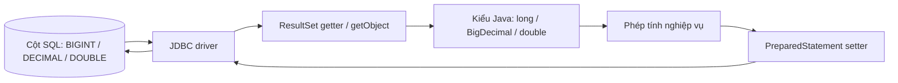

# Xử lý tràn số và chuyển đổi giữa các kiểu số trong JDBC

## 1. Vì sao truy cập dữ liệu số có thể làm sai kết quả?

Một ứng dụng quản lý đơn hàng viết bằng Java dùng **JDBC (Java Database Connectivity)** để truy cập cơ sở dữ liệu quan hệ. Bảng sản phẩm có giá bán, số lượng tồn kho, doanh thu và ID. Khi truy vấn, chương trình phải chuyển giá trị từ kiểu SQL sang kiểu Java; khi ghi, quá trình chuyển đổi diễn ra theo chiều ngược lại.

Giả sử cột `order_total` lưu số tiền `123456789012.34`, còn lập trình viên đọc bằng `ResultSet.getInt(...)`. Một số nguyên `int` của Java không biểu diễn được giá trị đó. Tùy kiểu SQL, JDBC driver và phép chuyển đổi được yêu cầu, chương trình có thể nhận `SQLException`, mất phần thập phân hoặc có kết quả không như mong đợi. Nếu dùng `double` để xử lý tiền, giá trị nhị phân xấp xỉ có thể gây sai số ngay cả khi không tràn phạm vi.

Ba vấn đề cần tách rõ:

1. **Tràn số (overflow):** giá trị hoặc kết quả phép tính nằm ngoài miền biểu diễn của kiểu đích.
2. **Mất độ chính xác hoặc phần thập phân:** phép chuyển đổi giữ giá trị trong phạm vi nhưng làm tròn, cắt phần lẻ hoặc đổi từ số thập phân chính xác sang xấp xỉ nhị phân.
3. **Sai ngữ nghĩa dữ liệu:** `NULL` bị đọc như `0`, số không dấu vượt giới hạn kiểu có dấu, hoặc phép chuyển đổi tự động phụ thuộc database/driver.

Khi dùng JDBC, cần hiểu **kiểu SQL ở database, kiểu trung gian do driver xử lý và kiểu Java mà ứng dụng nhận**. Không thể kết luận an toàn chỉ vì câu SQL đã chạy thành công.

## 2. Ba lớp chuyển đổi giá trị số



Ở chiều đọc, `ResultSet` cung cấp các phương thức như `getInt()`, `getLong()`, `getDouble()`, `getBigDecimal()` và `getObject()`. Ở chiều ghi, `PreparedStatement` có `setInt()`, `setLong()`, `setDouble()`, `setBigDecimal()` và `setObject()`.

Điều kiện an toàn không chỉ là getter có trả về một giá trị hay không. Một kết quả cần thỏa đồng thời **đủ phạm vi, đủ độ chính xác, đúng ý nghĩa dữ liệu và được xử lý `NULL`**.

Ví dụ, giá tiền có phần lẻ thường cần cột `DECIMAL`/`NUMERIC` và `BigDecimal`. Một bộ đếm nguyên vừa trong giới hạn 32 bit có thể dùng `INTEGER`/`int`; một khóa `BIGINT` được kiểm soát trong miền signed 64-bit có thể dùng `long`.

## 3. Các kiểu số SQL thường gặp và kiểu Java tương ứng

| Kiểu SQL | Kiểu Java thường dùng | Điều cần kiểm tra |
| --- | --- | --- |
| `SMALLINT` | `short` hoặc `int` | Giá trị có nằm trong miền của kiểu Java không? |
| `INTEGER` / `INT` | `int` hoặc `long` | Có nguy cơ tổng/counter lớn hơn 32 bit không? |
| `BIGINT` | `long` | Cột có thể chứa giá trị không dấu vượt `Long.MAX_VALUE` không? |
| `TINYINT` nếu DBMS hỗ trợ | `byte`, `short` hoặc `int` | Tính signed/unsigned phụ thuộc hệ quản trị. |
| `DECIMAL(p,s)` / `NUMERIC(p,s)` | `BigDecimal` | Precision, scale, miền giá trị và quy tắc làm tròn. |
| `REAL` | `float` | Là kiểu số thực xấp xỉ; có sai số nhị phân. |
| `FLOAT` / `DOUBLE PRECISION` | `double` hoặc `float` tùy DBMS/driver | Tên kiểu, độ chính xác và phép ánh xạ có thể khác nhau. |

Các ánh xạ trên là **định hướng thiết kế**, không phải bảng cam kết mọi DBMS có cùng phạm vi và cách cài đặt. Chẳng hạn, MySQL có các biến thể `UNSIGNED`, trong khi PostgreSQL không áp dụng cùng mô hình kiểu số nguyên không dấu cho các cột integer thông thường. Một hệ quản trị cũng có thể mở rộng cách xử lý `NUMERIC` hoặc giá trị đặc biệt.

**Phạm vi các kiểu nguyên Java thông dụng:**

| Kiểu Java | Số bit | Giá trị nhỏ nhất | Giá trị lớn nhất |
| --- | ---: | ---: | ---: |
| `byte` | 8 | -128 | 127 |
| `short` | 16 | -32.768 | 32.767 |
| `int` | 32 | -2.147.483.648 | 2.147.483.647 |
| `long` | 64 | -9.223.372.036.854.775.808 | 9.223.372.036.854.775.807 |

Một con số trong cột SQL lớn hơn những giới hạn này không thể được biểu diễn chính xác bằng kiểu Java nhỏ hơn. Nếu giá trị có thể lớn hơn 64 bit, cân nhắc cột `NUMERIC`/`DECIMAL` với phạm vi đủ lớn, đọc bằng `BigDecimal`, rồi dùng `BigInteger` sau khi kiểm tra số là nguyên.

## 4. Tràn số có thể xảy ra ở những thời điểm nào?

Tràn số có thể xuất hiện tại bốn điểm:

| Thời điểm | Ví dụ | Cách xử lý |
| --- | --- | --- |
| **Tại DBMS khi ghi** | Ghi `100000` vào `DECIMAL(7,2)`, giá trị có sáu chữ số phần nguyên trong khi cột cho phép tối đa năm. | Kiểm tra precision/scale trong ứng dụng, giữ ràng buộc ở DB và xử lý lỗi SQL. |
| **Trong biểu thức SQL** | Cộng/nhân giá trị nguyên làm kết quả vượt miền mà DBMS dùng để tính. | Dùng kiểu đủ rộng, ép kiểu có chủ đích và thử trên DBMS mục tiêu. |
| **Khi JDBC đọc/ép kiểu** | Đọc một cột `BIGINT` có giá trị 3.000.000.000 bằng `getInt()`. | Đọc bằng `getLong()` hoặc kiểu chính xác phù hợp; không phụ thuộc hành vi chuyển đổi ngoài phạm vi. |
| **Trong mã Java** | Cộng hai giá trị `int` lớn hoặc ép `long` sang `int`. | Dùng `Math.addExact`, `Math.multiplyExact`, `Math.toIntExact` hoặc `BigDecimal`/`BigInteger`. |

Không phải driver nào cũng báo lỗi giống nhau khi gặp giá trị ngoài phạm vi ở bước chuyển đổi. Vì vậy, **tránh yêu cầu chuyển đổi mà kiểu đích không thể biểu diễn**, dù một driver thử nghiệm dường như trả được kết quả.

Ví dụ SQL minh họa vấn đề:

```sql
CREATE TABLE invoices (
    id BIGINT PRIMARY KEY,
    item_count INTEGER NOT NULL,
    amount DECIMAL(7, 2) NOT NULL
);

-- DECIMAL(7,2) có tối đa 5 chữ số trước dấu thập phân.
-- 99999.99 vừa miền; 100000.00 vượt miền đó.
```

DBMS có thể ném lỗi, làm tròn hoặc áp dụng một quy tắc chuyển đổi khác tùy loại phép tính và cấu hình. Ứng dụng phải có **quy tắc chấp nhận dữ liệu rõ ràng**, không dựa vào việc database tự sửa mọi giá trị không hợp lệ.

## 5. `getInt()` không phải lựa chọn an toàn cho mọi cột số nguyên

Giả sử bảng `ledger` có cột `total_units BIGINT`, và một hàng lưu `3000000000` (ba tỷ). Giá trị này nằm trong miền `long` nhưng vượt `Integer.MAX_VALUE`.

```java
String sql = "SELECT total_units FROM ledger WHERE id = ?";

try (PreparedStatement statement = connection.prepareStatement(sql)) {
    statement.setLong(1, ledgerId);

    try (ResultSet result = statement.executeQuery()) {
        if (result.next()) {
            // Không nên: cột BIGINT có thể vượt miền int.
            int units = result.getInt("total_units");
            System.out.println(units);
        }
    }
}
```

Việc dùng `getInt()` yêu cầu driver chuyển dữ liệu nguồn về `int`. Khi giá trị vượt phạm vi, chương trình có thể gặp lỗi chuyển đổi hoặc kết quả không phù hợp tùy triển khai. Lựa chọn đúng nếu miền dữ liệu được bảo đảm trong signed 64-bit:

```java
long units = result.getLong("total_units");
```

Nếu giao diện hoặc API ngoài cần `int`, hãy kiểm tra có thể thu hẹp giá trị **sau khi đã đọc đúng**:

```java
long units = result.getLong("total_units");
int unitsForLegacyApi = Math.toIntExact(units);
```

`Math.toIntExact(long)` ném `ArithmeticException` nếu không biểu diễn được bằng `int`, thay vì tự cắt bớt bit. Nhờ vậy, ứng dụng có thể báo lỗi dữ liệu theo nghiệp vụ thay vì âm thầm tạo số sai.

Ví dụ cùng giá trị:

```java
long large = 3_000_000_000L;

int unsafe = (int) large;
System.out.println(unsafe); // -1294967296: giá trị đã bị cắt bit.

int checked = Math.toIntExact(large); // ArithmeticException.
```

**Điểm khác nhau:** đây là phép ép kiểu **trong Java**; không nên suy rằng driver JDBC sẽ cắt bit giống biểu thức `(int)` của Java. Chi tiết chuyển đổi SQL-to-Java thuộc hợp đồng JDBC và cách triển khai của driver.

## 6. Số thực nhị phân và số thập phân chính xác

Kiểu `float`/`double` dùng biểu diễn nhị phân xấp xỉ. Nhiều giá trị thập phân quen thuộc như `0.1` không thể biểu diễn chính xác dưới dạng số thực nhị phân hữu hạn.

```java
double result = 0.1 + 0.2;
System.out.println(result); // Thường là 0.30000000000000004.
```

Nếu dùng `DOUBLE` trong database và `getDouble()` ở Java, **sai số có thể đã phát sinh ngay trong dữ liệu nguồn**, không thể khôi phục độ chính xác thập phân ban đầu bằng cách đổi sang `BigDecimal` sau khi đọc.

Đối với số tiền, thuế hoặc tỷ lệ cần độ chính xác thập phân xác định, thường dùng:

- SQL: `DECIMAL(p,s)` hoặc `NUMERIC(p,s)` với precision và scale được thiết kế.
- Java: `java.math.BigDecimal`.
- JDBC: `ResultSet.getBigDecimal(...)` và `PreparedStatement.setBigDecimal(...)`.

```java
BigDecimal a = new BigDecimal("0.1");
BigDecimal b = new BigDecimal("0.2");
BigDecimal sum = a.add(b);

System.out.println(sum); // 0.3.
```

Nên tạo `BigDecimal` từ **chuỗi thập phân** khi muốn bảo toàn đúng giá trị được viết ra. `new BigDecimal(0.1)` nhận giá trị nhị phân xấp xỉ của `double` và có thể cho chuỗi thập phân dài ngoài ý muốn. `BigDecimal.valueOf(0.1)` sử dụng biểu diễn chuỗi của `double`, nhưng việc tạo thẳng từ nguồn thập phân đáng tin cậy vẫn rõ ràng hơn.

Không dùng `double` để thay thế `BigDecimal` chỉ vì giá trị cần lưu có hai chữ số thập phân.

## 7. Precision và scale của `DECIMAL(p,s)`

`DECIMAL(p,s)` mô tả một số thập phân có:

- **Precision `p`:** tổng số chữ số thập phân có ý nghĩa mà kiểu cho phép.
- **Scale `s`:** số chữ số phần thập phân theo cấu hình kiểu.
- Với kiểu thông dụng có `0 <= s <= p`, phần nguyên có tối đa `p - s` chữ số.

Ví dụ:

| Kiểu SQL | Số chữ số phần nguyên | Số chữ số phần lẻ | Ví dụ trong phạm vi | Ví dụ vượt phạm vi |
| --- | ---: | ---: | --- | --- |
| `DECIMAL(7,2)` | 5 | 2 | `99999.99` | `100000.00` |
| `DECIMAL(12,2)` | 10 | 2 | `1234567890.12` | `12345678901.12` |
| `DECIMAL(10,4)` | 6 | 4 | `123456.7890` | `1234567.0000` |

Các DBMS có thể có giới hạn khác nhau cho `p`, `s`, cách khai báo mặc định và việc làm tròn hoặc báo lỗi khi số chữ số thập phân đầu vào vượt scale. Vì vậy, không suy từ tên `DECIMAL` rằng việc ghi một giá trị bất kỳ sẽ tự được thực hiện chính xác theo ý định.

Ví dụ muốn lưu **giá không âm** trong cột `DECIMAL(7,2)`, ứng dụng có thể kiểm tra trước:

```java
import java.math.BigDecimal;
import java.math.RoundingMode;

public final class PriceRules {
    private static final BigDecimal MAX_PRICE =
            new BigDecimal("99999.99");

    public static BigDecimal validate(BigDecimal value) {
        if (value == null) {
            throw new IllegalArgumentException("Gia khong duoc null");
        }

        // Chỉ chấp nhận giá trị biểu diễn chính xác với 2 chữ số lẻ.
        BigDecimal normalized =
                value.setScale(2, RoundingMode.UNNECESSARY);

        if (normalized.signum() < 0 || normalized.compareTo(MAX_PRICE) > 0) {
            throw new IllegalArgumentException("Gia vuot gioi han DECIMAL(7,2)");
        }
        return normalized;
    }
}
```

`RoundingMode.UNNECESSARY` yêu cầu chuyển scale mà **không phải bỏ chữ số khác 0**; nếu cần làm tròn, Java sẽ ném `ArithmeticException`. Chẳng hạn `12.345` bị từ chối vì không biểu diễn chính xác bằng hai chữ số lẻ, còn `12.340` có thể trở thành `12.34` mà không mất giá trị.

Trong nghiệp vụ cho phép làm tròn, cần chọn quy tắc rõ ràng, ví dụ `HALF_EVEN` hoặc `HALF_UP`, thay vì tự giả định database, driver và Java có cùng cách làm tròn.

```java
BigDecimal raw = new BigDecimal("1.005");
BigDecimal rounded = raw.setScale(2, RoundingMode.HALF_EVEN);
System.out.println(rounded); // 1.00.
```

Quy tắc phù hợp tùy chính sách kế toán, thuế và đơn vị tiền tệ. Mọi phép so sánh biên phải tính cả **giá trị âm, số 0 và các giá trị sau khi làm tròn** nếu trường dữ liệu cho phép.

## 8. Đọc `DECIMAL` và chuyển sang kiểu nguyên có kiểm soát

Một phép chuyển đổi từ `BigDecimal` sang kiểu nguyên có thể làm mất phần lẻ hoặc vượt phạm vi:

```java
BigDecimal amount = new BigDecimal("123.99");

long truncated = amount.longValue();
System.out.println(truncated); // 123: mất phần thập phân.

long exact = amount.longValueExact(); // ArithmeticException.
```

Các phương thức `longValue()`, `intValue()` **không chứng minh phép chuyển đổi chính xác**. Để chuyển có kiểm tra:

- `intValueExact()` yêu cầu số nguyên trong miền `int`.
- `longValueExact()` yêu cầu số nguyên trong miền `long`.
- `toBigIntegerExact()` yêu cầu không có phần lẻ.

Ví dụ cột SQL `NUMERIC` chứa số nguyên ngoài miền signed 64-bit:

```java
BigDecimal source = new BigDecimal("9223372036854775808");

// Không biểu diễn được bằng long.
// long invalid = source.longValueExact(); // ArithmeticException.

BigInteger exactInteger = source.toBigIntegerExact();
System.out.println(exactInteger);
```

Ví dụ trên cần `import java.math.BigInteger;`. Tầng JDBC dùng `getBigDecimal()` để đọc một cột SQL decimal chính xác; `BigInteger` được tạo ở Java khi ứng dụng cần số nguyên tùy ý lớn và đã xác minh phần lẻ bằng `toBigIntegerExact()`.

**Không dùng `getDouble()` rồi ép sang `long`** để đọc ID hoặc bộ đếm lớn. `double` có độ chính xác hữu hạn, nên không thể biểu diễn chính xác mọi số nguyên 64-bit; quá trình ép kiểu còn có thể mất thông tin khác.

## 9. Ghi số qua `PreparedStatement`: chọn setter có chủ đích

Với bảng:

```sql
CREATE TABLE product_prices (
    product_id BIGINT PRIMARY KEY,
    unit_price DECIMAL(7,2) NOT NULL
);
```

Đoạn Java dưới đây cập nhật giá sản phẩm và yêu cầu giá trị thỏa quy tắc ứng dụng:

```java
import java.math.BigDecimal;
import java.sql.Connection;
import java.sql.PreparedStatement;
import java.sql.SQLException;

public final class ProductPriceWriter {
    public static void updatePrice(
            Connection connection, long productId, BigDecimal newPrice)
            throws SQLException {
        BigDecimal checkedPrice = PriceRules.validate(newPrice);

        String sql =
                "UPDATE product_prices SET unit_price = ? WHERE product_id = ?";
        try (PreparedStatement statement = connection.prepareStatement(sql)) {
            statement.setBigDecimal(1, checkedPrice);
            statement.setLong(2, productId);

            if (statement.executeUpdate() != 1) {
                throw new SQLException("Khong tim thay san pham");
            }
        }
    }
}
```

`setBigDecimal()` thể hiện ý định ghi một giá trị thập phân chính xác, trong khi `setLong()` phù hợp với ID đã được xác nhận nằm trong signed 64-bit. Database vẫn phải **kiểm tra ràng buộc ở phía máy chủ**: validation phía Java không ngăn dữ liệu sai đi qua ứng dụng khác hoặc câu SQL độc lập.

`PreparedStatement.setObject(...)` cũng có thể nhận các kiểu Java số, và một số overload cho phép chỉ định `java.sql.Types`/kiểu SQL mục tiêu. Tuy nhiên, phép suy kiểu và chuyển đổi cụ thể có thể phụ thuộc driver. Với schema đã biết, **setter tường minh** giúp truyền đạt rõ ý định và tránh một số trường hợp chuyển đổi mơ hồ.

Ví dụ với một cột decimal có thể nhận `NULL`:

```java
if (price == null) {
    statement.setNull(1, java.sql.Types.DECIMAL);
} else {
    statement.setBigDecimal(1, price);
}
```

Khi dùng chung đoạn mã giữa nhiều DBMS, nên kiểm tra hỗ trợ kiểu đích và cách driver ánh xạ `NUMERIC`/`DECIMAL` trên từng hệ quản trị mục tiêu.

## 10. Phép tính Java cũng có thể tràn trước khi ghi vào SQL

Ngay cả khi cột SQL đủ rộng, dữ liệu gửi xuống database có thể đã sai **ngay trong phép tính Java**:

```java
int max = Integer.MAX_VALUE;
int incorrect = max + 1;
System.out.println(incorrect); // -2147483648: tràn số nguyên có dấu.
```

Đây là hành vi số nguyên cố định chiều rộng trong Java, không phải lỗi của JDBC. Với phép tính yêu cầu phát hiện overflow, sử dụng các hàm `Exact`:

```java
int checkedSum = Math.addExact(Integer.MAX_VALUE, 1);
// ArithmeticException.

long checkedTotal = Math.multiplyExact(3_000_000_000L, 4L);
// 12000000000, nằm trong miền long.
```

Các hàm hữu ích khác gồm `Math.subtractExact(...)`, `Math.incrementExact(...)` và `Math.toIntExact(...)`. Chúng có thể ném `ArithmeticException`; ứng dụng nên chuyển lỗi thành thông báo nghiệp vụ phù hợp tại ranh giới cần thiết.

Với tính toán tiền hoặc số học thập phân, dùng `BigDecimal.add()`, `subtract()`, `multiply()` và `divide()`:

```java
BigDecimal price = new BigDecimal("199.90");
BigDecimal quantity = BigDecimal.valueOf(3);
BigDecimal total = price.multiply(quantity);
System.out.println(total); // 599.70.
```

`BigDecimal.divide(...)` có thể ném `ArithmeticException` nếu kết quả thập phân vô hạn và không được cấp scale hoặc `MathContext` thích hợp. Ví dụ `BigDecimal.ONE.divide(new BigDecimal("3"))` không có kết quả thập phân hữu hạn; cần chọn chính sách làm tròn nếu phép chia nghiệp vụ cho phép.

## 11. `NULL` không phải số 0

Với các getter nguyên thủy như `getInt()` và `getLong()`, khi cột SQL là `NULL`, JDBC trả về **giá trị mặc định số 0** và cho phép kiểm tra bằng `ResultSet.wasNull()`.

```java
long units = rows.getLong("reserved_units");
if (rows.wasNull()) {
    System.out.println("Chua co so luong dat truoc");
} else {
    System.out.println("So luong: " + units);
}
```

**Gọi `wasNull()` ngay sau getter cần kiểm tra.** Một getter khác thực thi trước đó có thể cập nhật trạng thái đọc `NULL`, khiến kết luận cho cột trước không còn đáng tin.

Với giá trị decimal, `getBigDecimal(...)` trả về `null` khi cột SQL là `NULL`:

```java
BigDecimal discount = rows.getBigDecimal("discount");
if (discount == null) {
    // Không có mức chiết khấu được lưu trong DB.
}
```

Phân biệt rõ ba trạng thái **không có giá trị (`NULL`)**, **giá trị 0** và **dữ liệu không hợp lệ do tràn hoặc chuyển đổi**. Việc dùng `COALESCE(col, 0)` trong SQL chỉ phù hợp nếu quy tắc nghiệp vụ thật sự coi `NULL` là 0.

## 12. Số nguyên không dấu và `BIGINT` quá lớn

Java không có kiểu nguyên primitive **không dấu 64-bit** tương đương với toàn bộ miền của `BIGINT UNSIGNED` trong một số hệ quản trị. Giá trị lớn hơn `Long.MAX_VALUE` không thể lưu nguyên vẹn trong `long` có dấu.

Ví dụ:

```java
BigDecimal unsignedValue =
        new BigDecimal("18446744073709551615");

// Giá trị dương này lớn hơn Long.MAX_VALUE.
BigInteger exact = unsignedValue.toBigIntegerExact();
```

Phạm vi và cách driver báo/đọc kiểu không dấu phụ thuộc DBMS. Không giả định mọi `BIGINT` SQL đều ánh xạ trọn vẹn sang `long`. Nếu ứng dụng cần hỗ trợ các giá trị không dấu lớn, hãy thiết kế rõ kiểu miền dữ liệu, dùng `BigInteger` hoặc `BigDecimal` có kiểm soát và xác minh ánh xạ JDBC với driver đích.

Không nên sử dụng `Long.parseUnsignedLong(...)` cùng với phép ép hoặc getters một cách tùy tiện để “vá” dữ liệu vượt miền; phương thức Java có thể thao tác trên biểu diễn bit không dấu, nhưng **phần lưu trữ, so sánh và truyền dữ liệu qua JDBC vẫn phải thống nhất về ngữ nghĩa**.

## 13. Dùng metadata để phát hiện kiểu và giới hạn

`ResultSetMetaData` mô tả các cột của **kết quả truy vấn**:

```java
import java.sql.ResultSet;
import java.sql.ResultSetMetaData;
import java.sql.SQLException;

public final class NumericColumnInspector {
    public static void inspect(ResultSet rows) throws SQLException {
        ResultSetMetaData meta = rows.getMetaData();

        for (int column = 1; column <= meta.getColumnCount(); column++) {
            System.out.printf(
                "Column=%s, type=%d, typeName=%s, precision=%d, scale=%d%n",
                meta.getColumnLabel(column),
                meta.getColumnType(column),
                meta.getColumnTypeName(column),
                meta.getPrecision(column),
                meta.getScale(column)
            );
        }
    }
}
```

Các phương thức:

- `getColumnType(int)` trả mã kiểu JDBC (liên hệ `java.sql.Types`).
- `getColumnTypeName(int)` trả tên kiểu được driver/DBMS công bố.
- `getPrecision(int)` cho biết precision theo hợp đồng metadata.
- `getScale(int)` cho biết scale khi có ý nghĩa.
- `isSigned(int)` cho biết cột được công bố là có dấu hay không.

Đối với toàn database, `DatabaseMetaData.getTypeInfo()` có thể cung cấp thông tin các kiểu mà driver/hệ quản trị hỗ trợ. **Metadata vẫn có giới hạn:** một biểu thức SQL như `SUM(amount)`, `CAST(...)` hay hàm số học có thể có kiểu kết quả khác kiểu cột nguồn; driver cũng có thể báo giá trị không đầy đủ tùy DBMS.

Do đó, hãy xem metadata là thông tin **khảo sát để chọn đường chuyển đổi** và dùng kiểm thử thực tế để xác nhận phạm vi, độ chính xác và hành vi của dữ liệu.

## 14. Xử lý lỗi JDBC khi giá trị ngoài phạm vi

Việc ghi hoặc đọc giá trị số ngoài phạm vi có thể khiến DBMS/driver ném `SQLException`. Một số lỗi chuyển đổi có thể có **SQLState `22003`** (numeric value out of range) theo quy ước SQLState, nhưng **không phải mọi driver hoặc DBMS đều báo cùng mã**. Các lỗi chuyển kiểu, làm tròn, mất dữ liệu hoặc giá trị không hợp lệ còn có thể dùng mã vendor riêng.

```java
try (PreparedStatement statement = connection.prepareStatement(sql)) {
    statement.setBigDecimal(1, amount);
    statement.executeUpdate();
} catch (SQLException error) {
    System.err.println("SQLState: " + error.getSQLState());
    System.err.println("Vendor code: " + error.getErrorCode());
    System.err.println("Message: " + error.getMessage());
    throw error;
}
```

`SQLDataException` là một nhánh của `SQLException` được dùng cho một số lỗi dữ liệu. `DataTruncation` cũng biểu diễn tình huống dữ liệu bị cắt; tùy thao tác và driver, nó có thể được báo qua exception hoặc warning. Vì vậy, khi cần chẩn đoán sâu, xem exception chain (`getNextException()`), warning được driver công bố và tài liệu vendor. **Không coi việc không có exception là bằng chứng không có mất độ chính xác**.

Nếu đang trong transaction, xử lý lỗi theo ranh giới transaction: một câu `INSERT` hoặc `UPDATE` thất bại có thể yêu cầu rollback và thử lại toàn bộ nghiệp vụ theo quy định của DBMS. Không tiếp tục commit những cập nhật một phần nếu tính đúng đắn yêu cầu tất cả các bước thành công.

Trong log, ghi đủ ngữ cảnh kỹ thuật như tên thao tác, kiểu dự kiến, precision/scale và SQLState nhưng **không ghi mật khẩu hoặc dữ liệu nhạy cảm**. Với lỗi số tiền, ưu tiên thông báo nghiệp vụ dễ hiểu thay vì trả nguyên chuỗi lỗi database cho người dùng.

## 15. Ví dụ hoàn chỉnh: đọc và cập nhật số tiền chính xác

Giả sử bảng sau tồn tại:

```sql
CREATE TABLE product_prices (
    product_id BIGINT PRIMARY KEY,
    unit_price DECIMAL(7,2) NOT NULL
);

INSERT INTO product_prices (product_id, unit_price)
VALUES (1, 1250.50);
```

Mã repository nhận `DataSource` và đọc giá bằng `BigDecimal`, giữ nguyên ý nghĩa số thập phân:

```java
import java.math.BigDecimal;
import java.sql.Connection;
import java.sql.PreparedStatement;
import java.sql.ResultSet;
import java.sql.SQLException;
import java.util.Optional;
import javax.sql.DataSource;

public final class ProductPriceRepository {
    private final DataSource dataSource;

    public ProductPriceRepository(DataSource dataSource) {
        this.dataSource = dataSource;
    }

    public Optional<BigDecimal> findPrice(long productId) throws SQLException {
        String sql =
                "SELECT unit_price FROM product_prices WHERE product_id = ?";

        try (Connection connection = dataSource.getConnection();
             PreparedStatement statement = connection.prepareStatement(sql)) {
            statement.setLong(1, productId);

            try (ResultSet rows = statement.executeQuery()) {
                if (!rows.next()) {
                    return Optional.empty();
                }
                BigDecimal price = rows.getBigDecimal("unit_price");
                if (price == null) {
                    throw new SQLException("Gia tri unit_price bat ngo la NULL");
                }
                return Optional.of(price);
            }
        }
    }

    public void updatePrice(long productId, BigDecimal requestedPrice)
            throws SQLException {
        BigDecimal checked = PriceRules.validate(requestedPrice);
        String sql =
                "UPDATE product_prices SET unit_price = ? WHERE product_id = ?";

        try (Connection connection = dataSource.getConnection();
             PreparedStatement statement = connection.prepareStatement(sql)) {
            statement.setBigDecimal(1, checked);
            statement.setLong(2, productId);
            if (statement.executeUpdate() != 1) {
                throw new SQLException("Khong tim thay product_id");
            }
        }
    }
}
```

Ví dụ sử dụng `PriceRules` ở phần trước, bảng có ràng buộc `NOT NULL`, khóa chính duy nhất và giả định `DataSource` đã được cấu hình bằng JDBC driver phù hợp. `Optional.empty()` biểu thị **không tìm thấy hàng**, còn `NULL` của `unit_price` (trái với schema) là lỗi cần xử lý riêng. `try-with-resources` đóng kết quả, statement và connection đúng vòng đời.

Khi `DataSource` sử dụng connection pool, `Connection.close()` thường trả handle về pool. Phép validation trong Java là lớp kiểm tra bổ sung; ràng buộc precision/scale thực tế vẫn do DBMS áp dụng.

## 16. Ma trận kiểm thử chuyển đổi kiểu số

Trước khi kết luận một mapping JDBC an toàn, hãy kiểm tra cả trường hợp bình thường và biên:

| Trường hợp | Giá trị mẫu | Kỳ vọng cần kiểm chứng |
| --- | --- | --- |
| Cột `INTEGER`, đọc `getInt()` | `2147483647` | Đọc chính xác giới hạn trên của `int`. |
| Cột `BIGINT`, đọc `getLong()` | `3000000000` | Đọc đúng giá trị vượt `int` nhưng vừa `long`. |
| Thu hẹp `long` → `int` | `3000000000` | `Math.toIntExact` phải từ chối. |
| Cột `DECIMAL(7,2)` | `99999.99` | Lưu và đọc đúng trong miền. |
| Cột `DECIMAL(7,2)` | `100000.00` | Không được lưu âm thầm thành giá trị sai. |
| Giá có ba chữ số lẻ | `12.345` | Ứng dụng xử lý theo chính sách làm tròn hoặc từ chối đã định nghĩa. |
| Decimal chuyển sang `long` | `123.99` | `longValueExact()` từ chối vì có phần lẻ. |
| Cột có thể `NULL` | `NULL` | Không nhầm với số 0; dùng `wasNull()`/`getBigDecimal()`. |
| Giá trị không dấu ngoài miền `long` | `18446744073709551615` | Dùng kiểu và đường chuyển đổi có khả năng biểu diễn; xác minh driver. |
| Dữ liệu `DOUBLE` | `0.1 + 0.2` | Ghi nhận sai số nhị phân, không dùng cho yêu cầu tiền tệ chính xác. |

Đây là **kế hoạch kiểm thử**, không phải kết quả PASS. Kết quả thực tế có thể khác tùy database, JDBC driver, SQL mode và schema. Với hệ thống hỗ trợ nhiều DBMS, thực hiện cùng các ca kiểm thử trên từng tổ hợp phiên bản cần hỗ trợ.

## 17. Những hiểu nhầm cần tránh

| Nhận định sai | Cách hiểu đúng |
| --- | --- |
| “SQL `BIGINT` thì Java `int` luôn đọc được.” | `int` chỉ có 32 bit; giá trị `BIGINT` có thể vượt miền. |
| “`double` đủ chính xác vì hiển thị chỉ hai chữ số lẻ.” | `double` dùng số nhị phân xấp xỉ, không bảo đảm chính xác thập phân. |
| “Đổi `double` sang `BigDecimal` là khôi phục được dữ liệu gốc.” | Sai số có thể đã xuất hiện trước khi chuyển đổi. |
| “`BigDecimal.longValue()` bảo đảm số nguyên không tràn.” | Có thể cắt phần lẻ hoặc thông tin; dùng `longValueExact()`. |
| “`getLong()` trả 0 tức database chứa 0.” | Có thể là SQL `NULL`; cần `wasNull()`. |
| “`DECIMAL(7,2)` chứa được 7 chữ số trước dấu thập phân.” | Nó có tối đa 5 chữ số phần nguyên theo cấu hình thông dụng. |
| “Có `setBigDecimal()` thì database sẽ nhận mọi số.” | Database vẫn giới hạn precision, scale và ràng buộc. |
| “JDBC luôn báo lỗi overflow bằng SQLState 22003.” | Cách báo lỗi và mã chi tiết phụ thuộc driver/DBMS. |

## 18. Bài tập thực hành và câu hỏi tự kiểm tra

### Bài tập 1: sửa lỗi thu hẹp kiểu

Đoạn mã sau đọc số lượng từ một cột `BIGINT` rồi chuyển về `int`:

```java
int count = result.getInt("total_units");
```

Hãy thay bằng `getLong()`, dùng `Math.toIntExact()` chỉ tại nơi API bắt buộc nhận `int`, rồi xử lý `ArithmeticException` theo nghiệp vụ. Thử với các giá trị `2147483647`, `2147483648` và `3000000000`.

### Bài tập 2: thiết kế giá với precision/scale

Cho cột `DECIMAL(7,2)` và các giá trị `12.34`, `12.345`, `99999.99`, `100000.00`, `-1.00`. Viết hàm Java dùng `BigDecimal` để chấp nhận **giá không âm** và từ chối số không biểu diễn chính xác với hai chữ số lẻ. Sau đó đổi chính sách sang làm tròn `HALF_EVEN` và giải thích thay đổi về nghiệp vụ.

### Bài tập 3: xử lý `NULL` và dữ liệu lớn

Tạo một bảng thử với cột `BIGINT` có thể `NULL` và cột `DECIMAL(20,0)`. Viết truy vấn dùng `getLong()`, `wasNull()` và `getBigDecimal().toBigIntegerExact()` đúng lúc. Kiểm thử với giá trị vượt `Long.MAX_VALUE` ở cột `DECIMAL(20,0)` trên driver mục tiêu.

### Câu hỏi tự kiểm tra

1. **Tràn số có thể xuất hiện ở đâu trong luồng JDBC?** Ở phép tính SQL, chuyển đổi của driver khi đọc/ghi, và phép tính hoặc ép kiểu Java.
2. **Khi nào nên dùng `getBigDecimal()` thay `getDouble()`?** Với dữ liệu SQL decimal cần độ chính xác thập phân như tiền, thuế hoặc số liệu kế toán.
3. **Phân biệt `longValue()` và `longValueExact()`?** Bản `Exact` từ chối phần lẻ hoặc giá trị ngoài miền `long`, còn bản thường có thể mất thông tin.
4. **`DECIMAL(7,2)` có tối đa bao nhiêu chữ số phần nguyên?** Năm, theo cấu hình decimal phổ biến cho precision 7 và scale 2.
5. **Vì sao gọi `wasNull()` ngay sau `getLong()`?** Getter nguyên thủy trả 0 khi SQL `NULL`, nên cần kiểm tra trạng thái của lần đọc vừa thực hiện.
6. **`PreparedStatement.setBigDecimal()` có bảo đảm DBMS không làm tròn hoặc báo lỗi?** Không. DBMS vẫn quyết định quy tắc chuyển đổi và giới hạn cột.
7. **Làm sao kiểm tra metadata kiểu số?** Dùng `ResultSetMetaData.getColumnType()`, `getPrecision()`, `getScale()`, `isSigned()` và kiểm thử giá trị biên.

Khi làm việc với số trong JDBC, hãy chọn **kiểu Java theo miền giá trị SQL**, dùng `BigDecimal` cho dữ liệu thập phân chính xác, kiểm tra phép chuyển đổi thu hẹp trước khi thực hiện và không gộp `NULL` với số 0. Quy tắc về precision, scale, làm tròn và lỗi tràn cần được xác định ở tầng nghiệp vụ, giữ lại dưới dạng ràng buộc database và xác minh bằng các ca kiểm thử trên driver/DBMS thực tế.
