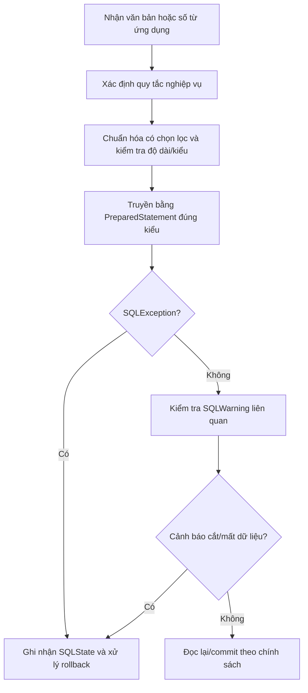

# Xử lý khoảng trắng, giá trị bị cắt và cảnh báo chuyển đổi trong JDBC

## 1. Bài toán khi đưa số và văn bản qua JDBC

Với **JDBC**, ứng dụng Java gửi giá trị qua `PreparedStatement`, cơ sở dữ liệu lưu theo kiểu cột SQL, rồi trả lại dữ liệu qua `ResultSet`. Trên đường đi, văn bản có thể chứa khoảng trắng không mong muốn, chuỗi có thể vượt độ dài cột, hoặc giá trị có thể bị thay đổi khi chuyển kiểu số, ký tự hay bộ mã. Nếu chỉ kiểm tra câu lệnh `INSERT`/`UPDATE` có chạy thành công, ứng dụng vẫn có thể lưu hoặc đọc một giá trị khác với điều người dùng dự định.

Ví dụ, một hệ thống nhận mã hàng `"  SP-001  "`, mô tả `"  Phiên bản đặc biệt  "` và giá trị tiền `"12,50"` dưới dạng chuỗi. Với mã hàng, khoảng trắng đầu/cuối thường là lỗi nhập liệu; với mô tả, chúng có thể là nội dung cần giữ; với tiền, dấu phẩy mang nghĩa thập phân hay phân tách hàng nghìn tùy quy ước. Cả ba giá trị cần quy tắc xử lý riêng trước khi truyền cho JDBC.

| Hiện tượng | Ví dụ | Cần quyết định ở đâu? |
| --- | --- | --- |
| Khoảng trắng dư hoặc có ý nghĩa | `"  SP-001 "`, `" Ghi chú  "` | Quy tắc nghiệp vụ ở Java; hiểu cách `CHAR`/`VARCHAR` lưu trữ ở SQL. |
| Chuỗi dài hơn cột | Dữ liệu dài 15 ký tự cho `VARCHAR(12)` | Kiểm tra trước khi ghi; cơ sở dữ liệu vẫn là tầng kiểm soát cuối. |
| Cắt dữ liệu khi đọc | Cấu hình giới hạn độ dài trường trả về | Kiểm tra truy vấn, driver và cấu hình của `Statement`. |
| Chuyển kiểu sai hoặc mất thông tin | Chuỗi `"12,50"` gửi vào `DECIMAL`, ký tự không hỗ trợ bởi bộ mã | Parse đúng kiểu tại Java; xử lý `SQLException` và `SQLWarning`. |

Mục tiêu của bài là nhận diện và xử lý các tình huống này bằng API chuẩn của JDBC, đồng thời nắm rõ phần nào phụ thuộc driver hoặc hệ quản trị cơ sở dữ liệu (DBMS).

## 2. Khoảng trắng: `String`, `CHAR`, `VARCHAR` và SQL `TRIM`

### 2.1. Khoảng trắng trong Java không tự biến mất khi gọi JDBC

`PreparedStatement#setString()` truyền chuỗi làm tham số; JDBC **không mặc định gọi** `trim()` hoặc `strip()` để làm sạch dữ liệu theo ý nghiệp vụ. Khi đọc cột văn bản bằng `ResultSet#getString()`, cũng không nên giả định mọi khoảng trắng sẽ tự bị loại bỏ.

```java
String rawCode = "  SP-001  ";
String rawNote = "  Giữ khoảng trắng này  ";

String code = rawCode.strip();   // "SP-001" (Java 11+)
String note = rawNote;           // Giữ nguyên nếu nghiệp vụ yêu cầu

try (PreparedStatement ps = connection.prepareStatement(
        "INSERT INTO products (sku, note) VALUES (?, ?)")) {
    ps.setString(1, code);
    ps.setString(2, note);
    ps.executeUpdate();
}
```

Trong Java, `trim()` (có từ các phiên bản Java cũ) loại các ký tự ở hai đầu có mã đơn vị UTF-16 nhỏ hơn hoặc bằng `U+0020`; `strip()` (Java 11+) dựa trên `Character.isWhitespace`, bao quát nhiều ký tự khoảng trắng Unicode hơn. Tuy vậy, `strip()` **không loại bỏ mọi ký tự nhìn giống dấu cách**, chẳng hạn một số non-breaking space. Nếu dữ liệu đến từ bản sao HTML, tệp bên ngoài hoặc thiết bị nhập liệu, hãy xác định chính xác những ký tự cần chuẩn hóa rồi viết quy tắc rõ ràng.

Không nên xóa khoảng trắng một cách đại trà: giá trị nhập của mật khẩu, chữ ký, đoạn văn có định dạng, định danh bên ngoài hoặc dữ liệu kiểm toán có thể coi khoảng trắng là một phần của nội dung. Việc `strip()` mã hàng ở ví dụ trên là **quyết định nghiệp vụ**, không phải quy tắc chung của JDBC.

### 2.2. Cột SQL có thể làm việc với khoảng trắng theo cách khác Java

| Kiểu/cách xử lý | Điểm cần chú ý |
| --- | --- |
| `CHAR(n)` | Kiểu độ dài cố định; DBMS có thể đệm dấu cách ở cuối khi lưu và có quy tắc riêng khi so sánh hoặc trả dữ liệu. |
| `VARCHAR(n)` | Kiểu độ dài biến đổi; khoảng trắng người dùng cung cấp thường có ý nghĩa, nhưng hành vi so sánh/chuẩn hóa phụ thuộc DBMS và collation. |
| `TRIM(column)` | SQL loại khoảng trắng theo cú pháp và quy tắc của DBMS, thường dùng khi tra cứu hay biến đổi có chủ đích. |
| `LTRIM` / `RTRIM` | Một số DBMS hỗ trợ hàm loại ký tự ở đầu/cuối; cú pháp và tập ký tự xử lý có thể khác nhau. |

Ví dụ SQL minh họa:

```sql
SELECT TRIM(sku) AS normalized_sku
FROM products;
```

Hàm này xử lý dữ liệu **trong kết quả truy vấn**; bản thân `SELECT` không sửa nội dung đã lưu. Nếu cần chuẩn hóa dữ liệu khi ghi, hãy xử lý trong Java hoặc dùng quy tắc SQL được thiết kế rõ ràng. Tránh mặc định rằng `TRIM` xử lý hết tab, xuống dòng hay các ký tự Unicode giống dấu cách trên mọi DBMS.

## 3. Độ dài chuỗi: ký tự, điểm mã Unicode và byte

Giới hạn `VARCHAR(n)` không nhất thiết có cùng cách hiểu giữa các hệ quản trị; còn Java có những đại lượng đo khác nhau:

- `String.length()` đếm **đơn vị mã UTF-16**; một ký tự ngoài BMP, chẳng hạn emoji, thường chiếm hai đơn vị.
- `String.codePointCount(0, text.length())` đếm **điểm mã Unicode**; một chữ nhìn thấy có thể gồm nhiều điểm mã khi dùng dấu kết hợp.
- `text.getBytes(StandardCharsets.UTF_8).length` đếm **byte trong UTF-8**, không phải độ dài cột SQL trừ khi schema/driver thực sự áp dụng giới hạn byte như vậy.
- Quy tắc của `VARCHAR(n)`, charset, giới hạn byte tối đa và phép so sánh phụ thuộc DBMS, phiên bản và định nghĩa cột. Ví dụ, `VARCHAR(n)` của PostgreSQL giới hạn số ký tự; không suy rộng cách đếm này sang mọi hệ quản trị.

```java
import java.nio.charset.StandardCharsets;

String value = "A😀";
System.out.println(value.length());                     // 3 đơn vị UTF-16
System.out.println(value.codePointCount(0, value.length())); // 2 điểm mã
System.out.println(value.getBytes(StandardCharsets.UTF_8).length); // 5 byte
```

Vì vậy, trước khi ghi chuỗi, cần kiểm tra độ dài **theo đúng quy tắc cột lưu trữ**. Không chọn đại `substring(0, n)` để rút ngắn: thao tác này có thể cắt đôi surrogate pair UTF-16 hoặc làm mất thông tin nghiệp vụ. Nếu sản phẩm thật sự có tính năng rút gọn mô tả, hãy định nghĩa trước liệu giới hạn tính theo điểm mã, ký tự hiển thị hay byte và thông báo rõ cho người dùng.

## 4. Truncation: khi nào dữ liệu có thể bị cắt?

**Data truncation** là tình huống giá trị bị rút ngắn trong quá trình chuyển dữ liệu giữa Java, driver và SQL. Cần phân biệt ít nhất ba nguồn:

1. **Khi ghi:** giá trị dài hơn kích thước cột, hoặc giá trị số vượt phạm vi/độ chính xác mà cột chấp nhận. DBMS có thể báo lỗi; một số cấu hình và driver có thể cảnh báo hoặc thay đổi dữ liệu thay vì từ chối. Không dựa vào việc mọi DBMS đều xử lý giống nhau.
2. **Khi đọc:** ứng dụng đặt giới hạn trên kích thước trường trả về, chẳng hạn `Statement#setMaxFieldSize(int)`. Đây là giới hạn do phía JDBC yêu cầu, có thể khiến nội dung văn bản/nhị phân trả về không đầy đủ.
3. **Do chuyển kiểu hoặc truy vấn:** `CAST`, phép làm tròn, biến đổi encoding hoặc hàm SQL có thể tạo kết quả khác dữ liệu gốc. Một phép cắt có chủ đích trong SQL không nhất thiết được báo như lỗi JDBC.

Ví dụ schema PostgreSQL:

```sql
CREATE TABLE products (
    id BIGINT GENERATED BY DEFAULT AS IDENTITY PRIMARY KEY,
    sku VARCHAR(12) NOT NULL UNIQUE,
    note VARCHAR(40) NOT NULL
);
```

`sku` dài hơn 12 ký tự sẽ bị cơ sở dữ liệu kiểm soát theo giới hạn của cột. Với PostgreSQL, thao tác vượt giới hạn thường báo lỗi `string data right truncation`, có SQLState `22001`; ở DBMS khác, hành vi còn phụ thuộc chế độ SQL và driver. Ứng dụng nên kiểm tra trước và **không tự động cắt mã định danh** để làm cho câu lệnh thành công.

Một nguồn cắt khi đọc dễ bỏ sót là `setMaxFieldSize()`:

```java
try (Statement statement = connection.createStatement()) {
    statement.setMaxFieldSize(4); // Tối đa 4 byte/trường áp dụng; 0: không giới hạn

    try (ResultSet rs = statement.executeQuery("SELECT note FROM products")) {
        while (rs.next()) {
            String note = rs.getString("note");
            // Có thể chỉ nhận một phần văn bản; không coi đây là dữ liệu gốc đầy đủ.
        }
    }
}
```

Theo hợp đồng JDBC, thiết lập này áp dụng cho một số cột kiểu ký tự/nhị phân khi đọc và phần vượt giới hạn có thể bị loại bỏ; khả năng thực thi chi tiết cần kiểm tra với driver. Thông thường, hãy để giá trị mặc định `0` nếu cần đọc nguyên vẹn cột. Đây là giới hạn **byte**, không phải số ký tự Unicode; không dùng để giới hạn độ dài nghiệp vụ một cách chính xác.

## 5. `SQLWarning`, `DataTruncation` và `SQLException`

JDBC có cơ chế báo vấn đề ở hai mức độ chính:

| API/kiểu | Ý nghĩa và cách dùng |
| --- | --- |
| `SQLException` | Lỗi SQL, chuyển kiểu hoặc giao tiếp với DB có thể khiến lệnh thất bại. Kiểm tra `getSQLState()`, `getErrorCode()` và chuỗi ngoại lệ nếu cần. |
| `SQLWarning` | Thông tin cảnh báo có thể xuất hiện ngay cả khi lệnh không ném lỗi. Đọc bằng `getWarnings()` từ `Connection`, `Statement`/`PreparedStatement` hoặc `ResultSet`, khi phù hợp. |
| `DataTruncation` | Lớp con của `SQLWarning` để mô tả dữ liệu bị cắt; có thêm thông tin về thao tác đọc/ghi, vị trí và kích thước truyền dữ liệu khi driver cung cấp. |

`DataTruncation` kế thừa `SQLWarning`, mà `SQLWarning` kế thừa `SQLException`; vì vậy một driver có thể **ném** một đối tượng thuộc họ này khi ghi, trong khi một trường hợp khác có thể được báo trong chuỗi cảnh báo. Thực tế còn có các `SQLException` hoặc lớp con khác cho lỗi cắt chuỗi và chuyển đổi. Đừng chỉ bắt `DataTruncation` rồi cho rằng đã xử lý mọi vấn đề.

Chuỗi cảnh báo được duyệt qua `getNextWarning()`, khác với `SQLException#getNextException()`. Ví dụ hàm đọc thông tin cảnh báo mà không ghi giá trị nhạy cảm của người dùng ra log:

```java
import java.sql.DataTruncation;
import java.sql.SQLWarning;

static void printWarnings(SQLWarning first) {
    for (SQLWarning warning = first;
         warning != null;
         warning = warning.getNextWarning()) {

        System.err.printf(
            "JDBC warning: SQLState=%s, vendorCode=%d%n",
            warning.getSQLState(), warning.getErrorCode()
        );

        if (warning instanceof DataTruncation) {
            DataTruncation dt = (DataTruncation) warning;
            System.err.printf(
                "Truncation: read=%s, parameter=%s, index=%d, dataSize=%d, transferSize=%d%n",
                dt.getRead(), dt.getParameter(), dt.getIndex(),
                dt.getDataSize(), dt.getTransferSize()
            );
        }
    }
}
```

Với `DataTruncation`, các kích thước được báo theo byte nếu có, và driver có thể không xác định được mọi thông tin. Không nên suy ra số ký tự bị mất từ chênh lệch kích thước byte một cách máy móc.

Các SQLState thường hữu ích khi điều tra (cần đối chiếu với tài liệu DBMS/driver):

| SQLState | Ý nghĩa thường gặp |
| --- | --- |
| `01004` | Cảnh báo cắt dữ liệu ký tự/nhị phân (`string data, right truncation`). |
| `22001` | Lỗi dữ liệu chuỗi quá dài (`string data, right truncation`). |
| `22018` | Giá trị ký tự không hợp lệ cho phép chuyển kiểu, chẳng hạn văn bản không phải số. |

**Cảnh báo không phải cơ chế phát hiện tuyệt đối.** Driver, hệ quản trị và chế độ cấu hình quyết định khi nào ném lỗi, khi nào thêm warning, hoặc không báo được. Đọc warning **ngay sau thao tác liên quan** vì các thao tác sau có thể xóa hoặc thay đổi chuỗi cảnh báo. Nếu cần, API có `clearWarnings()` để xóa các cảnh báo đã xử lý.

## 6. Ví dụ: kiểm tra dữ liệu và phát hiện cắt khi thêm bản ghi

Ví dụ này giả định schema PostgreSQL ở mục 4. Mã SKU chỉ cho phép chữ in hoa ASCII, chữ số, gạch ngang và gạch dưới; chính sách này **cố ý** loại khoảng trắng ở hai đầu và từ chối chuỗi quá dài. Trường `note` giữ nguyên khoảng trắng theo yêu cầu nghiệp vụ. Phương thức nhận `Connection` để bên gọi quyết định transaction; phần kiểm tra cảnh báo được thực hiện **trước `commit`**.

```java
import java.sql.Connection;
import java.sql.DataTruncation;
import java.sql.PreparedStatement;
import java.sql.SQLException;
import java.sql.SQLWarning;
import java.util.Objects;

public final class ProductWriter {
    private ProductWriter() {}

    public static void insert(Connection connection,
                              String rawSku,
                              String note) throws SQLException {
        Objects.requireNonNull(connection, "connection");
        String sku = Objects.requireNonNull(rawSku, "rawSku").strip();
        String originalNote = Objects.requireNonNull(note, "note");

        // Chính sách nghiệp vụ của ví dụ, không phải yêu cầu bắt buộc của JDBC.
        if (!sku.matches("[A-Z0-9_-]{1,12}")) {
            throw new IllegalArgumentException("SKU không đúng định dạng hoặc quá dài");
        }
        // Với PostgreSQL VARCHAR(40): giới hạn số ký tự Unicode.
        if (originalNote.codePointCount(0, originalNote.length()) > 40) {
            throw new IllegalArgumentException("Ghi chú vượt 40 ký tự");
        }

        String sql = "INSERT INTO products (sku, note) VALUES (?, ?)";
        try (PreparedStatement ps = connection.prepareStatement(sql)) {
            ps.setString(1, sku);
            ps.setString(2, originalNote);

            if (ps.executeUpdate() != 1) {
                throw new SQLException("Không thêm được đúng một bản ghi");
            }

            SQLWarning warnings = ps.getWarnings();
            printWarnings(warnings);
            for (SQLWarning warning = warnings;
                 warning != null;
                 warning = warning.getNextWarning()) {
                if (warning instanceof DataTruncation
                    || "01004".equals(warning.getSQLState())) {
                    throw new SQLException("JDBC cảnh báo dữ liệu bị cắt", warning);
                }
            }
        }
    }

    private static void printWarnings(SQLWarning first) {
        for (SQLWarning w = first; w != null; w = w.getNextWarning()) {
            System.err.printf("SQLWarning state=%s code=%d%n",
                w.getSQLState(), w.getErrorCode());
        }
    }
}
```

Gọi phương thức bằng `DataSource`, dùng transaction để có thể rollback nếu quá trình thực thi báo lỗi hoặc warning mà ứng dụng coi là không chấp nhận được:

```java
import javax.sql.DataSource;
import java.sql.Connection;
import java.sql.SQLException;

static void saveProduct(DataSource dataSource) throws SQLException {
    try (Connection connection = dataSource.getConnection()) {
        connection.setAutoCommit(false);
        try {
            ProductWriter.insert(connection, "  SP-001  ", "  Hàng mới  ");
            connection.commit();
        } catch (SQLException | RuntimeException error) {
            try {
                connection.rollback();
            } catch (SQLException rollbackError) {
                error.addSuppressed(rollbackError);
            }
            throw error;
        }
    }
}
```

Trong hệ thống thực tế, nên đưa logging vào bộ ghi log tập trung và xây dựng chính sách riêng cho các warning không liên quan cắt dữ liệu. Đoạn ví dụ kiểm tra `01004` và `DataTruncation`, còn **không coi mọi `SQLWarning` là lỗi**. Nếu driver trả dữ liệu đã bị rút ngắn mà không báo warning, bước kiểm tra này không phát hiện được; hãy giữ kiểm tra đầu vào, cấu hình DBMS phù hợp và có kiểm thử tích hợp.

## 7. Chuyển đổi số và văn bản: đừng phó mặc cho DBMS

Các phương thức JDBC có kiểu dữ liệu giúp giữ ý nghĩa của giá trị: `setString`/`getString` cho văn bản, `setInt`/`getInt` cho số nguyên, `setBigDecimal`/`getBigDecimal` cho số thập phân chính xác. Dùng `setString` để gửi văn bản số vào cột `DECIMAL` có thể dẫn tới ép kiểu ngầm phụ thuộc DBMS, lỗi `SQLException` hoặc sai số/ngữ nghĩa dấu phân cách.

```java
import java.math.BigDecimal;

// Ví dụ: đầu vào đã được quy định dùng dấu chấm làm dấu thập phân.
String rawAmount = "  12.50  ";
BigDecimal amount = new BigDecimal(rawAmount.strip());

try (PreparedStatement ps = connection.prepareStatement(
        "INSERT INTO invoices (amount) VALUES (?)")) {
    ps.setBigDecimal(1, amount);
    ps.executeUpdate();
}
```

Nếu người dùng nhập `"12,50"`, **đừng tự thay dấu phẩy bằng dấu chấm** khi chưa biết locale và quy tắc nhóm chữ số. Hãy parse bằng bộ phân tích phù hợp với định dạng đầu vào, kiểm tra tính hợp lệ và sau đó truyền một `BigDecimal`. Khi lưu vào `DECIMAL(p, s)`, vẫn cần đối chiếu **precision** (tổng số chữ số) và **scale** (số chữ số sau dấu thập phân); phép lưu có thể thất bại, làm tròn hoặc cảnh báo tùy schema và DBMS.

Với văn bản tiếng Việt hoặc Unicode ngoài ASCII, cần thống nhất bộ mã và kiểu cột SQL để tránh ký tự bị thay thế hoặc chuyển đổi mất thông tin. `setNString`/`getNString` là các API dành cho kiểu ký tự quốc gia (`NCHAR`/`NVARCHAR`) khi hệ quản trị và driver hỗ trợ; không phải cách sửa chung cho mọi vấn đề Unicode. Kiểm thử vòng đọc-ghi trên đúng driver sẽ cho biết dữ liệu có được giữ nguyên hay không.

## 8. Đọc warning khi truy vấn

Warning có thể gắn với `Statement` **hoặc** `ResultSet`. Nếu đang kiểm tra một vấn đề xảy ra lúc đọc cột, nên xem warning ngay sau thao tác đọc, trước khi chuyển sang hàng tiếp theo:

```java
try (PreparedStatement ps = connection.prepareStatement(
        "SELECT sku, note FROM products WHERE sku = ?")) {
    ps.setString(1, "SP-001");

    try (ResultSet rs = ps.executeQuery()) {
        while (rs.next()) {
            String sku = rs.getString("sku");
            String note = rs.getString("note");

            printWarnings(rs.getWarnings());
            // Xử lý sku/note; không tự strip() mọi giá trị lấy từ DB.
        }
        printWarnings(ps.getWarnings());
    }
}
```

Ví dụ sử dụng hàm `printWarnings` đã minh họa ở mục 5 (hoặc hàm cùng tên trong `ProductWriter`). Đối với vấn đề từ chính kết nối, có thể kiểm tra `connection.getWarnings()` tại điểm phù hợp. Việc warning xuất hiện ở đối tượng nào và có được driver cung cấp hay không cần được kiểm chứng bằng thử nghiệm thực tế.

## 9. Quy trình xử lý và những lỗi dễ mắc



| Sai lầm thường gặp | Cách phòng tránh |
| --- | --- |
| Luôn gọi `trim()`/`strip()` cho mọi chuỗi | Chuẩn hóa theo ý nghĩa từng trường; giữ nguyên khoảng trắng cần thiết. |
| Dùng `String.length()` làm tiêu chuẩn duy nhất cho mọi `VARCHAR(n)` | Hiểu quy tắc ký tự/byte của DBMS và kiểu dữ liệu cột. |
| Tự cắt `substring(0, n)` để tránh lỗi INSERT | Chỉ cắt khi đó là yêu cầu nghiệp vụ; kiểm tra nguy cơ mất thông tin và Unicode. |
| Tin rằng `executeUpdate()` thành công thì giá trị đã được giữ nguyên | Kiểm tra dữ liệu đầu vào, warning, chế độ DBMS và thử nghiệm đọc-ghi. |
| Không đọc `getWarnings()` hoặc chỉ bắt `DataTruncation` | Kiểm tra cả `SQLWarning`, `SQLException` và SQLState phù hợp. |
| Dùng `setString()` cho cột số để DB tự diễn giải | Parse ở Java theo locale/định dạng đã thỏa thuận; dùng setter đúng kiểu. |
| Nhận thấy cảnh báo sau khi lệnh đã auto-commit | Nếu warning phải làm hủy nghiệp vụ, dùng transaction và kiểm tra trước `commit`. |

Khi kiểm thử tích hợp JDBC, nên thử mã có khoảng trắng đầu/cuối, văn bản có dấu tiếng Việt và emoji, chuỗi ở đúng ranh giới độ dài cột, chuỗi vượt giới hạn, số có dấu phân cách theo locale, và trường hợp đọc có/không đặt `setMaxFieldSize()`. Ghi nhận cả giá trị đọc lại, `SQLException` và chuỗi `SQLWarning` trên **đúng phiên bản driver/DBMS**, vì hành vi có thể khác nhau giữa các hệ thống.

## 10. Ghi nhớ

Với dữ liệu số và văn bản trong JDBC, **khoảng trắng cần được xử lý theo nghĩa nghiệp vụ**, **độ dài cần đo theo quy tắc của cột SQL**, còn **cắt dữ liệu và chuyển đổi cần được phát hiện bằng kiểm tra đầu vào, ngoại lệ, cảnh báo và kiểm thử đọc-ghi**. `PreparedStatement` giúp truyền tham số đúng kiểu, `ResultSet` giúp kiểm tra dữ liệu trả về, `SQLWarning`/`DataTruncation` cung cấp tín hiệu chẩn đoán khi driver hỗ trợ, và transaction cho phép hủy thao tác nếu phát hiện mất thông tin trước khi `commit`.
