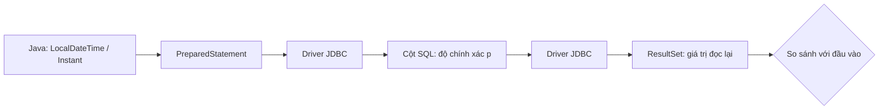

# Kiểm tra độ chính xác phần giây và mất dữ liệu khi làm tròn

> **Chương:** Ngày giờ và múi giờ  
> **Bối cảnh:** Ứng dụng Java dùng **JDBC** để ghi và đọc thời điểm từ cơ sở dữ liệu quan hệ qua `DataSource`, `PreparedStatement` và `ResultSet`.

Một sự kiện được tạo lúc `2026-06-01 12:34:56.123456789`, nhưng sau khi lưu và đọc lại chỉ còn `2026-06-01 12:34:56.123`. Có phải JDBC đã làm mất dữ liệu? Vì sao đôi khi giá trị còn tăng thành `.124`, thậm chí chuyển sang giây tiếp theo? Câu trả lời phụ thuộc vào **độ chính xác phần giây (fractional-second precision)** của kiểu cột, quy tắc **làm tròn hoặc cắt bớt** và cách driver JDBC chuyển đổi dữ liệu.

Bài học hướng dẫn kiểm tra sai lệch qua một phép **round-trip**: tạo giá trị trong Java → bind tham số → ghi vào database → đọc qua `ResultSet` → so sánh chính xác với giá trị đầu vào. Ví dụ thực hành chính dùng **MySQL 8.0+** với `DATETIME(3)` và `DATETIME(6)`. Tên kiểu, phạm vi độ chính xác và hành vi làm tròn của các hệ quản trị khác cần được kiểm chứng riêng.

## 1. Hiểu độ chính xác phần giây

Thành phần phần giây là các chữ số sau dấu thập phân của trường giây. Chẳng hạn:

```text
2026-06-01 12:34:56.123456789
                    └─────────┘ 9 chữ số phần giây
                     123 456 789
                      ms  µs  ns
```

Trong đó `ms` là mili giây (10⁻³ giây), `µs` là micro giây (10⁻⁶ giây), `ns` là nano giây (10⁻⁹ giây). Với kiểu SQL hỗ trợ khai báo `(p)`, `p` thường chỉ **số chữ số phần giây tối đa** mà cột lưu; phải đọc quy định cụ thể của DBMS để biết giới hạn và chế độ xử lý dữ liệu dư chữ số.

| Độ chính xác | Bước biểu diễn | Ví dụ của cùng một giây | Lưu ý |
|---|---:|---|---|
| `p = 0` | 1 giây | `12:34:56` | Không lưu phần giây. |
| `p = 3` | 1 ms | `12:34:56.123` | Thường dùng cho log hoặc thao tác nghiệp vụ không cần vi thời gian. |
| `p = 6` | 1 µs | `12:34:56.123456` | Mức tối đa của nhiều kiểu ngày giờ trong MySQL/PostgreSQL. |
| `p = 9` | 1 ns | `12:34:56.123456789` | Java `LocalDateTime`/`Instant` biểu diễn được; không phải DBMS nào cũng lưu đủ. |

Không nhầm **độ chính xác phần giây được khai báo** với **độ phân giải của đồng hồ thực tế**. Một `LocalDateTime` có thể mang chín chữ số nano giây, nhưng `Clock.systemUTC()` hoặc đồng hồ hệ điều hành không bảo đảm sự kiện được đo chính xác đến từng nano giây. Tương tự, việc driver trả về `Timestamp.getNanos()` không chứng minh database từng lưu đủ chín chữ số.

### Cắt bớt và làm tròn là hai phép biến đổi khác nhau

Giả sử lưu vào cột chỉ có **ba chữ số phần giây**:

| Giá trị nguồn | Cắt bớt đến ms | Làm tròn đến ms (quy tắc thường gặp) |
|---|---|---|
| `12:34:56.123499` | `12:34:56.123` | `12:34:56.123` |
| `12:34:56.123500` | `12:34:56.123` | `12:34:56.124` |
| `12:34:56.999500` | `12:34:56.999` | `12:34:57.000` |

- **Cắt bớt (truncate):** bỏ các chữ số vượt quá độ chính xác đích mà không bù vào chữ số được giữ.
- **Làm tròn (round):** chọn giá trị biểu diễn gần hơn; trường hợp đúng giữa hai mốc cần theo quy tắc làm tròn của DBMS. Phép làm tròn có thể phát sinh nhớ sang giây, phút, ngày tiếp theo.
- **Mất dữ liệu không thể phục hồi:** sau khi lưu `.123` hoặc `.124`, không thể suy ngược chắc chắn nguồn là `.123499`, `.123500` hay một giá trị khác. Việc đọc lại thành chín chữ số với các số 0 ở cuối không khôi phục những chữ số đã mất.

Đánh giá sai lệch phải xét cả **giá trị và ngữ nghĩa**: làm tròn có thể tạo mốc thời gian muộn hơn thực tế, còn cắt bớt có thể khiến các sự kiện khác nhau trùng cùng một mốc lưu trữ.

## 2. Những lớp có thể làm thay đổi phần giây

Một đường đi điển hình là:



| Vị trí | Điều cần kiểm tra | Sai lầm dễ gặp |
|---|---|---|
| Nguồn dữ liệu Java | `getNano()`, dữ liệu do API/đồng hồ tạo ra, phép chuyển đổi trước khi bind | Cho rằng `LocalDateTime` luôn có độ chính xác vật lý 1 ns. |
| API JDBC | `setObject(...)`, `setTimestamp(...)`, phiên bản driver, tham số loại SQL | Cho rằng JDBC bảo đảm giữ nguyên chín chữ số khi cột chỉ hỗ trợ sáu. |
| Cột SQL | Kiểu cột, tham số `(p)`, chế độ làm tròn/cắt bớt | Bỏ qua `DATETIME` mặc định không có phần giây ở một số DBMS. |
| Truy vấn và đọc dữ liệu | `getObject(..., LocalDateTime.class)`, `getTimestamp()`, phép định dạng | So sánh chuỗi hiển thị thay cho giá trị thời gian thực tế. |
| Chuyển đổi múi giờ | Loại có/không có timezone, cấu hình kết nối và phiên SQL | Nhầm sai lệch vài giờ với sai lệch vài micro giây. |

**Tách riêng hai loại lỗi:** sai lệch *phần giây* là mất hoặc điều chỉnh các chữ số sau dấu thập phân; sai lệch *múi giờ* là ánh xạ một thời điểm sang giờ địa phương khác hoặc lưu sai thời điểm. Cả hai có thể xuất hiện trong một round-trip, nhưng nguyên nhân và cách kiểm tra khác nhau.

## 3. Thực nghiệm SQL: `DATETIME(3)` so với `DATETIME(6)`

MySQL hỗ trợ `DATETIME(fsp)`, `TIMESTAMP(fsp)` và `TIME(fsp)` với `fsp` từ **0 đến 6**. Trong MySQL 8.0, khi giá trị có nhiều chữ số phần giây hơn cột đích, hành vi thông thường là **làm tròn**; SQL mode `TIME_TRUNCATE_FRACTIONAL` yêu cầu **cắt bớt** thay vì làm tròn. Vì vậy phải ghi nhận `sql_mode` của **chính kết nối dùng để kiểm thử**, không dựa vào mặc định mà người viết tài liệu giả định.

### 3.1. Kiểm tra môi trường

```sql
SELECT VERSION() AS mysql_version,
       @@SESSION.sql_mode AS session_sql_mode,
       @@SESSION.time_zone AS session_time_zone;
```

Ví dụ bên dưới giả định **`TIME_TRUNCATE_FRACTIONAL` không có trong `@@SESSION.sql_mode`**, tức phép chuyển từ micro giây sang mili giây dùng quy tắc làm tròn mặc định. Nếu mode này đang bật, hãy giữ nguyên cấu hình và đối chiếu với cột *cắt bớt* trong bảng ở mục 1, hoặc chạy thí nghiệm trong một phiên kiểm thử được cấu hình phù hợp. Đừng thay đổi thiết lập của môi trường đang chạy ứng dụng chỉ để khớp kết quả ví dụ.

### 3.2. Tạo bảng thử nghiệm và ghi giá trị biên

```sql
CREATE TABLE fractional_second_probe (
    id BIGINT PRIMARY KEY,
    occurred_ms DATETIME(3) NOT NULL,
    occurred_us DATETIME(6) NOT NULL
);

-- Chỉ chạy một lần trên bảng thử nghiệm trống.
INSERT INTO fractional_second_probe (id, occurred_ms, occurred_us) VALUES
    (1, '2026-06-01 12:34:56.123499', '2026-06-01 12:34:56.123499'),
    (2, '2026-06-01 12:34:56.123500', '2026-06-01 12:34:56.123500'),
    (3, '2026-06-01 12:34:56.999500', '2026-06-01 12:34:56.999500');
```

`DATETIME(6)` giữ lại sáu chữ số đầu vào vì mỗi ví dụ chỉ có sáu chữ số. `DATETIME(3)` giữ ba chữ số sau khi làm tròn. Giá trị thứ ba được chọn để bắt lỗi **tràn sang giây kế tiếp**, tình huống dễ gây sai khi so sánh chuỗi và khi thiết kế khoảng truy vấn.

### 3.3. Đọc kết quả với số chữ số cố định

```sql
SELECT id,
       DATE_FORMAT(occurred_ms, '%Y-%m-%d %H:%i:%s.%f') AS ms_text,
       DATE_FORMAT(occurred_us, '%Y-%m-%d %H:%i:%s.%f') AS us_text
FROM fractional_second_probe
ORDER BY id;
```

Khi SQL mode dùng làm tròn, kết quả kỳ vọng là:

| `id` | `ms_text` (`DATETIME(3)`) | `us_text` (`DATETIME(6)`) |
|---:|---|---|
| 1 | `2026-06-01 12:34:56.123000` | `2026-06-01 12:34:56.123499` |
| 2 | `2026-06-01 12:34:56.124000` | `2026-06-01 12:34:56.123500` |
| 3 | `2026-06-01 12:34:57.000000` | `2026-06-01 12:34:56.999500` |

`DATE_FORMAT(..., '%f')` xuất sáu chữ số phần giây trong MySQL. Các số `000` ở cuối `ms_text` chỉ là **phần đệm khi hiển thị**, không có nghĩa cột `DATETIME(3)` đã lưu đủ sáu chữ số.

Nếu kết quả của `id = 2` là `.123000` thay vì `.124000`, hoặc `id = 3` là `.999000` thay vì giây tiếp theo, hãy kiểm tra SQL mode trước khi cho rằng query hoặc driver sai. Khi chạy câu lệnh `INSERT` trực tiếp như trên, chưa có driver JDBC tham gia vào việc chuyển đổi giá trị thời gian, nên thí nghiệm này giúp xác định hành vi của chính database.

## 4. Kiểm tra round-trip qua JDBC 4.2+

JDBC 4.2 hỗ trợ các kiểu trong `java.time`. Với cột MySQL `DATETIME` không mang múi giờ, `LocalDateTime` là lựa chọn rõ ràng để **kiểm tra riêng độ chính xác phần giây**. Ví dụ dùng `setObject()` và `getObject(..., LocalDateTime.class)`; khả năng ánh xạ thực tế cần được xác nhận bằng phiên bản driver JDBC đang triển khai.

Giả sử đã có `DataSource dataSource` cho MySQL 8.0+ và bảng `fractional_second_probe` **đang trống**. Đoạn Java dưới đây tạo ba mẫu, gửi cùng một giá trị sang hai cột và kiểm tra lại từng hàng:

```java
import java.sql.Connection;
import java.sql.PreparedStatement;
import java.sql.ResultSet;
import java.sql.SQLException;
import java.time.LocalDateTime;
import java.time.temporal.ChronoUnit;
import java.util.LinkedHashMap;
import java.util.Map;
import javax.sql.DataSource;

public final class FractionalSecondRoundTrip {
    private FractionalSecondRoundTrip() {}

    public static void verify(DataSource dataSource) throws SQLException {
        // Giá trị nguồn có sáu chữ số phần giây, vừa với DATETIME(6).
        Map<Long, LocalDateTime> samples = new LinkedHashMap<>();
        samples.put(1L, LocalDateTime.parse("2026-06-01T12:34:56.123499"));
        samples.put(2L, LocalDateTime.parse("2026-06-01T12:34:56.123500"));
        samples.put(3L, LocalDateTime.parse("2026-06-01T12:34:56.999500"));

        String insertSql = """
            INSERT INTO fractional_second_probe
                (id, occurred_ms, occurred_us)
            VALUES (?, ?, ?)
            """;
        String selectSql = """
            SELECT id, occurred_ms, occurred_us
            FROM fractional_second_probe
            ORDER BY id
            """;

        try (Connection connection = dataSource.getConnection()) {
            // Ghi và đọc trên cùng một connection để giữ cùng session settings.
            try (PreparedStatement statement =
                     connection.prepareStatement(insertSql)) {
                for (var entry : samples.entrySet()) {
                    statement.setLong(1, entry.getKey());
                    statement.setObject(2, entry.getValue());
                    statement.setObject(3, entry.getValue());
                    statement.addBatch();
                }
                statement.executeBatch();
            }

            try (PreparedStatement statement =
                     connection.prepareStatement(selectSql);
                 ResultSet rs = statement.executeQuery()) {
                int count = 0;
                while (rs.next()) {
                    long id = rs.getLong("id");
                    LocalDateTime original = samples.get(id);
                    if (original == null) {
                        throw new IllegalStateException("Unexpected row: " + id);
                    }

                    LocalDateTime storedMs =
                        rs.getObject("occurred_ms", LocalDateTime.class);
                    LocalDateTime storedUs =
                        rs.getObject("occurred_us", LocalDateTime.class);

                    // Kỳ vọng khi MySQL dùng chế độ làm tròn mặc định.
                    LocalDateTime expectedMs = original
                        .plusNanos(500_000)
                        .truncatedTo(ChronoUnit.MILLIS);

                    if (!expectedMs.equals(storedMs)) {
                        throw new IllegalStateException(
                            "id=" + id + " ms: expected=" + expectedMs
                            + ", actual=" + storedMs);
                    }
                    if (!original.equals(storedUs)) {
                        throw new IllegalStateException(
                            "id=" + id + " us: expected=" + original
                            + ", actual=" + storedUs);
                    }

                    System.out.printf("id=%d, source=%s, ms=%s, us=%s%n",
                        id, original, storedMs, storedUs);
                    count++;
                }
                if (count != samples.size()) {
                    throw new IllegalStateException(
                        "Expected " + samples.size() + " rows, found " + count);
                }
            }
        }
    }
}
```

**Điều kiện của phép kiểm thử:** bảng phải trống trước khi chạy để tránh trùng khóa chính hoặc đọc nhầm hàng từ lượt trước; phiên MySQL đang ở chế độ làm tròn, không bật `TIME_TRUNCATE_FRACTIONAL`; driver hỗ trợ `LocalDateTime` theo JDBC 4.2. Nếu thử nghiệm chạy trong hệ thống kiểm thử nhiều người dùng, nên dùng bảng/khóa định danh riêng và cô lập dữ liệu của từng lượt chạy.

Đoạn `plusNanos(500_000).truncatedTo(MILLIS)` minh họa cách tính **kỳ vọng làm tròn đến mili giây** trong ví dụ với phần giây không âm. Quan trọng hơn một phép tính cụ thể là **giữ giá trị nguồn độc lập**, so sánh với giá trị đọc về và xác minh cả trường hợp nhớ sang giây tiếp theo. Để kiểm thử chế độ cắt bớt, thay kỳ vọng bằng `original.truncatedTo(ChronoUnit.MILLIS)`.

### Kiểm tra độ chính xác nano giây mà Java mang theo

```java
LocalDateTime javaValue =
    LocalDateTime.parse("2026-06-01T12:34:56.123456789");

System.out.println(javaValue.getNano());  // 123456789
System.out.println(javaValue.truncatedTo(ChronoUnit.MICROS));
// 2026-06-01T12:34:56.123456
```

Giá trị Java có **chín chữ số**, còn `DATETIME(6)` của MySQL lưu tối đa **sáu chữ số**. Với nguồn `.123456789`, nếu làm tròn đến micro giây thì kết quả tương ứng sẽ là `.123457`; nếu cắt bớt thì là `.123456`. Tuy nhiên, trong một round-trip JDBC thật, **driver có thể chuyển đổi phần giây trước khi DBMS xử lý**, nên không nên khẳng định kết quả nào sẽ xảy ra nếu chưa thử đúng phiên bản driver và cấu hình kết nối. Dùng phép thử ở mục 3 với SQL trực tiếp làm mốc, sau đó lặp bằng `setObject()` để xác định lớp nào đã thay đổi dữ liệu.

Nếu cần nhận diện phần giây đọc qua API JDBC truyền thống, `java.sql.Timestamp#getNanos()` trả về số nano giây trong giây hiện tại. Nó có miền biểu diễn `0` đến `999_999_999`, nhưng các chữ số đệm 0 sau một giá trị mili/micro giây **không chứng minh** độ chính xác lưu trữ cao hơn.

## 5. Định lượng sai lệch và xác định lỗi

So sánh hai giá trị bằng `.equals()` để biết round-trip có giữ nguyên hay không. Khi cần đo mức sai lệch, chuyển thành cùng một đại lượng với một ngữ cảnh múi giờ đã xác định. Với cặp `LocalDateTime` đại diện cho **cùng quy ước giờ địa phương**, có thể tính độ lệch nano giây:

```java
import java.time.Duration;
import java.time.LocalDateTime;

LocalDateTime input = LocalDateTime.parse("2026-06-01T12:34:56.123500");
LocalDateTime saved = LocalDateTime.parse("2026-06-01T12:34:56.124");

long deltaNanos = Duration.between(input, saved).toNanos();
System.out.println(deltaNanos); // 500000: dữ liệu lưu muộn hơn 0,5 ms
```

Không dùng `toMillis()` làm phép kiểm duy nhất khi đang tìm lỗi **micro/nano giây**: phép chuyển này có thể làm mất phần nhỏ hơn một mili giây. Với khoảng rất lớn, `Duration.toNanos()` có thể tràn kiểu `long`; bài thực hành chỉ đo sai lệch ngắn.

Một phép kiểm thử tốt nên bao phủ ít nhất các trường hợp:

| Nhóm | Giá trị đầu vào gợi ý | Lỗi muốn phát hiện |
|---|---|---|
| Giữ nguyên | `.123000` vào `DATETIME(3)` | Mất mốc thời gian dù đã đúng độ chính xác. |
| Ngay dưới ngưỡng | `.123499` vào `DATETIME(3)` | Làm tròn lên quá sớm. |
| Ngay ngưỡng | `.123500` vào `DATETIME(3)` | Nhầm làm tròn với cắt bớt. |
| Tràn giây | `.999500` vào `DATETIME(3)` | Quên cập nhật giây/phút/ngày khi có nhớ. |
| Đủ micro giây | `.123456` vào `DATETIME(6)` | Driver/ORM hoặc phép chuyển Java làm mất micro giây. |
| Có nano giây | `.123456789` vào `DATETIME(6)` | Kỳ vọng lưu đủ chín chữ số trong cột chỉ chứa sáu. |
| Sát ranh giới ngày | `23:59:59.999500` vào `DATETIME(3)` | Sự kiện chuyển thành ngày kế tiếp khi làm tròn. |

Khi kết quả không khớp, hãy xác định chính xác **điểm đầu tiên** mà giá trị thay đổi: kiểm tra `LocalDateTime#getNano()` trước khi bind, đọc SQL literal trực tiếp bằng DB client, thử `PreparedStatement` với cùng giá trị, kiểm tra kết quả lưu bằng SQL, rồi đối chiếu `ResultSet`. Quy trình này giúp phân biệt dữ liệu đã mất ở nguồn, driver, database hay bước đọc/format.

## 6. Hệ quả đối với truy vấn và thiết kế dữ liệu

Mất vài chữ số phần giây có thể ảnh hưởng tới nhiều cơ chế hơn việc hiển thị thời gian:

**1. So sánh bằng và tìm kiếm chính xác.**

```sql
-- occurred_ms trong MySQL lưu ba chữ số phần giây.
SELECT id
FROM fractional_second_probe
WHERE occurred_ms = '2026-06-01 12:34:56.123500';
```

Kết quả phụ thuộc cách database chuyển giá trị hằng ở vế phải, SQL mode và quy tắc so sánh thời gian. Nếu ứng dụng lưu `.123500` dưới dạng `.124` nhưng về sau tìm đúng giá trị nguồn với phép `=`, rất dễ bỏ sót dữ liệu hoặc nhận kết quả không như kỳ vọng. Quy tắc an toàn là **thống nhất độ chính xác của tham số và cột**, hoặc thiết kế truy vấn theo khoảng thời gian rõ ràng.

**2. Tính duy nhất và nhận diện sự kiện.** Hai sự kiện cách nhau vài micro giây có thể cùng `occurred_ms` sau khi lưu vào `DATETIME(3)`. Nếu dùng timestamp làm khóa duy nhất hoặc cơ chế chống trùng, rủi ro va chạm tăng. Dùng khóa định danh riêng (`BIGINT`/UUID) khi cần phân biệt các sự kiện, thay vì giả định timestamp có độ phân giải đủ lớn.

**3. Sắp xếp và phân trang.** Sau khi giảm độ chính xác, nhiều hàng có cùng timestamp. `ORDER BY occurred_ms` không tạo thứ tự xác định giữa các hàng này; thêm khóa phụ duy nhất:

```sql
SELECT id, occurred_ms
FROM fractional_second_probe
ORDER BY occurred_ms, id;
```

Với keyset pagination hoặc đồng bộ tăng dần, cần xét **cả timestamp và khóa phụ**. Dùng `WHERE occurred_ms > ?` một mình có thể bỏ qua hàng cùng timestamp nhưng chưa xử lý; `>=` một mình có thể đọc trùng. Ví dụ với khóa chính `id` và thứ tự `ORDER BY occurred_ms, id`, điều kiện tiếp trang tương ứng là:

```sql
SELECT id, occurred_ms
FROM fractional_second_probe
WHERE occurred_ms > ?
   OR (occurred_ms = ? AND id > ?)
ORDER BY occurred_ms, id
LIMIT 100;
```

Bind **cùng giá trị timestamp cuối của trang trước** vào hai dấu `?` đầu, bind `id` cuối vào dấu `?` thứ ba. Quy tắc này xử lý các hàng có timestamp trùng nhau, miễn dữ liệu và thứ tự không bị thay đổi theo cách phá vỡ giả định phân trang.

**4. Khóa phiên bản và đồng thời.** Dùng một timestamp có độ chính xác thấp làm dấu hiệu duy nhất cho mọi lần cập nhật dễ bỏ lỡ các cập nhật diễn ra trong cùng một đơn vị mili giây. Nếu cần optimistic locking đáng tin cậy, cân nhắc cột số phiên bản tăng dần thay vì chỉ dựa vào `updated_at`.

**5. Khoảng thời gian và nghiệp vụ.** Sai lệch làm tròn có thể chuyển sự kiện sang ngày mới, qua ngưỡng SLA hoặc ranh giới cửa sổ tính phí. Với khoảng dữ liệu, ưu tiên biểu diễn nửa mở `[start, end)` và xác định rõ độ chính xác của mốc `start`/`end`. Không tự cộng hoặc trừ một mili giây để tạo mốc cuối bao hàm khi cột có thể hỗ trợ micro giây.

## 7. Tách kiểm tra phần giây khỏi chuyển đổi múi giờ

`DATETIME` của MySQL biểu diễn **ngày giờ lịch** và không tự mang offset/múi giờ. `TIMESTAMP` của MySQL có hành vi chuyển đổi giữa múi giờ phiên và biểu diễn lưu trữ của database. Java `LocalDateTime` cũng không chứa offset, còn `Instant` là một thời điểm trên trục thời gian UTC. Vì vậy:

- Kiểm thử **phần giây** đơn thuần nên bắt đầu với `LocalDateTime` ↔ `DATETIME(p)` và giữ nguyên loại dữ liệu khi round-trip.
- Kiểm thử **thời điểm tuyệt đối** có thể dùng `Instant` cùng quy ước UTC và loại cột/driver phù hợp, sau đó đánh giá cả chuyển đổi múi giờ lẫn độ chính xác.
- Nếu đọc `TIMESTAMP` hoặc `TIMESTAMP WITH TIME ZONE` bằng JDBC, phải kiểm tra ngữ nghĩa riêng của DBMS và cấu hình driver. Không suy ra cùng hành vi chỉ vì tên kiểu giống nhau.

Ví dụ `2026-06-01T12:34:56.123456789Z` và `2026-06-01T19:34:56.123456789+07:00` chỉ cùng một `Instant`, dù phần giờ nhìn khác nhau. Một phép kiểm chỉ đối chiếu chuỗi hiển thị mà không chuẩn hóa offset có thể báo lỗi múi giờ giả hoặc che lấp lỗi phần giây thật.

## 8. Đối chiếu giữa các hệ quản trị

SQL mẫu dành riêng cho MySQL. Khi chuyển ứng dụng JDBC sang một database khác, **khả năng lưu và quy tắc chuyển đổi** cần được kiểm tra độc lập:

| Hệ quản trị | Kiểu/độ chính xác tiêu biểu | Điều cần kiểm chứng |
|---|---|---|
| **MySQL 8.0+** | `DATETIME(fsp)`, `TIMESTAMP(fsp)` với `fsp = 0..6` | Mặc định có thể làm tròn khi giảm `fsp`; SQL mode `TIME_TRUNCATE_FRACTIONAL` có thể chuyển sang cắt bớt. |
| **PostgreSQL** | `timestamp(p)`, `timestamptz(p)`, thông thường `p = 0..6` | Làm tròn về độ chính xác khai báo, ngữ nghĩa `timestamp` khác `timestamptz`; kiểm tra riêng driver. |
| **SQL Server** | `datetime2(p)` với `p = 0..7` | Mức tối đa đến 100 ns; kiểu `datetime` cũ có độ phân giải khác, không thay thế được `datetime2(p)`. |

Đừng coi ký hiệu `(3)` là hợp đồng đầy đủ giữa mọi hệ quản trị: cần xem giới hạn `p`, cách biểu diễn nội bộ, chính sách làm tròn, driver, timezone và tương tác với điều kiện truy vấn. Khi thay đổi DBMS, nên chạy lại chính bộ dữ liệu biên và phép round-trip thay vì chỉ đổi tên kiểu SQL.

## 9. Quy trình áp dụng trong ứng dụng JDBC

1. **Chốt yêu cầu dữ liệu:** sự kiện cần độ chính xác giây, mili, micro hay nano? Có cần giữ nguyên giá trị nguồn để đối soát, audit hay phát lại không? Nếu nguồn thực sự mang nano giây mà DBMS chỉ lưu micro giây, phải có quyết định về mất dữ liệu hoặc cơ chế lưu bổ sung.
2. **Khai báo rõ kiểu và độ chính xác:** chẳng hạn `DATETIME(3)` hoặc `DATETIME(6)`, không dựa vào default của DBMS. Thống nhất precision giữa schema, tham số JDBC và hợp đồng API.
3. **Lưu giá trị nguồn trước khi thử:** lấy `getNano()` hoặc `Instant` đầu vào trước phép chuyển đổi; giữ một bản giá trị mong đợi độc lập với `ResultSet`.
4. **Chạy thử trực tiếp trong SQL:** dùng các mẫu dưới ngưỡng, đúng ngưỡng, qua ranh giới giây/ngày để biết quy tắc của database và SQL mode.
5. **Chạy round-trip JDBC:** thử cả `setObject()` và API thực tế dự án đang dùng, xác minh bằng `getObject(...)` hoặc `getTimestamp().getNanos()` trên đúng driver phiên bản triển khai.
6. **Đánh giá hậu quả:** kiểm tra tìm kiếm bằng, phân trang, đồng bộ, unique, versioning và truy vấn theo khoảng thời gian. Có thể cần khóa phụ để phân biệt hàng cùng timestamp.
7. **Giữ regression test ở mức tích hợp:** kiểm thử với DBMS thực cùng schema, driver, SQL mode và cấu hình múi giờ. Mock `ResultSet` không tái hiện được quy tắc làm tròn của database.

### Bài thực hành

Sử dụng bảng `fractional_second_probe` trên một database thử nghiệm:

1. Ghi nhận `@@SESSION.sql_mode` và giải thích lý do phải biết mode này trước khi dự đoán kết quả.
2. Ghi ba giá trị biên `.123499`, `.123500`, `.999500` vào `DATETIME(3)` và `DATETIME(6)`; đối chiếu giá trị trước/sau và chỉ rõ trường hợp nhớ sang giây.
3. Chạy kiểm thử JDBC 4.2 ở mục 4; đối chiếu `LocalDateTime#getNano()` của đầu vào và đầu ra, xác định số chữ số có ý nghĩa còn được giữ.
4. Thử thêm giá trị `.123456789` qua `setObject()` vào `DATETIME(6)`. So sánh kết quả với việc chèn một SQL literal phù hợp để xác định vai trò của driver.
5. Thêm hai sự kiện khác nhau nhưng cùng một mili giây sau khi lưu. Viết truy vấn phân trang giữ ổn định bằng `ORDER BY occurred_ms, id` và giải thích vì sao chỉ `ORDER BY occurred_ms` là chưa đủ.

**Tiêu chí hoàn thành:** người học phân biệt được độ chính xác biểu diễn với độ chính xác của nguồn đo; nhận diện được làm tròn, cắt bớt và tràn giây; tự xây dựng được phép round-trip JDBC để phát hiện mất phần giây; và đánh giá được rủi ro dữ liệu khi chọn precision cho cột ngày giờ.
