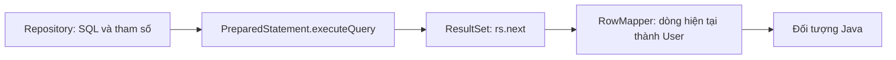

# Tách logic đọc `ResultSet` khỏi logic thực thi SQL trong JDBC

## 1. Vấn đề: một phương thức đang làm quá nhiều việc

Với **JDBC (Java Database Connectivity)**, một truy vấn thường trải qua các bước: lấy `Connection`, tạo `PreparedStatement`, truyền tham số, gọi `executeQuery()`, duyệt `ResultSet`, chuyển từng dòng thành đối tượng Java rồi đóng tài nguyên. JDBC là API truy cập cơ sở dữ liệu quan hệ; nó không tự quyết định dòng dữ liệu phải trở thành kiểu đối tượng nghiệp vụ nào.

Nếu đặt tất cả các bước trong một phương thức, logic truy vấn bị trộn với logic ánh xạ:

```java
List<User> findActiveUsers(DataSource dataSource) throws SQLException {
    String sql = "SELECT id, full_name, email, active "
               + "FROM app_user WHERE active = ? ORDER BY id";
    List<User> users = new ArrayList<>();

    try (Connection connection = dataSource.getConnection();
         PreparedStatement statement = connection.prepareStatement(sql)) {
        statement.setBoolean(1, true);

        try (ResultSet rs = statement.executeQuery()) {
            while (rs.next()) {
                // Quy tắc chuyển dữ liệu bị gắn chặt với câu SQL này.
                users.add(new User(
                    rs.getLong("id"),
                    rs.getString("full_name"),
                    rs.getString("email"),
                    rs.getBoolean("active")
                ));
            }
        }
    }
    return users;
}
```

Đoạn mã có thể chạy đúng, nhưng khi viết thêm `findById()`, `findByEmail()` hoặc báo cáo sử dụng cùng cấu trúc `User`, ta dễ sao chép đoạn `new User(...)` sang nhiều nơi. Việc đổi tên cột, thay đổi kiểu dữ liệu hoặc sửa quy tắc chuyển đổi phải được thực hiện ở nhiều phương thức. Kiểm thử ánh xạ cũng buộc phải đi qua cả quy trình truy vấn nếu không tách riêng.

**Mục tiêu** của bài này là đặt việc *thực thi SQL* và việc *đọc một dòng dữ liệu* ở hai thành phần có trách nhiệm rõ ràng, vẫn sử dụng JDBC thuần và quản lý tài nguyên đúng cách.

## 2. Phân chia trách nhiệm

| Thành phần | Chịu trách nhiệm | Không nên làm |
| --- | --- | --- |
| Repository/DAO | Chọn câu SQL, truyền tham số, lấy kết quả, quyết định trả về danh sách hay một bản ghi | Lặp lại cách tạo đối tượng từ từng cột ở nhiều phương thức |
| Bộ duyệt `ResultSet` | Gọi `rs.next()`, quyết định khi nào dừng, gom kết quả | Chứa các quy tắc chuyển đổi riêng của mọi kiểu đối tượng |
| `RowMapper<T>` | Nhận **dòng hiện tại** và tạo một đối tượng `T` | Tự chạy SQL, gọi `rs.next()`, đóng `ResultSet`/`Connection` |
| `DataSource` | Cấp `Connection` theo cấu hình ứng dụng | Quyết định cách chuyển dữ liệu thành đối tượng nghiệp vụ |



Một `RowMapper` được thiết kế theo nguyên tắc **một lần gọi = một dòng hiện tại = một đối tượng**. Nó đọc `ResultSet` nhưng không sở hữu vòng đời của `ResultSet`. Đây là ranh giới quan trọng nhất của cách tách lớp này.

## 3. Ví dụ đầy đủ bằng JDBC thuần

Giả sử cơ sở dữ liệu quan hệ có bảng sau (cú pháp `BOOLEAN` có thể khác giữa các hệ quản trị):

```sql
CREATE TABLE app_user (
    id        BIGINT       PRIMARY KEY,
    full_name VARCHAR(100) NOT NULL,
    email     VARCHAR(255) NOT NULL,
    active    BOOLEAN      NOT NULL
);
```

Các đoạn Java dưới đây có thể đặt thành những file riêng trong cùng package; sử dụng Java 17+ để dùng `record`. `DataSource` thuộc `javax.sql`, còn `Connection`, `PreparedStatement`, `ResultSet` và `SQLException` thuộc `java.sql`.

### Bước 1: định nghĩa đối tượng đích

```java
// User.java
public record User(long id, String fullName, String email, boolean active) {
}
```

`User` chỉ chứa dữ liệu nghiệp vụ. Nó không cần biết JDBC, tên bảng hay câu SQL.

### Bước 2: định nghĩa hợp đồng ánh xạ một dòng

```java
// RowMapper.java
import java.sql.ResultSet;
import java.sql.SQLException;

@FunctionalInterface
public interface RowMapper<T> {
    T mapRow(ResultSet rs) throws SQLException;
}
```

`@FunctionalInterface` cho phép dùng cả lớp riêng và biểu thức lambda. `SQLException` được khai báo vì thao tác đọc cột có thể lỗi, chẳng hạn tên cột không tồn tại hoặc driver không chuyển đổi được kiểu dữ liệu.

### Bước 3: chuyển một dòng thành `User`

```java
// UserRowMapper.java
import java.sql.ResultSet;
import java.sql.SQLException;

public final class UserRowMapper implements RowMapper<User> {
    @Override
    public User mapRow(ResultSet rs) throws SQLException {
        return new User(
            rs.getLong("id"),
            rs.getString("full_name"),
            rs.getString("email"),
            rs.getBoolean("active")
        );
    }
}
```

Các lệnh `getLong`, `getString` và `getBoolean` chỉ đọc **hàng mà con trỏ đang trỏ tới**. `UserRowMapper` tuyệt đối không gọi `rs.next()`: repository chịu trách nhiệm di chuyển con trỏ và quyết định số hàng cần đọc. Cột `active` trong ví dụ có ràng buộc `NOT NULL`, nên `getBoolean()` không gây nhập nhằng giữa `false` và giá trị SQL `NULL`.

### Bước 4: repository chỉ điều phối truy vấn

```java
// JdbcUserRepository.java
import javax.sql.DataSource;
import java.sql.Connection;
import java.sql.PreparedStatement;
import java.sql.ResultSet;
import java.sql.SQLException;
import java.util.ArrayList;
import java.util.List;
import java.util.Objects;
import java.util.Optional;

public final class JdbcUserRepository {
    private static final String USER_COLUMNS = "id, full_name, email, active";

    private final DataSource dataSource;
    private final RowMapper<User> userMapper;

    public JdbcUserRepository(DataSource dataSource) {
        this.dataSource = Objects.requireNonNull(dataSource);
        this.userMapper = new UserRowMapper();
    }

    public List<User> findByActive(boolean active) throws SQLException {
        String sql = "SELECT " + USER_COLUMNS
                   + " FROM app_user WHERE active = ? ORDER BY id";
        List<User> users = new ArrayList<>();

        try (Connection connection = dataSource.getConnection();
             PreparedStatement statement = connection.prepareStatement(sql)) {
            statement.setBoolean(1, active); // Tham số SQL, không nối input vào SQL.

            try (ResultSet rs = statement.executeQuery()) {
                while (rs.next()) {
                    users.add(userMapper.mapRow(rs));
                }
            }
        }
        return users;
    }

    public Optional<User> findById(long id) throws SQLException {
        String sql = "SELECT " + USER_COLUMNS + " FROM app_user WHERE id = ?";

        try (Connection connection = dataSource.getConnection();
             PreparedStatement statement = connection.prepareStatement(sql)) {
            statement.setLong(1, id);

            try (ResultSet rs = statement.executeQuery()) {
                if (!rs.next()) {
                    return Optional.empty();
                }
                User user = userMapper.mapRow(rs);
                if (rs.next()) {
                    throw new SQLException("Expected at most one user for id=" + id);
                }
                return Optional.of(user);
            }
        }
    }
}
```

Ở `findByActive()`, repository gọi `rs.next()` nhiều lần để tạo `List<User>`. Ở `findById()`, nó kiểm tra số hàng và trả về `Optional<User>`. **Cả hai đều tái sử dụng cùng `UserRowMapper`**; thay đổi số hàng được đọc không làm thay đổi quy tắc ánh xạ.

`try-with-resources` đóng `ResultSet`, `PreparedStatement`, `Connection` khi ra khỏi phạm vi, kể cả khi `mapRow()` ném `SQLException`. Không trả về `ResultSet` ra ngoài `try`: đối tượng này phụ thuộc vào tài nguyên JDBC đang mở.

> **Giả định của ví dụ:** `id` và `active` là `NOT NULL`; các cột được chọn có đúng tên như `UserRowMapper` sử dụng. `DataSource` đã được cấu hình để truy cập một cơ sở dữ liệu hỗ trợ bảng mẫu. Cách cấu hình driver/pool phụ thuộc môi trường ứng dụng và nằm ngoài trách nhiệm của mapper.

## 4. Vì sao không gọi `rs.next()` trong mapper?

Vừa nhận `ResultSet` sau `executeQuery()`, con trỏ ở vị trí **trước dòng đầu tiên**. Chỉ sau `rs.next()` trả về `true` mới có dòng hợp lệ để đọc. Trong vòng lặp `while (rs.next())`, bộ duyệt đã di chuyển con trỏ cho mapper.

Đặt thêm `rs.next()` bên trong `mapRow()` khiến mỗi lần ánh xạ lại nhảy sang dòng kế tiếp, dẫn đến bỏ sót dòng, ghép sai dữ liệu, hoặc đọc sau khi hết kết quả. Ví dụ sau **sai**:

```java
// SAI: vòng lặp bên ngoài và mapper cùng điều khiển con trỏ.
User mapRow(ResultSet rs) throws SQLException {
    rs.next();
    return new User(rs.getLong("id"), rs.getString("full_name"),
                    rs.getString("email"), rs.getBoolean("active"));
}
```

Quy tắc thống nhất: **bên gọi điều khiển con trỏ; mapper chỉ đọc dòng hiện tại**. Không lưu `ResultSet` vào field, không tạo tác vụ bất đồng bộ sử dụng nó sau khi repository kết thúc, và không gọi `close()` trong mapper.

## 5. Ánh xạ kiểu dữ liệu và xử lý `NULL`

Phương thức `ResultSet.getXxx()` cần tương thích với kiểu SQL và kiểu Java. Một số trường hợp thường gặp:

| SQL | Cách đọc JDBC | Kiểu Java gợi ý | Lưu ý |
| --- | --- | --- | --- |
| `VARCHAR`, `CHAR` | `getString("name")` | `String` | Trả về `null` nếu SQL `NULL` |
| `BIGINT NOT NULL` | `getLong("id")` | `long` | `getLong()` trả `0` khi SQL `NULL`; dùng `wasNull()` nếu cột có thể rỗng |
| `BOOLEAN NOT NULL` | `getBoolean("active")` | `boolean` | `getBoolean()` trả `false` khi SQL `NULL`; phân biệt bằng `wasNull()` |
| `DECIMAL` | `getBigDecimal("amount")` | `BigDecimal` | Tránh dùng `double` cho số tiền |
| `DATE` | `getDate("birthday")` rồi `toLocalDate()` | `LocalDate` | Kiểm tra `null` trước khi chuyển |
| `TIMESTAMP` | `getTimestamp("created_at")` | `Timestamp` hoặc chuyển kiểu thời gian | Cần quy ước múi giờ rõ ràng khi chuyển sang `Instant` |

Ví dụ cột `manager_id BIGINT NULL`:

```java
long managerIdValue = rs.getLong("manager_id");
Long managerId = rs.wasNull() ? null : managerIdValue;
```

`wasNull()` phản ánh **lần đọc cột gần nhất**, vì vậy phải gọi ngay sau `getLong()`. Với driver tương thích, có thể cân nhắc `rs.getObject("manager_id", Long.class)`, nhưng nên kiểm tra hỗ trợ của driver đang dùng. Nếu cột `DATE` nullable:

```java
java.sql.Date sqlDate = rs.getDate("birthday");
java.time.LocalDate birthday =
    sqlDate == null ? null : sqlDate.toLocalDate();
```

Quy tắc chuyển đổi (ví dụ `NULL` thành `null`, `DATE` thành `LocalDate`) thuộc về mapper. Quyết định lọc theo ngày nào hoặc sắp xếp theo cột nào thuộc về repository/SQL.

## 6. Tên cột, alias và hợp đồng giữa SQL với mapper

`rs.getString("full_name")` tra cứu **nhãn cột** trong kết quả. Nếu SQL có alias, mapper phải dùng nhãn sau `AS`, không tự giả định tên cột gốc:

```sql
SELECT u.id,
       u.full_name AS display_name,
       u.email,
       u.active
FROM app_user u
WHERE u.id = ?;
```

Mapper đọc `full_name` sẽ không tương thích với truy vấn trên; phải đọc `display_name` hoặc giữ alias `AS full_name`. Chọn một hợp đồng nhãn cột thống nhất cho các truy vấn sử dụng chung mapper. Trong truy vấn `JOIN`, nên alias rõ ràng các cột có tên trùng nhau (`user_id`, `department_id`...) để tránh ánh xạ nhầm.

Dùng tên/nhãn cột thường dễ bảo trì hơn chỉ số (`getString(2)`), vì thêm hoặc đổi thứ tự cột trong `SELECT` không làm âm thầm thay đổi ý nghĩa cột được đọc. Không nên lạm dụng `SELECT *` khi mapper cần một tập cột xác định.

## 7. Mở rộng: tái sử dụng cả vòng lặp JDBC

Nếu nhiều repository có cùng mẫu `Connection → PreparedStatement → ResultSet → List<T>`, có thể trích một **bộ thực thi truy vấn** nhận mapper và hàm truyền tham số. Đây là một mức trừu tượng tùy chọn; chỉ nên áp dụng khi thật sự xuất hiện lặp mã:

```java
@FunctionalInterface
interface ParameterBinder {
    void bind(PreparedStatement statement) throws SQLException;
}

final class JdbcQueryExecutor {
    private final DataSource dataSource;

    JdbcQueryExecutor(DataSource dataSource) {
        this.dataSource = dataSource;
    }

    <T> List<T> query(String sql, ParameterBinder binder,
                      RowMapper<T> mapper) throws SQLException {
        List<T> result = new ArrayList<>();
        try (Connection connection = dataSource.getConnection();
             PreparedStatement statement = connection.prepareStatement(sql)) {
            binder.bind(statement);
            try (ResultSet rs = statement.executeQuery()) {
                while (rs.next()) {
                    result.add(mapper.mapRow(rs));
                }
            }
        }
        return result;
    }
}
```

Đoạn này dùng các kiểu đã giới thiệu và các import `javax.sql.DataSource`, `java.sql.*`, `java.util.*`. Ví dụ cách gọi:

```java
List<User> activeUsers = executor.query(
    "SELECT id, full_name, email, active FROM app_user WHERE active = ?",
    statement -> statement.setBoolean(1, true),
    new UserRowMapper()
);
```

Lúc này `JdbcQueryExecutor` sở hữu vòng đời tài nguyên và duyệt dòng, repository sở hữu SQL/tham số, `UserRowMapper` sở hữu chuyển đổi một dòng. Tham số động vẫn dùng `PreparedStatement`; không ghép dữ liệu người dùng trực tiếp vào câu SQL. API `JdbcTemplate` của Spring JDBC cũng áp dụng ý tưởng truyền mapper vào bộ thực thi, nhưng ví dụ trên không phụ thuộc Spring.

Lưu ý: hàm `query()` minh họa truy vấn trả danh sách và tự quản lý `Connection`. Trong ứng dụng dùng **transaction** trải qua nhiều câu SQL, bộ thực thi phải dùng đúng `Connection` do transaction quản lý; không tự ý lấy kết nối mới cho từng lệnh rồi coi chúng thuộc cùng một transaction.

## 8. Khi một dòng không tương đương một đối tượng

`RowMapper<T>` hợp với ánh xạ đơn giản: một dòng của `ResultSet` thành một `User`, `Product` hoặc DTO. Với truy vấn `JOIN` một-nhiều, một đơn hàng có nhiều dòng kết quả vì mỗi dòng chứa thêm một mặt hàng. Khi đó gọi `new Order(...)` cho mỗi dòng sẽ tạo nhiều đơn hàng trùng nhau.

Ví dụ:

```sql
SELECT o.id AS order_id, i.id AS item_id, i.product_name
FROM orders o
LEFT JOIN order_item i ON i.order_id = o.id
ORDER BY o.id, i.id;
```

Trường hợp này nên gom các dòng theo `order_id` (chẳng hạn bằng `LinkedHashMap<Long, Order>`), hoặc dùng một hàm xử lý **toàn bộ `ResultSet`** như `ResultSetExtractor<T>`. Logic gom một-nhiều cần kiểm soát con trỏ/nhóm dòng ở tầng duyệt kết quả; mapper từng dòng chỉ chuyển đổi phần dữ liệu trong dòng mà nó nhận. Với `LEFT JOIN`, nhớ kiểm tra `item_id IS NULL` trước khi tạo item. Đây là quyết định mô hình hóa cấu trúc kết quả, không phải lý do để `RowMapper` tự chạy thêm truy vấn cho từng dòng (vốn có thể dẫn đến vấn đề N+1 query).

## 9. Kiểm thử sau khi tách

Việc tách giúp kiểm tra độc lập hai loại hành vi:

- **Mapper:** có đọc đúng nhãn cột, kiểu dữ liệu, `NULL` và tạo đúng đối tượng không? Có vô tình gọi `next()` hoặc `close()` không?
- **Repository:** có dùng SQL/phép lọc đúng, truyền tham số đúng, phân biệt 0/1/nhiều dòng và đóng tài nguyên khi lỗi không?

Ví dụ kiểm thử mapper với **JUnit 5 và Mockito** (cần khai báo hai thư viện này trong phạm vi test):

```java
import static org.junit.jupiter.api.Assertions.assertEquals;
import static org.mockito.Mockito.*;
import java.sql.ResultSet;
import org.junit.jupiter.api.Test;

class UserRowMapperTest {
    @Test
    void mapsCurrentRowWithoutMovingCursor() throws Exception {
        ResultSet rs = mock(ResultSet.class);
        when(rs.getLong("id")).thenReturn(7L);
        when(rs.getString("full_name")).thenReturn("An Nguyen");
        when(rs.getString("email")).thenReturn("an@example.test");
        when(rs.getBoolean("active")).thenReturn(true);

        User actual = new UserRowMapper().mapRow(rs);

        assertEquals(new User(7L, "An Nguyen", "an@example.test", true), actual);
        verify(rs, never()).next();
        verify(rs, never()).close();
    }
}
```

Kiểm thử tích hợp repository với cơ sở dữ liệu thử nghiệm nên bao gồm: không có dòng thì danh sách rỗng/`Optional.empty()`, nhiều dòng thì giữ đúng thứ tự, tham số truy vấn được bind đúng, và kết quả trả về có đầy đủ cột theo hợp đồng mapper. Unit test dùng mock `ResultSet` không thay thế việc kiểm tra tương thích kiểu SQL/driver bằng kiểm thử tích hợp.

## 10. Lỗi thường gặp và cách phòng tránh

| Hiện tượng | Nguyên nhân phổ biến | Cách xử lý |
| --- | --- | --- |
| Bỏ qua bản ghi hoặc gặp `Invalid cursor state` | Mapper tự gọi `rs.next()` | Chỉ vòng duyệt bên ngoài gọi `next()` |
| `Column ... not found` | SQL không chọn đủ cột hoặc dùng alias khác | Đồng bộ nhãn cột giữa `SELECT` và mapper |
| Giá trị nullable trở thành `0`/`false` | Dùng getter kiểu nguyên thủy mà không kiểm tra SQL `NULL` | Dùng `wasNull()` ngay sau getter, hoặc getter đối tượng phù hợp |
| Lỗi đóng kết nối, đọc dữ liệu sau khi truy vấn kết thúc | Trả `ResultSet` ra ngoài phạm vi mở tài nguyên | Ánh xạ sang đối tượng Java trước khi đóng tài nguyên |
| Kết quả `JOIN` bị nhân đôi đối tượng cha | Áp dụng máy móc một dòng = một object | Dùng bộ gom nhiều dòng theo khóa cha |
| Nhiều truy vấn sinh nhiều kết nối trong một nghiệp vụ | Bộ thực thi tự lấy kết nối riêng, tách khỏi transaction | Truyền hoặc dùng connection/transaction do tầng điều phối quản lý |
| Lỗi SQL injection | Nối giá trị đầu vào trực tiếp vào SQL | Bind giá trị qua `PreparedStatement` |

## 11. Ghi nhớ và tự kiểm tra

Khi thiết kế một chức năng đọc dữ liệu qua JDBC, hãy tự trả lời:

1. SQL và tham số của truy vấn được sở hữu ở đâu? Thành phần đó có kiểm soát `Connection` và `PreparedStatement` hợp lý không?
2. Ai là nơi duy nhất gọi `rs.next()`? Mapper có luôn được gọi khi con trỏ đang ở một dòng hợp lệ không?
3. Tất cả mapper dùng chung có nhận đúng nhãn cột, kiểu JDBC và quy ước `NULL` không?
4. Đối tượng trả về có độc lập với `ResultSet` sau khi tài nguyên JDBC đã đóng không?
5. Truy vấn tạo một đối tượng trên mỗi dòng, hay cần gom nhiều dòng thành một cấu trúc đối tượng?

**Bài tập thực hành:** thêm phương thức `findByEmail(String email)` vào `JdbcUserRepository`, trả về `Optional<User>`, bind tham số bằng `setString(1, email)` và tái sử dụng `UserRowMapper` mà không sao chép lại các lệnh `rs.getXxx()`. Sau đó thêm cột `birthday DATE NULL` vào schema và vào kiểu `User`; cập nhật mapper để xử lý `null`, rồi kiểm tra rằng mọi truy vấn dùng mapper đều đã chọn thêm cột này.

Tư duy cốt lõi: **repository quyết định truy vấn gì và đọc bao nhiêu dòng; mapper quyết định một dòng hiện tại trở thành đối tượng Java nào**. Nhờ ranh giới này, mã JDBC dễ đọc, dễ kiểm thử và dễ thay đổi khi cấu trúc dữ liệu phát triển.
