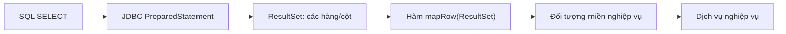

# Ánh xạ hàng kết quả vào đối tượng miền nghiệp vụ

## 1. Từ hàng dữ liệu SQL đến đối tượng Java

Khi dùng **JDBC**, câu lệnh SQL trả về `ResultSet`: một tập các hàng có cột và kiểu dữ liệu theo cơ sở dữ liệu. Trong khi đó, mã nghiệp vụ của ứng dụng Java thường làm việc với các đối tượng như `SalesOrder`, `Customer` hoặc `OrderItem`. **Ánh xạ bản ghi (record mapping)** là quá trình đọc các cột từ một hàng `ResultSet`, chuyển chúng sang kiểu Java phù hợp và tạo một đối tượng thể hiện dữ liệu hoặc quy tắc của miền nghiệp vụ.

Ví dụ: hàng SQL có `id = 1001`, `total_amount = 240.50`, `status = 'PAID'` sẽ được chuyển thành một đối tượng `SalesOrder` có `id` kiểu `long`, `totalAmount` kiểu `BigDecimal` và `status` kiểu enum `OrderStatus`.

Một cách tổ chức thường gặp:



Việc ánh xạ cần giải quyết nhiều hơn thao tác gọi `getString()`:

- Đọc đúng cột và kiểu dữ liệu, tránh mất độ chính xác khi chuyển đổi.
- Xử lý `NULL` từ SQL và các thuộc tính bắt buộc trong mô hình Java.
- Biến giá trị lưu trữ như chuỗi `'PAID'` thành khái niệm nghiệp vụ như `OrderStatus.PAID`.
- Tạo đối tượng hợp lệ theo các bất biến (invariants) của miền nghiệp vụ.
- Xử lý trường hợp một đối tượng được tạo từ nhiều hàng của kết quả `JOIN`.
- Giữ trách nhiệm JDBC tại tầng truy cập dữ liệu để mã nghiệp vụ không phụ thuộc trực tiếp vào `ResultSet`.

Trong bài, ta dùng các API JDBC chuẩn như `DataSource`, `Connection`, `PreparedStatement` và `ResultSet`. Các ví dụ Java dùng `record` (Java 17+) để thể hiện đối tượng bất biến; nếu dùng phiên bản Java cũ hơn, có thể thay bằng lớp có constructor và getter.

## 2. Tạo ví dụ dữ liệu và mô hình nghiệp vụ

Giả sử ứng dụng có bảng đơn hàng:

```sql
CREATE TABLE sales_orders (
    id               BIGINT PRIMARY KEY,
    customer_id      BIGINT NOT NULL,
    total_amount     DECIMAL(14, 2) NOT NULL,
    status           VARCHAR(20) NOT NULL,
    created_at       TIMESTAMP NOT NULL,
    note             VARCHAR(500),
    assigned_user_id BIGINT
);
```

Ví dụ hàng dữ liệu:

| id | customer_id | total_amount | status | created_at | note | assigned_user_id |
|---|---|---|---|---|---|---|
| 1001 | 21 | 240.50 | `PAID` | `2026-11-10 14:20:00` | `Giao giờ hành chính` | `8` |
| 1002 | 21 | 90.00 | `NEW` | `2026-11-11 08:05:00` | `NULL` | `NULL` |

Trong Java, định nghĩa kiểu trạng thái và đối tượng đơn hàng:

```java
import java.math.BigDecimal;
import java.time.LocalDateTime;
import java.util.Objects;

enum OrderStatus {
    NEW, PAID, CANCELLED
}

record SalesOrder(
        long id,
        long customerId,
        BigDecimal totalAmount,
        OrderStatus status,
        LocalDateTime createdAt,
        String note,
        Long assignedUserId
) {
    public SalesOrder {
        if (id <= 0 || customerId <= 0) {
            throw new IllegalArgumentException("ID must be positive");
        }
        Objects.requireNonNull(totalAmount, "totalAmount");
        Objects.requireNonNull(status, "status");
        Objects.requireNonNull(createdAt, "createdAt");
        if (totalAmount.signum() < 0) {
            throw new IllegalArgumentException("totalAmount must be >= 0");
        }
        if (assignedUserId != null && assignedUserId <= 0) {
            throw new IllegalArgumentException("assignedUserId must be positive");
        }
    }
}
```

Các lựa chọn trong mô hình có chủ đích:

- `BigDecimal` giữ số tiền ở dạng thập phân chính xác; `double` có thể tạo sai số dấu phẩy động.
- `OrderStatus` giới hạn trạng thái vào các giá trị nghiệp vụ được phép dùng.
- `LocalDateTime` phù hợp để minh họa cột SQL `TIMESTAMP` *không chứa thông tin múi giờ*. Nếu cơ sở dữ liệu lưu thời điểm tuyệt đối hoặc `TIMESTAMP WITH TIME ZONE`, cần thống nhất cách dùng `Instant`/`OffsetDateTime` và múi giờ với driver.
- `note` và `assignedUserId` có thể bằng `null` vì hai cột SQL tương ứng cho phép `NULL`. `Long` được sử dụng thay cho `long` đối với ID không bắt buộc.
- Constructor của `record` kiểm tra tính hợp lệ; đối tượng không được tạo ra với tổng tiền âm hoặc trạng thái thiếu.

Đây là **mô hình nghiệp vụ đơn giản**, độc lập với tên cột của JDBC. Với ứng dụng phức tạp, có thể dùng các value object như `OrderId`, `Money`, hoặc phương thức factory của domain để kiểm tra quy tắc sâu hơn.

## 3. Đọc một hàng từ `ResultSet`

Một câu truy vấn chọn những cột cần thiết và gán bí danh rõ ràng:

```sql
SELECT o.id AS order_id,
       o.customer_id,
       o.total_amount,
       o.status,
       o.created_at,
       o.note,
       o.assigned_user_id
FROM sales_orders o
WHERE o.id = ?;
```

`AS order_id` giúp đặt tên cột kết quả ổn định, đặc biệt hữu ích khi sau này `JOIN` sang bảng khác cũng có cột `id`.

Đây là hàm ánh xạ **đúng một hàng hiện tại**:

```java
import java.sql.ResultSet;
import java.sql.SQLException;
import java.sql.Timestamp;
import java.math.BigDecimal;

final class OrderRowMapping {
    private OrderRowMapping() {}

    static SalesOrder mapOrder(ResultSet rs) throws SQLException {
        long id = rs.getLong("order_id");
        long customerId = rs.getLong("customer_id");
        BigDecimal totalAmount = rs.getBigDecimal("total_amount");
        String statusText = rs.getString("status");
        Timestamp createdTimestamp = rs.getTimestamp("created_at");
        String note = rs.getString("note");

        // Đọc cột BIGINT có thể NULL: gọi wasNull() ngay sau getLong().
        long assignedRaw = rs.getLong("assigned_user_id");
        Long assignedUserId = rs.wasNull() ? null : assignedRaw;

        if (totalAmount == null || statusText == null
                || createdTimestamp == null) {
            throw new SQLException("Required sales_orders column is NULL");
        }

        final OrderStatus status;
        try {
            status = OrderStatus.valueOf(statusText);
        } catch (IllegalArgumentException e) {
            throw new SQLException("Unknown order status: " + statusText, e);
        }

        try {
            return new SalesOrder(
                    id,
                    customerId,
                    totalAmount,
                    status,
                    createdTimestamp.toLocalDateTime(),
                    note,
                    assignedUserId
            );
        } catch (IllegalArgumentException e) {
            throw new SQLException("Invalid sales order data for id=" + id, e);
        }
    }
}
```

**Hàm `mapOrder` không gọi `rs.next()`.** Nó giả định con trỏ `ResultSet` đang đứng tại một hàng hợp lệ. Vòng lặp duyệt các hàng thuộc trách nhiệm của repository, nhờ đó một hàm ánh xạ có thể tái sử dụng cho truy vấn một bản ghi, truy vấn danh sách và kết quả `JOIN`.

Các cột `id` và `customer_id` được khai báo `NOT NULL`. Ở ví dụ này, constructor kiểm tra chúng là số dương. Nếu cấu trúc thực tế cho phép ID bằng 0 hoặc dạng ID khác, quy tắc kiểm tra phải theo hợp đồng dữ liệu thực tế.

## 4. Viết repository với `DataSource` và `PreparedStatement`

Một repository đảm nhận truy vấn và duyệt `ResultSet`; đối tượng `SalesOrder` không biết đến kết nối, câu lệnh SQL hoặc tên cột. Ví dụ:

```java
import javax.sql.DataSource;
import java.sql.Connection;
import java.sql.PreparedStatement;
import java.sql.ResultSet;
import java.sql.SQLException;
import java.util.ArrayList;
import java.util.List;
import java.util.Objects;
import java.util.Optional;

final class OrderRepository {
    private final DataSource dataSource;

    OrderRepository(DataSource dataSource) {
        this.dataSource = Objects.requireNonNull(dataSource);
    }

    Optional<SalesOrder> findById(long id) throws SQLException {
        String sql = """
                SELECT o.id AS order_id, o.customer_id, o.total_amount,
                       o.status, o.created_at, o.note, o.assigned_user_id
                FROM sales_orders o
                WHERE o.id = ?
                """;

        try (Connection connection = dataSource.getConnection();
             PreparedStatement statement = connection.prepareStatement(sql)) {
            statement.setLong(1, id);
            try (ResultSet rs = statement.executeQuery()) {
                return rs.next()
                        ? Optional.of(OrderRowMapping.mapOrder(rs))
                        : Optional.empty();
            }
        }
    }

    List<SalesOrder> findByCustomerId(long customerId) throws SQLException {
        String sql = """
                SELECT o.id AS order_id, o.customer_id, o.total_amount,
                       o.status, o.created_at, o.note, o.assigned_user_id
                FROM sales_orders o
                WHERE o.customer_id = ?
                ORDER BY o.created_at DESC, o.id DESC
                """;

        List<SalesOrder> orders = new ArrayList<>();
        try (Connection connection = dataSource.getConnection();
             PreparedStatement statement = connection.prepareStatement(sql)) {
            statement.setLong(1, customerId);
            try (ResultSet rs = statement.executeQuery()) {
                while (rs.next()) {
                    orders.add(OrderRowMapping.mapOrder(rs));
                }
            }
        }
        return orders;
    }
}
```

Từ một hàng SQL, `findById` trả về `Optional<SalesOrder>`; nếu không có hàng, phương thức trả `Optional.empty()`. `findByCustomerId` dùng `while (rs.next())` để thêm lần lượt các đối tượng vào danh sách, nên kết quả trống được biểu diễn bằng danh sách rỗng.

Lưu ý:

1. `rs.next()` di chuyển con trỏ từ vị trí trước hàng đầu tiên sang hàng kế tiếp. Không đọc cột trước khi gọi `next()` thành công.
2. `PreparedStatement#setLong` truyền tham số SQL theo kiểu dữ liệu; không nối chuỗi chứa giá trị đầu vào vào câu SQL.
3. `try-with-resources` đóng `ResultSet`, `PreparedStatement` và `Connection` khi hoàn tất hoặc phát sinh lỗi. Nếu `DataSource` quản lý pool, `Connection.close()` thường trả kết nối về pool.
4. Truy vấn chỉ liệt kê cột cần đọc thay vì phụ thuộc `SELECT *`. Việc đổi thứ tự cột trong bảng vì thế ít ảnh hưởng hơn.
5. Nếu sử dụng nhiều lệnh phải cùng tham gia một transaction, repository cần nhận hoặc cùng sử dụng **một `Connection`** do tầng điều phối transaction quản lý; không thể rollback đồng thời các thao tác chạy trên hai kết nối độc lập.

## 5. Bảng đối chiếu kiểu dữ liệu và xử lý `NULL`

| Kiểu cột SQL | Cách đọc thường dùng trong JDBC | Kiểu Java gợi ý | Điều cần chú ý |
|---|---|---|---|
| `BIGINT NOT NULL` | `rs.getLong("id")` | `long` | `getLong()` trả `0` khi giá trị SQL là `NULL`; phải biết ràng buộc cột. |
| `BIGINT NULL` | `getLong()`, rồi `wasNull()` | `Long` | Không nhầm `NULL` với giá trị số `0`. |
| `VARCHAR` | `rs.getString("name")` | `String` | Trả `null` nếu SQL là `NULL`. |
| `DECIMAL(p,s)` | `rs.getBigDecimal("amount")` | `BigDecimal` | Tránh đi qua `double` cho dữ liệu tài chính. |
| `INTEGER` | `rs.getInt("quantity")` | `int` hoặc `Integer` | Với cột có thể null, kiểm tra `wasNull()`. |
| `DATE` | `rs.getDate("due_date")` | `LocalDate` qua `toLocalDate()` | Kiểm tra null trước khi chuyển. |
| `TIMESTAMP` | `rs.getTimestamp("created_at")` | `LocalDateTime` qua `toLocalDateTime()` | Cần quy ước timezone thống nhất với hệ quản trị/driver. |
| `BOOLEAN` | `rs.getBoolean("active")` | `boolean` hoặc `Boolean` | Kiểm tra `wasNull()` nếu cột nullable. |

Ví dụ xử lý `BIGINT NULL`:

```java
long value = rs.getLong("assigned_user_id");
Long assignedUserId = rs.wasNull() ? null : value;
```

`wasNull()` cho biết **cột vừa đọc gần nhất** có giá trị SQL `NULL` hay không. Vì vậy, đừng chèn một lời gọi `getString()`, `getInt()` hoặc đọc cột khác vào giữa `getLong()` và `wasNull()`. Một cách khác là dùng `rs.getObject("assigned_user_id", Long.class)` nếu driver hỗ trợ ánh xạ kiểu đó đúng như mong đợi; nên kiểm chứng với driver/hệ quản trị thực tế.

Ví dụ chuyển `DATE` an toàn:

```java
java.sql.Date sqlDate = rs.getDate("due_date");
java.time.LocalDate dueDate =
        sqlDate == null ? null : sqlDate.toLocalDate();
```

Hàm `getTimestamp()` trả về `java.sql.Timestamp` hoặc `null`. Trong ví dụ `OrderRowMapping`, ta kiểm tra null trước khi gọi `toLocalDateTime()`. Nếu cột thời gian thể hiện thời điểm toàn cầu, hãy chọn một quy ước múi giờ và áp dụng xuyên suốt tầng JDBC, domain và API. `LocalDateTime` bản thân nó không mang offset hay thông tin múi giờ.

## 6. Trách nhiệm của mapper và bất biến miền nghiệp vụ

Có hai kiểu mô hình mà ứng dụng thường cần:

- **Đối tượng đọc dữ liệu (read model/DTO):** hình dạng gần với kết quả SQL, hữu ích cho danh sách hoặc báo cáo. Có thể chỉ gồm `id`, `status` và `totalAmount` mà không cần toàn bộ dữ liệu.
- **Đối tượng miền nghiệp vụ (domain object):** thể hiện khái niệm có ý nghĩa nghiệp vụ và các bất biến. Ví dụ `SalesOrder` từ chối tổng tiền âm hoặc trạng thái không hợp lệ.

Mapper là nơi chuyển **biểu diễn lưu trữ** sang **biểu diễn miền**. Nó nên chịu trách nhiệm đọc cột, chuyển kiểu, xác định null và gọi constructor/factory. Quyết định như “đơn hàng thanh toán thành công thì gửi email” hoặc “có được hủy đơn không” thuộc tầng nghiệp vụ, không nên thực thi trong mapper.

Khi cột `status` chứa `'UNKNOWN_VALUE'`, `OrderStatus.valueOf(...)` ném `IllegalArgumentException`. Ví dụ ánh xạ ở trên chuyển lỗi này thành `SQLException` có thông tin cột và nguyên nhân gốc, để tầng truy cập dữ liệu báo rằng dữ liệu đọc từ database không phù hợp với mô hình. Mã thực tế có thể dùng exception chuyên biệt cho lỗi ánh xạ; điều quan trọng là **không âm thầm đổi giá trị lạ thành trạng thái mặc định**.

Tương tự, nếu một cột `NOT NULL` bất ngờ trả null do dữ liệu bẩn, thay đổi schema hoặc truy vấn sai, nên phát hiện lỗi sớm thay vì tạo đối tượng sai. Tùy chính sách ứng dụng, các trường hợp phục hồi dữ liệu cũ có thể cần một read model riêng với quy tắc chấp nhận dữ liệu yếu hơn.

**Mẫu hàm mapper nên được giữ đơn giản:**

```java
static DomainType mapRow(ResultSet rs) throws SQLException {
    // 1. Đọc các cột từ hàng hiện tại.
    // 2. Xử lý NULL và chuyển kiểu.
    // 3. Tạo và trả đối tượng miền nghiệp vụ hợp lệ.
    // Không gọi next(), không tự mở Connection, không ghi dữ liệu.
    throw new UnsupportedOperationException("Minh họa cấu trúc");
}
```

Đoạn trên chỉ mô tả cấu trúc; `OrderRowMapping.mapOrder` ở mục 3 là ví dụ có triển khai đầy đủ.

## 7. Khi một đối tượng được ánh xạ từ nhiều hàng `JOIN`

Một hàng `ResultSet` thường ánh xạ thành một đối tượng khi truy vấn đọc một bảng. Nhưng `JOIN` quan hệ **một-nhiều** làm lặp thông tin của đối tượng cha trên nhiều hàng.

Giả sử thêm bảng chi tiết đơn hàng:

```sql
CREATE TABLE order_items (
    id         BIGINT PRIMARY KEY,
    order_id   BIGINT NOT NULL,
    sku        VARCHAR(50) NOT NULL,
    quantity   INTEGER NOT NULL,
    unit_price DECIMAL(14, 2) NOT NULL,
    CONSTRAINT fk_order_items_order
        FOREIGN KEY (order_id) REFERENCES sales_orders(id)
);
```

Một đơn hàng `1001` có hai chi tiết sẽ trả hai hàng khi `JOIN`:

| order_id | status | item_id | sku | quantity |
|---|---|---|---|---|
| 1001 | PAID | 501 | KEYBOARD | 1 |
| 1001 | PAID | 502 | MOUSE | 2 |

Nếu gọi `mapOrder(rs)` rồi thêm vào danh sách sau mỗi `rs.next()`, ứng dụng sẽ tạo **hai đối tượng `SalesOrder` cùng ID 1001**. Cách đó không mô tả đúng quan hệ một đơn hàng có nhiều chi tiết.

Ta có thể giữ `SalesOrder` làm đối tượng đơn hàng, đồng thời tạo cấu trúc chứa các chi tiết:

```java
import java.math.BigDecimal;
import java.util.List;
import java.util.Objects;

record OrderItem(
        long id,
        long orderId,
        String sku,
        int quantity,
        BigDecimal unitPrice
) {
    public OrderItem {
        if (id <= 0 || orderId <= 0 || quantity <= 0) {
            throw new IllegalArgumentException("Invalid order item IDs/quantity");
        }
        Objects.requireNonNull(sku, "sku");
        Objects.requireNonNull(unitPrice, "unitPrice");
        if (unitPrice.signum() < 0) {
            throw new IllegalArgumentException("Negative unit price");
        }
    }
}

record OrderDetails(SalesOrder order, List<OrderItem> items) {
    public OrderDetails {
        Objects.requireNonNull(order, "order");
        items = List.copyOf(items);
    }
}
```

Truy vấn dùng `LEFT JOIN` để **giữ cả đơn hàng chưa có chi tiết**:

```sql
SELECT o.id AS order_id,
       o.customer_id,
       o.total_amount,
       o.status,
       o.created_at,
       o.note,
       o.assigned_user_id,
       i.id AS item_id,
       i.sku AS item_sku,
       i.quantity AS item_quantity,
       i.unit_price AS item_unit_price
FROM sales_orders o
LEFT JOIN order_items i ON i.order_id = o.id
WHERE o.customer_id = ?
ORDER BY o.id, i.id;
```

Mỗi hàng mang thông tin cha và tối đa một item. Khi không có item, các cột của `i` là `NULL`. Đoạn sau ghép các hàng có cùng `order_id` thành **một** `OrderDetails`:

```java
// Bổ sung import:
// java.util.Map, java.util.LinkedHashMap, java.util.ArrayList,
// java.util.List, java.math.BigDecimal
// và thêm phương thức/lớp hỗ trợ sau vào OrderRepository.

List<OrderDetails> findDetailsByCustomerId(long customerId)
        throws SQLException {
    String sql = """
            SELECT o.id AS order_id, o.customer_id, o.total_amount,
                   o.status, o.created_at, o.note, o.assigned_user_id,
                   i.id AS item_id, i.sku AS item_sku,
                   i.quantity AS item_quantity,
                   i.unit_price AS item_unit_price
            FROM sales_orders o
            LEFT JOIN order_items i ON i.order_id = o.id
            WHERE o.customer_id = ?
            ORDER BY o.id, i.id
            """;

    Map<Long, OrderBuilder> grouped = new LinkedHashMap<>();

    try (Connection connection = dataSource.getConnection();
         PreparedStatement statement = connection.prepareStatement(sql)) {
        statement.setLong(1, customerId);

        try (ResultSet rs = statement.executeQuery()) {
            while (rs.next()) {
                long orderId = rs.getLong("order_id");
                OrderBuilder builder = grouped.get(orderId);
                if (builder == null) {
                    builder = new OrderBuilder(OrderRowMapping.mapOrder(rs));
                    grouped.put(orderId, builder);
                }

                long itemId = rs.getLong("item_id");
                boolean missingItem = rs.wasNull();
                if (!missingItem) {
                    OrderItem item = new OrderItem(
                            itemId,
                            orderId,
                            rs.getString("item_sku"),
                            rs.getInt("item_quantity"),
                            rs.getBigDecimal("item_unit_price")
                    );
                    builder.items.add(item);
                }
            }
        }
    }

    List<OrderDetails> details = new ArrayList<>();
    for (OrderBuilder builder : grouped.values()) {
        details.add(new OrderDetails(builder.order, builder.items));
    }
    return details;
}

private static final class OrderBuilder {
    private final SalesOrder order;
    private final List<OrderItem> items = new ArrayList<>();

    private OrderBuilder(SalesOrder order) {
        this.order = order;
    }
}
```

Ở đoạn trên:

1. `LinkedHashMap` dùng khóa `order_id` nên thông tin cha chỉ được khởi tạo một lần cho mỗi đơn hàng; đồng thời giữ thứ tự duyệt.
2. `rs.getLong("item_id")` rồi `rs.wasNull()` phân biệt hàng `LEFT JOIN` không có item với hàng có item thực.
3. Mỗi item được thêm vào đối tượng gom tương ứng. Danh sách chi tiết cuối cùng bất biến nhờ `List.copyOf` trong `OrderDetails`.
4. Phương thức trả danh sách rỗng khi không có đơn hàng; đơn hàng chưa có item vẫn xuất hiện với `items` rỗng.

**Đừng suy ra rằng mọi `JOIN` đều có thể ánh xạ bằng một đối tượng trên mỗi hàng.** Nếu truy vấn nối thêm hai quan hệ một-nhiều khác nhau, số hàng có thể nhân lên; khi đó cần khử trùng lặp con theo ID hoặc chia truy vấn phù hợp. Với tập kết quả lớn, gom vào `Map` có chi phí bộ nhớ tỷ lệ với số đối tượng được giữ.

## 8. Các lỗi ánh xạ thường gặp

| Lỗi | Nguyên nhân | Cách khắc phục |
|---|---|---|
| `SQLException: Column ... not found` | Tên nhãn cột khác tên dùng trong `get...("...")`. | Dùng alias rõ ràng và thống nhất với mapper. |
| Đọc sai `id` khi `JOIN` | Nhiều bảng đều có cột `id`, truy vấn dùng `SELECT *`. | `SELECT o.id AS order_id, i.id AS item_id` và đọc bằng alias. |
| `NULL` bị hiểu là số `0` hoặc `false` | Đọc cột nullable bằng `getLong/getInt/getBoolean` mà không kiểm tra. | Gọi `wasNull()` ngay sau lần đọc. |
| Sai số tiền | Dùng `double` cho `DECIMAL`. | Dùng `BigDecimal` xuyên suốt đường đọc và xử lý tiền. |
| `NullPointerException` ở cột thời gian | Gọi `toLocalDateTime()` trên `getTimestamp()` trả null. | Kiểm tra null trước khi chuyển kiểu, xác định cột bắt buộc. |
| Danh sách bị thiếu hàng | Chỉ dùng một `if (rs.next())` trong truy vấn nhiều hàng. | Dùng `while (rs.next())` cho danh sách. |
| Trùng đối tượng cha | Quan hệ một-nhiều làm lặp hàng cha. | Gom theo khóa cha, thêm các bản ghi con vào danh sách. |
| Enum không hợp lệ | Giá trị DB không nằm trong enum Java. | Kiểm tra và báo lỗi ánh xạ có nguyên nhân; quản lý migration dữ liệu. |
| Không thể truy cập kết quả sau khi trả về | `ResultSet` đã bị đóng cùng `Connection`. | Ánh xạ thành đối tượng Java trước khi đóng tài nguyên. |
| Nhiều truy vấn nhỏ gây chậm | Lặp qua các cha rồi query chi tiết riêng cho từng cha (N+1). | Cân nhắc `JOIN` kèm gom dữ liệu hoặc đọc các con theo tập ID. |

Một lỗi khó nhận ra là **trộn dữ liệu hạ tầng vào đối tượng miền**, ví dụ lưu trực tiếp `ResultSet`, `Connection` hoặc tên cột SQL trong `SalesOrder`. `ResultSet` gắn với vòng đời kết nối và con trỏ, nên không phù hợp đưa ra ngoài repository. Hàm mapper cần trả về đối tượng đã đọc đủ dữ liệu cho mục đích sử dụng.

## 9. Hiệu năng và quyết định thiết kế

**Ánh xạ thủ công** qua `ResultSet` cho phép kiểm soát kiểu dữ liệu, truy vấn và bất biến, nhưng đòi hỏi duy trì đồng bộ SQL với code mapping. Có thể dùng một hàm ánh xạ tập trung như `OrderRowMapping.mapOrder` để tránh lặp logic đọc cùng các cột ở nhiều repository.

Một số nguyên tắc:

- **Chọn đúng dữ liệu:** chỉ `SELECT` các cột cần dùng; với danh sách tóm tắt, cân nhắc read model nhỏ thay vì luôn dựng aggregate đầy đủ.
- **Giới hạn số hàng:** phân trang các tập dữ liệu lớn; `getFetchSize()`/`setFetchSize()` là gợi ý với driver và cần kiểm chứng hành vi thực tế.
- **Tránh N+1:** thay vì lấy 100 đơn hàng rồi chạy 100 truy vấn item, cân nhắc một truy vấn `JOIN` hoặc hai truy vấn theo tập ID và ghép trong Java.
- **Chú ý kích thước `JOIN`:** một đơn hàng có nhiều item tạo nhiều hàng và lặp các cột cha. Tập dữ liệu lớn có thể khiến phương án truy vấn tách nhóm hiệu quả hơn.
- **Bảo toàn bất biến:** luôn dùng constructor/factory thích hợp. Không bypass kiểm tra domain chỉ để ép dữ liệu không hợp lệ vào đối tượng.
- **Tổ chức lỗi:** `SQLException` phản ánh truy cập DB/đọc dữ liệu; lỗi ánh xạ hoặc quy tắc nghiệp vụ cần thông báo rõ nguyên nhân và được xử lý tại tầng phù hợp. Không log dữ liệu cá nhân nhạy cảm khi tạo thông điệp lỗi.

**Khi nào dùng mapper tự viết?** Khi ứng dụng dùng JDBC thuần, mô hình không quá phức tạp và cần kiểm soát chi tiết ánh xạ. Khi hệ thống lớn, có thể cân nhắc thư viện ánh xạ hoặc ORM, nhưng dù dùng công cụ nào vẫn phải hiểu các vấn đề tương tự: null, kiểu dữ liệu, quan hệ nhiều hàng, tính hợp lệ của domain và chi phí truy vấn.

## 10. Thực hành tự kiểm chứng

Trên cơ sở dữ liệu thử nghiệm, có thể làm theo các bước:

1. Tạo `sales_orders` với hai hàng như bảng ví dụ, một hàng có `note` và `assigned_user_id` bằng `NULL`. Đọc bằng `findById()`; kiểm tra các trường bắt buộc, giá trị `BigDecimal` và `Long` nullable.
2. Truy vấn ID không tồn tại; xác nhận `Optional.empty()`. Truy vấn theo `customer_id = 21`; xác nhận danh sách gồm hai phần tử, đúng thứ tự `ORDER BY`.
3. Thêm hai `order_items` cho đơn hàng `1001`, không thêm item cho đơn hàng `1002`. Gọi `findDetailsByCustomerId(21)`; xác nhận có hai `OrderDetails`, với số item lần lượt là 2 và 0.
4. Cố tình thêm dữ liệu `status` không có trong `OrderStatus` tại môi trường thử nghiệm; kiểm tra mapper báo lỗi rõ thay vì tạo trạng thái mặc định.
5. Thử nullable `assigned_user_id`; xác nhận `NULL` không bị biến thành ID `0`. Sau đó thử alias sai tên để quan sát lỗi truy cập cột trong JDBC.

### Tự đánh giá

- Vì sao vòng lặp `rs.next()` nên nằm ngoài hàm `mapOrder`?
- Nếu cột `assigned_user_id` trả `NULL`, tại sao `getLong()` là chưa đủ?
- Vì sao `BigDecimal` phù hợp hơn `double` cho `DECIMAL(14, 2)`?
- Tại sao `LEFT JOIN` có thể tạo nhiều hàng cho một đơn hàng nhưng vẫn cần dựng đúng **một** đối tượng cha?
- Quy tắc xác thực trạng thái đơn hàng nên nằm trong domain hay trong code SQL? Mapper có trách nhiệm gì khi dữ liệu không hợp lệ?

### Ghi nhớ

Trong JDBC, `ResultSet` là biểu diễn dữ liệu ở tầng truy cập cơ sở dữ liệu; **đối tượng miền nghiệp vụ là biểu diễn mà ứng dụng dùng để giải quyết bài toán nghiệp vụ**. Một mapper tốt đọc đúng hàng, chuyển đúng kiểu, xử lý `NULL`, xây dựng đối tượng hợp lệ và để repository kiểm soát truy vấn, vòng đời kết nối và duyệt kết quả. Khi truy vấn có quan hệ một-nhiều, cần chủ động gom nhiều hàng thành cấu trúc đối tượng phù hợp thay vì giả định mỗi hàng SQL luôn tương ứng một đối tượng cha.
