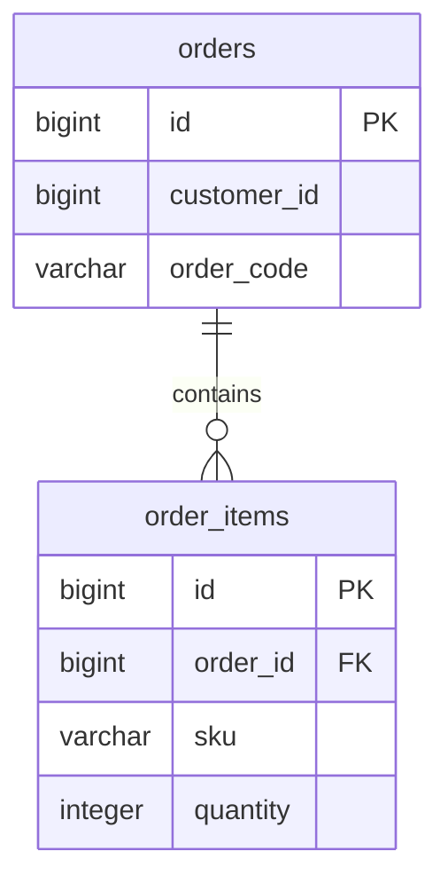
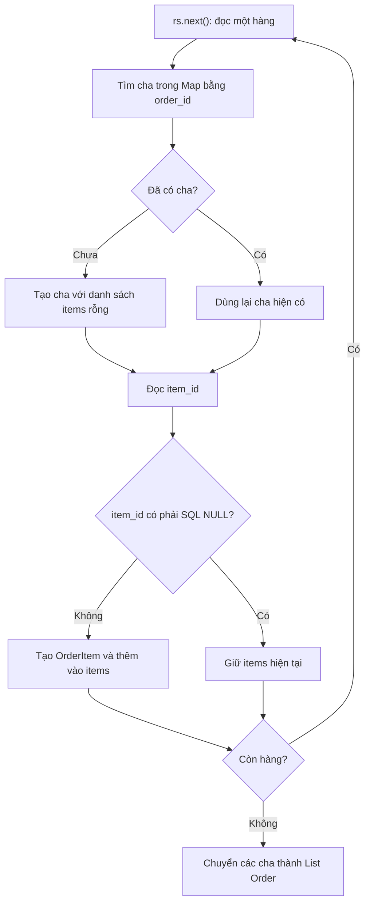

# Gom nhiều hàng thành quan hệ một-nhiều trong JDBC

## Mục tiêu học tập

Khi dùng **JDBC** để truy cập cơ sở dữ liệu quan hệ, kết quả từ `ResultSet` luôn là các hàng phẳng: mỗi lần `rs.next()` di chuyển tới một hàng. Trong khi đó, mô hình Java thường muốn một đối tượng cha chứa nhiều đối tượng con, ví dụ một `Order` có `List<OrderItem>`. Bài học thuộc chương **Ánh xạ bản ghi** này trình bày cách gom nhiều hàng SQL thành quan hệ **một-nhiều (one-to-many)** bằng các API JDBC chuẩn, từ `DataSource`, `PreparedStatement`, `ResultSet` đến quản lý kết nối và xử lý lỗi.

Sau bài học, bạn có thể:

- Nhận ra vì sao `JOIN` khiến dữ liệu của một bản ghi cha lặp trên nhiều hàng.
- Gom hàng theo **khóa chính của cha**, tạo đúng một đối tượng cha và thêm các đối tượng con tương ứng.
- Giữ được cha **không có con** khi dùng `LEFT JOIN`; xử lý chính xác `NULL` ở khóa con.
- Viết bộ ánh xạ Java có quản lý tài nguyên, câu SQL tham số hóa và thứ tự kết quả rõ ràng.
- Phân tích các rủi ro thường gặp: mất cha do lọc sai, con bị thêm trùng, N+1 query, phân trang sai và chi phí bộ nhớ.

## 1. Vì sao một đối tượng cha xuất hiện trên nhiều hàng?

Giả sử ứng dụng quản lý đơn hàng có hai bảng:

- `orders(id, customer_id, order_code)`: mỗi hàng là một đơn hàng.
- `order_items(id, order_id, sku, quantity)`: mỗi hàng là một mặt hàng; `order_id` là khóa ngoại trỏ tới `orders.id`.

Một đơn hàng có thể có **0, 1 hoặc nhiều** mặt hàng. Quan hệ này có thể hình dung bằng sơ đồ:



Giả sử truy vấn `LEFT JOIN` trả về các hàng sau:

| order_id | order_code | item_id | item_sku | item_quantity |
| ---: | --- | ---: | --- | ---: |
| 101 | ORD-101 | 501 | KEYBOARD-01 | 2 |
| 101 | ORD-101 | 502 | MOUSE-02 | 1 |
| 102 | ORD-102 | `NULL` | `NULL` | `NULL` |
| 103 | ORD-103 | 503 | MONITOR-03 | 1 |

Có **4 hàng SQL**, nhưng dữ liệu nghiệp vụ chỉ có **3 đơn hàng**:

```json
[
  {
    "id": 101,
    "orderCode": "ORD-101",
    "items": [
      { "id": 501, "sku": "KEYBOARD-01", "quantity": 2 },
      { "id": 502, "sku": "MOUSE-02", "quantity": 1 }
    ]
  },
  { "id": 102, "orderCode": "ORD-102", "items": [] },
  {
    "id": 103,
    "orderCode": "ORD-103",
    "items": [
      { "id": 503, "sku": "MONITOR-03", "quantity": 1 }
    ]
  }
]
```

Điểm mấu chốt: **một hàng `ResultSet` không nhất thiết tương ứng một đối tượng cha**. Hàng thứ nhất và thứ hai chứa cùng `order_id = 101` nên phải cùng đóng góp vào một đối tượng `Order`. Hàng có `item_id = NULL` vẫn đại diện cho một đơn hàng hợp lệ, chỉ là danh sách `items` rỗng.

Nếu cứ lặp qua `ResultSet` rồi tạo `new Order(...)` cho mỗi hàng, ứng dụng sẽ tạo hai đơn hàng có ID 101; nếu chỉ lấy hàng đầu của mỗi đơn, ứng dụng lại bỏ sót mặt hàng.

## 2. Lấy dữ liệu bằng `LEFT JOIN` và đặt bí danh cột

Truy vấn cho một khách hàng:

```sql
SELECT
    o.id         AS order_id,
    o.order_code AS order_code,
    i.id         AS item_id,
    i.sku        AS item_sku,
    i.quantity   AS item_quantity
FROM orders AS o
LEFT JOIN order_items AS i
    ON i.order_id = o.id
WHERE o.customer_id = ?
ORDER BY o.id, i.id;
```

Giải thích các lựa chọn:

1. **`LEFT JOIN`** bảo toàn hàng cha ngay cả khi không có hàng con. Nếu dùng `INNER JOIN`, đơn hàng không có mặt hàng sẽ không xuất hiện.
2. **`WHERE o.customer_id = ?`** lọc cha theo tham số, truyền qua `PreparedStatement`. Không nối trực tiếp dữ liệu đầu vào vào chuỗi SQL.
3. **`AS order_id` và `AS item_id`** tránh nhầm hai cột đều tên `id`; không dùng `SELECT *` khi ánh xạ dữ liệu từ nhiều bảng.
4. **`ORDER BY o.id, i.id`** xác định thứ tự cha và con. `LinkedHashMap` ở bước ánh xạ sẽ giữ thứ tự gặp hàng đầu tiên của từng cha, còn danh sách con giữ thứ tự được thêm.
5. **`i.id`** là khóa chính của con. Khi không có hàng con, giá trị SQL của cột này là `NULL`, cho phép nhận biết trường hợp danh sách rỗng.

Nếu lọc mặt hàng, hãy chú ý **vị trí của điều kiện**. Ví dụ chỉ lấy mặt hàng có số lượng dương nhưng vẫn hiển thị đơn hàng không có mặt hàng phù hợp:

```sql
SELECT o.id AS order_id, i.id AS item_id
FROM orders AS o
LEFT JOIN order_items AS i
    ON i.order_id = o.id
   AND i.quantity > 0
WHERE o.customer_id = ?;
```

Đặt `i.quantity > 0` trong `WHERE` thay vì `ON` sẽ loại các hàng mà `i` là `NULL`; kết quả thực tế sẽ không còn giữ cha không có con phù hợp. Nếu mục tiêu nghiệp vụ **chỉ lấy đơn có mặt hàng thỏa điều kiện**, việc lọc theo con là chủ ý khác và nên được diễn đạt rõ bằng `EXISTS` hoặc `INNER JOIN`.

## 3. Thuật toán gom nhiều hàng theo khóa cha

Ta cần hai cấu trúc:

- `Map<Long, MutableOrder>`: tra cứu đơn hàng đã tạo theo `order_id`.
- `List<OrderItem>` nằm trong mỗi `MutableOrder`: tập hợp con theo trình tự kết quả.

Với mỗi lần `rs.next()`:

1. Đọc `order_id`, dùng khóa đó tìm đối tượng cha trong `Map`.
2. Nếu chưa có cha thì tạo một đối tượng gom tạm (*accumulator/builder*) và đặt vào `Map`.
3. Đọc `item_id`. Nếu **khác SQL `NULL`**, tạo đối tượng `OrderItem` và thêm vào danh sách của cha vừa tìm.
4. Sau khi đọc hết `ResultSet`, chuyển các đối tượng gom tạm thành DTO/record Java để trả về.



**Khóa gom phải là khóa định danh ổn định.** Không gom theo `order_code` nếu mã này không được đảm bảo duy nhất; càng không gom theo tên khách hàng hoặc vị trí hàng. Nếu khóa chính gồm nhiều cột, cần một khóa tổng hợp thể hiện đủ các cột.

Dùng `LinkedHashMap` giúp giữ thứ tự cha theo lần xuất hiện đầu. `HashMap` cũng tìm theo khóa tốt nhưng không bảo đảm thứ tự lặp. Thứ tự danh sách con phụ thuộc `ORDER BY` của SQL, không nên phó mặc cho thứ tự tình cờ của cơ sở dữ liệu.

## 4. Ví dụ Java hoàn chỉnh: ánh xạ `Order` và `OrderItem`

Ví dụ dùng **Java 17+**, kiểu `record` cho dữ liệu đầu ra, `DataSource` để lấy kết nối, `PreparedStatement` để truy vấn tham số hóa và `ResultSet` để đọc tuần tự. Bảng giả định có khóa chính và khóa ngoại như phần 1, cùng ràng buộc thích hợp cho các cột bắt buộc.

```java
import java.sql.Connection;
import java.sql.PreparedStatement;
import java.sql.ResultSet;
import java.sql.SQLException;
import java.util.ArrayList;
import java.util.LinkedHashMap;
import java.util.List;
import java.util.Map;
import java.util.Objects;
import javax.sql.DataSource;

public final class OrderRepository {
    private final DataSource dataSource;

    public OrderRepository(DataSource dataSource) {
        this.dataSource = Objects.requireNonNull(dataSource);
    }

    public List<Order> findByCustomerId(long customerId) throws SQLException {
        String sql = """
            SELECT
                o.id         AS order_id,
                o.order_code AS order_code,
                i.id         AS item_id,
                i.sku        AS item_sku,
                i.quantity   AS item_quantity
            FROM orders AS o
            LEFT JOIN order_items AS i
                ON i.order_id = o.id
            WHERE o.customer_id = ?
            ORDER BY o.id, i.id
            """;

        Map<Long, MutableOrder> byOrderId = new LinkedHashMap<>();

        try (Connection connection = dataSource.getConnection();
             PreparedStatement statement = connection.prepareStatement(sql)) {

            statement.setLong(1, customerId);

            try (ResultSet rs = statement.executeQuery()) {
                while (rs.next()) {
                    long orderId = rs.getLong("order_id");

                    MutableOrder order = byOrderId.get(orderId);
                    if (order == null) {
                        order = new MutableOrder(
                            orderId,
                            rs.getString("order_code")
                        );
                        byOrderId.put(orderId, order);
                    }

                    long itemId = rs.getLong("item_id");
                    // Phải kiểm tra ngay sau getLong("item_id").
                    if (!rs.wasNull()) {
                        order.items.add(new OrderItem(
                            itemId,
                            rs.getString("item_sku"),
                            rs.getInt("item_quantity")
                        ));
                    }
                }
            }
        }

        List<Order> result = new ArrayList<>(byOrderId.size());
        for (MutableOrder row : byOrderId.values()) {
            result.add(new Order(
                row.id,
                row.orderCode,
                List.copyOf(row.items)
            ));
        }
        return List.copyOf(result);
    }

    private static final class MutableOrder {
        final long id;
        final String orderCode;
        final List<OrderItem> items = new ArrayList<>();

        MutableOrder(long id, String orderCode) {
            this.id = id;
            this.orderCode = orderCode;
        }
    }

    public record Order(long id, String orderCode, List<OrderItem> items) {
    }

    public record OrderItem(long id, String sku, int quantity) {
    }
}
```

### Vì sao cần một lớp gom tạm?

`record` phù hợp làm đối tượng đầu ra vì biểu diễn một bản ghi dữ liệu rõ ràng, nhưng danh sách bên trong vẫn có thể thay đổi nếu cố giữ `ArrayList` dùng chung. Ví dụ trên xây dựng kết quả qua `MutableOrder` rồi dùng `List.copyOf(...)` để trả về danh sách **không thể sửa qua API của danh sách đó**. Bản thân `OrderItem` là record, nên các phần tử cũng không chứa thuộc tính thay đổi trực tiếp.

Điều này tách hai giai đoạn: **gom dữ liệu có trạng thái** trong lúc đọc các hàng, sau đó **công bố dữ liệu đã hoàn chỉnh** ở tầng ứng dụng. Nếu dự án dùng Java 8 hoặc Java 11, có thể thay `record` bằng lớp DTO thông thường và thay Java text block bằng chuỗi SQL; thuật toán gom vẫn giữ nguyên.

### Phân biệt SQL `NULL` với giá trị `0`

`ResultSet.getLong("item_id")` trả về `0` khi cột SQL là `NULL`, nên đoạn mã **không** được dùng `if (itemId != 0)` để nhận biết có hàng con. Phải gọi `rs.wasNull()` **ngay sau** getter tương ứng, trước khi đọc cột khác; hoặc dùng kiểu wrapper với `getObject("item_id", Long.class)` nếu driver hỗ trợ đúng mong đợi.

Một hàng `LEFT JOIN` có `item_id = NULL` phải tạo hoặc giữ cha với danh sách con rỗng. **Không tạo đối tượng `OrderItem` giả** với ID 0 hay với tất cả trường `null`.

Trong ví dụ, `item_quantity` được giả định `NOT NULL` khi có hàng con. Nếu cột này có thể `NULL` thật, dùng `Integer` kết hợp `getObject` hoặc `wasNull()` để phân biệt giá trị rỗng với số lượng 0. Tương tự, nếu khóa chính của cha bất ngờ `NULL`, hãy coi đó là dữ liệu/truy vấn bất thường cần xử lý thay vì âm thầm gom nhiều hàng vào khóa 0.

### Tài nguyên và lỗi truy vấn

`try-with-resources` tự đóng `ResultSet`, `PreparedStatement` và `Connection` kể cả khi ánh xạ gặp `SQLException`. Phương thức trả kết quả **sau khi đọc hết** nên không phụ thuộc vào một `ResultSet` đã đóng. `throws SQLException` cho phép tầng gọi quyết định xử lý, ghi log hoặc chuyển thành lỗi ứng dụng phù hợp; tránh bắt lỗi rồi trả danh sách thiếu hàng như thể truy vấn thành công.

`DataSource` có thể được triển khai bằng connection pool; phương thức không giả định một kết nối dùng chung giữa các lời gọi. Nếu cần kết quả nhất quán qua **nhiều** truy vấn, phải cân nhắc transaction và isolation của DBMS cụ thể, thay vì coi `try-with-resources` tự cung cấp snapshot nhất quán.

## 5. Kiểm tra kết quả và các trường hợp biên

Với dữ liệu ở phần 1, giá trị trả về cần có:

| order_id | Số phần tử `items` | item_id dự kiến |
| ---: | ---: | --- |
| 101 | 2 | 501, 502 |
| 102 | 0 | Không có |
| 103 | 1 | 503 |

Các trường hợp nên tự kiểm tra khi tích hợp:

| Dữ liệu trong DB | Kết quả mong đợi |
| --- | --- |
| Khách hàng không có đơn hàng | Trả `List` rỗng, không có `Order` giả |
| Đơn hàng có 0 mặt hàng | Vẫn có `Order`, `items=[]` |
| Đơn hàng có 1 mặt hàng | 1 `Order` chứa 1 `OrderItem` |
| Đơn hàng có nhiều mặt hàng | 1 `Order` chứa đủ mặt hàng, đúng thứ tự |
| Nhiều đơn hàng có cùng `order_code` nhưng khác khóa | Vẫn là hai cha nếu khóa chính khác nhau |
| Một hàng có cột không thể `NULL` nhưng lại rỗng | Phát hiện lỗi dữ liệu/giả định schema; không âm thầm tạo DTO sai |

Quan hệ một-nhiều không có nghĩa mỗi đơn hàng luôn có ít nhất một phần tử. Đối với truy vấn `LEFT JOIN`, hàng cha với con `NULL` là dữ liệu hợp lệ và cần được xử lý rõ ràng.

## 6. Vì sao kết quả có thể bị thêm con trùng?

Với hai bảng `orders` và `order_items`, nếu `order_items.id` là khóa chính và điều kiện `JOIN` đúng, mỗi mặt hàng xuất hiện một lần trong kết quả trên. Nhưng khi `JOIN` thêm **một quan hệ nhiều khác** như `order_coupons`, có thể xuất hiện hiện tượng **nhân hàng**.

Ví dụ một đơn hàng có **2 mặt hàng** và **3 mã giảm giá**. Truy vấn nối đồng thời cả hai bảng con có thể tạo **2 × 3 = 6 hàng** cho cùng một đơn; nếu cứ thêm `OrderItem` theo mỗi hàng, danh sách mặt hàng bị lặp ba lần.

```sql
-- Minh họa nguy cơ nhân hàng khi JOIN hai tập con độc lập.
SELECT o.id, i.id AS item_id, c.id AS coupon_id
FROM orders o
LEFT JOIN order_items i ON i.order_id = o.id
LEFT JOIN order_coupons c ON c.order_id = o.id
WHERE o.id = ?;
```

Có hai cách xử lý thường dùng:

**Cách A — Chống trùng theo khóa con.** Trong mỗi đối tượng gom tạm, giữ thêm một `Set<Long> seenItemIds`; chỉ thêm phần tử khi `seenItemIds.add(itemId)` trả về `true`:

```java
// Minh họa bên trong MutableOrder khi truy vấn có nguy cơ nhân hàng.
final java.util.Set<Long> seenItemIds = new java.util.HashSet<>();

// Sau khi đọc itemId và xác nhận không phải SQL NULL:
if (order.seenItemIds.add(itemId)) {
    order.items.add(new OrderItem(itemId, sku, quantity));
}
```

Phải chống trùng bằng **khóa chính của con** chứ không dùng SKU (hai dòng hàng khác nhau có thể cùng SKU). Đoạn minh họa này là biến thể bổ sung cho `MutableOrder`, không phải mã sẽ chạy riêng không cần ngữ cảnh.

**Cách B — Tách truy vấn cho từng tập con.** Truy vấn cha và các bảng con bằng các truy vấn riêng, rồi ánh xạ theo khóa ngoại. Cách này thường rõ ràng và giảm số hàng trung gian khi có nhiều danh sách con độc lập.

`DISTINCT` trong SQL không bảo đảm sửa được vấn đề: khi cột `coupon_id` khác nhau, mỗi hàng `(order_id, item_id, coupon_id)` vẫn là duy nhất mặc dù `item_id` bị lặp.

## 7. Hiệu năng: một JOIN, N+1 hay hai truy vấn?

### 7.1. Một JOIN cho một tập con

Trong trường hợp điển hình, chỉ có một quan hệ một-nhiều và dữ liệu vừa phải, **một truy vấn JOIN** như ví dụ chính là cách tiếp cận đơn giản: lấy toàn bộ thông tin cần thiết và gom trong một lần duyệt.

Giả sử có `P` đơn hàng và tổng cộng `C` mặt hàng. Với `LEFT JOIN` một bảng con, tổng số hàng trả về xấp xỉ `C + P0`, trong đó `P0` là số đơn hàng không có mặt hàng. Thời gian xử lý gom tại ứng dụng trung bình **O(số hàng trả về)** vì thao tác tra `HashMap`/`LinkedHashMap` trung bình có chi phí hằng số; bộ nhớ kết quả tỷ lệ với số cha và số con được giữ.

Đổi lại, mỗi mặt hàng kéo theo các cột cha được lặp trên đường truyền. Với cha có nhiều con và nhiều cột lớn, lượng dữ liệu lặp có thể đáng kể. Nên chọn những cột thực sự cần.

### 7.2. Tránh N+1 query

Mẫu xử lý sau tạo ra **N+1 truy vấn**: một truy vấn lấy N cha, rồi mỗi cha chạy thêm một truy vấn lấy con:

```java
// Ý tưởng có vấn đề về hiệu năng khi N lớn:
List<Order> orders = loadOrders(customerId); // 1 query
for (Order order : orders) {
    loadItemsForOrder(order.id());            // N query khác
}
```

Nhiều lượt đi-về với database có thể tốn hơn một `JOIN`. Khi `JOIN` không thuận tiện, một cách khác là **lấy cha theo lô, rồi lấy con cho toàn bộ tập khóa cha**:

```sql
SELECT id, order_code
FROM orders
WHERE customer_id = ?
ORDER BY id;

-- Sau khi biết các ID cần đọc (ví dụ 101, 102, 103):
SELECT id, order_id, sku, quantity
FROM order_items
WHERE order_id IN (?, ?, ?)
ORDER BY order_id, id;
```

Ứng dụng phải tạo đúng số dấu `?` theo số khóa cha và gán từng tham số bằng `PreparedStatement`, xử lý riêng trường hợp danh sách cha rỗng, đồng thời chia lô khi DBMS giới hạn số tham số trong `IN`. Dùng bản đồ `Map<orderId, OrderBuilder>` để gắn mỗi con vào cha tương ứng. Khi cần nhất quán giữa hai lần đọc giữa các transaction đồng thời, dùng transaction đọc và isolation phù hợp theo DBMS.

### 7.3. Cẩn thận với phân trang

Không nên áp `LIMIT 10` trực tiếp lên truy vấn `orders LEFT JOIN order_items` rồi hiểu là “10 đơn hàng”: SQL lúc đó giới hạn **10 hàng JOIN**, có thể chỉ gồm một phần mặt hàng của đơn thứ mười.

Cách phổ biến là:

1. Chọn **trang gồm các khóa cha** bằng `ORDER BY` ổn định và chiến lược phân trang của DBMS.
2. Lấy tất cả hàng con cho **chính các cha thuộc trang đó**; có thể dùng truy vấn thứ hai hoặc JOIN vào tập khóa cha đã phân trang.
3. Gom dữ liệu như thuật toán phần 3.

Đối với dữ liệu rất lớn, cần cân nhắc kích thước trang, độ trễ mạng, giới hạn bộ nhớ và khả năng streaming/fetch size của driver. `setFetchSize(...)` chỉ là gợi ý cho driver; cách thực thi phụ thuộc DBMS, và nếu cuối cùng tạo `List<Order>` cho toàn bộ dữ liệu thì ứng dụng vẫn phải lưu toàn bộ cấu trúc kết quả.

### 7.4. Chỉ mục và thứ tự

Chỉ mục phù hợp thường gồm `orders(customer_id, id)` và `order_items(order_id, id)` để hỗ trợ lọc, JOIN và sắp xếp; hiệu quả thực tế phải kiểm tra bằng kế hoạch thực thi của database. Không dựa vào việc hệ quản trị “thường trả ra theo khóa chính”; nếu thứ tự danh sách có ý nghĩa với nghiệp vụ, hãy ghi `ORDER BY` rõ ràng.

## 8. Các lỗi thiết kế và cách sửa

| Cách làm có vấn đề | Hệ quả | Cách xử lý |
| --- | --- | --- |
| Tạo một `Order` mới cho mọi `rs.next()` | Cha bị nhân bản | Dùng `Map` theo khóa cha |
| Gom theo mã hiển thị hoặc tên người mua | Các cha khác nhau bị gộp | Dùng PK/khóa định danh duy nhất |
| Dùng `INNER JOIN` khi muốn cả cha không có con | Mất đơn hàng rỗng | Dùng `LEFT JOIN` |
| Kiểm tra `itemId != 0` để suy ra khác `NULL` | Nhầm SQL `NULL` thành dữ liệu thật hoặc ngược lại | Gọi `wasNull()` ngay sau getter |
| Đọc thêm cột trước khi gọi `wasNull()` | Kiểm tra nhầm cột cuối cùng | Kiểm tra ngay sau `getLong("item_id")` |
| Lọc con trong `WHERE` của `LEFT JOIN` | Cha không có con hợp lệ biến mất | Đặt điều kiện trong `ON` khi muốn giữ cha |
| Nối nhiều bảng con rồi thêm mọi hàng | Con xuất hiện trùng do tích Descartes | Dedupe theo PK hoặc tách truy vấn |
| Áp phân trang trên hàng JOIN | Cắt mất một phần tập con | Phân trang cha trước |
| Mở query lấy con cho từng cha | N+1 lượt truy cập database | JOIN hoặc truy vấn theo lô |
| Trả `ResultSet` ra ngoài scope kết nối | Không thể đọc an toàn khi tài nguyên đóng | Ánh xạ hết trước khi trả kết quả |
| Bắt `SQLException` rồi trả danh sách đang gom | Nhầm kết quả không đầy đủ là thành công | Truyền lỗi để tầng gọi xử lý |

## 9. Tự luyện tập

1. Với ba hàng `(order_id=7, item_id=61)`, `(7, 62)`, `(8, NULL)`, hãy mô tả số lượng `Order` và số `OrderItem` trong mỗi danh sách. **Đáp án:** hai `Order`; đơn 7 có hai con, đơn 8 có danh sách rỗng.
2. Đổi `LEFT JOIN` thành `INNER JOIN` với ví dụ ở phần 1. **Kết quả:** đơn 102 biến mất, vì không có mặt hàng để khớp.
3. Viết điều kiện chỉ lấy mặt hàng có `quantity >= 2` nhưng vẫn phải giữ đơn không có mặt hàng thỏa điều kiện. **Gợi ý:** đặt điều kiện trên `i` trong mệnh đề `ON`.
4. Một đơn có 2 mặt hàng và 4 coupon. Hỏi `JOIN` đồng thời hai bảng con có thể tạo bao nhiêu hàng, và vì sao không được thêm mỗi `item_id` theo số hàng đó? **Đáp án:** có thể 8 hàng; một mặt hàng lặp theo từng coupon.
5. Cần hiển thị 20 đơn hàng và đủ mọi mặt hàng của từng đơn: hãy giải thích vì sao `LIMIT 20` trên truy vấn JOIN có thể không đáp ứng và nêu cách phân trang cha trước.

## Kết luận

Ánh xạ quan hệ một-nhiều từ JDBC cần **nhận diện đúng cha theo khóa**, **tích lũy các con qua nhiều hàng** và **xử lý rõ hàng con `NULL`**. `ResultSet` cung cấp từng hàng; chính logic Java quyết định khi nào tạo cha và khi nào chỉ thêm con. Dùng `PreparedStatement`, bí danh cột, `LEFT JOIN` phù hợp, `ORDER BY` rõ ràng và `try-with-resources` giúp quá trình ánh xạ dễ đọc, an toàn và kiểm soát được. Khi dữ liệu lớn hoặc có nhiều quan hệ con, lựa chọn giữa JOIN và truy vấn theo lô dựa trên số hàng trung gian, khả năng phân trang và tính nhất quán mà ứng dụng yêu cầu.
