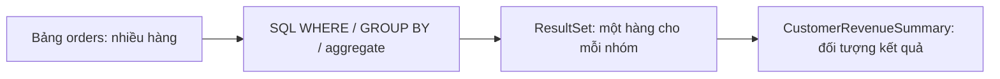

# Đọc dữ liệu tổng hợp không trùng mô hình bảng gốc

## 1. Khi kết quả truy vấn không còn là một bản ghi của bảng

Trong ứng dụng Java sử dụng **JDBC**, việc ánh xạ một dòng từ `ResultSet` không nhất thiết phải tạo ra đối tượng có cấu trúc giống một hàng của bảng cơ sở dữ liệu. Các màn hình báo cáo, bảng điều khiển và thống kê thường cần **dữ liệu tổng hợp**: số đơn hàng, tổng doanh thu, mức trung bình, số lượng theo trạng thái hoặc kết quả ghép từ nhiều bảng.

Giả sử bảng `orders` có các cột `order_id`, `customer_id`, `status` và `total_amount`. Một câu truy vấn có thể tạo ra kết quả:

| customer_id | paid_order_count | total_paid_amount | average_paid_amount |
| ---: | ---: | ---: | ---: |
| 101 | 2 | 200.75 | 100.375 |
| 102 | 1 | 50.00 | 50.00 |

Không có cột `paid_order_count` hay `average_paid_amount` trong bảng `orders`. Mỗi dòng kết quả đại diện cho **một nhóm đơn hàng của một khách hàng**, không đại diện cho một đơn hàng cụ thể. Do đó, cố ép kết quả này vào lớp `Order` sẽ gây nhầm lẫn về ý nghĩa dữ liệu.

Trong JDBC, cách tiếp cận phù hợp là ánh xạ kết quả sang một **đối tượng chỉ đọc dành cho truy vấn**, thường gọi là *projection*, *DTO* hoặc *read model*:



Phép ánh xạ này độc lập với thao tác ghi đơn hàng. Lớp dùng để tạo/cập nhật một đơn hàng có thể giữ nguyên mô hình của nó; lớp dùng để đọc báo cáo chỉ chứa những trường mà báo cáo cần.

## 2. Xây dựng dữ liệu ví dụ

Để thấy rõ sự khác biệt giữa bảng gốc và kết quả tổng hợp, xét hai bảng quan hệ đơn giản:

```sql
CREATE TABLE customers (
    customer_id BIGINT PRIMARY KEY,
    customer_name VARCHAR(100) NOT NULL
);

CREATE TABLE orders (
    order_id BIGINT PRIMARY KEY,
    customer_id BIGINT NOT NULL,
    status VARCHAR(16) NOT NULL,
    total_amount DECIMAL(15, 2) NOT NULL,
    CONSTRAINT fk_orders_customer
        FOREIGN KEY (customer_id) REFERENCES customers(customer_id),
    CONSTRAINT ck_orders_non_negative
        CHECK (total_amount >= 0)
);

INSERT INTO customers (customer_id, customer_name)
VALUES
    (101, 'An'),
    (102, 'Binh'),
    (103, 'Chi');

INSERT INTO orders (order_id, customer_id, status, total_amount)
VALUES
    (1, 101, 'PAID', 120.50),
    (2, 101, 'PAID', 80.25),
    (3, 101, 'CANCELLED', 40.00),
    (4, 102, 'PAID', 50.00);
```

Ví dụ dùng SQL phổ biến với `DECIMAL` để biểu diễn tiền theo giá trị thập phân chính xác. Chi tiết cú pháp ràng buộc và định dạng số có thể cần điều chỉnh theo hệ quản trị cơ sở dữ liệu.

Từ dữ liệu trên:

- Khách hàng **101** có hai đơn `PAID` với tổng `200.75`; đơn `CANCELLED` không được tính doanh thu đã thanh toán.
- Khách hàng **102** có một đơn `PAID` trị giá `50.00`.
- Khách hàng **103** chưa có đơn; đây là trường hợp quan trọng khi cần thống kê đầy đủ mọi khách hàng.

## 3. Tạo một dòng tổng hợp cho mỗi nhóm bằng SQL

Truy vấn sau trả về số lượng, tổng và giá trị trung bình của các đơn đã thanh toán, nhóm theo khách hàng:

```sql
SELECT
    o.customer_id AS customer_id,
    COUNT(*) AS paid_order_count,
    SUM(o.total_amount) AS total_paid_amount,
    AVG(o.total_amount) AS average_paid_amount
FROM orders o
WHERE o.status = 'PAID'
GROUP BY o.customer_id
ORDER BY total_paid_amount DESC, o.customer_id ASC;
```

Với dữ liệu ví dụ, kết quả là hai dòng ở mục 1. Tùy hệ quản trị và công cụ hiển thị, `AVG` có thể được trình bày với số chữ số thập phân khác nhau; giá trị trung bình của khách hàng 101 là `200.75 / 2 = 100.375`.

Mỗi thành phần trong truy vấn có vai trò riêng:

| Thành phần | Chức năng |
| --- | --- |
| `WHERE o.status = 'PAID'` | Chọn các hàng nguồn trước khi tổng hợp |
| `GROUP BY o.customer_id` | Gom nhiều đơn hàng thành một nhóm theo khách hàng |
| `COUNT(*)` | Đếm số hàng thuộc nhóm |
| `SUM(o.total_amount)` | Tính tổng giá trị tiền của nhóm |
| `AVG(o.total_amount)` | Tính trung bình các giá trị không `NULL` của nhóm |
| `AS paid_order_count` | Đặt tên cột kết quả để ánh xạ rõ ràng |
| `ORDER BY ...` | Xác định thứ tự hiển thị ổn định |

**Hệ quả của `GROUP BY`:** một khách hàng có thể có rất nhiều hàng trong `orders` nhưng chỉ có một hàng trong `ResultSet`. Những cột không nằm trong hàm tổng hợp thường phải thuộc khóa nhóm hoặc được xác định duy nhất theo khóa nhóm mà hệ quản trị nhận diện; không thể tùy ý lấy `order_id` trong truy vấn trên vì một nhóm có thể chứa nhiều `order_id`.

### Lọc nhóm bằng `HAVING`

`WHERE` lọc **hàng trước khi nhóm**, còn `HAVING` lọc **nhóm sau khi tổng hợp**. Ví dụ chỉ trả về khách hàng có ít nhất hai đơn đã thanh toán:

```sql
SELECT
    o.customer_id AS customer_id,
    COUNT(*) AS paid_order_count,
    SUM(o.total_amount) AS total_paid_amount
FROM orders o
WHERE o.status = 'PAID'
GROUP BY o.customer_id
HAVING COUNT(*) >= 2;
```

Kết quả ví dụ chỉ có khách hàng **101**. Khi giá trị ngưỡng đến từ đầu vào ứng dụng, hãy đưa nó vào tham số `?` của `PreparedStatement` thay vì ghép chuỗi SQL.

## 4. Thiết kế Java record dành riêng cho kết quả tổng hợp

Với Java 16 trở lên, có thể dùng `record` để mô tả kết quả thống kê mà không cần viết getter, constructor và phương thức so sánh bằng tay:

```java
import java.math.BigDecimal;

public record CustomerRevenueSummary(
        long customerId,
        long paidOrderCount,
        BigDecimal totalPaidAmount,
        BigDecimal averagePaidAmount
) {}
```

Kiểu dữ liệu được chọn theo **cột kết quả truy vấn**, không dựa vào toàn bộ cấu trúc bảng gốc:

| Cột kết quả SQL | Trường trong record | Lý do |
| --- | --- | --- |
| `customer_id` | `long customerId` | Định danh khách hàng, giả định khóa ngoại không `NULL` |
| `COUNT(*)` | `long paidOrderCount` | Kết quả đếm có thể lớn hơn phạm vi `int` |
| `SUM(DECIMAL)` | `BigDecimal totalPaidAmount` | Giữ độ chính xác thập phân của tiền |
| `AVG(DECIMAL)` | `BigDecimal averagePaidAmount` | Trung bình có thể nhiều chữ số thập phân hơn số tiền gốc |

Lớp `CustomerRevenueSummary` **không có** `orderId`, `status` hay những cột chỉ thuộc đơn hàng đơn lẻ, vì chúng không có ý nghĩa duy nhất cho mỗi nhóm. Đây là một mô hình chỉ đọc theo nhu cầu màn hình thống kê; không nên triển khai `save(summary)` như thể đối tượng này là một bản ghi của bảng `orders`.

`BigDecimal` phù hợp cho giá trị tiền và nhiều phép tổng hợp thập phân. Tránh dùng `double` cho tiền khi cần tính toán chính xác theo thập phân. Việc làm tròn `averagePaidAmount`, nếu cần, phải dựa trên quy tắc nghiệp vụ cụ thể, ví dụ loại phép làm tròn và số chữ số sau dấu phẩy; không âm thầm làm tròn ngay ở lớp ánh xạ.

## 5. Ánh xạ `ResultSet` sang record bằng JDBC

Lớp repository sau dùng `DataSource` lấy kết nối, `PreparedStatement` truyền trạng thái và ngưỡng thống kê, rồi đọc từng hàng kết quả thành `CustomerRevenueSummary`. Ví dụ dùng Java 17+ để hỗ trợ record và SQL text block.

```java
import java.math.BigDecimal;
import java.sql.Connection;
import java.sql.PreparedStatement;
import java.sql.ResultSet;
import java.sql.SQLException;
import java.util.ArrayList;
import java.util.List;
import javax.sql.DataSource;

public final class CustomerRevenueRepository {
    private final DataSource dataSource;

    public CustomerRevenueRepository(DataSource dataSource) {
        this.dataSource = dataSource;
    }

    public List<CustomerRevenueSummary> findPaidRevenue(
            int minimumPaidOrders) throws SQLException {
        if (minimumPaidOrders < 1) {
            throw new IllegalArgumentException(
                    "minimumPaidOrders phải lớn hơn hoặc bằng 1");
        }

        String sql = """
                SELECT
                    o.customer_id AS customer_id,
                    COUNT(*) AS paid_order_count,
                    SUM(o.total_amount) AS total_paid_amount,
                    AVG(o.total_amount) AS average_paid_amount
                FROM orders o
                WHERE o.status = ?
                GROUP BY o.customer_id
                HAVING COUNT(*) >= ?
                ORDER BY total_paid_amount DESC, o.customer_id ASC
                """;

        List<CustomerRevenueSummary> summaries = new ArrayList<>();

        try (Connection connection = dataSource.getConnection();
             PreparedStatement statement =
                     connection.prepareStatement(sql)) {
            statement.setString(1, "PAID");
            statement.setLong(2, minimumPaidOrders);

            try (ResultSet rs = statement.executeQuery()) {
                while (rs.next()) {
                    long customerId = rs.getLong("customer_id");
                    long paidOrderCount = rs.getLong("paid_order_count");
                    BigDecimal totalPaidAmount =
                            rs.getBigDecimal("total_paid_amount");
                    BigDecimal averagePaidAmount =
                            rs.getBigDecimal("average_paid_amount");

                    summaries.add(new CustomerRevenueSummary(
                            customerId,
                            paidOrderCount,
                            totalPaidAmount,
                            averagePaidAmount));
                }
            }
        }
        return summaries;
    }
}
```

Ví dụ sử dụng khi đã cấu hình `dataSource` tương ứng:

```java
CustomerRevenueRepository repository =
        new CustomerRevenueRepository(dataSource);

List<CustomerRevenueSummary> rows = repository.findPaidRevenue(1);

for (CustomerRevenueSummary row : rows) {
    System.out.printf(
            "customer=%d, orders=%d, total=%s, average=%s%n",
            row.customerId(),
            row.paidOrderCount(),
            row.totalPaidAmount(),
            row.averagePaidAmount());
}
```

Các nguyên tắc cần giữ khi đọc kết quả:

1. **Dùng bí danh cột ổn định.** `rs.getLong("paid_order_count")` đọc tên kết quả do `AS` định nghĩa. Tên này không cần trùng với một cột tồn tại trong bảng. Dùng nhãn cột giúp code dễ hiểu hơn dùng chỉ số vị trí `1`, `2`, `3` khi truy vấn có nhiều biểu thức.
2. **Đọc đúng kiểu.** `COUNT(*)` nên được đọc bằng `getLong`; `SUM/AVG` của `DECIMAL` thường nên đọc bằng `getBigDecimal`. Kiểu thực tế của biểu thức còn tùy DBMS và driver.
3. **Không mặc định tất cả kết quả đều có dữ liệu.** Với truy vấn có `GROUP BY`, khi không có nhóm thỏa điều kiện, `ResultSet` rỗng và phương thức trên trả về danh sách rỗng.
4. **Đóng tài nguyên đầy đủ.** `try-with-resources` đóng `ResultSet`, `PreparedStatement`, `Connection` khi hoàn thành hoặc xảy ra `SQLException`. Nếu dùng connection pool, đóng kết nối theo giao diện `Connection` để trả lại pool.
5. **Giữ SQL tham số hóa.** `setString` và `setLong` áp dụng cho bộ lọc trạng thái và ngưỡng `HAVING`; không ghép dữ liệu đầu vào thành SQL.

Trong ví dụ, `orders.customer_id` và `orders.total_amount` đều `NOT NULL`. Do đó, mỗi nhóm thực sự tồn tại có `SUM` và `AVG` không `NULL`. Nếu schema thực tế cho phép `NULL`, cần xử lý kết quả thiếu bằng kiểu tham chiếu như `Long`/`BigDecimal`, `getObject(...)` phù hợp hoặc kiểm tra `rs.wasNull()` sau phương thức đọc kiểu nguyên thủy.

## 6. Phân biệt kết quả của `COUNT`, `SUM` và trường hợp không có hàng

Trong SQL, các hàm tổng hợp có quy tắc xử lý `NULL` khác nhau:

| Biểu thức | Ý nghĩa | Nếu không có hàng phù hợp |
| --- | --- | --- |
| `COUNT(*)` | Đếm tất cả hàng | `0` |
| `COUNT(total_amount)` | Đếm hàng mà `total_amount` không `NULL` | `0` |
| `COUNT(DISTINCT customer_id)` | Đếm giá trị khách hàng khác nhau, không `NULL` | `0` |
| `SUM(total_amount)` | Cộng các giá trị không `NULL` | `NULL` |
| `AVG(total_amount)` | Trung bình các giá trị không `NULL` | `NULL` |
| `MIN/MAX(total_amount)` | Nhỏ nhất/lớn nhất trong các giá trị có dữ liệu | `NULL` |

Điều này cần được hiểu cùng **hình dạng truy vấn**:

```sql
-- Không có GROUP BY: vẫn trả về một hàng,
-- kể cả khi bộ lọc không khớp đơn hàng nào.
SELECT
    COUNT(*) AS order_count,
    SUM(total_amount) AS total_amount
FROM orders
WHERE status = 'UNKNOWN';
-- order_count = 0, total_amount = NULL
```

Ngược lại, cùng bộ lọc nhưng có `GROUP BY customer_id` sẽ **không trả về hàng nào** nếu không có nhóm. Hai trường hợp phải được ánh xạ khác nhau:

- **Một hàng tổng hợp chung:** có thể dùng một `record` chứa số đếm và `BigDecimal` có thể `null`, hoặc cho `SUM` giá trị 0 bằng `COALESCE` nếu nghiệp vụ muốn như vậy.
- **Nhiều hàng theo nhóm:** trả về `List<CustomerRevenueSummary>`; danh sách rỗng khi không có nhóm thỏa điều kiện.

Không nên biến mọi `NULL` thành 0 một cách máy móc. Ví dụ, doanh thu bằng 0 có thể hợp lý với khách hàng không có đơn, nhưng **giá trị trung bình** của một tập không có phần tử thường nên được thể hiện là “không có dữ liệu” thay vì `0`.

## 7. Cần cả những nhóm không có dữ liệu: `LEFT JOIN`

Truy vấn ở mục 3 bắt đầu từ `orders` nên khách hàng **103** không xuất hiện. Nếu báo cáo yêu cầu tất cả khách hàng, kể cả người chưa mua hàng, hãy bắt đầu từ `customers` rồi `LEFT JOIN` các đơn hàng:

```sql
SELECT
    c.customer_id AS customer_id,
    c.customer_name AS customer_name,
    COUNT(o.order_id) AS paid_order_count,
    COALESCE(SUM(o.total_amount), 0) AS total_paid_amount
FROM customers c
LEFT JOIN orders o
    ON o.customer_id = c.customer_id
   AND o.status = 'PAID'
GROUP BY c.customer_id, c.customer_name
ORDER BY c.customer_id ASC;
```

Kết quả mong đợi:

| customer_id | customer_name | paid_order_count | total_paid_amount |
| ---: | --- | ---: | ---: |
| 101 | An | 2 | 200.75 |
| 102 | Binh | 1 | 50.00 |
| 103 | Chi | 0 | 0 |

Ba chi tiết quan trọng:

1. **`COUNT(o.order_id)` thay cho `COUNT(*)`:** `LEFT JOIN` tạo một hàng mở rộng chứa `NULL` khi không có đơn phù hợp. `COUNT(*)` có thể đếm hàng mở rộng đó thành 1; `COUNT(o.order_id)` chỉ đếm đơn thật vì khóa `order_id` không `NULL` trên các hàng khớp.
2. **`COALESCE(SUM(...), 0)`:** biến tổng `NULL` của nhóm không có đơn thành 0 nếu quy tắc báo cáo muốn hiển thị doanh thu bằng 0.
3. **Điều kiện trạng thái nằm trong `ON`:** đặt `o.status = 'PAID'` ở `WHERE` của ví dụ này sẽ loại hàng không có đơn, khiến khách hàng 103 biến mất khỏi báo cáo.

Khi cột kết quả có thêm `customer_name`, ta tạo một kiểu kết quả mới, chẳng hạn:

```java
import java.math.BigDecimal;

public record CustomerPaidOverview(
        long customerId,
        String customerName,
        long paidOrderCount,
        BigDecimal totalPaidAmount
) {}
```

Ánh xạ từ `ResultSet` cũng thay đổi tương ứng:

```java
CustomerPaidOverview overview = new CustomerPaidOverview(
        rs.getLong("customer_id"),
        rs.getString("customer_name"),
        rs.getLong("paid_order_count"),
        rs.getBigDecimal("total_paid_amount"));
```

Phần mã trên minh họa phép ánh xạ **bên trong vòng lặp `ResultSet`** của truy vấn `LEFT JOIN`; không phải đoạn chương trình hoàn chỉnh độc lập.

## 8. Cẩn thận khi tổng hợp qua nhiều quan hệ

Một nguồn lỗi nghiêm trọng của báo cáo là **nhân bản hàng sau JOIN**. Giả sử sau này có thêm bảng `order_items`, trong đó mỗi đơn có thể có nhiều dòng hàng. Truy vấn như sau có nguy cơ nhân đôi hoặc nhân nhiều lần doanh thu:

```sql
-- KHÔNG đúng nếu tổng doanh thu đang lấy từ orders.total_amount
-- và một đơn có nhiều order_items.
SELECT
    o.customer_id,
    COUNT(*) AS row_count,
    SUM(o.total_amount) AS wrong_revenue
FROM orders o
JOIN order_items i ON i.order_id = o.order_id
WHERE o.status = 'PAID'
GROUP BY o.customer_id;
```

Nếu một đơn trị giá `120.50` có ba dòng sản phẩm, `SUM(o.total_amount)` trong truy vấn này có thể cộng `120.50` **ba lần**. `COUNT(DISTINCT o.order_id)` có thể sửa số lượng đơn được đếm, nhưng **không** tự sửa phép tính `SUM` bị nhân lên.

Một cách xử lý là tổng hợp bảng nhiều trước thành **một hàng trên mỗi đơn**, rồi mới nối về `orders`:

```sql
WITH item_counts AS (
    SELECT
        order_id,
        COUNT(*) AS line_count
    FROM order_items
    GROUP BY order_id
)
SELECT
    o.customer_id AS customer_id,
    COUNT(*) AS paid_order_count,
    SUM(o.total_amount) AS total_paid_amount,
    SUM(COALESCE(ic.line_count, 0)) AS total_item_lines
FROM orders o
LEFT JOIN item_counts ic ON ic.order_id = o.order_id
WHERE o.status = 'PAID'
GROUP BY o.customer_id;
```

Ở đây, `item_counts` có tối đa một dòng cho mỗi `order_id`. Vì vậy, `LEFT JOIN` không làm tăng số dòng `orders`; `COUNT(*)` và `SUM(o.total_amount)` vẫn tính theo từng đơn. Đây là ví dụ mở rộng giả định hệ thống có bảng `order_items(order_id, ...)`.

Nếu cần tính doanh thu từ chi tiết sản phẩm thay vì giá trị đã lưu trong đơn, phải xác định nguồn dữ liệu chính thức, chính sách chiết khấu/thuế/hoàn tiền và tổng hợp khoản tiền chi tiết theo đúng cấp độ trước khi cộng. Một truy vấn tổng hợp cho kết quả sai về mặt nghiệp vụ vẫn có thể được JDBC đọc và ánh xạ mà không phát sinh lỗi.

## 9. Biệt danh, kiểu kết quả và metadata của cột tính toán

Trong các câu truy vấn phức tạp, một `ResultSet` có thể chứa:

- **Cột gốc:** ví dụ `o.customer_id`.
- **Cột tính toán:** `SUM(o.total_amount)`, `COUNT(*)`.
- **Biểu thức:** `COALESCE(..., 0)`, `CASE WHEN ... END`.
- **Cột ghép từ bảng khác:** ví dụ `c.customer_name`.

Không nên suy ra rằng một lớp Java phải trùng tên và số cột của một bảng. Hợp đồng ánh xạ là **danh sách cột của kết quả `SELECT`**, gồm nhãn, kiểu và ý nghĩa dữ liệu.

Khi cần kiểm tra hợp đồng này, có thể xem `ResultSetMetaData`:

```java
import java.sql.ResultSet;
import java.sql.ResultSetMetaData;
import java.sql.SQLException;

public final class ResultSetColumnInspector {
    private ResultSetColumnInspector() {}

    public static void describeColumns(ResultSet rs) throws SQLException {
        ResultSetMetaData metadata = rs.getMetaData();

        for (int column = 1; column <= metadata.getColumnCount(); column++) {
            System.out.printf(
                    "%s: SQL type=%s, Java class=%s%n",
                    metadata.getColumnLabel(column),
                    metadata.getColumnTypeName(column),
                    metadata.getColumnClassName(column));
        }
    }
}
```

Đoạn mã này được gọi khi `ResultSet` còn mở, chẳng hạn ngay sau `executeQuery()`. `getColumnLabel` trả về nhãn được đặt bằng `AS` nếu driver hỗ trợ chuẩn đó; `getColumnName` không luôn giống nhãn với các biểu thức. Thông tin kiểu từ driver hữu ích để chẩn đoán, nhưng tên và kiểu chính xác có thể thay đổi giữa các DBMS hoặc cách viết biểu thức, nhất là với `COUNT`, `SUM` và `AVG`.

Vì thế, với các báo cáo quan trọng, nên đặt **alias rõ ràng** và định nghĩa kiểu Java mong muốn ngay tại điểm ánh xạ, thay vì dựa vào `SELECT *` hay gọi `getObject` rồi ép kiểu tùy tiện.

## 10. Kiểm thử kết quả và xem xét hiệu năng

### Kiểm thử chức năng

Với dữ liệu ở mục 2, những tình huống sau giúp phát hiện lỗi ánh xạ và lỗi SQL:

| Tình huống | Kỳ vọng |
| --- | --- |
| `findPaidRevenue(1)` | Hai đối tượng: khách hàng 101 có 2 đơn, tổng 200.75; khách hàng 102 có 1 đơn, tổng 50.00 |
| `findPaidRevenue(2)` | Chỉ còn khách hàng 101 |
| `findPaidRevenue(3)` | Danh sách rỗng |
| Truy vấn một tổng chung khi không có đơn phù hợp | `COUNT(*) = 0`, `SUM(...) = NULL` |
| Truy vấn `LEFT JOIN` toàn bộ khách hàng | Khách hàng 103 xuất hiện với số đơn 0, tổng 0 |
| Một đơn có nhiều `order_items` | Doanh thu không được cộng lặp vì JOIN |
| Các số tiền có phần thập phân | `BigDecimal` giữ giá trị chính xác; không đi qua `double` |

Khi so sánh `BigDecimal`, cần phân biệt `equals` và `compareTo`: `new BigDecimal("50.0").equals(new BigDecimal("50.00"))` là `false` vì khác scale, còn `compareTo(...) == 0` thể hiện bằng nhau về giá trị số. Việc so sánh scale nào là phù hợp tùy yêu cầu định dạng và nghiệp vụ.

### Hiệu năng và tính nhất quán

1. **Để DBMS tổng hợp trước khi truyền qua JDBC.** Với báo cáo chỉ cần vài chục nhóm, thường hiệu quả hơn việc lấy toàn bộ hàng `orders` về Java rồi tự cộng dồn. Tuy nhiên, tốc độ còn phụ thuộc bộ lọc, chỉ mục, số nhóm và kế hoạch thực thi.
2. **Đặt lọc hàng vào `WHERE` khi thích hợp, lọc nhóm vào `HAVING`.** Lọc sớm giúp giảm lượng dữ liệu cần nhóm, nhưng phải giữ đúng ý nghĩa nghiệp vụ và ngữ nghĩa `LEFT JOIN`.
3. **Cân nhắc chỉ mục dựa trên truy vấn thật.** Ví dụ báo cáo lọc `status` rồi nhóm `customer_id` có thể hưởng lợi từ chỉ mục phù hợp; dùng `EXPLAIN`/kế hoạch thực thi của hệ quản trị để quyết định, không tạo chỉ mục theo suy đoán.
4. **Phân trang sau khi nhóm và sắp xếp ổn định.** Phân trang dữ liệu gốc trước `GROUP BY` sẽ làm sai tổng; cú pháp `LIMIT/OFFSET`, `FETCH FIRST` hoặc tương đương tùy DBMS. Hãy có tiêu chí phá hòa trong `ORDER BY`, chẳng hạn `customer_id`.
5. **Chú ý transaction khi báo cáo gồm nhiều truy vấn.** Nếu tổng số nhóm, danh sách nhóm và biểu đồ được đọc trong các câu lệnh khác nhau, dữ liệu có thể thay đổi giữa các lần đọc. Có thể cần một transaction chỉ đọc với mức cô lập thích hợp theo DBMS để bảo đảm ảnh chụp dữ liệu nhất quán.
6. **Theo dõi giới hạn kiểu số và kích thước kết quả.** Tổng hợp trên rất nhiều hàng có thể làm tràn một kiểu số hoặc tạo tập kết quả lớn. Chọn kiểu SQL/Java đủ sức chứa và cân nhắc xử lý theo lô hoặc streaming nếu thống kê có nhiều nhóm.

## 11. Phân biệt `GROUP BY` và hàm cửa sổ

`GROUP BY` gom các hàng nguồn thành **một hàng cho mỗi nhóm**. Ngược lại, hàm cửa sổ như `SUM(...) OVER (PARTITION BY ...)` tính số liệu theo nhóm nhưng **vẫn giữ từng hàng nguồn**:

```sql
SELECT
    o.order_id,
    o.customer_id,
    o.total_amount,
    SUM(o.total_amount) OVER (
        PARTITION BY o.customer_id
    ) AS customer_total
FROM orders o
WHERE o.status = 'PAID'
ORDER BY o.customer_id, o.order_id;
```

Truy vấn này trả về **mỗi đơn hàng một dòng**, kèm tổng tiền đã thanh toán của khách hàng; nó phù hợp với màn hình danh sách đơn có thêm chỉ số tổng hợp. Khi đó nên dùng một projection khác, chẳng hạn `OrderWithCustomerTotal`, vì hình dạng kết quả đã khác `CustomerRevenueSummary`.

**Ghi nhớ:** Với JDBC, đơn vị cần ánh xạ là **mỗi hàng của `ResultSet` do truy vấn tạo ra**, không mặc định là một hàng của bảng gốc. Hãy xác định đúng cấp độ tổng hợp, chọn alias và kiểu trả về phù hợp, tạo DTO/record riêng cho nhu cầu đọc, xử lý `NULL` và JOIN cẩn thận, rồi dùng `PreparedStatement` và `ResultSet` để nhận kết quả chính xác, an toàn và dễ kiểm thử.
