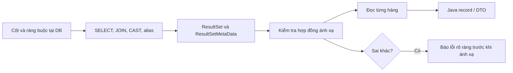

# Phát hiện sai khác giữa mô hình Java và lược đồ truy vấn trong JDBC

## 1. Vì sao ánh xạ bản ghi có thể sai dù câu SQL chạy thành công?

Trong JDBC, một câu `SELECT` trả về `ResultSet`, còn ứng dụng Java cần chuyển từng hàng thành đối tượng, DTO hoặc `record`. Bước chuyển đổi này thường được gọi là **record mapping**. Một truy vấn hợp lệ về cú pháp vẫn có thể trả về dữ liệu không còn phù hợp với cấu trúc mà bộ ánh xạ đang kỳ vọng: đổi alias, thêm hoặc bỏ cột, đổi kiểu giá trị, phát sinh `NULL` do `LEFT JOIN`, hoặc thay đổi ý nghĩa của biểu thức tổng hợp.

Ví dụ, bộ ánh xạ từng đọc `rs.getLong("user_id")`. Sau một lần sửa truy vấn, cột được đặt alias thành `id`; truy vấn chạy bình thường nhưng lệnh đọc `user_id` có thể ném `SQLException`. Nguy hiểm hơn, nếu lấy cột theo **vị trí** và thứ tự cột thay đổi, ứng dụng có thể gán nhầm hai giá trị cùng kiểu mà không phát hiện ngay.

Cần phân biệt ba lớp hợp đồng:

| Lớp | Mô tả | Ví dụ |
| --- | --- | --- |
| Lược đồ bảng (*table schema*) | Cột, kiểu và ràng buộc được khai báo ở cơ sở dữ liệu. | `app_users.id BIGINT NOT NULL`, `display_name VARCHAR(120)`. |
| Lược đồ kết quả truy vấn (*result-set schema*) | Các cột thực tế do **câu `SELECT` cụ thể** trả về, gồm alias và biểu thức. | `user_id`, `display_name`, `created_on`, `order_count`. |
| Mô hình Java (*Java model*) | Tên thuộc tính, kiểu dữ liệu và quy tắc bắt buộc/cho phép `null`. | `record UserOverview(long userId, String displayName, LocalDate createdOn, long orderCount)`. |

Đối với một trình ánh xạ `ResultSet` thông thường, **lược đồ kết quả truy vấn** mới là hợp đồng trực tiếp. `DatabaseMetaData` có thể mô tả các bảng thực, nhưng nó không thay thế được việc kiểm tra cột của `SELECT` khi truy vấn sử dụng alias, `JOIN`, hàm, `CAST`, `GROUP BY` hoặc `CASE`.



## 2. Những sai khác cần phát hiện

| Nhóm | Tình huống | Rủi ro |
| --- | --- | --- |
| Thiếu cột | `user_id` không còn trong `SELECT` | Lỗi khi đọc nhãn cột hoặc giá trị thiếu. |
| Thừa cột | Truy vấn thêm `email` hoặc dùng `SELECT *` | Mapper có thể bỏ qua thay đổi hoặc lấy sai vị trí. |
| Trùng nhãn | `u.id AS id`, `o.id AS id` | `getXXX("id")` trở nên mơ hồ, phụ thuộc cách driver giải quyết nhãn trùng. |
| Đổi alias/đổi kiểu chữ | `display_name` thành `full_name` | Không khớp tên trường hợp đồng. |
| Đổi thứ tự | Hai cột `BIGINT` đổi vị trí | Mapper đọc theo index có thể gán nhầm mà vẫn hợp lệ về kiểu. |
| Đổi SQL type | `BIGINT` thành `VARCHAR`, `DATE` thành `TIMESTAMP` | Lỗi chuyển kiểu, sai dữ liệu hoặc mất độ chính xác. |
| `NULL` ngoài dự kiến | Cột từ phía phải của `LEFT JOIN` không có hàng tương ứng | `getLong()` trả `0` khi gặp SQL `NULL` nếu không kiểm tra `wasNull()`. |
| Sai phạm vi | `COUNT(*)` được ánh xạ thành `int`; tổng tiền `DECIMAL` thành `double` | Tràn số, làm tròn hoặc mất thông tin. |
| Đổi ngữ nghĩa | `COUNT(o.id)` đổi thành `COUNT(*)` trong `LEFT JOIN` | Kiểu cột vẫn đúng nhưng số đơn hàng có thể sai. |

Hai nhóm cuối cho thấy kiểm tra metadata là **cần thiết nhưng chưa đủ**: metadata có thể phát hiện sai khác về *hình dạng* và *kiểu*, còn *ý nghĩa nghiệp vụ* vẫn phải được bảo vệ bằng kiểm thử và quy tắc SQL rõ ràng.

## 3. Ví dụ: xác lập hợp đồng của truy vấn

Giả sử hệ thống PostgreSQL có hai bảng:

```sql
CREATE TABLE app_users (
    id BIGINT PRIMARY KEY,
    display_name VARCHAR(120) NOT NULL,
    created_on DATE NOT NULL
);

CREATE TABLE orders (
    id BIGINT PRIMARY KEY,
    user_id BIGINT NOT NULL REFERENCES app_users(id)
);
```

Ứng dụng muốn lấy danh sách người dùng và tổng số đơn hàng, kể cả người chưa có đơn:

```sql
SELECT
    u.id AS user_id,
    u.display_name AS display_name,
    u.created_on AS created_on,
    COUNT(o.id) AS order_count
FROM app_users AS u
LEFT JOIN orders AS o ON o.user_id = u.id
GROUP BY u.id, u.display_name, u.created_on
ORDER BY u.id;
```

`LEFT JOIN` giúp người dùng không có đơn vẫn xuất hiện; `COUNT(o.id)` trả `0` khi không có hàng `orders` khớp. Trong PostgreSQL, `COUNT` trả kiểu `BIGINT`. Dựa trên truy vấn này, ứng dụng thiết lập hợp đồng như sau:

| Nhãn cột kết quả | SQL type dự kiến (PostgreSQL/JDBC) | Kiểu Java | Có chấp nhận `NULL`? |
| --- | --- | --- | --- |
| `user_id` | `BIGINT` (`Types.BIGINT`) | `long` | Không |
| `display_name` | `VARCHAR` (`Types.VARCHAR`) | `String` | Không |
| `created_on` | `DATE` (`Types.DATE`) | `LocalDate` | Không |
| `order_count` | `BIGINT` (`Types.BIGINT`) | `long` | Không |

Ví dụ dùng Java 17+ với `record`:

```java
import java.time.LocalDate;

public record UserOverview(
    long userId,
    String displayName,
    LocalDate createdOn,
    long orderCount
) {}
```

Tên trường Java có thể dùng `camelCase`, trong khi nhãn SQL dùng `snake_case`. Đây là **quy ước ánh xạ do ứng dụng định nghĩa**, không phải quy tắc tự động của JDBC; `ResultSet` không tự điền dữ liệu vào `record`.

## 4. `ResultSetMetaData`: quan sát chính xác các cột được trả về

Sau `executeQuery()`, gọi `resultSet.getMetaData()` để nhận mô tả của kết quả truy vấn, thường là trước khi gọi `next()`:

```java
import java.sql.ResultSetMetaData;

ResultSetMetaData metadata = resultSet.getMetaData();
for (int column = 1; column <= metadata.getColumnCount(); column++) {
    System.out.printf(
        "index=%d, label=%s, name=%s, sqlType=%d (%s), javaClass=%s, nullable=%d%n",
        column,
        metadata.getColumnLabel(column),
        metadata.getColumnName(column),
        metadata.getColumnType(column),
        metadata.getColumnTypeName(column),
        metadata.getColumnClassName(column),
        metadata.isNullable(column)
    );
}
```

Những phương thức quan trọng:

| Phương thức | Cần hiểu |
| --- | --- |
| `getColumnCount()` | Số cột thực tế của kết quả; chỉ số cột JDBC bắt đầu từ **1**. |
| `getColumnLabel(i)` | **Nhãn dùng để trình bày/tra cứu**, thường là alias `AS`; thích hợp để đối chiếu hợp đồng mapping. |
| `getColumnName(i)` | Tên cột theo báo cáo của driver; với biểu thức/alias, giá trị không nhất thiết giống nhãn. |
| `getColumnType(i)` | Mã SQL type thuộc `java.sql.Types`, hữu ích cho kiểm tra kiểu có cấu trúc. |
| `getColumnTypeName(i)` | Tên kiểu cụ thể do DBMS/driver báo cáo, phù hợp cho chẩn đoán. |
| `getColumnClassName(i)` | Tên lớp Java mà driver dự kiến dùng cho `getObject(i)`; không buộc tất cả getter trả đúng lớp này. |
| `isNullable(i)` | `columnNoNulls`, `columnNullable` hoặc `columnNullableUnknown`; không coi `Unknown` là chắc chắn không null. |
| `getPrecision(i)`, `getScale(i)` | Thông tin độ chính xác/quy mô nếu áp dụng; cách báo cáo có thể phụ thuộc biểu thức và driver. |

Đối với cột suy ra từ biểu thức, aggregate và `JOIN`, metadata có thể không xác định được đầy đủ tính nullable hoặc precision/scale. Hãy kiểm chứng quy tắc của driver và **luôn xử lý giá trị `NULL` thực tế** tại lúc đọc. Khi cần rà soát lược đồ bảng, `DatabaseMetaData#getColumns()` cung cấp thông tin cấu trúc bảng nhưng không phản ánh hoàn toàn kết quả của mọi câu `SELECT`.

## 5. Ví dụ hoàn chỉnh: phát hiện drift trước khi đọc hàng

Một cách dễ kiểm soát là: thực thi truy vấn, **đối chiếu metadata với hợp đồng cố định**, rồi mới ánh xạ từng hàng. Ví dụ sau thực hiện các kiểm tra nghiêm ngặt cho truy vấn PostgreSQL ở mục 3:

- Đúng bốn nhãn cột; thiếu, thừa hoặc trùng nhãn đều bị phát hiện.
- SQL type phải thuộc tập cho phép, không phụ thuộc thứ tự cột trong truy vấn.
- Các trường Java bắt buộc nhận dữ liệu khác `NULL`.
- Với số nguyên, kiểm tra `wasNull()` ngay sau getter nguyên thủy.

```java
import javax.sql.DataSource;
import java.sql.Connection;
import java.sql.Date;
import java.sql.PreparedStatement;
import java.sql.ResultSet;
import java.sql.ResultSetMetaData;
import java.sql.SQLException;
import java.sql.Types;
import java.time.LocalDate;
import java.util.ArrayList;
import java.util.HashMap;
import java.util.HashSet;
import java.util.List;
import java.util.Locale;
import java.util.Map;
import java.util.Set;

public final class UserOverviewRepository {
    private final DataSource dataSource;

    public UserOverviewRepository(DataSource dataSource) {
        this.dataSource = dataSource;
    }

    public record UserOverview(
        long userId, String displayName, LocalDate createdOn, long orderCount
    ) {}

    private static final String SQL =
        "SELECT u.id AS user_id, " +
        "u.display_name AS display_name, " +
        "u.created_on AS created_on, " +
        "COUNT(o.id) AS order_count " +
        "FROM app_users u " +
        "LEFT JOIN orders o ON o.user_id = u.id " +
        "GROUP BY u.id, u.display_name, u.created_on " +
        "ORDER BY u.id";

    // Hợp đồng của kết quả truy vấn trên PostgreSQL.
    private static final Map<String, Set<Integer>> EXPECTED_TYPES = Map.of(
        "user_id", Set.of(Types.BIGINT),
        "display_name", Set.of(Types.VARCHAR),
        "created_on", Set.of(Types.DATE),
        "order_count", Set.of(Types.BIGINT)
    );

    public List<UserOverview> findAll() throws SQLException {
        List<UserOverview> result = new ArrayList<>();
        try (Connection connection = dataSource.getConnection();
             PreparedStatement statement = connection.prepareStatement(SQL);
             ResultSet rows = statement.executeQuery()) {

            // Kiểm tra một lần cho schema của cả ResultSet.
            Map<String, Integer> indexes = validateColumns(rows.getMetaData());

            while (rows.next()) {
                long id = rows.getLong(indexes.get("user_id"));
                if (rows.wasNull()) {
                    throw new SQLException("user_id là NULL");
                }

                String name = rows.getString(indexes.get("display_name"));
                if (name == null) {
                    throw new SQLException("display_name là NULL");
                }

                Date sqlDate = rows.getDate(indexes.get("created_on"));
                if (sqlDate == null) {
                    throw new SQLException("created_on là NULL");
                }

                long count = rows.getLong(indexes.get("order_count"));
                if (rows.wasNull()) {
                    throw new SQLException("order_count là NULL");
                }

                result.add(new UserOverview(id, name,
                    sqlDate.toLocalDate(), count));
            }
        }
        return result;
    }

    private static Map<String, Integer> validateColumns(
            ResultSetMetaData metadata) throws SQLException {
        Map<String, Integer> indexes = new HashMap<>();

        for (int column = 1; column <= metadata.getColumnCount(); column++) {
            String rawLabel = metadata.getColumnLabel(column);
            if (rawLabel == null || rawLabel.isBlank()) {
                throw new SQLException("Cột " + column + " không có nhãn hợp lệ");
            }

            // Hợp đồng này chủ động so khớp nhãn không phân biệt chữ hoa/thường.
            String label = rawLabel.toLowerCase(Locale.ROOT);
            Set<Integer> allowedTypes = EXPECTED_TYPES.get(label);
            if (allowedTypes == null) {
                throw new SQLException("Cột ngoài hợp đồng: " + rawLabel);
            }
            if (indexes.putIfAbsent(label, column) != null) {
                throw new SQLException("Nhãn cột trùng: " + rawLabel);
            }

            int actualType = metadata.getColumnType(column);
            if (!allowedTypes.contains(actualType)) {
                throw new SQLException(
                    "Cột " + rawLabel + " có SQL type " +
                    metadata.getColumnTypeName(column) + " (" + actualType +
                    "), dự kiến: " + allowedTypes
                );
            }
        }

        Set<String> missing = new HashSet<>(EXPECTED_TYPES.keySet());
        missing.removeAll(indexes.keySet());
        if (!missing.isEmpty()) {
            throw new SQLException("Truy vấn thiếu cột: " + missing);
        }
        return indexes;
    }
}
```

**Lưu ý về chính sách nghiêm ngặt:** Ví dụ cố ý từ chối mọi cột ngoài hợp đồng và mọi SQL type khác những kiểu đã khai báo. Trên cơ sở dữ liệu hoặc driver khác, cùng dữ liệu có thể được báo bằng mã kiểu khác; lúc đó cần cập nhật tập kiểu được chấp nhận **dựa trên sự tương thích đã kiểm chứng**, thay vì nới lỏng để chấp nhận tất cả. Nếu ứng dụng cho phép thêm cột không ảnh hưởng mapper, có thể điều chỉnh quy tắc *thừa cột* nhưng vẫn phải phát hiện thiếu, trùng và sai kiểu.

`validateColumns()` được gọi **một lần trên `ResultSet`**, vì cấu trúc cột là chung cho toàn bộ các hàng. Trong ví dụ, việc đổi thứ tự cột không làm lỗi ánh xạ: các vị trí được lấy từ nhãn đã kiểm tra. Đây là lợi ích của việc lưu bảng ánh xạ *nhãn → vị trí* sau khi xác thực.

## 6. Phát hiện `NULL` và lỗi chuyển kiểu tại thời điểm đọc

Metadata cho biết kỳ vọng và một phần đặc điểm của cột, nhưng giá trị thực tế cần được xử lý theo kiểu Java:

```java
long quantity = rows.getLong("quantity");
if (rows.wasNull()) {
    throw new SQLException("quantity không được NULL trong mô hình Java");
}
```

Các getter nguyên thủy như `getInt()`, `getLong()` và `getBoolean()` dùng giá trị mặc định tương ứng khi SQL trả `NULL`; gọi `wasNull()` **ngay sau getter** để tránh nhầm `0` hoặc `false` với dữ liệu thật. Với `String`, `BigDecimal`, `Date` hoặc đối tượng, getter thường trả `null` nếu cột là SQL `NULL`.

Nếu Java model **cho phép thiếu** số lượng, hãy dùng `Long` thay cho `long` và đọc có kiểm tra:

```java
long raw = rows.getLong("quantity");
Long quantity = rows.wasNull() ? null : raw;
```

Một số bất đồng giữa mô hình Java và SQL type cần xử lý rõ:

| SQL type / biểu thức | Kiểu Java đề xuất | Điểm kiểm tra |
| --- | --- | --- |
| `BIGINT`, `COUNT(...)` (PostgreSQL) | `long` hoặc `Long` | Tránh `int` nếu giá trị có thể vượt `Integer.MAX_VALUE`. |
| `NUMERIC(p,s)` / `DECIMAL(p,s)` | `BigDecimal` | Giữ chính xác tài chính; kiểm tra `precision`/`scale` theo yêu cầu nghiệp vụ. |
| `DATE` | `LocalDate` | Lưu ngày không có giờ; dùng getter driver hỗ trợ (`getDate().toLocalDate()` hoặc `getObject(..., LocalDate.class)`). |
| `TIMESTAMP` | `LocalDateTime` khi không có múi giờ | Không tự diễn giải `TIMESTAMP` thành một thời điểm UTC. |
| `TIMESTAMP WITH TIME ZONE` | `OffsetDateTime` hoặc mô hình thời gian phù hợp | Phải xác định cách driver/DBMS chuẩn hóa offset. |
| `VARCHAR`, `CHAR` | `String` | Hiểu quy tắc đệm khoảng trắng, charset và độ dài. |

JDBC cho phép một số chuyển đổi kiểu qua `getXXX()` hoặc `getObject()`, nhưng mức độ hỗ trợ và quy tắc có thể khác nhau giữa driver. Không dùng việc *chạy được* của `getString()` trên cột số làm bằng chứng rằng mô hình Java đã phù hợp: chuyển đổi ngầm có thể thay đổi cách biểu diễn hoặc che giấu drift.

## 7. Alias, tên cột và các trường hợp dễ ánh xạ nhầm

### 7.1. Ưu tiên danh sách cột và alias tường minh

```sql
-- Rủi ro khi bảng thay đổi hoặc khi JOIN tạo cột trùng tên:
SELECT *
FROM app_users AS u
JOIN orders AS o ON o.user_id = u.id;

-- Chỉ lấy cột mà Java model yêu cầu, gán alias rõ ràng:
SELECT u.id AS user_id, o.id AS order_id
FROM app_users AS u
JOIN orders AS o ON o.user_id = u.id;
```

Khi nhiều bảng cùng có `id`, nhãn `id` lặp lại khiến `getLong("id")` không diễn đạt rõ muốn lấy ID nào. Alias riêng giúp tránh mơ hồ và khiến thay đổi trở nên dễ quan sát.

### 7.2. Phân biệt `getColumnLabel()` và `getColumnName()`

Trong câu `SELECT u.id AS user_id`, nhãn thường là `user_id` còn tên cột gốc có thể là `id`. Khi truy vấn dùng biểu thức, `getColumnName()` có thể trả thông tin theo quy tắc driver. Vì vậy, nếu ánh xạ bằng alias thì phải kiểm tra **`getColumnLabel()`**, không giả định tên cột gốc sẽ trùng với tên trường Java.

### 7.3. Quy tắc chữ hoa/thường là lựa chọn có chủ đích

Ví dụ validator ở mục 5 chuẩn hóa nhãn với `toLowerCase(Locale.ROOT)`, cho phép `USER_ID` và `user_id` khớp cùng một nhãn. Quy tắc này cũng cố ý **xem hai nhãn chỉ khác hoa/thường là trùng nhau**. Nếu hệ thống sử dụng identifier được trích dẫn có phân biệt hoa/thường, cần điều chỉnh quy tắc so sánh, đồng thời bổ sung kiểm thử trên DBMS thực tế.

## 8. Những giới hạn của kiểm tra metadata

Không phải mọi sai khác đều được phát hiện chỉ bằng danh sách cột:

1. **Sai ngữ nghĩa nhưng cùng kiểu:** `COUNT(*)` trong `LEFT JOIN` đếm cả hàng không khớp, trong khi `COUNT(o.id)` không đếm hàng có `o.id` là `NULL`. Cả hai đều có thể trả `BIGINT`.
2. **`NULL` phát sinh từ SQL:** thuộc tính bảng `NOT NULL` không bảo đảm các biểu thức và cột thuộc phía ngoài của `LEFT JOIN` sẽ không bao giờ là `NULL`.
3. **Biểu thức tính toán:** `SUM(amount)` có thể trả `NULL` nếu không có hàng đủ điều kiện; kiểu kết quả có thể được nâng rộng so với kiểu cột nguồn.
4. **Thời gian và múi giờ:** cùng mã SQL type không thể tự xác định toàn bộ quy tắc diễn giải thời gian của ứng dụng.
5. **Tương thích kiểu về mặt kỹ thuật:** driver có thể chuyển kiểu thành công nhưng bị mất precision hoặc biểu diễn theo một quy ước khác.
6. **Tính nullable trong metadata:** `isNullable()` có thể trả `columnNullableUnknown`; không dùng nó như biện pháp duy nhất để áp đặt điều kiện không null.

Vì vậy, nên phối hợp **kiểm tra metadata + kiểm tra giá trị khi ánh xạ + kiểm thử nghiệp vụ**, đặc biệt với aggregate, `JOIN`, `CASE`, `CAST` và truy vấn nhiều tầng.

## 9. Quy trình phát hiện schema drift khi thay đổi hệ thống

Một bản cập nhật SQL, migration bảng hoặc nâng cấp driver có thể làm thay đổi hợp đồng ánh xạ. Quy trình thực hành phù hợp là:

1. **Xác lập hợp đồng truy vấn:** danh sách alias, SQL type được chấp nhận, nullable kỳ vọng và ý nghĩa của mỗi cột.
2. **Thực thi câu SQL thực** với đúng JDBC driver và DBMS trong môi trường thử nghiệm; lấy `ResultSetMetaData` trước khi ánh xạ.
3. **So sánh hợp đồng:** phát hiện thiếu, thừa, trùng nhãn hoặc thay đổi SQL type. Ghi lại nhãn và mã SQL type để chẩn đoán mà không ghi dữ liệu nhạy cảm của từng hàng.
4. **Kiểm thử dữ liệu biên:** không có đơn hàng, có nhiều đơn hàng, giá trị nullable, giá trị số lớn, văn bản Unicode và các trường hợp trả nhiều hàng.
5. **Chạy lại sau migration hoặc nâng cấp driver:** một SQL type có thể được báo cáo khác hoặc biểu thức có kết quả khác; cập nhật hợp đồng khi thay đổi là có chủ đích.
6. **Xử lý lỗi rõ ràng:** ném `SQLException`/ngoại lệ mapping có ngữ cảnh, để tầng gọi quyết định retry, rollback hoặc dừng xử lý. Không tự động đổi `NULL` thành `0` hoặc cắt bớt giá trị để “chạy cho qua”.

| Thay đổi thử nghiệm | Kỳ vọng của validator ở mục 5 |
| --- | --- |
| Bỏ `AS user_id`, chỉ trả `id` | Báo cột ngoài hợp đồng và/hoặc thiếu `user_id`. |
| Đổi `display_name` thành `nickname` | Báo thiếu cột đã khai báo. |
| Thêm `u.id AS extra_id` | Báo cột ngoài hợp đồng. |
| Gán thêm một cột khác `AS user_id` | Báo nhãn trùng. |
| `CAST(u.id AS VARCHAR)` | Báo sai SQL type của `user_id`. |
| Đổi thứ tự bốn cột, giữ nguyên nhãn và kiểu | Vẫn ánh xạ đúng nhờ tra vị trí theo nhãn. |
| Trả `NULL` cho một trường Java bắt buộc | Báo lỗi khi đọc giá trị hàng. |
| Đổi `COUNT(o.id)` thành `COUNT(*)` | **Có thể qua kiểm tra metadata**; kiểm thử nghiệp vụ phải bắt sai số đếm. |

Ví dụ này phù hợp cho mapping **nghiêm ngặt** của một truy vấn cố định. Với các truy vấn động hoặc module hỗ trợ nhiều DBMS, có thể tách bảng hợp đồng thành cấu hình theo câu truy vấn/driver. Tuy nhiên, không nên bỏ kiểm tra bắt buộc chỉ vì các môi trường trả metadata không hoàn toàn giống nhau.

## 10. Ghi nhớ

Trong JDBC, ranh giới quyết định tính đúng đắn của record mapping nằm giữa **`ResultSet` thực tế** và **mô hình Java**. Hãy xác định rõ alias, số lượng và kiểu cột; dùng `ResultSetMetaData` để phát hiện sai khác của kết quả truy vấn; đọc giá trị bằng getter phù hợp; kiểm tra `NULL` khi ánh xạ sang trường bắt buộc; và kiểm thử các trường hợp mà SQL vẫn đúng kiểu nhưng đã thay đổi ý nghĩa. Cách tiếp cận này biến lỗi lệch lược đồ thành lỗi có thông tin rõ ràng, thay vì để dữ liệu sai âm thầm đi sâu vào ứng dụng.
