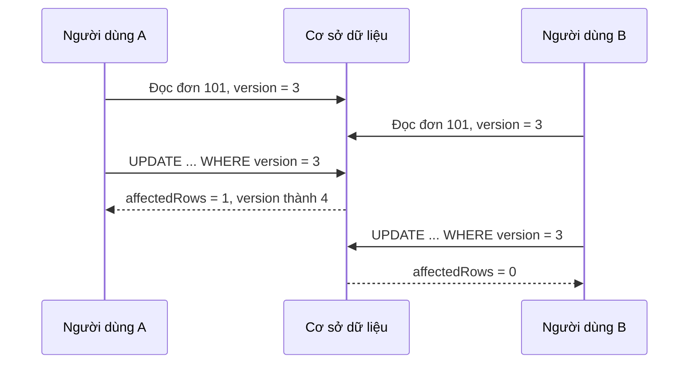

# Kiểm tra số dòng bị ảnh hưởng để xác nhận điều kiện nghiệp vụ

## 1. Vì sao số dòng bị ảnh hưởng quan trọng trong CRUD?

Trong ứng dụng Java truy cập cơ sở dữ liệu quan hệ bằng **JDBC**, một thao tác cập nhật không chỉ cần chạy câu SQL không phát sinh lỗi. Ứng dụng còn cần biết **có đúng bản ghi dự kiến được tác động hay không**. Ví dụ:

- Người dùng phê duyệt đơn hàng: chỉ đơn hàng đang ở trạng thái `PENDING` mới được phê duyệt.
- Khách hàng hủy đơn: chỉ chủ sở hữu đơn và đơn chưa giao mới có quyền hủy.
- Kho xuất hàng: số lượng tồn phải đủ trước khi trừ.
- Hệ thống sửa dữ liệu: một bản ghi đã bị người khác chỉnh sửa không được âm thầm ghi đè.
- Chức năng xóa: có thực sự xóa đúng một bản ghi hay không?

Với các lệnh thay đổi dữ liệu, JDBC cung cấp `PreparedStatement.executeUpdate()` để thực thi SQL và trả về **số dòng bị ảnh hưởng** (update count). Việc kết hợp điều kiện nghiệp vụ vào mệnh đề `WHERE` rồi kiểm tra kết quả này giúp ứng dụng đưa ra quyết định chính xác hơn.

Ví dụ:

```sql
UPDATE orders
SET status = 'APPROVED'
WHERE id = ?
  AND status = 'PENDING';
```

Nếu câu lệnh chỉ tác động **một dòng**, hệ thống có cơ sở kết luận rằng thao tác chuyển trạng thái đã được áp dụng cho một đơn hàng thỏa điều kiện SQL. Nếu tác động **không dòng nào**, có thể đơn hàng không tồn tại hoặc trạng thái không còn là `PENDING`. Không thể suy ra chính xác nguyên nhân chỉ từ số `0`.

> Số dòng bị ảnh hưởng là bằng chứng về **kết quả thực thi câu SQL trên kết nối hiện tại**; nó không tự bảo đảm transaction đã commit, thông điệp đã gửi, hay mọi hệ thống bên ngoài đã hoàn tất.

Sau bài học, bạn có thể sử dụng `DataSource`, `PreparedStatement` và `executeUpdate()` để kiểm tra điều kiện nghiệp vụ khi thực hiện CRUD; phát hiện thao tác thất bại do trạng thái hoặc tranh chấp; phối hợp update count với transaction, optimistic locking và batching.

## 2. `executeUpdate()` trả về gì?

API JDBC:

```java
int affectedRows = preparedStatement.executeUpdate();
```

`executeUpdate()` dùng cho các câu lệnh SQL thay đổi dữ liệu như `INSERT`, `UPDATE`, `DELETE` và một số câu lệnh SQL khác không trả về `ResultSet`. Với thao tác DML thông thường, kết quả là số hàng được câu lệnh báo đã tác động. `executeQuery()` dùng cho truy vấn trả `ResultSet`, chẳng hạn `SELECT`.

| Giá trị trả về | Diễn giải thường gặp đối với lệnh DML kỳ vọng đúng một hàng | Hành động nên cân nhắc |
|---|---|---|
| `0` | Không có hàng đủ điều kiện; một số DB/driver có thể báo số hàng thực sự thay đổi thay vì số hàng khớp điều kiện. | Xem lại điều kiện, trạng thái hoặc quyết định thao tác không được áp dụng. |
| `1` | Một hàng được báo đã tác động. | Có thể coi thành công ở cấp câu lệnh khi `WHERE` đã thể hiện đầy đủ điều kiện nghiệp vụ. |
| `> 1` | Nhiều hàng được tác động. | Nếu chỉ được sửa một bản ghi, đây là lỗi cần phát hiện; rollback nếu thuộc transaction. |

Hai điểm dễ nhầm:

1. **Số hàng khớp và số hàng thực sự đổi giá trị** có thể khác nhau theo hệ quản trị, cách viết SQL và cấu hình driver. Ví dụ `UPDATE orders SET status = 'PAID' WHERE id = 10` khi hàng đó vốn đã là `PAID` có thể cho update count khác nhau giữa các môi trường. Không dựa vào cập nhật lặp lại cùng một giá trị để xác định thay đổi nghiệp vụ nếu chưa biết quy ước của hệ thống.
2. `executeUpdate()` còn có thể trả `0` với câu lệnh không phải DML như một số lệnh định nghĩa dữ liệu. Chỉ diễn giải số `0` là “không tìm thấy bản ghi” khi đang xử lý DML tương ứng.

Đối với các thao tác thay đổi phiên bản hoặc số lượng bằng phép toán thực sự, chẳng hạn `version = version + 1` hoặc `stock = stock - ?` với lượng giảm dương, một hàng thỏa điều kiện sẽ có giá trị dữ liệu được thay đổi. Điều này tránh phần lớn sự mơ hồ của một lệnh `UPDATE` không làm đổi giá trị.

Nếu một lệnh có thể tác động hơn `Integer.MAX_VALUE` hàng, JDBC còn có API `executeLargeUpdate()` trả về `long`; kiểm tra khả năng hỗ trợ của driver đang sử dụng. Với thao tác một bản ghi, `executeUpdate()` là lựa chọn thông thường.

## 3. Mô hình dữ liệu minh họa

Giả sử hệ thống đặt hàng có bảng:

```sql
CREATE TABLE orders (
    id         BIGINT PRIMARY KEY,
    tenant_id  BIGINT NOT NULL,
    product_id BIGINT NOT NULL,
    quantity   INTEGER NOT NULL,
    status     VARCHAR(20) NOT NULL,
    version    BIGINT NOT NULL DEFAULT 0,
    updated_at TIMESTAMP
);

CREATE TABLE inventory (
    product_id    BIGINT PRIMARY KEY,
    available_qty INTEGER NOT NULL
);
```

Ví dụ dữ liệu ban đầu:

| `id` | `tenant_id` | `product_id` | `quantity` | `status` | `version` |
|---|---|---|---|---|---|
| 101 | 7 | 5001 | 2 | `PENDING` | 3 |
| 102 | 7 | 5001 | 1 | `APPROVED` | 1 |
| 103 | 8 | 5002 | 4 | `PENDING` | 0 |

Hệ thống có thể quy định: **mỗi lần phê duyệt chỉ cập nhật đúng một đơn hàng thuộc tenant của người gọi, đang `PENDING` và chưa bị chỉnh sửa kể từ lúc người dùng đọc dữ liệu**.

Ở đây, `tenant_id` được lấy từ ngữ cảnh xác thực đáng tin cậy của ứng dụng, không tin giá trị tenant do người gọi tự chọn tùy ý. Cột `version` dùng cho optimistic locking; sẽ được giải thích ở mục sau.

## 4. Kiểm tra đúng một dòng khi chuyển trạng thái

Thay vì truy vấn trạng thái, kiểm tra trong Java rồi cập nhật bằng điều kiện chỉ có `id`, hãy đưa điều kiện cần thiết trực tiếp vào SQL:

```sql
UPDATE orders
SET status = 'APPROVED',
    version = version + 1,
    updated_at = CURRENT_TIMESTAMP
WHERE id = ?
  AND tenant_id = ?
  AND status = 'PENDING'
  AND version = ?;
```

Đây là một câu lệnh DML có điều kiện: việc xác định hàng đủ điều kiện và cập nhật xảy ra trong cùng thao tác SQL, tránh khoảng trống giữa một lần đọc trạng thái và một lần ghi dựa trên trạng thái đã cũ.

Repository JDBC có thể định nghĩa kết quả nghiệp vụ rõ ràng:

```java
import java.sql.Connection;
import java.sql.PreparedStatement;
import java.sql.SQLException;
import java.util.Objects;
import javax.sql.DataSource;

enum ApprovalResult {
    APPLIED,
    NOT_APPLIED
}

public final class OrderRepository {
    private final DataSource dataSource;

    public OrderRepository(DataSource dataSource) {
        this.dataSource = Objects.requireNonNull(dataSource);
    }

    public ApprovalResult approveIfPending(
            long orderId, long tenantId, long expectedVersion)
            throws SQLException {

        String sql = """
                UPDATE orders
                SET status = 'APPROVED',
                    version = version + 1,
                    updated_at = CURRENT_TIMESTAMP
                WHERE id = ?
                  AND tenant_id = ?
                  AND status = 'PENDING'
                  AND version = ?
                """;

        try (Connection connection = dataSource.getConnection();
             PreparedStatement statement = connection.prepareStatement(sql)) {
            statement.setLong(1, orderId);
            statement.setLong(2, tenantId);
            statement.setLong(3, expectedVersion);

            int affectedRows = statement.executeUpdate();
            if (affectedRows == 1) {
                return ApprovalResult.APPLIED;
            }
            if (affectedRows == 0) {
                return ApprovalResult.NOT_APPLIED;
            }
            throw new SQLException(
                    "Expected at most one order, updated " + affectedRows);
        }
    }
}
```

Đoạn mã sử dụng các API chuẩn của JDBC. `PreparedStatement` gắn tham số `?` bằng `setLong()`, tránh ghép dữ liệu người dùng vào SQL. `try-with-resources` đóng `PreparedStatement` và `Connection` cả khi ném ngoại lệ; với connection pool, `close()` thường trả kết nối về pool.

Vì `id` là khóa chính, số hàng cập nhật kỳ vọng tối đa là `1`. Kiểm tra `affectedRows > 1` vẫn diễn đạt rõ bất biến của thao tác và có ích khi bảo trì câu SQL về sau.

**Điểm cần phân biệt:** Hàm trên trả `APPLIED` sau khi câu lệnh thực thi thành công. Nếu kết nối đang ở chế độ `autoCommit = false`, transaction vẫn cần được commit bởi tầng quản lý transaction. Trường hợp dùng `DataSource` có cấu hình quản lý transaction từ bên ngoài, repository cần tuân theo hợp đồng kết nối/transaction đó; ví dụ này chỉ minh họa một lệnh độc lập.

### Không dùng điều kiện `id` đơn lẻ khi nghiệp vụ yêu cầu thêm kiểm tra

So sánh:

```sql
-- Không đủ: có thể phê duyệt cả đơn đã hủy, đã duyệt hoặc sai tenant.
UPDATE orders
SET status = 'APPROVED'
WHERE id = ?;

-- Có điều kiện nghiệp vụ, phạm vi tenant và kiểm tra phiên bản.
UPDATE orders
SET status = 'APPROVED',
    version = version + 1
WHERE id = ?
  AND tenant_id = ?
  AND status = 'PENDING'
  AND version = ?;
```

Một kết quả `1` từ câu lệnh thứ nhất chỉ cho biết đã tác động vào hàng mang ID đó; nó **không chứng minh** trạng thái chuyển đổi là hợp lệ. Sức mạnh của phép kiểm tra đến từ **điều kiện SQL đúng** kết hợp với **số dòng bị tác động**.

## 5. Diễn giải giá trị `0` một cách thận trọng

Khi `approveIfPending(101, 7, 3)` chạy trên dữ liệu mẫu và không có thay đổi cạnh tranh, kết quả kỳ vọng là `APPLIED`. Sau đó, nếu gọi lại với cùng phiên bản `3`, sẽ không có hàng thỏa `status = 'PENDING'` và `version = 3`.

Một kết quả `0` có thể xuất hiện khi:

- ID đơn hàng không tồn tại.
- ID tồn tại nhưng không thuộc tenant được phép thao tác.
- Đơn hàng đã được phê duyệt, hủy hoặc chuyển sang trạng thái khác.
- `version` không còn khớp do tiến trình khác đã cập nhật đơn hàng.
- Có thay đổi dữ liệu hoặc chính sách khác khiến điều kiện `WHERE` không thỏa.

Do vậy, **không trả về thông báo “không tìm thấy” cho mọi trường hợp `0`** nếu ứng dụng cần phân biệt nguyên nhân. Hãy chọn phản hồi phù hợp mục tiêu: một kết quả trung tính `NOT_APPLIED`, lỗi xung đột trạng thái, hoặc bước kiểm tra tiếp theo có kiểm soát quyền truy cập.

Ví dụ, ứng dụng có thể trả lỗi nghiệp vụ “Không thể phê duyệt đơn hàng ở trạng thái hiện tại” cho người gọi. Nếu muốn phân loại “không tồn tại” và “phiên bản đã thay đổi”, có thể truy vấn tiếp trạng thái của hàng trong **cùng transaction** với điều kiện tenant và mức cô lập phù hợp. Tuy nhiên, dữ liệu có thể thay đổi đồng thời; một truy vấn sau khi `UPDATE` trả `0` không luôn khẳng định được trạng thái tại thời điểm `UPDATE` vừa thực thi.

**Không tiết lộ sự tồn tại của bản ghi thuộc tenant khác** khi thực hiện kiểm tra hoặc đưa ra thông báo lỗi. Điều kiện `tenant_id` và chính sách phân quyền cần được áp dụng nhất quán.

## 6. Kiểm soát tranh chấp với optimistic locking

Xét hai người dùng cùng đọc đơn `101` ở `version = 3`:



Với optimistic locking, ứng dụng:

1. Đọc phiên bản hiện tại khi tải đối tượng.
2. Gửi phiên bản đã đọc vào mệnh đề `WHERE` của lệnh `UPDATE`.
3. Tăng phiên bản bằng `version = version + 1` khi cập nhật.
4. Chỉ xem việc cập nhật thành công khi số hàng bị tác động là `1`.

Nếu người dùng B gửi dữ liệu cũ, `0` cho biết thao tác **không được áp dụng**. Ứng dụng có thể yêu cầu tải lại trạng thái mới và thực hiện lại quyết định nghiệp vụ. Không nên tự động lặp vô hạn câu lệnh với phiên bản mới; dữ liệu người dùng B muốn ghi có thể đã không còn hợp lệ.

Optimistic locking có thể áp dụng cả khi cập nhật nhiều cột:

```sql
UPDATE orders
SET quantity = ?,
    version = version + 1,
    updated_at = CURRENT_TIMESTAMP
WHERE id = ?
  AND tenant_id = ?
  AND status = 'PENDING'
  AND version = ?;
```

Điều kiện `status` bảo vệ quy tắc “chỉ sửa đơn chờ xử lý”; điều kiện `version` bảo vệ khỏi ghi đè một cập nhật cạnh tranh. Cả hai đều cần thiết nếu ứng dụng có cả hai yêu cầu.

## 7. Dùng số dòng cập nhật để bảo vệ số lượng tồn kho

Một cách làm dễ sai là:

```text
SELECT available_qty FROM inventory WHERE product_id = 5001;
if (available_qty >= requestedQty) {
    UPDATE inventory SET available_qty = available_qty - requestedQty
    WHERE product_id = 5001;
}
```

Nếu hai transaction cùng đọc một số lượng còn đủ trước khi một bên cập nhật, kết quả có thể không phản ánh đúng lượng hàng dành cho cả hai. Tốt hơn, đưa điều kiện tồn kho vào chính câu lệnh `UPDATE`:

```sql
UPDATE inventory
SET available_qty = available_qty - ?
WHERE product_id = ?
  AND available_qty >= ?;
```

Sử dụng số lượng yêu cầu dương trong cả tham số trừ và tham số so sánh:

```java
public boolean reserveInventory(long productId, int requestedQty)
        throws SQLException {
    if (requestedQty <= 0) {
        throw new IllegalArgumentException("requestedQty must be positive");
    }

    String sql = """
            UPDATE inventory
            SET available_qty = available_qty - ?
            WHERE product_id = ?
              AND available_qty >= ?
            """;

    try (Connection connection = dataSource.getConnection();
         PreparedStatement statement = connection.prepareStatement(sql)) {
        statement.setInt(1, requestedQty);
        statement.setLong(2, productId);
        statement.setInt(3, requestedQty);

        int count = statement.executeUpdate();
        if (count > 1) {
            throw new SQLException("Updated more than one inventory row");
        }
        return count == 1;
    }
}
```

Phương thức trên minh họa một phương thức thành viên của repository có trường `dataSource` như ví dụ `OrderRepository`. Với `product_id` là khóa chính, mỗi lần chỉ có tối đa một hàng thỏa điều kiện.

Khi `count == 1`, cơ sở dữ liệu đã áp dụng phép trừ cho một hàng đủ điều kiện. Khi `count == 0`, sản phẩm có thể không tồn tại hoặc số lượng tồn không đủ. Việc gói điều kiện và phép trừ trong cùng `UPDATE` giúp cơ sở dữ liệu kiểm soát các cập nhật đồng thời theo cơ chế khóa và transaction của hệ quản trị.

Không thể suy ra “hết hàng” chỉ từ giá trị `0`. Muốn trả lý do cụ thể cần đọc dữ liệu bổ sung với chính sách nhất quán phù hợp.

## 8. Phối hợp nhiều update count trong cùng transaction

Một nghiệp vụ đôi khi cần **hai tác động cùng thành công**: chuyển đơn `PENDING` sang `APPROVED` và giữ chỗ số lượng hàng trong kho. Nếu đơn được duyệt nhưng kho không đủ, hai bảng sẽ bất nhất. Mỗi lệnh có thể trả `1` riêng lẻ, nhưng phải kiểm tra **tất cả** và chỉ commit khi toàn bộ điều kiện được đáp ứng.

Ví dụ sau minh họa một dịch vụ transaction độc lập, dùng một `Connection` chung cho cả hai lệnh:

```java
import java.sql.Connection;
import java.sql.PreparedStatement;
import java.sql.SQLException;
import java.util.Objects;
import javax.sql.DataSource;

public final class OrderApprovalService {
    private final DataSource dataSource;

    public OrderApprovalService(DataSource dataSource) {
        this.dataSource = Objects.requireNonNull(dataSource);
    }

    public boolean approveAndReserve(
            long orderId,
            long tenantId,
            long productId,
            int requestedQty,
            long expectedVersion) throws SQLException {

        if (requestedQty <= 0) {
            throw new IllegalArgumentException("requestedQty must be positive");
        }

        String updateOrder = """
                UPDATE orders
                SET status = 'APPROVED',
                    version = version + 1,
                    updated_at = CURRENT_TIMESTAMP
                WHERE id = ?
                  AND tenant_id = ?
                  AND product_id = ?
                  AND quantity = ?
                  AND status = 'PENDING'
                  AND version = ?
                """;

        String updateInventory = """
                UPDATE inventory
                SET available_qty = available_qty - ?
                WHERE product_id = ?
                  AND available_qty >= ?
                """;

        // Ví dụ giả định Connection mới không tham gia transaction bên ngoài.
        try (Connection connection = dataSource.getConnection()) {
            connection.setAutoCommit(false);
            try {
                int orderCount;
                try (PreparedStatement statement =
                             connection.prepareStatement(updateOrder)) {
                    statement.setLong(1, orderId);
                    statement.setLong(2, tenantId);
                    statement.setLong(3, productId);
                    statement.setInt(4, requestedQty);
                    statement.setLong(5, expectedVersion);
                    orderCount = statement.executeUpdate();
                }

                if (orderCount == 0) {
                    connection.rollback();
                    return false;
                }
                if (orderCount != 1) {
                    throw new SQLException("Unexpected order update count: "
                            + orderCount);
                }

                int inventoryCount;
                try (PreparedStatement statement =
                             connection.prepareStatement(updateInventory)) {
                    statement.setInt(1, requestedQty);
                    statement.setLong(2, productId);
                    statement.setInt(3, requestedQty);
                    inventoryCount = statement.executeUpdate();
                }

                if (inventoryCount == 0) {
                    connection.rollback();
                    return false;
                }
                if (inventoryCount != 1) {
                    throw new SQLException(
                            "Unexpected inventory update count: "
                            + inventoryCount);
                }

                connection.commit();
                return true;
            } catch (SQLException | RuntimeException error) {
                try {
                    connection.rollback();
                } catch (SQLException rollbackError) {
                    error.addSuppressed(rollbackError);
                }
                throw error;
            }
        }
    }
}
```

Mã trên cố ý tách biệt việc kiểm tra hai kết quả:

- `orderCount == 0`: đơn không thỏa điều kiện và không có lý do để tiếp tục giữ hàng; rollback rồi trả `false`.
- `orderCount == 1`, `inventoryCount == 0`: đơn đã được cập nhật **trong transaction**, nhưng rollback hoàn tác cập nhật đó vì kho không đáp ứng điều kiện.
- Cả hai bằng `1`: gọi `commit()` để xác nhận hai thay đổi như một đơn vị.
- Một lệnh ném `SQLException` hoặc số dòng bất thường: rollback trong nhánh ngoại lệ. Nếu rollback cũng lỗi, mã giữ ngoại lệ rollback ở dạng suppressed exception.

Không mở hai kết nối độc lập rồi mong một lệnh `rollback()` hoàn tác cả hai. Nếu dự án dùng transaction manager hoặc `DataSource` được quản lý bởi container, hãy phối hợp với cơ chế đó thay vì tự thay đổi `autoCommit`. Khi tự quản lý kết nối có pool, cấu hình hoặc pool cần đảm bảo trạng thái kết nối được khôi phục trước khi tái sử dụng.

**Lưu ý về độ bền:** `executeUpdate() == 1` chỉ xác nhận cập nhật ở mức câu lệnh. Transaction vẫn có thể rollback hoặc `commit()` thất bại, nên không phát thông báo “đã phê duyệt” ra hệ thống khác chỉ dựa trên count trước commit. Các tác vụ ngoài database cần chiến lược phối hợp riêng (ví dụ ghi outbox trong cùng transaction nếu có yêu cầu).

## 9. Kiểm tra kết quả khi `INSERT` và `DELETE`

### 9.1. `INSERT` một dòng

```sql
INSERT INTO inventory (product_id, available_qty)
VALUES (?, ?);
```

Khi chèn một dòng theo cấu trúc `VALUES` đơn, ứng dụng thường kỳ vọng `executeUpdate() == 1`. Nếu ràng buộc khóa chính hoặc `UNIQUE` bị vi phạm, nhiều hệ cơ sở dữ liệu ném `SQLException` thay vì trả `0`. Vì vậy, hãy xử lý exception và update count như **hai kênh thông tin khác nhau**; không diễn giải mọi lỗi chèn thành “0 hàng”.

Nếu bảng có khóa chính được cơ sở dữ liệu tự sinh, số dòng ảnh hưởng không phải giá trị khóa sinh. Để đọc khóa sinh, JDBC có cơ chế riêng:

```java
import java.sql.Connection;
import java.sql.PreparedStatement;
import java.sql.ResultSet;
import java.sql.SQLException;
import java.sql.Statement;

// Ví dụ bảng notes(id tự sinh, text_value) đã được tạo trong DB.
try (Connection connection = dataSource.getConnection();
     PreparedStatement statement = connection.prepareStatement(
             "INSERT INTO notes(text_value) VALUES (?)",
             Statement.RETURN_GENERATED_KEYS)) {
    statement.setString(1, "Created from JDBC");
    int inserted = statement.executeUpdate();
    if (inserted != 1) {
        throw new SQLException("Expected one inserted note, got " + inserted);
    }

    try (ResultSet keys = statement.getGeneratedKeys()) {
        if (!keys.next()) {
            throw new SQLException("Database did not return a generated key");
        }
        long generatedId = keys.getLong(1);
        // Sử dụng generatedId sau khi kiểm tra giao dịch thành công.
    }
}
```

Khả năng trả khóa sinh và cách tạo cột tự tăng phụ thuộc cơ sở dữ liệu/driver. `inserted == 1` xác nhận số hàng chèn; `getGeneratedKeys()` cung cấp giá trị khóa mà ứng dụng cần để tham chiếu hàng mới.

### 9.2. `DELETE` một dòng và tính lặp lại an toàn

```sql
DELETE FROM orders
WHERE id = ?
  AND tenant_id = ?
  AND status = 'CANCELLED';
```

Khi mục tiêu là “xóa một đơn đã hủy”, `1` có nghĩa một dòng thỏa điều kiện được báo đã xóa. `0` có thể là không tồn tại, sai tenant hoặc trạng thái chưa cho phép xóa. Nếu ID là khóa chính, số dòng kỳ vọng tối đa là một.

Phân biệt **ý nghĩa nghiệp vụ** của xóa lặp:

- Nếu API yêu cầu “xóa đúng bản ghi đang tồn tại”, kết quả `0` là dấu hiệu thao tác không áp dụng.
- Nếu API muốn “bảo đảm bản ghi không còn”, một lệnh `DELETE` lặp trả `0` vẫn có thể được coi là kết quả chấp nhận được, sau khi xác định điều kiện quyền truy cập và phạm vi xóa.
- Nếu bảng có khóa ngoại, lệnh xóa có thể bị từ chối bằng `SQLException`. Số dòng ảnh hưởng không thay thế việc kiểm tra ràng buộc tham chiếu.

Với **soft delete**, điều kiện thường dùng là `WHERE deleted_at IS NULL`; khi xóa thành công, có thể đặt `deleted_at = CURRENT_TIMESTAMP` và tăng `version`. Lần xóa lặp có thể trả `0` vì bản ghi không còn ở trạng thái active.

## 10. Cảnh giác với `UPDATE` tác động nhiều dòng

Khi yêu cầu chỉ sửa **một** khách hàng, câu lệnh thiếu điều kiện có thể cập nhật nhiều hàng:

```sql
-- Nguy hiểm nếu yêu cầu chỉ sửa một khách hàng:
UPDATE customers SET email_verified = TRUE;

-- Ràng buộc mục tiêu và điều kiện nghiệp vụ:
UPDATE customers
SET email_verified = TRUE
WHERE id = ?
  AND tenant_id = ?
  AND email_verified = FALSE;
```

Nếu nghiệp vụ kỳ vọng duy nhất một hàng, hãy kiểm tra `affectedRows == 1`. Điều kiện `affectedRows > 0` không đủ, vì giá trị `2` hoặc `200` cũng bị coi là thành công dù có thể đã sửa nhầm.

**Quan trọng:** Nếu chạy với `autoCommit = true`, lúc mã Java phát hiện `affectedRows > 1` thì lệnh SQL có thể đã được commit. Việc ném exception sau đó **không tự hoàn tác dữ liệu**. Khi có nguy cơ cập nhật quá rộng và việc kiểm tra số hàng là yêu cầu an toàn, cần đặt thao tác trong transaction rồi rollback nếu count không đúng, đồng thời thiết kế `WHERE` và ràng buộc khóa đủ chặt từ đầu.

Trường hợp nghiệp vụ thực sự yêu cầu cập nhật một tập hàng (ví dụ đóng tất cả phiên đăng nhập đã hết hạn), kết quả `> 1` có thể hoàn toàn đúng. Khi đó hãy xác định rõ số dòng tối thiểu, giới hạn, tiêu chí lựa chọn và chính sách xử lý số hàng bằng `0`.

## 11. Đếm số hàng trong batch JDBC

Khi thực thi nhiều lệnh theo lô, kết quả không còn là một `int` đơn lẻ:

```java
int[] counts = statement.executeBatch();
```

`executeBatch()` trả một mảng update count theo thứ tự các lệnh đã thêm qua `addBatch()`. Theo JDBC, ngoài các số không âm, có thể xuất hiện hằng:

| Giá trị | Ý nghĩa |
|---|---|
| `0` hoặc số dương | Số hàng được driver báo đã tác động cho lệnh tương ứng. |
| `Statement.SUCCESS_NO_INFO` (`-2`) | Lệnh thực thi thành công nhưng driver không cung cấp được số hàng tác động. |
| `Statement.EXECUTE_FAILED` (`-3`) | Lệnh thất bại trong batch khi driver tiếp tục xử lý sau một lỗi. |

Vì vậy, kiểm tra batch theo kiểu `count == 1` cho tất cả phần tử có thể đánh dấu nhầm một lệnh **thành công nhưng không biết số hàng** là thất bại. Nếu nghiệp vụ bắt buộc biết *chính xác* một dòng được tác động, giá trị `SUCCESS_NO_INFO` **không đủ bằng chứng** để xác nhận bất biến. Có thể cần thực thi riêng từng câu lệnh, chọn driver/cơ chế có count đáng tin cậy hoặc thiết kế cách kiểm chứng khác.

```java
import java.sql.Statement;

for (int i = 0; i < counts.length; i++) {
    int count = counts[i];
    if (count == Statement.SUCCESS_NO_INFO) {
        // Thành công ở mức thực thi, chưa xác nhận được đúng một hàng.
    } else if (count == Statement.EXECUTE_FAILED) {
        // Driver báo thất bại cho lệnh tương ứng.
    } else if (count == 1) {
        // Đúng một hàng được báo tác động.
    } else {
        // count == 0 hoặc count > 1: cần xem lại quy tắc nghiệp vụ.
    }
}
```

Khi một lệnh trong batch thất bại, JDBC có thể ném `BatchUpdateException`; `getUpdateCounts()` cung cấp các count mà driver đã ghi nhận, nhưng driver có thể dừng ở lệnh lỗi hoặc tiếp tục xử lý các lệnh còn lại. Không suy ra rằng mọi lệnh đều thành công chỉ vì một phần mảng chứa count dương. Với batch có yêu cầu tất cả cùng thành công, cần transaction và rollback nếu có lỗi hoặc kết quả không đáp ứng điều kiện.

Với batch rất lớn, JDBC cung cấp `executeLargeBatch()` và `long[]` ở driver hỗ trợ; quy tắc diễn giải số âm vẫn tương tự.

## 12. Các lỗi suy luận cần tránh

| Suy luận sai | Vì sao sai | Cách làm đúng |
|---|---|---|
| “SQL không ném exception nên thao tác nghiệp vụ thành công.” | `UPDATE` có thể chạy hợp lệ nhưng không có hàng nào khớp `WHERE`. | Kiểm tra update count theo số hàng kỳ vọng. |
| “`affectedRows > 0` là đủ khi sửa theo ID.” | Có thể đã sửa nhiều hàng do `WHERE` sai. | Yêu cầu `== 1` nếu nghiệp vụ chỉ cho phép một hàng. |
| “`0` nghĩa là ID không tồn tại.” | Còn có điều kiện status, tenant, version hoặc quy ước đếm thay đổi của driver. | Trả trạng thái trung tính hoặc kiểm tra bổ sung có kiểm soát. |
| “`1` có nghĩa mọi bước nghiệp vụ đã commit.” | Transaction vẫn có thể rollback, commit thất bại hoặc bước khác chưa chạy. | Chỉ xác nhận thành công sau khi hoàn tất transaction. |
| “`UPDATE` cùng giá trị luôn trả `1`.” | Số hàng khớp và số hàng đổi giá trị không luôn được báo giống nhau. | Thiết kế thay đổi rõ ràng và kiểm chứng hành vi DB/driver. |
| “`executeUpdate()` cho biết khóa mới sinh.” | Update count và generated key là hai kết quả khác nhau. | Dùng `getGeneratedKeys()` khi driver hỗ trợ. |
| “Mọi phần tử batch đều là số hàng không âm.” | JDBC có `SUCCESS_NO_INFO` và `EXECUTE_FAILED`. | Phân nhánh xử lý theo các hằng chuẩn. |
| “Ném exception khi thấy cập nhật nhiều hàng sẽ tự rollback.” | Trong auto-commit, dữ liệu có thể đã được commit. | Dùng transaction trước khi thực hiện thao tác cần kiểm tra. |
| “`count = 1` chứng minh trigger/cascade chỉ tác động một hàng.” | Count của câu lệnh không nhất thiết phản ánh mọi tác động phụ. | Hiểu trigger, cascade và hợp đồng driver, kiểm tra các bất biến liên quan. |

Một số hệ cơ sở dữ liệu còn có trigger hoặc cascade thực hiện các thao tác phụ. Update count phản ánh số dòng được driver báo cho **câu lệnh đã thực thi**, không phải phép đếm đầy đủ mọi thay đổi gián tiếp phát sinh. Nếu nghiệp vụ yêu cầu thống kê chính xác tác động trên nhiều bảng, cần thiết kế truy vấn, transaction và kiểm toán riêng.

## 13. Bài thực hành tự kiểm chứng

Thực hiện trên cơ sở dữ liệu thử nghiệm có JDBC driver và `DataSource` được cấu hình:

1. Chèn đơn hàng `101` ở trạng thái `PENDING`, `version = 3`. Gọi `approveIfPending(101, 7, 3)` và kiểm tra `affectedRows == 1`. Đọc lại để thấy trạng thái `APPROVED` và `version = 4`.
2. Gọi phê duyệt đơn `101` lần nữa với `expectedVersion = 3`. Vì điều kiện không còn thỏa, kiểm tra phương thức trả `NOT_APPLIED` thay vì âm thầm coi là thành công.
3. Gọi phê duyệt đơn không tồn tại hoặc khác tenant; xác nhận cùng nhận `NOT_APPLIED`, đồng thời tránh rò rỉ thông tin đơn thuộc tenant khác.
4. Tạo tồn kho sản phẩm `5001` có `available_qty = 2`. Gọi `reserveInventory(5001, 2)`: cập nhật thành công; gọi lại với lượng `1`: không có hàng nào đủ điều kiện.
5. Trong một transaction, thử phê duyệt đơn yêu cầu lượng hàng lớn hơn tồn kho bằng `approveAndReserve`. Xác nhận kết quả `false` và trạng thái đơn vẫn `PENDING` do rollback.
6. Thử hai tiến trình đọc cùng một phiên bản đơn rồi lần lượt cập nhật bằng `WHERE version = ?`. Xác nhận chỉ bản cập nhật có phiên bản còn hợp lệ được áp dụng; quan sát kết quả phụ thuộc thứ tự transaction thực tế.
7. Thực hiện batch đơn giản và in từng count để xem driver có trả số hàng cụ thể hay `SUCCESS_NO_INFO`. Không giả định một quy ước khi chưa thử với driver triển khai.

### Câu hỏi tự đánh giá

- Vì sao một thao tác `UPDATE` trả `0` chưa đủ để kết luận rằng bản ghi không tồn tại?
- Điều kiện nào cần xuất hiện trong `WHERE` khi chỉ cho phép chuyển `PENDING` sang `APPROVED`?
- Tại sao `version = version + 1` và `WHERE version = ?` giúp phát hiện cập nhật cạnh tranh?
- Nếu cập nhật đơn trả `1` nhưng giữ hàng trong kho trả `0`, bạn nên làm gì với transaction?
- Có thể xác nhận “đúng một hàng” khi một mục batch trả `Statement.SUCCESS_NO_INFO` không?

### Ghi nhớ

Trong JDBC, **kiểm tra số dòng bị ảnh hưởng là một phần của xác nhận điều kiện nghiệp vụ**, đặc biệt với `UPDATE` và `DELETE` có điều kiện. Hãy đưa trạng thái, quyền sở hữu và phiên bản vào `WHERE`; kiểm tra `executeUpdate()` theo số dòng kỳ vọng; xử lý riêng trường hợp `0`, `1` và nhiều hơn `1`; và chỉ công bố kết quả hoàn tất khi transaction đã commit theo hợp đồng của ứng dụng. Số dòng bị ảnh hưởng có giá trị khi được diễn giải cùng SQL, trạng thái dữ liệu và cơ chế giao dịch, không phải một bằng chứng độc lập cho toàn bộ nghiệp vụ.
