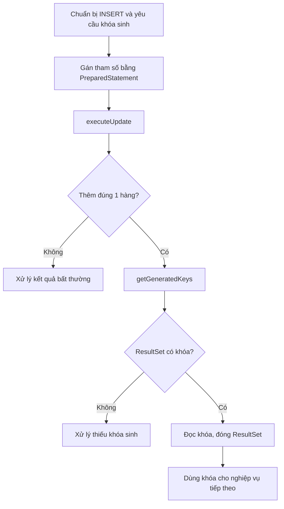

# Sử dụng `RETURN_GENERATED_KEYS` khi tạo bản ghi

## 1. Vì sao cần lấy khóa ngay sau `INSERT`?

Trong ứng dụng Java làm việc với cơ sở dữ liệu quan hệ qua JDBC, khóa chính thường do cơ sở dữ liệu sinh khi thêm bản ghi: cột `IDENTITY`, `AUTO_INCREMENT`, giá trị lấy từ sequence, hoặc giá trị mặc định do cơ sở dữ liệu cấp. Ví dụ, khi tạo một khách hàng mới, ứng dụng cần biết `customer_id` để hiển thị thông tin, trả về từ API hoặc thêm các bản ghi liên quan.

Nếu chỉ gọi `executeUpdate()` cho câu lệnh `INSERT`, JDBC trả về **số hàng bị tác động**, không phải khóa chính vừa sinh. JDBC cung cấp cơ chế **generated keys** để lấy khóa gắn với chính câu lệnh vừa thực thi:

1. Chuẩn bị câu lệnh `INSERT` với yêu cầu trả khóa sinh.
2. Gán tham số và thực thi `INSERT`.
3. Đọc `ResultSet` từ `getGeneratedKeys()`.
4. Dùng khóa nhận được cho xử lý tiếp theo, chẳng hạn tạo bản ghi con trong cùng transaction.



**Phân biệt hai loại kết quả:** `executeUpdate()` trả về số hàng thêm/sửa/xóa; `getGeneratedKeys()` trả về một `ResultSet` chứa giá trị khóa do cơ sở dữ liệu hoặc driver cung cấp. Giá trị `1` từ `executeUpdate()` chỉ nói rằng có một hàng được thêm, hoàn toàn không có nghĩa khóa sinh bằng `1`.

## 2. Yêu cầu khóa sinh khi tạo `PreparedStatement`

JDBC cung cấp hai cách thường gặp để tạo `PreparedStatement` cho một câu lệnh `INSERT`:

```java
// Cách 1: yêu cầu driver trả về khóa được sinh.
PreparedStatement insert = connection.prepareStatement(
    "INSERT INTO customers (full_name, email) VALUES (?, ?)",
    Statement.RETURN_GENERATED_KEYS
);

// Cách 2: chỉ rõ tên cột cần nhận, nếu driver hỗ trợ.
PreparedStatement insertWithColumn = connection.prepareStatement(
    "INSERT INTO customers (full_name, email) VALUES (?, ?)",
    new String[] { "id" }
);
```

`Statement.RETURN_GENERATED_KEYS` là hằng số trong `java.sql.Statement`, dù đối tượng trả về là `PreparedStatement`. Khi chỉ cần một cột khóa và driver hỗ trợ lựa chọn theo tên cột, truyền `new String[] {"id"}` giúp diễn đạt rõ cột mong muốn. Một số driver chỉ hỗ trợ biến thể dùng hằng số hoặc có quy tắc riêng về tên cột, kiểu cột và thứ tự dữ liệu trả về; cần kiểm chứng với hệ quản trị cơ sở dữ liệu đang sử dụng.

Không nên chuẩn bị câu lệnh như bình thường rồi mặc định rằng `getGeneratedKeys()` sẽ luôn có dữ liệu: ứng dụng phải yêu cầu khóa sinh khi tạo statement, theo cách driver hỗ trợ.

## 3. Ví dụ hoàn chỉnh: thêm khách hàng và lấy `id`

Giả sử sử dụng PostgreSQL với bảng sau. Đây là ví dụ cụ thể; cú pháp tạo cột sinh tự động có thể khác ở MySQL, SQL Server, Oracle hoặc các hệ quản trị khác.

```sql
CREATE TABLE customers (
    id BIGINT GENERATED BY DEFAULT AS IDENTITY PRIMARY KEY,
    full_name VARCHAR(150) NOT NULL,
    email VARCHAR(255) NOT NULL UNIQUE
);
```

Lệnh thêm mới không cung cấp `id`; cơ sở dữ liệu sẽ sinh giá trị này:

```sql
INSERT INTO customers (full_name, email) VALUES (?, ?);
```

Sau đây là DAO dùng `DataSource` để lấy kết nối, `PreparedStatement` để ràng buộc dữ liệu và `getGeneratedKeys()` để nhận khóa. Ví dụ yêu cầu driver trả riêng cột `id`:

```java
import javax.sql.DataSource;
import java.sql.Connection;
import java.sql.PreparedStatement;
import java.sql.ResultSet;
import java.sql.SQLException;
import java.util.Objects;

public final class CustomerDao {
    private final DataSource dataSource;

    public CustomerDao(DataSource dataSource) {
        this.dataSource = Objects.requireNonNull(dataSource);
    }

    public long create(String fullName, String email) throws SQLException {
        String sql =
            "INSERT INTO customers (full_name, email) VALUES (?, ?)";

        try (Connection connection = dataSource.getConnection();
             PreparedStatement statement = connection.prepareStatement(
                 sql, new String[] { "id" })) {

            statement.setString(1, fullName);
            statement.setString(2, email);

            int affectedRows = statement.executeUpdate();
            if (affectedRows != 1) {
                throw new SQLException(
                    "Dự kiến thêm 1 khách hàng, thực tế: " + affectedRows
                );
            }

            try (ResultSet keys = statement.getGeneratedKeys()) {
                if (!keys.next()) {
                    throw new SQLException("INSERT thành công nhưng không nhận được id");
                }

                long id = keys.getLong(1);
                if (keys.wasNull()) {
                    throw new SQLException("Khóa sinh trả về là NULL");
                }
                if (keys.next()) {
                    throw new SQLException("Nhận nhiều khóa cho một INSERT một hàng");
                }
                return id;
            }
        }
    }
}
```

Ví dụ gọi DAO (giả sử `dataSource` đã được cấu hình):

```java
CustomerDao dao = new CustomerDao(dataSource);
long customerId = dao.create("Nguyễn An", "an@example.com");
System.out.println("ID khách hàng mới: " + customerId);
```

Những điểm cần đọc đúng trong ví dụ:

- `setString(1, ...)` và `setString(2, ...)` gán giá trị cho hai dấu `?` theo **vị trí bắt đầu từ 1**, tránh ghép chuỗi SQL từ dữ liệu đầu vào.
- `executeUpdate()` thực thi `INSERT`; chỉ sau khi lệnh này hoàn tất mới đọc `getGeneratedKeys()`.
- `getGeneratedKeys()` trả về `ResultSet`; phải gọi `next()` trước khi đọc hàng đầu tiên. Chỉ số cột trong `getLong(1)` cũng bắt đầu từ 1.
- `getLong(1)` phù hợp với cột `BIGINT`; nếu giá trị SQL là `NULL`, JDBC trả `0` và cần `wasNull()` để phân biệt. Trong ví dụ cột khóa chính không thể là `NULL`, nên đó là tình huống bất thường.
- `try-with-resources` đóng `ResultSet`, `PreparedStatement` và `Connection` ngay cả khi có `SQLException`. Với connection pool, `close()` thường trả kết nối về pool.

Ví dụ dùng `new String[] {"id"}` được lựa chọn cho PostgreSQL. Nếu driver chỉ hỗ trợ `Statement.RETURN_GENERATED_KEYS`, thay đối số thứ hai bằng hằng số đó, đồng thời kiểm tra hình dạng và thứ tự cột của `ResultSet` trả về. Không mặc định rằng cột thứ nhất luôn là `id` nếu driver trả nhiều cột.

## 4. Đọc khóa từ `ResultSet` đúng cách

Đối với thao tác thêm **một** hàng, ba tình huống cần xét là:

| Kết quả | Cách xử lý |
| --- | --- |
| `ResultSet` có đúng một hàng và giá trị khóa hợp lệ | Đọc khóa theo cột/kiểu dữ liệu tương ứng rồi trả về. |
| Không có hàng nào từ `getGeneratedKeys()` | Báo lỗi hoặc áp dụng cơ chế thay thế đã được thiết kế riêng cho driver; không tự đoán ID. |
| Có nhiều hàng khóa dù chỉ thêm một bản ghi | Xác minh SQL, driver và cách yêu cầu cột; trong DAO kỳ vọng một hàng có thể báo lỗi như ví dụ. |

**Giá trị khóa không nhất thiết là `long`.** Cách đọc phải tương thích với schema và kiểu do driver trả về. Một khóa dạng `INTEGER` có thể đọc bằng `getInt()`, một khóa `BIGINT` bằng `getLong()`; với UUID hay kiểu khác, cách đọc (`getObject()`, ép kiểu hoặc chuyển đổi) phụ thuộc vào driver và SQL type. Nếu đọc theo tên cột, hãy kiểm tra tên/nhãn cột thực tế mà driver đưa vào `ResultSet`.

Đối với `Statement` thông thường, JDBC cũng có dạng:

```java
int rows = statement.executeUpdate(
    "INSERT INTO customers (full_name, email) " +
    "VALUES ('Nguyen An', 'an@example.com')",
    Statement.RETURN_GENERATED_KEYS
);
try (ResultSet keys = statement.getGeneratedKeys()) {
    // Đọc ResultSet theo cùng nguyên tắc ở trên.
}
```

Đoạn này chỉ minh họa API của `Statement` với chuỗi SQL cố định; trong ứng dụng thực tế, hãy ưu tiên `PreparedStatement` và các dấu `?` để truyền giá trị từ người dùng.

## 5. Dùng ID vừa sinh để tạo dữ liệu liên quan

Một tình huống phổ biến là tạo đơn hàng trước, sau đó thêm các dòng hàng tham chiếu đến `orders.id`:

```text
orders:       id = 501  (do DB sinh)
order_items:  order_id = 501  (ứng dụng lấy từ khóa sinh)
```

Các thao tác có quan hệ nghiệp vụ như vậy nên dùng **cùng một `Connection` và một transaction**:

```java
try (Connection connection = dataSource.getConnection()) {
    connection.setAutoCommit(false);
    try {
        // INSERT orders bằng PreparedStatement trên connection,
        // gọi getGeneratedKeys() để nhận orderId.
        // INSERT order_items với order_id = orderId,
        // vẫn sử dụng chính connection này.

        connection.commit();
    } catch (SQLException | RuntimeException error) {
        try {
            connection.rollback();
        } catch (SQLException rollbackError) {
            error.addSuppressed(rollbackError);
        }
        throw error;
    }
}
```

Đây là **khung minh họa** luồng transaction; phần chú thích cần được thay bằng các câu `INSERT` thực tế. Khóa sinh được đọc sau `INSERT`, **trước cả khi `commit()`**. Nếu transaction bị rollback, bản ghi có thể không tồn tại dù ứng dụng từng nhận được giá trị ID. Đồng thời, sequence/identity có thể đã tăng và để lại khoảng trống sau rollback; không nên giả định ID liên tục hoặc dùng ID để đếm số bản ghi.

Nếu triển khai DAO có nhiều phương thức tham gia cùng transaction, cần truyền **cùng `Connection`** vào các phương thức đó, hoặc dùng cơ chế quản lý transaction bảo đảm chúng cùng một kết nối. Gọi riêng `dataSource.getConnection()` trong mỗi bước có thể khiến các thao tác không nằm trong cùng transaction.

## 6. `RETURN_GENERATED_KEYS` so với cú pháp SQL `RETURNING`

Đây là hai cơ chế có mục đích gần nhau nhưng cách lập trình khác nhau:

| Tiêu chí | JDBC generated keys | SQL `RETURNING` (ví dụ PostgreSQL) |
| --- | --- | --- |
| Cách yêu cầu | `prepareStatement(sql, Statement.RETURN_GENERATED_KEYS)` hoặc truyền tên cột | Viết `INSERT ... RETURNING id` trong SQL |
| Cách thực thi điển hình | `executeUpdate()` | `executeQuery()` khi SQL trả về hàng |
| Cách đọc | `statement.getGeneratedKeys()` | `ResultSet` trả trực tiếp từ `executeQuery()` |
| Tính di động | API JDBC chuẩn; hành vi cụ thể phụ thuộc driver/DB | Cú pháp và khả năng hỗ trợ phụ thuộc hệ quản trị; ví dụ SQL Server dùng `OUTPUT` |

Ví dụ PostgreSQL dùng cú pháp trả hàng trực tiếp:

```java
String sql =
    "INSERT INTO customers (full_name, email) VALUES (?, ?) RETURNING id";

try (PreparedStatement statement = connection.prepareStatement(sql)) {
    statement.setString(1, "Nguyễn An");
    statement.setString(2, "an@example.com");

    try (ResultSet rows = statement.executeQuery()) {
        if (!rows.next()) {
            throw new SQLException("INSERT không trả về id");
        }
        long id = rows.getLong("id");
        // Sử dụng id theo nhu cầu.
    }
}
```

Khi đã dùng `INSERT ... RETURNING id` với `executeQuery()`, kết quả nằm ngay trong `rows`: **không cần gọi thêm** `getGeneratedKeys()` để đọc lại cùng dữ liệu. Cơ chế generated keys phù hợp khi muốn dùng API JDBC chuẩn; `RETURNING` hữu ích nếu muốn kiểm soát trực tiếp nhiều cột trả về và chấp nhận gắn với cú pháp SQL của hệ quản trị cụ thể.

## 7. Trường hợp nhiều hàng và batch

Với `INSERT` nhiều hàng hoặc `executeBatch()`, có thể xuất hiện nhiều khóa sinh. Tuy nhiên, khả năng trả đủ khóa, thứ tự khóa, cách ánh xạ mỗi khóa sang phần tử batch và cách xử lý khi batch lỗi **không đồng nhất giữa các driver**. Vì vậy:

- Không mặc định rằng `getGeneratedKeys()` luôn trả đúng `N` hàng tương ứng với `N` phần tử của batch.
- Không mặc định hàng khóa thứ `i` luôn ứng với phần tử batch thứ `i` nếu chưa xác minh tài liệu và thử nghiệm driver.
- Nếu nghiệp vụ cần ánh xạ chính xác nhiều khóa sang nhiều bản ghi, hãy chọn chiến lược được driver và cơ sở dữ liệu hỗ trợ rõ ràng (chẳng hạn dùng khóa tạo từ ứng dụng, `RETURNING` phù hợp hoặc thao tác từng hàng trong transaction).
- Với batch, kiểm tra cả `executeBatch()`/`BatchUpdateException` và kết quả khóa sinh trong điều kiện thành công lẫn thất bại một phần.

Ví dụ DAO ở mục 3 cố ý thao tác **một hàng mỗi lần**, nhờ đó yêu cầu về một khóa sinh rõ ràng và dễ kiểm chứng hơn.

## 8. Lỗi phổ biến và cách phòng tránh

| Sai lầm | Hậu quả và hướng khắc phục |
| --- | --- |
| Dùng giá trị `executeUpdate()` làm ID | Nhầm số hàng tác động với khóa chính. Phải đọc `getGeneratedKeys()`. |
| Quên yêu cầu generated keys lúc tạo statement | `getGeneratedKeys()` có thể rỗng hoặc gây lỗi tùy driver. Truyền `RETURN_GENERATED_KEYS` hay tên cột ngay từ đầu. |
| Không gọi `keys.next()` | Con trỏ `ResultSet` chưa đứng trên hàng dữ liệu. Gọi `next()` và kiểm tra kết quả. |
| Dùng `SELECT MAX(id)` để tìm bản ghi vừa thêm | Có thể lấy nhầm khóa do phiên khác vừa chèn; dùng khóa gắn với chính câu `INSERT`. |
| Giả định mọi driver trả cột `id` ở vị trí 1 | Một số driver trả thêm cột hoặc dùng tên cột khác. Thử nghiệm và chọn cột tường minh khi được hỗ trợ. |
| Bỏ qua `SQLException`, rò rỉ statement/result set | Mất thông tin nguyên nhân lỗi, cạn tài nguyên. Dùng `try-with-resources` và truyền/xử lý ngoại lệ có chủ đích. |
| Coi khóa đã nhận là bằng chứng transaction đã commit | Có thể rollback sau khi sinh khóa. Chỉ xác nhận hoàn tất nghiệp vụ khi transaction commit thành công. |

Có thể dùng `DatabaseMetaData.supportsGetGeneratedKeys()` để kiểm tra driver **khai báo** hỗ trợ tính năng hay không:

```java
boolean supported = connection.getMetaData().supportsGetGeneratedKeys();
```

Kết quả kiểm tra này không bảo đảm mọi kiểu khóa, kiểu `INSERT` và batch đều hoạt động giống nhau. Khi triển khai, nên có bài kiểm thử tích hợp trên **đúng driver và phiên bản cơ sở dữ liệu sử dụng thực tế**, xác minh ít nhất: thêm một bản ghi và nhận đúng ID, không có khóa trả về, vi phạm ràng buộc `UNIQUE`, rollback sau khi lấy khóa, và các tình huống batch nếu có sử dụng.

## 9. Ghi nhớ

Với thao tác CRUD trong JDBC, quy trình chuẩn để lấy khóa do cơ sở dữ liệu sinh là **chuẩn bị `INSERT` có yêu cầu generated keys → thực thi bằng `executeUpdate()` → đọc `getGeneratedKeys()` → dùng giá trị khóa đúng kiểu dữ liệu**. `PreparedStatement` giúp truyền tham số an toàn, `DataSource` cung cấp kết nối, và transaction bảo đảm các thao tác liên quan được xác nhận hoặc hoàn tác như một đơn vị. Khi cần dùng tính năng này trên nhiều loại cơ sở dữ liệu, luôn kiểm chứng hành vi thực tế của driver, nhất là hình dạng `ResultSet` và các trường hợp insert nhiều hàng.
