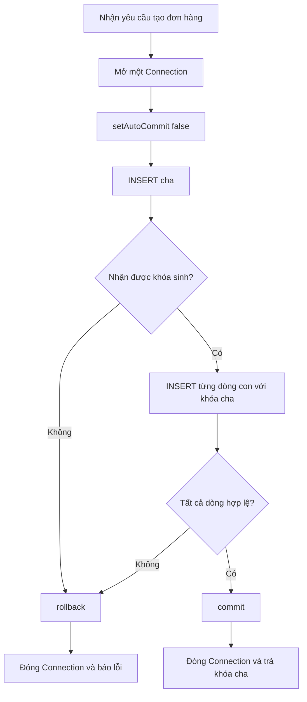

# Lưu bản ghi cha-con với khóa được sinh trong cùng giao dịch JDBC

Trong một hệ thống bán hàng, đơn hàng (*cha*) thường được tạo trước các dòng hàng (*con*). Cơ sở dữ liệu có thể tự sinh `order_id` khi thêm đơn hàng, trong khi từng dòng hàng phải dùng đúng `order_id` đó làm khóa ngoại. Nếu chỉ lưu được đơn hàng mà không lưu được các dòng hàng, dữ liệu sẽ không còn phản ánh một thao tác nghiệp vụ hoàn chỉnh.

Với **JDBC**, cách giải quyết là thực hiện toàn bộ thao tác trên **cùng một `Connection`**, tắt chế độ tự động commit, lấy khóa vừa sinh bằng `PreparedStatement.getGeneratedKeys()`, dùng khóa ấy khi thêm các bản ghi con, rồi chỉ `commit()` khi mọi bước thành công. Nếu xảy ra lỗi, `rollback()` đưa những thay đổi thuộc giao dịch chưa commit về trạng thái trước thao tác, trong phạm vi khả năng giao dịch của cơ sở dữ liệu.

Bài học thuộc chương **CRUD và khóa sinh** của JDBC, tập trung vào việc phối hợp các API chuẩn `DataSource`, `Connection`, `PreparedStatement`, `ResultSet`, `Statement` và `SQLException`. Sau bài, bạn sẽ biết cách viết một thao tác lưu cha-con có tính nguyên tử, xử lý được lỗi khi tạo bản ghi hoặc truy xuất khóa sinh, và nhận diện những khác biệt giữa các hệ quản trị cơ sở dữ liệu.

## 1. Bài toán: một đơn hàng, nhiều dòng hàng

Giả sử một đơn hàng có hai dòng hàng:

```text
Đơn hàng (purchase_order)
  order_id = 501 (DB tự sinh)
  customer_id = 42
  status = NEW
         |
         +-- Dòng 1 (order_item): order_id = 501, product_id = 10, quantity = 2
         |
         +-- Dòng 2 (order_item): order_id = 501, product_id = 11, quantity = 1
```

Điều kiện nghiệp vụ là **hoặc cả đơn hàng và toàn bộ dòng hàng được lưu, hoặc không bản ghi nào của thao tác này được commit**. Khóa ngoại giúp ngăn một dòng hàng tham chiếu tới đơn hàng không tồn tại; giao dịch giúp không để lại đơn hàng thiếu dòng hàng nếu bước ghi con thất bại.

Một lược đồ SQL minh họa:

```sql
CREATE TABLE purchase_order (
    order_id     BIGINT GENERATED ALWAYS AS IDENTITY PRIMARY KEY,
    customer_id  BIGINT NOT NULL,
    status       VARCHAR(20) NOT NULL
);

CREATE TABLE order_item (
    order_id    BIGINT NOT NULL,
    line_no     INTEGER NOT NULL,
    product_id  BIGINT NOT NULL,
    quantity    INTEGER NOT NULL CHECK (quantity > 0),
    unit_price  DECIMAL(12, 2) NOT NULL CHECK (unit_price >= 0),
    PRIMARY KEY (order_id, line_no),
    FOREIGN KEY (order_id) REFERENCES purchase_order(order_id)
);
```

`purchase_order.order_id` là **khóa chính được sinh bởi cơ sở dữ liệu**. `order_item.order_id` là **khóa ngoại**, còn `(order_id, line_no)` là khóa chính ghép của dòng hàng. Mỗi đơn hàng có thể có dòng số 1, số 2, số 3 mà không trùng khóa với dòng thuộc đơn hàng khác.

> Cú pháp `GENERATED ALWAYS AS IDENTITY` minh họa cơ chế identity theo SQL chuẩn; hỗ trợ và cú pháp thực tế khác nhau giữa PostgreSQL, MySQL, SQL Server, Oracle và các cơ sở dữ liệu khác. Ví dụ Java bên dưới dựa vào hợp đồng “lệnh `INSERT` tạo một hàng cha và driver có thể trả khóa sinh”, không dựa vào cách hiện thực identity nội bộ. Khả năng hỗ trợ giao dịch còn phụ thuộc engine hoặc kiểu bảng được sử dụng.

Ở đây chúng ta giả định mỗi đơn hàng phải có **ít nhất một** dòng, giá đơn vị cần lưu chính xác tới hai chữ số thập phân, và phương thức lưu trả về `order_id` vừa được cơ sở dữ liệu sinh.

## 2. Vì sao phải dùng cùng một giao dịch?

Mặc định, một kết nối JDBC thông thường có `autoCommit = true`: mỗi câu lệnh SQL hoàn tất sẽ được commit theo quy tắc JDBC. Khi đó, mã sau có thể để lại dữ liệu dở dang:

```java
// Minh họa cách làm không đáp ứng yêu cầu nguyên tử.
long orderId = insertParentOnOneConnection(); // Đã commit riêng.
insertFirstChildOnAnotherConnection(orderId); // Đã commit riêng.
insertSecondChild(orderId);                    // Có thể lỗi ở đây.
```

Nếu dòng thứ hai bị lỗi vì vi phạm `CHECK`, `FOREIGN KEY`, lỗi kết nối hoặc bất kỳ nguyên nhân nào khác, các thay đổi đã commit trước đó sẽ không bị thu hồi bởi một lệnh `rollback()` ở kết nối khác.

Quy trình đúng về nguyên tắc:



Ba yêu cầu phải được thỏa mãn đồng thời:

1. **Một kết nối** phục vụ câu lệnh thêm cha, lấy khóa và các câu lệnh thêm con.
2. **Một ranh giới giao dịch** bao trùm toàn bộ các lệnh ghi; không `commit` sớm sau `INSERT` cha.
3. **Một quyết định cuối cùng**: thành công thì `commit`; có lỗi trước khi commit thì thử `rollback` và truyền lỗi tới tầng gọi.

Khóa sinh có thể được đọc và dùng trong các lệnh tiếp theo **trước `commit()`**, miễn thao tác diễn ra trên cùng kết nối/giao dịch. Không cần commit cha để dòng con tham chiếu được khóa cha trong giao dịch ấy. Việc một phiên giao dịch khác có nhìn thấy thay đổi chưa commit hay không phụ thuộc mức cô lập và hệ quản trị; ví dụ không dựa vào khả năng nhìn thấy từ kết nối khác.

## 3. Lấy khóa sinh với `RETURN_GENERATED_KEYS`

`PreparedStatement` có dạng tạo câu lệnh yêu cầu driver trả khóa sinh:

```java
String sql = "INSERT INTO purchase_order (customer_id, status) VALUES (?, ?)";

try (PreparedStatement statement = connection.prepareStatement(
        sql, Statement.RETURN_GENERATED_KEYS)) {
    statement.setLong(1, 42L);
    statement.setString(2, "NEW");

    int affectedRows = statement.executeUpdate();
    if (affectedRows != 1) {
        throw new SQLException("Expected one inserted order row");
    }

    try (ResultSet keys = statement.getGeneratedKeys()) {
        if (!keys.next()) {
            throw new SQLException("Insert succeeded but no generated key was returned");
        }

        long newOrderId = keys.getLong(1);
        if (keys.wasNull()) {
            throw new SQLException("Generated key was NULL");
        }

        // newOrderId được dùng để insert các dòng con trên cùng Connection.
    }
}
```

Các thành phần giữ vai trò riêng:

| Thành phần | Tác dụng |
| --- | --- |
| `Statement.RETURN_GENERATED_KEYS` | Yêu cầu trả các khóa sinh khi tạo `PreparedStatement` |
| `executeUpdate()` | Thực thi `INSERT`; trả số hàng bị tác động với câu lệnh này |
| `getGeneratedKeys()` | Trả `ResultSet` chứa khóa mà driver thông báo đã được sinh |
| `keys.next()` | Di chuyển đến hàng khóa đầu tiên, nếu có |
| `keys.getLong(1)` | Đọc cột đầu tiên của kết quả khóa; ví dụ giả định đó là `order_id` kiểu `BIGINT` |

`executeUpdate() == 1` xác nhận lệnh thêm cha báo một hàng bị tác động; **không bảo đảm khóa đã được trả**. Vì vậy phải kiểm tra cả kết quả `getGeneratedKeys()`. Nếu không có khóa, mã không được âm thầm thay bằng `0` hoặc tiếp tục thêm con với khóa giả.

Khi cần nêu rõ cột khóa, JDBC còn cung cấp biến thể:

```java
connection.prepareStatement(sql, new String[] { "order_id" });
```

Một số driver hỗ trợ biến thể chỉ định tên cột tốt hơn `RETURN_GENERATED_KEYS`, trong khi một số driver có hạn chế về tên cột, kiểu câu lệnh hoặc số cột được trả. Ví dụ hoàn chỉnh bên dưới dùng `RETURN_GENERATED_KEYS` và cột đầu tiên vì mô hình chỉ có một khóa sinh. **Hãy xác minh hình dạng `ResultSet` khóa sinh với driver thực tế**. Có thể tham khảo `DatabaseMetaData.supportsGetGeneratedKeys()`, nhưng integration test vẫn cần thiết để xác minh hành vi cụ thể.

Đừng dùng `SELECT MAX(order_id)` để xác định ID vừa tạo: một giao dịch khác có thể thêm hàng giữa các bước. Cũng đừng tự ghép khóa dựa vào giả định “ID trước đó + 1”; sequence/identity có thể bỏ số, nhất là khi rollback hoặc có giao dịch đồng thời.

## 4. Ví dụ đầy đủ: lưu cha và con trong một `Connection`

Ví dụ sau dùng Java 17 trở lên, `DataSource` có sẵn, `record` cho dữ liệu đầu vào, `BigDecimal` cho giá tiền và **batch** để thêm các dòng con. Các bản ghi đầu vào được kiểm tra trước khi mở kết nối, giúp lỗi dữ liệu thông thường được phát hiện sớm.

Tệp minh họa `OrderWriter.java`:

```java
import java.math.BigDecimal;
import java.math.RoundingMode;
import java.sql.Connection;
import java.sql.PreparedStatement;
import java.sql.ResultSet;
import java.sql.SQLException;
import java.sql.Statement;
import java.util.List;
import java.util.Objects;
import javax.sql.DataSource;

public final class OrderWriter {

    // Dữ liệu của một dòng hàng. Yêu cầu tương ứng DECIMAL(12, 2).
    public record Line(long productId, int quantity, BigDecimal unitPrice) {
        public Line {
            if (productId <= 0 || quantity <= 0) {
                throw new IllegalArgumentException(
                        "Product ID and quantity must be positive");
            }

            Objects.requireNonNull(unitPrice, "unitPrice");
            try {
                // Chấp nhận 12.340 -> 12.34; từ chối 12.345.
                unitPrice = unitPrice.setScale(2, RoundingMode.UNNECESSARY);
            } catch (ArithmeticException ex) {
                throw new IllegalArgumentException(
                        "unitPrice must have at most two significant decimal places", ex);
            }

            if (unitPrice.signum() < 0 || unitPrice.precision() > 12) {
                throw new IllegalArgumentException(
                        "unitPrice is outside the DECIMAL(12, 2) range");
            }
        }
    }

    // Sao chép danh sách để caller không sửa nội dung trong lúc đang lưu.
    public record NewOrder(long customerId, List<Line> lines) {
        public NewOrder {
            if (customerId <= 0) {
                throw new IllegalArgumentException("customerId must be positive");
            }
            lines = List.copyOf(Objects.requireNonNull(lines, "lines"));
            if (lines.isEmpty()) {
                throw new IllegalArgumentException("An order needs at least one line");
            }
        }
    }

    private static final String INSERT_ORDER = """
            INSERT INTO purchase_order (customer_id, status)
            VALUES (?, ?)
            """;

    private static final String INSERT_LINE = """
            INSERT INTO order_item
                (order_id, line_no, product_id, quantity, unit_price)
            VALUES (?, ?, ?, ?, ?)
            """;

    private final DataSource dataSource;

    public OrderWriter(DataSource dataSource) {
        this.dataSource = Objects.requireNonNull(dataSource, "dataSource");
    }

    public long save(NewOrder order) throws SQLException {
        Objects.requireNonNull(order, "order");

        // Connection thuộc quyền sở hữu của một lần gọi save.
        try (Connection connection = dataSource.getConnection()) {
            connection.setAutoCommit(false);
            try {
                long orderId = insertOrder(connection, order.customerId());
                insertLines(connection, orderId, order.lines());
                connection.commit();
                return orderId;
            } catch (SQLException | RuntimeException failure) {
                try {
                    connection.rollback();
                } catch (SQLException rollbackFailure) {
                    // Giữ nguyên nguyên nhân gốc để dễ chẩn đoán.
                    failure.addSuppressed(rollbackFailure);
                }
                throw failure;
            }
        }
    }

    private static long insertOrder(Connection connection, long customerId)
            throws SQLException {
        try (PreparedStatement statement = connection.prepareStatement(
                INSERT_ORDER, Statement.RETURN_GENERATED_KEYS)) {

            statement.setLong(1, customerId);
            statement.setString(2, "NEW");

            int affected = statement.executeUpdate();
            if (affected != 1) {
                throw new SQLException(
                        "Expected one inserted order, got " + affected);
            }

            try (ResultSet generatedKeys = statement.getGeneratedKeys()) {
                if (!generatedKeys.next()) {
                    throw new SQLException("Database returned no generated order ID");
                }

                long id = generatedKeys.getLong(1);
                if (generatedKeys.wasNull()) {
                    throw new SQLException("Generated order ID is NULL");
                }
                if (generatedKeys.next()) {
                    throw new SQLException("Expected exactly one generated-key row");
                }
                return id;
            }
        }
    }

    private static void insertLines(
            Connection connection, long orderId, List<Line> lines)
            throws SQLException {

        try (PreparedStatement statement = connection.prepareStatement(INSERT_LINE)) {
            int lineNo = 0;
            for (Line line : lines) {
                statement.setLong(1, orderId);
                statement.setInt(2, ++lineNo);
                statement.setLong(3, line.productId());
                statement.setInt(4, line.quantity());
                statement.setBigDecimal(5, line.unitPrice());
                statement.addBatch();
            }

            int[] counts = statement.executeBatch();
            if (counts.length != lines.size()) {
                throw new SQLException("Unexpected batch result size");
            }

            for (int count : counts) {
                // SUCCESS_NO_INFO nghĩa là thành công nhưng DB không báo số hàng.
                if (count != 1 && count != Statement.SUCCESS_NO_INFO) {
                    throw new SQLException(
                            "Unexpected child INSERT result: " + count);
                }
            }
        }
    }
}
```

Cách gọi từ tầng ứng dụng:

```java
import java.math.BigDecimal;
import java.util.List;

OrderWriter writer = new OrderWriter(dataSource);

OrderWriter.NewOrder request = new OrderWriter.NewOrder(
        42L,
        List.of(
                new OrderWriter.Line(10L, 2, new BigDecimal("19.99")),
                new OrderWriter.Line(11L, 1, new BigDecimal("5.50"))));

long orderId = writer.save(request);
System.out.println("Created order: " + orderId);
```

Đoạn mã trên giả định `dataSource` đã được cấu hình để kết nối với cơ sở dữ liệu chứa hai bảng tương ứng, DB và driver hỗ trợ cơ chế trả khóa sinh, và các cột sử dụng đúng kiểu như DDL minh họa. Đây là phần mã tác nghiệp đầy đủ của một thao tác ghi; cách cấu hình `DataSource` và chuẩn bị schema phụ thuộc môi trường triển khai.

### Tại sao ví dụ dùng những API này?

| Dòng xử lý | Ý nghĩa |
| --- | --- |
| `dataSource.getConnection()` | Mở một kết nối dành riêng cho thao tác tạo đơn |
| `connection.setAutoCommit(false)` | Tự quản lý transaction, tránh commit riêng từng lệnh |
| `insertOrder(connection, ...)` | Thêm cha, lấy khóa sinh từ chính lệnh `INSERT` |
| `insertLines(connection, orderId, ...)` | Dùng **cùng kết nối** và cùng khóa cha cho mọi dòng con |
| `statement.addBatch()` | Gom các lệnh thêm con có cùng cấu trúc SQL |
| `connection.commit()` | Xác nhận toàn bộ các thay đổi nếu không có lỗi |
| `connection.rollback()` | Cố gắng thu hồi các thay đổi chưa commit khi có lỗi |
| `try-with-resources` | Đóng `ResultSet`, `PreparedStatement` và `Connection` |

Không có câu lệnh `commit()` trong `insertOrder` hoặc `insertLines`: hai hàm này chỉ làm việc trên `Connection` được truyền vào, còn `save()` giữ quyền quyết định kết thúc giao dịch. Cách chia trách nhiệm ấy cũng giúp mở rộng thao tác: thêm một dòng audit, cập nhật tồn kho hoặc ghi trạng thái phụ trợ trong **cùng giao dịch** nếu đó là yêu cầu nghiệp vụ và cùng cơ sở dữ liệu hỗ trợ.

## 5. Mốc commit, rollback và vòng đời Connection

### Commit chính xác tại ranh giới nghiệp vụ

Một đơn hàng được xem là lưu thành công **sau khi `connection.commit()` trả về thành công**. Chỉ `executeUpdate()` trả `1` hoặc nhận được `orderId` chưa chứng minh toàn bộ thao tác đã hoàn tất. Nếu không thể thêm con, `save()` phải báo lỗi; không trả ID như thể đã tạo xong đơn.

Với `autoCommit = false`, các lệnh thêm cha và thêm con thuộc cùng transaction trên kết nối đó. Cần tránh những thao tác có thể commit ngầm, ví dụ một số loại DDL tùy hệ quản trị, bên trong giao dịch CRUD đang thực hiện. Ví dụ dùng **chỉ các lệnh DML** (`INSERT`) và không mở kết nối khác ở hàm con.

### Rollback khi bất kỳ bước nào thất bại

Những nguyên nhân điển hình làm thao tác dừng trước commit:

- `INSERT` cha vi phạm khóa ngoại hoặc ràng buộc của bảng cha.
- Driver không hỗ trợ trả khóa hoặc `getGeneratedKeys()` không có hàng khóa.
- `INSERT` con vi phạm `CHECK`, `FOREIGN KEY`, khóa chính ghép hoặc ràng buộc dữ liệu.
- `executeBatch()` trả kết quả bất thường hoặc ném `BatchUpdateException`.
- Các thao tác JDBC gặp `SQLException` vì kết nối, quyền hoặc loại dữ liệu.
- Mã Java ném `RuntimeException` trong vùng giao dịch.

Trong ví dụ, `catch (SQLException | RuntimeException)` thử rollback và giữ nguyên lỗi ban đầu. Nếu rollback cũng gặp lỗi, ngoại lệ rollback được gắn qua `addSuppressed`, giúp người vận hành xem cả hai nguyên nhân. Lỗi rollback hoặc lỗi ở **`commit()`** có thể khiến trạng thái giao dịch không xác định từ góc nhìn client; không nên mặc nhiên khẳng định dữ liệu chắc chắn đã hoặc chưa được lưu. Khi đó cần kiểm tra trạng thái qua khóa nghiệp vụ duy nhất hoặc cơ chế đối soát an toàn trước khi thử lại.

Việc `rollback()` không làm bộ đếm identity/sequence nhất thiết quay về giá trị cũ. Vì vậy, thấy `order_id` nhảy từ 501 lên 503 **không** đồng nghĩa đơn 502 phải đang tồn tại; khóa định danh không nên được dùng làm số thứ tự liên tục mang ý nghĩa nghiệp vụ.

### Đóng kết nối và connection pool

`try-with-resources` đóng `Connection` dù thành công hay thất bại; với `DataSource` dùng pool, `close()` thông thường trả kết nối về pool. Ví dụ sở hữu trọn vòng đời kết nối của `save()` và luôn kết thúc transaction qua `commit()` hoặc cố gắng `rollback()` trước khi đóng.

Nếu ứng dụng đã có **transaction manager** hoặc kết nối do tầng gọi quản lý, không nên để repository tự gọi `getConnection()`, `commit()` hoặc `close()` tùy ý. Thay vào đó, truyền **cùng `Connection`** tới những hàm ghi cha và con, còn tầng gọi quyết định commit/rollback. Khi tái sử dụng kết nối do nơi khác sở hữu, cần tôn trọng chế độ `autoCommit` và quyền quản lý tài nguyên của nơi đó. Đừng đặt `setAutoCommit(true)` trong `finally` một cách vô điều kiện khi giao dịch có thể còn dang dở: theo JDBC, thay đổi từ `false` sang `true` có thể commit giao dịch đang hoạt động. Với pool, cần xác minh cơ chế reset trạng thái và loại bỏ kết nối hỏng theo hợp đồng của pool.

## 6. Tối ưu ghi nhiều bản ghi con bằng batching

Nếu đơn hàng có nhiều dòng, `PreparedStatement` thường được dùng lại với `addBatch()` và `executeBatch()` để giảm chi phí gọi từng lệnh. Nhưng **batch không tự tạo transaction**: khi `autoCommit = true`, cách xử lý một phần batch lỗi phụ thuộc driver/DB và có thể để lại hàng đã được commit. Batching và transaction có nhiệm vụ khác nhau:

| Cơ chế | Giải quyết vấn đề nào? | Có thay thế cho cơ chế kia không? |
| --- | --- | --- |
| `addBatch` / `executeBatch` | Giảm lượt gửi hoặc chi phí thực thi nhiều lệnh cùng cấu trúc | Không đảm bảo toàn bộ thao tác nguyên tử |
| `setAutoCommit(false)` + `commit` / `rollback` | Kiểm soát ranh giới nguyên tử của thao tác ghi | Không tự tối ưu số lần gửi lệnh |

Với `executeBatch()` trả `int[]`, từng phần tử thường là số hàng bị tác động. JDBC còn định nghĩa:

- `Statement.SUCCESS_NO_INFO` (`-2`): câu lệnh đã thành công, nhưng không biết chính xác số hàng tác động.
- `Statement.EXECUTE_FAILED` (`-3`): phần tử bị lỗi; tùy driver, kết quả này có thể xuất hiện trong mảng đếm của `BatchUpdateException` khi driver tiếp tục chạy những lệnh còn lại.

Ví dụ chỉ chấp nhận `1` hoặc `SUCCESS_NO_INFO` cho mỗi `INSERT` con. Bất kỳ kết quả khác đều bị coi là lỗi và kích hoạt rollback. `BatchUpdateException.getUpdateCounts()` có thể giúp chẩn đoán hàng nào bị lỗi, nhưng **không nên dùng để quyết định giữ lại những hàng “thành công”** trong yêu cầu lưu cha-con nguyên tử. Toàn bộ giao dịch vẫn cần rollback.

Khi danh sách con rất lớn, cân nhắc chia thành **nhiều batch có kích thước giới hạn trên cùng một giao dịch**, tránh tích lũy số lượng tham số và bộ nhớ quá lớn. Chia batch không đồng nghĩa chia transaction: chỉ commit sau batch cuối cùng. Chi phí khóa, log giao dịch và thời gian giữ kết nối cũng tăng khi transaction quá dài, nên cần đo đạc trên hệ quản trị và driver đích.

### Có thể dùng `executeUpdate()` từng dòng thay batch không?

Có. Thay `addBatch`/`executeBatch` bằng vòng lặp `setXxx` rồi `executeUpdate()`, kiểm tra kết quả mỗi dòng. Chừng nào mọi lệnh dùng **cùng `Connection` có `autoCommit = false`**, toàn bộ thao tác vẫn có thể rollback. Với ít dòng và cần xác định lỗi theo từng dòng, phiên bản không batch thậm chí dễ quan sát hơn.

## 7. Những chi tiết dễ sai khi làm việc với khóa sinh

| Cách làm hoặc tình huống | Hệ quả | Cách xử lý |
| --- | --- | --- |
| Chạy `INSERT` cha và con trên hai kết nối | Không có cùng ranh giới transaction, cha chưa commit có thể chưa được kết nối kia nhìn thấy | Truyền cùng `Connection` vào cả hai hàm |
| Quên `setAutoCommit(false)` | Mỗi lệnh có thể commit độc lập và để lại dữ liệu một phần | Tắt auto-commit trước lệnh ghi đầu tiên |
| `commit()` ngay sau lệnh thêm cha | Rollback sau đó không thể thu hồi cha đã commit | Chỉ commit sau khi hoàn thành toàn bộ con |
| Gọi `getGeneratedKeys()` nhưng không yêu cầu trả khóa khi tạo statement | Driver có thể không trả khóa | Dùng `RETURN_GENERATED_KEYS` hoặc danh sách tên cột được hỗ trợ |
| Dùng `SELECT MAX(order_id)` | Có thể lấy khóa thuộc giao dịch khác | Lấy khóa từ kết quả của chính `INSERT` |
| Đọc cột khóa mà không gọi `next()` | Con trỏ chưa đứng ở hàng hợp lệ | Kiểm tra `keys.next()` trước khi đọc |
| Mặc định `keys.getLong(1)` luôn phù hợp mọi schema | Có DB/driver trả nhiều cột hoặc khóa không phải `BIGINT` | Xác minh metadata, thứ tự cột, kiểu khóa và hỗ trợ driver |
| Dùng lại ID đã sinh dù transaction rollback | ID không tương ứng đơn hàng đã commit | Chỉ trả ID khi `commit()` thành công; không coi ID là bằng chứng đã lưu |
| Chỉ dựa vào foreign key để bảo đảm đầy đủ đơn hàng | FK không bảo đảm có đủ các dòng hàng được yêu cầu | Dùng một giao dịch, xác nhận số dòng đã thêm và điều kiện nghiệp vụ |
| Bắt exception rồi trả kết quả thành công | Caller không biết thao tác đã thất bại | Rollback, giữ nguyên nguyên nhân và truyền lỗi |

Một số hệ quản trị có cơ chế lấy khóa riêng như `INSERT ... RETURNING` hoặc mệnh đề trả dữ liệu của lệnh `INSERT`. Chúng có thể hữu ích khi cần lấy nhiều cột hoặc thêm nhiều cha cùng lúc, nhưng cú pháp và API thực thi không hoàn toàn giống nhau. Khi dạy hoặc xây dựng mã JDBC dùng chung cho nhiều DB, `RETURN_GENERATED_KEYS` là điểm bắt đầu hợp lý; khi yêu cầu cụ thể của DB đòi hỏi cơ chế khác, nên gói khác biệt đó trong tầng truy cập dữ liệu và viết integration test cho driver tương ứng.

### Khi phải tạo nhiều cha trong một batch

Đừng suy đoán rằng mảng khóa do `getGeneratedKeys()` trả về luôn tương ứng một-một và đúng thứ tự với các câu lệnh chèn cha trong mọi driver. Nếu cần gán khóa chính xác cho **nhiều cha cùng lúc**, phải xác minh hợp đồng của driver và dạng SQL được dùng, hoặc chèn từng cha để đọc khóa rồi gắn con tương ứng. Ví dụ chính chỉ tạo **một cha** trước khi batch các con, nên tránh được sự mơ hồ về ghép cặp khóa.

## 8. Tính nhất quán, cạnh tranh đồng thời và thử lại

Transaction giúp đảm bảo các thay đổi trong **một** thao tác không bị commit một phần; nó không tự giải quyết mọi tình huống cạnh tranh. Ví dụ, hai lời gọi `save()` đồng thời có thể tạo hai đơn cho cùng một yêu cầu API nếu client gửi lại sau khi hết thời gian chờ. Vì vậy:

- Nếu nghiệp vụ yêu cầu “một yêu cầu chỉ tạo tối đa một đơn”, cần **khóa nghiệp vụ duy nhất** hoặc idempotency key với ràng buộc `UNIQUE` phù hợp, không dựa vào ID identity.
- Nếu sau lỗi mạng ở thời điểm `commit()` không rõ transaction đã thành công hay chưa, không tự động thử lại một cách mù quáng: có thể tạo đơn trùng. Hãy kiểm tra bằng mã yêu cầu/idempotency key hoặc quy trình đối soát.
- Nếu cập nhật tồn kho, hạn mức hoặc trạng thái có khả năng tranh chấp, phải kiểm tra mức cô lập transaction, khóa hàng, điều kiện `UPDATE` và số hàng cập nhật theo nghiệp vụ.
- Nếu ghi sang hệ thống ngoài cơ sở dữ liệu (gửi email, gọi API thanh toán, phát thông điệp), `rollback()` JDBC không tự thu hồi được các tác động ngoài DB. Có thể cần mẫu **transactional outbox** hoặc quy trình đồng bộ chuyên biệt.

Đối với ví dụ chỉ thêm cha-con trong cùng một DB có hỗ trợ transaction, `commit`/`rollback` là ranh giới chính. Khi yêu cầu mở rộng sang nhiều hệ thống, cần thiết kế rõ điều gì nằm trong cùng giao dịch và điều gì không thể đảm bảo bằng JDBC đơn thuần.

## 9. Kiểm thử thao tác lưu cha-con

Đừng chỉ kiểm tra `save()` có trả về ID. Cần dùng **integration test với DB và driver thực tế** để xác nhận ràng buộc, generated keys, batch và rollback hoạt động đúng như thiết kế. Một bộ tình huống tiêu biểu:

| Tình huống | Kỳ vọng sau thao tác |
| --- | --- |
| Một cha, hai con hợp lệ | `save` trả ID; tìm thấy đúng một cha và hai con cùng `order_id` |
| Dòng đầu hợp lệ, dòng sau vi phạm `CHECK (quantity > 0)` ở DB | Thao tác thất bại; không có cha hoặc con nào của yêu cầu được commit |
| `INSERT` cha bị lỗi | Không thực hiện thêm con; transaction được rollback nếu đã bắt đầu |
| Driver không trả khóa sinh | Thao tác thất bại có thông báo rõ; không ghi con với khóa `0` |
| Thất bại giữa batch | Dù một số dòng được thực thi trước lỗi, toàn bộ transaction phải rollback |
| Có nhiều yêu cầu tạo đơn đồng thời | Các con của mỗi đơn dùng đúng khóa cha của đơn đó; không ghép nhầm |
| `commit()` hoặc mạng thất bại | Caller nhận lỗi; trạng thái commit có thể chưa rõ và phải được đối soát khi cần |
| Lưu xong rồi đọc lại bằng kết nối khác | Sau commit thành công, dữ liệu cha-con hiện diện theo điều kiện đọc thông thường |

Để kiểm tra rollback thực sự, có thể cố ý gây lỗi ở một lệnh `INSERT` con **trong DB**; ví dụ cho `quantity` không hợp lệ ở tầng thử nghiệm trực tiếp hoặc dùng một khóa ngoại không tồn tại. Tuy nhiên, constructor `Line` trong ví dụ chặn giá trị sai trước khi mở kết nối, nên một bài test chỉ truyền `quantity = 0` vào `new Line(...)` **không kiểm chứng rollback**: nó kiểm chứng validation đầu vào. Muốn thử rollback sau khi đã thêm cha, hãy bố trí lỗi phát sinh tại DB, chẳng hạn một `product_id` không tồn tại nếu schema có FK tương ứng, một ràng buộc riêng được cấu hình trong môi trường test, hoặc một failure injection có kiểm soát sau bước thêm cha.

Một trường hợp khác cần phân biệt: giả sử cơ sở dữ liệu phát hành ID 501 cho cha rồi xảy ra lỗi, rollback thành công. Việc bản ghi `order_id = 501` không tồn tại sau đó mới là điều phải kiểm tra; **không** bắt hệ thống cấp ID 501 lần nữa ở lần gọi kế tiếp.

### Kiểm tra bằng các truy vấn xác nhận

Sau khi `save()` trả `orderId`, có thể truy vấn:

```sql
SELECT order_id, customer_id, status
FROM purchase_order
WHERE order_id = ?;

SELECT order_id, line_no, product_id, quantity, unit_price
FROM order_item
WHERE order_id = ?
ORDER BY line_no;
```

Ở các truy vấn xác nhận, dùng `PreparedStatement` và `setLong(1, orderId)` như các truy vấn tham số hóa JDBC khác. Việc đọc lại sau commit bằng một kết nối riêng giúp kiểm tra rằng dữ liệu thực sự đã được commit và có thể truy cập từ bên ngoài giao dịch tạo đơn.

## 10. Bài tập ứng dụng

**Bài 1 — Xác định ranh giới giao dịch.** Một lập trình viên viết `insertOrder(connection); connection.commit(); insertItems(connection);`. Nếu bước thêm con thất bại, một lệnh `rollback()` có xóa được cha đã commit không? Hãy sửa thứ tự thao tác.

**Gợi ý:** Không. Thực hiện `insertOrder` → lấy khóa → `insertItems` → `commit`; nếu có lỗi trước commit thì rollback.

**Bài 2 — Bắt buộc có khóa sinh.** Vì sao kiểm tra `executeUpdate() == 1` chưa đủ? Chuyện gì xảy ra nếu `getGeneratedKeys()` trả `ResultSet` rỗng?

**Gợi ý:** Thành công của câu lệnh và khả năng lấy khóa là hai điều khác nhau. Khi không có khóa, phải báo lỗi và rollback thay vì ghi con bằng giá trị suy đoán.

**Bài 3 — Thêm con không dùng batch.** Thay `insertLines` bằng vòng lặp `statement.executeUpdate()` cho từng dòng và kiểm tra mỗi lệnh thêm đúng một hàng. Những thành phần nào của `save()` vẫn giữ nguyên?

**Gợi ý:** Giữ `Connection`, `setAutoCommit(false)`, khóa sinh, `commit`, `rollback` và `try-with-resources`.

**Bài 4 — Thiết kế kiểm thử rollback.** Constructor `Line` từ chối `quantity = 0` trước khi mở kết nối. Hãy thiết kế một integration test thực sự làm phát sinh lỗi **sau khi cha được thêm** và chứng minh không có hàng nào của yêu cầu được commit.

**Bài 5 — Thử lại an toàn.** Client gọi API tạo đơn hàng và mất kết nối đúng lúc server gửi câu trả lời. Vì sao gọi lại ngay với nội dung giống hệt nhau có thể tạo đơn thứ hai? Hãy mô tả cách dùng `request_id` duy nhất và ràng buộc `UNIQUE` để nhận biết một yêu cầu đã xử lý.

## Tổng kết

Trong JDBC, lưu bản ghi cha-con với khóa sinh là một **thao tác nhiều câu lệnh nhưng một ranh giới giao dịch**. Thứ tự thiết yếu là: mở một `Connection`, tắt `autoCommit`, thực thi `INSERT` cha và đọc khóa sinh qua `getGeneratedKeys()`, thêm toàn bộ con bằng khóa ấy trên chính kết nối đó, cuối cùng `commit()` nếu mọi bước thành công hoặc thử `rollback()` khi lỗi. `PreparedStatement` đảm bảo tham số hóa SQL; `DataSource` cung cấp kết nối; `executeBatch()` có thể tối ưu khi có nhiều con nhưng không thay thế transaction. Khi triển khai thật, cần xác minh hỗ trợ khóa sinh, DDL, hành vi batch và rollback của driver/DB, cùng phương án xử lý nếu kết quả commit chưa rõ hoặc yêu cầu có thể được gửi lại.
