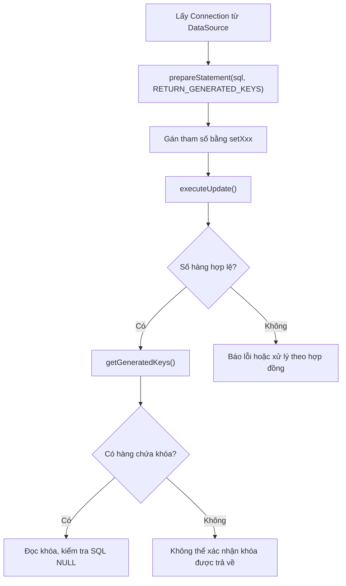

# Phân biệt câu lệnh trả khóa và cú pháp RETURNING riêng của hệ quản trị

## 1. Bối cảnh: một thao tác INSERT, hai cách lấy dữ liệu sau khi ghi

Trong JDBC, ứng dụng Java thường gọi `PreparedStatement.executeUpdate()` để thực hiện `INSERT`, `UPDATE` hoặc `DELETE`. Phương thức này trả về **số hàng bị tác động**, không phải giá trị khóa mới sinh. Tuy nhiên, khi bảng dùng cột định danh tự sinh (`IDENTITY`, sequence hoặc cơ chế tương tự), ứng dụng thường cần biết khóa của hàng vừa thêm để tạo bản ghi liên quan hoặc trả kết quả cho API.

Có hai cơ chế cần phân biệt:

1. **Yêu cầu JDBC trả khóa sinh:** tạo `PreparedStatement` với `Statement.RETURN_GENERATED_KEYS` hoặc danh sách tên cột, chạy câu SQL ghi dữ liệu, rồi lấy `ResultSet` từ `getGeneratedKeys()`. Đây là **API JDBC**, còn SQL và mức hỗ trợ thực tế tùy driver và hệ quản trị cơ sở dữ liệu.
2. **Viết SQL có mệnh đề trả dữ liệu:** sử dụng cú pháp như PostgreSQL `INSERT ... RETURNING ...` hoặc SQL Server `OUTPUT INSERTED...`. Kết quả là các hàng/cột do câu SQL chỉ định. Đây là **tính năng của hệ quản trị**, không phải một mệnh đề SQL chung được mọi cơ sở dữ liệu hay mọi JDBC driver triển khai giống nhau.

Hai cơ chế có thể cùng giải quyết bài toán “lấy ID mới sinh”, nhưng **không hoàn toàn tương đương** về cú pháp, dữ liệu nhận được, khả năng áp dụng cho `UPDATE`/`DELETE`, cách gọi API, mức độ di động và hành vi batch.

Bài học thuộc chương **CRUD và khóa sinh** của module **JDBC**, hướng đến thao tác cơ sở dữ liệu quan hệ bằng driver, `DataSource`, `PreparedStatement`, `ResultSet`, transaction, quản lý kết nối và xử lý lỗi. Sau khi học, bạn cần biết chọn đúng cơ chế và nhận biết những giả định dễ gây lỗi khi triển khai trên driver thực tế.

## 2. Phân biệt ngay từ tên gọi

| Tiêu chí | `getGeneratedKeys()` của JDBC | `RETURNING` và cú pháp tương tự của DB |
|---|---|---|
| Cơ chế | API được định nghĩa bởi JDBC để lấy các giá trị khóa tự sinh mà driver hỗ trợ. | Phần **cú pháp SQL** do hệ quản trị hỗ trợ để trả dữ liệu từ thao tác ghi. |
| Cách yêu cầu | `prepareStatement(sql, Statement.RETURN_GENERATED_KEYS)` hoặc `prepareStatement(sql, String[] columnNames)`. | Ghi trực tiếp `RETURNING ...` hoặc cú pháp tương ứng vào chuỗi SQL. |
| Cách lấy kết quả | Sau khi thực thi, gọi `statement.getGeneratedKeys()`. | Đọc tập kết quả do lệnh SQL trả về, ví dụ `executeQuery()` với PostgreSQL `INSERT ... RETURNING`. |
| Nội dung trả về | Thường là khóa sinh; số cột, nhãn cột và loại khóa phụ thuộc driver/DB. | Do danh sách biểu thức trong SQL quyết định, ví dụ `id, sku, created_at`. |
| `INSERT` một hàng | Trường hợp sử dụng phổ biến nhất. | Hỗ trợ nếu DB có cú pháp tương ứng. |
| `UPDATE`/`DELETE` | Không được hiểu là cách truy xuất tùy ý mọi hàng đã cập nhật hoặc xóa. | Một số DB hỗ trợ trả hàng/giá trị từ `UPDATE` hoặc `DELETE`, với ngữ nghĩa riêng. |
| Tính di động | Code Java theo chuẩn JDBC; driver và DB vẫn cần hỗ trợ. | SQL phải viết theo dialect và khả năng của từng DB, có thể cần đổi cách thực thi. |
| Batch và nhiều hàng | Cần kiểm tra driver có trả đủ khóa và thứ tự ánh xạ hay không. | Phụ thuộc cú pháp multi-row/batch và ngữ nghĩa kết quả từng DB. |

> `RETURN_GENERATED_KEYS` là **hằng số của `java.sql.Statement`**, không phải mệnh đề `RETURNING` trong SQL. Việc dùng API chuẩn không bảo đảm mọi driver luôn trả được khóa hoặc trả theo cùng cấu trúc.

## 3. Ví dụ dữ liệu để thực hành

Giả sử ứng dụng bán hàng tạo sản phẩm trong bảng `products`. Cấu trúc dưới đây là **ví dụ PostgreSQL** để minh họa cả hai cách trong cùng một hệ quản trị; kiểu `TIMESTAMPTZ` và một số chi tiết DDL phải thay đổi khi chuyển sang DB khác:

```sql
CREATE TABLE products (
    id         BIGINT GENERATED ALWAYS AS IDENTITY PRIMARY KEY,
    sku        VARCHAR(64) NOT NULL UNIQUE,
    price      NUMERIC(12, 2) NOT NULL,
    created_at TIMESTAMPTZ NOT NULL DEFAULT CURRENT_TIMESTAMP
);
```

Ứng dụng không truyền `id` khi thêm sản phẩm:

```sql
INSERT INTO products (sku, price)
VALUES (?, ?)
```

Dấu `?` trong `PreparedStatement` thay thế **giá trị** theo đúng thứ tự. `id` do DB sinh; `created_at` dùng giá trị mặc định của DB. Sau khi ghi, ứng dụng có thể cần một trong hai kết quả:

- Chỉ cần `id` để tham chiếu sản phẩm trong một thao tác tiếp theo.
- Cần cả `id`, `sku`, `price`, `created_at` như một DTO phản ánh dữ liệu đã lưu.

Hai nhu cầu này gợi ý hai cách triển khai khác nhau.

## 4. Cách A: API JDBC `RETURN_GENERATED_KEYS` và `getGeneratedKeys()`

### 4.1. Luồng xử lý



**Thứ tự quan trọng:** yêu cầu trả khóa khi **tạo statement**, sau đó thực thi lệnh, rồi mới gọi `getGeneratedKeys()`. Gọi `executeUpdate()` trên câu SQL `INSERT` thông thường chỉ trả số hàng; nó không tự trả `id` dưới dạng giá trị trả về của phương thức.

### 4.2. Code Java hoàn chỉnh: thêm sản phẩm và lấy khóa

Ví dụ này dùng Java 17+, `javax.sql.DataSource`, `PreparedStatement` và `try-with-resources`. Kiểu `BigDecimal` dùng cho số tiền để tránh sai số do `double`.

```java
import javax.sql.DataSource;
import java.math.BigDecimal;
import java.sql.Connection;
import java.sql.PreparedStatement;
import java.sql.ResultSet;
import java.sql.SQLException;
import java.sql.Statement;
import java.sql.Timestamp;
import java.time.Instant;

public final class ProductWriter {
    private final DataSource dataSource;

    public ProductWriter(DataSource dataSource) {
        this.dataSource = dataSource;
    }

    public record CreatedProduct(
            long id,
            String sku,
            BigDecimal price,
            Instant createdAt
    ) {}

    // API JDBC: chỉ yêu cầu khóa mà driver coi là generated key.
    public long insertUsingGeneratedKeys(
            String sku,
            BigDecimal price
    ) throws SQLException {
        String sql = """
                INSERT INTO products (sku, price)
                VALUES (?, ?)
                """;

        try (Connection connection = dataSource.getConnection();
             PreparedStatement statement = connection.prepareStatement(
                     sql, Statement.RETURN_GENERATED_KEYS)) {
            statement.setString(1, sku);
            statement.setBigDecimal(2, price);

            int affected = statement.executeUpdate();
            if (affected != 1) {
                throw new SQLException(
                        "INSERT phải ảnh hưởng đúng 1 hàng, thực tế: " + affected);
            }

            try (ResultSet keys = statement.getGeneratedKeys()) {
                if (!keys.next()) {
                    throw new SQLException("Driver không trả khóa sinh");
                }

                long generatedId = keys.getLong(1);
                if (keys.wasNull()) {
                    throw new SQLException("Khóa sinh trả về là NULL");
                }
                if (keys.next()) {
                    throw new SQLException("Có hơn một hàng khóa sinh");
                }
                return generatedId;
            }
        }
    }

    // SQL PostgreSQL: yêu cầu trả nhiều cột qua RETURNING.
    public CreatedProduct insertUsingPostgresReturning(
            String sku,
            BigDecimal price
    ) throws SQLException {
        String sql = """
                INSERT INTO products (sku, price)
                VALUES (?, ?)
                RETURNING id, sku, price, created_at
                """;

        try (Connection connection = dataSource.getConnection();
             PreparedStatement statement = connection.prepareStatement(sql)) {
            statement.setString(1, sku);
            statement.setBigDecimal(2, price);

            try (ResultSet rows = statement.executeQuery()) {
                if (!rows.next()) {
                    throw new SQLException(
                            "INSERT ... RETURNING không trả hàng");
                }

                long id = rows.getLong("id");
                if (rows.wasNull()) {
                    throw new SQLException("id trả về là NULL");
                }

                Timestamp created = rows.getTimestamp("created_at");
                if (created == null) {
                    throw new SQLException("created_at trả về là NULL");
                }

                CreatedProduct product = new CreatedProduct(
                        id,
                        rows.getString("sku"),
                        rows.getBigDecimal("price"),
                        created.toInstant()
                );

                if (rows.next()) {
                    throw new SQLException(
                            "INSERT một sản phẩm nhưng trả nhiều hàng");
                }
                return product;
            }
        }
    }
}
```

Hai phương thức được đặt cạnh nhau để minh họa sự khác biệt. Phương thức thứ nhất có chuỗi SQL `INSERT` không kèm `RETURNING`, kích hoạt cơ chế trả khóa qua JDBC và chỉ đọc một giá trị ở cột đầu tiên của kết quả khóa. Phương thức thứ hai gắn `RETURNING` trực tiếp vào SQL PostgreSQL, đọc kết quả do SQL quyết định và không cần gọi `getGeneratedKeys()`.

Mỗi phương thức tự lấy/đóng kết nối. Nếu hai thao tác phải cùng một transaction, nên để tầng điều phối truyền **cùng một `Connection`** vào các phương thức nội bộ để quyết định `commit`/`rollback` tập trung; mở một kết nối mới cho mỗi bước có thể phá vỡ ranh giới transaction mong muốn.

### 4.3. Yêu cầu tên cột cụ thể

Ngoài `Statement.RETURN_GENERATED_KEYS`, JDBC có overload cho phép đề nghị trả khóa theo **tên cột**:

```java
String sql = "INSERT INTO products (sku, price) VALUES (?, ?)";
try (PreparedStatement ps = connection.prepareStatement(
        sql, new String[] {"id"})) {
    ps.setString(1, sku);
    ps.setBigDecimal(2, price);
    ps.executeUpdate();

    try (ResultSet keys = ps.getGeneratedKeys()) {
        // Đọc và kiểm tra khóa tương tự ví dụ phía trên.
    }
}
```

Trong đoạn trích, `connection`, `sku`, `price` là các biến đã khai báo và được quản lý ở tầng gọi. Việc cung cấp tên cột giúp nêu rõ khóa mong muốn, nhưng **không bảo đảm mọi driver nhận tên cột, trả đúng cột hay cho phép lấy mọi cột tùy ý**. Phải thử với driver/version/DB mục tiêu, đọc tài liệu và kiểm tra kết quả thực tế.

Không nên dựa vào tên nhãn của cột trong `getGeneratedKeys()` nếu driver không cam kết nhãn đó. Với trường hợp chỉ có một khóa đơn `BIGINT`, `getLong(1)` phù hợp sau khi đã xác nhận cấu trúc trả về trong môi trường sử dụng.

### 4.4. Driver có hỗ trợ hay không?

JDBC cung cấp:

```java
boolean supported =
        connection.getMetaData().supportsGetGeneratedKeys();
```

Giá trị này là dấu hiệu driver báo có hỗ trợ `getGeneratedKeys()`. Tuy nhiên, nó **không chứng minh** rằng mọi dạng `INSERT`, mọi kiểu cột, batch hay cách yêu cầu tên cột đều sẽ hoạt động như mong đợi. Một số môi trường có thể ném `SQLFeatureNotSupportedException` hoặc trả tập khóa rỗng trong tình huống cụ thể.

Khi không có khóa được trả về, không nên mặc định `0` hoặc tự đoán khóa bằng cách truy vấn `MAX(id)`: truy vấn `MAX(id)` có thể nhìn thấy bản ghi của giao dịch khác và không xác định đúng hàng vừa tạo.

## 5. Cách B: SQL `RETURNING` và các cú pháp theo hệ quản trị

### 5.1. PostgreSQL: `INSERT ... RETURNING`

PostgreSQL cho phép chọn các cột/biểu thức trả về từ hàng bị tác động:

```sql
INSERT INTO products (sku, price)
VALUES (?, ?)
RETURNING id, sku, price, created_at;
```

Với driver PostgreSQL JDBC, câu lệnh trên trả tập kết quả; ví dụ Java dùng `executeQuery()` rồi đọc `ResultSet`. `RETURNING` có thể trả nhiều cột hoặc biểu thức, kể cả giá trị mặc định từ DB, nên tiện khi API cần trả DTO đã lưu.

Có thể dùng `RETURNING *` để lấy nhiều cột, nhưng trong ứng dụng thực tế nên liệt kê trường cần dùng để giữ hợp đồng dữ liệu ổn định và tránh vô tình trả các cột nhạy cảm khi schema mở rộng.

### 5.2. PostgreSQL: `UPDATE` và `DELETE` cũng có thể trả hàng

```sql
-- Trả thông tin mới của các hàng được cập nhật.
UPDATE products
SET price = ?
WHERE id = ?
RETURNING id, sku, price;

-- Trả thông tin hàng bị xóa.
DELETE FROM products
WHERE id = ?
RETURNING id, sku;
```

Điểm khác biệt: `RETURNING` không chỉ dành cho khóa vừa sinh. Nó cho phép câu lệnh ghi dữ liệu trả về một tập hàng, vì vậy ứng dụng có thể biết giá trị mới sau cập nhật hoặc định danh của hàng vừa xóa mà không thực hiện thêm một `SELECT` độc lập.

**Trường hợp không khớp hàng:** `UPDATE ... WHERE id = ? RETURNING ...` hoặc `DELETE ... WHERE id = ? RETURNING ...` có thể trả **0 hàng**. Đây thường là kết quả hợp lệ, cần phân biệt với lỗi SQL. Phương thức repository có thể trả `Optional.empty()` cho “không tìm thấy bản ghi”, hoặc kiểm tra và ném lỗi theo hợp đồng API.

**`INSERT ... ON CONFLICT DO NOTHING RETURNING id`** của PostgreSQL cũng có thể trả 0 hàng khi xảy ra xung đột và không có bản ghi nào được thêm. Khi dùng `ON CONFLICT DO UPDATE`, kết quả trả về có thể là hàng được thêm **hoặc được cập nhật**; đừng suy ra “có hàng trả về” đồng nghĩa với “chắc chắn mới INSERT”.

### 5.3. Các hệ quản trị có cách viết khác

| Hệ quản trị | Ví dụ/khả năng | Ghi chú |
|---|---|---|
| **PostgreSQL** | `INSERT ... RETURNING id`; `UPDATE ... RETURNING ...`; `DELETE ... RETURNING ...` | Dữ liệu được trả qua tập kết quả theo cú pháp PostgreSQL. |
| **Microsoft SQL Server** | `INSERT INTO ... OUTPUT INSERTED.id VALUES (...)` | Sử dụng mệnh đề `OUTPUT`; có `INSERTED`/`DELETED` theo ngữ nghĩa lệnh. Cách xử lý kết quả và trigger cần xem theo driver/SQL Server. |
| **Oracle Database** | `INSERT ... RETURNING id INTO :bind` | Cú pháp `RETURNING ... INTO` và bind output khác với PostgreSQL; có thể cần API/kiểu statement phù hợp của driver hoặc PL/SQL. |
| **SQLite** | `INSERT ... RETURNING id` ở các phiên bản SQLite hỗ trợ tính năng | Cần kiểm tra phiên bản engine và khả năng xử lý result set của JDBC driver đang dùng. |
| **MySQL** | Thường dùng cơ chế khóa sinh của JDBC khi lấy ID `AUTO_INCREMENT` | Không nên sao chép nguyên cú pháp PostgreSQL `RETURNING` sang MySQL rồi giả định dùng được. |

Các hàng trên chỉ là định hướng chọn chiến lược, **không phải cam kết hỗ trợ cho mọi phiên bản DB hoặc driver JDBC**. Ngay cả cùng một chức năng “trả ID”, vị trí đặt mệnh đề, cú pháp `INSERT`, việc xử lý trigger và loại kết quả cũng có thể khác nhau. Hãy xác định chính xác hệ quản trị và phiên bản trong dự án trước khi triển khai.

Ví dụ minh họa cho SQL Server (khác cú pháp PostgreSQL):

```sql
INSERT INTO products (sku, price)
OUTPUT INSERTED.id
VALUES (?, ?);
```

Để tương thích với các câu lệnh có thể trả tập kết quả hoặc số hàng cập nhật theo cách riêng của driver, JDBC còn có `PreparedStatement.execute()`, `getResultSet()`, `getUpdateCount()` và `getMoreResults()`. Không nên mặc định mọi cú pháp “trả dữ liệu” ở mọi DB đều có thể gọi `executeQuery()` giống ví dụ PostgreSQL.

```java
boolean hasResultSet = statement.execute();
if (hasResultSet) {
    try (ResultSet rs = statement.getResultSet()) {
        while (rs.next()) {
            // Đọc những cột mà SQL thực sự trả về.
        }
    }
} else {
    int affected = statement.getUpdateCount();
    // Kiểm tra số hàng bị tác động nếu đó là hợp đồng của lệnh.
}
```

Đây là khung minh họa cho việc kiểm tra **kết quả đầu tiên** sau `execute()`; câu lệnh hoặc driver có nhiều kết quả (bao gồm update count và result set) còn cần xử lý tuần tự bằng `getMoreResults()` và `getUpdateCount()`. Trong triển khai cụ thể, chọn API theo tài liệu driver và loại câu lệnh thực thi.

## 6. Chọn `executeUpdate()`, `executeQuery()` hay `execute()`?

| Cách thực thi | Mục đích sử dụng điển hình | Kết quả trực tiếp |
|---|---|---|
| `executeUpdate()` với `INSERT` thông thường | CRUD cần biết bao nhiêu hàng được thêm | `int` là số hàng bị tác động; sau đó có thể dùng `getGeneratedKeys()` nếu đã yêu cầu và driver hỗ trợ |
| `executeQuery()` với PostgreSQL `INSERT ... RETURNING ...` | Lệnh có tập hàng kết quả theo dialect PostgreSQL | `ResultSet` chứa đúng các cột/biểu thức được chọn trong `RETURNING` |
| `execute()` với cú pháp phức tạp hoặc kết quả không chắc chắn | Câu lệnh có thể sinh một hoặc nhiều loại kết quả | `boolean` cho biết **kết quả đầu tiên** có phải `ResultSet` hay không; cần các getter tiếp theo |

Không nên gọi `getGeneratedKeys()` chỉ vì câu SQL có `RETURNING`, cũng không nên kỳ vọng `executeUpdate()` trực tiếp trả `id`. Đây là hai hợp đồng API khác nhau.

Một lựa chọn hay gặp:

```text
Chỉ cần ID vừa sinh, muốn ít phụ thuộc dialect SQL
    -> JDBC RETURN_GENERATED_KEYS + getGeneratedKeys
       (nếu driver/DB hỗ trợ trường hợp đó)

Cần nhiều giá trị DB tính ra sau INSERT/UPDATE/DELETE
    -> SQL RETURNING/OUTPUT/tính năng tương đương
       theo đúng DB và driver

Cần bảo đảm chạy với nhiều hệ quản trị
    -> Đóng gói khác biệt vào repository/adapter theo dialect,
       thử thực tế trên từng tổ hợp DB + driver
```

## 7. Transaction: khóa sinh không thay thế `commit`

Lấy được khóa hoặc hàng từ `RETURNING` **không có nghĩa giao dịch đã được commit**. Nếu `autoCommit = false`, kết quả có thể đọc ngay trong giao dịch hiện tại nhưng lệnh ghi vẫn có thể bị `rollback`.

Ví dụ tình huống tạo sản phẩm và nhập dòng tồn kho cần thực hiện cùng nhau:

1. Lấy một `Connection` từ `DataSource`.
2. Bắt đầu transaction, thường bằng `connection.setAutoCommit(false)` với cấu hình phù hợp.
3. Chạy `INSERT products` và lấy khóa bằng một trong hai cơ chế.
4. Dùng khóa đó trong `INSERT inventory` trên **chính connection của transaction**.
5. Nếu cả hai thành công, `commit`; nếu lỗi, `rollback`, đồng thời giữ nguyên nguyên nhân `SQLException`.
6. Đóng tài nguyên và khôi phục trạng thái connection theo chính sách quản lý connection/pool.

Không nên thực hiện bước 3 và bước 4 trên hai kết nối được lấy độc lập nếu nghiệp vụ cần tính nguyên tử giữa hai thao tác. Các driver hoặc DB dùng sequence/identity có thể **không tái sử dụng** giá trị ID sau rollback; vì vậy khoảng trống trong chuỗi ID thường không chứng tỏ thiếu bản ghi.

Nếu một ứng dụng thay thế `getGeneratedKeys()` bằng truy vấn riêng như `SELECT MAX(id)`, ranh giới transaction cũng **không làm truy vấn đó trở thành cách xác định khóa an toàn** trong môi trường đồng thời. Lấy khóa từ chính kết quả của lệnh ghi là lựa chọn rõ ràng hơn.

## 8. Batch, INSERT nhiều hàng và tính đúng đắn của ánh xạ

Một trường hợp dễ gây nhầm là thêm nhiều hàng:

```java
PreparedStatement ps = connection.prepareStatement(
        "INSERT INTO products (sku, price) VALUES (?, ?)",
        Statement.RETURN_GENERATED_KEYS);

for (ProductInput item : items) {
    ps.setString(1, item.sku());
    ps.setBigDecimal(2, item.price());
    ps.addBatch();
}

int[] counts = ps.executeBatch();
try (ResultSet keys = ps.getGeneratedKeys()) {
    // Số khóa, thứ tự khóa và khả năng liên hệ với từng input
    // phải được xác minh cho driver/DB và dạng SQL thực tế.
}
```

Đây là trích đoạn minh họa, trong đó `connection`, `items` và kiểu `ProductInput` do ứng dụng cung cấp. Trong code thật cần đóng `PreparedStatement` bằng `try-with-resources`, kiểm tra `counts` và bắt `BatchUpdateException` nếu cần xử lý lỗi theo từng lệnh.

**Điểm mấu chốt:** JDBC hỗ trợ batch qua `addBatch()`/`executeBatch()`, nhưng không nên suy luận rằng `getGeneratedKeys()` sẽ **luôn** có đúng N hàng theo đúng thứ tự của N input. Khả năng trả khóa cho batch, số cột, thứ tự, trường hợp một số lệnh lỗi và cách tối ưu hóa/rewrite batch phụ thuộc driver, DB và cấu hình.

Với SQL `INSERT ... RETURNING` nhiều giá trị, một statement có thể trả nhiều hàng, nhưng cũng không nên gắn từng hàng trả về với input chỉ bằng vị trí nếu hợp đồng DB không cam kết thứ tự. Nếu cần ánh xạ chắc chắn từng kết quả với từng input, hãy thiết kế khóa nghiệp vụ duy nhất như `sku` hoặc một mã tương quan được phép xuất hiện trong kết quả, đồng thời kiểm tra tính duy nhất và tính nhất quán.

Đối với batch có thể ghi một phần trước khi lỗi, phải đọc `BatchUpdateException.getUpdateCounts()` theo hợp đồng driver và có chiến lược transaction thích hợp. Một danh sách ID được trả ra không thay thế được việc kiểm tra thành công hay thất bại của cả batch.

## 9. Lỗi thường gặp và cách phòng tránh

### 9.1. Nhầm số hàng bị tác động với khóa sinh

```java
int value = statement.executeUpdate();
// value thường là số hàng bị tác động, không phải product.id.
```

Với một câu `INSERT` thêm đúng một hàng, `value` thường là `1`. Nếu ID do DB sinh là `4832`, thì `1` **không** phải khóa sản phẩm. Muốn lấy khóa, phải dùng `getGeneratedKeys()` sau khi yêu cầu, hoặc SQL trả hàng theo dialect.

### 9.2. Không yêu cầu driver trả khóa từ đầu

```java
PreparedStatement ps = connection.prepareStatement(
        "INSERT INTO products (sku, price) VALUES (?, ?)");
```

Đây là `PreparedStatement` hợp lệ để ghi dữ liệu; nhưng với code phụ thuộc `getGeneratedKeys()`, hãy yêu cầu trả khóa ở overload khi tạo statement, rồi kiểm tra trường hợp driver không hỗ trợ hoặc trả dữ liệu không như kỳ vọng.

### 9.3. Giả định mọi DB đều hiểu `RETURNING`

Nếu ứng dụng xây SQL PostgreSQL nhưng triển khai với MySQL, Oracle hoặc SQL Server, câu SQL có thể bị từ chối hoặc mang ngữ nghĩa khác. Nên tách chiến lược lấy kết quả sau ghi thành các thành phần riêng nếu hệ thống cần chạy nhiều DB, ví dụ `PostgresProductWriter` và một adapter sử dụng generated keys khi phù hợp.

### 9.4. Giả định `RETURNING` chỉ sinh một hàng

`UPDATE ... RETURNING` hoặc `DELETE ... RETURNING` có thể trả **nhiều hàng** khi điều kiện `WHERE` khớp nhiều bản ghi. `INSERT ... RETURNING` nhiều giá trị cũng có thể trả nhiều hàng. Do đó, mã đọc `rs.next()` một lần chỉ phù hợp với phương thức có hợp đồng **đúng một hàng**; nếu không phải như vậy, phải xử lý `List<T>`, streaming hoặc giới hạn phạm vi SQL.

### 9.5. Coi giá trị `0` từ `getLong` là “không có khóa”

`ResultSet.getLong(1)` trả `0` khi SQL là `NULL`, nhưng `0` có thể cũng là dữ liệu hợp lệ nếu schema cho phép. Kiểm tra `rs.wasNull()` ngay sau khi đọc; với khóa `BIGINT` không cho phép NULL, nên báo lỗi khi driver trả NULL thay vì chấp nhận giá trị mặc định.

### 9.6. Lấy khóa bằng `MAX(id)` hoặc không giữ đúng connection

`SELECT MAX(id)` không cho biết khóa của chính câu `INSERT` trong môi trường nhiều người dùng và transaction đồng thời. Các hàm/biến “last inserted id” riêng của DB cũng thường phụ thuộc phiên kết nối, và không có cùng hành vi trên mọi hệ quản trị. Nếu phải dùng phương án dự phòng theo DB, thực hiện trên đúng connection và kiểm thử kỹ dưới tải đồng thời.

### 9.7. Dùng `RETURNING *` khi API chỉ cần ID

`RETURNING *` khiến hợp đồng giữa SQL và ứng dụng thay đổi khi bảng có thêm cột, tăng dữ liệu truyền và có thể đưa trường nhạy cảm vào kết quả. Ưu tiên danh sách cột tối thiểu đúng nhu cầu.

### 9.8. Trộn nối chuỗi SQL với giá trị người dùng

```java
// Sai: không nối dữ liệu người dùng trực tiếp vào SQL.
String sql = "INSERT INTO products (sku) VALUES ('" + sku + "')";
```

Dùng tham số `?` với `setString`, `setBigDecimal`, v.v. trong **cả hai cách**. `RETURNING` hay `getGeneratedKeys()` đều không thay thế cơ chế tham số hóa. Tên bảng, tên cột và danh sách biểu thức SQL là **cấu trúc SQL**, không thể thay bằng placeholder giá trị; nếu được chọn động, phải giới hạn bằng allowlist đáng tin cậy.

## 10. Bài tập kiểm chứng trên DB và driver thật

Có thể viết hai phương thức repository giống phần 4, chuẩn bị dữ liệu và kiểm tra:

| Tình huống | Điều cần quan sát |
|---|---|
| `INSERT` một sản phẩm bằng JDBC generated keys | `executeUpdate() == 1`, `getGeneratedKeys()` có khóa phù hợp, tra lại bằng khóa đó ra đúng `sku`. |
| `INSERT ... RETURNING` trên PostgreSQL | `ResultSet` có `id` và `created_at` do DB sinh, `sku` và `price` phù hợp với dữ liệu đã lưu. |
| `UPDATE ... RETURNING` với ID không tồn tại | Tập kết quả rỗng; ứng dụng phản ánh “không tìm thấy” đúng hợp đồng. |
| `DELETE ... RETURNING` với ID tồn tại | Trả dữ liệu của hàng đã xóa; truy vấn sau đó không còn thấy hàng trong transaction phù hợp. |
| `INSERT ... ON CONFLICT DO NOTHING RETURNING id` | Không có kết quả khi xung đột; phân biệt với lỗi do driver không hỗ trợ. |
| Thêm nhiều hàng bằng batch | Ghi nhận số khóa, thứ tự, kiểu khóa, update counts và hành vi khi một lệnh lỗi. |
| Rollback sau khi đã đọc khóa | Không còn bản ghi vừa ghi sau rollback; không giả định ID sẽ được tái sử dụng. |
| Thử driver/DB khác | Xác nhận hỗ trợ `getGeneratedKeys()` và mức tương thích của dialect `RETURNING`/cơ chế tương đương. |

Khi đánh giá hiệu năng, nên so sánh **độ trễ end-to-end** (số lượt đi/về DB, thời gian thực thi câu lệnh, lượng dữ liệu trả, chi phí xử lý driver), thay vì mặc định cách nào nhanh hơn. `RETURNING` có thể giảm nhu cầu truy vấn `SELECT` tiếp theo khi cần nhiều trường; `getGeneratedKeys()` lại phù hợp với thao tác chỉ cần ID và có khả năng giảm mã SQL phụ thuộc DB. Kết quả đo còn chịu ảnh hưởng của mạng, transaction, database, driver và cách chạy batch.

## 11. Nguyên tắc lựa chọn

- **Chỉ cần khóa sinh từ một câu `INSERT`:** ưu tiên xem xét `Statement.RETURN_GENERATED_KEYS` và `getGeneratedKeys()`, rồi xác nhận hỗ trợ của driver/DB mục tiêu.
- **Cần hàng đã ghi hoặc nhiều giá trị sau `INSERT`/`UPDATE`/`DELETE`:** dùng `RETURNING`, `OUTPUT` hoặc cơ chế tương đương theo DB, với cách thực thi JDBC phù hợp.
- **Có nhiều DB mục tiêu:** tập trung khác biệt SQL vào adapter/repository và có kiểm thử tích hợp riêng cho từng DB/driver.
- **Có batch, nhiều hàng hoặc transaction:** kiểm tra số hàng, khóa và thứ tự kết quả; không coi việc lấy được ID là bằng chứng giao dịch đã commit.

Câu hỏi quyết định không chỉ là “lấy ID như thế nào?” mà còn là **cần lấy những cột nào, thao tác đã ảnh hưởng bao nhiêu hàng, driver hỗ trợ gì và dữ liệu có đang ở trong một transaction chưa commit hay không?** Khi tách bạch những yếu tố này, phần CRUD bằng JDBC sẽ an toàn và dễ chuyển đổi giữa các hệ quản trị hơn.
