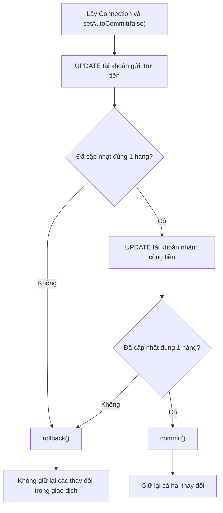
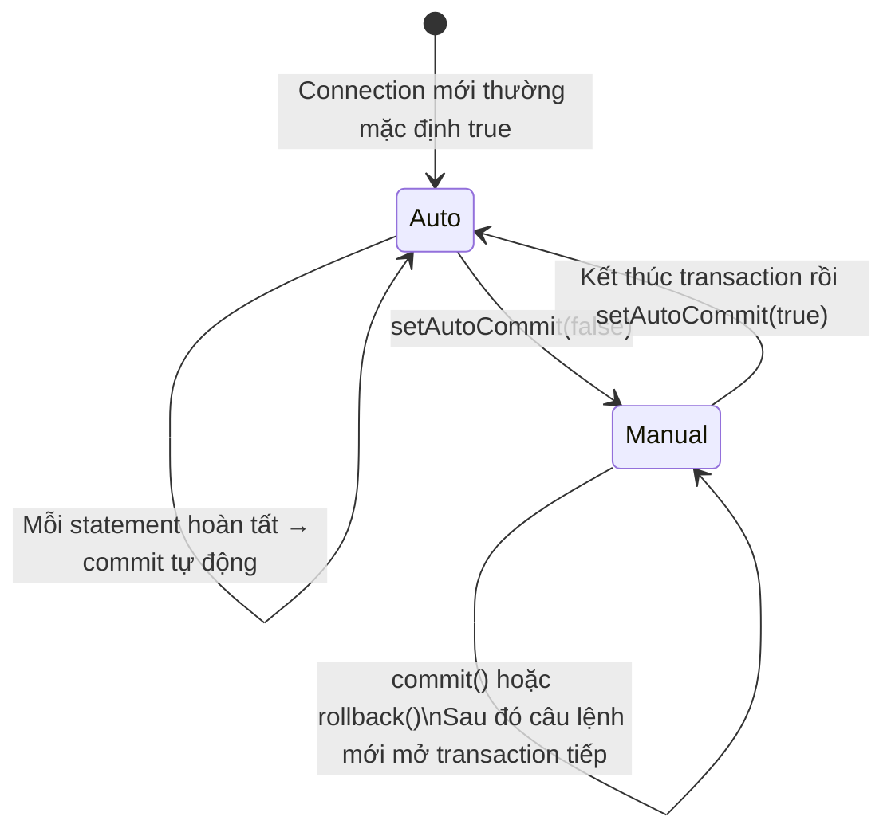

# Phân biệt `autoCommit` và giao dịch do ứng dụng điều khiển trong JDBC

Trong chương **Giao dịch cơ bản**, một trong những quyết định đầu tiên khi làm việc với **JDBC** là: **mỗi câu lệnh SQL có được xác nhận tự động hay ứng dụng sẽ quyết định lúc nào xác nhận và hủy cả nhóm thao tác?**

JDBC cho phép ứng dụng Java truy cập cơ sở dữ liệu quan hệ qua `Driver`, `DataSource`, `Connection`, `PreparedStatement` và `ResultSet`. Khi thực hiện CRUD, SQL tham số hóa, batching hoặc xử lý lỗi, việc hiểu chính xác `autoCommit` sẽ quyết định liệu các thay đổi dữ liệu có nhất quán khi một bước thất bại hay không.

Bài này phân biệt hai chế độ, minh họa giao dịch chuyển tiền, hướng dẫn quản lý kết nối và chỉ ra các lỗi thường gặp ở ranh giới transaction.

## 1. `autoCommit` thực sự có nghĩa là gì?

Mỗi đối tượng `java.sql.Connection` có thuộc tính **auto-commit mode**, đọc bằng `getAutoCommit()` và thay đổi bằng `setAutoCommit(boolean)`.

- **`autoCommit = true`**: cơ sở dữ liệu tự `COMMIT` giao dịch của từng câu lệnh khi câu lệnh **hoàn tất** theo quy tắc JDBC. Ứng dụng không gọi `commit()` cho từng câu lệnh.
- **`autoCommit = false`**: các câu lệnh trên **cùng một `Connection`** tham gia giao dịch do ứng dụng quản lý. Ứng dụng quyết định `commit()` để giữ thay đổi hoặc `rollback()` để hủy thay đổi của giao dịch hiện tại.

Kết nối JDBC mới theo mặc định ở chế độ `autoCommit = true`. Tuy nhiên, **`DataSource` và connection pool có thể cấu hình hoặc khôi phục trạng thái khác**. Khi xây dựng transaction boundary, hãy đọc `getAutoCommit()` thay vì suy đoán.

### “Hoàn tất câu lệnh” không luôn đồng nghĩa “vừa gọi `execute()`”

Với lệnh `INSERT`, `UPDATE` hoặc `DELETE` đơn giản, thao tác thường hoàn tất khi kết quả thực thi đã được nhận. Với truy vấn trả `ResultSet`, thời điểm hoàn tất có thể liên quan tới việc đọc hết/đóng các kết quả; câu lệnh có nhiều kết quả cũng phải được xử lý tương ứng. Vì vậy, diễn đạt chính xác là **auto-commit khi câu lệnh hoàn tất theo JDBC**, không nhất thiết ngay lập tức khi gọi một phương thức `execute...`.

Dù tự động xác nhận từng câu lệnh, `autoCommit = true` **không có nghĩa cơ sở dữ liệu bỏ qua transaction**. Một lệnh `UPDATE` đơn lẻ vẫn được thực thi dưới cơ chế transaction và bảo đảm nguyên tử theo khả năng của hệ quản trị CSDL/engine giao dịch.

## 2. Bảng so sánh nhanh

| Khía cạnh | `autoCommit = true` | `autoCommit = false` |
| --- | --- | --- |
| Ai quyết định `COMMIT`? | JDBC/driver tự xác nhận khi từng câu lệnh hoàn tất | Ứng dụng gọi `Connection.commit()` |
| Khi một câu lệnh sau thất bại | Những câu lệnh trước đã commit không tự bị hủy | Có thể `rollback()` để hủy các thay đổi chưa commit của cả giao dịch |
| Phạm vi nguyên tử thông thường | Mỗi câu lệnh hoàn tất | Nhóm nhiều câu lệnh trên cùng `Connection` |
| Số lần ứng dụng gọi `commit()`/`rollback()` | Không cần và không hợp lệ khi vẫn ở auto-commit | Phải quản lý khi thành công/thất bại |
| Phù hợp | Một CRUD độc lập, không cần gắn với bước khác | Chuyển tiền, tạo đơn hàng kèm chi tiết, thay đổi nhiều bảng liên quan |
| Độ phức tạp | Dễ sử dụng | Phải bảo đảm mọi nhánh đều commit/rollback và quản lý kết nối |
| Thời gian giữ transaction | Thường ngắn cho câu lệnh đơn | Phụ thuộc ứng dụng; kéo dài quá lâu có thể tăng tranh chấp khóa/tài nguyên |

**Ví dụ chọn chế độ:**

- Đổi tên hiển thị bằng một câu `UPDATE users SET display_name = ? WHERE id = ?`: thường đủ dùng auto-commit.
- Tạo một đơn hàng **và** trừ tồn kho **và** ghi các dòng chi tiết: nếu nghiệp vụ yêu cầu *hoặc tất cả thành công, hoặc không thay đổi gì*, cần một transaction do ứng dụng điều khiển.

Lưu ý: nếu có thể biểu diễn toàn bộ thay đổi cần thiết bằng **một câu SQL nguyên tử**, auto-commit vẫn có thể phù hợp. Đừng tạo transaction nhiều câu chỉ vì thao tác mang ý nghĩa nghiệp vụ phức tạp.

## 3. Tình huống: chuyển tiền giữa hai tài khoản

Giả sử bảng có cấu trúc minh họa:

```sql
CREATE TABLE accounts (
    id BIGINT PRIMARY KEY,
    balance_cents BIGINT NOT NULL CHECK (balance_cents >= 0)
);
```

Tài khoản `101` có `500_00` cent và tài khoản `202` có `100_00` cent. Cần chuyển `150_00` cent từ `101` sang `202`, gồm hai thay đổi:

```sql
-- Trừ tiền, từ chối nếu số dư không đủ.
UPDATE accounts
SET balance_cents = balance_cents - ?
WHERE id = ? AND balance_cents >= ?;

-- Cộng tiền cho tài khoản nhận.
UPDATE accounts
SET balance_cents = balance_cents + ?
WHERE id = ?;
```

`?` là placeholder của `PreparedStatement`; giá trị số tiền và mã tài khoản được truyền riêng qua `setLong(...)`. Không ghép trực tiếp dữ liệu người dùng vào chuỗi SQL.

### 3.1. Nếu dùng `autoCommit = true`

```text
UPDATE tài khoản 101: -150_00
    └─ Thành công → COMMIT tự động

UPDATE tài khoản 202: +150_00
    └─ Thất bại (ví dụ: tài khoản đích không tồn tại)

Kết quả: tiền đã bị trừ, không có khoản cộng tương ứng.
```

Gọi `rollback()` sau đó **không thể đảo ngược câu UPDATE thứ nhất đã được commit**. Khi phương thức `executeUpdate()` của lần thứ hai trả `0`, đây có thể là một lỗi nghiệp vụ dù JDBC không ném `SQLException`. Ứng dụng phải kiểm tra số hàng chịu tác động.

### 3.2. Nếu dùng `autoCommit = false`



Cả hai lệnh thực thi trên **cùng một `Connection`** trước khi gọi `commit()`. Nếu một bước lỗi, `rollback()` có thể hủy các thay đổi chưa được commit, với điều kiện hệ quản trị CSDL và các bảng liên quan hỗ trợ transaction.

Ở chế độ manual commit, JDBC **không yêu cầu phải gửi câu SQL `BEGIN` riêng** cho trường hợp thông thường: giao dịch được bắt đầu ngầm khi câu lệnh cần transaction được thực thi. Sau `commit()` hoặc `rollback()`, các lệnh tiếp theo trên kết nối vẫn ở `autoCommit = false` sẽ thuộc giao dịch mới.

## 4. API JDBC liên quan

| API | Ý nghĩa | Điều cần nhớ |
| --- | --- | --- |
| `connection.getAutoCommit()` | Xem trạng thái hiện tại | Hữu ích với connection pool |
| `connection.setAutoCommit(false)` | Chuyển sang tự quản lý transaction | Thực hiện tại ranh giới nghiệp vụ, trước các SQL liên quan |
| `connection.commit()` | Xác nhận giao dịch hiện tại | Chỉ dùng khi auto-commit đang tắt |
| `connection.rollback()` | Hủy các thay đổi chưa commit của giao dịch hiện tại | Cần gọi khi một bước thất bại |
| `connection.setAutoCommit(true)` | Bật lại auto-commit | **Nếu đang có giao dịch, việc đổi chế độ có thể commit giao dịch đó** |
| `connection.setSavepoint()` | Đánh dấu điểm có thể rollback một phần | Chỉ dùng trong manual transaction nếu driver/CSDL hỗ trợ |
| `connection.setTransactionIsolation(...)` | Đặt mức cô lập | Quyết định khả năng nhìn thấy thay đổi đồng thời, là vấn đề khác với `autoCommit` |

Trong JDBC, gọi `commit()` hoặc `rollback()` khi auto-commit đang bật là sai cách sử dụng API và thường dẫn đến `SQLException`.

**Cảnh báo quan trọng:** Theo hợp đồng `Connection.setAutoCommit`, **nếu đổi chế độ auto-commit khi một giao dịch đang diễn ra, giao dịch có thể được commit**. Đặc biệt, gọi `setAutoCommit(true)` để “dọn trạng thái” **trước khi rollback** có nguy cơ xác nhận dữ liệu mà ứng dụng định hủy. Phải kết thúc giao dịch bằng `commit()` hoặc `rollback()` trước khi khôi phục trạng thái.

## 5. Java/JDBC: một cập nhật độc lập bằng auto-commit

Đây là trường hợp mỗi yêu cầu chỉ sửa một thuộc tính độc lập:

```java
import javax.sql.DataSource;
import java.sql.Connection;
import java.sql.PreparedStatement;
import java.sql.SQLException;

public class UserRepository {
    private final DataSource dataSource;

    public UserRepository(DataSource dataSource) {
        this.dataSource = dataSource;
    }

    public boolean rename(long userId, String newName) throws SQLException {
        String sql = """
            UPDATE users SET display_name = ? WHERE id = ?
            """;

        try (Connection conn = dataSource.getConnection()) {
            // Ví dụ này mong đợi pool cung cấp autoCommit = true.
            // Không tự ý setAutoCommit(true) giữa giao dịch của người khác.
            if (!conn.getAutoCommit()) {
                throw new IllegalStateException(
                    "Kết nối không ở chế độ auto-commit như cấu hình dự kiến"
                );
            }

            try (PreparedStatement ps = conn.prepareStatement(sql)) {
                ps.setString(1, newName);
                ps.setLong(2, userId);
                return ps.executeUpdate() == 1;
            }
        }
    }
}
```

Trong chế độ auto-commit, khi lệnh `UPDATE` hoàn tất thành công, thay đổi được commit tự động. `try-with-resources` đóng `PreparedStatement` và trả/đóng `Connection`, nhưng chính cơ chế auto-commit xác nhận giao dịch, không phải việc đóng kết nối.

Ở đây, nếu câu `UPDATE` ảnh hưởng `0` hàng thì thường có nghĩa không tồn tại `userId` phù hợp. Với lệnh có điều kiện phiên bản như `WHERE id = ? AND version = ?`, `0` hàng cũng có thể báo xung đột phiên bản.

## 6. Java/JDBC: một transaction do ứng dụng điều khiển

Ví dụ dưới đây minh họa một **transaction boundary** ở tầng service. Cả hai `PreparedStatement` được tạo từ cùng một kết nối lấy từ `DataSource` và chỉ commit khi cả hai cập nhật đúng một hàng.

```java
import javax.sql.DataSource;
import java.sql.Connection;
import java.sql.PreparedStatement;
import java.sql.SQLException;
import java.util.Objects;

public final class TransferService {
    private final DataSource dataSource;

    public TransferService(DataSource dataSource) {
        this.dataSource = Objects.requireNonNull(dataSource);
    }

    public void transfer(
        long sourceId, long targetId, long amountCents
    ) throws SQLException {
        if (sourceId == targetId || amountCents <= 0) {
            throw new IllegalArgumentException(
                "Tài khoản phải khác nhau và số tiền phải dương"
            );
        }

        try (Connection conn = dataSource.getConnection()) {
            // Lưu trạng thái ban đầu, không đoán cấu hình pool.
            boolean originalAutoCommit = conn.getAutoCommit();
            conn.setAutoCommit(false);

            boolean transactionEnded = false;
            Throwable failure = null;

            try {
                // Cập nhật có điều kiện để không trừ tiền quá số dư.
                String debitSql = """
                    UPDATE accounts
                    SET balance_cents = balance_cents - ?
                    WHERE id = ? AND balance_cents >= ?
                    """;

                try (PreparedStatement debit =
                         conn.prepareStatement(debitSql)) {
                    debit.setLong(1, amountCents);
                    debit.setLong(2, sourceId);
                    debit.setLong(3, amountCents);
                    if (debit.executeUpdate() != 1) {
                        throw new SQLException(
                            "Tài khoản gửi không tồn tại hoặc không đủ tiền"
                        );
                    }
                }

                String creditSql = """
                    UPDATE accounts
                    SET balance_cents = balance_cents + ?
                    WHERE id = ?
                    """;

                try (PreparedStatement credit =
                         conn.prepareStatement(creditSql)) {
                    credit.setLong(1, amountCents);
                    credit.setLong(2, targetId);
                    if (credit.executeUpdate() != 1) {
                        throw new SQLException(
                            "Tài khoản nhận không tồn tại"
                        );
                    }
                }

                // Chỉ commit khi cả hai thao tác thành công.
                conn.commit();
                transactionEnded = true;

            } catch (SQLException | RuntimeException ex) {
                failure = ex;
                try {
                    conn.rollback();
                    transactionEnded = true;
                } catch (SQLException rollbackError) {
                    ex.addSuppressed(rollbackError);
                }
                throw ex;

            } finally {
                // Chỉ đổi về chế độ cũ nếu commit/rollback đã hoàn tất.
                // Nếu rollback thất bại, tránh setAutoCommit(true) vô tình commit.
                if (transactionEnded) {
                    try {
                        conn.setAutoCommit(originalAutoCommit);
                    } catch (SQLException resetError) {
                        if (failure != null) {
                            failure.addSuppressed(resetError);
                        } else {
                            throw resetError;
                        }
                    }
                }
            }
        }
    }
}
```

**Các điểm chủ chốt trong ví dụ:**

1. **`DataSource.getConnection()` một lần** cho cả quy trình. Nếu mỗi repository tự mở kết nối riêng, mỗi lệnh có thể thuộc transaction khác, và `rollback()` ở một connection không hủy được lệnh ở connection kia.
2. **`setAutoCommit(false)` trước SQL đầu tiên** trong quy trình.
3. **`executeUpdate() == 1`** là điều kiện thành công với cập nhật theo khóa chính. Nếu không có hàng nào bị trừ/cộng, đây là lỗi nghiệp vụ và transaction phải rollback.
4. **`commit()` sau cùng**, chỉ sau khi các kiểm tra đã đạt.
5. **`rollback()` khi có `SQLException` hoặc `RuntimeException`**. Nếu rollback cũng lỗi, lỗi rollback được đính kèm bằng `addSuppressed(...)`, giữ được nguyên nhân ban đầu.
6. **Khôi phục trạng thái connection** sau khi kết thúc transaction thành công. Đây là bước đặc biệt quan trọng khi dùng pool vì kết nối có thể được tái sử dụng.

Để tập trung vào `autoCommit`, ví dụ không triển khai cơ chế bảo vệ số nguyên khỏi tràn, ghi sổ kế toán, giới hạn chuyển tiền hoặc chiến lược xử lý deadlock. Trong ứng dụng tài chính thực tế phải thêm các ràng buộc đó và kiểm thử trên CSDL mục tiêu. Điều kiện `balance_cents >= ?` giúp chống trừ quá số dư ở mức câu lệnh, nhưng không tự giải quyết mọi vấn đề đồng thời.

### Điểm tinh tế khi `commit()` trả lỗi

Nếu kết nối mạng bị đứt đúng lúc `commit()`, có thể **không biết chắc** máy chủ đã ghi commit hay chưa. Ví dụ vẫn thử `rollback()` để dọn phần giao dịch chưa xác nhận, nhưng không thể suy ra rằng “rollback được gọi” chắc chắn có nghĩa commit trước đó chưa xảy ra. Với nghiệp vụ quan trọng, cần thiết kế **idempotency key**, ghi nhận mã giao dịch duy nhất, kiểm tra trạng thái từ cơ sở dữ liệu và chỉ thử lại khi có quy trình chống lặp.

Nếu `rollback()` thất bại, ví dụ cố ý **không chuyển auto-commit trở lại `true`** vì thao tác đó có thể commit phần việc còn treo. Connection sẽ được `close()`/trả cho pool theo `try-with-resources`; cấu hình pool và chính sách loại bỏ kết nối lỗi phải được thiết lập phù hợp. Không dựa vào `close()` như một cách thay thế `rollback()`.

## 7. Các trạng thái và thời điểm thay đổi



**Ba quy tắc thực hành:**

- Khi muốn một chuỗi thao tác **cùng thành công hoặc cùng thất bại**, hãy mở manual transaction ngay trước chuỗi thao tác và kết thúc ngay khi có kết quả.
- Sau `commit()` hoặc `rollback()`, `autoCommit` **không tự chuyển thành `true`**. Trạng thái vẫn là `false` cho tới khi ứng dụng chủ động đổi.
- Đừng đặt lệnh `setAutoCommit(true)` trong `finally` vô điều kiện nếu bạn chưa biết transaction đã thực sự kết thúc. Hãy quản lý đúng mọi nhánh lỗi.

## 8. Giao dịch, connection pool và kiến trúc tầng

### Phạm vi transaction thuộc về `Connection`

Một transaction JDBC cục bộ được quản lý qua **một `Connection`**. Đây là sai lầm phổ biến:

```java
// Ví dụ sai ý đồ: mỗi DAO tự lấy một connection khác nhau.
orderDao.insertOrder(dataSource, order);
inventoryDao.decreaseStock(dataSource, sku, quantity);
```

Nếu hai lời gọi trên tự tạo kết nối và tự commit, không thể rollback đồng thời bằng một `Connection` khác.

Thiết kế phù hợp với JDBC thuần:

```java
try (Connection conn = dataSource.getConnection()) {
    conn.setAutoCommit(false);
    try {
        orderDao.insertOrder(conn, order);
        inventoryDao.decreaseStock(conn, sku, quantity);
        conn.commit();
    } catch (SQLException | RuntimeException ex) {
        try {
            conn.rollback();
        } catch (SQLException rollbackEx) {
            ex.addSuppressed(rollbackEx);
        }
        throw ex;
    }
}
```

Đây là ví dụ ngắn chỉ minh họa **truyền cùng connection**. Trong mã vận hành, vẫn cần xử lý khôi phục trạng thái và tình huống rollback lỗi như ví dụ đầy đủ phía trên. DAO trong transaction **không tự commit, rollback hoặc đóng connection** do service truyền vào; tầng sở hữu transaction quyết định vòng đời của nó.

### Lưu ý về pool

`Connection.close()` trên kết nối lấy từ pool thường là **trả kết nối về pool**, không nhất thiết đóng socket vật lý. Do đó:

- Lấy kết nối cho phạm vi nghiệp vụ vừa đủ, rồi đóng đúng lúc.
- Khôi phục `autoCommit` sau khi transaction kết thúc; driver/pool có thể có cơ chế tự reset, nhưng mã ứng dụng không nên dựa vào hành vi không được xác nhận.
- Nếu có lỗi nghiêm trọng khiến trạng thái transaction không còn chắc chắn, cần chính sách loại bỏ/kiểm tra kết nối trong pool theo tài liệu của thư viện đang dùng.
- Không giữ một connection qua thời gian chờ người dùng, gọi HTTP lâu hoặc xử lý không liên quan: transaction dài có thể giữ khóa và tăng nguy cơ deadlock.

### Giao dịch cục bộ không bao trùm hệ thống ngoài

`conn.rollback()` chỉ hủy các thay đổi tham gia transaction trên connection/CSDL đó. Nó **không tự thu hồi** email đã gửi, yêu cầu thanh toán HTTP đã hoàn thành hay ghi vào một CSDL khác. Các quy trình xuyên nhiều hệ thống cần thiết kế riêng, chẳng hạn transactional outbox, idempotency hoặc điều phối bù trừ; đó không phải phạm vi của `Connection.commit()` đơn lẻ.

## 9. Những ngộ nhận và lỗi thường gặp

### “Auto-commit nghĩa là không có transaction”

**Sai.** Mỗi câu lệnh độc lập vẫn được DBMS xử lý trong phạm vi transaction; khác biệt là ứng dụng không điều khiển thời điểm commit cho **nhiều câu lệnh cùng nhau**.

### “Chỉ cần gọi `rollback()` khi một lệnh thất bại”

**Chưa đủ.** Nếu `autoCommit = true`, các lệnh hoàn tất trước đó có thể đã commit. Muốn rollback cả chuỗi, phải tắt auto-commit **trước khi thực hiện** chuỗi thao tác.

### “`executeUpdate()` không ném lỗi nghĩa là nghiệp vụ đã thành công”

**Sai.** Lệnh `UPDATE ... WHERE id = ?` có thể tác động `0` hàng. Tùy nghiệp vụ cần kiểm tra số hàng và rollback.

### “Đóng `Connection` sẽ luôn rollback”

**Không được giả định.** Hành vi đóng kết nối khi còn transaction đang hoạt động có thể phụ thuộc driver/DBMS/pool. Luôn xác nhận hoặc hủy transaction một cách tường minh.

### “Bật lại auto-commit trong `finally` là vô hại”

**Sai.** Chuyển auto-commit từ false về true khi vẫn có transaction có thể khiến transaction được commit ngoài ý muốn. Phải `commit()` hoặc `rollback()` trước.

### “Đã có manual transaction thì không cần quan tâm isolation”

**Sai.** `autoCommit` quyết định **ai/bao giờ commit**; isolation quyết định **các transaction đồng thời có thể quan sát và ảnh hưởng nhau ra sao**. Có transaction không đồng nghĩa mọi lỗi đồng thời, lost update, deadlock hoặc phantom read đều được giải quyết. Mức cô lập phù hợp tùy yêu cầu và DBMS.

### “Chạy batch trong auto-commit chắc chắn nguyên tử toàn bộ”

**Không có bảo đảm chung như vậy.** `PreparedStatement.addBatch()` và `executeBatch()` tối ưu cách gửi/thực thi nhiều thao tác nhưng không tự thay thế transaction nghiệp vụ. Nếu muốn nhóm batch hoặc batch kèm cập nhật khác được commit/rollback cùng nhau, hãy đặt chúng trong manual transaction và kiểm tra `BatchUpdateException`/update counts theo driver.

### “Lệnh DDL luôn rollback như DML”

**Tùy DBMS.** Một số hệ quản trị có quy tắc implicit commit đối với DDL (`CREATE`, `ALTER`, `DROP`). Không áp dụng giả định “mọi SQL đều rollback được” nếu chưa xác minh tài liệu hệ quản trị và storage engine đang dùng.

## 10. Tự kiểm tra với các tình huống

**Tình huống 1.** Một dịch vụ chạy hai câu `UPDATE` trên cùng connection, mặc định `autoCommit = true`. Câu thứ nhất thành công; câu thứ hai lỗi. Gọi `rollback()` có hoàn tác câu đầu không?

**Đáp án:** không. Câu đầu đã commit khi hoàn tất. Để giao dịch mang tính nguyên tử, tắt auto-commit trước câu đầu và tự commit/rollback sau các bước.

**Tình huống 2.** Sau khi gọi `connection.commit()` thành công với `autoCommit = false`, câu `UPDATE` tiếp theo sẽ tự commit không?

**Đáp án:** không. `autoCommit` vẫn là `false`. Lệnh tiếp theo thuộc transaction mới do ứng dụng điều khiển và cần commit/rollback riêng.

**Tình huống 3.** Một hàm nhận `Connection` từ service, rồi gọi `setAutoCommit(true)` trước khi chạy SELECT cho tiện. Điều gì có thể xảy ra?

**Đáp án:** nếu connection đang có transaction chưa kết thúc, thay đổi chế độ có thể commit các thay đổi của service, phá vỡ ranh giới nghiệp vụ. Hàm nhận connection nên tôn trọng người sở hữu transaction.

**Tình huống 4.** Bạn thực hiện batch 500 lệnh `INSERT`. Yêu cầu là “nếu có bất kỳ bản ghi nào sai, toàn bộ 500 bản ghi không được lưu”. Nên làm gì?

**Đáp án:** chạy batch trong manual transaction, kiểm tra kết quả/lỗi theo driver; chỉ commit khi cả nhóm hợp lệ, ngược lại rollback. Không dựa riêng vào `executeBatch()` để bảo đảm nguyên tử.

**Tình huống 5.** Cơ sở dữ liệu đã trừ số dư tài khoản nguồn nhưng câu cập nhật tài khoản nhận trả `0` hàng. Ứng dụng có thể gọi commit không?

**Đáp án:** không. Vì hai bước là một giao dịch chuyển tiền, `0` hàng ở bước cộng tiền là lỗi nghiệp vụ; rollback toàn bộ transaction và trả kết quả thất bại thích hợp.

## Ghi nhớ

- **`autoCommit = true`**: từng câu SQL được xác nhận tự động khi hoàn tất; phù hợp với thao tác độc lập.
- **`autoCommit = false`**: các câu SQL trên cùng connection được gom thành một giao dịch; ứng dụng chủ động `commit()` hoặc `rollback()`.
- **Ranh giới transaction thuộc về connection**: không tự tạo connection mới ở mỗi DAO khi muốn dùng cùng transaction.
- **Kiểm tra cả kết quả nghiệp vụ và `SQLException`**: `0` hàng cập nhật vẫn có thể buộc rollback.
- **Chỉ khôi phục auto-commit sau khi transaction đã kết thúc**; không dựa vào `close()` để hủy dữ liệu chưa commit.
- **Isolation, batching, hiệu năng và lỗi mạng lúc commit** là những vấn đề liên quan cần xét riêng; manual commit không tự giải quyết tất cả.
