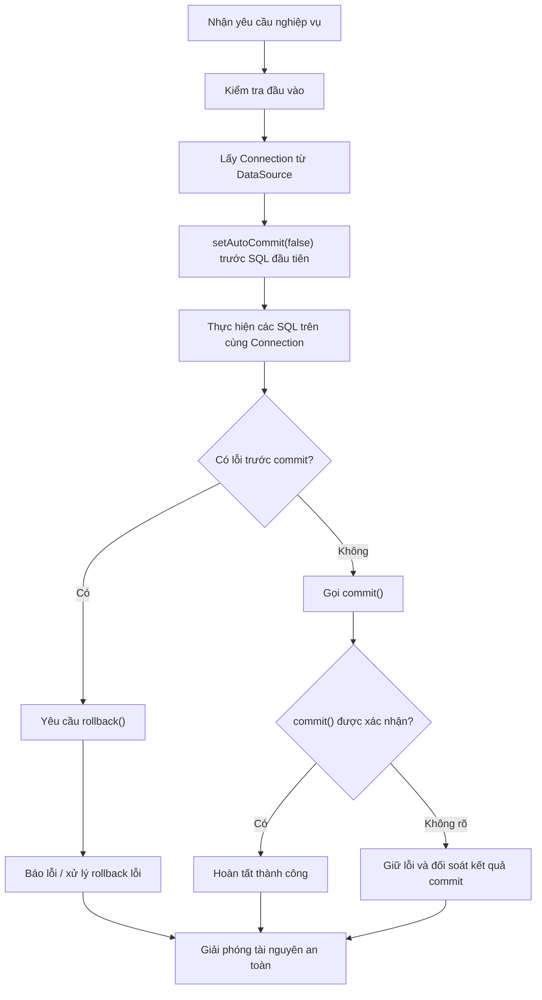
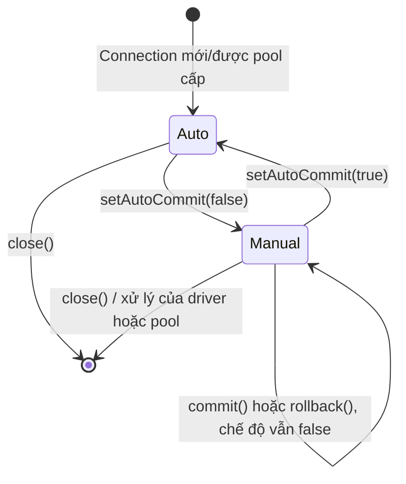

# Bắt đầu phạm vi nghiệp vụ bằng cách thiết lập autoCommit phù hợp

## Mục tiêu học tập

Trong **JDBC**, ứng dụng Java có thể thực hiện SQL qua driver bằng `Connection`, `PreparedStatement` và đọc dữ liệu bằng `ResultSet`. Nhưng khi một thao tác nghiệp vụ gồm **nhiều câu SQL phải cùng thành công hoặc cùng bị hủy**, chỉ viết các câu SQL đúng là chưa đủ. Bạn cần xác định **ranh giới giao dịch (transaction boundary)** trên đúng kết nối, và bước khởi đầu quan trọng là cấu hình `autoCommit` phù hợp **trước khi thực hiện SQL thuộc nghiệp vụ đó**.

Bài học thuộc chương **Giao dịch cơ bản** này tập trung vào thời điểm và cách dùng `Connection.setAutoCommit(false)`, cách duy trì một phạm vi nghiệp vụ qua nhiều `PreparedStatement`, và trách nhiệm kết thúc bằng `commit()` hoặc `rollback()`. Việc hiểu rõ ranh giới sẽ giúp các thao tác CRUD, ghi theo lô và xử lý lỗi trong JDBC không vô tình lưu dữ liệu dở dang.

Sau bài này, bạn có thể:

- Giải thích ý nghĩa của `autoCommit=true` và `autoCommit=false` đối với một `Connection`.
- Xác định khi nào một nghiệp vụ cần **một transaction thủ công** và đặt `setAutoCommit(false)` ở đâu.
- Thực hiện nhiều lệnh SQL trên **cùng kết nối**, sau đó `commit` hoặc `rollback` đúng nhánh.
- Tránh các bẫy khi bật lại `autoCommit`, khi mỗi repository mở một connection riêng và khi trả connection về pool.
- Nhận diện lỗi trước commit khác với ngoại lệ ở chính `commit()`.

## 1. Phạm vi nghiệp vụ không nhất thiết bằng một câu SQL

Giả sử một dịch vụ chuyển 250.000 đồng từ tài khoản A sang tài khoản B. Nghiệp vụ cần hai thay đổi:

1. Trừ 250.000 đồng ở A, với điều kiện A đủ số dư.
2. Cộng 250.000 đồng vào B.

Nếu chỉ trừ ở A rồi không thể cộng ở B, dữ liệu sẽ sai. Ta muốn cả hai thay đổi là **một đơn vị nguyên tử**: cùng được xác nhận hoặc cùng bị hủy. Đó là lý do cần một transaction.

Ngược lại, khi chỉ cần đọc một danh sách công khai hoặc thực hiện một câu `UPDATE` độc lập đã tự đảm bảo các điều kiện cần thiết, chế độ tự commit thường đủ. Không phải mọi phương thức Java hay mọi HTTP request đều phải chứa một giao dịch thủ công.

Điểm cần phân biệt:

- **Phạm vi nghiệp vụ:** tập thao tác phải nhất quán cùng nhau, ví dụ “chuyển tiền”.
- **Phạm vi JDBC transaction:** các lệnh thực hiện trên một `Connection` trong chế độ giao dịch tương ứng, từ khi thao tác trong transaction bắt đầu cho đến lúc `commit()` hoặc `rollback()` kết thúc.
- **Phạm vi tài nguyên:** thời gian ứng dụng giữ `Connection`, `PreparedStatement` và `ResultSet`. Tài nguyên có thể được mở/đóng quanh một nghiệp vụ, nhưng việc đóng tài nguyên **không thay thế** lệnh kết thúc transaction rõ ràng.

Đối với transaction JDBC cục bộ (*local transaction*), **cùng một `Connection`** là điều kiện cốt lõi. Hai lệnh SQL dùng hai connection khác nhau không tự động trở thành một transaction chỉ vì chúng cùng trỏ tới một database.

## 2. Hai chế độ autoCommit

Theo hợp đồng JDBC, một `Connection` mới thông thường được tạo ở chế độ **`autoCommit=true`**. Tuy nhiên, connection pool hoặc cấu hình môi trường có thể cung cấp connection với trạng thái khác, nên tại ranh giới cần kiểm tra giả định khi cần thiết bằng `connection.getAutoCommit()`.

| Tiêu chí | `autoCommit=true` | `autoCommit=false` |
| --- | --- | --- |
| Cách xác nhận thay đổi | Mỗi câu lệnh SQL được tự commit theo quy tắc hoàn tất câu lệnh của JDBC/driver | Ứng dụng yêu cầu `commit()` rõ ràng |
| Khi câu SQL tiếp theo gặp lỗi | Câu trước có thể đã commit, không thể rollback ngược bằng transaction mới | Có thể rollback toàn bộ phần thay đổi **chưa commit** trong transaction hiện tại |
| Phù hợp | Tác vụ SQL độc lập, trường hợp không cần gom nhiều câu | Nghiệp vụ nhiều câu phải nhất quán, một số luồng ghi theo lô |
| Ai kết thúc transaction? | Driver/cơ sở dữ liệu theo chế độ tự commit | Mã điều phối nghiệp vụ gọi `commit()` hoặc `rollback()` |
| Gọi `commit()`/`rollback()` thủ công | Không phù hợp; các phương thức này có thể ném `SQLException` khi auto-commit đang bật theo hợp đồng JDBC | Là hai thao tác kết thúc transaction cơ bản |

Trong `autoCommit=true`, câu lệnh thường được commit khi **hoàn tất**. Với truy vấn trả về `ResultSet`, khái niệm “hoàn tất” có thể phụ thuộc việc duyệt/đóng kết quả; không nên diễn giải mọi `executeQuery()` là tức khắc kết thúc một transaction đọc. Với các câu DML độc lập, đây vẫn là chế độ thường dùng.

### Ví dụ khác biệt trong hai lần cập nhật

```text
Chế độ tự commit:
  UPDATE A (thành công) -> thay đổi A được commit
  UPDATE B (thất bại)  -> không thể hủy thay đổi A đã commit

Chế độ transaction thủ công:
  setAutoCommit(false)
  UPDATE A (thành công)
  UPDATE B (thất bại)
  rollback()           -> hủy phần thay đổi chưa commit của cả nghiệp vụ

Khi cả hai cập nhật thành công:
  setAutoCommit(false)
  UPDATE A
  UPDATE B
  commit()             -> xác nhận hai thay đổi trong cùng transaction
```

**Kết luận quan trọng:** Cần thiết lập `autoCommit=false` **trước lệnh SQL đầu tiên** của nghiệp vụ cần tính nguyên tử. Nếu chờ cập nhật A xong rồi mới tắt tự commit, A có thể đã được xác nhận riêng và không còn nằm trong transaction của B.

## 3. Đặt ranh giới transaction ở đâu?

Với nghiệp vụ chuyển tiền, phạm vi thường nằm ở **tầng dịch vụ điều phối** thay vì trong từng hàm truy vấn hoặc từng repository. Một trình tự hợp lý là:

1. Kiểm tra đầu vào đơn giản có thể thực hiện mà không cần database, như số tiền phải dương và tài khoản nguồn khác tài khoản đích.
2. Lấy một `Connection` từ `DataSource`.
3. **Trước SQL nghiệp vụ đầu tiên**, gọi `connection.setAutoCommit(false)`.
4. Thực hiện các thao tác SQL bằng `PreparedStatement` **trên connection đó**.
5. Nếu mọi bước hợp lệ, gọi `connection.commit()` một lần tại cuối phạm vi.
6. Nếu một bước lỗi **trước khi gọi commit**, gọi `connection.rollback()` và chuyển lỗi cho tầng gọi.
7. Đóng tài nguyên và để cơ chế quản lý kết nối xử lý trạng thái còn lại theo hợp đồng của driver/pool.



Việc gọi `setAutoCommit(false)` chuyển **chế độ điều khiển transaction** sang thủ công; nó không nhất thiết gửi ngay một câu `BEGIN` tới server. Thời điểm transaction vật lý thực sự bắt đầu có thể phụ thuộc DBMS, driver và câu SQL đầu tiên. Hãy hiểu đây là **khởi tạo ranh giới ở phía JDBC**, còn cơ sở dữ liệu triển khai chi tiết theo ngữ nghĩa của nó.

Nếu cần thiết lập mức cô lập (*isolation level*) hoặc thuộc tính transaction khác, phải xem quy tắc của driver/DBMS và cấu hình chúng **trước khi các lệnh nghiệp vụ bắt đầu**. Không tùy tiện đổi isolation giữa transaction đang hoạt động.

## 4. Ví dụ hoàn chỉnh với DataSource và PreparedStatement

Giả sử bảng `accounts` có:

| Cột | Ý nghĩa |
| --- | --- |
| `id BIGINT` | Khóa chính tài khoản |
| `balance DECIMAL(19, 2)` | Số dư tiền chính xác theo thang đo của database |

Ví dụ sau dùng `BigDecimal` để biểu diễn số tiền và hai câu `UPDATE` trong một transaction. Mẫu câu SQL chỉ minh họa nghiệp vụ chuyển tiền nội bộ; hệ thống thực tế còn cần kiểm soát quyền, sổ cái, tính duy nhất yêu cầu, concurrency và cơ chế đối soát phù hợp.

```java
import java.math.BigDecimal;
import java.sql.Connection;
import java.sql.PreparedStatement;
import java.sql.SQLException;
import java.util.Objects;
import javax.sql.DataSource;

public final class TransferService {
    private final DataSource dataSource;

    public TransferService(DataSource dataSource) {
        this.dataSource = Objects.requireNonNull(dataSource);
    }

    public void transfer(long fromId, long toId, BigDecimal amount)
            throws SQLException {
        if (fromId == toId || amount == null || amount.signum() <= 0) {
            throw new IllegalArgumentException(
                "Cần hai tài khoản khác nhau và số tiền dương"
            );
        }

        try (Connection connection = dataSource.getConnection()) {
            // Ranh giới giao dịch: đặt trước mọi SQL của nghiệp vụ.
            connection.setAutoCommit(false);

            try {
                int debited = debit(connection, fromId, amount);
                if (debited != 1) {
                    throw new SQLException(
                        "Tài khoản nguồn không tồn tại hoặc không đủ số dư"
                    );
                }

                int credited = credit(connection, toId, amount);
                if (credited != 1) {
                    throw new SQLException(
                        "Tài khoản nhận không tồn tại"
                    );
                }
            } catch (SQLException | RuntimeException error) {
                // Nhánh này xử lý lỗi xảy ra TRƯỚC commit().
                try {
                    connection.rollback();
                } catch (SQLException rollbackError) {
                    // Giữ lại nguyên nhân ban đầu và lỗi khi rollback.
                    error.addSuppressed(rollbackError);
                }
                throw error;
            }

            // Chỉ commit khi cả hai lệnh UPDATE đã thành công.
            // Lỗi ngay trong commit() có thể khiến kết quả chưa rõ;
            // do đó không nằm trong catch "lỗi trước commit" ở trên.
            connection.commit();
        }
    }

    private static int debit(Connection connection,
                             long accountId,
                             BigDecimal amount) throws SQLException {
        String sql = """
            UPDATE accounts
               SET balance = balance - ?
             WHERE id = ? AND balance >= ?
            """;

        try (PreparedStatement ps = connection.prepareStatement(sql)) {
            ps.setBigDecimal(1, amount);
            ps.setLong(2, accountId);
            ps.setBigDecimal(3, amount);
            return ps.executeUpdate();
        }
    }

    private static int credit(Connection connection,
                              long accountId,
                              BigDecimal amount) throws SQLException {
        String sql = """
            UPDATE accounts
               SET balance = balance + ?
             WHERE id = ?
            """;

        try (PreparedStatement ps = connection.prepareStatement(sql)) {
            ps.setBigDecimal(1, amount);
            ps.setLong(2, accountId);
            return ps.executeUpdate();
        }
    }
}
```

Ví dụ sử dụng **Java 17+** để có kiểu chuỗi SQL nhiều dòng (*text block*). Các API giao dịch cốt lõi `setAutoCommit`, `commit`, `rollback`, `PreparedStatement` đều đã có trong JDBC từ trước. Với Java cũ, thay text block bằng chuỗi SQL thông thường.

### Vì sao thiết kế này phù hợp với ranh giới nghiệp vụ?

- `DataSource.getConnection()` cung cấp **một connection**; cả hai hàm `debit` và `credit` dùng đúng tham số `connection` đó.
- `setAutoCommit(false)` chạy **trước** khi tạo/chạy `PreparedStatement` cho các cập nhật nghiệp vụ.
- `executeUpdate()` trả số hàng bị ảnh hưởng. Nếu lệnh trừ hoặc cộng không tác động đúng một tài khoản, code phát hiện lỗi và yêu cầu `rollback()`.
- `commit()` nằm **sau** hai thao tác, nên không có tình huống ứng dụng chủ động xác nhận riêng phần trừ mà chưa cộng.
- `try-with-resources` đóng từng `PreparedStatement` và `Connection` kể cả khi có lỗi; việc rollback rõ ràng vẫn là trách nhiệm của ứng dụng.
- `BigDecimal` tránh dùng số thực dấu phẩy động để biểu diễn tiền; schema, độ chính xác và quy tắc làm tròn phải phù hợp yêu cầu thực tế.

Câu lệnh `UPDATE ... WHERE balance >= ?` đưa điều kiện đủ tiền vào **chính** thao tác trừ, thay vì đọc số dư rồi tự quyết định trên một giá trị có thể đã thay đổi. Hiệu lực dưới cạnh tranh giao dịch vẫn cần dựa vào ràng buộc, mức cô lập và đặc tính DBMS đang dùng.

### Lỗi nào được rollback trong ví dụ?

Khối `catch` chỉ bao quanh **hai lệnh SQL trước commit**. Nếu một lệnh thất bại hoặc logic trong khối ném `RuntimeException`, ứng dụng thử `rollback()`. Nếu rollback cũng lỗi, ngoại lệ thứ hai được lưu qua `addSuppressed(...)` để không làm mất lỗi ban đầu.

`connection.commit()` đặt **ngoài** khối `catch` này có chủ đích: khi chính lời gọi commit ném `SQLException`, không được kết luận ngay rằng transaction chưa được ghi nhận. Có thể database đã commit nhưng phản hồi bị mất, ví dụ do mất kết nối. Trạng thái khi đó là **chưa xác định** cho đến khi có bằng chứng từ driver/DBMS hoặc bước đối soát.

Ví dụ đang minh họa ranh giới transaction, **chưa phải triển khai chuyển tiền dùng cho production**. Với nghiệp vụ quan trọng, cần gắn mã yêu cầu duy nhất và dấu vết cùng transaction để đối soát nếu commit bị mất phản hồi. Nếu `Connection.close()` gặp lỗi sau khi `commit()` đã thành công, lỗi đóng tài nguyên cũng không có nghĩa commit bị hủy.

## 5. Trạng thái autoCommit trong vòng đời Connection

`setAutoCommit(false)` **không phải** một câu lệnh “mở giao dịch một lần rồi tự đóng”. Đây là một thuộc tính trạng thái trên `Connection`:



Hai ý dễ bị bỏ qua:

**Một là, `commit()` hoặc `rollback()` không tự động bật lại `autoCommit=true`.** Nếu đã đặt chế độ thủ công, các câu SQL tiếp theo trên cùng connection tiếp tục ở chế độ đó cho đến khi thay đổi thuộc tính hoặc kết nối được reset/đóng theo hợp đồng liên quan.

**Hai là, thay đổi chế độ autoCommit khi transaction đang hoạt động có thể làm transaction được commit.** JDBC quy định việc gọi `setAutoCommit` mà **thực sự thay đổi chế độ** trong một transaction có thể kết thúc transaction hiện tại bằng commit. Vì thế, đây là mẫu rất nguy hiểm:

```java
// PHẢN VÍ DỤ: không áp dụng trong ứng dụng!
connection.setAutoCommit(false);
updateFirstTable(connection); // Thành công
updateSecondTable(connection); // Có thể ném lỗi

// Nếu đặt bừa trong finally, setAutoCommit(true) có thể
// commit phần thay đổi còn treo thay vì rollback!
connection.setAutoCommit(true);
```

**Không được coi `setAutoCommit(true)` như một cách hủy transaction.** Nếu cần hủy, yêu cầu `rollback()` trước; chỉ cân nhắc đổi mode sau khi đã xác định transaction kết thúc an toàn.

### Nên khôi phục autoCommit hay chỉ đóng connection?

Có hai ngữ cảnh khác nhau:

| Ngữ cảnh | Ai sở hữu kết nối? | Cách quản lý trạng thái |
| --- | --- | --- |
| Service tự lấy connection bằng `DataSource.getConnection()` và đóng sau nghiệp vụ | Service sở hữu vòng đời connection mượn | Dùng `try-with-resources`; cấu hình và kiểm chứng pool rollback/reset trạng thái khi trả connection; không coi close là rollback được bảo đảm |
| Hàm nhận connection do tầng gọi truyền vào | Tầng gọi sở hữu connection | Hàm chỉ thực hiện SQL; **không** tùy ý `commit`, `rollback`, đổi `autoCommit` hoặc `close` |
| Ứng dụng chủ động tái sử dụng connection để chạy phần việc khác | Tầng quản lý transaction sở hữu | Kết thúc transaction bằng commit/rollback, rồi khôi phục mode gốc nếu cần; không bật true nếu transaction còn đang treo hoặc không rõ trạng thái |

Khi đã biết transaction kết thúc an toàn, mã điều phối có thể lưu và khôi phục trạng thái ban đầu:

```java
boolean original = connection.getAutoCommit();
connection.setAutoCommit(false);
try {
    // ... câu SQL của nghiệp vụ
    connection.commit(); // Chỉ tiếp tục khi được xác nhận thành công.
} finally {
    // Chỉ khôi phục khi đã biết transaction kết thúc an toàn.
    // Không dùng finally để bật true một cách vô điều kiện
    // nếu commit/rollback chưa hoàn tất hoặc đã thất bại.
}
```

Đoạn trên minh họa việc **quan sát trạng thái gốc** và cảnh báo về cleanup, không phải mẫu quản lý lỗi hoàn chỉnh để sao chép nguyên xi. Với transaction kết thúc **chắc chắn** và connection còn sử dụng được, việc khôi phục có thể thực hiện bằng `connection.setAutoCommit(original)`. Nếu `commit()` hoặc `rollback()` có kết quả chưa rõ, không đổi mode một cách mù quáng; nên cô lập/loại bỏ connection theo khả năng của driver và pool, đồng thời đối soát trạng thái nghiệp vụ.

Trên nhiều connection pool, `close()` đối với logical connection thực chất là trả về pool, có cơ chế reset `autoCommit` và rollback transaction chưa kết thúc. Nhưng **không được mặc định mọi pool/driver làm giống nhau**. Hãy kiểm tra cấu hình và hợp đồng pool đang dùng, nhất là khi connection có lỗi giữa transaction.

## 6. Không vô tình tách một nghiệp vụ thành nhiều connection

Dưới đây là ví dụ **sai về ranh giới transaction**:

```java
void transfer(long fromId, long toId, BigDecimal amount)
        throws SQLException {
    debitRepository.debit(fromId, amount); // Tự mở connection A.
    creditRepository.credit(toId, amount); // Tự mở connection B.
}
```

Nếu mỗi repository gọi `dataSource.getConnection()` riêng và để tự commit, lời gọi thứ nhất đã có thể được lưu dù lời gọi thứ hai lỗi. Ngay cả khi từng repository tự `setAutoCommit(false)`, chúng vẫn đang vận hành **hai transaction độc lập** trên hai connection.

Một phương án rõ ràng với JDBC thuần là **đẩy connection từ tầng điều phối xuống**:

```java
void transferWithinTransaction(Connection connection,
                               long fromId, long toId,
                               BigDecimal amount) throws SQLException {
    debitRepository.debit(connection, fromId, amount);
    creditRepository.credit(connection, toId, amount);
}

// Tầng service bao quanh lời gọi trên bằng:
// setAutoCommit(false) -> thao tác -> commit()/rollback().
```

Các repository chỉ nên thực hiện SQL và trả kết quả, không tự quyết định kết thúc transaction mà tầng service đang sở hữu. Nếu dự án có transaction manager hoặc framework như Spring, để framework quản lý ranh giới theo hợp đồng của nó; không đan xen việc điều khiển thủ công một cách tùy tiện.

Cũng nên tránh đưa hoạt động HTTP, chờ người dùng hoặc gọi dịch vụ ngoài kéo dài vào giữa transaction. Những hoạt động đó làm thời gian giữ connection và khóa database tăng, đồng thời hệ thống bên ngoài không tự thuộc transaction JDBC.

## 7. Khi nào không cần tắt autoCommit?

Không phải lúc nào `setAutoCommit(false)` cũng là lựa chọn tốt nhất.

| Tình huống | Lựa chọn thường hợp lý | Lý do |
| --- | --- | --- |
| Một câu `UPDATE` độc lập, mọi điều kiện nằm trong SQL | `autoCommit=true` | Một câu SQL thường đủ là đơn vị tự xác nhận |
| Nhiều câu DML phải cùng thành công hoặc cùng hủy | `autoCommit=false` | Cần `commit()`/`rollback()` cho cả nhóm |
| Một câu `SELECT` đơn giản không cần snapshot nhiều lần đọc | Thường giữ chế độ mặc định | Không cần giữ transaction thủ công kéo dài |
| Đọc nhiều truy vấn cần nhìn cùng một ảnh chụp dữ liệu | Transaction đọc với isolation thích hợp | Chỉ tắt autoCommit thôi **chưa đảm bảo** snapshot; cần hiểu DBMS |
| Ghi nhiều câu bằng `executeBatch()` cần cùng nguyên tử | Transaction thủ công khi DBMS/driver hỗ trợ ngữ nghĩa mong muốn | Tự commit có thể làm một phần batch thành công; phải đánh giá lỗi từng lệnh |
| Câu DDL như `CREATE TABLE` | Kiểm tra tài liệu DBMS | Một số hệ quản trị tự commit quanh DDL bất kể ý định gom transaction |

Bài học không đặt ra quy tắc “cứ truy vấn database thì phải tắt autoCommit”. Quyết định dựa vào yêu cầu nhất quán của nghiệp vụ, chi phí giữ khóa/kết nối và khả năng transaction của các câu SQL đang thực hiện.

## 8. Những lỗi thường gặp khi bắt đầu transaction

### 8.1. Bật chế độ thủ công quá muộn

```java
updateAccountA(connection);       // Có thể đã auto commit.
connection.setAutoCommit(false);
updateAccountB(connection);       // Transaction mới.
connection.rollback();            // Không hủy được UPDATE A đã commit.
```

**Cách sửa:** đặt `connection.setAutoCommit(false)` trước lần gọi `updateAccountA`.

### 8.2. Đổi autoCommit trong một phương thức truy vấn tầng dưới

Nếu repository gọi `setAutoCommit(true)` để “dọn dẹp” trong khi service vẫn còn transaction, nó có thể commit sớm một phần nghiệp vụ. Mỗi transaction cần **một chủ sở hữu ranh giới**: tầng điều phối quyết định thời điểm bắt đầu và kết thúc.

### 8.3. Quên kết thúc transaction sau khi có lỗi

Nếu code chỉ gọi `commit()` ở nhánh thành công mà bỏ qua `rollback()` ở nhánh lỗi, connection có thể còn các thay đổi chưa được xác nhận và giữ tài nguyên/khóa. Phải xử lý nhánh lỗi trước commit bằng rollback rõ ràng, bắt cả lỗi rollback và bảo đảm connection được quản lý an toàn.

### 8.4. Xem lỗi commit là bằng chứng chưa commit

Ngoại lệ của `commit()` có thể do phản hồi bị mất sau khi database đã ghi nhận transaction. Đừng thực hiện lại nghiệp vụ có tác động không thể đảo ngược chỉ vì gặp `SQLException` tại thời điểm đó. Ghi mã yêu cầu, theo dõi lỗi và đối soát; khả năng thử lại an toàn phụ thuộc cơ chế idempotency của nghiệp vụ.

### 8.5. Giữ transaction quá lâu

Bắt đầu transaction trước một cuộc gọi API mạng chậm hoặc thực hiện tác vụ tính toán kéo dài ở giữa các câu SQL làm tăng thời gian giữ connection và có thể giữ khóa lâu. Hãy gom các thao tác SQL cần nguyên tử vào một phạm vi ngắn, đủ bao phủ nghiệp vụ.

### 8.6. Nhầm transaction local với transaction trên nhiều nguồn dữ liệu

Một `Connection` JDBC thông thường chỉ điều khiển transaction local đối với kết nối đó. Các connection đến hai database hoặc hai dịch vụ khác nhau không tự tham gia một giao dịch phân tán chỉ vì cùng đoạn `try`. Trường hợp này đòi hỏi cơ chế phối hợp riêng, ví dụ XA/JTA hoặc thiết kế saga/outbox phù hợp.

## 9. Kiểm tra thực tế và bài luyện tập

Bạn có thể kiểm tra một vài giả định bằng cách ghi log tại ranh giới (không log thông tin nhạy cảm):

```java
try (Connection connection = dataSource.getConnection()) {
    boolean initialMode = connection.getAutoCommit();
    System.out.println("autoCommit trước nghiệp vụ: " + initialMode);

    connection.setAutoCommit(false);
    System.out.println("autoCommit sau khi thiết lập: "
                       + connection.getAutoCommit());

    // Chỉ là ví dụ kiểm tra cấu hình, chưa thực hiện DML.
    connection.rollback(); // Kết thúc một transaction thủ công nếu có.
}
```

Trong môi trường tích hợp, hãy thử các tình huống:

1. **Hai cập nhật đều thành công:** thực hiện `commit()` và đọc lại từ connection mới; cả hai thay đổi phải xuất hiện.
2. **Bước thứ hai lỗi trước commit:** thực hiện `rollback()`; xác nhận bước thứ nhất không còn hiệu lực.
3. **Repository vô tình dùng connection khác:** quan sát giao dịch không còn chung ranh giới, rồi sửa để nhận `Connection` từ tầng gọi.
4. **Chuyển `autoCommit=true` khi còn thay đổi treo:** trong môi trường thử nghiệm cách ly, quan sát hành vi và đối chiếu hợp đồng driver; không dùng kỹ thuật này trong nghiệp vụ thực tế.
5. **Lỗi ngay khi gọi commit:** thay vì luôn gán “rollback”, mô hình trạng thái có thể chưa xác định và kế hoạch đối soát.

### Câu hỏi tự kiểm tra

**Câu 1.** Tại sao cần gọi `setAutoCommit(false)` trước SQL đầu tiên của một nghiệp vụ gồm hai cập nhật?

*Gợi ý đáp án:* Nếu lệnh đầu chạy trong chế độ tự commit, nó có thể đã được xác nhận; rollback ở lệnh sau không thể hủy kết quả cũ.

**Câu 2.** Sau khi gọi `connection.commit()` thành công, `getAutoCommit()` có tự đổi về `true` không?

*Đáp án:* Không; chế độ `autoCommit` vẫn là `false` cho đến khi đổi rõ ràng hoặc connection được reset theo hợp đồng của cơ chế quản lý.

**Câu 3.** Hai repository cùng dùng một `DataSource` nhưng mỗi bên tự lấy một `Connection`. Chúng có mặc nhiên cùng transaction không?

*Đáp án:* Không. Với transaction JDBC local, cần cùng `Connection` và cùng ranh giới điều phối.

**Câu 4.** Có nên đặt `setAutoCommit(true)` vô điều kiện trong `finally` sau khi lệnh SQL lỗi không?

*Đáp án:* Không. Nếu transaction còn đang hoạt động, chuyển sang chế độ tự commit có thể commit những thay đổi chưa được hủy. Cần hoàn tất transaction an toàn trước khi khôi phục mode.

**Câu 5.** Khi `commit()` ném lỗi mất kết nối, ứng dụng có đủ thông tin để kết luận database đã rollback không?

*Đáp án:* Không. Lỗi có thể xảy ra sau khi database đã commit; cần xử lý trạng thái chưa xác định theo chính sách driver, database và cơ chế đối soát nghiệp vụ.

## Kết luận

Bắt đầu phạm vi nghiệp vụ trong JDBC là quyết định **những SQL nào phải được xử lý chung** và đặt `setAutoCommit(false)` trên **đúng `Connection` trước SQL nghiệp vụ đầu tiên**. Các thao tác dùng chung connection được điều phối đến một điểm `commit()` hoặc `rollback()`, còn các repository phía dưới không tự thay đổi ranh giới ấy. Cần quản lý vòng đời kết nối cẩn thận, đặc biệt khi trả về pool, và không nhầm `setAutoCommit(true)` với rollback. Với thao tác độc lập, chế độ tự commit có thể là lựa chọn đơn giản hơn; với thao tác nhiều bước cần nguyên tử, một transaction thủ công ngắn và rõ chủ sở hữu là nền tảng an toàn.
