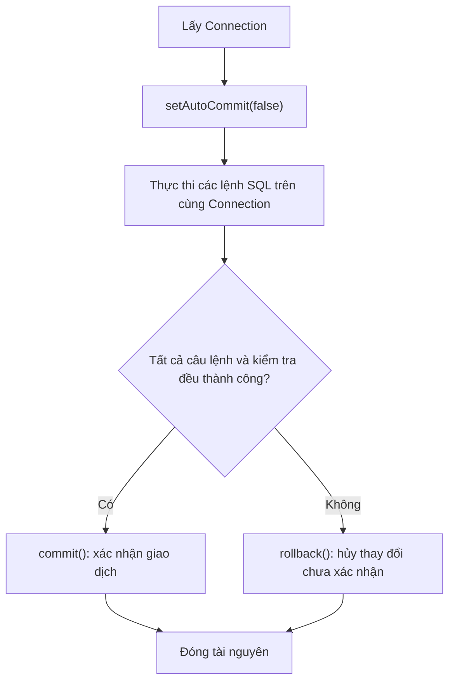

# Xác nhận dữ liệu bằng `commit` trong JDBC

Trong JDBC, phương thức `Connection.commit()` đánh dấu **điểm xác nhận thành công** của một giao dịch (transaction): những thay đổi dữ liệu được thực hiện trong giao dịch đó được xác nhận như một đơn vị. Đây là cơ chế quan trọng khi một thao tác nghiệp vụ cần nhiều câu SQL cùng thành công, chẳng hạn tạo đơn hàng gồm phần thông tin chung và các dòng sản phẩm, chuyển tiền giữa hai tài khoản hoặc ghi phiếu nhập và cập nhật tồn kho.

Bài học thuộc chương **Giao dịch cơ bản** của JDBC. Mục tiêu là hiểu đúng thời điểm gọi `commit()`, cách dùng `DataSource`, `Connection` và `PreparedStatement` để gom nhiều thao tác CRUD vào cùng một giao dịch, cũng như xử lý lỗi bằng `rollback()`. Quy tắc đặc biệt quan trọng: **`executeUpdate()` báo câu lệnh đã được thực thi, nhưng không đồng nghĩa toàn bộ giao dịch đã được xác nhận bằng `commit()`.**

## 1. `commit` xác nhận điều gì?

Một giao dịch là nhóm thao tác được hệ quản trị cơ sở dữ liệu (DBMS) xem là một đơn vị. Khi ứng dụng dùng giao dịch tường minh, luồng xử lý thường là:

1. Lấy một `Connection` từ `DataSource`.
2. Chuyển kết nối sang chế độ tự quản lý giao dịch bằng `setAutoCommit(false)`.
3. Thực thi các câu `INSERT`, `UPDATE`, `DELETE` hoặc câu SQL cần thiết trên **cùng kết nối**.
4. Chỉ khi **toàn bộ** thao tác và kiểm tra nghiệp vụ thành công, gọi `connection.commit()`.
5. Nếu có lỗi trước khi xác nhận, gọi `connection.rollback()` để yêu cầu hủy các thay đổi chưa được xác nhận.
6. Đóng `PreparedStatement`, `ResultSet` và `Connection` đúng cách.

Ví dụ, một đơn hàng có hai phần:

- Thêm hàng vào `order_header` để tạo đơn.
- Thêm hàng vào `order_line` để ghi sản phẩm thuộc đơn.

Nếu bước thêm `order_line` thất bại do vi phạm khóa chính hoặc khóa ngoại, nghiệp vụ thường không muốn tồn tại một `order_header` “mồ côi”. Đặt cả hai câu lệnh trong **một giao dịch** và chỉ `commit` khi cả hai thành công sẽ ngăn kết quả dở dang này.



### Mối liên hệ với tính chất ACID

- **Atomicity (nguyên tử):** các thay đổi của một giao dịch được xác nhận cùng nhau, hoặc có thể bị hủy nếu chưa xác nhận.
- **Consistency (nhất quán):** giao dịch hoàn tất phải tuân thủ các ràng buộc dữ liệu; ứng dụng vẫn phải thiết kế và kiểm tra quy tắc nghiệp vụ đúng.
- **Isolation (cô lập):** các giao dịch đồng thời quan sát lẫn nhau theo mức cô lập của DBMS; `commit` không tự giải quyết mọi xung đột đồng thời.
- **Durability (bền vững):** khi DBMS báo xác nhận thành công, dữ liệu đã xác nhận được bảo vệ theo cam kết về độ bền của hệ quản trị và cấu hình lưu trữ.

Vì vậy, `commit()` là **ranh giới xác nhận**, còn quy tắc kiểm tra dữ liệu, khóa, isolation và cấu hình DBMS vẫn cần thiết.

## 2. Auto-commit: vì sao phải tắt trước khi gom nhiều lệnh?

Theo JDBC, một `Connection` mới mặc định bật chế độ **auto-commit**. Khi đó, mỗi câu SQL được tự động xác nhận khi hoàn tất theo quy tắc JDBC và driver. Với câu `INSERT`/`UPDATE` thông thường, điều này thường có nghĩa mỗi lần gọi `executeUpdate()` thành công đã được xác nhận độc lập.

```java
try (Connection connection = dataSource.getConnection()) {
    System.out.println(connection.getAutoCommit()); // Thường là true theo mặc định JDBC
}
```

Hãy so sánh hai tình huống:

| Tình huống | Khi lệnh thêm đơn thành công, nhưng thêm dòng đơn thất bại |
|---|---|
| `autoCommit = true` | Lệnh đầu có thể đã được commit, nên `rollback()` sau đó không thể hủy thay đổi đã commit. |
| `autoCommit = false` | Cả hai lệnh thuộc cùng giao dịch nếu thực thi trên một `Connection`; có thể `rollback()` để hủy lệnh đầu nếu lệnh sau thất bại. |

Để tự quyết định thời điểm xác nhận:

```java
try (Connection connection = dataSource.getConnection()) {
    connection.setAutoCommit(false);

    // Các thao tác SQL thực hiện trên chính connection này.

    connection.commit(); // Chỉ gọi sau khi mọi bước cần thiết đều thành công.
}
```

Đoạn ngắn trên minh họa API; **mã sản xuất phải có xử lý lỗi và `rollback()`** như ví dụ hoàn chỉnh ở phần sau.

Các điểm cần nhớ:

- Trong chế độ `autoCommit = false`, giao dịch được kết thúc bằng `commit()` hoặc `rollback()`; lệnh SQL tiếp theo trên kết nối sẽ tham gia giao dịch tiếp theo.
- `commit()` được thiết kế cho kết nối đã tắt auto-commit; gọi khi auto-commit đang bật có thể gây `SQLException` theo hợp đồng JDBC.
- Gọi `setAutoCommit(true)` khi một giao dịch đang hoạt động có thể **tự commit** giao dịch đó. Đừng dùng thao tác bật lại auto-commit làm cách xử lý lỗi.
- Giao dịch gắn với **`Connection`**, không gắn với đối tượng `PreparedStatement` hay với toàn bộ `DataSource`. Hai kết nối riêng sẽ không tự động nằm trong cùng một giao dịch.

## 3. Ví dụ hoàn chỉnh: chỉ commit khi tạo đơn hàng thành công

Giả sử CSDL có hai bảng và hỗ trợ giao dịch. Ví dụ dùng khóa chính do ứng dụng truyền vào để tập trung vào cách commit; trong ứng dụng thực tế, có thể dùng khóa phát sinh và `getGeneratedKeys()`.

```sql
CREATE TABLE order_header (
    id BIGINT PRIMARY KEY,
    customer_id BIGINT NOT NULL
);

CREATE TABLE order_line (
    id BIGINT PRIMARY KEY,
    order_id BIGINT NOT NULL,
    product_id BIGINT NOT NULL,
    quantity INTEGER NOT NULL CHECK (quantity > 0),
    FOREIGN KEY (order_id) REFERENCES order_header(id)
);
```

Giả định ứng dụng đã cấu hình một `javax.sql.DataSource` hợp lệ, CSDL và engine bảng có hỗ trợ transaction. Với Java 8+ và một JDBC driver hỗ trợ các API sử dụng trong ví dụ:

```java
import java.sql.Connection;
import java.sql.PreparedStatement;
import java.sql.SQLException;
import javax.sql.DataSource;

public final class OrderWriter {
    private OrderWriter() {
    }

    public static void createOrder(
            DataSource dataSource,
            long orderId,
            long customerId,
            long lineId,
            long productId,
            int quantity
    ) throws SQLException {
        if (quantity <= 0) {
            throw new IllegalArgumentException("Số lượng phải lớn hơn 0");
        }

        String insertOrder =
                "INSERT INTO order_header (id, customer_id) VALUES (?, ?)";
        String insertLine =
                "INSERT INTO order_line "
                + "(id, order_id, product_id, quantity) VALUES (?, ?, ?, ?)";

        try (Connection connection = dataSource.getConnection()) {
            connection.setAutoCommit(false);

            try {
                try (PreparedStatement orderPs =
                             connection.prepareStatement(insertOrder);
                     PreparedStatement linePs =
                             connection.prepareStatement(insertLine)) {

                    orderPs.setLong(1, orderId);
                    orderPs.setLong(2, customerId);
                    if (orderPs.executeUpdate() != 1) {
                        throw new SQLException("Không tạo được order_header");
                    }

                    linePs.setLong(1, lineId);
                    linePs.setLong(2, orderId);
                    linePs.setLong(3, productId);
                    linePs.setInt(4, quantity);
                    if (linePs.executeUpdate() != 1) {
                        throw new SQLException("Không tạo được order_line");
                    }
                }

                // Điểm duy nhất xác nhận cả hai lệnh INSERT.
                connection.commit();

            } catch (SQLException | RuntimeException failure) {
                // Nếu chưa commit được, cố gắng hủy thay đổi chưa xác nhận.
                try {
                    connection.rollback();
                } catch (SQLException rollbackFailure) {
                    // Giữ nguyên lỗi gốc; gắn lỗi rollback để chẩn đoán.
                    failure.addSuppressed(rollbackFailure);
                }
                throw failure;
            }
        }
    }
}
```

Ví dụ gọi phương thức:

```java
// dataSource được cung cấp từ cấu hình ứng dụng.
OrderWriter.createOrder(
        dataSource,
        1001L, // orderId
        25L,   // customerId
        5001L, // lineId
        901L,  // productId
        2      // quantity
);
```

**Điểm cần quan sát trong ví dụ:**

1. `connection.setAutoCommit(false)` phải được gọi **trước câu SQL ghi đầu tiên**.
2. Cả `orderPs` và `linePs` được tạo từ **cùng một biến `connection`**.
3. Các tham số `?` được bind bằng `setLong()` và `setInt()`; không ghép trực tiếp giá trị vào chuỗi SQL.
4. Kiểm tra số bản ghi cập nhật xảy ra trước commit; nếu số lượng ngoài mong đợi, phương thức ném lỗi và đi vào nhánh rollback.
5. Chỉ có **một lệnh `connection.commit()`** sau khi toàn bộ bước ghi thành công.
6. `catch` cố gắng rollback khi câu SQL hoặc phần kiểm tra thất bại; nếu rollback cũng thất bại, lỗi rollback được ghi dưới dạng *suppressed exception* để không che mất lỗi ban đầu.
7. `try-with-resources` đóng statement và kết nối kể cả khi phát sinh ngoại lệ. Việc đóng kết nối **không thay thế** lời gọi rollback tường minh.

Các khóa `orderId`, `lineId` phải thỏa ràng buộc duy nhất. Nếu `order_line` đã tồn tại với `lineId` đó, lệnh thứ hai có thể phát sinh lỗi khóa trùng. Khi `rollback()` thành công, dòng `order_header` vừa chèn cũng không được giữ lại.

### Tại sao statement được đóng trước khi commit?

Trong ví dụ, khối `try-with-resources` bên trong hoàn tất, đóng hai `PreparedStatement` rồi mới gọi `connection.commit()` trên kết nối vẫn đang mở. Đây là trình tự hợp lệ đối với các câu `INSERT`/`UPDATE` đã được thực thi. **Đóng `PreparedStatement` không tự commit giao dịch.** Nếu một lệnh đang giữ `ResultSet`, cần quản lý vòng đời `ResultSet` theo quy tắc driver trước khi kết thúc giao dịch.

## 4. Phân biệt `executeUpdate()`, `commit()` và `rollback()`

Ba thao tác xử lý những việc khác nhau:

| API | Vai trò | Điều **không** được suy ra |
|---|---|---|
| `PreparedStatement.executeUpdate()` | Gửi câu DML đến DBMS và trả về số dòng bị ảnh hưởng trong trường hợp áp dụng. | Không đảm bảo giao dịch nhiều bước đã được commit nếu auto-commit tắt. |
| `Connection.commit()` | Yêu cầu DBMS xác nhận toàn bộ giao dịch đang hoạt động trên kết nối. | Không xác nhận các giao dịch trên kết nối khác; không sửa logic nghiệp vụ sai. |
| `Connection.rollback()` | Yêu cầu hủy những thay đổi **chưa được commit** trong giao dịch. | Không thể hủy giao dịch đã commit bằng cùng lệnh rollback thông thường. |

Ví dụ:

```java
connection.setAutoCommit(false);

int inserted = ps.executeUpdate(); // Có thể trả về 1.
if (inserted != 1) {
    connection.rollback();
    throw new SQLException("Kết quả INSERT ngoài mong đợi");
}

connection.commit();               // Xác nhận sau kiểm tra.
```

Nếu sau khi `commit()` thành công mà nghiệp vụ cần hoàn tác, ứng dụng phải thực hiện **giao dịch bù** (ví dụ tạo nghiệp vụ hủy đơn hoặc hoàn tiền) tùy quy tắc dữ liệu; gọi `rollback()` khi đó không đảo ngược commit trước.

### Sau `commit()`, auto-commit có tự bật lại không?

**Không.** Gọi `commit()` khi `autoCommit = false` kết thúc giao dịch hiện tại nhưng giữ cấu hình auto-commit của kết nối. Nếu sau đó thực hiện thêm `UPDATE`, thay đổi mới thuộc một giao dịch mới và vẫn cần `commit()` hoặc `rollback()`.

```java
connection.setAutoCommit(false);
updateFirstGroup(connection);
connection.commit();

updateSecondGroup(connection);
connection.commit(); // Cần cho nhóm thao tác thứ hai.
```

Hai hàm `updateFirstGroup` và `updateSecondGroup` ở đây tượng trưng cho các thao tác SQL trên chính `connection`, không phải API JDBC có sẵn.

## 5. Điều gì xảy ra khi `commit()` thất bại?

`commit()` có thể ném `SQLException`, ví dụ vì mất kết nối, lỗi I/O, xung đột giao dịch hoặc DBMS không thể xác nhận giao dịch. Cách xử lý phụ thuộc thời điểm lỗi.

**Trước khi commit thành công:** nếu một câu SQL thất bại, chương trình nên rollback giao dịch nếu kết nối còn sử dụng được. Điều này tránh để các câu trước đó dở dang trong cùng transaction.

**Ngay trong lúc commit:** nếu kết nối đứt hoặc phản hồi bị mất, ứng dụng đôi khi **không biết chắc DBMS đã commit hay chưa**. Một số DBMS có thể đã ghi nhận commit nhưng ứng dụng không nhận được thông báo; việc gọi `rollback()` sau lỗi cũng có thể thất bại hoặc không đảo ngược commit đã xảy ra.

Do đó:

- Đừng kết luận rằng mọi `SQLException` từ `commit()` đồng nghĩa “chắc chắn đã rollback”.
- Đừng thử gửi lại toàn bộ thao tác tạo đơn hoặc chuyển tiền ngay lập tức nếu có nguy cơ tạo dữ liệu trùng, trừ khi thiết kế đã hỗ trợ **idempotency** (ví dụ mã yêu cầu duy nhất, ràng buộc unique và quy trình đối soát).
- Giữ thông tin lỗi gốc, kiểm tra trạng thái giao dịch theo quy trình vận hành; khi cần, dùng mã nghiệp vụ duy nhất để xác định kết quả đã được ghi hay chưa.
- Chỉ báo thành công cho người gọi sau khi đã nhận kết quả commit thành công. Tuy nhiên, nếu xảy ra lỗi khi **đóng** kết nối sau commit, commit có thể đã thành công; cần phân biệt loại lỗi trong log/chẩn đoán.

Mẫu `catch` trong phần 3 thực hiện rollback theo nguyên tắc **cố gắng tốt nhất** (*best effort*) khi xảy ra lỗi. Nó không thể bảo đảm giao dịch chưa được commit nếu kết quả `commit()` bị mất do sự cố mạng.

## 6. Những sai lầm thường gặp khi dùng commit

| Lỗi | Hậu quả | Cách làm đúng |
|---|---|---|
| Quên `setAutoCommit(false)` | Mỗi lệnh có thể đã được xác nhận riêng, không còn atomicity cho nhiều bước. | Tắt auto-commit trước câu ghi đầu tiên. |
| Gọi `commit()` ngay sau từng `INSERT` | Một bước sau thất bại vẫn để lại thay đổi của các bước trước. | Đặt commit sau khi **tất cả** thao tác thuộc nghiệp vụ thành công. |
| Dùng `DataSource.getConnection()` cho từng statement | Các statement có thể chạy ở những giao dịch khác nhau. | Truyền một `Connection` qua các thao tác trong cùng transaction. |
| Bắt ngoại lệ rồi bỏ qua, vẫn commit | Có thể commit dữ liệu thiếu hoặc sai. | Xử lý thất bại theo chính sách: rollback hoặc xác định rõ có thể tiếp tục. |
| Coi `close()` tự rollback | Hành vi với transaction đang hoạt động khi đóng kết nối có thể phụ thuộc driver/pool. | Gọi `commit()` hoặc `rollback()` rõ ràng trước khi đóng. |
| Bật `setAutoCommit(true)` để “dọn” kết nối khi đang lỗi | Có thể vô tình commit giao dịch còn hoạt động. | Rollback trước; chỉ thay đổi trạng thái sau khi đã kết thúc giao dịch an toàn. |
| Tự gửi SQL `COMMIT` xen lẫn `Connection.commit()` | Driver và logic quản lý trạng thái có thể không nhất quán. | Ưu tiên API quản lý transaction của JDBC. |
| Nghĩ commit giải quyết mọi ghi đè đồng thời | Có thể xảy ra lost update, deadlock hoặc lỗi serialization. | Thiết kế isolation, khóa hoặc optimistic locking theo nghiệp vụ. |

### Giao dịch ngắn và batch

Một transaction dài có thể giữ khóa lâu hơn, tăng khả năng tranh chấp hoặc dùng nhiều tài nguyên DBMS. Không nên bao gồm cuộc gọi HTTP chậm, chờ thao tác người dùng hoặc xử lý nặng không liên quan trong thời gian giữ giao dịch mở.

Khi ghi nhiều bản ghi bằng `PreparedStatement.addBatch()` / `executeBatch()`, vẫn có thể gom toàn bộ batch trong **một transaction** bằng `setAutoCommit(false)` rồi `commit()` sau khi kiểm tra kết quả. Nếu batch gặp lỗi, xử lý `BatchUpdateException` và rollback theo yêu cầu atomicity. Một số câu trong batch có thể đã được thực thi trước khi gặp lỗi, nên **không suy đoán batch tự rollback** chỉ từ việc `executeBatch()` ném ngoại lệ.

## 7. Phạm vi giao dịch, mức cô lập và DDL

**Phạm vi một kết nối.** Các lệnh thuộc cùng transaction phải được thực hiện qua cùng `Connection`. Ví dụ, mở một kết nối mới trong DAO con sẽ khiến lệnh của DAO con nằm ở một transaction riêng, dù phương thức bên ngoài chưa commit.

**Isolation.** Khi giao dịch A commit, thay đổi trở thành dữ liệu đã xác nhận. Tuy nhiên, giao dịch B đang dùng snapshot cũ hoặc một mức isolation nhất định có thể chưa nhìn thấy thay đổi này cho đến khi bắt đầu transaction hoặc snapshot mới. Vì vậy, không nên phát biểu “mọi kết nối sẽ nhìn thấy dữ liệu ngay lập tức” mà bỏ qua mức cô lập và thời điểm đọc.

**DDL.** Một số hệ quản trị tự commit trước hoặc sau lệnh định nghĩa cấu trúc như `CREATE TABLE` hoặc `ALTER TABLE`; có hệ hỗ trợ DDL transaction tốt hơn. Đừng giả định rằng đặt DDL giữa hai câu `INSERT` luôn có thể rollback toàn bộ. Ví dụ tạo bảng ở phần 3 chỉ để chuẩn bị schema, **không** phải thao tác được chạy giữa transaction tạo đơn.

**Khả năng hỗ trợ:** các ví dụ giả định engine và driver hỗ trợ transaction. Có thể truy vấn `DatabaseMetaData.supportsTransactions()` để kiểm tra khả năng cơ bản, đồng thời xác minh loại bảng, mức isolation và hành vi của phiên bản DBMS thực tế.

## 8. Commit khác gì với savepoint?

Khi một nghiệp vụ có phần được phép thử lại hoặc bỏ qua, JDBC cung cấp `Savepoint` nếu DBMS/driver hỗ trợ:

```java
import java.sql.Connection;
import java.sql.Savepoint;

// Giả định connection.setAutoCommit(false) đã được gọi.
Savepoint beforeOptionalStep = connection.setSavepoint();

try {
    // Thực thi một thao tác phụ có thể thất bại.
    performOptionalUpdate(connection);
} catch (SQLException problem) {
    connection.rollback(beforeOptionalStep);
    // Quyết định nghiệp vụ: ghi log hoặc xử lý lỗi phù hợp.
}

// Sau đó vẫn cần commit toàn bộ các thay đổi được giữ lại.
connection.commit();
```

`performOptionalUpdate` là phương thức minh họa do ứng dụng tự định nghĩa.

`rollback(savepoint)` chỉ hoàn tác phần thay đổi sau savepoint tương ứng, còn `commit()` vẫn là **lần xác nhận cuối cùng** cho các thay đổi còn lại. Savepoint không phải “commit nhỏ”, không nên dùng để che lỗi vi phạm quy tắc bắt buộc, và có thể bị hạn chế tùy DBMS.

## 9. Kiểm chứng hành vi commit bằng thí nghiệm

Nên dùng CSDL thử nghiệm có transaction thực sự, tránh kiểm tra chỉ bằng mock `Connection`. Với schema `order_header` và `order_line` ở trên, thử các tình huống:

1. **Cả hai câu chèn thành công:** gọi `createOrder(...)`, sau khi phương thức trả về, mở **kết nối mới** và xác nhận có đúng một `order_header` cùng một `order_line`.
2. **Câu thứ hai thất bại:** thử `lineId` trùng khóa chính hoặc ràng buộc thích hợp khiến `INSERT order_line` thất bại; xác nhận không có `order_header` mới của lần gọi đó sau khi rollback thành công.
3. **So sánh auto-commit:** tách hai lệnh chèn thành hai câu chạy trong chế độ auto-commit; thấy rằng lỗi câu thứ hai không tự xóa dữ liệu câu thứ nhất đã commit.
4. **Nhiều lần ghi trên cùng kết nối:** gọi `commit()` sau nhóm thứ nhất, thực hiện thêm thao tác ở nhóm thứ hai; nếu nhóm thứ hai thất bại và rollback, nhóm thứ nhất vẫn tồn tại.
5. **Lỗi khi commit:** mô phỏng sự cố kết nối bằng môi trường kiểm thử phù hợp và xác minh tầng gọi không tự động kết luận dữ liệu đã rollback; nếu có retry, phải dựa vào khóa nghiệp vụ/idempotency.
6. **Tính hiển thị:** một kết nối thứ hai đọc sau commit trong transaction mới; khi đánh giá kết quả, kiểm tra cả mức isolation và thời điểm snapshot của kết nối đọc.

Có thể dùng câu SQL kiểm tra với tham số:

```sql
SELECT COUNT(*) FROM order_header WHERE id = ?;
SELECT COUNT(*) FROM order_line WHERE order_id = ?;
```

Khi viết test tích hợp, nên xóa hoặc cô lập dữ liệu thử một cách có chủ đích. Trường hợp lỗi rollback có thể làm dữ liệu cần kiểm tra khác dự tính, nên kiểm tra kết quả thực tế thay vì dựa vào thông báo lỗi.

## 10. Câu hỏi tự kiểm tra

**1. Tại sao gọi `executeUpdate()` thành công hai lần vẫn chưa đủ để kết luận “đơn hàng đã được xác nhận”?**

Vì khi `autoCommit = false`, các câu SQL đã thực thi vẫn đang thuộc transaction chưa commit. Chỉ sau `connection.commit()` thành công mới có kết quả xác nhận được báo về từ DBMS.

**2. Nếu thêm `order_header` rồi `commit()`, sau đó thêm `order_line` thất bại, có thể gọi `rollback()` để xóa `order_header` vừa commit không?**

Không. `rollback()` chỉ xử lý thay đổi chưa commit của giao dịch hiện tại. Cần thiết kế điểm commit ở cuối toàn bộ nghiệp vụ hoặc thực hiện một giao dịch bù phù hợp.

**3. Sau khi `commit()` thành công, `connection.getAutoCommit()` sẽ là gì nếu trước đó đã gọi `setAutoCommit(false)`?**

Vẫn là `false`. Ứng dụng cần quyết định rõ transaction tiếp theo và cách hoàn tất hoặc đóng kết nối.

**4. Nếu `commit()` ném lỗi do mất kết nối, có chắc chắn dữ liệu chưa được ghi không?**

Không. Trạng thái có thể chưa biết vì DBMS có thể đã commit nhưng ứng dụng không nhận được phản hồi. Cần cơ chế đối soát và idempotency nếu thử lại.

**5. Tại sao một phương thức con tự mở kết nối mới có thể phá vỡ transaction của phương thức gọi?**

Vì transaction JDBC thông thường gắn với từng `Connection`. `commit()` của kết nối ngoài không xác nhận hoặc rollback được thay đổi trên kết nối khác.

## Ghi nhớ khi áp dụng

`Connection.commit()` là điểm xác nhận cho **toàn bộ thao tác SQL chưa commit trên cùng một kết nối**. Để bảo vệ một nghiệp vụ nhiều bước, hãy tắt auto-commit, thực thi SQL tham số hóa bằng `PreparedStatement`, kiểm tra kết quả, chỉ commit khi mọi điều kiện thành công và rollback khi thất bại. Xử lý ngoại lệ từ commit cẩn thận vì kết quả giao dịch có thể không xác định khi mất liên lạc với DBMS; đóng tài nguyên bằng `try-with-resources` và dùng thiết kế idempotency cho các thao tác có thể phải thử lại.
