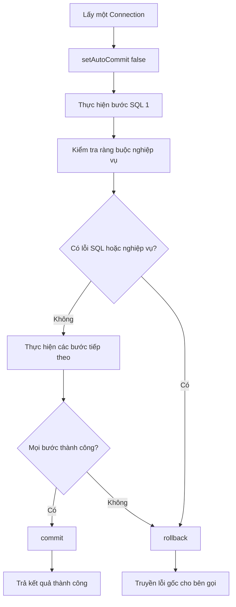

# Xử lý lỗi rollback sau lỗi nghiệp vụ hoặc lỗi SQL trong JDBC

## 1. Khi nào phải rollback một giao dịch?

Trong **JDBC**, một nghiệp vụ thường gồm nhiều thao tác SQL cần được xác nhận hoặc hủy như một đơn vị. Ví dụ, đặt hàng có thể cần tạo đơn, trừ tồn kho và thêm dòng hàng. Nếu bước cuối thất bại nhưng hai bước đầu đã được ghi vĩnh viễn, dữ liệu trở nên không nhất quán. Cơ chế **transaction** cho phép ứng dụng chủ động `commit()` khi toàn bộ nghiệp vụ hợp lệ hoặc `rollback()` khi không thể hoàn thành.

Với `Connection` JDBC, ba thao tác cơ bản là:

```java
connection.setAutoCommit(false); // Bắt đầu tự quản lý commit/rollback
// Thực thi các thao tác SQL có liên quan trên cùng connection.
connection.commit();              // Xác nhận toàn bộ thao tác thành công
// Hoặc connection.rollback();    // Hủy thay đổi chưa commit
```

Đây là ví dụ độc lập về API; trong ứng dụng cần thêm cấu trúc `try/catch`, kiểm tra kết quả và đóng tài nguyên như phần sau. Khi bật `autoCommit` (thường là mặc định của kết nối JDBC mới), mỗi câu SQL được xác nhận theo quy tắc JDBC sau khi hoàn tất; lúc đó lỗi ở câu lệnh sau **không thể dùng `rollback()` để hủy các câu lệnh đã commit trước đó**.

Điều kiện quyết định việc rollback không chỉ là JDBC có ném `SQLException` hay không. Nghiệp vụ cũng có thể thất bại dù mọi câu SQL đều hợp lệ: hết hàng, số dư không đủ, trạng thái đơn không cho phép sửa, hoặc kết quả `UPDATE` bằng `0` hàng. Khi đó Java cần chủ động ném lỗi nghiệp vụ, đưa transaction sang nhánh rollback.



## 2. Phân biệt lỗi SQL, lỗi nghiệp vụ và lỗi khi hoàn tất transaction

| Tình huống | Ví dụ | Xử lý tại ranh giới transaction |
| --- | --- | --- |
| **Lỗi SQL** (`SQLException`) | Vi phạm `UNIQUE`, khóa ngoại, `CHECK`, câu SQL không hợp lệ, mất kết nối. | Cố gắng `rollback()` nếu đã mở giao dịch, giữ nguyên nguyên nhân lỗi để tầng gọi xử lý. |
| **Lỗi nghiệp vụ** | Cập nhật tồn kho tác động `0` hàng, đơn không ở trạng thái được hủy. | Ném ngoại lệ nghiệp vụ có chủ đích; `rollback()` toàn bộ thay đổi chưa commit. |
| **Lỗi xử lý Java** (`RuntimeException`) | Thiếu dữ liệu bắt buộc, lỗi chuyển đổi hoặc tính toán trong transaction. | Thông thường rollback để không giữ trạng thái dở dang, rồi ném lại lỗi. |
| **Lỗi khi `commit()`** | Mất liên lạc lúc gửi commit hoặc DB từ chối commit. | Ghi nhận lỗi, thử rollback nếu còn khả năng; **kết quả commit có thể không xác định** nếu mất kết nối. |
| **Lỗi khi `rollback()`** | Kết nối hỏng hoặc DB không phản hồi. | Giữ lỗi ban đầu, bổ sung lỗi rollback để chẩn đoán; không khẳng định đã hoàn tác thành công. |

**Lưu ý về mức độ bảo đảm:** `rollback()` hoàn tác các thay đổi **thuộc transaction trên kết nối đó** mà DBMS hỗ trợ giao dịch. Nó không đảo ngược tác dụng phụ ngoài cơ sở dữ liệu như gửi email, gọi HTTP, ghi tệp, hoặc thông điệp đã gửi đến hệ thống khác. Một số thao tác SQL DDL còn có quy tắc commit riêng tùy DBMS. Vì vậy, ví dụ và bảo đảm trong bài áp dụng cho thao tác DML trên bảng có hỗ trợ transaction.

## 3. Mẫu xử lý lỗi: rollback rồi ném lại lỗi ban đầu

Hãy quản lý transaction ở một ranh giới rõ ràng, dùng **cùng một `Connection`** cho mọi bước nghiệp vụ. Mẫu cơ bản:

```java
import javax.sql.DataSource;
import java.sql.Connection;
import java.sql.SQLException;

static void runBusinessOperation(DataSource dataSource) throws SQLException {
    try (Connection connection = dataSource.getConnection()) {
        connection.setAutoCommit(false);

        try {
            // Thực thi các PreparedStatement trên connection.
            // Nếu điều kiện nghiệp vụ không đạt, ném RuntimeException
            // hoặc ngoại lệ nghiệp vụ được thiết kế riêng.

            connection.commit();
        } catch (SQLException | RuntimeException failure) {
            try {
                connection.rollback();
            } catch (SQLException rollbackFailure) {
                failure.addSuppressed(rollbackFailure);
            }
            throw failure;
        }
    }
}
```

Trong mẫu trên:

1. `setAutoCommit(false)` cho phép nhiều câu lệnh nằm trong một giao dịch được quản lý tường minh.
2. `commit()` chỉ được gọi khi tất cả câu lệnh và kiểm tra nghiệp vụ đã thành công.
3. Nhánh `catch` xử lý cả lỗi JDBC lẫn lỗi Java không kiểm tra (*unchecked*) phát sinh trong khối giao dịch.
4. Nếu chính `rollback()` lỗi, `addSuppressed()` giữ lỗi rollback bên cạnh **lỗi ban đầu**, tránh làm mất nguyên nhân đầu tiên.
5. `try-with-resources` đóng `Connection` dù thành công hay thất bại. Khi dùng pool, `close()` thường trả kết nối về pool; pool phải bảo đảm làm sạch trạng thái trước khi cho mượn lại.

`connection.setAutoCommit(false)` nằm trước khối `try` bên trong vì các bước DML vẫn chưa bắt đầu. Nếu lệnh này thất bại, kết nối vẫn được đóng bởi `try-with-resources` phía ngoài. Nếu nghiệp vụ sử dụng **ngoại lệ checked do ứng dụng tự định nghĩa**, cần bổ sung kiểu ngoại lệ ấy vào đường xử lý rollback hoặc chuyển nó thành lỗi nghiệp vụ theo hợp đồng của service; không được để ngoại lệ checked vượt qua nhánh `catch` một cách vô tình.

**Không nên dùng `finally` để gọi `commit()`**: khối `finally` cũng chạy khi nghiệp vụ vừa ném lỗi. Tương tự, không đặt `return` hay ném ngoại lệ mới trong `finally` vì có thể che mất lỗi quan trọng.

## 4. Ví dụ đầy đủ: tạo đơn hàng và trừ tồn kho

Giả sử cơ sở dữ liệu PostgreSQL có ba bảng sau (cú pháp identity và chi tiết ràng buộc có thể khác ở DBMS khác):

```sql
CREATE TABLE inventory (
    sku VARCHAR(40) PRIMARY KEY,
    available_qty INTEGER NOT NULL CHECK (available_qty >= 0)
);

CREATE TABLE purchase_orders (
    id BIGINT GENERATED BY DEFAULT AS IDENTITY PRIMARY KEY,
    customer_id BIGINT NOT NULL
);

CREATE TABLE purchase_order_items (
    order_id BIGINT NOT NULL REFERENCES purchase_orders(id),
    sku VARCHAR(40) NOT NULL REFERENCES inventory(sku),
    quantity INTEGER NOT NULL CHECK (quantity BETWEEN 1 AND 3),
    PRIMARY KEY (order_id, sku)
);
```

Trong ví dụ này, `CHECK (quantity BETWEEN 1 AND 3)` minh họa một ràng buộc dữ liệu ở DBMS để quan sát nhánh lỗi SQL: dù kho còn đủ, việc chèn dòng hàng với `quantity = 4` vẫn bị từ chối. Ứng dụng thực tế cần thống nhất giới hạn số lượng giữa chính sách nghiệp vụ và ràng buộc cơ sở dữ liệu.

Service dưới đây thực hiện ba bước trong **một** transaction: tạo đơn, giảm tồn kho theo điều kiện nguyên tử, rồi tạo dòng hàng. Nếu kho không đủ, service ném `InsufficientStockException` (lỗi nghiệp vụ); nếu câu `INSERT` vi phạm ràng buộc, JDBC ném `SQLException`. Cả hai lỗi đều đi qua cùng một cơ chế rollback.

```java
import javax.sql.DataSource;
import java.sql.Connection;
import java.sql.PreparedStatement;
import java.sql.ResultSet;
import java.sql.SQLException;
import java.util.Objects;

public final class OrderService {
    private final DataSource dataSource;

    public OrderService(DataSource dataSource) {
        this.dataSource = Objects.requireNonNull(dataSource);
    }

    public static final class InsufficientStockException
            extends RuntimeException {
        public InsufficientStockException(String sku) {
            super("Không đủ tồn kho hoặc SKU không tồn tại: " + sku);
        }
    }

    public long placeOrder(long customerId, String sku, int quantity)
            throws SQLException {
        Objects.requireNonNull(sku, "sku");
        if (customerId <= 0 || quantity <= 0 || sku.isBlank()) {
            throw new IllegalArgumentException("Thông tin đặt hàng không hợp lệ");
        }

        try (Connection connection = dataSource.getConnection()) {
            connection.setAutoCommit(false);
            try {
                long orderId = insertOrder(connection, customerId);
                decreaseStock(connection, sku, quantity);
                insertOrderItem(connection, orderId, sku, quantity);

                connection.commit();
                return orderId;
            } catch (SQLException | RuntimeException failure) {
                try {
                    connection.rollback();
                } catch (SQLException rollbackFailure) {
                    failure.addSuppressed(rollbackFailure);
                }
                throw failure;
            }
        }
    }

    private static long insertOrder(Connection connection, long customerId)
            throws SQLException {
        String sql = "INSERT INTO purchase_orders (customer_id) VALUES (?)";
        try (PreparedStatement statement = connection.prepareStatement(
                sql, new String[] { "id" })) {
            statement.setLong(1, customerId);
            if (statement.executeUpdate() != 1) {
                throw new SQLException("Không tạo được đúng một đơn hàng");
            }

            try (ResultSet keys = statement.getGeneratedKeys()) {
                if (!keys.next()) {
                    throw new SQLException("Không nhận được mã đơn hàng mới");
                }
                long orderId = keys.getLong(1);
                if (keys.wasNull()) {
                    throw new SQLException("Mã đơn hàng được sinh là NULL");
                }
                return orderId;
            }
        }
    }

    private static void decreaseStock(
            Connection connection, String sku, int quantity)
            throws SQLException {
        String sql =
            "UPDATE inventory " +
            "SET available_qty = available_qty - ? " +
            "WHERE sku = ? AND available_qty >= ?";

        try (PreparedStatement statement = connection.prepareStatement(sql)) {
            statement.setInt(1, quantity);
            statement.setString(2, sku);
            statement.setInt(3, quantity);

            if (statement.executeUpdate() != 1) {
                throw new InsufficientStockException(sku);
            }
        }
    }

    private static void insertOrderItem(
            Connection connection, long orderId, String sku, int quantity)
            throws SQLException {
        String sql =
            "INSERT INTO purchase_order_items (order_id, sku, quantity) " +
            "VALUES (?, ?, ?)";

        try (PreparedStatement statement = connection.prepareStatement(sql)) {
            statement.setLong(1, orderId);
            statement.setString(2, sku);
            statement.setInt(3, quantity);

            if (statement.executeUpdate() != 1) {
                throw new SQLException("Không tạo được đúng một dòng hàng");
            }
        }
    }
}
```

Ví dụ gọi `placeOrder()` (giả sử `dataSource` đã cấu hình đúng driver):

```java
OrderService service = new OrderService(dataSource);

try {
    long id = service.placeOrder(42L, "BOOK-01", 2);
    System.out.println("Đơn đã tạo: " + id);
} catch (OrderService.InsufficientStockException error) {
    // Thông báo cho người dùng rằng số lượng yêu cầu không đáp ứng được.
} catch (SQLException error) {
    // Ghi nhận SQLState/vendor code để điều tra và trả lỗi phù hợp.
}
```

**Vì sao câu `UPDATE` có điều kiện?** `UPDATE inventory ... WHERE available_qty >= ?` kiểm tra và giảm kho trong một câu SQL, tránh mô hình đọc tồn kho rồi quyết định giảm dựa trên một giá trị có thể đã cũ. Tính đúng đắn khi chạy đồng thời còn phụ thuộc isolation, khóa và đặc tính DBMS; ví dụ này dùng điều kiện cập nhật nguyên tử làm điểm xuất phát, không thay thế toàn bộ thiết kế chống tranh chấp tồn kho.

## 5. Đi qua ba kịch bản thực tế

Giả sử `inventory` đã có `('BOOK-01', 5)` và chưa có đơn hàng mới:

| Thao tác | Dữ liệu trong transaction | Kết quả sau khi kết thúc |
| --- | --- | --- |
| `placeOrder(42, "BOOK-01", 2)` | Tạo đơn, giảm kho từ `5` xuống `3`, thêm dòng hàng `2`. | `commit()` thành công: đơn/dòng hàng tồn tại, kho còn `3`. |
| `placeOrder(42, "BOOK-01", 8)` | Đã tạo đơn; `UPDATE` kho tác động `0` hàng, ném lỗi nghiệp vụ. | `rollback()` thành công: đơn tạm bị hủy, kho vẫn `5`. |
| `placeOrder(42, "BOOK-01", 4)` | Tạo đơn và tạm trừ kho còn `1`; `INSERT` dòng hàng vi phạm `CHECK(quantity BETWEEN 1 AND 3)`. | `rollback()` thành công: cả đơn lẫn thay đổi kho bị hủy, kho vẫn `5`. |

Các kịch bản độc lập, mỗi kịch bản bắt đầu từ kho `5` trong môi trường thử nghiệm được khôi phục trạng thái. Chúng minh họa rằng **lỗi nghiệp vụ** (`UPDATE` tác động `0` hàng) và **lỗi SQL** (vi phạm `CHECK`) khác nguồn gốc nhưng phải dẫn đến cùng kết quả nhất quán nếu rollback thành công.

Vì khóa identity/sequence có thể tăng dù transaction bị rollback, một số ID có thể bị bỏ qua. Không suy ra giao dịch đã commit chỉ vì `getGeneratedKeys()` trả một ID, và không giả định khóa đơn hàng luôn liên tục.

## 6. Giữ nguyên nguyên nhân lỗi và xử lý khi rollback cũng thất bại

Lệnh `rollback()` bản thân nó cũng có thể ném `SQLException`, chẳng hạn do mất kết nối hoặc máy chủ không phản hồi. Mẫu xử lý sau **không được phép thay thế lỗi gốc bằng lỗi rollback**:

```java
catch (SQLException | RuntimeException failure) {
    try {
        connection.rollback();
    } catch (SQLException rollbackFailure) {
        failure.addSuppressed(rollbackFailure);
    }
    throw failure;
}
```

Ví dụ, câu `INSERT` có thể ném `SQLException` do khóa ngoại. Nếu ngay sau đó mạng bị gián đoạn, `rollback()` cũng ném ngoại lệ. Khi sử dụng `addSuppressed()`, tầng giám sát vẫn nhìn thấy **lỗi khóa ngoại là nguyên nhân chính** và **lỗi rollback là thông tin bổ sung**. Trình ghi log nên hiển thị cả `getSuppressed()` để chẩn đoán đầy đủ.

Tuy nhiên, nếu rollback thất bại, không được báo với hệ thống khác rằng giao dịch **chắc chắn** đã bị hủy. Nếu `commit()` thất bại vì mất liên lạc, trạng thái cũng có thể không xác định: lệnh commit có thể đã được DBMS xử lý trước khi kết nối đứt. Không tự động thử lại nghiệp vụ có tác dụng phụ mà không có chiến lược idempotency và kiểm tra trạng thái phù hợp.

Trong trường hợp `SQLException`, có thể ghi các thông tin chẩn đoán sau (tránh ghi mật khẩu, SQL có dữ liệu cá nhân hoặc tham số nhạy cảm):

```java
static void reportSqlException(SQLException error) {
    for (SQLException e = error; e != null; e = e.getNextException()) {
        System.err.printf("SQLState=%s, vendorCode=%d, message=%s%n",
            e.getSQLState(), e.getErrorCode(), e.getMessage());
    }
    for (Throwable suppressed : error.getSuppressed()) {
        System.err.println("Lỗi bổ sung: " + suppressed);
    }
}
```

`SQLState` và vendor code giúp phân loại lỗi, nhưng mã cụ thể phụ thuộc DBMS. Ví dụ với PostgreSQL, `23505` biểu thị vi phạm ràng buộc duy nhất, `23503` biểu thị vi phạm khóa ngoại và `23514` biểu thị vi phạm `CHECK`. Các mã này hữu ích cho chẩn đoán; không nên thiết kế một cơ chế rollback chỉ dựa trên một tập SQLState vì còn các lỗi kết nối và lỗi không do ràng buộc.

## 7. Các lỗi thiết kế thường gặp

### 7.1. Quên tắt auto-commit

```java
// Sai nếu muốn coi hai câu lệnh là một transaction:
try (Connection connection = dataSource.getConnection()) {
    insertOrder(connection);       // Có thể đã auto-commit.
    decreaseStock(connection);     // Nếu lỗi, lệnh trước không tự được hủy.
}
```

Đây là mã giả để nêu sai lầm; các phương thức `insertOrder` và `decreaseStock` trong ví dụ đầy đủ nhận thêm tham số. Cần thiết lập `setAutoCommit(false)` **trước các thao tác DML đầu tiên** và xác định rõ điểm `commit()` duy nhất.

### 7.2. Mỗi bước dùng một kết nối khác nhau

Nếu `createOrder()` và `updateInventory()` tự gọi `dataSource.getConnection()` riêng, việc rollback một kết nối không hoàn tác công việc đã commit trên kết nối kia. Service chịu trách nhiệm transaction cần truyền cùng `Connection` cho DAO tham gia, hoặc dùng cơ chế quản lý transaction thống nhất.

### 7.3. Chỉ bắt `SQLException`, bỏ sót lỗi nghiệp vụ

```java
// Sai nếu có thao tác SQL trước đó và điều kiện nghiệp vụ ném RuntimeException:
try {
    // ... INSERT đơn hàng ...
    if (notEnoughStock) {
        throw new IllegalStateException("Hết hàng");
    }
    connection.commit();
} catch (SQLException error) {
    connection.rollback();
    throw error;
}
```

Trong mã trên, lỗi nghiệp vụ không đi vào `catch`. Việc đóng kết nối có thể khiến driver/pool dọn giao dịch, nhưng **không dùng đóng kết nối làm kế hoạch rollback**. Hãy bắt các loại lỗi nghiệp vụ mà service cho phép phát sinh và gọi rollback tường minh.

### 7.4. Nuốt lỗi rồi commit dữ liệu dở dang

```java
try {
    // ... UPDATE tồn kho ...
} catch (SQLException error) {
    System.err.println(error.getMessage());
}
connection.commit(); // Có nguy cơ xác nhận trạng thái không hoàn chỉnh.
```

Không tiếp tục `commit()` sau một lỗi thuộc nhánh bắt buộc hủy nghiệp vụ. Nếu cố tình cho phép *partial success*, đó phải là yêu cầu nghiệp vụ tường minh với giới hạn transaction tương ứng, không phải hệ quả của việc bỏ qua ngoại lệ.

### 7.5. Bật lại auto-commit khi transaction còn dở dang

Theo JDBC, đổi chế độ từ `autoCommit=false` về `true` có thể **commit transaction hiện hành**. Vì vậy, không gọi `setAutoCommit(true)` trong `finally` một cách vô điều kiện khi chưa chắc transaction đã `commit()` hoặc `rollback()` thành công. Với kết nối mượn từ pool, cần tuân theo hợp đồng của pool về khôi phục trạng thái và loại bỏ kết nối lỗi; ví dụ trong bài đóng kết nối sau mỗi nghiệp vụ.

## 8. Ranh giới transaction, ngoại lệ checked và hệ thống bên ngoài

Một số nguyên tắc khi mở rộng từ ví dụ sang DAO/repository thực tế:

- **Một chủ sở hữu transaction:** tầng service quyết định `commit`/`rollback`; các DAO dùng cùng `Connection` không tự `commit()` ở giữa, trừ khi thiết kế cố ý tách các nghiệp vụ độc lập.
- **Ngoại lệ checked của ứng dụng:** nếu nghiệp vụ dùng `throws BusinessException` (checked), nhánh `catch` phải bao phủ kiểu này trước khi ngoại lệ rời transaction. Nếu không, service có thể bỏ sót rollback.
- **Không giữ transaction lâu:** hạn chế gọi API ngoài, chờ người dùng hoặc xử lý tính toán kéo dài khi đang giữ khóa DB. Nếu cần phối hợp với hệ thống khác, cân nhắc outbox, idempotency hoặc cơ chế điều phối thích hợp thay vì giả định `rollback()` JDBC sẽ hoàn tác mọi nơi.
- **Không cho rằng mọi lỗi SQL hủy toàn bộ transaction:** chẳng hạn PostgreSQL đánh dấu giao dịch là thất bại sau nhiều lỗi SQL và yêu cầu rollback, trong khi hệ quản trị khác có thể chỉ hủy một statement. Ở ranh giới nghiệp vụ yêu cầu nguyên tử, vẫn chủ động rollback khi bất kỳ bước bắt buộc nào thất bại.
- **Phạm vi rollback:** `rollback()` không hoàn tác thay đổi đã được `commit()`. Khi sử dụng savepoint, `rollback(savepoint)` chỉ quay về một mốc trong transaction; đây là lựa chọn thiết kế riêng, không thay thế rollback toàn bộ khi toàn bộ nghiệp vụ phải thất bại.

Đối với ứng dụng xử lý nhiều yêu cầu đồng thời, một `Connection` không nên được chia sẻ tùy tiện giữa các luồng thực hiện các transaction độc lập. Mỗi yêu cầu hoặc đơn vị công việc nên nhận kết nối phù hợp từ `DataSource` và trả lại sau khi hoàn tất.

## 9. Kiểm thử rollback theo nguyên nhân thất bại

Cần kiểm tra trạng thái **trong database sau giao dịch**, thay vì chỉ xác nhận rằng phương thức đã ném ngoại lệ. Bảng kiểm thử tích hợp mẫu:

| Trường hợp | Dữ liệu đầu vào | Kỳ vọng cần kiểm tra |
| --- | --- | --- |
| Thành công | Kho còn `5`, đặt `2` | Có đơn và dòng hàng, kho còn `3`. |
| Lỗi nghiệp vụ sau `INSERT` | Kho còn `5`, đặt `8` | Ném `InsufficientStockException`, không có đơn/dòng hàng mới, kho vẫn `5`. |
| Lỗi SQL ở bước cuối | Kho còn `5`, đặt `4` (vi phạm giới hạn dòng hàng `<= 3`) | Ném `SQLException`, không có đơn/dòng hàng mới, kho vẫn `5`. |
| Lỗi SQL ngay ở bước đầu | Trong môi trường test, thêm ràng buộc hoặc trigger để `INSERT purchase_orders` bị từ chối | Không có dữ liệu dở dang, lỗi gốc còn được bảo toàn. |
| Lỗi rollback | Dùng môi trường kiểm thử có khả năng mô phỏng lỗi kết nối/rollback | Lỗi ban đầu vẫn là lỗi chính, lỗi rollback nằm trong suppressed, không khẳng định trạng thái DB. |
| Lỗi commit hoặc mất kết nối | Mô phỏng tình huống không nhận được phản hồi commit | Báo trạng thái không chắc chắn; xác minh bằng khóa nghiệp vụ/idempotency trước khi thử lại. |

Với kịch bản lỗi nghiệp vụ/SQL, có thể đối chiếu số bản ghi trong `purchase_orders` và `purchase_order_items`, cùng `available_qty` trước và sau khi gọi service. Kiểm thử nên chạy trên DBMS/driver thực tế vì tự động commit, transaction isolation, ràng buộc SQL và lỗi kết nối đều chịu ảnh hưởng môi trường.

## 10. Ghi nhớ

Xử lý rollback đúng trong JDBC bắt đầu bằng việc **tắt auto-commit trước khi thực hiện chuỗi DML**, dùng **một `Connection`**, kiểm tra cả **lỗi SQL và điều kiện nghiệp vụ**, chỉ `commit()` khi mọi bước hợp lệ, và `rollback()` ngay khi có thất bại. Giữ nguyên lỗi ban đầu, đính kèm lỗi rollback bằng `addSuppressed()`, rồi chuyển thông tin cho tầng gọi. Nếu rollback hoặc commit gặp sự cố kết nối, hãy báo rõ rằng trạng thái cuối có thể chưa xác định và kiểm tra lại dữ liệu trước những thao tác có thể bị lặp.
