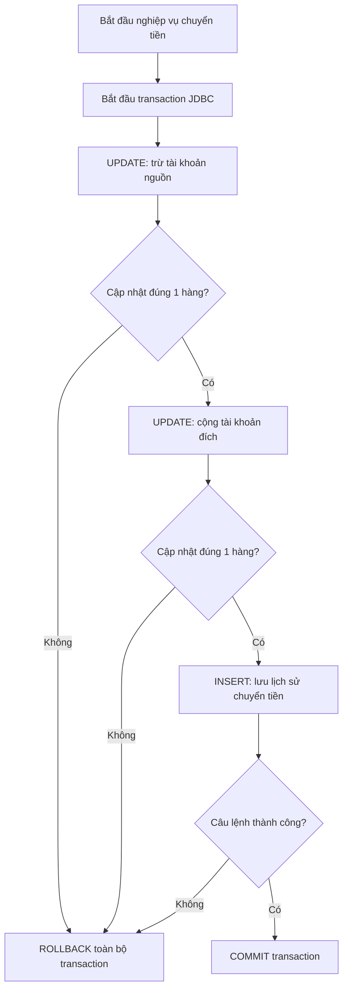

# Phối hợp nhiều câu lệnh như một đơn vị nghiệp vụ

## 1. Vì sao nhiều câu lệnh SQL phải cùng thành công hoặc cùng thất bại?

Trong ứng dụng Java dùng **JDBC** để truy cập cơ sở dữ liệu quan hệ, một thao tác nghiệp vụ thường không dừng ở một câu lệnh SQL. Ví dụ, khi chuyển tiền giữa hai tài khoản, hệ thống cần:

1. Trừ số tiền ở tài khoản nguồn.
2. Cộng đúng số tiền đó vào tài khoản đích.
3. Ghi một bản ghi lịch sử chuyển tiền.

Nếu thao tác (1) đã được lưu nhưng thao tác (2) hoặc (3) thất bại, dữ liệu sẽ ở trạng thái không nhất quán: tiền đã bị trừ nhưng chưa đến người nhận, hoặc việc chuyển tiền không có dấu vết kiểm tra.

**Transaction (giao dịch)** cung cấp một ranh giới để nhiều câu lệnh SQL được xử lý như **một đơn vị nghiệp vụ**: nếu toàn bộ hợp lệ thì `commit`, nếu có lỗi thì `rollback` các thay đổi chưa được commit trong cùng giao dịch.



Trong sơ đồ, cả ba câu lệnh phải được thực thi trên **cùng một `Connection` và trong cùng một giao dịch**. Việc từng lệnh thành công riêng lẻ chưa bảo đảm cả đơn vị nghiệp vụ đã thành công.

## 2. Vì sao `autoCommit` mặc định không phù hợp với nhiều bước?

Trong JDBC, `Connection` có chế độ `autoCommit`. Khi chế độ này bật, JDBC thường commit mỗi câu lệnh SQL khi câu lệnh hoàn tất theo quy tắc của JDBC và driver. Vì vậy, các lệnh thực thi lần lượt có thể được lưu độc lập.

Ví dụ sau **không tạo được tính nguyên tử** của nghiệp vụ:

```java
// Minh họa lỗi thiết kế: mỗi câu lệnh có thể được commit riêng.
try (Connection connection = dataSource.getConnection()) {
    // Khi autoCommit=true:
    executeDebit(connection);   // Thay đổi có thể đã commit.
    executeCredit(connection);  // Nếu lỗi, debit không tự động được hoàn tác.
    insertTransfer(connection);
}
```

Ba phương thức trên chỉ mang tính minh họa. Một lời gọi `rollback()` sau khi câu lệnh thứ nhất đã commit **không thể quay ngược** commit đó.

Với đơn vị nghiệp vụ có nhiều lệnh, cần chủ động quản lý ranh giới transaction:

```java
connection.setAutoCommit(false);

try {
    // Thực hiện các SQL DML thuộc cùng nghiệp vụ.
    connection.commit();
} catch (SQLException | RuntimeException failure) {
    try {
        connection.rollback();
    } catch (SQLException rollbackFailure) {
        failure.addSuppressed(rollbackFailure);
    }
    throw failure;
}
```

Đây là mẫu **lõi** để minh họa ranh giới giao dịch; ví dụ hoàn chỉnh ở mục 5 còn xử lý lấy/đóng kết nối, xác thực đầu vào, số hàng bị ảnh hưởng và khôi phục trạng thái kết nối.

| API JDBC | Ý nghĩa khi tự quản lý transaction |
| --- | --- |
| `setAutoCommit(false)` | Ngừng commit độc lập từng câu lệnh; bắt đầu quản lý transaction thủ công |
| `commit()` | Yêu cầu DBMS xác nhận các thay đổi của giao dịch hiện hành |
| `rollback()` | Yêu cầu DBMS hoàn tác các thay đổi chưa commit của giao dịch hiện hành |
| `getAutoCommit()` | Kiểm tra chế độ trước khi thay đổi |
| `close()` | Giải phóng `Connection`; với pool thường trả kết nối về pool; không dùng thay `commit/rollback` |

**Không nên xem `close()` như một cách rollback đáng tin cậy.** Việc đóng một kết nối khi còn transaction chưa kết thúc có hành vi phụ thuộc driver, pool và DBMS. Ứng dụng cần chủ động kết thúc transaction bằng `commit` hoặc `rollback`.

## 3. Chọn ranh giới theo nghiệp vụ, không theo từng phương thức SQL

Một transaction nên bao trọn những thay đổi **phải nhất quán với nhau** theo quy tắc nghiệp vụ. Ví dụ:

| Nghiệp vụ | Các thay đổi cần phối hợp | Điều kiện thành công |
| --- | --- | --- |
| Chuyển tiền | Trừ nguồn, cộng đích, ghi lịch sử | Đủ tiền, hai tài khoản hợp lệ, ghi đủ ba bước |
| Tạo đơn hàng | Thêm đơn, thêm dòng hàng, giữ hàng tồn | Không có dòng hàng bị bỏ sót; tồn kho đủ |
| Hủy đặt chỗ | Cập nhật trạng thái, trả lại chỗ, tạo bản ghi hoàn trả nội bộ | Không có trạng thái hủy dở dang |
| Thanh toán nội bộ bằng điểm | Trừ điểm, cộng điểm, ghi giao dịch | Không âm điểm, không tạo giao dịch trùng |

Nếu một service gọi ba repository, nhưng **mỗi repository tự mở và đóng một `Connection`**, thì ba lệnh không còn thuộc một transaction chỉ vì chúng chạy trong cùng phương thức Java. Cần chia sẻ **chính một `Connection`** hoặc dùng cơ chế quản lý transaction có khả năng liên kết kết nối trong cùng phạm vi.

Trong bài này, ta dùng thuần JDBC với `DataSource`, `PreparedStatement`, `ResultSet` khi cần đọc và `Connection` để quản lý transaction. Các framework quản lý transaction có thể giảm mã lặp, nhưng không làm thay đổi yêu cầu cơ bản: mọi lệnh cần tính nguyên tử phải nằm trong một transaction thực sự do DBMS hỗ trợ.

## 4. Dữ liệu mẫu: hai tài khoản và lịch sử chuyển tiền

Thiết kế bảng sau dùng hai tài khoản và bảng lịch sử, với cú pháp phù hợp PostgreSQL. Khi chuyển sang DBMS khác, cần điều chỉnh kiểu thời gian, cú pháp ràng buộc và kiểm tra các bảng thực sự hỗ trợ transaction; chẳng hạn `TIMESTAMP` trong SQL Server có ý nghĩa khác kiểu ngày giờ dùng ở đây.

```sql
CREATE TABLE bank_accounts (
    account_id BIGINT PRIMARY KEY,
    balance DECIMAL(18, 2) NOT NULL,
    CONSTRAINT ck_account_nonnegative CHECK (balance >= 0)
);

CREATE TABLE money_transfers (
    transfer_id VARCHAR(64) PRIMARY KEY,
    source_account_id BIGINT NOT NULL,
    target_account_id BIGINT NOT NULL,
    amount DECIMAL(18, 2) NOT NULL,
    created_at TIMESTAMP NOT NULL DEFAULT CURRENT_TIMESTAMP,
    CONSTRAINT fk_transfer_source FOREIGN KEY (source_account_id)
        REFERENCES bank_accounts(account_id),
    CONSTRAINT fk_transfer_target FOREIGN KEY (target_account_id)
        REFERENCES bank_accounts(account_id),
    CONSTRAINT ck_transfer_positive CHECK (amount > 0),
    CONSTRAINT ck_transfer_distinct_accounts
        CHECK (source_account_id <> target_account_id)
);

INSERT INTO bank_accounts (account_id, balance)
VALUES (1, 100.00), (2, 40.00);
```

Ta muốn chuyển **25.00** từ tài khoản `1` sang tài khoản `2`, với mã yêu cầu duy nhất `TX-001`. Kết quả sau khi transaction thành công:

| account_id | balance trước | balance sau |
| ---: | ---: | ---: |
| 1 | 100.00 | 75.00 |
| 2 | 40.00 | 65.00 |

Bảng `money_transfers` phải đồng thời có một hàng ghi `TX-001`, nguồn `1`, đích `2` và số tiền `25.00`. Nếu một bước không hoàn tất, **cả hai số dư phải giữ nguyên** và bản ghi lịch sử không được xuất hiện.

Để tránh thao tác trừ tiền khi số dư không đủ, câu SQL ghi nợ sử dụng điều kiện **ngay trong câu `UPDATE`**:

```sql
UPDATE bank_accounts
SET balance = balance - ?
WHERE account_id = ?
  AND balance >= ?;
```

Khi tài khoản có đủ tiền, thao tác thường ảnh hưởng đúng **một hàng**. Khi không tìm thấy tài khoản hoặc số dư không đủ, nó ảnh hưởng **không hàng nào**. Kiểm tra `executeUpdate()` giúp phát hiện trường hợp nghiệp vụ thất bại, dù không có `SQLException`.

## 5. Ví dụ hoàn chỉnh: phối hợp ba câu lệnh bằng một `Connection`

Ví dụ dưới dùng Java 17+, `DataSource` đã được cấu hình với driver và kết nối tới DBMS có hỗ trợ transaction cho các bảng trên. Mỗi lần chuyển tiền dùng một kết nối riêng, thực hiện ba câu lệnh trong cùng một transaction, commit một lần cuối cùng.

```java
import java.math.BigDecimal;
import java.math.RoundingMode;
import java.sql.Connection;
import java.sql.PreparedStatement;
import java.sql.SQLException;
import javax.sql.DataSource;

public final class MoneyTransferService {
    private final DataSource dataSource;

    public MoneyTransferService(DataSource dataSource) {
        this.dataSource = dataSource;
    }

    public void transfer(
            long sourceId,
            long targetId,
            BigDecimal amount,
            String transferId) throws SQLException {

        if (sourceId == targetId) {
            throw new IllegalArgumentException(
                    "Tài khoản nguồn và đích phải khác nhau");
        }
        if (amount == null || amount.signum() <= 0) {
            throw new IllegalArgumentException(
                    "Số tiền phải lớn hơn 0");
        }
        if (transferId == null || transferId.isBlank()
                || transferId.length() > 64) {
            throw new IllegalArgumentException(
                    "Mã giao dịch không hợp lệ");
        }

        // Không âm thầm làm tròn số tiền có quá 2 chữ số lẻ.
        BigDecimal normalizedAmount =
                amount.setScale(2, RoundingMode.UNNECESSARY);

        try (Connection connection = dataSource.getConnection()) {
            boolean previousAutoCommit = connection.getAutoCommit();
            if (!previousAutoCommit) {
                throw new SQLException(
                        "Ví dụ yêu cầu Connection chưa có transaction");
            }
            connection.setAutoCommit(false);

            boolean transactionEnded = false;
            Throwable primaryFailure = null;

            try {
                int debitCount = debit(
                        connection, sourceId, normalizedAmount);
                if (debitCount != 1) {
                    throw new IllegalStateException(
                            "Nguồn không tồn tại hoặc số dư không đủ");
                }

                int creditCount = credit(
                        connection, targetId, normalizedAmount);
                if (creditCount != 1) {
                    throw new IllegalStateException(
                            "Tài khoản đích không tồn tại");
                }

                insertTransfer(
                        connection, transferId, sourceId, targetId,
                        normalizedAmount);

                // Chỉ xác nhận sau khi toàn bộ bước đều thành công.
                connection.commit();
                transactionEnded = true;
            } catch (SQLException | RuntimeException failure) {
                primaryFailure = failure;
                try {
                    connection.rollback();
                    transactionEnded = true;
                } catch (SQLException rollbackFailure) {
                    failure.addSuppressed(rollbackFailure);
                }
                throw failure;
            } finally {
                // Chỉ đổi chế độ trở lại khi đã kết thúc transaction.
                // setAutoCommit(true) khi transaction còn mở có thể commit.
                if (transactionEnded) {
                    try {
                        connection.setAutoCommit(previousAutoCommit);
                    } catch (SQLException resetFailure) {
                        if (primaryFailure != null) {
                            primaryFailure.addSuppressed(resetFailure);
                        } else {
                            throw resetFailure;
                        }
                    }
                }
            }
        }
    }

    private static int debit(
            Connection connection, long accountId, BigDecimal amount)
            throws SQLException {
        String sql = """
                UPDATE bank_accounts
                SET balance = balance - ?
                WHERE account_id = ? AND balance >= ?
                """;

        try (PreparedStatement statement =
                     connection.prepareStatement(sql)) {
            statement.setBigDecimal(1, amount);
            statement.setLong(2, accountId);
            statement.setBigDecimal(3, amount);
            return statement.executeUpdate();
        }
    }

    private static int credit(
            Connection connection, long accountId, BigDecimal amount)
            throws SQLException {
        String sql = """
                UPDATE bank_accounts
                SET balance = balance + ?
                WHERE account_id = ?
                """;

        try (PreparedStatement statement =
                     connection.prepareStatement(sql)) {
            statement.setBigDecimal(1, amount);
            statement.setLong(2, accountId);
            return statement.executeUpdate();
        }
    }

    private static void insertTransfer(
            Connection connection,
            String transferId,
            long sourceId,
            long targetId,
            BigDecimal amount) throws SQLException {
        String sql = """
                INSERT INTO money_transfers
                    (transfer_id, source_account_id,
                     target_account_id, amount)
                VALUES (?, ?, ?, ?)
                """;

        try (PreparedStatement statement =
                     connection.prepareStatement(sql)) {
            statement.setString(1, transferId);
            statement.setLong(2, sourceId);
            statement.setLong(3, targetId);
            statement.setBigDecimal(4, amount);

            if (statement.executeUpdate() != 1) {
                throw new SQLException(
                        "Không ghi được lịch sử chuyển tiền");
            }
        }
    }
}
```

Gọi service:

```java
MoneyTransferService service = new MoneyTransferService(dataSource);

service.transfer(
        1L,
        2L,
        new BigDecimal("25.00"),
        "TX-001");
```

**Điểm cốt lõi của thiết kế:**

1. `DataSource.getConnection()` được gọi **một lần** trong phạm vi transaction. Ba hàm `debit`, `credit` và `insertTransfer` đều nhận cùng đối tượng `Connection`.
2. `setAutoCommit(false)` được gọi **trước** các lệnh cập nhật. `commit()` chỉ chạy khi đã xác minh số hàng và lịch sử.
3. Các câu lệnh dùng `PreparedStatement` với `?` và các setter đúng kiểu; không tạo SQL bằng cách nối dữ liệu người dùng.
4. `BigDecimal` bảo toàn phép tính thập phân hơn `double`. `setScale(2, UNNECESSARY)` chấp nhận số có thể biểu diễn chính xác bằng hai chữ số thập phân và từ chối số đòi hỏi làm tròn.
5. Khi kết quả `executeUpdate()` là 0 ở một bước bắt buộc, mã chủ động phát sinh `IllegalStateException` để kích hoạt rollback. Lỗi nghiệp vụ vẫn cần rollback như lỗi SQL.
6. Nếu rollback thất bại, ngoại lệ rollback được gắn bằng `addSuppressed` vào lỗi gốc để giữ thông tin chẩn đoán. Khi đó trạng thái transaction có thể chưa rõ; ví dụ bỏ qua việc khôi phục `autoCommit` và đóng kết nối.
7. Khi `commit` hoặc `rollback` hoàn tất, trạng thái `autoCommit` ban đầu được khôi phục. Nếu thao tác khôi phục sau `commit` thất bại, lời gọi có thể ném `SQLException` **dù giao dịch nghiệp vụ đã commit**; cần đối chiếu trạng thái trước khi thử lại.

Việc khôi phục thuộc tính kết nối còn cần phù hợp cơ chế pool/transaction manager của ứng dụng. Mẫu trên chủ động yêu cầu một `Connection` ban đầu ở chế độ `autoCommit=true` để tránh vô tình tham gia một transaction do nơi khác mở. Nếu đang dùng transaction do framework hoặc container quản lý, hãy để thành phần đó sở hữu `commit/rollback` và ranh giới kết nối, không tự bật/tắt `autoCommit` bên trong.

## 6. Vì sao không được tự mở kết nối trong từng thao tác con?

Một lỗi thường gặp là mỗi repository có phương thức:

```java
// Sai đối với nghiệp vụ cần 3 thao tác nguyên tử.
void debit(BigDecimal amount) throws SQLException {
    try (Connection c = dataSource.getConnection()) {
        // UPDATE tài khoản nguồn...
    }
}

void credit(BigDecimal amount) throws SQLException {
    try (Connection c = dataSource.getConnection()) {
        // UPDATE tài khoản đích...
    }
}
```

Hai lần gọi `getConnection()` có thể lấy hai phiên khác nhau. Không có gì bảo đảm chúng cùng transaction. Dù cả hai dùng chung một `DataSource`, `commit` trên một kết nối không tự điều khiển các thay đổi trên kết nối còn lại.

Với JDBC thuần, một mẫu tổ chức đơn giản là **service sở hữu ranh giới giao dịch, repository nhận `Connection` do service truyền vào**:

```java
// Dạng chữ ký gợi ý bên trong cùng ứng dụng:
int debit(Connection c, long accountId, BigDecimal amount)
        throws SQLException;
int credit(Connection c, long accountId, BigDecimal amount)
        throws SQLException;
void insertTransfer(Connection c, String id, long sourceId,
        long targetId, BigDecimal amount) throws SQLException;
```

Các phương thức thao tác con đóng `PreparedStatement`/`ResultSet` mà chúng tạo, nhưng **không đóng, commit hay rollback `Connection` truyền vào**. Chỉ service chịu trách nhiệm quyết định khi nào transaction kết thúc.

Một `Connection` JDBC cũng không nên dùng đồng thời từ nhiều luồng cho các thao tác con: hãy chạy tuần tự hoặc sử dụng cơ chế phối hợp transaction phù hợp. Việc dùng nhiều luồng và nhiều connection không tự biến thành một transaction nguyên tử.

## 7. Xử lý thất bại ở từng giai đoạn

Không phải mọi lỗi nghiệp vụ đều thể hiện bằng `SQLException`. Cần xét cả giá trị trả về và lỗi Java khi ra quyết định commit/rollback.

| Thời điểm lỗi | Ví dụ | Xử lý đúng |
| --- | --- | --- |
| Trước khi mở transaction | `amount <= 0`, hai tài khoản trùng nhau | Từ chối ngay; chưa có thay đổi DB |
| UPDATE nguồn ảnh hưởng 0 hàng | Không tồn tại hoặc không đủ tiền | Phát sinh lỗi nghiệp vụ; `rollback` |
| UPDATE đích ảnh hưởng 0 hàng | Không tìm thấy tài khoản nhận | `rollback` cả phần trừ nguồn |
| INSERT lịch sử lỗi khóa duy nhất | `transfer_id` đã tồn tại | `rollback` phần trừ và cộng vừa làm |
| DBMS báo lỗi constraint hoặc deadlock | `SQLException` ở bất kỳ bước nào | `rollback` hoặc kiểm tra tình trạng transaction; quyết định thử lại có kiểm soát |
| Ngoại lệ Java trong khi xử lý | `IllegalStateException`, lỗi tính toán | `rollback`; không để cập nhật dở dang |
| `rollback` thất bại | Mất kết nối hoặc DBMS lỗi | Giữ lỗi gốc, ghi nhận lỗi rollback; trạng thái có thể chưa xác định |
| `commit` báo lỗi hoặc kết nối đứt đúng lúc commit | Không biết DB đã commit chưa | Xem kết quả là **chưa xác định**; kiểm tra bằng ID nghiệp vụ, tránh thử lại mù quáng |

Điểm cuối đặc biệt quan trọng. Khi ứng dụng gọi `commit()` mà đường truyền bị ngắt, phía Java có thể nhận ngoại lệ dù DBMS đã nhận và thực thi commit. Gọi `rollback()` sau đó **không bảo đảm hoàn tác** một commit đã thành công. Với giao dịch tiền, đặt mã `transfer_id` duy nhất giúp đối chiếu xem yêu cầu đã được ghi chưa.

Nếu muốn hỗ trợ **retry an toàn**, mã yêu cầu phải ổn định giữa các lần thử và có quy tắc xử lý trùng rõ ràng. Ví dụ, khi nhận lỗi trùng `transfer_id`, service cần hoàn tác transaction hiện tại rồi đọc lại bản ghi cũ, so sánh nguồn, đích và số tiền để phân biệt yêu cầu lặp hợp lệ với việc tái sử dụng mã cho nội dung khác. Chỉ nhìn thấy khóa đã tồn tại chưa đủ để tự động báo thành công.

## 8. Tính nguyên tử, nhất quán, cô lập và bền vững

Một transaction có bốn thuộc tính thường được viết tắt là **ACID**:

| Thuộc tính | Ý nghĩa trong ví dụ chuyển tiền |
| --- | --- |
| **Atomicity (nguyên tử)** | Trừ tiền, cộng tiền, ghi lịch sử cùng commit hoặc cùng rollback |
| **Consistency (nhất quán)** | Chuyển trạng thái DB hợp lệ sang trạng thái hợp lệ khác, dưới ràng buộc và kiểm tra nghiệp vụ |
| **Isolation (cô lập)** | Các transaction đồng thời không được gây ra các hiện tượng ngoài giới hạn mà mức cô lập đã chọn cho phép |
| **Durability (bền vững)** | Sau commit thành công, DBMS chịu trách nhiệm duy trì kết quả theo cơ chế bền vững đã cấu hình |

**Transaction không tự kiểm tra mọi quy tắc nghiệp vụ.** Nó không thể biết rằng một lần chuyển tiền phải có người nhận khác người gửi hay số dư không được âm nếu ứng dụng/schema không thể hiện các điều kiện đó.

Ràng buộc `CHECK(balance >= 0)` cùng điều kiện `WHERE balance >= ?` là hai lớp bảo vệ bổ sung. Transaction đảm bảo các thay đổi trong phạm vi được thực thi nguyên tử, còn quy tắc dữ liệu và ràng buộc bảo vệ tính hợp lệ.

Việc transaction thật sự có tính nguyên tử còn phụ thuộc vào loại bảng/storage engine và DBMS. Ví dụ, không nên giả định các bảng không hỗ trợ transaction có thể rollback hoàn chỉnh.

## 9. Đồng thời: transaction không tự giải quyết mọi tranh chấp

Giả sử tài khoản nguồn có 100.00 và đồng thời nhận hai yêu cầu chuyển 80.00. Cách làm sai là:

```text
Transaction A: SELECT balance -> 100.00
Transaction B: SELECT balance -> 100.00
Transaction A: UPDATE balance = 20.00
Transaction B: UPDATE balance = 20.00
```

Nếu quyết định dựa trên số dư đọc cũ mà không khóa hay kiểm tra khi cập nhật, hệ thống có thể mất cập nhật hoặc ghi nhận hai lần chuyển tiền nhưng số dư chỉ giảm một lần.

Trong ví dụ mục 5, câu lệnh:

```sql
UPDATE bank_accounts
SET balance = balance - ?
WHERE account_id = ?
  AND balance >= ?;
```

thực hiện kiểm tra điều kiện và cập nhật trong **cùng một lệnh SQL**. Trên DBMS giao dịch phổ biến với cơ chế khóa/kiểm soát đồng thời thích hợp, hai lệnh cập nhật tranh cùng một hàng được điều phối để tránh cùng trừ vượt số dư. Dù vậy, hành vi cụ thể khi có lock timeout, deadlock hay xung đột serialization phụ thuộc DBMS và mức cô lập.

JDBC cho phép tham khảo hoặc đặt mức cô lập bằng `getTransactionIsolation()` và `setTransactionIsolation(...)`. Các mức thường gặp:

- `TRANSACTION_READ_COMMITTED`: không đọc dữ liệu chưa commit từ transaction khác; những lần đọc lặp lại vẫn có thể thấy kết quả khác.
- `TRANSACTION_REPEATABLE_READ`: bảo vệ thêm một số hiện tượng đọc lại; quy tắc phantom/write skew và triển khai khác nhau theo DBMS.
- `TRANSACTION_SERIALIZABLE`: hướng tới kết quả tương đương lịch thực thi tuần tự, nhưng có thể phát sinh lỗi xung đột cần retry.

Không mặc định rằng mức cô lập “cao” có thể thay mọi kiểm tra miền nghiệp vụ. Với invariant nhiều hàng (ví dụ tổng số tiền giữa nhiều tài khoản hoặc giới hạn tài nguyên liên quan), có thể cần chiến lược khóa, ràng buộc, isolation phù hợp và kiểm thử concurrency trên DBMS thực tế.

Deadlock còn có thể xảy ra khi hai transaction cập nhật nhiều tài khoản theo thứ tự khác nhau. Sắp xếp thứ tự lấy khóa nhất quán có thể giảm deadlock; nếu DBMS vẫn phát hiện deadlock, phải **retry toàn bộ đơn vị nghiệp vụ** từ đầu với giới hạn số lần và mã yêu cầu ổn định, sau khi xác định tình trạng transaction trước đó. Không retry riêng câu UPDATE bị lỗi rồi bỏ qua các bước còn lại.

## 10. Những gì transaction JDBC không bao phủ

Một transaction JDBC thông thường bảo vệ các thay đổi trong **một cơ sở dữ liệu** qua một kết nối hoặc tài nguyên transaction được hỗ trợ. Nó không tự hoàn tác những tác động bên ngoài như:

- Gửi email hoặc thông báo qua HTTP.
- Trừ tiền thật qua cổng thanh toán bên thứ ba.
- Ghi tệp vào hệ thống lưu trữ khác.
- Gửi bản tin đến message broker không tham gia cùng cơ chế transaction.

Ví dụ, nếu gọi API gửi thông báo sau khi trừ tiền nhưng trước `commit`, thông báo có thể được gửi thành công rồi cơ sở dữ liệu rollback: người nhận thấy thông báo cho một giao dịch chưa tồn tại.

Một giải pháp phổ biến là **transactional outbox**: ghi thêm một bản ghi “cần gửi thông báo” vào bảng `outbox` **trong chính transaction** với các thay đổi nghiệp vụ, commit cùng nhau; tiến trình riêng đọc bảng outbox để gửi sau. Giải pháp này vẫn cần xử lý gửi lặp (idempotency), không biến email hoặc HTTP thành thao tác có thể rollback.

Ngoài ra, một số DBMS có lệnh DDL gây implicit commit, và các bảng đặc biệt có thể không hỗ trợ rollback như bảng giao dịch thông thường. Hãy giữ transaction cơ bản tập trung vào DML (`INSERT`, `UPDATE`, `DELETE`) trên các bảng có hỗ trợ transaction; kiểm tra tài liệu DBMS trước khi trộn DDL hoặc lệnh quản trị vào cùng luồng nghiệp vụ.

## 11. Kiểm thử transaction bằng kết quả cuối cùng, không chỉ bằng ngoại lệ

Một kiểm thử tích hợp nên chạy trên DBMS có cấu hình gần với môi trường thực tế, chuẩn bị số dư ban đầu, gọi service, rồi **mở kết nối khác để đọc trạng thái đã commit**. Một số tình huống cần xác minh:

| Tình huống | Số dư tài khoản 1 | Số dư tài khoản 2 | Lịch sử |
| --- | ---: | ---: | --- |
| Trước chuyển tiền | 100.00 | 40.00 | Không có `TX-001` |
| Chuyển 25.00 thành công | 75.00 | 65.00 | Có đúng một `TX-001` |
| Chuyển 120.00, không đủ tiền | 100.00 | 40.00 | Không có ID yêu cầu thất bại |
| Tài khoản đích không tồn tại | 100.00 | 40.00 | Không có ID yêu cầu thất bại |
| `transfer_id` trùng, INSERT lịch sử thất bại | Không thay đổi so với trước lần thử lặp | Không thay đổi | Không tạo thêm lịch sử |
| Constraint hoặc SQL lỗi ở bước cuối | Không thay đổi so với trước lần gọi | Không thay đổi | Không ghi lịch sử mới |

Các hàng kết quả thất bại giả định mỗi ca kiểm thử bắt đầu từ dữ liệu được tạo lại độc lập. Nếu chạy nhiều ca liên tiếp, phải so sánh với **trạng thái ngay trước ca đó**, không mặc định mọi ca bắt đầu từ 100.00 và 40.00.

Kiểm thử nên bao gồm:

1. **Thành công:** ba bước cùng hiện diện sau commit; tổng số dư hai tài khoản trong ví dụ không thay đổi (`100.00 + 40.00 = 75.00 + 65.00`).
2. **Lỗi giữa chừng:** cố ý tạo tình huống không tìm thấy tài khoản đích sau khi trừ nguồn và chứng minh rollback hoàn nguyên số dư nguồn.
3. **Lỗi ở bước cuối:** sử dụng mã chuyển tiền đã tồn tại để `INSERT` thất bại; chứng minh hai `UPDATE` của lần gọi sau đã rollback.
4. **Concurrency:** chạy hai lệnh chuyển cạnh tranh cùng số dư; xác minh không phát sinh số dư âm hoặc chuyển tiền vượt số tiền khả dụng; kiểm tra deadlock/timeout thực tế.
5. **Kết quả commit chưa rõ:** mô phỏng ngắt kết nối ở ranh giới commit (nếu bộ công cụ kiểm thử cho phép), đối chiếu theo `transfer_id` và đánh giá retry.

Với phần tiền, hãy so sánh bằng `BigDecimal.compareTo(...) == 0` nếu quy tắc xác minh là bằng nhau theo giá trị số. `BigDecimal.equals` còn so sánh cả `scale`, vì vậy `new BigDecimal("25.0").equals(new BigDecimal("25.00"))` là `false`.

## 12. Những nguyên tắc nên ghi nhớ

- Chọn **một ranh giới transaction cho toàn bộ thao tác nghiệp vụ** cần được commit/rollback cùng nhau.
- Sử dụng **một `Connection`** xuyên suốt các lệnh JDBC thuộc transaction đó.
- Tắt `autoCommit` trước khi thao tác, kiểm tra số hàng `executeUpdate()`, `commit` sau khi tất cả điều kiện đạt và `rollback` khi có lỗi.
- Dùng `PreparedStatement` để truyền tham số, `BigDecimal` cho tiền và ràng buộc DBMS để giữ dữ liệu hợp lệ.
- Giữ lỗi gốc và lỗi rollback/khôi phục kết nối để chẩn đoán; nhận biết trường hợp commit có thể đã thành công dù ứng dụng nhận lỗi.
- Thiết kế retry và mã định danh duy nhất theo nghiệp vụ; kiểm thử đồng thời và kết quả sau commit.
- Không đưa email, HTTP hoặc thao tác với hệ thống bên ngoài vào giả định “rollback được” của transaction JDBC.

**Ghi nhớ:** Trong JDBC, “nhiều câu lệnh như một đơn vị nghiệp vụ” nghĩa là nhiều thay đổi liên quan phải chia sẻ một `Connection` và một ranh giới transaction rõ ràng. API `commit()/rollback()` đem lại khả năng điều phối nguyên tử; các kiểm tra nghiệp vụ, ràng buộc dữ liệu, xử lý đồng thời và kiểm thử mới giúp đảm bảo kết quả đúng trong điều kiện thực tế.
