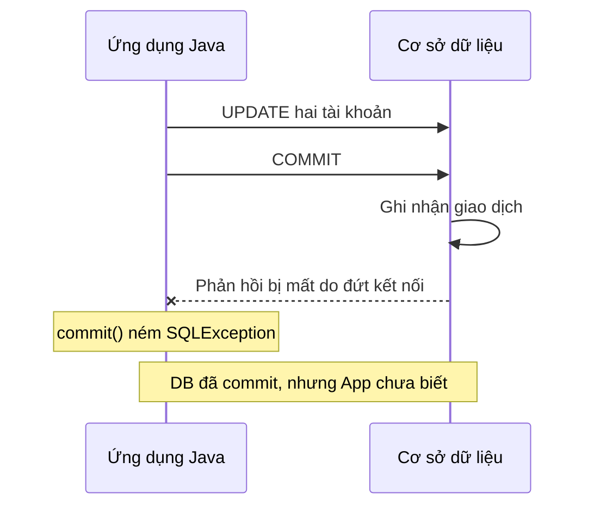
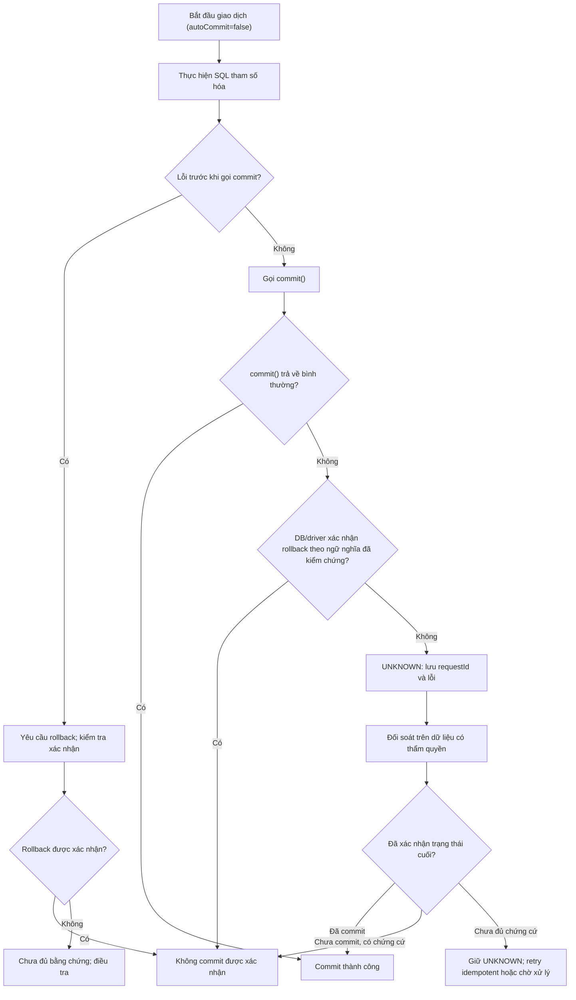

# Phân biệt commit thành công, commit thất bại và kết quả chưa xác định

## Mục tiêu học tập

Trong chương **Giao dịch cơ bản** của JDBC, việc gọi `Connection.commit()` là bước yêu cầu cơ sở dữ liệu kết thúc một giao dịch và xác nhận các thay đổi. Tuy nhiên, **một lệnh `commit()` ném ngoại lệ không đồng nghĩa với giao dịch chắc chắn đã thất bại**. Ứng dụng có thể mất kết nối đúng lúc cơ sở dữ liệu đã ghi nhận giao dịch nhưng chưa kịp gửi phản hồi.

Sau bài này, bạn có thể:

- Phân biệt ba trạng thái **commit được xác nhận**, **không commit được xác nhận** và **kết quả chưa xác định** từ góc nhìn ứng dụng Java.
- Giải thích vì sao `SQLException`, timeout hoặc `rollback()` không tự chứng minh giao dịch đã thất bại.
- Thiết kế cách ghi nhận, đối soát và thử lại an toàn bằng `DataSource`, `Connection`, `PreparedStatement`, khóa nghiệp vụ duy nhất và truy vấn bằng `ResultSet`.
- Xử lý các tình huống mất kết nối, failover, lỗi ở thời điểm `COMMIT` mà không vô tình thực hiện nghiệp vụ hai lần.

## 1. Bối cảnh: `commit()` xác nhận điều gì?

Với giao dịch JDBC điều khiển thủ công, ứng dụng lấy một `Connection`, gọi `setAutoCommit(false)`, thực hiện một hay nhiều câu SQL rồi kết thúc bằng `commit()` hoặc `rollback()`.

```java
try (Connection connection = dataSource.getConnection()) {
    connection.setAutoCommit(false);

    // Các lệnh INSERT, UPDATE hoặc DELETE dùng chung connection.
    // Ví dụ: ghi yêu cầu chuyển tiền và cập nhật hai tài khoản.

    connection.commit();
}
```

Khi `commit()` **trả về bình thường**, ứng dụng đã nhận được xác nhận thành công từ driver/cơ sở dữ liệu theo cam kết giao dịch của hệ thống đang dùng. Những thay đổi thuộc giao dịch được chấp nhận như một đơn vị. Mức bảo đảm về độ bền, đồng bộ bản sao và khả năng khôi phục vẫn phụ thuộc cấu hình của hệ quản trị cơ sở dữ liệu.

Khi `commit()` **ném `SQLException`**, ứng dụng chỉ biết rằng thao tác gọi commit **không hoàn tất bình thường ở phía ứng dụng**. Để xác định giao dịch thực sự có được ghi nhận hay không, cần xét loại lỗi, tài liệu của driver/cơ sở dữ liệu và bằng chứng đối soát.

> Phạm vi bài: các bảng có hỗ trợ transaction, các lệnh DML chạy trên cùng một `Connection` với `autoCommit=false`. Một số hệ quản trị tự commit khi chạy DDL hoặc dùng bảng không hỗ trợ transaction; không áp dụng máy móc các kết luận dưới đây cho những trường hợp đó.

## 2. Ba kết quả phải phân biệt

| Kết quả | Bằng chứng cần có | Ý nghĩa nghiệp vụ | Hướng xử lý |
| --- | --- | --- | --- |
| **Commit thành công (được xác nhận)** | `commit()` trả về bình thường; hoặc đối soát thấy dấu vết bền vững của chính giao dịch trên nguồn dữ liệu có thẩm quyền | Giao dịch đã được chấp nhận; không thực hiện lại nghiệp vụ | Trả kết quả thành công; hoàn tất ghi nhận |
| **Commit thất bại (được xác nhận không commit)** | Cơ sở dữ liệu/driver xác nhận transaction đã bị hủy hoặc rollback theo quy tắc cụ thể; hoặc đối soát đủ điều kiện xác nhận giao dịch không được áp dụng | Các thay đổi trong giao dịch đó không được commit | Sửa lỗi hoặc thử lại bằng chính sách retry an toàn |
| **Kết quả chưa xác định (unknown / in doubt)** | Không nhận được xác nhận cuối cùng, ví dụ timeout, đứt kết nối hay failover khi gửi/đợi phản hồi `COMMIT` | Giao dịch **có thể đã commit hoặc chưa commit** | Lưu mã yêu cầu, đối soát trạng thái; chưa khẳng định thành công hoặc thất bại |

**Lưu ý về thuật ngữ:** trong thực tế, cụm “commit thất bại” đôi khi chỉ có nghĩa “lời gọi `commit()` ném lỗi”. Đó là cách gọi dễ gây nhầm lẫn. Trong bài này, **thất bại được xác nhận** nghĩa là có căn cứ rằng **giao dịch không được commit**. Nếu chỉ thấy ngoại lệ ở lời gọi `commit()`, mặc định xử lý thận trọng như **chưa xác định**, trừ khi tài liệu của driver/cơ sở dữ liệu đưa ra bảo đảm rõ ràng khác.

### 2.1. Commit thành công: ứng dụng nhận xác nhận

1. Java gửi yêu cầu `COMMIT`.
2. Cơ sở dữ liệu chấp nhận giao dịch.
3. Driver nhận phản hồi và `Connection.commit()` trả về bình thường.

Ứng dụng có thể báo thành công. Nếu một lỗi xuất hiện **sau đó** ở bước đóng connection, ghi log hoặc gửi HTTP response, không được diễn giải ngược rằng giao dịch chưa commit.

### 2.2. Commit thất bại: có bằng chứng giao dịch không được áp dụng

Ví dụ, một hệ quản trị từ chối commit vì ràng buộc kiểm tra trì hoãn đến cuối giao dịch, đồng thời xác nhận transaction đã bị rollback; hoặc cơ chế đối soát của hệ thống xác định an toàn rằng giao dịch đã kết thúc mà dấu vết commit không tồn tại. Với mỗi tình huống, phải kiểm tra **ngữ nghĩa cụ thể** của hệ quản trị và driver.

Nếu lỗi xảy ra **trước khi gọi** `commit()`, ứng dụng thường thực hiện `rollback()`. Khi `rollback()` được cơ sở dữ liệu xác nhận, có thể kết luận transaction đang xử lý đã được hủy; đừng đánh đồng trường hợp này với ngoại lệ xảy ra **trong khi gọi** `commit()`.

### 2.3. Kết quả chưa xác định: có thể đã thành công

Giả sử ứng dụng chuyển 500.000 đồng giữa hai tài khoản trong cùng một giao dịch:



Ứng dụng không thể suy ra kết quả chỉ từ lỗi kết nối. Nếu chạy lại thao tác chuyển tiền với một yêu cầu mới, người nhận có thể được cộng tiền **hai lần**.

Một đường đi khác có cùng triệu chứng là: thông điệp `COMMIT` chưa tới cơ sở dữ liệu, kết nối bị đóng, transaction bị hủy. Vì cả hai đường đi đều có thể tạo ra timeout hoặc ngoại lệ kết nối, phải giữ trạng thái **chưa xác định** đến khi có bằng chứng.

## 3. Những dấu hiệu dễ khiến ứng dụng kết luận sai

| Quan sát | Có thể kết luận gì? | Không thể kết luận gì? |
| --- | --- | --- |
| `commit()` trả về bình thường | Commit được xác nhận | HTTP response, email hoặc API bên ngoài cũng thành công |
| `commit()` ném `SQLException` | Lời gọi commit thất bại tại phía Java | Giao dịch chắc chắn đã rollback |
| `SQLTimeoutException` khi commit | Thời gian chờ bị vượt quá | Cơ sở dữ liệu chắc chắn chưa commit |
| `SQLState` lớp `08` (lỗi kết nối) | Có vấn đề trên đường kết nối | Trạng thái commit cuối cùng |
| `SQLState` lớp `40` / `SQLTransactionRollbackException` | Dấu hiệu rollback theo phân loại JDBC/SQL; cần kiểm tra ngữ nghĩa driver và thời điểm lỗi | Mọi database/driver xử lý tương tự trong mọi tình huống |
| `rollback()` được gọi sau khi `commit()` ném lỗi | Ứng dụng đã thử hủy phần transaction còn tồn tại | Một commit đã hoàn tất có thể bị “hoàn tác” ngược thời gian |
| `executeUpdate()` trả về `1` | Một câu SQL đã ảnh hưởng một dòng trong transaction | Cả transaction đã commit |
| Kết nối đang `isValid()` hoặc kết nối mới hoạt động | Có một kết nối dùng được lúc kiểm tra | Kết quả commit của kết nối cũ |

Các kiểu `SQLTransientException` hay `SQLRecoverableException` có thể gợi ý chiến lược phục hồi, **không phải** bằng chứng rằng thao tác nghiệp vụ đã không diễn ra. Khi cần suy luận mạnh hơn từ mã `SQLState` hay mã lỗi vendor, hãy dựa vào tài liệu và kiểm thử của **chính** DBMS/driver đang vận hành.

## 4. Ví dụ JDBC: giữ nguyên sự khác biệt giữa lỗi và kết quả

Đoạn sau tập trung vào **thời điểm gọi commit**. Giả sử ứng dụng đã dùng `PreparedStatement` để thực hiện các SQL cần thiết trên `connection` với `autoCommit=false`, và mỗi yêu cầu có `requestId` riêng.

```java
enum CommitOutcome {
    COMMITTED,
    UNKNOWN
}

static CommitOutcome attemptCommit(Connection connection,
                                   String requestId) {
    try {
        connection.commit();
        return CommitOutcome.COMMITTED;
    } catch (SQLException error) {
        // Lưu requestId, SQLState, mã lỗi và nguyên nhân để đối soát.
        System.err.printf(
            "Commit chưa rõ kết quả: requestId=%s, SQLState=%s, code=%d%n",
            requestId, error.getSQLState(), error.getErrorCode()
        );

        // Tình huống chung: không thể suy ra NOT_COMMITTED chỉ từ lỗi.
        return CommitOutcome.UNKNOWN;
    }
}
```

Đây là **ví dụ phân loại kết quả quan sát**, chưa phải lớp transaction production hoàn chỉnh. Ứng dụng thực tế cần lưu nguyên nhân lỗi theo hệ thống log/giám sát, quản lý vòng đời `Connection`, đóng `PreparedStatement`/`ResultSet` và truyền trạng thái `UNKNOWN` tới quy trình đối soát. Nếu muốn ném ngoại lệ lên tầng dịch vụ, có thể dùng loại ngoại lệ riêng như `CommitOutcomeUnknownException` và giữ `SQLException` gốc làm nguyên nhân.

Trước commit, hãy phân biệt riêng phần xử lý lỗi SQL:

```java
connection.setAutoCommit(false);

try {
    // 1. INSERT dấu vết requestId duy nhất.
    // 2. UPDATE dữ liệu nghiệp vụ qua PreparedStatement.
    // Nếu thao tác chưa hợp lệ, rollback trước khi gửi COMMIT.
    connection.rollback(); // Ví dụ nhánh hủy được chủ động xác nhận.
} catch (SQLException error) {
    // Nếu rollback cũng thất bại, cần giữ cả hai lỗi.
    // Không ghi nhận NOT_COMMITTED nếu chưa đủ bằng chứng.
    throw error;
}
```

Ví dụ `rollback()` trên minh họa một **nhánh hủy giao dịch**, không chạy cùng lúc với đường commit. Trong code thực tế, chỉ gọi nhánh này khi có lỗi nghiệp vụ/lỗi SQL **trước commit**. Một nhánh `catch` bao quanh cả quá trình cần biết **đã bắt đầu gọi `commit()` hay chưa** để không gán nhầm ngoại lệ commit thành “đã rollback”.

Lưu ý thêm: `Connection.close()` có thể ném lỗi **sau khi commit đã được xác nhận**. Tầng quản lý tài nguyên phải ghi nhận lỗi đóng kết nối riêng, tránh che mất kết quả commit đã có. Khi `autoCommit=true`, từng lệnh có thể đã được commit tự động; gọi `commit()` ở chế độ này không đại diện cho transaction thủ công mong muốn.

## 5. Thiết kế đối soát bằng mã yêu cầu duy nhất

Một cách thực tế để xử lý `UNKNOWN` là lưu **dấu vết nghiệp vụ** với khóa duy nhất, cùng transaction với các thay đổi. Ví dụ có bảng `transfer_requests`:

```sql
CREATE TABLE transfer_requests (
    request_id VARCHAR(64) PRIMARY KEY,
    from_account_id BIGINT NOT NULL,
    to_account_id BIGINT NOT NULL,
    amount DECIMAL(18, 2) NOT NULL,
    status VARCHAR(20) NOT NULL
);
```

Trong **cùng một transaction** trên **cùng một connection**, ứng dụng thực hiện:

1. `INSERT` một bản ghi có `request_id` chưa từng dùng, cùng thông tin chuyển tiền và `status = 'COMPLETED'`.
2. `UPDATE` tài khoản nguồn với điều kiện đủ số dư; kiểm tra số dòng bị ảnh hưởng bằng `executeUpdate()`.
3. `UPDATE` tài khoản đích; kiểm tra số dòng bị ảnh hưởng.
4. Gọi `commit()`.

Nếu commit xảy ra, cả dấu vết yêu cầu lẫn thay đổi số dư được chấp nhận theo tính nguyên tử của transaction. Nếu transaction rollback, chúng cùng biến mất. Phải dùng kiểu số chính xác như `BigDecimal` cho số tiền, kiểm tra điều kiện nghiệp vụ và xử lý cạnh tranh giao dịch theo mức cô lập phù hợp.

Khi kết quả chưa rõ, ứng dụng tạo **kết nối mới** đến nguồn dữ liệu có thẩm quyền (ưu tiên primary nếu việc đọc replica có độ trễ) và đối soát bằng câu SQL tham số hóa:

```java
String sql = """
    SELECT from_account_id, to_account_id, amount, status
    FROM transfer_requests
    WHERE request_id = ?
    """;

try (Connection check = dataSource.getConnection();
     PreparedStatement ps = check.prepareStatement(sql)) {

    ps.setString(1, requestId);

    try (ResultSet rs = ps.executeQuery()) {
        if (rs.next()) {
            // Đối chiếu cả from/to/amount với yêu cầu ban đầu.
            // Chỉ chấp nhận kết quả nếu dữ liệu khớp và status phù hợp.
        } else {
            // Chưa thấy bản ghi: vẫn có thể đang có transaction in-flight.
            // Không kết luận thất bại ngay khi chỉ dựa vào một lần đọc.
        }
    }
}
```

Đoạn Java trên dùng **text block**, yêu cầu Java 15 trở lên. Với Java phiên bản cũ, thay bằng chuỗi SQL nối thông thường.

**Vì sao không chỉ kiểm tra số dư?** Hai giao dịch khác nhau có thể thay đổi cùng số dư; trạng thái tổng không chứng minh yêu cầu cụ thể nào đã commit. `request_id` cùng dữ liệu nghiệp vụ là dấu vết đáng tin cậy hơn.

**Vì sao “không thấy bản ghi” chưa đủ?** Giao dịch cũ có thể chưa kết thúc, câu truy vấn có thể chạy trước khi commit được nhìn thấy hoặc đang đọc bản sao chậm. Chỉ xác nhận **không commit** nếu hệ thống có cơ chế chắc chắn về trạng thái kết thúc giao dịch và phạm vi quan sát dữ liệu. Nếu không, giữ `UNKNOWN` và tiếp tục đối soát có kiểm soát.

### Thử lại thế nào để không tạo giao dịch trùng?

- **Giữ nguyên `request_id`** khi thử lại cùng một yêu cầu; không tạo mã mới mỗi lần HTTP timeout.
- Đặt ràng buộc **`UNIQUE` hoặc `PRIMARY KEY`** trong database; kiểm tra kết quả trùng khóa và đối chiếu payload gốc, thay vì coi mọi lỗi trùng khóa là “đã thành công”.
- Nếu transaction cũ còn chạy, lần thử mới có thể phải chờ kết quả cạnh tranh khóa. Cần giới hạn số lần, backoff và cơ chế xử lý lâu dài.
- Chỉ trả thành công khi có xác nhận commit hoặc dấu vết đã được commit với **đúng** thông tin nghiệp vụ. Trường hợp chưa rõ phải báo trạng thái đang xử lý/đối soát cho bên gọi.
- Các tác động **ngoài** database, như gửi email, gọi API thanh toán, xuất sự kiện, không tự động thuộc cùng transaction JDBC. Cân nhắc *transactional outbox* hoặc cơ chế idempotency ở hệ thống nhận.

## 6. Quy trình quyết định khi thao tác commit có lỗi



Một mô hình kết quả phù hợp ở tầng dịch vụ có thể là `COMMITTED`, `NOT_COMMITTED` và `UNKNOWN`, trong đó lý do/ngoại lệ và `request_id` được giữ riêng. **Không ép mọi `SQLException` thành `NOT_COMMITTED`** vì làm vậy gây nguy cơ lặp nghiệp vụ.

## 7. Ba kịch bản thực tế

**Kịch bản A — commit được xác nhận:** Java cập nhật đơn hàng và hàng tồn kho trong một transaction. `commit()` trả về bình thường. Sau đó server HTTP mất kết nối trước khi trả kết quả. Transaction vẫn đã commit; phía client khi gửi lại yêu cầu phải dùng mã idempotency cũ để truy ra kết quả, không tạo đơn mới.

**Kịch bản B — không commit được xác nhận:** Cơ sở dữ liệu báo lỗi khiến giao dịch bị rollback theo ngữ nghĩa được driver và hệ quản trị xác nhận, hoặc `rollback()` trước commit đã được xác nhận. Chưa có thay đổi nào của transaction được chấp nhận. Có thể sửa dữ liệu và thực hiện lại trong **giao dịch mới** khi điều kiện nghiệp vụ cho phép.

**Kịch bản C — kết quả chưa xác định:** Java gọi `commit()`, ngay sau đó nhận lỗi mất kết nối. Database có thể đã commit, cũng có thể không. Ứng dụng ghi nhận `UNKNOWN` cùng `request_id`, đối soát với bảng dấu vết yêu cầu và chỉ quyết định retry sau khi kiểm tra cơ chế ngăn trùng.

## 8. Sai lầm thường gặp và điểm ghi nhớ

- **Sai:** “`commit()` ném exception nên cứ chuyển tiền lần nữa.” **Đúng:** ngoại lệ lúc commit có thể là `UNKNOWN`; cần đối soát hoặc retry có idempotency.
- **Sai:** “`rollback()` sau lỗi commit thì chắc chắn mọi thay đổi đã bị hủy.” **Đúng:** rollback không đảo ngược giao dịch đã commit trước đó; kết quả `rollback()` cũng cần được đánh giá.
- **Sai:** “`executeUpdate() == 1` nghĩa là đã lưu vĩnh viễn.” **Đúng:** số dòng cập nhật chỉ phản ánh câu SQL trong transaction, chưa phải xác nhận commit.
- **Sai:** “Không thấy bản ghi ở replica tức là commit thất bại.” **Đúng:** độ trễ replica và transaction chưa kết thúc có thể khiến kết quả tạm thời chưa xuất hiện.
- **Sai:** “Lỗi có tính transient nên luôn retry được.” **Đúng:** cần tách **khả năng thực hiện lại thao tác kỹ thuật** khỏi **an toàn nghiệp vụ khi thao tác lặp**.

Trong JDBC, **thành công** và **thất bại được xác nhận** là các kết luận có bằng chứng; **chưa xác định** là một trạng thái thực sự cần được mô hình hóa. Với các thao tác quan trọng, hãy gắn khóa yêu cầu duy nhất, lưu dấu vết cùng transaction, giữ lỗi gốc và có quy trình đối soát khi mất xác nhận từ `commit()`.
