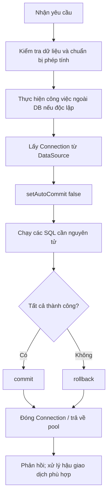

# Giữ giao dịch ngắn để giảm thời gian chiếm kết nối và khóa

Trong ứng dụng Java dùng **JDBC**, một giao dịch (transaction) giúp nhiều câu lệnh SQL thành một đơn vị công việc: **hoặc cùng được xác nhận (`commit`), hoặc cùng được hủy (`rollback`)**. Tuy nhiên, giao dịch đúng về tính nguyên tử vẫn có thể gây nghẽn nếu ứng dụng giữ nó mở quá lâu. Mỗi lần chờ dịch vụ bên ngoài, xử lý dữ liệu hoặc đợi người dùng trong lúc giao dịch đang mở đều có thể kéo dài thời gian chiếm kết nối từ `DataSource` và thời gian cơ sở dữ liệu giữ một số loại khóa.

Bài này thuộc chương **Giao dịch cơ bản** của JDBC. Mục tiêu là biết đặt ranh giới giao dịch đủ hẹp để truy cập cơ sở dữ liệu quan hệ hiệu quả, đồng thời vẫn bảo vệ tính nhất quán của các thao tác CRUD, SQL tham số hóa và các quy tắc nghiệp vụ cần tính nguyên tử.

## 1. Phân biệt thời gian giữ kết nối, giao dịch và khóa

Ba khoảng thời gian sau liên quan với nhau nhưng **không hoàn toàn trùng nhau**:

| Khoảng thời gian | Bắt đầu và kết thúc | Tác động chính |
| --- | --- | --- |
| **Chiếm kết nối** | Từ lúc lấy được `Connection` qua `DataSource.getConnection()` đến khi `close()` (với pool: trả kết nối về pool). | Kết nối đang bận, yêu cầu khác có thể phải chờ pool cấp kết nối. |
| **Giao dịch chưa kết thúc** | Khi cơ sở dữ liệu bắt đầu xử lý công việc thuộc giao dịch đến `commit` hoặc `rollback`. JDBC dùng `setAutoCommit(false)` để nhóm các lệnh vào chế độ xác nhận thủ công. | Các thay đổi chưa được xác nhận; có thể giữ khóa, phiên bản hàng hoặc tài nguyên khác tùy hệ quản trị. |
| **Giữ khóa** | Từ lúc một thao tác lấy khóa đến lúc khóa được nhả theo quy tắc của hệ quản trị và mức cô lập. | Giao dịch khác có thể bị chặn khi truy cập tài nguyên xung đột. |

**Ví dụ:** một yêu cầu lấy kết nối, cập nhật hàng tồn kho trong 20 ms, gọi HTTP đến đối tác mất 2 giây rồi mới `commit`. Phần xử lý cơ sở dữ liệu rất nhanh, nhưng kết nối đã bị chiếm hơn 2 giây; khóa do câu `UPDATE` lấy được cũng có thể bị giữ cho tới khi kết thúc giao dịch. Khả năng xảy ra và thời điểm nhả từng loại khóa phụ thuộc hệ quản trị cơ sở dữ liệu (DBMS), loại thao tác và mức cô lập; không nên giả định mọi câu `SELECT` đều giữ khóa ghi đến `commit`.

Khi `autoCommit` bật (thường là mặc định của JDBC), mỗi câu lệnh được xác nhận theo quy tắc hoàn thành của JDBC; với câu truy vấn tạo `ResultSet`, việc đóng/đọc hết kết quả có thể ảnh hưởng thời điểm hoàn thành. Khi tắt `autoCommit`, ứng dụng chịu trách nhiệm kết thúc giao dịch. **Chỉ gọi `setAutoCommit(false)` không có nghĩa là mọi DBMS lập tức lấy khóa**: khóa thường được lấy khi thực thi những câu lệnh cụ thể.

### Một hình dung về khả năng phục vụ

Giả sử pool có 10 kết nối, mỗi yêu cầu luôn phải giữ một kết nối và không có giới hạn tài nguyên nào khác:

| Thời gian trung bình giữ một kết nối | Năng lực lý thuyết tối đa do riêng pool giới hạn |
| --- | ---: |
| 2 giây/yêu cầu | Khoảng 5 yêu cầu/giây |
| 100 mili giây/yêu cầu | Khoảng 100 yêu cầu/giây |

Đây là **minh họa**, không phải cam kết thông lượng: CPU, độ trễ SQL, pool thực tế, khóa và tải đến đồng thời còn ảnh hưởng kết quả. Điểm quan trọng là: **có thể giảm thời gian chờ pool ngay cả khi không giảm số câu SQL**, chỉ bằng cách trả kết nối sớm hơn.

## 2. Nguyên tắc đặt ranh giới giao dịch

**Bắt đầu giao dịch sát phần công việc cần tính nguyên tử; kết thúc ngay sau khi phần đó hoàn tất hoặc thất bại.** Thực hiện các bước không cần nằm trong giao dịch ở ngoài khoảng này.



Trước khi lấy `Connection`, có thể kiểm tra định dạng dữ liệu, xác thực quyền bằng thông tin có sẵn, tính toán thuần Java và chuẩn bị tham số. Trong giao dịch, chỉ để những lần đọc/ghi **phải nhìn thấy cùng một trạng thái hoặc phải thành công cùng nhau**. Sau `commit`/`rollback`, đóng kết nối ngay để giải phóng tài nguyên. Cần phân biệt tính chất các bước: không được đẩy một lần đọc hoặc kiểm tra phụ thuộc dữ liệu đang tranh chấp ra ngoài giao dịch nếu điều đó làm hỏng quy tắc nghiệp vụ.

**Không giữ giao dịch mở trong khi:**

- Gọi REST API, dịch vụ thanh toán, hệ thống email hoặc hệ thống tệp ở xa.
- Chờ người dùng xác nhận, chờ hàng đợi, `sleep`, hoặc thử lại một dịch vụ bên ngoài.
- Xử lý báo cáo lớn, tạo PDF, nén tệp hay biến đổi dữ liệu thuần Java.
- Duyệt và xuất một `ResultSet` rất lớn theo tốc độ tải xuống của người dùng.

Một yêu cầu có thể cần các bước đó, nhưng cần thiết kế luồng công việc để chúng không kéo dài giao dịch JDBC. Ví dụ, nếu phải thông báo đáng tin cậy sau khi ghi dữ liệu, có thể lưu **bản ghi outbox** trong cùng giao dịch rồi gửi thông báo bằng tiến trình riêng sau `commit`. Gọi dịch vụ ngoài trước/sau giao dịch không tự tạo ra tính nguyên tử giữa hai hệ thống; nghiệp vụ liên hệ nhiều hệ thống cần cơ chế riêng như idempotency, outbox hoặc bù trừ.

## 3. Ví dụ JDBC: chuyển tiền trong một giao dịch ngắn

Giả sử cơ sở dữ liệu quan hệ có bảng tài khoản minh họa:

```sql
CREATE TABLE accounts (
    id BIGINT PRIMARY KEY,
    balance DECIMAL(19, 2) NOT NULL CHECK (balance >= 0)
);
```

Yêu cầu: trừ tiền ở tài khoản nguồn và cộng đúng số đó vào tài khoản đích. Nếu một thao tác thất bại, cả hai thay đổi phải bị hủy. Đây là phần cần tính nguyên tử; kiểm tra số tiền hợp lệ có thể làm **trước khi mượn kết nối**. Ví dụ sau dùng `DataSource`, `PreparedStatement`, `BigDecimal`, `commit`, `rollback` và `try-with-resources`.

```java
import java.math.BigDecimal;
import java.math.RoundingMode;
import java.sql.Connection;
import java.sql.PreparedStatement;
import java.sql.SQLException;
import java.util.Objects;
import javax.sql.DataSource;

public final class TransferService {
    private final DataSource dataSource;

    public TransferService(DataSource dataSource) {
        this.dataSource = Objects.requireNonNull(dataSource);
    }

    public void transfer(long fromId, long toId, BigDecimal requested)
            throws SQLException {
        // Không cần connection để kiểm tra các điều kiện độc lập với DB.
        if (fromId == toId || requested == null || requested.signum() <= 0) {
            throw new IllegalArgumentException("Thông tin chuyển tiền không hợp lệ");
        }
        BigDecimal amount = requested.setScale(2, RoundingMode.UNNECESSARY);

        // Mượn connection sát thời điểm thực hiện SQL.
        try (Connection connection = dataSource.getConnection()) {
            connection.setAutoCommit(false);
            try {
                debit(connection, fromId, amount);
                credit(connection, toId, amount);
                connection.commit(); // Xác nhận ngay sau thao tác cuối cùng.
            } catch (SQLException | RuntimeException failure) {
                try {
                    connection.rollback();
                } catch (SQLException rollbackFailure) {
                    failure.addSuppressed(rollbackFailure);
                }
                throw failure;
            }
        } // close(): trả connection về pool nếu DataSource dùng pool.
    }

    private static void debit(Connection connection, long id, BigDecimal amount)
            throws SQLException {
        String sql = "UPDATE accounts SET balance = balance - ? "
                   + "WHERE id = ? AND balance >= ?";
        try (PreparedStatement statement = connection.prepareStatement(sql)) {
            statement.setBigDecimal(1, amount);
            statement.setLong(2, id);
            statement.setBigDecimal(3, amount);
            if (statement.executeUpdate() != 1) {
                throw new SQLException("Không có tài khoản nguồn hoặc không đủ số dư");
            }
        }
    }

    private static void credit(Connection connection, long id, BigDecimal amount)
            throws SQLException {
        String sql = "UPDATE accounts SET balance = balance + ? WHERE id = ?";
        try (PreparedStatement statement = connection.prepareStatement(sql)) {
            statement.setBigDecimal(1, amount);
            statement.setLong(2, id);
            if (statement.executeUpdate() != 1) {
                throw new SQLException("Không có tài khoản đích");
            }
        }
    }
}
```

Trong ví dụ:

1. `BigDecimal` và `setScale(2, RoundingMode.UNNECESSARY)` kiểm tra số tiền có tối đa hai chữ số thập phân **trước khi** lấy kết nối. `PreparedStatement` truyền giá trị qua tham số `?`, tránh ghép SQL từ đầu vào.
2. `UPDATE ... WHERE balance >= ?` gộp điều kiện đủ tiền vào chính câu cập nhật. Cách này tránh mẫu **đọc số dư trước rồi cập nhật mà không bảo vệ tính đồng thời**. Điều kiện `CHECK`, nếu DBMS hỗ trợ và thực thi, là lớp bảo vệ bổ sung.
3. Hai câu `UPDATE` dùng **cùng một `Connection`** trong một giao dịch. Nếu số hàng cập nhật không đúng, mã ném lỗi, gọi `rollback` và không chuyển tiền một phần.
4. `commit` được gọi ngay khi cập nhật xong; không có HTTP, `sleep`, đọc tệp hay đợi người dùng ở giữa. `try-with-resources` đóng từng `PreparedStatement` và kết nối kể cả khi lỗi xảy ra.
5. Nếu `rollback` cũng lỗi, lỗi rollback được đính kèm vào lỗi ban đầu bằng `addSuppressed` để không che khuất nguyên nhân đầu tiên.

**Giới hạn của ví dụ:** đây là mã dạy về ranh giới giao dịch, chưa phải hệ thống thanh toán hoàn chỉnh. Chuyển tiền hai chiều giữa cùng hai tài khoản vẫn có thể gây **deadlock** khi hai giao dịch khóa các hàng theo thứ tự ngược nhau. Trong hệ thống thật, cân nhắc lấy khóa theo thứ tự ID cố định, chính sách thử lại có giới hạn và kiểm soát idempotency. Một lỗi khi `commit` xảy ra do mất mạng có thể khiến **kết quả commit chưa rõ**; không tự động giả định đã rollback thành công hoặc thử chuyển tiền lại một cách mù quáng. Nghiệp vụ chuyển tiền thật còn cần quản lý đơn vị tiền tệ, sổ cái, kiểm toán và các quy tắc bổ sung.

### Vì sao phải giữ cả hai câu SQL trong một giao dịch?

Nếu `debit` và `credit` dùng hai kết nối bật `autoCommit`, câu trừ tiền có thể được xác nhận trước khi câu cộng tiền thất bại. Ngược lại, hai lệnh trong một giao dịch JDBC tạo ra ranh giới nguyên tử. Việc rút ngắn giao dịch **không có nghĩa tách những câu SQL vốn phải cùng thành công** thành các giao dịch độc lập.

## 4. Nhận diện các mẫu làm giao dịch kéo dài

### Mẫu 1: Gọi dịch vụ HTTP giữa các câu SQL

```text
Luồng dễ gây nghẽn:
  getConnection -> setAutoCommit(false) -> UPDATE
  -> gọi HTTP (chờ 2 giây) -> UPDATE -> commit -> close

Luồng có ranh giới tốt hơn khi nghiệp vụ cho phép:
  chuẩn bị dữ liệu / gọi dịch vụ độc lập
  -> getConnection -> setAutoCommit(false)
  -> UPDATE -> UPDATE -> commit -> close
  -> công việc hậu giao dịch
```

Tách bước HTTP ra ngoài chỉ đúng khi không làm mất yêu cầu nhất quán. Ví dụ: cần thanh toán qua cổng ngoài và lưu kết quả nội bộ thì hai hệ thống không thể được bảo đảm nguyên tử chỉ bằng một transaction JDBC. Nên thiết kế trạng thái nghiệp vụ, khóa yêu cầu/idempotency và cách phục hồi sau lỗi, thay vì giữ kết nối mở trong suốt cuộc gọi mạng.

### Mẫu 2: Đọc dữ liệu lớn rồi xử lý từng dòng trong giao dịch

```java
// Phác họa phản ví dụ: duyệt nhiều hàng và xử lý chậm trước commit.
connection.setAutoCommit(false);
try (PreparedStatement ps = connection.prepareStatement("SELECT ...");
     java.sql.ResultSet rs = ps.executeQuery()) {
    while (rs.next()) {
        // Xử lý nặng hoặc xuất qua mạng ở đây kéo dài thời gian dùng connection.
    }
}
connection.commit();
```

Với tác vụ chỉ đọc, cân nhắc giới hạn lượng dữ liệu, phân trang theo khóa ổn định, xử lý theo lô và đóng `ResultSet`/`Statement` sớm. Với xử lý cần ảnh chụp nhất quán, việc tách thành nhiều lần đọc có thể làm thay đổi ngữ nghĩa; phải quyết định theo yêu cầu cô lập và tính đúng đắn. **Phân trang** giảm mỗi đợt giữ kết nối, nhưng không đảm bảo một ảnh chụp thống nhất xuyên suốt các trang khi dữ liệu đang thay đổi.

### Mẫu 3: Mượn kết nối quá sớm, trả quá muộn

```text
Sai vị trí thời gian:
  getConnection -> validate -> buildReport -> SQL -> commit -> renderResponse -> close

Tốt hơn:
  validate -> buildInputs -> getConnection -> SQL -> commit -> close
  -> renderResponse
```

Kể cả khi đã `commit`, giữ `Connection` trong lúc dựng JSON, gửi phản hồi hay tạo báo cáo vẫn làm mất một slot trong pool. Trong JDBC, gọi `close()` với kết nối lấy từ pool thường là **trả kết nối về pool**, không phải đóng kết nối vật lý; một `DataSource` không dùng pool có thể đóng kết nối thật.

### Mẫu 4: Một giao dịch xử lý quá nhiều bản ghi

Chuyển 100.000 cập nhật vào một transaction có thể giữ khóa và tài nguyên trong thời gian dài dù dùng `executeBatch()`. Batching giúp giảm số lượt trao đổi giữa ứng dụng và cơ sở dữ liệu, **không tự động giảm thời gian giao dịch**. Nếu các bản ghi độc lập, có thể chia thành các lô nhỏ, mỗi lô `commit`, đồng thời ghi nhận tiến độ và bảo đảm thao tác chạy lại an toàn. Nếu toàn bộ bản ghi bắt buộc thành công hoặc thất bại cùng nhau, chia transaction sẽ phá vỡ yêu cầu đó; lúc này cần cân nhắc thiết kế nghiệp vụ hoặc phương thức cập nhật khác.

## 5. Thời gian chờ, khóa và mức cô lập

Rút ngắn transaction thường làm giảm cửa sổ tranh chấp, nhưng không thể loại bỏ mọi xung đột:

- **Khóa ghi:** `UPDATE`/`DELETE` có thể giữ khóa trên những hàng liên quan cho đến khi transaction kết thúc. Một giao dịch giữ khóa lâu khiến giao dịch khác phải chờ, dù bản thân câu SQL chỉ tốn vài mili giây.
- **`SELECT ... FOR UPDATE`:** được dùng để khóa dữ liệu chuẩn bị cập nhật trong nhiều DBMS. Nếu dùng, phải hoàn thành việc cập nhật nhanh và `commit`/`rollback` sớm. Cú pháp và hành vi cụ thể phụ thuộc DBMS.
- **Mức cô lập:** `READ COMMITTED`, `REPEATABLE READ`, `SERIALIZABLE` có đặc tính bảo vệ và khả năng tranh chấp khác nhau giữa các hệ quản trị. Không hạ mức cô lập chỉ để giảm khóa nếu nghiệp vụ cần mức bảo vệ cao hơn.
- **Deadlock:** giao dịch ngắn làm giảm thời gian phơi nhiễm nhưng vẫn có thể deadlock. Truy cập các bản ghi theo thứ tự ổn định, dùng chỉ mục thích hợp và xây dựng cơ chế thử lại **toàn bộ transaction** có giới hạn cho những lỗi có thể thử lại.
- **Lệnh SQL chậm:** nếu thời gian chủ yếu nằm ở chính một câu truy vấn do thiếu chỉ mục, quét quá nhiều hàng hoặc chờ khóa, việc di chuyển ranh giới Java không đủ; cần xem kế hoạch thực thi và chiến lược truy cập dữ liệu.

Thí dụ hai yêu cầu cùng sửa một tài khoản:

```text
Giao dịch A: UPDATE tài khoản #7 ───── chờ HTTP ───── COMMIT
Giao dịch B:                UPDATE tài khoản #7 (có thể phải đợi A)

Giao dịch A: UPDATE tài khoản #7 ─ COMMIT
Giao dịch B:                             UPDATE tài khoản #7 (đợi ít hơn)
```

Thời điểm khóa được cấp/nhả trong hình chỉ mang tính minh họa; DBMS có thể xử lý các truy vấn đọc, mức cô lập và cơ chế đồng thời khác nhau.

## 6. Timeout giúp chặn chờ quá lâu, nhưng không thay thế thiết kế

Trong JDBC, có thể đặt timeout cho từng lệnh khi driver hỗ trợ:

```java
try (PreparedStatement statement = connection.prepareStatement(
        "UPDATE orders SET status = ? WHERE id = ?")) {
    statement.setQueryTimeout(3); // giây; hiệu lực phụ thuộc driver/DBMS.
    statement.setString(1, "PAID");
    statement.setLong(2, orderId);
    statement.executeUpdate();
}
```

Phân biệt các loại giới hạn:

| Giới hạn | Nhằm kiểm soát | Lưu ý |
| --- | --- | --- |
| **Pool acquisition timeout** (theo thư viện pool) | Thời gian yêu cầu chờ một kết nối rảnh. | Không rút ngắn transaction đang giữ kết nối. |
| `Statement.setQueryTimeout(seconds)` | Thời gian chạy của một lần thực thi câu lệnh, nếu driver hỗ trợ. | Không phải timeout cho toàn bộ transaction; khi câu lệnh lỗi vẫn phải xử lý kết thúc transaction. |
| **Lock timeout / transaction timeout** (theo DBMS hoặc hạ tầng) | Thời gian chờ khóa hoặc tuổi thọ giao dịch. | Cấu hình/cách hủy khác nhau theo DBMS; có thể làm transaction thất bại và cần rollback. |

Một timeout xảy ra ở giữa giao dịch **không tự động bảo đảm mọi thay đổi trước đó đã được rollback** theo cách ứng dụng mong muốn. Phải bắt lỗi, `rollback` khi phù hợp, đóng kết nối và xử lý khả năng trạng thái chưa xác định sau lỗi kết nối/`commit`. Với lỗi có thể thử lại (ví dụ deadlock hoặc serialization failure), chỉ retry **toàn bộ đơn vị công việc** khi đã xác định được loại lỗi và tính an toàn của thao tác; mỗi lần thử cần kết nối/giao dịch mới và giới hạn số lần thử.

## 7. Đo đúng nơi giao dịch bị kéo dài

Không nên chỉ nhìn thời gian phản hồi HTTP rồi quy toàn bộ cho SQL. Ít nhất, hãy phân biệt:

1. **Chờ mượn kết nối**: từ trước `DataSource.getConnection()` đến khi phương thức trả về.
2. **Thời gian giữ kết nối**: từ khi có `Connection` đến sau `close()`.
3. **Thời gian transaction**: từ khi bắt đầu phần SQL thuộc giao dịch đến `commit`/`rollback` hoàn thành; có thể đo rộng hơn bằng khoảng từ `setAutoCommit(false)` đến lúc kết thúc, nhưng phải hiểu đó là phép đo ở phía ứng dụng.
4. **Thời gian SQL và chờ khóa**: ghi nhận thời lượng từng lệnh, số lần timeout, deadlock hoặc chờ lock theo khả năng quan sát của driver và DBMS.

Khi dùng pool, theo dõi số kết nối đang hoạt động, số kết nối rảnh và số yêu cầu đang chờ. Ở DBMS, tìm giao dịch chạy lâu, giao dịch đang chờ khóa và truy vấn chậm. Chẳng hạn PostgreSQL có trạng thái `idle in transaction` để chỉ phiên đã ở trong transaction nhưng hiện không chạy lệnh; cách quan sát tương ứng ở DBMS khác sẽ khác. Đo thêm p95/p99 thay vì chỉ trung bình vì một số ít transaction rất lâu có thể làm nghẽn pool vào giờ cao điểm.

Với từng thay đổi tối ưu, so sánh trước và sau trên cùng loại tải: thời gian giữ kết nối, transaction duration, thời gian chờ khóa, tỷ lệ lỗi và số request hoàn thành. Nếu chuyển logic ra ngoài giao dịch làm mất tính nhất quán, đó không phải tối ưu hợp lệ dù chỉ số hiệu năng đẹp hơn.

## 8. Những bẫy kỹ thuật khi kết thúc transaction JDBC

| Tình huống | Cách xử lý đúng |
| --- | --- |
| Tắt `autoCommit` nhưng quên `commit` hoặc `rollback`. | Luôn có cả nhánh thành công và thất bại; bảo đảm `close()` bằng `try-with-resources`. |
| Gặp exception sau câu `UPDATE` đầu tiên. | `rollback` trước khi rời khối thao tác, giữ lại exception gốc và thông tin rollback nếu có. |
| Dùng hai `Connection` cho hai SQL phải nguyên tử. | Chạy các SQL đó trên **cùng kết nối, cùng giao dịch**. |
| Gọi `setAutoCommit(true)` trong `finally` trước khi rollback. | Tránh: theo hợp đồng JDBC, đổi từ `false` sang `true` khi còn transaction có thể **xác nhận transaction**. Kết thúc bằng `commit` hoặc `rollback` rõ ràng trước. |
| Tin rằng `close()` tự rollback theo cùng một cách trên mọi driver/pool. | Chủ động `rollback` khi có lỗi. Pool thường reset trạng thái kết nối khi trả về, nhưng không dùng điều đó làm cơ chế bảo đảm nghiệp vụ. |
| `commit()` báo lỗi mạng, lập tức chạy lại giao dịch có hiệu ứng bên ngoài. | Kết quả commit có thể chưa xác định. Dùng định danh thao tác, kiểm tra trạng thái và cơ chế idempotency trước khi retry. |
| Giữ `ResultSet`/`PreparedStatement` mở sau khi không còn sử dụng. | Đóng bằng `try-with-resources`, đặc biệt với truy vấn streaming/cursor. |

**Ghi nhớ:** Transaction chỉ nên chứa đúng những bước cần được cơ sở dữ liệu bảo đảm nhất quán. `commit`/`rollback` ngay sau bước cuối, rồi trả `Connection` về `DataSource` càng sớm càng tốt. Mọi cách rút ngắn phải giữ nguyên tính đúng đắn của nghiệp vụ; khi giao dịch vẫn chậm, đo thời gian chờ kết nối, SQL và khóa để tìm đúng nguyên nhân.

## 9. Tự kiểm tra bằng tình huống

Một API nhận yêu cầu đặt hàng thực hiện: kiểm tra định dạng đầu vào (5 ms), gọi dịch vụ tính phí vận chuyển (700 ms), trừ số lượng tồn kho (15 ms), tạo bản ghi đơn hàng (12 ms), dựng email xác nhận (200 ms) rồi `commit`.

Hãy tự trả lời:

1. Bước nào nên chuyển ra trước khi mượn kết nối? Bước nào nên làm sau khi trả kết nối?
2. Tại sao hai câu SQL cập nhật kho và tạo đơn hàng vẫn nên cùng nằm trong một transaction?
3. Nếu hai yêu cầu đặt hàng tranh nhau số lượng cuối cùng, chỉ rút ngắn transaction đã đủ bảo vệ không bán quá số lượng chưa? Điều kiện cập nhật hoặc cơ chế khóa nào còn cần thiết?

**Gợi ý:** kiểm tra định dạng và tính phí vận chuyển có thể thực hiện trước khi lấy kết nối nếu không phụ thuộc dữ liệu trong transaction; dựng và gửi email nên làm sau commit, hoặc dùng outbox nếu cần gửi đáng tin cậy. Hai thao tác tồn kho và đơn hàng phải nguyên tử. Với tồn kho, thường cần cập nhật có điều kiện như `UPDATE ... SET quantity = quantity - ? WHERE id = ? AND quantity >= ?`, kiểm tra số dòng cập nhật và rollback nếu không đủ hàng. Thiết kế đúng còn phải xét lỗi mạng, yêu cầu gửi lại và mức nhất quán với dịch vụ bên ngoài.
