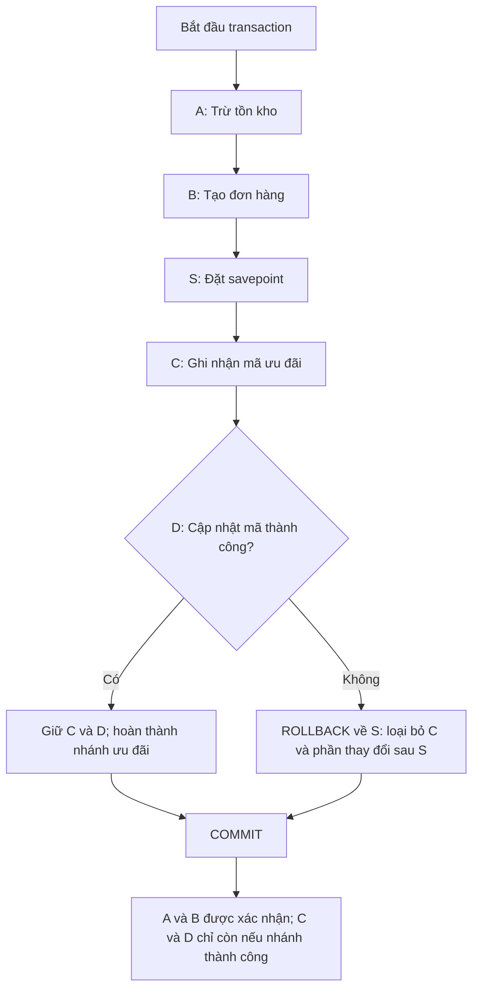

# Hoàn tác về savepoint và xác định phần thay đổi còn hiệu lực

## 1. Vì sao cần hoàn tác một phần giao dịch?

Trong ứng dụng Java sử dụng **JDBC** để truy cập cơ sở dữ liệu quan hệ, một nghiệp vụ có thể gồm nhiều lệnh SQL cần được xử lý trong cùng một transaction. Tuy nhiên, không phải mọi bước đều bắt buộc phải thành công để nghiệp vụ chính được tiếp tục.

Ví dụ, quy trình tạo đơn hàng gồm:

1. Trừ số lượng tồn kho.
2. Tạo đơn hàng.
3. Ghi nhận lần sử dụng mã ưu đãi.
4. Trừ lượt sử dụng còn lại của mã ưu đãi.

Hai bước đầu là phần **bắt buộc**. Hai bước sau là phần **tùy chọn**: nếu mã ưu đãi đã hết lượt, đơn hàng vẫn được tạo mà không áp dụng ưu đãi. Muốn thực hiện điều này một cách nhất quán, ứng dụng phải xóa sạch các thay đổi dang dở của nhánh ưu đãi, đồng thời giữ các thay đổi của đơn hàng trong transaction.

JDBC hỗ trợ **savepoint** (điểm đánh dấu trong transaction) để giải quyết tình huống này:

- `Connection.setSavepoint()` hoặc `setSavepoint(String)` tạo điểm đánh dấu.
- `Connection.rollback(Savepoint)` hoàn tác phần công việc phát sinh **sau điểm đánh dấu**, theo ngữ nghĩa transaction của hệ quản trị.
- `Connection.releaseSavepoint(Savepoint)` giải phóng điểm đánh dấu khi không còn cần dùng.
- `Connection.commit()` xác nhận các thay đổi **còn lại** trong transaction.
- `Connection.rollback()` (không có tham số) hoàn tác **toàn bộ transaction hiện tại**.

**Mục tiêu của bài:** sử dụng đúng các API JDBC chuẩn để hoàn tác về savepoint, giải thích thay đổi nào còn chờ commit, thay đổi nào đã bị loại bỏ và khi nào được coi là bền vững; xử lý lỗi, `PreparedStatement`, kết quả cập nhật và giới hạn tương thích của driver.

## 2. Hiểu đúng ranh giới của savepoint

Xét chuỗi thao tác trong một transaction có `autoCommit = false`:

```text
BEGIN transaction
    A: UPDATE inventory ...          -- trừ tồn kho
    B: INSERT INTO orders ...         -- tạo đơn
    S: SAVEPOINT before_coupon        -- lưu ranh giới
    C: INSERT INTO coupon_redemptions -- ghi nhận sử dụng mã
    D: UPDATE coupons ...             -- thử trừ lượt ưu đãi
    R: ROLLBACK TO SAVEPOINT S        -- hoàn tác về ranh giới
    E: SELECT ...                     -- kiểm tra trong cùng transaction
COMMIT
```

Nếu thao tác `D` không thỏa điều kiện (ví dụ mã đã hết lượt), `rollback(S)` sẽ hoàn tác phần thay đổi phát sinh sau `S`, bao gồm bản ghi ghi nhận ở `C`. Hai thay đổi `A` và `B` nằm **trước** `S` nên vẫn còn trong transaction. `E` chỉ đọc trạng thái hiện tại; `COMMIT` mới xác nhận các thay đổi `A`, `B` nếu transaction hoàn tất thành công.



| Mốc thời gian | Tồn kho trừ theo A | Đơn hàng B | Ghi nhận ưu đãi C | Trạng thái transaction |
|---|---|---|---|---|
| Trước `BEGIN` | Chưa | Chưa | Chưa | Chưa có transaction nghiệp vụ |
| Sau `A` và `B` | Đã thay đổi trong transaction | Đã tạo trong transaction | Chưa | **Chưa commit** |
| Sau `S` và `C` | Còn thay đổi | Còn thay đổi | Có trong transaction | **Chưa commit** |
| Sau `rollback(S)` | **Vẫn còn thay đổi** | **Vẫn còn bản ghi** | **Đã hoàn tác** | **Chưa commit** |
| Sau `commit()` thành công | **Được xác nhận** | **Được xác nhận** | Không có | Transaction kết thúc |

> **Điểm mấu chốt:** “Còn hiệu lực sau `rollback(savepoint)`” **không đồng nghĩa** với “đã commit”. Các thay đổi còn lại vẫn có thể bị hủy bởi `rollback()` toàn phần hoặc bởi transaction không thể commit.

### So sánh ba thao tác thường bị nhầm

| Lệnh JDBC | Tác động | Có xác nhận dữ liệu bền vững không? |
|---|---|---|
| `rollback(savepoint)` | Hoàn tác đến ranh giới đã đánh dấu, giữ các thay đổi trước đó trong transaction | Không |
| `releaseSavepoint(savepoint)` | Bỏ điểm đánh dấu; bản thân việc release không hủy thay đổi | Không |
| `commit()` | Xác nhận các thay đổi còn lại của transaction | Có, nếu commit thành công theo bảo đảm của DB |
| `rollback()` | Hủy toàn bộ thay đổi chưa commit của transaction hiện tại | Không |

Savepoint **không phải transaction con độc lập**. Không thể commit riêng phần trước savepoint rồi tiếp tục transaction bên ngoài bằng `releaseSavepoint()`.

## 3. Các API savepoint của JDBC

```java
import java.sql.Connection;
import java.sql.Savepoint;

// connection do JDBC cấp, dùng riêng cho transaction hiện tại.
connection.setAutoCommit(false);

Savepoint checkpoint = connection.setSavepoint("after_mandatory_steps");

// Thực hiện các lệnh SQL cần thử sau checkpoint.

connection.rollback(checkpoint); // Hoàn tác các thay đổi sau checkpoint.
connection.commit();             // Xác nhận các thay đổi còn lại.
```

Chi tiết từng API:

- `setAutoCommit(false)`: tắt cơ chế tự commit sau mỗi statement trên kết nối này, cho phép ứng dụng điều khiển transaction. Savepoint cần được sử dụng trong transaction đang hoạt động và trên hệ quản trị/driver có hỗ trợ.
- `setSavepoint()`: tạo savepoint không tên; JDBC trả về đối tượng `Savepoint` để dùng khi rollback hoặc release.
- `setSavepoint("after_mandatory_steps")`: tạo savepoint có tên. Tên có thể chịu giới hạn của hệ quản trị; không cần tự viết câu SQL `SAVEPOINT ...` khi đã dùng API này.
- `rollback(checkpoint)`: quay về vị trí đánh dấu trong **cùng connection**. Savepoint không thể dùng cho connection khác.
- `releaseSavepoint(checkpoint)`: bỏ điểm đánh dấu khi không cần rollback đến đó nữa. Savepoint có thể trở nên không hợp lệ sau release, commit, rollback toàn phần hoặc thao tác khác làm nó mất hiệu lực.
- `commit()` và `rollback()`: lần lượt xác nhận hoặc hủy transaction; khi transaction kết thúc, các savepoint gắn với nó không còn sử dụng được.

Ví dụ với savepoint không tên:

```java
Savepoint beforeOptionalStep = connection.setSavepoint();
try {
    // Lệnh SQL tùy chọn.
    // ...
    connection.releaseSavepoint(beforeOptionalStep);
} catch (java.sql.SQLException error) {
    connection.rollback(beforeOptionalStep);
    throw error; // Chỉ minh họa; ví dụ hoàn chỉnh ở mục 5 phân biệt lỗi nghiệp vụ.
}
```

Đoạn này chỉ cho thấy cú pháp, chưa quản lý commit và rollback toàn phần. Trong ứng dụng thật, transaction owner cần điều khiển điểm kết thúc của transaction.

### Kiểm tra khả năng hỗ trợ

Không phải mọi driver và hệ quản trị đều hỗ trợ savepoint với cùng mức khả năng:

```java
import java.sql.DatabaseMetaData;
import java.sql.SQLException;

DatabaseMetaData metadata = connection.getMetaData();
if (!metadata.supportsSavepoints()) {
    throw new SQLException("JDBC driver/database does not support savepoints");
}
```

Các thao tác không hỗ trợ hoặc thực hiện ở trạng thái không hợp lệ có thể ném `SQLException` (trong một số trường hợp là `SQLFeatureNotSupportedException`). Kiểm tra tài liệu của hệ quản trị/driver thực tế, nhất là cách xử lý lỗi trong transaction và hiệu lực của savepoint sau rollback.

## 4. Mô hình dữ liệu để thực hành

Giả sử một hệ thống bán hàng có các bảng như sau:

```sql
CREATE TABLE inventory (
    product_id     BIGINT PRIMARY KEY,
    available_qty  INTEGER NOT NULL CHECK (available_qty >= 0)
);

CREATE TABLE coupons (
    id             BIGINT PRIMARY KEY,
    remaining_uses INTEGER NOT NULL CHECK (remaining_uses >= 0)
);

CREATE TABLE orders (
    id         BIGINT PRIMARY KEY,
    product_id BIGINT NOT NULL REFERENCES inventory(product_id),
    quantity   INTEGER NOT NULL CHECK (quantity > 0),
    coupon_id  BIGINT NULL REFERENCES coupons(id),
    status     VARCHAR(20) NOT NULL
);

CREATE TABLE coupon_redemptions (
    order_id  BIGINT PRIMARY KEY REFERENCES orders(id),
    coupon_id BIGINT NOT NULL REFERENCES coupons(id)
);
```

Đây là SQL minh họa theo cú pháp quan hệ phổ biến; một số hệ quản trị có khác biệt về kiểu dữ liệu, `CHECK` hoặc cách khai báo khóa ngoại. Trường hợp thực tế cũng có thể cần ràng buộc tránh dùng mã quá lượt theo khách hàng, thời hạn và điều kiện áp dụng.

Trạng thái ban đầu:

| Bảng | Hàng đang xét |
|---|---|
| `inventory` | `product_id = 2001`, `available_qty = 10` |
| `coupons` | `id = 51`, `remaining_uses = 0` |
| `orders` | Chưa có `id = 9001` |
| `coupon_redemptions` | Chưa có `order_id = 9001` |

Mục tiêu: đặt đơn `9001` mua hai sản phẩm `2001`. Nếu mã ưu đãi `51` đã hết lượt, vẫn tạo đơn và giảm tồn kho, nhưng không để lại hàng “đã sử dụng ưu đãi”.

Các điều kiện nghiệp vụ ở mức SQL:

```sql
-- A: Chỉ trừ kho khi đủ số lượng.
UPDATE inventory
SET available_qty = available_qty - ?
WHERE product_id = ?
  AND available_qty >= ?;

-- B: Tạo đơn chưa gắn mã ưu đãi.
INSERT INTO orders (id, product_id, quantity, coupon_id, status)
VALUES (?, ?, ?, NULL, 'CREATED');

-- C: Ghi nhận thử việc sử dụng mã.
INSERT INTO coupon_redemptions (order_id, coupon_id)
VALUES (?, ?);

-- D: Chỉ trừ lượt mã khi còn lượt.
UPDATE coupons
SET remaining_uses = remaining_uses - 1
WHERE id = ?
  AND remaining_uses > 0;

-- E (chỉ khi D thành công): Gắn mã vào đơn.
UPDATE orders
SET coupon_id = ?
WHERE id = ?
  AND coupon_id IS NULL;
```

`A` và `B` phải cùng thành công. `C` đến `E` tạo thành nhóm tùy chọn: nếu `D` tác động `0` hàng, rollback về savepoint để xóa `C`. Nếu một lệnh bắt buộc thất bại hoặc phát hiện lỗi hệ thống bất thường, rollback toàn bộ.

## 5. Ví dụ JDBC hoàn chỉnh: giữ đơn hàng, hoàn tác mã ưu đãi

Ví dụ dưới đây dùng một `DataSource` để lấy **một connection duy nhất**, các lệnh `PreparedStatement` tham số hóa, `Savepoint` và `executeUpdate()` để quyết định tiếp tục hay hoàn tác.

```java
import javax.sql.DataSource;
import java.sql.Connection;
import java.sql.PreparedStatement;
import java.sql.SQLException;
import java.sql.Savepoint;
import java.util.Objects;

enum CouponOutcome {
    APPLIED,
    SKIPPED_NO_USES
}

record OrderPlacement(long orderId, CouponOutcome couponOutcome) {}

public final class OrderService {
    private final DataSource dataSource;

    public OrderService(DataSource dataSource) {
        this.dataSource = Objects.requireNonNull(dataSource);
    }

    public OrderPlacement placeOrder(
            long orderId, long productId, int quantity, long couponId)
            throws SQLException {

        if (orderId <= 0 || productId <= 0 || couponId <= 0 || quantity <= 0) {
            throw new IllegalArgumentException("Invalid order arguments");
        }

        // Ví dụ tự quản lý transaction trên connection riêng mới lấy.
        try (Connection connection = dataSource.getConnection()) {
            boolean originalAutoCommit = connection.getAutoCommit();
            if (!originalAutoCommit) {
                throw new SQLException("Expected an unmanaged auto-commit connection");
            }
            if (!connection.getMetaData().supportsSavepoints()) {
                throw new SQLException("Savepoints are not supported");
            }

            connection.setAutoCommit(false);
            boolean transactionEnded = false;

            try {
                // A. Trừ tồn kho: đây là bước bắt buộc.
                String reserveSql = """
                        UPDATE inventory
                        SET available_qty = available_qty - ?
                        WHERE product_id = ?
                          AND available_qty >= ?
                        """;
                try (PreparedStatement ps =
                             connection.prepareStatement(reserveSql)) {
                    ps.setInt(1, quantity);
                    ps.setLong(2, productId);
                    ps.setInt(3, quantity);
                    if (ps.executeUpdate() != 1) {
                        throw new SQLException("Product missing or insufficient stock");
                    }
                }

                // B. Tạo đơn chưa gắn mã: đây là bước bắt buộc.
                String insertOrderSql = """
                        INSERT INTO orders
                            (id, product_id, quantity, coupon_id, status)
                        VALUES (?, ?, ?, NULL, 'CREATED')
                        """;
                try (PreparedStatement ps =
                             connection.prepareStatement(insertOrderSql)) {
                    ps.setLong(1, orderId);
                    ps.setLong(2, productId);
                    ps.setInt(3, quantity);
                    if (ps.executeUpdate() != 1) {
                        throw new SQLException("Expected exactly one inserted order");
                    }
                }

                // S. Sau hai bước bắt buộc, đánh dấu ranh giới.
                Savepoint beforeCoupon = connection.setSavepoint("before_coupon");

                // C. Tạo bản ghi sử dụng mã (chưa được xác nhận).
                String redemptionSql = """
                        INSERT INTO coupon_redemptions (order_id, coupon_id)
                        VALUES (?, ?)
                        """;
                try (PreparedStatement ps =
                             connection.prepareStatement(redemptionSql)) {
                    ps.setLong(1, orderId);
                    ps.setLong(2, couponId);
                    if (ps.executeUpdate() != 1) {
                        throw new SQLException("Expected one redemption row");
                    }
                }

                // D. Chỉ trừ lượt nếu mã còn lượt.
                int couponUpdated;
                String useCouponSql = """
                        UPDATE coupons
                        SET remaining_uses = remaining_uses - 1
                        WHERE id = ?
                          AND remaining_uses > 0
                        """;
                try (PreparedStatement ps =
                             connection.prepareStatement(useCouponSql)) {
                    ps.setLong(1, couponId);
                    couponUpdated = ps.executeUpdate();
                }

                final CouponOutcome outcome;
                if (couponUpdated == 0) {
                    // Xóa C và mọi thay đổi sau S;
                    // A và B vẫn nằm trong transaction.
                    connection.rollback(beforeCoupon);
                    outcome = CouponOutcome.SKIPPED_NO_USES;
                } else if (couponUpdated == 1) {
                    // E. Chỉ gắn mã khi đã trừ lượt thành công.
                    String linkCouponSql = """
                            UPDATE orders
                            SET coupon_id = ?
                            WHERE id = ?
                              AND coupon_id IS NULL
                            """;
                    try (PreparedStatement ps =
                                 connection.prepareStatement(linkCouponSql)) {
                        ps.setLong(1, couponId);
                        ps.setLong(2, orderId);
                        if (ps.executeUpdate() != 1) {
                            throw new SQLException("Cannot link coupon to order");
                        }
                    }

                    // Không cần savepoint nữa, nhưng chưa commit.
                    connection.releaseSavepoint(beforeCoupon);
                    outcome = CouponOutcome.APPLIED;
                } else {
                    throw new SQLException(
                            "Unexpected coupon update count: " + couponUpdated);
                }

                // Chỉ tại đây các thay đổi còn lại mới được xác nhận.
                connection.commit();
                transactionEnded = true;
                return new OrderPlacement(orderId, outcome);

            } catch (SQLException | RuntimeException error) {
                try {
                    connection.rollback(); // Hủy TOÀN BỘ phần chưa commit.
                    transactionEnded = true;
                } catch (SQLException rollbackError) {
                    error.addSuppressed(rollbackError);
                }
                throw error;
            } finally {
                // Khôi phục cấu hình cho connection sẽ trả về pool.
                // Nếu rollback thất bại, tránh bật auto-commit
                // vì thao tác đó có thể commit transaction còn dang dở.
                if (transactionEnded) {
                    connection.setAutoCommit(originalAutoCommit);
                }
            }
        }
    }
}
```

**Các giả định để đọc đúng ví dụ:**

- Phương thức nhận một connection mà nó sở hữu và tự quản lý transaction; connection mới thường ở chế độ auto-commit. Nếu dự án có transaction manager, nên để transaction manager kiểm soát connection và ranh giới commit/rollback; không áp dụng nguyên xi điều kiện kiểm tra `originalAutoCommit`.
- `couponId` được giả định tham chiếu một mã hợp lệ về khóa ngoại. Nếu chèn `coupon_redemptions` bị lỗi ràng buộc, ví dụ coi đó là lỗi cần rollback **toàn bộ**, thay vì tự ý bỏ qua mọi `SQLException`.
- Điều kiện `quantity > 0` được kiểm tra ở Java, câu `UPDATE inventory` còn kiểm tra tồn kho đủ trong chính SQL. Kiểm tra `executeUpdate() == 1` bảo vệ điều kiện nghiệp vụ và số hàng kỳ vọng.
- Trong nhánh `couponUpdated == 0`, `connection.rollback(beforeCoupon)` xóa hàng `coupon_redemptions` vừa chèn. Hàng `orders` vẫn tồn tại trong transaction với `coupon_id = NULL`, còn tồn kho vẫn giảm.
- Trong nhánh `couponUpdated == 1`, thay đổi trừ lượt mã và gắn mã vào đơn được giữ. `releaseSavepoint()` chỉ giải phóng điểm đánh dấu; `commit()` sau đó mới xác nhận các thay đổi.
- Nếu một lỗi không dự kiến xảy ra ở bất cứ bước nào, `rollback()` không đối số hủy toàn bộ công việc chưa commit. Nếu rollback cũng lỗi, ngoại lệ rollback được gắn vào ngoại lệ gốc bằng `addSuppressed()`.
- Việc khôi phục `autoCommit` thành `true` có thể kết thúc/commit transaction còn đang hoạt động; vì thế ví dụ chỉ khôi phục khi transaction đã kết thúc bằng commit hoặc rollback thành công. Nếu rollback thất bại, hệ thống thực tế cần loại bỏ kết nối lỗi khỏi pool theo cơ chế pool/driver, không tái sử dụng một kết nối có trạng thái không chắc chắn.

Mã dùng Java 17+ vì có `record` và text block; phần JDBC (`Connection`, `PreparedStatement`, `Savepoint`, `ResultSet` khi đọc kết quả) là các API chuẩn, không phụ thuộc ORM.

## 6. Xác định chính xác phần thay đổi còn hiệu lực

Trở lại dữ liệu mẫu: tồn kho ban đầu bằng `10`, mã `51` có `0` lượt, và đơn `9001` chưa tồn tại. Với `placeOrder(9001, 2001, 2, 51)`:

| Thời điểm | `inventory.available_qty` | `orders(9001)` | `coupon_redemptions(9001)` | `coupons(51).remaining_uses` |
|---|---:|---|---|---:|
| Trước transaction | 10 | Chưa có | Chưa có | 0 |
| Sau bước A | 8 (chưa commit) | Chưa có | Chưa có | 0 |
| Sau bước B, trước savepoint | 8 (chưa commit) | Có, `coupon_id = NULL` (chưa commit) | Chưa có | 0 |
| Sau C, D báo `0` | 8 (chưa commit) | Có (chưa commit) | Có (chưa commit) | 0 |
| **Sau `rollback(beforeCoupon)`** | **8 (chưa commit)** | **Có (chưa commit)** | **Không có** | **0** |
| **Sau `commit()` thành công** | **8** | **Có, không gắn ưu đãi** | **Không có** | **0** |

Trong ví dụ, câu `UPDATE coupons` không tác động hàng nào vì `remaining_uses = 0`, nên không có lượt mã nào bị trừ. Dù vậy, bản ghi sử dụng ưu đãi đã được chèn trước đó cần được hoàn tác về savepoint.

Nếu mã `51` có một lượt trước khi giao dịch bắt đầu, `couponUpdated == 1` và nhánh thành công giữ cả `C`, `D`, `E`. Khi commit, tồn kho giảm còn `8`, đơn gắn `coupon_id = 51`, có một hàng sử dụng mã và số lượt của mã giảm còn `0`.

### Truy vấn kiểm tra trên cùng connection

Sau `rollback(beforeCoupon)` nhưng trước `commit()`, có thể kiểm tra trạng thái từ **chính connection đang thực hiện transaction**:

```java
String sql = """
        SELECT COUNT(*)
        FROM coupon_redemptions
        WHERE order_id = ?
        """;

try (PreparedStatement ps = connection.prepareStatement(sql)) {
    ps.setLong(1, orderId);
    try (java.sql.ResultSet rs = ps.executeQuery()) {
        rs.next();
        long redemptions = rs.getLong(1);
        // Kỳ vọng 0 sau khi rollback về beforeCoupon.
    }
}
```

Kết quả trong ví dụ là `0`. Nếu truy vấn `orders` hoặc `inventory` cũng bằng connection này, thông thường sẽ nhìn thấy các thay đổi A và B chưa commit của chính transaction đó. Connection **khác** có thể chưa nhìn thấy A và B, tùy mức cô lập transaction và hệ quản trị. Vì vậy, khi xác nhận “phần còn hiệu lực” phải luôn làm rõ **đang quan sát ở cùng transaction hay sau khi commit**.

Đừng mở một connection mới để quyết định rollback hay không rồi mong nó tham gia cùng savepoint: savepoint thuộc về transaction trên connection ban đầu.

## 7. Nhiều savepoint: hoàn tác đến đâu?

Một transaction có thể tạo nhiều savepoint theo thứ tự:

```text
BEGIN
  A: INSERT orders
  S1: setSavepoint("after_order")
  B: UPDATE inventory
  S2: setSavepoint("after_inventory")
  C: INSERT coupon_redemptions
  D: UPDATE coupons
  R: rollback(S2)
  E: UPDATE orders SET status = 'READY'
COMMIT
```

Sau `rollback(S2)`:

- Thay đổi `A` và `B` **vẫn còn** trong transaction.
- Thay đổi `C` và `D` bị hoàn tác.
- Thay đổi `E`, thực hiện **sau rollback**, được giữ nếu hợp lệ và transaction cuối cùng commit.
- `S1` vẫn đánh dấu một vị trí sớm hơn, nhưng tính hợp lệ của các savepoint và điểm đánh dấu sau khi rollback cần tuân theo quy định của DB/driver. Không sử dụng savepoint đã release hay đã bị vô hiệu.

Nếu thay bằng `rollback(S1)`, `B`, `C` và `D` đều bị hoàn tác, còn `A` vẫn nằm trong transaction. Nếu gọi `rollback()` không tham số, cả `A` cũng bị hủy.

Một quy tắc vận hành hữu ích: **đặt savepoint ngay trước khối tùy chọn cần có khả năng hoàn tác**, đặt tên theo ranh giới nghiệp vụ thay vì theo một lệnh SQL riêng lẻ, và không giữ nhiều savepoint không cần thiết.

## 8. Phân biệt từ chối nghiệp vụ và lỗi hệ thống

Trong quy trình đặt hàng, `couponUpdated == 0` là một kết quả được **dự kiến**: mã đã hết lượt hoặc không còn thỏa điều kiện. Có thể chủ động rollback nhánh tùy chọn và tiếp tục đặt đơn.

Ngược lại, một `SQLException` do mất kết nối, deadlock, sai schema, lỗi khóa ngoại hoặc ràng buộc không được dự kiến có thể khiến trạng thái transaction trở nên khó xác định. Không nên xử lý tất cả ngoại lệ này bằng:

```java
try {
    // Mọi lệnh SQL của nhánh tùy chọn.
} catch (SQLException ignored) {
    // Bỏ qua lỗi và tiếp tục commit.
}
```

Mẫu trên nguy hiểm: bỏ qua lỗi DB có thể khiến transaction chưa phục hồi được hoặc che giấu lỗi dữ liệu nghiêm trọng. Cách phù hợp:

1. Xử lý **điều kiện nghiệp vụ dự kiến** bằng update count (`0`) hoặc kết quả kiểm tra được định nghĩa rõ.
2. Nếu một lỗi SQL **được dự kiến và có thể phục hồi** xảy ra sau savepoint, rollback đến savepoint trước khi tiếp tục; phân loại dựa trên hợp đồng driver/database, loại lỗi và nghiệp vụ. Không lấy mọi `SQLException` làm “mã ưu đãi không hợp lệ”.
3. Nếu lỗi là bất thường, không biết chắc tình trạng transaction hoặc rollback về savepoint không thành công, rollback toàn phần và báo lỗi lên tầng gọi.
4. Chỉ commit sau khi kiểm tra mọi bất biến bắt buộc.

Ví dụ, với PostgreSQL, nhiều lỗi SQL làm transaction chuyển sang trạng thái lỗi; muốn tiếp tục transaction đó, thường phải rollback đến savepoint hợp lệ hoặc rollback toàn bộ. Các hệ quản trị khác có hành vi khác nhau. Cần thử đường phục hồi trên chính DB/driver đang dùng.

## 9. Savepoint, auto-commit và quản lý connection

### Phải kiểm soát ranh giới transaction

Kết nối JDBC thường được cấp với `autoCommit = true` theo mặc định, trừ khi được framework, pool hoặc transaction manager cấu hình khác. Nếu mỗi lệnh tự commit, ứng dụng sẽ không có một transaction thống nhất để quay lại savepoint như mong muốn.

```java
try (Connection connection = dataSource.getConnection()) {
    connection.setAutoCommit(false);
    try {
        // Các bước SQL và savepoint...
        connection.commit();
    } catch (SQLException | RuntimeException e) {
        try {
            connection.rollback();
        } catch (SQLException rollbackFailure) {
            e.addSuppressed(rollbackFailure);
        }
        throw e;
    }
}
```

Đây là cấu trúc tối giản để minh họa. Trong dịch vụ thực tế, cần quan tâm khôi phục trạng thái kết nối và xử lý rollback thất bại, như ví dụ đầy đủ ở mục 5.

### Không chia transaction qua hai connection

`Savepoint` được tạo bởi một `Connection` không thể dùng để rollback trên connection khác. Nếu bước A mở một connection, bước B mở connection thứ hai, các thao tác không nằm chung transaction JDBC đơn giản. Nhiều lệnh SQL cùng cần rollback phải sử dụng **cùng connection** hoặc một cơ chế điều phối transaction phù hợp.

### Không dùng savepoint như nested transaction độc lập

`releaseSavepoint()` không có nghĩa là “commit transaction con”. Rollback toàn phần về sau vẫn có thể hủy cả phần đã vượt qua savepoint. Chỉ điểm `commit()` của transaction bao ngoài mới xác nhận tất cả thay đổi còn lại.

## 10. Những giới hạn và tác dụng phụ cần biết

| Trường hợp | Vì sao cần chú ý |
|---|---|
| `DDL` như `CREATE TABLE`, `ALTER TABLE` | Một số DB tự commit ngầm hoặc hạn chế transaction với DDL, có thể làm savepoint mất ý nghĩa dự kiến. Không giả định DDL có thể rollback như DML trên mọi hệ quản trị. |
| Sinh khóa tự động và sequence | Nhiều hệ quản trị không hoàn tác số đã cấp bởi sequence/auto-increment khi rollback; có thể xuất hiện khoảng trống ID. Không coi dãy ID liên tục là bất biến. |
| Gửi email, gọi HTTP, ghi file | Các tác động bên ngoài database không được JDBC `rollback(savepoint)` đảo ngược. Nếu cần đảm bảo nhất quán, cân nhắc ghi ý định công việc vào bảng outbox trong transaction và xử lý sau commit. |
| Trigger, procedure, side effect | Các thay đổi SQL có thể được rollback theo DB, nhưng hành vi của procedure hoặc tác động ngoài DB phải được đánh giá riêng. |
| Khóa và tài nguyên | Cách DB giữ hoặc giải phóng lock khi rollback về savepoint khác nhau; không giả định mọi khóa sau savepoint đều được giải phóng ngay. |
| `ResultSet` và statement | Rollback có thể ảnh hưởng cursor hoặc tài nguyên đọc tùy driver, loại `ResultSet` và chế độ holdability. Tránh giữ cursor quan trọng qua các bước rollback mà chưa kiểm chứng. |
| Transaction isolation | Các connection khác nhìn thấy dữ liệu chưa commit khác nhau theo mức cô lập và DB. Kiểm tra trạng thái nội bộ bằng connection hiện tại khi cần. |
| Savepoint đã hết hiệu lực | Commit, rollback toàn phần, release hoặc rollback đến điểm sớm hơn có thể làm một số savepoint không còn hợp lệ. Không tái sử dụng các tham chiếu đó. |
| Lỗi commit | `executeUpdate()` thành công và `rollback(savepoint)` thành công chưa bảo đảm `commit()` cũng thành công. Nếu kết quả commit không rõ do mất kết nối, cần quy trình đối soát hoặc thao tác có khả năng lặp lại an toàn. |

Savepoint là công cụ **điều khiển thay đổi của một transaction trong DB**, không thể thay thế cơ chế nhất quán giữa cơ sở dữ liệu với hệ thống ngoài hoặc giữa nhiều cơ sở dữ liệu độc lập.

## 11. Kiểm tra bằng bài thực hành

Trên một database thử nghiệm có driver hỗ trợ savepoint, thực hiện các tình huống sau:

**Tình huống A — Ưu đãi hết lượt**

1. Tạo dữ liệu với `inventory(2001).available_qty = 10` và `coupons(51).remaining_uses = 0`.
2. Chạy `placeOrder(9001, 2001, 2, 51)`.
3. Kiểm tra phương thức trả `SKIPPED_NO_USES`; sau commit, tồn kho còn `8`, đơn `9001` tồn tại với `coupon_id = NULL`, không có redemption.

**Tình huống B — Ưu đãi còn lượt**

1. Dùng ID đơn mới và một mã còn ít nhất một lượt.
2. Chạy quy trình, xác nhận `APPLIED`.
3. Sau commit, tồn kho giảm, đơn được gắn mã, xuất hiện một redemption và lượt mã giảm đi một.

**Tình huống C — Bước bắt buộc thất bại**

1. Yêu cầu số lượng lớn hơn tồn kho.
2. Xác nhận phương thức ném lỗi, transaction được rollback toàn phần.
3. Đơn không được tạo, không có redemption và tồn kho không đổi.

**Tình huống D — Hoàn tác toàn phần sau khi rollback savepoint**

1. Trên một connection thử nghiệm, thực hiện A và B; đặt savepoint; thực hiện C; gọi `rollback(savepoint)`.
2. Trước khi commit, thực hiện thêm một bước bắt buộc giả lập thất bại.
3. Gọi `rollback()` không tham số; xác nhận **A và B cũng bị hủy**, vì trước đó chúng vẫn chưa commit.

**Tình huống E — Savepoint không hợp lệ**

1. Tạo một savepoint trên connection đang ở transaction.
2. Release savepoint hoặc commit transaction.
3. Thử dùng lại savepoint cũ để quan sát `SQLException` theo driver; không làm điều này với dữ liệu thật.

### Câu hỏi tự đánh giá

- Sau `rollback(savepoint)`, vì sao những thay đổi trước savepoint vẫn có thể bị hủy?
- `releaseSavepoint()` khác `commit()` ở điểm nào?
- Nếu một lệnh ghi redemption thành công nhưng lệnh trừ lượt ưu đãi trả `0`, tại sao cần rollback về savepoint?
- Nếu mất kết nối ngay khi commit, có thể chắc chắn transaction đã commit hay rollback chỉ dựa vào kết quả `executeUpdate()` không?
- Vì sao không nên bắt mọi `SQLException` của nhánh ưu đãi rồi tự động tiếp tục đặt hàng?

### Ghi nhớ

Savepoint cho phép **hoàn tác một phần thay đổi của transaction JDBC đang hoạt động**. Khi gọi `Connection.rollback(savepoint)`, những thay đổi sau điểm đánh dấu được loại bỏ; những thay đổi trước đó **vẫn tồn tại trong transaction và chưa được commit**. `releaseSavepoint()` chỉ giải phóng điểm đánh dấu, `commit()` mới xác nhận phần thay đổi còn lại và `rollback()` không tham số hủy toàn bộ transaction. Sử dụng cùng một `Connection`, kiểm tra update count và phân biệt thất bại nghiệp vụ với lỗi hệ thống để quyết định rollback một phần hay toàn phần một cách đúng đắn.
