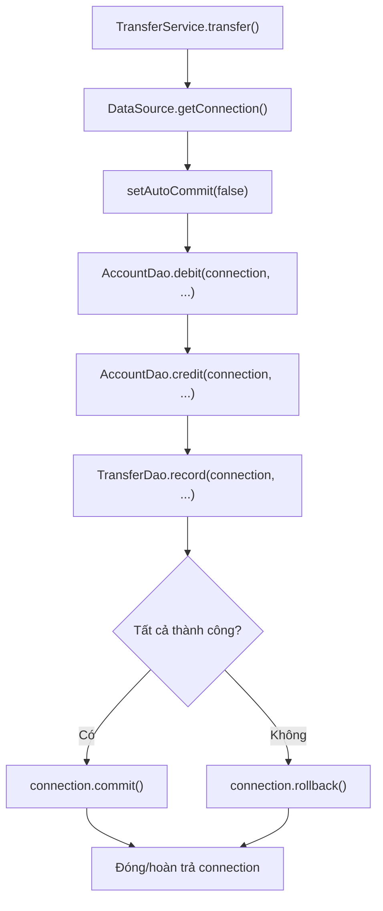

# Thiết kế quyền sở hữu giao dịch khi nhiều DAO được gọi chung

> **Chương:** Giao dịch nâng cao  
> **Ngữ cảnh:** Ứng dụng Java sử dụng **JDBC** với `DataSource`, `Connection`, `PreparedStatement` và `ResultSet` để phối hợp nhiều thao tác CRUD trên cơ sở dữ liệu quan hệ.

Giả sử một yêu cầu chuyển tiền cần gọi `AccountDao` để trừ số dư người gửi, gọi tiếp `AccountDao` để cộng cho người nhận, rồi gọi `TransferDao` để ghi lịch sử. Nếu lần ghi lịch sử thất bại, hai cập nhật số dư phải được **rollback cùng nhau**. Khi mỗi DAO tự mở kết nối, thực hiện SQL và commit, ứng dụng có thể để lại dữ liệu không nhất quán.

Vấn đề cốt lõi là **quyền sở hữu giao dịch (transaction ownership)**: thành phần nào quyết định bắt đầu, commit, rollback và kết thúc giao dịch; thành phần nào chỉ tham gia bằng cách chạy SQL trên kết nối đã được cấp? Với JDBC thuần, một thiết kế rõ ràng thường đặt quyền sở hữu ở **service/use case** điều phối toàn bộ nghiệp vụ, còn DAO chỉ xử lý SQL và mapping dữ liệu.

Bài học hướng dẫn thiết kế hợp đồng đó, triển khai qua nhiều DAO trên **cùng một `Connection`**, xử lý lỗi đúng thứ tự, phân biệt savepoint với transaction lồng nhau và kiểm thử khả năng rollback toàn bộ. Ví dụ dùng Java 17+, JDBC chuẩn và schema PostgreSQL; những khác biệt liên quan đến SQL dialect, isolation, pool và driver được ghi rõ.

## 1. Xác định ranh giới giao dịch từ bất biến nghiệp vụ

Hãy bắt đầu bằng câu hỏi: *Những thay đổi nào phải thành công hoặc thất bại như một đơn vị?*

Với thao tác chuyển tiền nội bộ một cơ sở dữ liệu, các thay đổi liên quan là:

1. Kiểm tra đủ tiền và trừ số dư tài khoản nguồn.
2. Cộng số dư tài khoản đích.
3. Ghi một bản ghi lịch sử chuyển tiền có định danh yêu cầu.
4. Chỉ xác nhận thành công cho client khi toàn bộ thay đổi đã commit.

Nếu bất kỳ thao tác nào thất bại, cơ sở dữ liệu phải trở về trạng thái trước yêu cầu. Vì vậy ranh giới giao dịch bao phủ **cả ba thao tác ghi**, không kết thúc sau từng DAO.

| Cách tổ chức | Điều gì xảy ra nếu DAO ghi lịch sử thất bại? | Đánh giá |
|---|---|---|
| Mỗi DAO mở connection, chạy với `autoCommit=true` | Hai lần cập nhật số dư có thể đã commit | Không đáp ứng tính nguyên tử |
| Mỗi DAO tự mở transaction rồi commit | Các transaction riêng biệt không thể được rollback bởi transaction của service | Không đáp ứng tính nguyên tử |
| Service mở **một connection**, tắt auto-commit, gọi các DAO rồi quyết định commit/rollback | Cả ba SQL statement nằm trong cùng một transaction của DBMS | Mô hình phù hợp |
| Service A gọi một microservice B qua HTTP | Transaction của A không bao trùm database của B | Cần mô hình phân tán, không giải quyết bằng việc truyền JDBC connection |

**Phân biệt phạm vi nghiệp vụ và phạm vi connection.** Một transaction JDBC thông thường gắn với **một connection tới một cơ sở dữ liệu**. Có cùng `DataSource` không đồng nghĩa cùng transaction: hai lần `dataSource.getConnection()` thường nhận hai connection/phiên làm việc khác nhau, kể cả khi cùng dùng một pool.

## 2. Hợp đồng sở hữu: service điều phối, DAO tham gia

Hai vai trò nên được quy định rõ:

| Thành phần | Được làm | Không được tự ý làm trong giao dịch do service sở hữu |
|---|---|---|
| **Service / Unit of Work** | Nhận `Connection` từ `DataSource`, quyết định ranh giới nghiệp vụ, đặt auto-commit, gọi nhiều DAO, `commit`/`rollback`, đóng connection | Giao quyền commit cho một DAO giữa chừng |
| **DAO / Repository** | Nhận connection từ caller, tạo và đóng `PreparedStatement`/`ResultSet`, bind tham số, thực hiện SQL, trả kết quả hoặc ném lỗi | `commit`, `rollback`, `setAutoCommit`, `close` connection được truyền vào |
| **Transaction helper** (nếu có) | Đóng gói cơ chế begin/commit/rollback và cleanup theo chính sách thống nhất | Tự tạo transaction mới cho mỗi lời gọi DAO bên trong cùng một use case |
| **Database** | Thực thi SQL và bảo vệ ràng buộc, khóa, isolation | Không tự hiểu được ranh giới nghiệp vụ nếu ứng dụng commit giữa các bước |

Sơ đồ thực thi:



Một thiết kế DAO tham gia giao dịch có thể thể hiện ngay trong chữ ký:

```java
int debit(Connection connection, long accountId, BigDecimal amount)
        throws SQLException;

int credit(Connection connection, long accountId, BigDecimal amount)
        throws SQLException;

void record(Connection connection, UUID requestId,
            long fromAccountId, long toAccountId, BigDecimal amount)
        throws SQLException;
```

Việc truyền tham chiếu `Connection` làm rõ trách nhiệm: **caller sở hữu**, DAO **mượn** trong thời gian thực hiện phương thức. DAO vẫn tự đóng `PreparedStatement` và `ResultSet` mà nó tạo, vì các resource đó thuộc phạm vi DAO.

**Không giữ `Connection` trong một field singleton của DAO.** `Connection` có trạng thái transaction, không nên dùng đồng thời giữa nhiều request/thread. Đối tượng DAO có thể được tái sử dụng nếu không lưu connection đang hoạt động vào state chia sẻ.

## 3. Cơ sở JDBC: auto-commit, commit, rollback và close

JDBC thường cung cấp connection mới ở chế độ `autoCommit=true`: mỗi SQL statement được commit khi hoàn tất theo quy định của JDBC/driver. Để tạo một transaction trải qua nhiều statement, chủ sở hữu sử dụng:

```java
Connection connection = dataSource.getConnection();

connection.setAutoCommit(false); // Bắt đầu quản lý transaction thủ công.
// ... thực thi SQL trên CHÍNH connection này
connection.commit();            // Hoặc connection.rollback()
connection.close();             // Hoàn trả/đóng connection
```

Đây chỉ là **khung giải thích**, chưa phải code xử lý lỗi an toàn. Những điểm phải nhớ:

- `setAutoCommit(false)` bật chế độ điều khiển commit thủ công; trên nhiều DBMS, transaction thực tế bắt đầu khi chạy statement đầu tiên. Không cần viết SQL `BEGIN` riêng nếu đã điều khiển bằng API JDBC.
- `commit()` xác nhận các thay đổi của transaction hiện hành. DAO không được gọi sớm vì các bước sau sẽ không còn khả năng hủy những thay đổi đã commit.
- `rollback()` yêu cầu hủy các thay đổi chưa commit của transaction hiện hành.
- **`close()` không được dùng thay cho `rollback()`**. Khi đóng connection còn transaction chưa kết thúc, hành vi phụ thuộc implementation/driver/pool; luôn chủ động xử lý transaction trước khi đóng.
- Đổi `setAutoCommit(true)` khi transaction chưa hoàn tất **có thể khiến transaction được commit theo quy định của JDBC**. Vì vậy không bật lại auto-commit bừa bãi trong `finally` nếu rollback đã thất bại hoặc trạng thái connection không xác định.
- Nếu lấy connection từ pool, `close()` trên proxy thường **hoàn trả connection** về pool, không nhất thiết đóng kết nối mạng vật lý. Pool cần có cấu hình/kiểm thử để dọn trạng thái transaction bị lỗi, nhưng service vẫn chịu trách nhiệm gọi rollback và quản lý scope hợp lý.

Một transaction không nên mở rồi đi thực hiện cuộc gọi HTTP chậm, chờ người dùng nhập liệu, gửi email hoặc xử lý CPU kéo dài: thời gian giữ connection và database lock tăng, làm giảm throughput và tăng nguy cơ deadlock. Đưa những việc đó ra ngoài transaction hoặc dùng thiết kế outbox/saga phù hợp.

## 4. Chuẩn bị schema ví dụ

Ví dụ dưới đây giả định thao tác chuyển tiền giữa **hai tài khoản cùng đơn vị tiền tệ**, trong **cùng PostgreSQL database**. Các ràng buộc giữ số dư không âm và phát hiện cùng một `request_id` được ghi lặp:

```sql
CREATE TABLE bank_accounts (
    account_id BIGINT PRIMARY KEY,
    balance NUMERIC(19, 2) NOT NULL CHECK (balance >= 0)
);

CREATE TABLE money_transfers (
    request_id UUID PRIMARY KEY,
    from_account_id BIGINT NOT NULL
        REFERENCES bank_accounts (account_id),
    to_account_id BIGINT NOT NULL
        REFERENCES bank_accounts (account_id),
    amount NUMERIC(19, 2) NOT NULL CHECK (amount > 0),
    CHECK (from_account_id <> to_account_id)
);

INSERT INTO bank_accounts (account_id, balance)
VALUES (101, 1000.00), (202, 300.00);
```

`money_transfers` là lịch sử giao dịch đã được ghi nhận, dùng `request_id` như khóa ổn định của yêu cầu. Nó giúp phát hiện request trùng, **nhưng một khóa duy nhất chưa tự giải quyết mọi trường hợp retry**: client vẫn cần phân biệt request cũ thành công với request mới có payload khác.

Để tránh lỗi cạnh tranh khi hai request đồng thời trừ tiền, DAO không làm theo cách “đọc số dư rồi kiểm tra bằng Java, sau đó UPDATE không điều kiện”. Thay vào đó, SQL trừ tiền gắn luôn điều kiện số dư:

```sql
UPDATE bank_accounts
SET balance = balance - ?
WHERE account_id = ?
  AND balance >= ?;
```

Với `amount > 0` và kiểu `NUMERIC(19,2)`, một hàng được cập nhật khi tài khoản tồn tại và số dư đáp ứng điều kiện tại thời điểm câu SQL thực sự cập nhật. Cơ chế locking/isolation của DBMS chịu trách nhiệm xử lý các cập nhật đồng thời theo quy tắc của nó. Dù đã có ràng buộc `CHECK (balance >= 0)`, điều kiện `balance >= ?` vẫn cho phép báo thất bại nghiệp vụ mà không cần đợi lỗi constraint.

## 5. Triển khai hai DAO tham gia cùng một transaction

Mỗi phương thức sau nhận `Connection` từ caller, dùng `PreparedStatement` và **không gọi commit, rollback hay close trên connection**. Java 17+ và PostgreSQL JDBC được dùng cho ví dụ mã hoàn chỉnh.

```java
import java.math.BigDecimal;
import java.sql.Connection;
import java.sql.PreparedStatement;
import java.sql.SQLException;
import java.util.UUID;

final class AccountDao {

    int debit(Connection connection, long accountId, BigDecimal amount)
            throws SQLException {
        String sql = """
            UPDATE bank_accounts
            SET balance = balance - ?
            WHERE account_id = ? AND balance >= ?
            """;

        try (PreparedStatement ps = connection.prepareStatement(sql)) {
            ps.setBigDecimal(1, amount);
            ps.setLong(2, accountId);
            ps.setBigDecimal(3, amount);
            return ps.executeUpdate();
        }
    }

    int credit(Connection connection, long accountId, BigDecimal amount)
            throws SQLException {
        String sql = """
            UPDATE bank_accounts
            SET balance = balance + ?
            WHERE account_id = ?
            """;

        try (PreparedStatement ps = connection.prepareStatement(sql)) {
            ps.setBigDecimal(1, amount);
            ps.setLong(2, accountId);
            return ps.executeUpdate();
        }
    }
}

final class TransferDao {

    void record(
            Connection connection,
            UUID requestId,
            long fromId,
            long toId,
            BigDecimal amount
    ) throws SQLException {
        String sql = """
            INSERT INTO money_transfers (
                request_id, from_account_id, to_account_id, amount
            ) VALUES (?, ?, ?, ?)
            """;

        try (PreparedStatement ps = connection.prepareStatement(sql)) {
            ps.setObject(1, requestId); // UUID PostgreSQL qua JDBC driver.
            ps.setLong(2, fromId);
            ps.setLong(3, toId);
            ps.setBigDecimal(4, amount);

            if (ps.executeUpdate() != 1) {
                throw new SQLException("Could not record transfer");
            }
        }
    }
}
```

DAO biết cách thao tác dữ liệu và báo số hàng được cập nhật. **Nó không biết** rằng ba SQL statement đang tạo thành nghiệp vụ chuyển tiền; service sẽ quyết định xử lý tình huống mất tài khoản, thiếu số dư hoặc ghi lịch sử thất bại.

Nếu hệ thống cần DAO dùng độc lập ở nơi khác, hãy tạo một service/use case riêng làm chủ transaction tại điểm gọi đó. Tránh thay đổi hành vi DAO thành “tự commit nếu chưa có transaction” vì API như vậy khó xác định ranh giới và dễ gây partial commit.

## 6. Service sở hữu transaction từ đầu đến cuối

`TransferService` nhận request, kiểm tra input, lấy **một** connection từ `DataSource` rồi dùng chính connection đó xuyên suốt `debit`, `credit` và `record`.

Để ví dụ minh họa rõ việc phục hồi connection, code giả định pool trả connection mới với `autoCommit=true`. Đây là một **hợp đồng riêng của service**; nếu ứng dụng đang chạy trong transaction được framework/container quản lý, phải để framework làm chủ ranh giới và không dùng service này để tạo transaction thủ công bên trong.

```java
import java.math.BigDecimal;
import java.math.RoundingMode;
import java.sql.Connection;
import java.sql.SQLException;
import java.util.Objects;
import java.util.UUID;
import javax.sql.DataSource;

record TransferRequest(
    UUID requestId,
    long fromAccountId,
    long toAccountId,
    BigDecimal amount
) {}

public final class TransferService {
    private final DataSource dataSource;
    private final AccountDao accountDao = new AccountDao();
    private final TransferDao transferDao = new TransferDao();

    public TransferService(DataSource dataSource) {
        this.dataSource = Objects.requireNonNull(dataSource);
    }

    public void transfer(TransferRequest request) throws SQLException {
        Objects.requireNonNull(request, "request");
        Objects.requireNonNull(request.requestId(), "requestId");

        BigDecimal amount = Objects.requireNonNull(
            request.amount(), "amount"
        ).setScale(2, RoundingMode.UNNECESSARY);

        if (amount.signum() <= 0) {
            throw new IllegalArgumentException("amount must be positive");
        }
        if (request.fromAccountId() == request.toAccountId()) {
            throw new IllegalArgumentException("accounts must differ");
        }

        try (Connection connection = dataSource.getConnection()) {
            // Chỉ nhận connection chưa nằm trong transaction của caller.
            if (!connection.getAutoCommit()) {
                throw new SQLException("Expected autoCommit=true");
            }

            connection.setAutoCommit(false);
            boolean transactionEnded = false;
            Throwable primaryFailure = null;

            try {
                int debited = accountDao.debit(
                    connection, request.fromAccountId(), amount
                );
                if (debited != 1) {
                    throw new IllegalStateException(
                        "Source account absent or insufficient funds"
                    );
                }

                int credited = accountDao.credit(
                    connection, request.toAccountId(), amount
                );
                if (credited != 1) {
                    throw new IllegalStateException(
                        "Destination account absent"
                    );
                }

                transferDao.record(
                    connection,
                    request.requestId(),
                    request.fromAccountId(),
                    request.toAccountId(),
                    amount
                );

                // Chỉ service quyết định kết thúc transaction.
                connection.commit();
                transactionEnded = true;

            } catch (SQLException | RuntimeException | Error failure) {
                primaryFailure = failure;

                try {
                    connection.rollback();
                    transactionEnded = true;
                } catch (SQLException rollbackFailure) {
                    failure.addSuppressed(rollbackFailure);
                }

                throw failure;

            } finally {
                // Chỉ phục hồi auto-commit khi commit hoặc rollback
                // đã hoàn tất; bật lại sớm có thể commit phần còn lại.
                if (transactionEnded) {
                    try {
                        connection.setAutoCommit(true);
                    } catch (SQLException resetFailure) {
                        if (primaryFailure != null) {
                            primaryFailure.addSuppressed(resetFailure);
                        } else {
                            throw resetFailure;
                        }
                    }
                }
            }
            // try-with-resources đóng hoặc trả connection về pool.
        }
    }
}
```

Ví dụ gọi service:

```java
TransferService service = new TransferService(dataSource);

// Tạo ID một lần cho yêu cầu, giữ lại để đối soát khi timeout.
UUID requestId = UUID.randomUUID();
TransferRequest request = new TransferRequest(
    requestId, 101L, 202L, new BigDecimal("125.50")
);

service.transfer(request);
```

Sau khi commit thành công, trạng thái mong đợi từ dữ liệu thử là:

| Bảng/hàng | Trước | Sau |
|---|---:|---:|
| `bank_accounts`, ID 101 | `1000.00` | `874.50` |
| `bank_accounts`, ID 202 | `300.00` | `425.50` |
| `money_transfers` với `request_id` vừa tạo | Chưa có | Được thêm một hàng với `amount = 125.50` |

Ở ví dụ này, `setScale(2, UNNECESSARY)` tránh việc Java âm thầm làm tròn số tiền có nhiều hơn hai chữ số thập phân. Trong ứng dụng thực tế, quy tắc tiền tệ, định danh tài khoản, phân quyền và phân biệt “không tồn tại” với “không đủ tiền” cần được mô hình hóa rõ hơn; chúng không thay đổi nguyên tắc **một transaction do service sở hữu**.

### Phân tích nhánh lỗi

- Nếu `debit` trả `0` vì không có tài khoản hoặc thiếu tiền, service ném exception và rollback.
- Nếu đã trừ tiền nhưng `credit` trả `0`, rollback hủy cả khoản trừ.
- Nếu cập nhật hai số dư xong nhưng `money_transfers` vi phạm `PRIMARY KEY`/`FOREIGN KEY`, `SQLException` khiến rollback cả hai update.
- Nếu mọi câu SQL thành công nhưng `commit()` thất bại, service thử rollback và báo lỗi. **Client không thể suy ra chắc chắn transaction đã hay chưa được commit chỉ từ lỗi đường truyền ở thời điểm commit**; cần đối soát bằng `request_id` trước khi retry.
- Nếu `rollback()` cũng thất bại, mã giữ lỗi rollback dưới dạng *suppressed exception* và **không gọi `setAutoCommit(true)`** khi trạng thái transaction chưa xác định. Connection được đóng/trả pool; phải dựa vào pool/driver để loại bỏ hoặc reset connection lỗi theo cấu hình thực tế.
- Nếu thao tác khôi phục auto-commit thất bại **sau khi commit đã thành công**, caller cũng có thể nhận `SQLException`. Điều đó không có nghĩa dữ liệu chưa lưu: cần xử lý trạng thái kết quả không chắc chắn như trường hợp lỗi ở ranh giới commit.

### Ai đóng resource?

| Resource | Nơi tạo | Nơi đóng |
|---|---|---|
| `Connection` | `TransferService` lấy từ `DataSource` | `TransferService` qua try-with-resources |
| `PreparedStatement` để trừ/cộng số dư | `AccountDao` | `AccountDao` qua try-with-resources |
| `PreparedStatement` để ghi lịch sử | `TransferDao` | `TransferDao` qua try-with-resources |
| `ResultSet`, nếu có câu `SELECT` | DAO thực hiện câu `SELECT` | DAO đó qua try-with-resources |

Không đóng connection trong DAO vì DAO không sở hữu nó. Trả connection về pool giữa hai câu `UPDATE` sẽ phá vỡ tính nguyên tử của nghiệp vụ.

## 7. Những cách triển khai gây lỗi và cách nhận diện

### Lỗi 1: mỗi DAO tự lấy connection

```java
// Không phù hợp cho use case cần một transaction xuyên nhiều DAO.
void debitWrong(DataSource dataSource, long accountId, BigDecimal amount)
        throws SQLException {
    try (Connection connection = dataSource.getConnection()) {
        // Statement có thể được auto-commit ngay.
        // UPDATE bank_accounts SET balance = balance - ? ...
    }
}
```

Dù `debitWrong()` và `creditWrong()` dùng cùng `DataSource`, chúng **không** cùng transaction. Cách sửa là truyền connection do service sở hữu vào từng DAO.

### Lỗi 2: DAO tự commit

```java
void recordWrong(Connection connection) throws SQLException {
    // INSERT money_transfers ...
    connection.commit(); // DAO kết thúc transaction của caller!
}
```

Một DAO không biết còn bao nhiêu bước service sẽ gọi tiếp. Nếu nó commit, service không thể rollback các bước vừa được xác nhận khi bước sau thất bại.

### Lỗi 3: DAO đóng connection được mượn

```java
void updateWrong(Connection connection) throws SQLException {
    try (Connection borrowed = connection) {
        // UPDATE ...
    } // borrowed.close() cũng đóng handle do service đang sở hữu.
}
```

Chỉ đóng statement/result set trong DAO. `Connection` được truyền vào là tài nguyên **mượn**, không chuyển quyền sở hữu.

### Lỗi 4: che giấu lỗi rồi cho service commit

```java
void writeWrong(Connection connection) {
    try {
        // Thực thi INSERT/UPDATE bằng PreparedStatement.
    } catch (SQLException exception) {
        System.err.println(exception.getMessage());
        // Không báo thất bại cho service.
    }
}
```

Nếu DAO nuốt exception, service có thể gọi `commit()` dù thao tác thiết yếu đã lỗi. Với một số DBMS như PostgreSQL, transaction còn có thể bị đánh dấu lỗi và các lệnh sau thất bại cho đến khi rollback. DAO nên **ném lỗi hoặc trả kết quả được service kiểm tra rõ ràng**, không lặng lẽ chuyển thất bại thành thành công.

### Lỗi 5: service lồng nhau tự mở transaction khác

```text
CheckoutService.checkout()
  ├─ InventoryService.reserve()  -> connection A, commit
  └─ OrderService.create()        -> connection B, lỗi, rollback
```

Khi cả hai service tự sở hữu transaction, transaction ngoài không thể rollback phần đã commit ở connection A. Với nhiều use case lồng nhau, hãy thiết kế tách **phương thức điều phối transaction** khỏi **phương thức tham gia transaction** (nhận `Connection`/unit of work), hoặc dùng một transaction manager có propagation rõ ràng. Không áp dụng `setAutoCommit(false)` bừa bãi trong phương thức service được gọi lồng.

## 8. Savepoint là rollback từng phần, không phải transaction độc lập

Đôi khi một thao tác **không bắt buộc** có thể được thử trong transaction chính: ví dụ ghi một ghi chú phụ, nếu thất bại thì vẫn cho phép lưu hóa đơn. Nếu DBMS và driver hỗ trợ savepoint, **chủ sở hữu transaction** có thể chủ động đánh dấu điểm khôi phục:

```java
import java.sql.Connection;
import java.sql.Savepoint;
import java.sql.SQLException;

void writeOptionalNote(Connection connection, NoteDao noteDao)
        throws SQLException {
    Savepoint mark = connection.setSavepoint();

    try {
        noteDao.insert(connection); // DAO không tạo transaction riêng.
        connection.releaseSavepoint(mark);
    } catch (SQLException noteFailure) {
        connection.rollback(mark);
        // Ghi nhận lỗi phù hợp và tiếp tục công việc được phép.
        // Nếu rollback đến savepoint thất bại, exception được ném lên.
    }
}
```

**Điều kiện tiên quyết:** `connection` đang trong transaction thủ công (`autoCommit=false`), driver/DBMS hỗ trợ savepoint, và ghi chú thật sự là bước **không bắt buộc** theo hợp đồng nghiệp vụ. Có thể kiểm tra `connection.getMetaData().supportsSavepoints()` trước khi dùng nếu cần tương thích nhiều hệ quản trị.

Savepoint **không phải transaction lồng nhau có commit riêng**:

- `rollback(savepoint)` chỉ hủy phần thay đổi sau savepoint trong cùng một transaction.
- `releaseSavepoint(savepoint)` bỏ mốc khôi phục, **không commit** dữ liệu đã ghi sau mốc.
- Nếu transaction ngoài rollback, các thay đổi “đã qua savepoint” cũng rollback.
- Không dùng savepoint để bỏ qua lỗi của bước bắt buộc như trừ tiền hoặc ghi lịch sử chuyển tiền. Với nghiệp vụ phải nguyên tử, lỗi nào cũng phải rollback toàn transaction.

Một số ràng buộc, DDL hoặc tài nguyên không hoạt động giống nhau dưới savepoint trên mọi DBMS. Cần kiểm thử logic rollback từng phần bằng database/driver mục tiêu.

## 9. Isolation, khóa và đồng thời: quyền sở hữu cũng bao gồm chính sách giao dịch

Một connection cho phép đặt mức isolation bằng `setTransactionIsolation()`; ví dụ:

```java
try (Connection connection = dataSource.getConnection()) {
    // Cấu hình trên connection sạch, trước khi chạy SQL của transaction.
    connection.setTransactionIsolation(Connection.TRANSACTION_READ_COMMITTED);
    connection.setAutoCommit(false);
    // Các DAO sẽ dùng cùng connection và cùng mức isolation này.
}
```

Đoạn trên **chỉ minh họa cấu hình**, không phải transaction hoàn chỉnh vì chưa có xử lý commit/rollback. Với code thật, nên gộp cùng cơ chế cleanup ở mục 6, khôi phục isolation và `readOnly` theo hợp đồng pool sau khi transaction kết thúc; đừng đổi chúng giữa chừng khi đã thực thi SQL.

Mức isolation ảnh hưởng những gì một DAO nhìn thấy từ giao dịch khác, ví dụ non-repeatable read, phantom và serialization conflict. Tuy nhiên, **isolation không thay thế việc gom nhiều DAO vào cùng transaction**. Ngay cả `SERIALIZABLE` cũng không cứu được use case đã chia thành hai transaction độc lập và commit riêng.

Ở ví dụ chuyển tiền, các câu cập nhật số dư dùng điều kiện trực tiếp trong SQL. Nhưng nếu hai chuyển tiền đối chiều cập nhật hai hàng theo thứ tự ngược nhau, vẫn có thể phát sinh **deadlock**. Có thể giảm rủi ro bằng chính sách khóa tài khoản theo thứ tự cố định trước khi thay đổi (theo cơ chế DBMS, ví dụ PostgreSQL `SELECT ... FOR UPDATE`) hoặc chiến lược tương đương; đồng thời phải xử lý deadlock/serialization failure theo chính sách retry có giới hạn.

Một quy trình khóa có thể được thiết kế như sau:

```sql
-- Ví dụ riêng cho PostgreSQL, thực thi trong transaction trước UPDATE.
SELECT account_id
FROM bank_accounts
WHERE account_id IN (?, ?)
ORDER BY account_id
FOR UPDATE;
```

Phải xác minh tìm thấy đủ hai tài khoản và đảm bảo mọi luồng chuyển tiền tuân thủ cùng quy tắc khóa. Chỉ xác định thứ tự trong code mà không thực sự kiểm soát khóa DBMS chưa đủ để khẳng định không có deadlock.

**Thread ownership:** Một `Connection` đang mang transaction không nên được chia cho các luồng chạy song song. Chạy hai DAO bất đồng bộ với cùng connection có thể đan xen SQL và làm thứ tự commit/rollback khó kiểm soát. Nếu cần xử lý song song, chỉ tách các công việc độc lập ngoài transaction hoặc thiết kế cơ chế phối hợp phù hợp, không dùng connection như tài nguyên thread-safe mặc định.

## 10. Retry, idempotency và trạng thái commit không chắc chắn

Một transaction có thể thất bại do lỗi tạm thời như deadlock, serialization conflict hoặc mất kết nối. Nhưng **không phải mọi `SQLException` đều có thể retry**:

| Tình huống | Xử lý ưu tiên |
|---|---|
| Thiếu số dư, không tồn tại tài khoản | Báo thất bại nghiệp vụ; không retry mù |
| Trùng `request_id` | Kiểm tra yêu cầu cũ và đối chiếu payload/kết quả; không tạo một chuyển tiền mới |
| Deadlock hoặc serialization failure | Cân nhắc retry **toàn bộ transaction** trên connection mới, với số lần và backoff giới hạn |
| Mất kết nối trong/đúng lúc `commit()` | Đối soát trạng thái bằng định danh yêu cầu ổn định trước khi quyết định retry |
| Vi phạm constraint khác | Phân tích nguyên nhân; không đổi ID hoặc chạy lại vô hạn |

Trong PostgreSQL, SQLSTATE `40P01` thường chỉ deadlock detected, `40001` là serialization failure và `23505` là unique violation. Những mã này **là thông tin đặc thù DBMS**; khi dùng driver/hệ quản trị khác, phải dùng quy ước lỗi của hệ đó.

Ví dụ luồng idempotency cho `TransferRequest.requestId()`:

1. Client/service tạo `requestId` **một lần** và giữ nguyên cho mọi lần gửi lại cùng yêu cầu.
2. Câu `INSERT money_transfers` dùng `request_id` làm `PRIMARY KEY`, đảm bảo chỉ một giao dịch có thể chèn cùng ID.
3. Nếu nhận lỗi trùng ID hoặc lỗi không rõ kết quả commit, đọc lại `money_transfers` theo `request_id` trên một connection/transaction mới.
4. So sánh `from_account_id`, `to_account_id`, `amount` và thông tin định danh liên quan; nếu trùng với yêu cầu đã thành công, có thể trả lại kết quả cũ theo hợp đồng API. Nếu không trùng, báo xung đột.
5. Nếu xác minh chưa có bản ghi và điều kiện retry phù hợp, thực hiện lại **toàn bộ** use case với **cùng requestId**; không chỉ chạy lại `credit` hoặc `record`.

Để tránh kết luận từ dữ liệu còn chưa visible do một transaction khác đang chạy, việc xử lý retry/idempotency trong hệ thống thực cần quy tắc rõ về timeout, visibility, isolation và cách chờ/khóa cùng request key.

Nếu thao tác nghiệp vụ bao gồm gửi email, gọi thanh toán ngoài hoặc phát sự kiện tới broker, những hệ thống đó **không tự tham gia vào transaction JDBC**. Có thể áp dụng **transactional outbox**: ghi trạng thái và một hàng outbox trên **cùng connection/transaction**, commit xong mới có worker phát sự kiện ra ngoài, kèm cơ chế xử lý trùng. Không gửi yêu cầu ra bên ngoài rồi giả định `connection.rollback()` có thể hoàn tác nó.

## 11. Khi dùng framework quản lý transaction

Trong ứng dụng Spring hoặc môi trường Jakarta EE/JTA, transaction thường được quản lý bằng interceptor/transaction manager. Khi đó hợp đồng ownership thay đổi: **framework/container** là chủ giao dịch và DAO tham gia qua connection gắn với ngữ cảnh giao dịch theo cơ chế cấu hình phù hợp.

Ví dụ ý tưởng với Spring:

```java
// Chỉ minh họa: Spring quản lý transaction và hai DAO
// phải dùng DataSource/transaction manager đã cấu hình đúng.
@Transactional
public void transfer(TransferRequest request) {
    accountDao.debit(...);
    accountDao.credit(...);
    transferDao.record(...);
}
```

Không thể suy ra transaction chỉ bằng việc thêm annotation vào bất kỳ phương thức nào: cần đảm bảo bean được proxy/áp dụng interceptor, phương thức được gọi qua proxy theo cấu hình, DAO lấy connection transaction-aware, và chính sách rollback cho checked exception phù hợp. Ví dụ Spring thường rollback mặc định với `RuntimeException`/`Error`; `SQLException` là checked exception nên phải cấu hình `rollbackFor` hoặc cách xử lý tương ứng khi cần rollback.

**Không tự gọi `dataSource.getConnection()` và `setAutoCommit(false)` ở nơi framework đã làm chủ**, trừ khi đã chủ ý dùng API phù hợp với transaction manager. Một connection độc lập lấy trực tiếp từ pool có thể không tham gia transaction framework đang điều phối. Ngược lại, khi dùng JDBC thuần không có transaction manager, việc truyền `Connection` vào DAO như ví dụ là một hợp đồng rõ ràng và dễ kiểm thử.

Một hệ thống gọi nhiều database riêng biệt hoặc nhiều dịch vụ cần giải pháp rộng hơn một transaction JDBC local: XA/JTA nếu yêu cầu và hạ tầng hỗ trợ, hoặc outbox/saga với bù trừ và idempotency. Phạm vi bài này là **nhiều DAO cùng thao tác trên một database/connection**.

## 12. Kiểm thử ranh giới transaction và giao diện DAO

Kiểm thử quan trọng nhất là **integration test với database thật hoặc môi trường tương đương**, vì mock DAO không chứng minh được commit/rollback và mức isolation của database.

| Tình huống kiểm thử | Cách tạo tình huống | Kết quả phải quan sát |
|---|---|---|
| Tất cả DAO thành công | Chuyển `125.50` từ tài khoản 101 sang 202 | Hai số dư đổi đúng và có đúng một hàng lịch sử |
| Lỗi ngay tại DAO đầu | Số dư không đủ | Không đổi số dư, không có hàng lịch sử |
| Lỗi tại DAO thứ hai | Tài khoản đích không tồn tại | Khoản đã trừ ở bước đầu **được rollback** |
| Lỗi tại DAO cuối | Dùng `request_id` đã tồn tại hoặc tạo vi phạm FK | Hai số dư được giữ nguyên |
| Concurrent debit | Hai yêu cầu cùng rút gần hết số dư | Không có số dư âm; các kết quả phù hợp với cập nhật nguyên tử |
| Cập nhật ngược chiều | Hai transfer đồng thời A→B và B→A | Có thể xảy ra deadlock; kiểm tra retry giới hạn và toàn vẹn dữ liệu |
| Commit không rõ kết quả | Giả lập sự cố kết nối gần thời điểm commit | Dùng `request_id` để đối soát; tránh ghi hai lần |
| DAO gọi ngoài service | Gọi trên connection do test sở hữu, rollback sau thao tác | DAO **không tự commit** và không đóng connection của caller |

Ví dụ kiểm tra trạng thái sau khi cố chuyển tới tài khoản không tồn tại:

```sql
SELECT account_id, balance
FROM bank_accounts
WHERE account_id IN (101, 202)
ORDER BY account_id;

SELECT request_id, from_account_id, to_account_id, amount
FROM money_transfers
ORDER BY request_id;
```

Nếu `TransferService` đã trừ tiền ở bước đầu rồi bước cộng tiền thất bại, sau rollback mọi số dư phải trở về đúng giá trị trước yêu cầu, và không có lịch sử của yêu cầu lỗi.

Để kiểm thử đường đi lỗi đáng tin cậy, không cần sửa DAO để nuốt exception; hãy tạo dữ liệu đầu vào gây lỗi constraint hoặc cấu hình một điểm chèn lỗi kiểm thử trong service, sau đó **đối chiếu dữ liệu đã lưu trong database**.

### Bài thực hành

1. Tạo schema và dữ liệu mẫu ở mục 4. Chạy `TransferService.transfer()` với request mới, kiểm tra hai số dư và hàng trong `money_transfers`.
2. Thay tài khoản đích bằng một ID không tồn tại. Chứng minh bằng `SELECT` rằng khoản trừ trước đó không còn sau khi service rollback.
3. Viết một phiên bản DAO tự `getConnection()` rồi commit, chạy lại kịch bản lỗi ở bước 2. Giải thích vì sao xuất hiện partial commit và sửa lại bằng cách truyền chung connection.
4. Đặt `connection.commit()` vào `AccountDao.credit()` trong môi trường thử nghiệm. Quan sát vì sao lỗi ghi lịch sử không thể hoàn tác hai lần cập nhật số dư.
5. Thêm một tác vụ ghi chú **không bắt buộc** sau bước ghi lịch sử; thử `Savepoint` để rollback riêng ghi chú. Giải thích tại sao savepoint không cho phép commit riêng một DAO.
6. Chạy hai request đồng thời liên quan cùng hai tài khoản, kiểm thử tính đúng đắn của số dư, xử lý deadlock và chính sách retry toàn transaction.
7. Thiết kế một helper `inTransaction(ConnectionWork<T>)` hoặc cơ chế unit of work để dùng lại ranh giới service; nêu rõ ai mở, commit, rollback, phục hồi trạng thái và đóng connection.

**Tiêu chí hoàn thành:** người học chỉ rõ được một chủ sở hữu transaction cho mỗi use case JDBC; truyền chung một connection cho các DAO tham gia; đảm bảo commit/rollback đúng khi DAO bất kỳ thất bại; phân biệt close, auto-commit, savepoint và transaction lồng nhau; đồng thời thiết kế được kiểm thử và chiến lược xử lý retry/idempotency phù hợp với ranh giới giao dịch.
